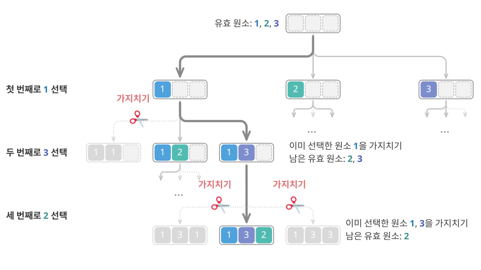
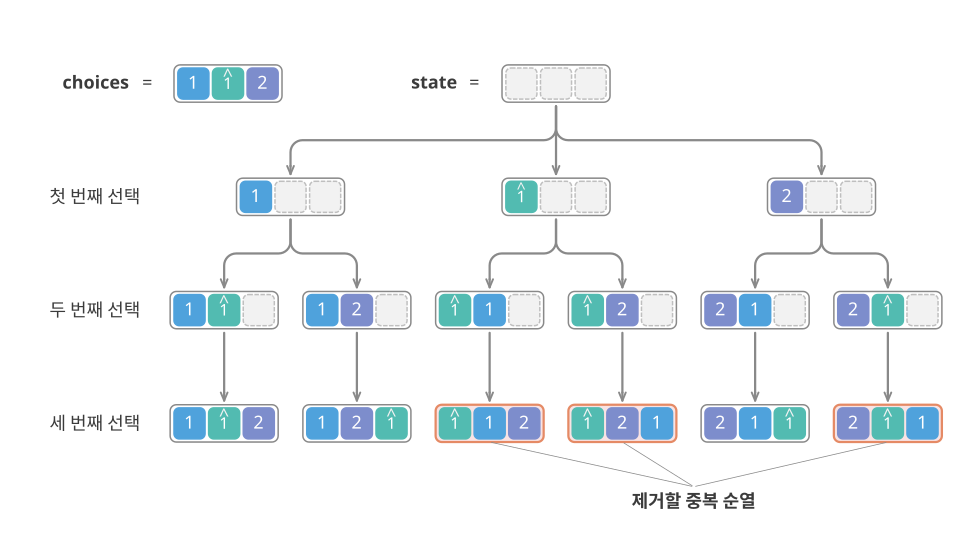
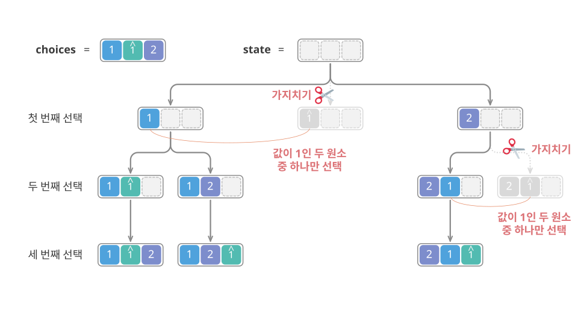

# 13.2 &nbsp; 순열 문제

모든 순열을 구하는 문제는 백트래킹의 대표적인 응용 예이다. 배열이나 문자열처럼 원소들의 모음이 주어질 때 원소를 배치하는 가능한 모든 순서를 찾는 문제이다.

아래 표(13-2)는 몇 가지 입력 배열과 각 배열의 모든 순열을 보여 준다.

<p align="center"> 표 13-2 &nbsp; 순열 예시 </p>

<div class="center-table" markdown>

| 입력 배열    | 모든 순열                                                           |
| :---------- | :----------------------------------------------------------------- |
| $[1]$       | $[1]$                                                              |
| $[1, 2]$    | $[1, 2], [2, 1]$                                                   |
| $[1, 2, 3]$ | $[1, 2, 3], [1, 3, 2], [2, 1, 3], [2, 3, 1], [3, 1, 2], [3, 2, 1]$ |

</div>

## 13.2.1 &nbsp; 값이 같은 원소가 없는 경우

!!! question

    중복 원소가 없는 정수 배열이 주어질 때 가능한 모든 순열을 반환하라.

백트래킹의 관점에서 **순열을 만드는 과정은 연속된 선택의 결과로 볼 수 있다**. 입력 배열이 $[1, 2, 3]$일 때 먼저 $1$을 선택하고 이어서 $3$, 마지막으로 $2$를 선택하면 순열 $[1, 3, 2]$를 얻는다. 되돌리기는 선택 하나를 취소하는 것이며, 그 뒤에는 다른 선택을 시도한다.

코드에서 후보 집합 `choices`는 입력 배열의 모든 원소이고 상태 `state`는 지금까지 선택한 원소들이다. 각 원소를 한 번만 선택할 수 있으므로 **`state`에는 같은 원소가 두 번 들어갈 수 없다**.

아래 그림(13-5)처럼 탐색 과정을 재귀 트리로 펼치면 각 노드는 현재 상태 `state`를 나타낸다. 루트에서 출발해 세 번 선택하면 리프 노드에 도달하며, 리프 노드 하나가 순열 하나에 대응한다.

{ class="animation-figure" }

<p align="center"> 그림 13-5 &nbsp; 모든 순열의 재귀 트리 </p>

### 1. &nbsp; 같은 원소의 중복 선택 가지치기

각 원소를 한 번만 선택하도록 불리언 배열 `selected`를 도입한다. `selected[i]`는 `choices[i]`를 이미 선택했는지 나타낸다. 이를 바탕으로 다음과 같이 가지치기한다.

- `choices[i]`를 선택하면 `selected[i]`에 $\text{True}$를 대입해 이미 선택했다고 표시한다.
- 선택지 리스트 `choices`를 순회할 때 이미 선택한 노드는 모두 건너뛴다. 이것이 가지치기다.

아래 그림(13-6)처럼 첫 번째로 1, 두 번째로 3, 세 번째로 2를 선택한다고 하자. 두 번째 선택에서는 1로 가는 가지를, 세 번째 선택에서는 1과 3으로 가는 가지를 잘라 내야 한다.

{ class="animation-figure" }

<p align="center"> 그림 13-6 &nbsp; 순열 생성 시 가지치기 예시 </p>

그림에서 볼 수 있듯 이 가지치기는 탐색 공간의 크기를 $O(n^n)$에서 $O(n!)$로 줄인다.

### 2. &nbsp; 코드 구현

이제 기본 코드 구조의 빈칸을 채울 수 있다. 코드를 간결하게 유지하기 위해 각 함수를 따로 구현하지 않고 그 내용을 `backtrack()` 함수 안에 직접 작성한다.

=== "Python"

    ```python title="permutations_i.py"
    def backtrack(
        state: list[int], choices: list[int], selected: list[bool], res: list[list[int]]
    ):
        """백트래킹: 순열 I"""
        # 상태의 길이가 원소 개수와 같으면 해를 기록한다
        if len(state) == len(choices):
            res.append(list(state))
            return
        # 모든 선택지를 순회한다
        for i, choice in enumerate(choices):
            # 가지치기: 이미 선택한 원소는 다시 선택하지 않는다
            if not selected[i]:
                # 시도: 하나를 선택하고 상태를 갱신한다
                selected[i] = True
                state.append(choice)
                # 다음 선택을 진행한다
                backtrack(state, choices, selected, res)
                # 되돌리기: 선택을 취소하고 이전 상태를 복원한다
                selected[i] = False
                state.pop()

    def permutations_i(nums: list[int]) -> list[list[int]]:
        """순열 I"""
        res = []
        backtrack(state=[], choices=nums, selected=[False] * len(nums), res=res)
        return res
    ```

=== "C++"

    ```cpp title="permutations_i.cpp"
    /* 백트래킹: 순열 I */
    void backtrack(vector<int> &state, const vector<int> &choices, vector<bool> &selected, vector<vector<int>> &res) {
        // 상태의 길이가 원소 개수와 같으면 해를 기록한다
        if (state.size() == choices.size()) {
            res.push_back(state);
            return;
        }
        // 모든 선택지를 순회한다
        for (int i = 0; i < choices.size(); i++) {
            int choice = choices[i];
            // 가지치기: 이미 선택한 원소는 다시 선택하지 않는다
            if (!selected[i]) {
                // 시도: 하나를 선택하고 상태를 갱신한다
                selected[i] = true;
                state.push_back(choice);
                // 다음 선택을 진행한다
                backtrack(state, choices, selected, res);
                // 되돌리기: 선택을 취소하고 이전 상태를 복원한다
                selected[i] = false;
                state.pop_back();
            }
        }
    }

    /* 순열 I */
    vector<vector<int>> permutationsI(vector<int> nums) {
        vector<int> state;
        vector<bool> selected(nums.size(), false);
        vector<vector<int>> res;
        backtrack(state, nums, selected, res);
        return res;
    }
    ```

=== "Java"

    ```java title="permutations_i.java"
    /* 백트래킹: 순열 I */
    void backtrack(List<Integer> state, int[] choices, boolean[] selected, List<List<Integer>> res) {
        // 상태의 길이가 원소 개수와 같으면 해를 기록한다
        if (state.size() == choices.length) {
            res.add(new ArrayList<Integer>(state));
            return;
        }
        // 모든 선택지를 순회한다
        for (int i = 0; i < choices.length; i++) {
            int choice = choices[i];
            // 가지치기: 이미 선택한 원소는 다시 선택하지 않는다
            if (!selected[i]) {
                // 시도: 하나를 선택하고 상태를 갱신한다
                selected[i] = true;
                state.add(choice);
                // 다음 선택을 진행한다
                backtrack(state, choices, selected, res);
                // 되돌리기: 선택을 취소하고 이전 상태를 복원한다
                selected[i] = false;
                state.remove(state.size() - 1);
            }
        }
    }

    /* 순열 I */
    List<List<Integer>> permutationsI(int[] nums) {
        List<List<Integer>> res = new ArrayList<List<Integer>>();
        backtrack(new ArrayList<Integer>(), nums, new boolean[nums.length], res);
        return res;
    }
    ```

=== "C#"

    ```csharp title="permutations_i.cs"
    /* 백트래킹: 순열 I */
    void Backtrack(List<int> state, int[] choices, bool[] selected, List<List<int>> res) {
        // 상태의 길이가 원소 개수와 같으면 해를 기록한다
        if (state.Count == choices.Length) {
            res.Add(new List<int>(state));
            return;
        }
        // 모든 선택지를 순회한다
        for (int i = 0; i < choices.Length; i++) {
            int choice = choices[i];
            // 가지치기: 이미 선택한 원소는 다시 선택하지 않는다
            if (!selected[i]) {
                // 시도: 하나를 선택하고 상태를 갱신한다
                selected[i] = true;
                state.Add(choice);
                // 다음 선택을 진행한다
                Backtrack(state, choices, selected, res);
                // 되돌리기: 선택을 취소하고 이전 상태를 복원한다
                selected[i] = false;
                state.RemoveAt(state.Count - 1);
            }
        }
    }

    /* 순열 I */
    List<List<int>> PermutationsI(int[] nums) {
        List<List<int>> res = [];
        Backtrack([], nums, new bool[nums.Length], res);
        return res;
    }
    ```

=== "Go"

    ```go title="permutations_i.go"
    /* 백트래킹: 순열 I */
    func backtrackI(state *[]int, choices *[]int, selected *[]bool, res *[][]int) {
        // 상태의 길이가 원소 개수와 같으면 해를 기록한다
        if len(*state) == len(*choices) {
            newState := append([]int{}, *state...)
            *res = append(*res, newState)
        }
        // 모든 선택지를 순회한다
        for i := 0; i < len(*choices); i++ {
            choice := (*choices)[i]
            // 가지치기: 이미 선택한 원소는 다시 선택하지 않는다
            if !(*selected)[i] {
                // 시도: 하나를 선택하고 상태를 갱신한다
                (*selected)[i] = true
                *state = append(*state, choice)
                // 다음 선택을 진행한다
                backtrackI(state, choices, selected, res)
                // 되돌리기: 선택을 취소하고 이전 상태를 복원한다
                (*selected)[i] = false
                *state = (*state)[:len(*state)-1]
            }
        }
    }

    /* 순열 I */
    func permutationsI(nums []int) [][]int {
        res := make([][]int, 0)
        state := make([]int, 0)
        selected := make([]bool, len(nums))
        backtrackI(&state, &nums, &selected, &res)
        return res
    }
    ```

=== "Swift"

    ```swift title="permutations_i.swift"
    /* 백트래킹: 순열 I */
    func backtrack(state: inout [Int], choices: [Int], selected: inout [Bool], res: inout [[Int]]) {
        // 상태의 길이가 원소 개수와 같으면 해를 기록한다
        if state.count == choices.count {
            res.append(state)
            return
        }
        // 모든 선택지를 순회한다
        for (i, choice) in choices.enumerated() {
            // 가지치기: 이미 선택한 원소는 다시 선택하지 않는다
            if !selected[i] {
                // 시도: 하나를 선택하고 상태를 갱신한다
                selected[i] = true
                state.append(choice)
                // 다음 선택을 진행한다
                backtrack(state: &state, choices: choices, selected: &selected, res: &res)
                // 되돌리기: 선택을 취소하고 이전 상태를 복원한다
                selected[i] = false
                state.removeLast()
            }
        }
    }

    /* 순열 I */
    func permutationsI(nums: [Int]) -> [[Int]] {
        var state: [Int] = []
        var selected = Array(repeating: false, count: nums.count)
        var res: [[Int]] = []
        backtrack(state: &state, choices: nums, selected: &selected, res: &res)
        return res
    }
    ```

=== "JS"

    ```javascript title="permutations_i.js"
    /* 백트래킹: 순열 I */
    function backtrack(state, choices, selected, res) {
        // 상태의 길이가 원소 개수와 같으면 해를 기록한다
        if (state.length === choices.length) {
            res.push([...state]);
            return;
        }
        // 모든 선택지를 순회한다
        choices.forEach((choice, i) => {
            // 가지치기: 이미 선택한 원소는 다시 선택하지 않는다
            if (!selected[i]) {
                // 시도: 하나를 선택하고 상태를 갱신한다
                selected[i] = true;
                state.push(choice);
                // 다음 선택을 진행한다
                backtrack(state, choices, selected, res);
                // 되돌리기: 선택을 취소하고 이전 상태를 복원한다
                selected[i] = false;
                state.pop();
            }
        });
    }

    /* 순열 I */
    function permutationsI(nums) {
        const res = [];
        backtrack([], nums, Array(nums.length).fill(false), res);
        return res;
    }
    ```

=== "TS"

    ```typescript title="permutations_i.ts"
    /* 백트래킹: 순열 I */
    function backtrack(
        state: number[],
        choices: number[],
        selected: boolean[],
        res: number[][]
    ): void {
        // 상태의 길이가 원소 개수와 같으면 해를 기록한다
        if (state.length === choices.length) {
            res.push([...state]);
            return;
        }
        // 모든 선택지를 순회한다
        choices.forEach((choice, i) => {
            // 가지치기: 이미 선택한 원소는 다시 선택하지 않는다
            if (!selected[i]) {
                // 시도: 하나를 선택하고 상태를 갱신한다
                selected[i] = true;
                state.push(choice);
                // 다음 선택을 진행한다
                backtrack(state, choices, selected, res);
                // 되돌리기: 선택을 취소하고 이전 상태를 복원한다
                selected[i] = false;
                state.pop();
            }
        });
    }

    /* 순열 I */
    function permutationsI(nums: number[]): number[][] {
        const res: number[][] = [];
        backtrack([], nums, Array(nums.length).fill(false), res);
        return res;
    }
    ```

=== "Dart"

    ```dart title="permutations_i.dart"
    /* 백트래킹: 순열 I */
    void backtrack(
      List<int> state,
      List<int> choices,
      List<bool> selected,
      List<List<int>> res,
    ) {
      // 상태의 길이가 원소 개수와 같으면 해를 기록한다
      if (state.length == choices.length) {
        res.add(List.from(state));
        return;
      }
      // 모든 선택지를 순회한다
      for (int i = 0; i < choices.length; i++) {
        int choice = choices[i];
        // 가지치기: 이미 선택한 원소는 다시 선택하지 않는다
        if (!selected[i]) {
          // 시도: 하나를 선택하고 상태를 갱신한다
          selected[i] = true;
          state.add(choice);
          // 다음 선택을 진행한다
          backtrack(state, choices, selected, res);
          // 되돌리기: 선택을 취소하고 이전 상태를 복원한다
          selected[i] = false;
          state.removeLast();
        }
      }
    }

    /* 순열 I */
    List<List<int>> permutationsI(List<int> nums) {
      List<List<int>> res = [];
      backtrack([], nums, List.filled(nums.length, false), res);
      return res;
    }
    ```

=== "Rust"

    ```rust title="permutations_i.rs"
    /* 백트래킹: 순열 I */
    fn backtrack(mut state: Vec<i32>, choices: &[i32], selected: &mut [bool], res: &mut Vec<Vec<i32>>) {
        // 상태의 길이가 원소 개수와 같으면 해를 기록한다
        if state.len() == choices.len() {
            res.push(state);
            return;
        }
        // 모든 선택지를 순회한다
        for i in 0..choices.len() {
            let choice = choices[i];
            // 가지치기: 이미 선택한 원소는 다시 선택하지 않는다
            if !selected[i] {
                // 시도: 하나를 선택하고 상태를 갱신한다
                selected[i] = true;
                state.push(choice);
                // 다음 선택을 진행한다
                backtrack(state.clone(), choices, selected, res);
                // 되돌리기: 선택을 취소하고 이전 상태를 복원한다
                selected[i] = false;
                state.pop();
            }
        }
    }

    /* 순열 I */
    fn permutations_i(nums: &mut [i32]) -> Vec<Vec<i32>> {
        let mut res = Vec::new(); // 상태(부분집합)
        backtrack(Vec::new(), nums, &mut vec![false; nums.len()], &mut res);
        res
    }
    ```

=== "C"

    ```c title="permutations_i.c"
    /* 백트래킹: 순열 I */
    void backtrack(int *state, int stateSize, int *choices, int choicesSize, bool *selected, int **res, int *resSize) {
        // 상태의 길이가 원소 개수와 같으면 해를 기록한다
        if (stateSize == choicesSize) {
            res[*resSize] = (int *)malloc(choicesSize * sizeof(int));
            for (int i = 0; i < choicesSize; i++) {
                res[*resSize][i] = state[i];
            }
            (*resSize)++;
            return;
        }
        // 모든 선택지를 순회한다
        for (int i = 0; i < choicesSize; i++) {
            int choice = choices[i];
            // 가지치기: 이미 선택한 원소는 다시 선택하지 않는다
            if (!selected[i]) {
                // 시도: 하나를 선택하고 상태를 갱신한다
                selected[i] = true;
                state[stateSize] = choice;
                // 다음 선택을 진행한다
                backtrack(state, stateSize + 1, choices, choicesSize, selected, res, resSize);
                // 되돌리기: 선택을 취소하고 이전 상태를 복원한다
                selected[i] = false;
            }
        }
    }

    /* 순열 I */
    int **permutationsI(int *nums, int numsSize, int *returnSize) {
        int *state = (int *)malloc(numsSize * sizeof(int));
        bool *selected = (bool *)malloc(numsSize * sizeof(bool));
        for (int i = 0; i < numsSize; i++) {
            selected[i] = false;
        }
        int **res = (int **)malloc(MAX_SIZE * sizeof(int *));
        *returnSize = 0;

        backtrack(state, 0, nums, numsSize, selected, res, returnSize);

        free(state);
        free(selected);

        return res;
    }
    ```

=== "Kotlin"

    ```kotlin title="permutations_i.kt"
    /* 백트래킹: 순열 I */
    fun backtrack(
        state: MutableList<Int>,
        choices: IntArray,
        selected: BooleanArray,
        res: MutableList<MutableList<Int>?>
    ) {
        // 상태의 길이가 원소 개수와 같으면 해를 기록한다
        if (state.size == choices.size) {
            res.add(state.toMutableList())
            return
        }
        // 모든 선택지를 순회한다
        for (i in choices.indices) {
            val choice = choices[i]
            // 가지치기: 이미 선택한 원소는 다시 선택하지 않는다
            if (!selected[i]) {
                // 시도: 하나를 선택하고 상태를 갱신한다
                selected[i] = true
                state.add(choice)
                // 다음 선택을 진행한다
                backtrack(state, choices, selected, res)
                // 되돌리기: 선택을 취소하고 이전 상태를 복원한다
                selected[i] = false
                state.removeAt(state.size - 1)
            }
        }
    }

    /* 순열 I */
    fun permutationsI(nums: IntArray): MutableList<MutableList<Int>?> {
        val res = mutableListOf<MutableList<Int>?>()
        backtrack(mutableListOf(), nums, BooleanArray(nums.size), res)
        return res
    }
    ```

=== "Ruby"

    ```ruby title="permutations_i.rb"
    ### 백트래킹: 순열 I ###
    def backtrack(state, choices, selected, res)
      # 상태의 길이가 원소 개수와 같으면 해를 기록한다
      if state.length == choices.length
        res << state.dup
        return
      end

      # 모든 선택지를 순회한다
      choices.each_with_index do |choice, i|
        # 가지치기: 이미 선택한 원소는 다시 선택하지 않는다
        unless selected[i]
          # 시도: 하나를 선택하고 상태를 갱신한다
          selected[i] = true
          state << choice
          # 다음 선택을 진행한다
          backtrack(state, choices, selected, res)
          # 되돌리기: 선택을 취소하고 이전 상태를 복원한다
          selected[i] = false
          state.pop
        end
      end
    end

    ### 순열 I ###
    def permutations_i(nums)
      res = []
      backtrack([], nums, Array.new(nums.length, false), res)
      res
    end
    ```

??? pythontutor "실행 과정 시각화"

    <div style="height: 549px; width: 100%;"><iframe class="pythontutor-iframe" title="실행 과정 시각화" src="https://pythontutor.com/iframe-embed.html#code=def%20backtrack%28%0A%20%20%20%20state%3A%20list%5Bint%5D,%20choices%3A%20list%5Bint%5D,%20selected%3A%20list%5Bbool%5D,%20res%3A%20list%5Blist%5Bint%5D%5D%0A%29%3A%0A%20%20%20%20%22%22%22%EB%B0%B1%ED%8A%B8%EB%9E%98%ED%82%B9%3A%20%EC%88%9C%EC%97%B4%20I%22%22%22%0A%20%20%20%20%23%20%EC%83%81%ED%83%9C%EC%9D%98%20%EA%B8%B8%EC%9D%B4%EA%B0%80%20%EC%9B%90%EC%86%8C%20%EA%B0%9C%EC%88%98%EC%99%80%20%EA%B0%99%EC%9C%BC%EB%A9%B4%20%ED%95%B4%EB%A5%BC%20%EA%B8%B0%EB%A1%9D%ED%95%9C%EB%8B%A4%0A%20%20%20%20if%20len%28state%29%20%3D%3D%20len%28choices%29%3A%0A%20%20%20%20%20%20%20%20res.append%28list%28state%29%29%0A%20%20%20%20%20%20%20%20return%0A%20%20%20%20%23%20%EB%AA%A8%EB%93%A0%20%EC%84%A0%ED%83%9D%EC%A7%80%EB%A5%BC%20%EC%88%9C%ED%9A%8C%ED%95%9C%EB%8B%A4%0A%20%20%20%20for%20i,%20choice%20in%20enumerate%28choices%29%3A%0A%20%20%20%20%20%20%20%20%23%20%EA%B0%80%EC%A7%80%EC%B9%98%EA%B8%B0%3A%20%EC%9D%B4%EB%AF%B8%20%EC%84%A0%ED%83%9D%ED%95%9C%20%EC%9B%90%EC%86%8C%EB%8A%94%20%EB%8B%A4%EC%8B%9C%20%EC%84%A0%ED%83%9D%ED%95%98%EC%A7%80%20%EC%95%8A%EB%8A%94%EB%8B%A4%0A%20%20%20%20%20%20%20%20if%20not%20selected%5Bi%5D%3A%0A%20%20%20%20%20%20%20%20%20%20%20%20%23%20%EC%8B%9C%EB%8F%84%3A%20%ED%95%98%EB%82%98%EB%A5%BC%20%EC%84%A0%ED%83%9D%ED%95%98%EA%B3%A0%20%EC%83%81%ED%83%9C%EB%A5%BC%20%EA%B0%B1%EC%8B%A0%ED%95%9C%EB%8B%A4%0A%20%20%20%20%20%20%20%20%20%20%20%20selected%5Bi%5D%20%3D%20True%0A%20%20%20%20%20%20%20%20%20%20%20%20state.append%28choice%29%0A%20%20%20%20%20%20%20%20%20%20%20%20%23%20%EB%8B%A4%EC%9D%8C%20%EC%84%A0%ED%83%9D%EC%9D%84%20%EC%A7%84%ED%96%89%ED%95%9C%EB%8B%A4%0A%20%20%20%20%20%20%20%20%20%20%20%20backtrack%28state,%20choices,%20selected,%20res%29%0A%20%20%20%20%20%20%20%20%20%20%20%20%23%20%EB%90%98%EB%8F%8C%EB%A6%AC%EA%B8%B0%3A%20%EC%84%A0%ED%83%9D%EC%9D%84%20%EC%B7%A8%EC%86%8C%ED%95%98%EA%B3%A0%20%EC%9D%B4%EC%A0%84%20%EC%83%81%ED%83%9C%EB%A5%BC%20%EB%B3%B5%EC%9B%90%ED%95%9C%EB%8B%A4%0A%20%20%20%20%20%20%20%20%20%20%20%20selected%5Bi%5D%20%3D%20False%0A%20%20%20%20%20%20%20%20%20%20%20%20state.pop%28%29%0A%0A%0Adef%20permutations_i%28nums%3A%20list%5Bint%5D%29%20-%3E%20list%5Blist%5Bint%5D%5D%3A%0A%20%20%20%20%22%22%22%EC%88%9C%EC%97%B4%20I%22%22%22%0A%20%20%20%20res%20%3D%20%5B%5D%0A%20%20%20%20backtrack%28state%3D%5B%5D,%20choices%3Dnums,%20selected%3D%5BFalse%5D%20%2A%20len%28nums%29,%20res%3Dres%29%0A%20%20%20%20return%20res%0A%0A%0A%22%22%22Driver%20Code%22%22%22%0Aif%20__name__%20%3D%3D%20%22__main__%22%3A%0A%20%20%20%20nums%20%3D%20%5B1,%202,%203%5D%0A%0A%20%20%20%20res%20%3D%20permutations_i%28nums%29%0A%0A%20%20%20%20print%28f%22%EC%9E%85%EB%A0%A5%20%EB%B0%B0%EC%97%B4%20nums%20%3D%20%7Bnums%7D%22%29%0A%20%20%20%20print%28f%22%EB%AA%A8%EB%93%A0%20%EC%88%9C%EC%97%B4%20res%20%3D%20%7Bres%7D%22%29&codeDivHeight=472&codeDivWidth=350&cumulative=false&curInstr=13&heapPrimitives=nevernest&origin=opt-frontend.js&py=311&rawInputLstJSON=%5B%5D&textReferences=false"> </iframe></div>
    <div style="margin-top: 5px;"><a href="https://pythontutor.com/iframe-embed.html#code=def%20backtrack%28%0A%20%20%20%20state%3A%20list%5Bint%5D,%20choices%3A%20list%5Bint%5D,%20selected%3A%20list%5Bbool%5D,%20res%3A%20list%5Blist%5Bint%5D%5D%0A%29%3A%0A%20%20%20%20%22%22%22%EB%B0%B1%ED%8A%B8%EB%9E%98%ED%82%B9%3A%20%EC%88%9C%EC%97%B4%20I%22%22%22%0A%20%20%20%20%23%20%EC%83%81%ED%83%9C%EC%9D%98%20%EA%B8%B8%EC%9D%B4%EA%B0%80%20%EC%9B%90%EC%86%8C%20%EA%B0%9C%EC%88%98%EC%99%80%20%EA%B0%99%EC%9C%BC%EB%A9%B4%20%ED%95%B4%EB%A5%BC%20%EA%B8%B0%EB%A1%9D%ED%95%9C%EB%8B%A4%0A%20%20%20%20if%20len%28state%29%20%3D%3D%20len%28choices%29%3A%0A%20%20%20%20%20%20%20%20res.append%28list%28state%29%29%0A%20%20%20%20%20%20%20%20return%0A%20%20%20%20%23%20%EB%AA%A8%EB%93%A0%20%EC%84%A0%ED%83%9D%EC%A7%80%EB%A5%BC%20%EC%88%9C%ED%9A%8C%ED%95%9C%EB%8B%A4%0A%20%20%20%20for%20i,%20choice%20in%20enumerate%28choices%29%3A%0A%20%20%20%20%20%20%20%20%23%20%EA%B0%80%EC%A7%80%EC%B9%98%EA%B8%B0%3A%20%EC%9D%B4%EB%AF%B8%20%EC%84%A0%ED%83%9D%ED%95%9C%20%EC%9B%90%EC%86%8C%EB%8A%94%20%EB%8B%A4%EC%8B%9C%20%EC%84%A0%ED%83%9D%ED%95%98%EC%A7%80%20%EC%95%8A%EB%8A%94%EB%8B%A4%0A%20%20%20%20%20%20%20%20if%20not%20selected%5Bi%5D%3A%0A%20%20%20%20%20%20%20%20%20%20%20%20%23%20%EC%8B%9C%EB%8F%84%3A%20%ED%95%98%EB%82%98%EB%A5%BC%20%EC%84%A0%ED%83%9D%ED%95%98%EA%B3%A0%20%EC%83%81%ED%83%9C%EB%A5%BC%20%EA%B0%B1%EC%8B%A0%ED%95%9C%EB%8B%A4%0A%20%20%20%20%20%20%20%20%20%20%20%20selected%5Bi%5D%20%3D%20True%0A%20%20%20%20%20%20%20%20%20%20%20%20state.append%28choice%29%0A%20%20%20%20%20%20%20%20%20%20%20%20%23%20%EB%8B%A4%EC%9D%8C%20%EC%84%A0%ED%83%9D%EC%9D%84%20%EC%A7%84%ED%96%89%ED%95%9C%EB%8B%A4%0A%20%20%20%20%20%20%20%20%20%20%20%20backtrack%28state,%20choices,%20selected,%20res%29%0A%20%20%20%20%20%20%20%20%20%20%20%20%23%20%EB%90%98%EB%8F%8C%EB%A6%AC%EA%B8%B0%3A%20%EC%84%A0%ED%83%9D%EC%9D%84%20%EC%B7%A8%EC%86%8C%ED%95%98%EA%B3%A0%20%EC%9D%B4%EC%A0%84%20%EC%83%81%ED%83%9C%EB%A5%BC%20%EB%B3%B5%EC%9B%90%ED%95%9C%EB%8B%A4%0A%20%20%20%20%20%20%20%20%20%20%20%20selected%5Bi%5D%20%3D%20False%0A%20%20%20%20%20%20%20%20%20%20%20%20state.pop%28%29%0A%0A%0Adef%20permutations_i%28nums%3A%20list%5Bint%5D%29%20-%3E%20list%5Blist%5Bint%5D%5D%3A%0A%20%20%20%20%22%22%22%EC%88%9C%EC%97%B4%20I%22%22%22%0A%20%20%20%20res%20%3D%20%5B%5D%0A%20%20%20%20backtrack%28state%3D%5B%5D,%20choices%3Dnums,%20selected%3D%5BFalse%5D%20%2A%20len%28nums%29,%20res%3Dres%29%0A%20%20%20%20return%20res%0A%0A%0A%22%22%22Driver%20Code%22%22%22%0Aif%20__name__%20%3D%3D%20%22__main__%22%3A%0A%20%20%20%20nums%20%3D%20%5B1,%202,%203%5D%0A%0A%20%20%20%20res%20%3D%20permutations_i%28nums%29%0A%0A%20%20%20%20print%28f%22%EC%9E%85%EB%A0%A5%20%EB%B0%B0%EC%97%B4%20nums%20%3D%20%7Bnums%7D%22%29%0A%20%20%20%20print%28f%22%EB%AA%A8%EB%93%A0%20%EC%88%9C%EC%97%B4%20res%20%3D%20%7Bres%7D%22%29&codeDivHeight=800&codeDivWidth=600&cumulative=false&curInstr=13&heapPrimitives=nevernest&origin=opt-frontend.js&py=311&rawInputLstJSON=%5B%5D&textReferences=false" target="_blank" rel="noopener noreferrer">전체 화면으로 보기 ></a></div>

## 13.2.2 &nbsp; 값이 같은 원소가 있는 경우

!!! question

    정수 배열이 주어진다. **배열에 중복 원소가 있을 수 있다**. 서로 다른 순열을 모두 반환하라.

입력 배열을 $[1, 1, 2]$라 하자. 값이 $1$인 두 원소를 구별하기 위해 두 번째 $1$은 $\hat{1}$로 표시한다.

아래 그림(13-7)처럼 앞의 방법으로 생성한 순열 중 절반은 중복이다.

{ class="animation-figure" }

<p align="center"> 그림 13-7 &nbsp; 중복 순열 </p>

중복 순열은 어떻게 제거할까? 가장 직접적인 방법은 해시 집합을 이용해 결과에서 중복을 제거하는 것이다. 하지만 **중복 순열만 만드는 가지는 탐색할 필요가 없으므로 미리 찾아 잘라 내는 편이 낫다**. 이렇게 하면 효율도 높아진다.

### 1. &nbsp; 값이 같은 원소 가지치기

아래 그림(13-8)에서 첫 번째 선택으로 $1$을 고르는 것과 $\hat{1}$을 고르는 것은 동등하다. 두 선택 아래에서 생성되는 순열이 모두 겹치므로 $\hat{1}$ 쪽 가지를 잘라 내야 한다.

마찬가지로 첫 번째로 $2$를 선택한 뒤 두 번째 선택에서 $1$과 $\hat{1}$은 중복된 가지를 만든다. 따라서 두 번째 선택에서도 $\hat{1}$ 쪽 가지를 잘라 내야 한다.

**목표는 한 단계에서 값이 같은 여러 원소 중 하나만 선택하도록 하는 것이다**.

{ class="animation-figure" }

<p align="center"> 그림 13-8 &nbsp; 중복 순열 가지치기 </p>

### 2. &nbsp; 코드 구현

앞 문제의 코드를 바탕으로 각 선택 단계마다 해시 집합 `duplicated`를 만든다. 이 집합에 그 단계에서 이미 시도한 원솟값을 기록하고 값이 중복되면 가지치기한다.

=== "Python"

    ```python title="permutations_ii.py"
    def backtrack(
        state: list[int], choices: list[int], selected: list[bool], res: list[list[int]]
    ):
        """백트래킹: 순열 II"""
        # 상태의 길이가 원소 개수와 같으면 해를 기록한다
        if len(state) == len(choices):
            res.append(list(state))
            return
        # 모든 선택지를 순회한다
        duplicated = set[int]()
        for i, choice in enumerate(choices):
            # 가지치기: 이미 선택한 원소를 다시 고르거나 같은 층에서 값이 같은 원소를 다시 고르지 않는다
            if not selected[i] and choice not in duplicated:
                # 시도: 하나를 선택하고 상태를 갱신한다
                duplicated.add(choice)  # 선택한 원소의 값을 기록한다
                selected[i] = True
                state.append(choice)
                # 다음 선택을 진행한다
                backtrack(state, choices, selected, res)
                # 되돌리기: 선택을 취소하고 이전 상태를 복원한다
                selected[i] = False
                state.pop()

    def permutations_ii(nums: list[int]) -> list[list[int]]:
        """순열 II"""
        res = []
        backtrack(state=[], choices=nums, selected=[False] * len(nums), res=res)
        return res
    ```

=== "C++"

    ```cpp title="permutations_ii.cpp"
    /* 백트래킹: 순열 II */
    void backtrack(vector<int> &state, const vector<int> &choices, vector<bool> &selected, vector<vector<int>> &res) {
        // 상태의 길이가 원소 개수와 같으면 해를 기록한다
        if (state.size() == choices.size()) {
            res.push_back(state);
            return;
        }
        // 모든 선택지를 순회한다
        unordered_set<int> duplicated;
        for (int i = 0; i < choices.size(); i++) {
            int choice = choices[i];
            // 가지치기: 이미 선택한 원소를 다시 고르거나 같은 층에서 값이 같은 원소를 다시 고르지 않는다
            if (!selected[i] && duplicated.find(choice) == duplicated.end()) {
                // 시도: 하나를 선택하고 상태를 갱신한다
                duplicated.emplace(choice); // 선택한 원소의 값을 기록한다
                selected[i] = true;
                state.push_back(choice);
                // 다음 선택을 진행한다
                backtrack(state, choices, selected, res);
                // 되돌리기: 선택을 취소하고 이전 상태를 복원한다
                selected[i] = false;
                state.pop_back();
            }
        }
    }

    /* 순열 II */
    vector<vector<int>> permutationsII(vector<int> nums) {
        vector<int> state;
        vector<bool> selected(nums.size(), false);
        vector<vector<int>> res;
        backtrack(state, nums, selected, res);
        return res;
    }
    ```

=== "Java"

    ```java title="permutations_ii.java"
    /* 백트래킹: 순열 II */
    void backtrack(List<Integer> state, int[] choices, boolean[] selected, List<List<Integer>> res) {
        // 상태의 길이가 원소 개수와 같으면 해를 기록한다
        if (state.size() == choices.length) {
            res.add(new ArrayList<Integer>(state));
            return;
        }
        // 모든 선택지를 순회한다
        Set<Integer> duplicated = new HashSet<Integer>();
        for (int i = 0; i < choices.length; i++) {
            int choice = choices[i];
            // 가지치기: 이미 선택한 원소를 다시 고르거나 같은 층에서 값이 같은 원소를 다시 고르지 않는다
            if (!selected[i] && !duplicated.contains(choice)) {
                // 시도: 하나를 선택하고 상태를 갱신한다
                duplicated.add(choice); // 선택한 원소의 값을 기록한다
                selected[i] = true;
                state.add(choice);
                // 다음 선택을 진행한다
                backtrack(state, choices, selected, res);
                // 되돌리기: 선택을 취소하고 이전 상태를 복원한다
                selected[i] = false;
                state.remove(state.size() - 1);
            }
        }
    }

    /* 순열 II */
    List<List<Integer>> permutationsII(int[] nums) {
        List<List<Integer>> res = new ArrayList<List<Integer>>();
        backtrack(new ArrayList<Integer>(), nums, new boolean[nums.length], res);
        return res;
    }
    ```

=== "C#"

    ```csharp title="permutations_ii.cs"
    /* 백트래킹: 순열 II */
    void Backtrack(List<int> state, int[] choices, bool[] selected, List<List<int>> res) {
        // 상태의 길이가 원소 개수와 같으면 해를 기록한다
        if (state.Count == choices.Length) {
            res.Add(new List<int>(state));
            return;
        }
        // 모든 선택지를 순회한다
        HashSet<int> duplicated = [];
        for (int i = 0; i < choices.Length; i++) {
            int choice = choices[i];
            // 가지치기: 이미 선택한 원소를 다시 고르거나 같은 층에서 값이 같은 원소를 다시 고르지 않는다
            if (!selected[i] && !duplicated.Contains(choice)) {
                // 시도: 하나를 선택하고 상태를 갱신한다
                duplicated.Add(choice); // 선택한 원소의 값을 기록한다
                selected[i] = true;
                state.Add(choice);
                // 다음 선택을 진행한다
                Backtrack(state, choices, selected, res);
                // 되돌리기: 선택을 취소하고 이전 상태를 복원한다
                selected[i] = false;
                state.RemoveAt(state.Count - 1);
            }
        }
    }

    /* 순열 II */
    List<List<int>> PermutationsII(int[] nums) {
        List<List<int>> res = [];
        Backtrack([], nums, new bool[nums.Length], res);
        return res;
    }
    ```

=== "Go"

    ```go title="permutations_ii.go"
    /* 백트래킹: 순열 II */
    func backtrackII(state *[]int, choices *[]int, selected *[]bool, res *[][]int) {
        // 상태의 길이가 원소 개수와 같으면 해를 기록한다
        if len(*state) == len(*choices) {
            newState := append([]int{}, *state...)
            *res = append(*res, newState)
        }
        // 모든 선택지를 순회한다
        duplicated := make(map[int]struct{}, 0)
        for i := 0; i < len(*choices); i++ {
            choice := (*choices)[i]
            // 가지치기: 이미 선택한 원소를 다시 고르거나 같은 층에서 값이 같은 원소를 다시 고르지 않는다
            if _, ok := duplicated[choice]; !ok && !(*selected)[i] {
                // 시도: 하나를 선택하고 상태를 갱신한다
                // 선택한 원소의 값을 기록한다
                duplicated[choice] = struct{}{}
                (*selected)[i] = true
                *state = append(*state, choice)
                // 다음 선택을 진행한다
                backtrackII(state, choices, selected, res)
                // 되돌리기: 선택을 취소하고 이전 상태를 복원한다
                (*selected)[i] = false
                *state = (*state)[:len(*state)-1]
            }
        }
    }

    /* 순열 II */
    func permutationsII(nums []int) [][]int {
        res := make([][]int, 0)
        state := make([]int, 0)
        selected := make([]bool, len(nums))
        backtrackII(&state, &nums, &selected, &res)
        return res
    }
    ```

=== "Swift"

    ```swift title="permutations_ii.swift"
    /* 백트래킹: 순열 II */
    func backtrack(state: inout [Int], choices: [Int], selected: inout [Bool], res: inout [[Int]]) {
        // 상태의 길이가 원소 개수와 같으면 해를 기록한다
        if state.count == choices.count {
            res.append(state)
            return
        }
        // 모든 선택지를 순회한다
        var duplicated: Set<Int> = []
        for (i, choice) in choices.enumerated() {
            // 가지치기: 이미 선택한 원소를 다시 고르거나 같은 층에서 값이 같은 원소를 다시 고르지 않는다
            if !selected[i], !duplicated.contains(choice) {
                // 시도: 하나를 선택하고 상태를 갱신한다
                duplicated.insert(choice) // 선택한 원소의 값을 기록한다
                selected[i] = true
                state.append(choice)
                // 다음 선택을 진행한다
                backtrack(state: &state, choices: choices, selected: &selected, res: &res)
                // 되돌리기: 선택을 취소하고 이전 상태를 복원한다
                selected[i] = false
                state.removeLast()
            }
        }
    }

    /* 순열 II */
    func permutationsII(nums: [Int]) -> [[Int]] {
        var state: [Int] = []
        var selected = Array(repeating: false, count: nums.count)
        var res: [[Int]] = []
        backtrack(state: &state, choices: nums, selected: &selected, res: &res)
        return res
    }
    ```

=== "JS"

    ```javascript title="permutations_ii.js"
    /* 백트래킹: 순열 II */
    function backtrack(state, choices, selected, res) {
        // 상태의 길이가 원소 개수와 같으면 해를 기록한다
        if (state.length === choices.length) {
            res.push([...state]);
            return;
        }
        // 모든 선택지를 순회한다
        const duplicated = new Set();
        choices.forEach((choice, i) => {
            // 가지치기: 이미 선택한 원소를 다시 고르거나 같은 층에서 값이 같은 원소를 다시 고르지 않는다
            if (!selected[i] && !duplicated.has(choice)) {
                // 시도: 하나를 선택하고 상태를 갱신한다
                duplicated.add(choice); // 선택한 원소의 값을 기록한다
                selected[i] = true;
                state.push(choice);
                // 다음 선택을 진행한다
                backtrack(state, choices, selected, res);
                // 되돌리기: 선택을 취소하고 이전 상태를 복원한다
                selected[i] = false;
                state.pop();
            }
        });
    }

    /* 순열 II */
    function permutationsII(nums) {
        const res = [];
        backtrack([], nums, Array(nums.length).fill(false), res);
        return res;
    }
    ```

=== "TS"

    ```typescript title="permutations_ii.ts"
    /* 백트래킹: 순열 II */
    function backtrack(
        state: number[],
        choices: number[],
        selected: boolean[],
        res: number[][]
    ): void {
        // 상태의 길이가 원소 개수와 같으면 해를 기록한다
        if (state.length === choices.length) {
            res.push([...state]);
            return;
        }
        // 모든 선택지를 순회한다
        const duplicated = new Set();
        choices.forEach((choice, i) => {
            // 가지치기: 이미 선택한 원소를 다시 고르거나 같은 층에서 값이 같은 원소를 다시 고르지 않는다
            if (!selected[i] && !duplicated.has(choice)) {
                // 시도: 하나를 선택하고 상태를 갱신한다
                duplicated.add(choice); // 선택한 원소의 값을 기록한다
                selected[i] = true;
                state.push(choice);
                // 다음 선택을 진행한다
                backtrack(state, choices, selected, res);
                // 되돌리기: 선택을 취소하고 이전 상태를 복원한다
                selected[i] = false;
                state.pop();
            }
        });
    }

    /* 순열 II */
    function permutationsII(nums: number[]): number[][] {
        const res: number[][] = [];
        backtrack([], nums, Array(nums.length).fill(false), res);
        return res;
    }
    ```

=== "Dart"

    ```dart title="permutations_ii.dart"
    /* 백트래킹: 순열 II */
    void backtrack(
      List<int> state,
      List<int> choices,
      List<bool> selected,
      List<List<int>> res,
    ) {
      // 상태의 길이가 원소 개수와 같으면 해를 기록한다
      if (state.length == choices.length) {
        res.add(List.from(state));
        return;
      }
      // 모든 선택지를 순회한다
      Set<int> duplicated = {};
      for (int i = 0; i < choices.length; i++) {
        int choice = choices[i];
        // 가지치기: 이미 선택한 원소를 다시 고르거나 같은 층에서 값이 같은 원소를 다시 고르지 않는다
        if (!selected[i] && !duplicated.contains(choice)) {
          // 시도: 하나를 선택하고 상태를 갱신한다
          duplicated.add(choice); // 선택한 원소의 값을 기록한다
          selected[i] = true;
          state.add(choice);
          // 다음 선택을 진행한다
          backtrack(state, choices, selected, res);
          // 되돌리기: 선택을 취소하고 이전 상태를 복원한다
          selected[i] = false;
          state.removeLast();
        }
      }
    }

    /* 순열 II */
    List<List<int>> permutationsII(List<int> nums) {
      List<List<int>> res = [];
      backtrack([], nums, List.filled(nums.length, false), res);
      return res;
    }
    ```

=== "Rust"

    ```rust title="permutations_ii.rs"
    /* 백트래킹: 순열 II */
    fn backtrack(mut state: Vec<i32>, choices: &[i32], selected: &mut [bool], res: &mut Vec<Vec<i32>>) {
        // 상태의 길이가 원소 개수와 같으면 해를 기록한다
        if state.len() == choices.len() {
            res.push(state);
            return;
        }
        // 모든 선택지를 순회한다
        let mut duplicated = HashSet::<i32>::new();
        for i in 0..choices.len() {
            let choice = choices[i];
            // 가지치기: 이미 선택한 원소를 다시 고르거나 같은 층에서 값이 같은 원소를 다시 고르지 않는다
            if !selected[i] && !duplicated.contains(&choice) {
                // 시도: 하나를 선택하고 상태를 갱신한다
                duplicated.insert(choice); // 선택한 원소의 값을 기록한다
                selected[i] = true;
                state.push(choice);
                // 다음 선택을 진행한다
                backtrack(state.clone(), choices, selected, res);
                // 되돌리기: 선택을 취소하고 이전 상태를 복원한다
                selected[i] = false;
                state.pop();
            }
        }
    }

    /* 순열 II */
    fn permutations_ii(nums: &mut [i32]) -> Vec<Vec<i32>> {
        let mut res = Vec::new();
        backtrack(Vec::new(), nums, &mut vec![false; nums.len()], &mut res);
        res
    }
    ```

=== "C"

    ```c title="permutations_ii.c"
    /* 백트래킹: 순열 II */
    void backtrack(int *state, int stateSize, int *choices, int choicesSize, bool *selected, int **res, int *resSize) {
        // 상태의 길이가 원소 개수와 같으면 해를 기록한다
        if (stateSize == choicesSize) {
            res[*resSize] = (int *)malloc(choicesSize * sizeof(int));
            for (int i = 0; i < choicesSize; i++) {
                res[*resSize][i] = state[i];
            }
            (*resSize)++;
            return;
        }
        // 모든 선택지를 순회한다
        bool duplicated[MAX_SIZE] = {false};
        for (int i = 0; i < choicesSize; i++) {
            int choice = choices[i];
            // 가지치기: 이미 선택한 원소를 다시 고르거나 같은 층에서 값이 같은 원소를 다시 고르지 않는다
            if (!selected[i] && !duplicated[choice]) {
                // 시도: 하나를 선택하고 상태를 갱신한다
                duplicated[choice] = true; // 선택한 원소의 값을 기록한다
                selected[i] = true;
                state[stateSize] = choice;
                // 다음 선택을 진행한다
                backtrack(state, stateSize + 1, choices, choicesSize, selected, res, resSize);
                // 되돌리기: 선택을 취소하고 이전 상태를 복원한다
                selected[i] = false;
            }
        }
    }

    /* 순열 II */
    int **permutationsII(int *nums, int numsSize, int *returnSize) {
        int *state = (int *)malloc(numsSize * sizeof(int));
        bool *selected = (bool *)malloc(numsSize * sizeof(bool));
        for (int i = 0; i < numsSize; i++) {
            selected[i] = false;
        }
        int **res = (int **)malloc(MAX_SIZE * sizeof(int *));
        *returnSize = 0;

        backtrack(state, 0, nums, numsSize, selected, res, returnSize);

        free(state);
        free(selected);

        return res;
    }
    ```

=== "Kotlin"

    ```kotlin title="permutations_ii.kt"
    /* 백트래킹: 순열 II */
    fun backtrack(
        state: MutableList<Int>,
        choices: IntArray,
        selected: BooleanArray,
        res: MutableList<MutableList<Int>?>
    ) {
        // 상태의 길이가 원소 개수와 같으면 해를 기록한다
        if (state.size == choices.size) {
            res.add(state.toMutableList())
            return
        }
        // 모든 선택지를 순회한다
        val duplicated = HashSet<Int>()
        for (i in choices.indices) {
            val choice = choices[i]
            // 가지치기: 이미 선택한 원소를 다시 고르거나 같은 층에서 값이 같은 원소를 다시 고르지 않는다
            if (!selected[i] && !duplicated.contains(choice)) {
                // 시도: 하나를 선택하고 상태를 갱신한다
                duplicated.add(choice) // 선택한 원소의 값을 기록한다
                selected[i] = true
                state.add(choice)
                // 다음 선택을 진행한다
                backtrack(state, choices, selected, res)
                // 되돌리기: 선택을 취소하고 이전 상태를 복원한다
                selected[i] = false
                state.removeAt(state.size - 1)
            }
        }
    }

    /* 순열 II */
    fun permutationsII(nums: IntArray): MutableList<MutableList<Int>?> {
        val res = mutableListOf<MutableList<Int>?>()
        backtrack(mutableListOf(), nums, BooleanArray(nums.size), res)
        return res
    }
    ```

=== "Ruby"

    ```ruby title="permutations_ii.rb"
    ### 백트래킹: 순열 II ###
    def backtrack(state, choices, selected, res)
      # 상태의 길이가 원소 개수와 같으면 해를 기록한다
      if state.length == choices.length
        res << state.dup
        return
      end

      # 모든 선택지를 순회한다
      duplicated = Set.new
      choices.each_with_index do |choice, i|
        # 가지치기: 이미 선택한 원소를 다시 고르거나 같은 층에서 값이 같은 원소를 다시 고르지 않는다
        if !selected[i] && !duplicated.include?(choice)
          # 시도: 하나를 선택하고 상태를 갱신한다
          duplicated.add(choice)
          selected[i] = true
          state << choice
          # 다음 선택을 진행한다
          backtrack(state, choices, selected, res)
          # 되돌리기: 선택을 취소하고 이전 상태를 복원한다
          selected[i] = false
          state.pop
        end
      end
    end

    ### 순열 II ###
    def permutations_ii(nums)
      res = []
      backtrack([], nums, Array.new(nums.length, false), res)
      res
    end
    ```

??? pythontutor "실행 과정 시각화"

    <div style="height: 549px; width: 100%;"><iframe class="pythontutor-iframe" title="실행 과정 시각화" src="https://pythontutor.com/iframe-embed.html#code=def%20backtrack%28%0A%20%20%20%20state%3A%20list%5Bint%5D,%20choices%3A%20list%5Bint%5D,%20selected%3A%20list%5Bbool%5D,%20res%3A%20list%5Blist%5Bint%5D%5D%0A%29%3A%0A%20%20%20%20%22%22%22%EB%B0%B1%ED%8A%B8%EB%9E%98%ED%82%B9%3A%20%EC%88%9C%EC%97%B4%20II%22%22%22%0A%20%20%20%20%23%20%EC%83%81%ED%83%9C%EC%9D%98%20%EA%B8%B8%EC%9D%B4%EA%B0%80%20%EC%9B%90%EC%86%8C%20%EA%B0%9C%EC%88%98%EC%99%80%20%EA%B0%99%EC%9C%BC%EB%A9%B4%20%ED%95%B4%EB%A5%BC%20%EA%B8%B0%EB%A1%9D%ED%95%9C%EB%8B%A4%0A%20%20%20%20if%20len%28state%29%20%3D%3D%20len%28choices%29%3A%0A%20%20%20%20%20%20%20%20res.append%28list%28state%29%29%0A%20%20%20%20%20%20%20%20return%0A%20%20%20%20%23%20%EB%AA%A8%EB%93%A0%20%EC%84%A0%ED%83%9D%EC%A7%80%EB%A5%BC%20%EC%88%9C%ED%9A%8C%ED%95%9C%EB%8B%A4%0A%20%20%20%20duplicated%20%3D%20set%5Bint%5D%28%29%0A%20%20%20%20for%20i,%20choice%20in%20enumerate%28choices%29%3A%0A%20%20%20%20%20%20%20%20%23%20%EA%B0%80%EC%A7%80%EC%B9%98%EA%B8%B0%3A%20%EC%9D%B4%EB%AF%B8%20%EC%84%A0%ED%83%9D%ED%95%9C%20%EC%9B%90%EC%86%8C%EB%A5%BC%20%EB%8B%A4%EC%8B%9C%20%EA%B3%A0%EB%A5%B4%EA%B1%B0%EB%82%98%20%EA%B0%99%EC%9D%80%20%EC%B8%B5%EC%97%90%EC%84%9C%20%EA%B0%92%EC%9D%B4%20%EA%B0%99%EC%9D%80%20%EC%9B%90%EC%86%8C%EB%A5%BC%20%EB%8B%A4%EC%8B%9C%20%EA%B3%A0%EB%A5%B4%EC%A7%80%20%EC%95%8A%EB%8A%94%EB%8B%A4%0A%20%20%20%20%20%20%20%20if%20not%20selected%5Bi%5D%20and%20choice%20not%20in%20duplicated%3A%0A%20%20%20%20%20%20%20%20%20%20%20%20%23%20%EC%8B%9C%EB%8F%84%3A%20%ED%95%98%EB%82%98%EB%A5%BC%20%EC%84%A0%ED%83%9D%ED%95%98%EA%B3%A0%20%EC%83%81%ED%83%9C%EB%A5%BC%20%EA%B0%B1%EC%8B%A0%ED%95%9C%EB%8B%A4%0A%20%20%20%20%20%20%20%20%20%20%20%20duplicated.add%28choice%29%20%20%23%20%EC%84%A0%ED%83%9D%ED%95%9C%20%EC%9B%90%EC%86%8C%EC%9D%98%20%EA%B0%92%EC%9D%84%20%EA%B8%B0%EB%A1%9D%ED%95%9C%EB%8B%A4%0A%20%20%20%20%20%20%20%20%20%20%20%20selected%5Bi%5D%20%3D%20True%0A%20%20%20%20%20%20%20%20%20%20%20%20state.append%28choice%29%0A%20%20%20%20%20%20%20%20%20%20%20%20%23%20%EB%8B%A4%EC%9D%8C%20%EC%84%A0%ED%83%9D%EC%9D%84%20%EC%A7%84%ED%96%89%ED%95%9C%EB%8B%A4%0A%20%20%20%20%20%20%20%20%20%20%20%20backtrack%28state,%20choices,%20selected,%20res%29%0A%20%20%20%20%20%20%20%20%20%20%20%20%23%20%EB%90%98%EB%8F%8C%EB%A6%AC%EA%B8%B0%3A%20%EC%84%A0%ED%83%9D%EC%9D%84%20%EC%B7%A8%EC%86%8C%ED%95%98%EA%B3%A0%20%EC%9D%B4%EC%A0%84%20%EC%83%81%ED%83%9C%EB%A5%BC%20%EB%B3%B5%EC%9B%90%ED%95%9C%EB%8B%A4%0A%20%20%20%20%20%20%20%20%20%20%20%20selected%5Bi%5D%20%3D%20False%0A%20%20%20%20%20%20%20%20%20%20%20%20state.pop%28%29%0A%0A%0Adef%20permutations_ii%28nums%3A%20list%5Bint%5D%29%20-%3E%20list%5Blist%5Bint%5D%5D%3A%0A%20%20%20%20%22%22%22%EC%88%9C%EC%97%B4%20II%22%22%22%0A%20%20%20%20res%20%3D%20%5B%5D%0A%20%20%20%20backtrack%28state%3D%5B%5D,%20choices%3Dnums,%20selected%3D%5BFalse%5D%20%2A%20len%28nums%29,%20res%3Dres%29%0A%20%20%20%20return%20res%0A%0A%0A%22%22%22Driver%20Code%22%22%22%0Aif%20__name__%20%3D%3D%20%22__main__%22%3A%0A%20%20%20%20nums%20%3D%20%5B1,%202,%202%5D%0A%0A%20%20%20%20res%20%3D%20permutations_ii%28nums%29%0A%0A%20%20%20%20print%28f%22%EC%9E%85%EB%A0%A5%20%EB%B0%B0%EC%97%B4%20nums%20%3D%20%7Bnums%7D%22%29%0A%20%20%20%20print%28f%22%EB%AA%A8%EB%93%A0%20%EC%88%9C%EC%97%B4%20res%20%3D%20%7Bres%7D%22%29&codeDivHeight=472&codeDivWidth=350&cumulative=false&curInstr=13&heapPrimitives=nevernest&origin=opt-frontend.js&py=311&rawInputLstJSON=%5B%5D&textReferences=false"> </iframe></div>
    <div style="margin-top: 5px;"><a href="https://pythontutor.com/iframe-embed.html#code=def%20backtrack%28%0A%20%20%20%20state%3A%20list%5Bint%5D,%20choices%3A%20list%5Bint%5D,%20selected%3A%20list%5Bbool%5D,%20res%3A%20list%5Blist%5Bint%5D%5D%0A%29%3A%0A%20%20%20%20%22%22%22%EB%B0%B1%ED%8A%B8%EB%9E%98%ED%82%B9%3A%20%EC%88%9C%EC%97%B4%20II%22%22%22%0A%20%20%20%20%23%20%EC%83%81%ED%83%9C%EC%9D%98%20%EA%B8%B8%EC%9D%B4%EA%B0%80%20%EC%9B%90%EC%86%8C%20%EA%B0%9C%EC%88%98%EC%99%80%20%EA%B0%99%EC%9C%BC%EB%A9%B4%20%ED%95%B4%EB%A5%BC%20%EA%B8%B0%EB%A1%9D%ED%95%9C%EB%8B%A4%0A%20%20%20%20if%20len%28state%29%20%3D%3D%20len%28choices%29%3A%0A%20%20%20%20%20%20%20%20res.append%28list%28state%29%29%0A%20%20%20%20%20%20%20%20return%0A%20%20%20%20%23%20%EB%AA%A8%EB%93%A0%20%EC%84%A0%ED%83%9D%EC%A7%80%EB%A5%BC%20%EC%88%9C%ED%9A%8C%ED%95%9C%EB%8B%A4%0A%20%20%20%20duplicated%20%3D%20set%5Bint%5D%28%29%0A%20%20%20%20for%20i,%20choice%20in%20enumerate%28choices%29%3A%0A%20%20%20%20%20%20%20%20%23%20%EA%B0%80%EC%A7%80%EC%B9%98%EA%B8%B0%3A%20%EC%9D%B4%EB%AF%B8%20%EC%84%A0%ED%83%9D%ED%95%9C%20%EC%9B%90%EC%86%8C%EB%A5%BC%20%EB%8B%A4%EC%8B%9C%20%EA%B3%A0%EB%A5%B4%EA%B1%B0%EB%82%98%20%EA%B0%99%EC%9D%80%20%EC%B8%B5%EC%97%90%EC%84%9C%20%EA%B0%92%EC%9D%B4%20%EA%B0%99%EC%9D%80%20%EC%9B%90%EC%86%8C%EB%A5%BC%20%EB%8B%A4%EC%8B%9C%20%EA%B3%A0%EB%A5%B4%EC%A7%80%20%EC%95%8A%EB%8A%94%EB%8B%A4%0A%20%20%20%20%20%20%20%20if%20not%20selected%5Bi%5D%20and%20choice%20not%20in%20duplicated%3A%0A%20%20%20%20%20%20%20%20%20%20%20%20%23%20%EC%8B%9C%EB%8F%84%3A%20%ED%95%98%EB%82%98%EB%A5%BC%20%EC%84%A0%ED%83%9D%ED%95%98%EA%B3%A0%20%EC%83%81%ED%83%9C%EB%A5%BC%20%EA%B0%B1%EC%8B%A0%ED%95%9C%EB%8B%A4%0A%20%20%20%20%20%20%20%20%20%20%20%20duplicated.add%28choice%29%20%20%23%20%EC%84%A0%ED%83%9D%ED%95%9C%20%EC%9B%90%EC%86%8C%EC%9D%98%20%EA%B0%92%EC%9D%84%20%EA%B8%B0%EB%A1%9D%ED%95%9C%EB%8B%A4%0A%20%20%20%20%20%20%20%20%20%20%20%20selected%5Bi%5D%20%3D%20True%0A%20%20%20%20%20%20%20%20%20%20%20%20state.append%28choice%29%0A%20%20%20%20%20%20%20%20%20%20%20%20%23%20%EB%8B%A4%EC%9D%8C%20%EC%84%A0%ED%83%9D%EC%9D%84%20%EC%A7%84%ED%96%89%ED%95%9C%EB%8B%A4%0A%20%20%20%20%20%20%20%20%20%20%20%20backtrack%28state,%20choices,%20selected,%20res%29%0A%20%20%20%20%20%20%20%20%20%20%20%20%23%20%EB%90%98%EB%8F%8C%EB%A6%AC%EA%B8%B0%3A%20%EC%84%A0%ED%83%9D%EC%9D%84%20%EC%B7%A8%EC%86%8C%ED%95%98%EA%B3%A0%20%EC%9D%B4%EC%A0%84%20%EC%83%81%ED%83%9C%EB%A5%BC%20%EB%B3%B5%EC%9B%90%ED%95%9C%EB%8B%A4%0A%20%20%20%20%20%20%20%20%20%20%20%20selected%5Bi%5D%20%3D%20False%0A%20%20%20%20%20%20%20%20%20%20%20%20state.pop%28%29%0A%0A%0Adef%20permutations_ii%28nums%3A%20list%5Bint%5D%29%20-%3E%20list%5Blist%5Bint%5D%5D%3A%0A%20%20%20%20%22%22%22%EC%88%9C%EC%97%B4%20II%22%22%22%0A%20%20%20%20res%20%3D%20%5B%5D%0A%20%20%20%20backtrack%28state%3D%5B%5D,%20choices%3Dnums,%20selected%3D%5BFalse%5D%20%2A%20len%28nums%29,%20res%3Dres%29%0A%20%20%20%20return%20res%0A%0A%0A%22%22%22Driver%20Code%22%22%22%0Aif%20__name__%20%3D%3D%20%22__main__%22%3A%0A%20%20%20%20nums%20%3D%20%5B1,%202,%202%5D%0A%0A%20%20%20%20res%20%3D%20permutations_ii%28nums%29%0A%0A%20%20%20%20print%28f%22%EC%9E%85%EB%A0%A5%20%EB%B0%B0%EC%97%B4%20nums%20%3D%20%7Bnums%7D%22%29%0A%20%20%20%20print%28f%22%EB%AA%A8%EB%93%A0%20%EC%88%9C%EC%97%B4%20res%20%3D%20%7Bres%7D%22%29&codeDivHeight=800&codeDivWidth=600&cumulative=false&curInstr=13&heapPrimitives=nevernest&origin=opt-frontend.js&py=311&rawInputLstJSON=%5B%5D&textReferences=false" target="_blank" rel="noopener noreferrer">전체 화면으로 보기 ></a></div>

모든 원소가 서로 다르면 원소 $n$개로 만들 수 있는 순열은 $n!$개(팩토리얼)이다. 각 결과를 기록할 때 길이가 $n$인 리스트를 복사하므로 $O(n)$ 시간이 든다. **따라서 시간 복잡도는 $O(n!n)$이다**.

최대 재귀 깊이가 $n$이므로 스택 프레임에 $O(n)$ 공간이 든다. `selected`는 $O(n)$ 공간을 사용한다. 동시에 존재하는 `duplicated`는 최대 $n$개로 $O(n^2)$ 공간을 사용한다. **따라서 공간 복잡도는 $O(n^2)$이다**.

### 3. &nbsp; 두 가지 가지치기 비교

`selected`와 `duplicated`는 모두 가지치기에 쓰이지만 목적이 다르다.

- **같은 원소의 중복 선택 가지치기**: 탐색 전체에서 `selected` 하나를 사용한다. 현재 상태에 포함된 원소를 기록하여 같은 원소가 `state`에 두 번 들어가지 않게 한다.
- **값이 같은 원소 가지치기**: 각 선택 단계(각 `backtrack` 함수 호출)마다 별도의 `duplicated`를 사용한다. 이번 순회(`for` 반복문)에서 이미 선택한 값을 기록해 같은 값은 한 번만 선택하도록 한다.

아래 그림(13-9)은 두 가지 가지치기 조건의 적용 범위를 보여 준다. 트리의 각 노드는 하나의 선택을 나타내고, 루트에서 잎으로 이어지는 경로상의 선택들이 하나의 순열을 이룬다.

{ class="animation-figure" }

<p align="center"> 그림 13-9 &nbsp; 두 가지 가지치기 조건의 적용 범위 </p>
