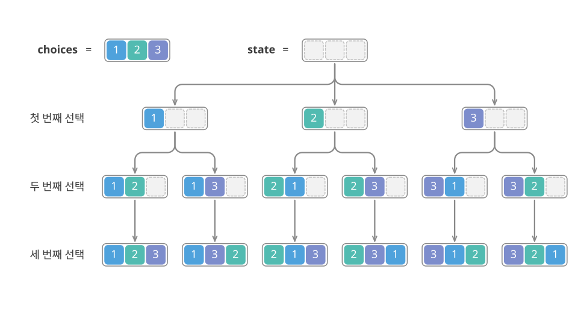
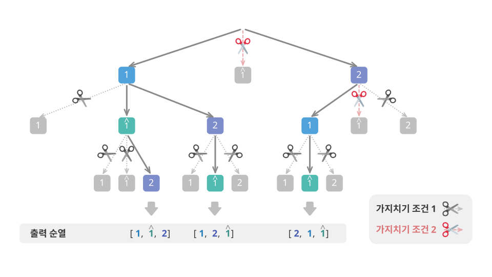

# 순열 문제

모든 순열을 구하는 문제는 백트래킹의 대표적인 응용 예이다. 배열이나 문자열처럼 원소들의 모음이 주어질 때 원소를 배치하는 가능한 모든 순서를 찾는 문제이다.

아래 표는 몇 가지 입력 배열과 각 배열의 모든 순열을 보여 준다.

<p align="center"> 표 <id> &nbsp; 순열 예시 </p>

| 입력 배열    | 모든 순열                                                           |
| :---------- | :----------------------------------------------------------------- |
| $[1]$       | $[1]$                                                              |
| $[1, 2]$    | $[1, 2], [2, 1]$                                                   |
| $[1, 2, 3]$ | $[1, 2, 3], [1, 3, 2], [2, 1, 3], [2, 3, 1], [3, 1, 2], [3, 2, 1]$ |

## 값이 같은 원소가 없는 경우

!!! question

    중복 원소가 없는 정수 배열이 주어질 때 가능한 모든 순열을 반환하라.

백트래킹의 관점에서 **순열을 만드는 과정은 연속된 선택의 결과로 볼 수 있다**. 입력 배열이 $[1, 2, 3]$일 때 먼저 $1$을 선택하고 이어서 $3$, 마지막으로 $2$를 선택하면 순열 $[1, 3, 2]$를 얻는다. 되돌리기는 선택 하나를 취소하는 것이며, 그 뒤에는 다른 선택을 시도한다.

코드에서 후보 집합 `choices`는 입력 배열의 모든 원소이고 상태 `state`는 지금까지 선택한 원소들이다. 각 원소를 한 번만 선택할 수 있으므로 **`state`에는 같은 원소가 두 번 들어갈 수 없다**.

아래 그림처럼 탐색 과정을 재귀 트리로 펼치면 각 노드는 현재 상태 `state`를 나타낸다. 루트에서 출발해 세 번 선택하면 잎 노드에 도달하며, 잎 노드 하나가 순열 하나에 대응한다.



### 같은 원소의 중복 선택 가지치기

각 원소를 한 번만 선택하도록 불리언 배열 `selected`를 도입한다. `selected[i]`는 `choices[i]`를 이미 선택했는지 나타낸다. 이를 바탕으로 다음과 같이 가지치기한다.

- `choices[i]`를 선택하면 `selected[i]`에 $\text{True}$를 대입해 이미 선택했다고 표시한다.
- 선택지 리스트 `choices`를 순회할 때 이미 선택한 노드는 모두 건너뛴다. 이것이 가지치기다.

아래 그림처럼 첫 번째로 1, 두 번째로 3, 세 번째로 2를 선택한다고 하자. 두 번째 선택에서는 1로 가는 가지를, 세 번째 선택에서는 1과 3으로 가는 가지를 잘라 내야 한다.


그림에서 볼 수 있듯 이 가지치기는 탐색 공간의 크기를 $O(n^n)$에서 $O(n!)$로 줄인다.

### 코드 구현

이제 기본 코드 구조의 빈칸을 채울 수 있다. 코드를 간결하게 유지하기 위해 각 함수를 따로 구현하지 않고 그 내용을 `backtrack()` 함수 안에 직접 작성한다.

```src
[file]{permutations_i}-[class]{}-[func]{permutations_i}
```

## 값이 같은 원소가 있는 경우

!!! question

    정수 배열이 주어진다. **배열에 중복 원소가 있을 수 있다**. 서로 다른 순열을 모두 반환하라.

입력 배열을 $[1, 1, 2]$라 하자. 값이 $1$인 두 원소를 구별하기 위해 두 번째 $1$은 $\hat{1}$로 표시한다.

아래 그림처럼 앞의 방법으로 생성한 순열 중 절반은 중복이다.


중복 순열은 어떻게 제거할까? 가장 직접적인 방법은 해시 집합을 이용해 결과에서 중복을 제거하는 것이다. 하지만 **중복 순열만 만드는 가지는 탐색할 필요가 없으므로 미리 찾아 잘라 내는 편이 낫다**. 이렇게 하면 효율도 높아진다.

### 값이 같은 원소 가지치기

아래 그림에서 첫 번째 선택으로 $1$을 고르는 것과 $\hat{1}$을 고르는 것은 동등하다. 두 선택 아래에서 생성되는 순열이 모두 겹치므로 $\hat{1}$ 쪽 가지를 잘라 내야 한다.

마찬가지로 첫 번째로 $2$를 선택한 뒤 두 번째 선택에서 $1$과 $\hat{1}$은 중복된 가지를 만든다. 따라서 두 번째 선택에서도 $\hat{1}$ 쪽 가지를 잘라 내야 한다.

**목표는 한 단계에서 값이 같은 여러 원소 중 하나만 선택하도록 하는 것이다**.


### 코드 구현

앞 문제의 코드를 바탕으로 각 선택 단계마다 해시 집합 `duplicated`를 만든다. 이 집합에 그 단계에서 이미 시도한 원솟값을 기록하고 값이 중복되면 가지치기한다.

```src
[file]{permutations_ii}-[class]{}-[func]{permutations_ii}
```

모든 원소가 서로 다르면 원소 $n$개로 만들 수 있는 순열은 $n!$개(팩토리얼)이다. 각 결과를 기록할 때 길이가 $n$인 리스트를 복사하므로 $O(n)$ 시간이 든다. **따라서 시간 복잡도는 $O(n!n)$이다**.

최대 재귀 깊이가 $n$이므로 스택 프레임에 $O(n)$ 공간이 든다. `selected`는 $O(n)$ 공간을 사용한다. 동시에 존재하는 `duplicated`는 최대 $n$개로 $O(n^2)$ 공간을 사용한다. **따라서 공간 복잡도는 $O(n^2)$이다**.

### 두 가지 가지치기 비교

`selected`와 `duplicated`는 모두 가지치기에 쓰이지만 목적이 다르다.

- **같은 원소의 중복 선택 가지치기**: 탐색 전체에서 `selected` 하나를 사용한다. 현재 상태에 포함된 원소를 기록하여 같은 원소가 `state`에 두 번 들어가지 않게 한다.
- **값이 같은 원소 가지치기**: 각 선택 단계(각 `backtrack` 함수 호출)마다 별도의 `duplicated`를 사용한다. 이번 순회(`for` 반복문)에서 이미 선택한 값을 기록해 같은 값은 한 번만 선택하도록 한다.

아래 그림은 두 가지 가지치기 조건의 적용 범위를 보여 준다. 트리의 각 노드는 하나의 선택을 나타내고, 루트에서 잎으로 이어지는 경로상의 선택들이 하나의 순열을 이룬다.


