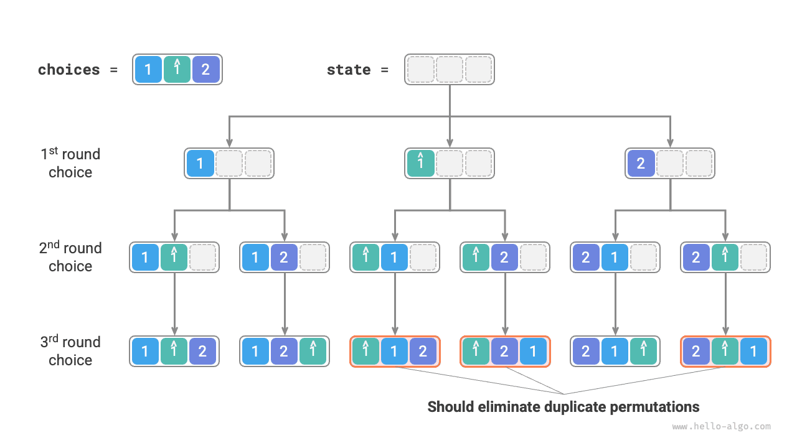

# 모든 순열 문제

모든 순열 문제는 백트래킹 알고리즘의 대표적인 응용이다. 배열이나 문자열 같은 집합이 주어졌을 때 원소들의 가능한 모든 순열을 찾는 문제로 정의된다.

아래 표에는 입력 배열과 그에 대응하는 모든 순열의 예시가 나와 있다.

<p align="center"> 표 <id> &nbsp; 모든 순열의 예시 </p>

| 입력 배열 | 모든 순열 |
| :---------- | :----------------------------------------------------------------- |
| $[1]$       | $[1]$                                                              |
| $[1, 2]$    | $[1, 2], [2, 1]$                                                   |
| $[1, 2, 3]$ | $[1, 2, 3], [1, 3, 2], [2, 1, 3], [2, 3, 1], [3, 1, 2], [3, 2, 1]$ |

## 값이 같은 원소가 없는 경우

!!! question "문제"

    중복 원소가 없는 정수 배열을 입력받아 가능한 모든 순열을 반환하라.

백트래킹 관점에서는 **순열을 만드는 과정을 연속된 선택의 결과로 볼 수 있다**. 입력 배열이 $[1, 2, 3]$이고 $1$, $3$, $2$ 순서로 선택하면 순열 $[1, 3, 2]$를 얻는다. 되돌리기는 선택 하나를 취소한 뒤 다른 선택을 계속 시도한다는 뜻이다.

백트래킹 코드에서 후보 집합 `choices`는 입력 배열의 모든 원소이고, 상태 `state`는 지금까지 선택한 원소들이다. 각 원소는 한 번만 선택할 수 있으므로 **`state` 안의 원소는 모두 중복되지 않아야 한다**.

아래 그림과 같이 탐색 과정을 재귀 트리로 펼칠 수 있다. 각 노드는 현재 상태 `state`를 나타낸다. 루트에서 시작해 세 차례 선택하면 리프에 도달하며, 각 리프 노드는 순열 하나에 대응한다.


### 중복 선택 가지치기

각 원소를 한 번만 선택하도록 불리언 배열 `selected`를 도입하자. `selected[i]`는 `choices[i]`를 이미 선택했는지 나타내며, 이를 바탕으로 다음과 같이 가지치기한다.

- `choices[i]`를 선택하면 `selected[i]`를 $\text{True}$로 설정하여 이미 선택했음을 표시한다.
- 선택지 리스트 `choices`를 순회할 때 이미 선택한 모든 노드를 건너뛰어 가지치기한다.

아래 그림처럼 첫 번째에 1, 두 번째에 3, 세 번째에 2를 선택한다면, 두 번째에서는 원소 1의 가지를, 세 번째에서는 원소 1과 3의 가지를 잘라 내야 한다.


위 그림에서 이 가지치기가 탐색 공간의 크기를 $O(n^n)$에서 $O(n!)$로 줄이는 것을 볼 수 있다.

### 코드 구현

위 내용을 정리했으니 기본 틀 코드의 '빈칸을 채울' 수 있다. 전체 코드를 짧게 만들기 위해 각 함수를 따로 구현하지 않고 `backtrack()` 함수 안에 직접 작성한다.

```src
[file]{permutations_i}-[class]{}-[func]{permutations_i}
```

## 값이 같은 원소가 있는 경우

!!! question "문제"

    **중복 원소가 있을 수 있는** 정수 배열을 입력받아 중복되지 않는 모든 순열을 반환하라.

입력 배열이 $[1, 1, 2]$라고 하자. 두 원소 $1$을 쉽게 구분하기 위해 두 번째 $1$을 $\hat{1}$로 표시한다.

아래 그림과 같이 앞의 방법으로 만든 순열의 절반은 중복된다.



중복된 순열은 어떻게 제거할까? 가장 직접적으로는 해시 집합을 이용해 결과에서 중복을 제거할 수 있다. 하지만 이 방법은 충분히 간결하지 않다. **중복된 순열을 만드는 탐색 가지는 불필요하므로 미리 알아내어 잘라 내야 하며**, 그러면 알고리즘의 효율을 더 높일 수 있다.

### 같은 값의 원소 가지치기

아래 그림에서 첫 번째 선택으로 $1$을 고르든 $\hat{1}$을 고르든 같다. 두 선택 아래에서 만들어지는 모든 순열이 중복되므로 $\hat{1}$을 가지치기해야 한다.

마찬가지로 첫 번째에 $2$를 선택한 뒤에도 두 번째의 $1$과 $\hat{1}$이 중복 가지를 만들므로 두 번째의 $\hat{1}$도 잘라 내야 한다.

본질적으로 **한 차례의 선택에서 값이 같은 여러 원소를 한 번만 선택하도록 보장하는 것**이 목표다.


### 코드 구현

앞 문제의 코드를 바탕으로 매 차례의 선택에서 해시 집합 `duplicated`를 만들어 이미 시도한 원소를 기록하고 중복 원소를 가지치기한다.

```src
[file]{permutations_ii}-[class]{}-[func]{permutations_ii}
```

모든 원소가 서로 다르다면 $n$ 개 원소의 순열은 $n!$ 가지(팩토리얼)다. 결과를 기록할 때마다 길이 $n$의 리스트를 복사하는 데 $O(n)$ 시간이 걸린다. **따라서 시간 복잡도는 $O(n!n)$이다**.

최대 재귀 깊이는 $n$이므로 $O(n)$의 스택 프레임 공간을 사용한다. `selected`는 $O(n)$ 공간을 사용한다. 동시에 최대 $n$ 개의 `duplicated`가 존재하여 $O(n^2)$ 공간을 사용한다. **따라서 공간 복잡도는 $O(n^2)$이다**.

### 두 가지 가지치기 비교

`selected`와 `duplicated`는 모두 가지치기에 쓰이지만 목적이 다르다.

- **중복 선택 가지치기**: 전체 탐색 과정에 `selected`는 하나만 존재한다. 현재 상태에 어떤 원소가 포함되어 있는지를 기록하여 같은 원소가 `state`에 중복 등장하지 않게 한다.
- **같은 값의 원소 가지치기**: 매 차례의 선택(호출된 각 `backtrack` 함수)마다 `duplicated`가 하나씩 있다. 이번 순회(`for` 반복문)에서 이미 선택한 원소를 기록하여 같은 값의 원소를 한 번만 선택하게 한다.

아래 그림은 두 가지 가지치기 조건이 적용되는 범위를 보여 준다. 각 트리 노드는 선택 하나를 나타내며, 루트에서 리프까지의 경로에 있는 노드들이 하나의 순열을 이룬다.


