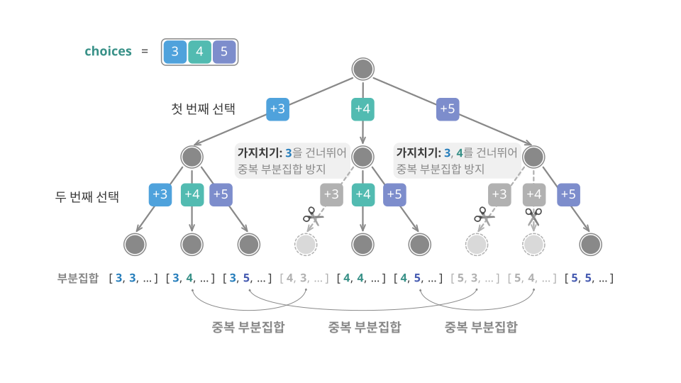
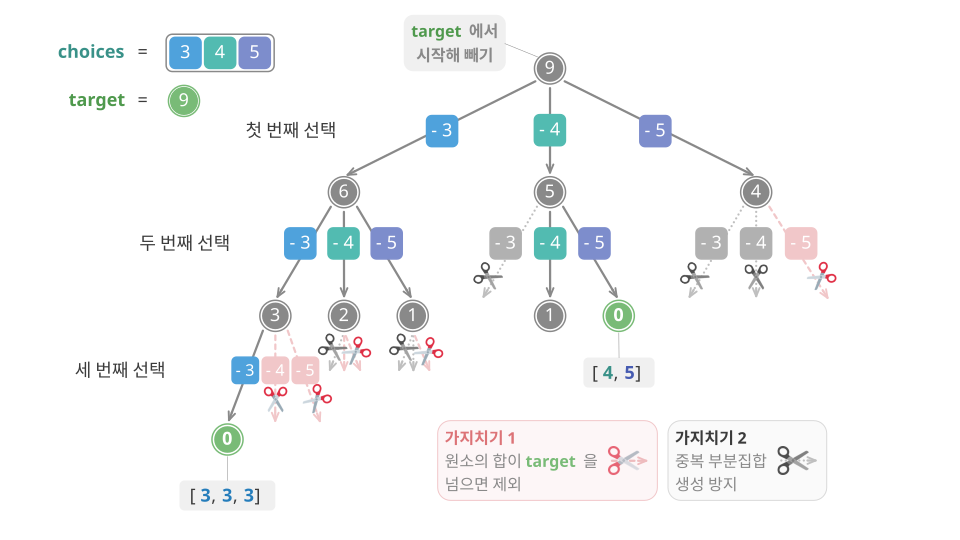

# 부분집합의 합 문제

## 중복 원소가 없는 경우

!!! question

    양의 정수 배열 `nums`와 양의 정수 목표값 `target`이 주어진다. 원소의 합이 `target`인 조합을 모두 찾아라. 배열에는 중복 원소가 없으며 각 원소는 여러 번 선택할 수 있다. 조합을 리스트로 반환하되 같은 조합을 두 번 넣지 마라.

예를 들어 입력 집합이 $\{3, 4, 5\}$이고 목표 정수가 $9$이면 해는 $\{3, 3, 3\}, \{4, 5\}$이다. 다음 두 가지에 유의하자.

- 입력 집합의 각 원소를 횟수 제한 없이 반복해서 선택할 수 있다.
- 부분집합에서는 원소의 순서를 구분하지 않는다. 예를 들어 $\{4, 5\}$와 $\{5, 4\}$는 같은 부분집합이다.

### 순열 문제의 풀이 응용

순열 문제처럼 부분집합을 만드는 과정도 일련의 선택으로 볼 수 있다. 선택할 때마다 원소의 합을 갱신하고 합이 `target`과 같아지면 해당 부분집합을 결과 리스트에 기록한다.

순열 문제와 달리 **이 문제에서는 같은 원소를 횟수 제한 없이 선택할 수 있다**. 따라서 불리언 리스트 `selected`로 원소의 선택 여부를 기록할 필요가 없다. 순열 문제의 코드를 조금 수정해 첫 풀이를 작성해 보자.

```src
[file]{subset_sum_i_naive}-[class]{}-[func]{subset_sum_i_naive}
```

위 코드에 배열 $[3, 4, 5]$와 목표값 $9$를 입력하면 결과는 $[3, 3, 3], [4, 5], [5, 4]$이다. **합이 $9$인 부분집합을 모두 찾았지만 $[4, 5]$와 $[5, 4]$는 같은 부분집합이다**.

탐색 과정은 선택 순서를 구분하지만 부분집합은 순서를 구분하지 않기 때문이다. 아래 그림에서 $4$를 먼저 고르고 $5$를 고르는 가지와 $5$를 먼저 고르고 $4$를 고르는 가지는 다르지만 같은 부분집합에 해당한다.


**결과 리스트에서 중복을 제거하는 방법**을 바로 떠올릴 수 있다. 하지만 이 방법은 두 가지 이유로 효율이 매우 낮다.

- 배열의 원소가 많을 때, 특히 `target`이 클 때 탐색 과정에서 중복 부분집합이 많이 생긴다.
- 부분집합(배열)이 같은지 비교하려면 배열을 먼저 정렬하고 각 원소를 하나씩 비교해야 하므로 시간이 많이 든다.

### 중복 부분집합 가지치기

**탐색 도중에 가지치기로 중복을 제거해 보자**. 아래 그림처럼 같은 원소들을 다른 순서로 선택할 때 중복 부분집합이 생긴다. 다음 예를 보자.

1. 첫 번째와 두 번째로 각각 $3$과 $4$를 선택하면 이 두 원소를 포함하는 부분집합을 모두 생성한다. 이를 $[3, 4, \dots]$로 표시하자.
2. 이후 첫 번째로 $4$를 선택했다면 **두 번째 선택에서는 $3$을 건너뛰어야 한다**. 여기서 생성될 부분집합 $[4, 3, \dots]$은 `1.` 단계에서 생성한 부분집합과 완전히 겹치기 때문이다.

각 층에서는 왼쪽에서 오른쪽 순으로 선택지를 하나씩 시도하므로 오른쪽으로 갈수록 잘라 내는 가지가 많다.

1. 처음 두 번의 선택으로 $3$과 $5$를 고르면 부분집합 $[3, 5, \dots]$을 생성한다.
2. 처음 두 번의 선택으로 $4$와 $5$를 고르면 부분집합 $[4, 5, \dots]$을 생성한다.
3. 첫 번째로 $5$를 고르면 **두 번째 선택에서는 $3$과 $4$를 건너뛰어야 한다**. 부분집합 $[5, 3, \dots]$과 $[5, 4, \dots]$은 각각 `1.` 단계와 `2.` 단계에서 설명한 부분집합과 완전히 겹치기 때문이다.



정리하면 입력 배열이 $[x_1, x_2, \dots, x_n]$이고 탐색 과정에서 선택한 순서가 $[x_{i_1}, x_{i_2}, \dots, x_{i_m}]$일 때 인덱스는 $i_1 \leq i_2 \leq \dots \leq i_m$를 만족해야 한다. **이 조건에 어긋나는 순서는 모두 중복을 만들므로 가지치기해야 한다**.

### 코드 구현

이를 구현하려면 순회 시작점을 나타내는 변수 `start`를 초기화한다. **$x_{i}$를 선택하면 다음 단계에서는 인덱스 $i$부터 순회한다**. 그러면 선택 순서가 $i_1 \leq i_2 \leq \dots \leq i_m$를 만족하므로 같은 부분집합이 두 번 생기지 않는다.

이와 함께 코드를 두 가지 더 개선한다.

- 탐색 전에 배열 `nums`를 정렬한다. 선택지를 순회하다가 **부분집합의 합이 `target`을 초과하면 즉시 반복을 끝낸다**. 뒤에 있는 원소는 더 커서 합이 반드시 `target`을 초과하기 때문이다.
- 원소의 합을 담는 변수 `total`을 없애고 **선택한 값을 `target`에서 빼는 방식으로 합을 추적한다**. `target`이 $0$이 되면 해를 기록한다.

```src
[file]{subset_sum_i}-[class]{}-[func]{subset_sum_i}
```

아래 그림은 위 코드에 배열 $[3, 4, 5]$와 목표값 $9$를 입력했을 때의 전체 백트래킹 과정이다.



## 중복 원소가 있는 경우

!!! question

    양의 정수 배열 `nums`와 양의 정수 목표값 `target`이 주어진다. 원소의 합이 `target`인 조합을 모두 찾아라. **배열에는 중복 원소가 있을 수 있으며, 각 원소는 한 번만 선택할 수 있다**. 조합을 리스트로 반환하되 같은 조합을 두 번 넣지 마라.

앞 문제와 달리 **입력 배열에 중복 원소가 있을 수 있어** 새로운 문제가 생긴다. 예를 들어 배열이 $[4, \hat{4}, 5]$이고 목표값이 $9$이면 기존 코드는 $[4, 5], [\hat{4}, 5]$를 출력해 같은 부분집합이 두 번 나온다.

**한 선택 단계에서 값이 같은 원소를 여러 번 선택하기 때문에 중복이 생긴다**. 아래 그림에서 첫 번째 선택지는 세 개이고 그중 두 개의 값이 $4$이다. 이 둘이 중복된 탐색 가지를 만들어 같은 부분집합을 출력한다. 마찬가지로 두 번째 선택에서 값이 $4$인 두 원소 역시 중복 부분집합을 만든다.


### 값이 같은 원소 가지치기

이 문제를 해결하려면 **각 단계에서 같은 값은 한 번만 선택해야 한다**. 배열이 정렬되어 값이 같은 원소들이 이웃한다는 점을 이용하면 된다. 한 단계에서 순회 중인 원소의 값이 바로 왼쪽 원소와 같다면 그 값은 이미 시도했으므로 현재 원소를 건너뛴다.

동시에 **각 배열 원소를 한 번만 선택해야 한다**. 이 제약도 변수 `start`로 처리할 수 있다. $x_{i}$를 선택하면 다음 단계에서는 인덱스 $i + 1$부터 뒤로 순회한다. 이렇게 하면 중복 부분집합을 제거하면서 같은 원소를 다시 선택하는 것도 막을 수 있다.

### 코드 구현

```src
[file]{subset_sum_ii}-[class]{}-[func]{subset_sum_ii}
```

아래 그림은 배열 $[4, 4, 5]$와 목표값 $9$에 대한 백트래킹 과정으로, 네 가지 가지치기 연산이 포함되어 있다. 그림과 코드 주석을 함께 보며 전체 탐색 과정과 각 가지치기의 작동 방식을 확인해 보자.


