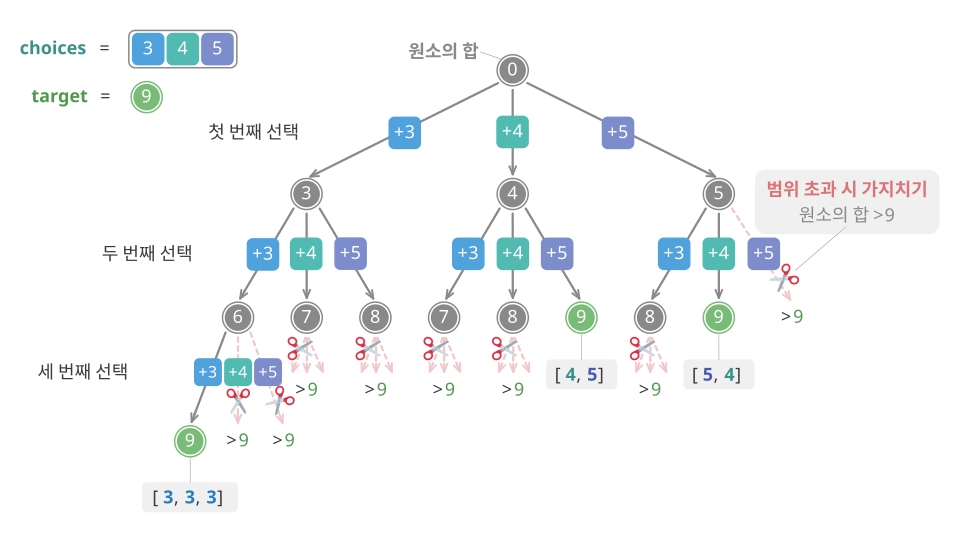
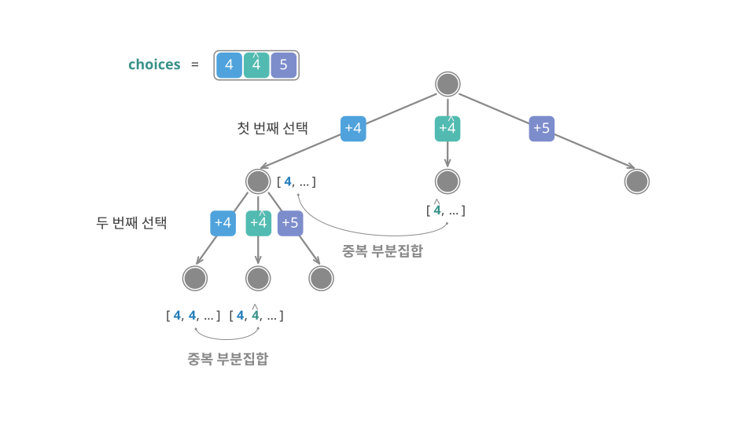
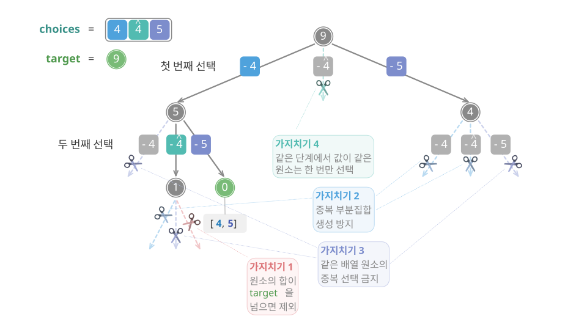

# 13.3 &nbsp; 부분집합의 합 문제

## 13.3.1 &nbsp; 중복 원소가 없는 경우

!!! question

    양의 정수 배열 `nums`와 양의 정수 목표값 `target`이 주어진다. 원소의 합이 `target`인 조합을 모두 찾아라. 배열에는 중복 원소가 없으며 각 원소는 여러 번 선택할 수 있다. 조합을 리스트로 반환하되 같은 조합을 두 번 넣지 마라.

예를 들어 입력 집합이 $\{3, 4, 5\}$이고 목표 정수가 $9$이면 해는 $\{3, 3, 3\}, \{4, 5\}$이다. 다음 두 가지에 유의하자.

- 입력 집합의 각 원소를 횟수 제한 없이 반복해서 선택할 수 있다.
- 부분집합에서는 원소의 순서를 구분하지 않는다. 예를 들어 $\{4, 5\}$와 $\{5, 4\}$는 같은 부분집합이다.

### 1. &nbsp; 순열 문제의 풀이 응용

순열 문제처럼 부분집합을 만드는 과정도 일련의 선택으로 볼 수 있다. 선택할 때마다 원소의 합을 갱신하고 합이 `target`과 같아지면 해당 부분집합을 결과 리스트에 기록한다.

순열 문제와 달리 **이 문제에서는 같은 원소를 횟수 제한 없이 선택할 수 있다**. 따라서 불리언 리스트 `selected`로 원소의 선택 여부를 기록할 필요가 없다. 순열 문제의 코드를 조금 수정해 첫 풀이를 작성해 보자.

=== "Python"

    ```python title="subset_sum_i_naive.py"
    def backtrack(
        state: list[int],
        target: int,
        total: int,
        choices: list[int],
        res: list[list[int]],
    ):
        """백트래킹: 부분집합의 합 I"""
        # 부분집합의 합이 target과 같으면 해를 기록한다
        if total == target:
            res.append(list(state))
            return
        # 모든 선택지를 순회한다
        for i in range(len(choices)):
            # 가지치기: 부분집합의 합이 target을 초과하면 이 선택을 건너뛴다
            if total + choices[i] > target:
                continue
            # 시도: 원소를 선택하고 원소의 합 total을 갱신한다
            state.append(choices[i])
            # 다음 선택을 진행한다
            backtrack(state, target, total + choices[i], choices, res)
            # 되돌리기: 선택을 취소하고 이전 상태를 복원한다
            state.pop()

    def subset_sum_i_naive(nums: list[int], target: int) -> list[list[int]]:
        """부분집합의 합 I 풀기(중복 부분집합 포함)"""
        state = []  # 상태(부분집합)
        total = 0  # 부분집합의 합
        res = []  # 결과 리스트(부분집합의 리스트)
        backtrack(state, target, total, nums, res)
        return res
    ```

=== "C++"

    ```cpp title="subset_sum_i_naive.cpp"
    /* 백트래킹: 부분집합의 합 I */
    void backtrack(vector<int> &state, int target, int total, vector<int> &choices, vector<vector<int>> &res) {
        // 부분집합의 합이 target과 같으면 해를 기록한다
        if (total == target) {
            res.push_back(state);
            return;
        }
        // 모든 선택지를 순회한다
        for (size_t i = 0; i < choices.size(); i++) {
            // 가지치기: 부분집합의 합이 target을 초과하면 이 선택을 건너뛴다
            if (total + choices[i] > target) {
                continue;
            }
            // 시도: 원소를 선택하고 원소의 합 total을 갱신한다
            state.push_back(choices[i]);
            // 다음 선택을 진행한다
            backtrack(state, target, total + choices[i], choices, res);
            // 되돌리기: 선택을 취소하고 이전 상태를 복원한다
            state.pop_back();
        }
    }

    /* 부분집합의 합 I 풀기(중복 부분집합 포함) */
    vector<vector<int>> subsetSumINaive(vector<int> &nums, int target) {
        vector<int> state;       // 상태(부분집합)
        int total = 0;           // 부분집합의 합
        vector<vector<int>> res; // 결과 리스트(부분집합의 리스트)
        backtrack(state, target, total, nums, res);
        return res;
    }
    ```

=== "Java"

    ```java title="subset_sum_i_naive.java"
    /* 백트래킹: 부분집합의 합 I */
    void backtrack(List<Integer> state, int target, int total, int[] choices, List<List<Integer>> res) {
        // 부분집합의 합이 target과 같으면 해를 기록한다
        if (total == target) {
            res.add(new ArrayList<>(state));
            return;
        }
        // 모든 선택지를 순회한다
        for (int i = 0; i < choices.length; i++) {
            // 가지치기: 부분집합의 합이 target을 초과하면 이 선택을 건너뛴다
            if (total + choices[i] > target) {
                continue;
            }
            // 시도: 원소를 선택하고 원소의 합 total을 갱신한다
            state.add(choices[i]);
            // 다음 선택을 진행한다
            backtrack(state, target, total + choices[i], choices, res);
            // 되돌리기: 선택을 취소하고 이전 상태를 복원한다
            state.remove(state.size() - 1);
        }
    }

    /* 부분집합의 합 I 풀기(중복 부분집합 포함) */
    List<List<Integer>> subsetSumINaive(int[] nums, int target) {
        List<Integer> state = new ArrayList<>(); // 상태(부분집합)
        int total = 0; // 부분집합의 합
        List<List<Integer>> res = new ArrayList<>(); // 결과 리스트(부분집합의 리스트)
        backtrack(state, target, total, nums, res);
        return res;
    }
    ```

=== "C#"

    ```csharp title="subset_sum_i_naive.cs"
    /* 백트래킹: 부분집합의 합 I */
    void Backtrack(List<int> state, int target, int total, int[] choices, List<List<int>> res) {
        // 부분집합의 합이 target과 같으면 해를 기록한다
        if (total == target) {
            res.Add(new List<int>(state));
            return;
        }
        // 모든 선택지를 순회한다
        for (int i = 0; i < choices.Length; i++) {
            // 가지치기: 부분집합의 합이 target을 초과하면 이 선택을 건너뛴다
            if (total + choices[i] > target) {
                continue;
            }
            // 시도: 원소를 선택하고 원소의 합 total을 갱신한다
            state.Add(choices[i]);
            // 다음 선택을 진행한다
            Backtrack(state, target, total + choices[i], choices, res);
            // 되돌리기: 선택을 취소하고 이전 상태를 복원한다
            state.RemoveAt(state.Count - 1);
        }
    }

    /* 부분집합의 합 I 풀기(중복 부분집합 포함) */
    List<List<int>> SubsetSumINaive(int[] nums, int target) {
        List<int> state = []; // 상태(부분집합)
        int total = 0; // 부분집합의 합
        List<List<int>> res = []; // 결과 리스트(부분집합의 리스트)
        Backtrack(state, target, total, nums, res);
        return res;
    }
    ```

=== "Go"

    ```go title="subset_sum_i_naive.go"
    /* 백트래킹: 부분집합의 합 I */
    func backtrackSubsetSumINaive(total, target int, state, choices *[]int, res *[][]int) {
        // 부분집합의 합이 target과 같으면 해를 기록한다
        if target == total {
            newState := append([]int{}, *state...)
            *res = append(*res, newState)
            return
        }
        // 모든 선택지를 순회한다
        for i := 0; i < len(*choices); i++ {
            // 가지치기: 부분집합의 합이 target을 초과하면 이 선택을 건너뛴다
            if total+(*choices)[i] > target {
                continue
            }
            // 시도: 원소를 선택하고 원소의 합 total을 갱신한다
            *state = append(*state, (*choices)[i])
            // 다음 선택을 진행한다
            backtrackSubsetSumINaive(total+(*choices)[i], target, state, choices, res)
            // 되돌리기: 선택을 취소하고 이전 상태를 복원한다
            *state = (*state)[:len(*state)-1]
        }
    }

    /* 부분집합의 합 I 풀기(중복 부분집합 포함) */
    func subsetSumINaive(nums []int, target int) [][]int {
        state := make([]int, 0) // 상태(부분집합)
        total := 0              // 부분집합의 합
        res := make([][]int, 0) // 결과 리스트(부분집합의 리스트)
        backtrackSubsetSumINaive(total, target, &state, &nums, &res)
        return res
    }
    ```

=== "Swift"

    ```swift title="subset_sum_i_naive.swift"
    /* 백트래킹: 부분집합의 합 I */
    func backtrack(state: inout [Int], target: Int, total: Int, choices: [Int], res: inout [[Int]]) {
        // 부분집합의 합이 target과 같으면 해를 기록한다
        if total == target {
            res.append(state)
            return
        }
        // 모든 선택지를 순회한다
        for i in choices.indices {
            // 가지치기: 부분집합의 합이 target을 초과하면 이 선택을 건너뛴다
            if total + choices[i] > target {
                continue
            }
            // 시도: 원소를 선택하고 원소의 합 total을 갱신한다
            state.append(choices[i])
            // 다음 선택을 진행한다
            backtrack(state: &state, target: target, total: total + choices[i], choices: choices, res: &res)
            // 되돌리기: 선택을 취소하고 이전 상태를 복원한다
            state.removeLast()
        }
    }

    /* 부분집합의 합 I 풀기(중복 부분집합 포함) */
    func subsetSumINaive(nums: [Int], target: Int) -> [[Int]] {
        var state: [Int] = [] // 상태(부분집합)
        let total = 0 // 부분집합의 합
        var res: [[Int]] = [] // 결과 리스트(부분집합의 리스트)
        backtrack(state: &state, target: target, total: total, choices: nums, res: &res)
        return res
    }
    ```

=== "JS"

    ```javascript title="subset_sum_i_naive.js"
    /* 백트래킹: 부분집합의 합 I */
    function backtrack(state, target, total, choices, res) {
        // 부분집합의 합이 target과 같으면 해를 기록한다
        if (total === target) {
            res.push([...state]);
            return;
        }
        // 모든 선택지를 순회한다
        for (let i = 0; i < choices.length; i++) {
            // 가지치기: 부분집합의 합이 target을 초과하면 이 선택을 건너뛴다
            if (total + choices[i] > target) {
                continue;
            }
            // 시도: 원소를 선택하고 원소의 합 total을 갱신한다
            state.push(choices[i]);
            // 다음 선택을 진행한다
            backtrack(state, target, total + choices[i], choices, res);
            // 되돌리기: 선택을 취소하고 이전 상태를 복원한다
            state.pop();
        }
    }

    /* 부분집합의 합 I 풀기(중복 부분집합 포함) */
    function subsetSumINaive(nums, target) {
        const state = []; // 상태(부분집합)
        const total = 0; // 부분집합의 합
        const res = []; // 결과 리스트(부분집합의 리스트)
        backtrack(state, target, total, nums, res);
        return res;
    }
    ```

=== "TS"

    ```typescript title="subset_sum_i_naive.ts"
    /* 백트래킹: 부분집합의 합 I */
    function backtrack(
        state: number[],
        target: number,
        total: number,
        choices: number[],
        res: number[][]
    ): void {
        // 부분집합의 합이 target과 같으면 해를 기록한다
        if (total === target) {
            res.push([...state]);
            return;
        }
        // 모든 선택지를 순회한다
        for (let i = 0; i < choices.length; i++) {
            // 가지치기: 부분집합의 합이 target을 초과하면 이 선택을 건너뛴다
            if (total + choices[i] > target) {
                continue;
            }
            // 시도: 원소를 선택하고 원소의 합 total을 갱신한다
            state.push(choices[i]);
            // 다음 선택을 진행한다
            backtrack(state, target, total + choices[i], choices, res);
            // 되돌리기: 선택을 취소하고 이전 상태를 복원한다
            state.pop();
        }
    }

    /* 부분집합의 합 I 풀기(중복 부분집합 포함) */
    function subsetSumINaive(nums: number[], target: number): number[][] {
        const state = []; // 상태(부분집합)
        const total = 0; // 부분집합의 합
        const res = []; // 결과 리스트(부분집합의 리스트)
        backtrack(state, target, total, nums, res);
        return res;
    }
    ```

=== "Dart"

    ```dart title="subset_sum_i_naive.dart"
    /* 백트래킹: 부분집합의 합 I */
    void backtrack(
      List<int> state,
      int target,
      int total,
      List<int> choices,
      List<List<int>> res,
    ) {
      // 부분집합의 합이 target과 같으면 해를 기록한다
      if (total == target) {
        res.add(List.from(state));
        return;
      }
      // 모든 선택지를 순회한다
      for (int i = 0; i < choices.length; i++) {
        // 가지치기: 부분집합의 합이 target을 초과하면 이 선택을 건너뛴다
        if (total + choices[i] > target) {
          continue;
        }
        // 시도: 원소를 선택하고 원소의 합 total을 갱신한다
        state.add(choices[i]);
        // 다음 선택을 진행한다
        backtrack(state, target, total + choices[i], choices, res);
        // 되돌리기: 선택을 취소하고 이전 상태를 복원한다
        state.removeLast();
      }
    }

    /* 부분집합의 합 I 풀기(중복 부분집합 포함) */
    List<List<int>> subsetSumINaive(List<int> nums, int target) {
      List<int> state = []; // 상태(부분집합)
      int total = 0; // 원소의 합
      List<List<int>> res = []; // 결과 리스트(부분집합의 리스트)
      backtrack(state, target, total, nums, res);
      return res;
    }
    ```

=== "Rust"

    ```rust title="subset_sum_i_naive.rs"
    /* 백트래킹: 부분집합의 합 I */
    fn backtrack(
        state: &mut Vec<i32>,
        target: i32,
        total: i32,
        choices: &[i32],
        res: &mut Vec<Vec<i32>>,
    ) {
        // 부분집합의 합이 target과 같으면 해를 기록한다
        if total == target {
            res.push(state.clone());
            return;
        }
        // 모든 선택지를 순회한다
        for i in 0..choices.len() {
            // 가지치기: 부분집합의 합이 target을 초과하면 이 선택을 건너뛴다
            if total + choices[i] > target {
                continue;
            }
            // 시도: 원소를 선택하고 원소의 합 total을 갱신한다
            state.push(choices[i]);
            // 다음 선택을 진행한다
            backtrack(state, target, total + choices[i], choices, res);
            // 되돌리기: 선택을 취소하고 이전 상태를 복원한다
            state.pop();
        }
    }

    /* 부분집합의 합 I 풀기(중복 부분집합 포함) */
    fn subset_sum_i_naive(nums: &[i32], target: i32) -> Vec<Vec<i32>> {
        let mut state = Vec::new(); // 상태(부분집합)
        let total = 0; // 부분집합의 합
        let mut res = Vec::new(); // 결과 리스트(부분집합의 리스트)
        backtrack(&mut state, target, total, nums, &mut res);
        res
    }
    ```

=== "C"

    ```c title="subset_sum_i_naive.c"
    /* 백트래킹: 부분집합의 합 I */
    void backtrack(int target, int total, int *choices, int choicesSize) {
        // 부분집합의 합이 target과 같으면 해를 기록한다
        if (total == target) {
            for (int i = 0; i < stateSize; i++) {
                res[resSize][i] = state[i];
            }
            resColSizes[resSize++] = stateSize;
            return;
        }
        // 모든 선택지를 순회한다
        for (int i = 0; i < choicesSize; i++) {
            // 가지치기: 부분집합의 합이 target을 초과하면 이 선택을 건너뛴다
            if (total + choices[i] > target) {
                continue;
            }
            // 시도: 원소를 선택하고 원소의 합 total을 갱신한다
            state[stateSize++] = choices[i];
            // 다음 선택을 진행한다
            backtrack(target, total + choices[i], choices, choicesSize);
            // 되돌리기: 선택을 취소하고 이전 상태를 복원한다
            stateSize--;
        }
    }

    /* 부분집합의 합 I 풀기(중복 부분집합 포함) */
    void subsetSumINaive(int *nums, int numsSize, int target) {
        resSize = 0; // 해의 개수를 0으로 초기화한다
        backtrack(target, 0, nums, numsSize);
    }
    ```

=== "Kotlin"

    ```kotlin title="subset_sum_i_naive.kt"
    /* 백트래킹: 부분집합의 합 I */
    fun backtrack(
        state: MutableList<Int>,
        target: Int,
        total: Int,
        choices: IntArray,
        res: MutableList<MutableList<Int>?>
    ) {
        // 부분집합의 합이 target과 같으면 해를 기록한다
        if (total == target) {
            res.add(state.toMutableList())
            return
        }
        // 모든 선택지를 순회한다
        for (i in choices.indices) {
            // 가지치기: 부분집합의 합이 target을 초과하면 이 선택을 건너뛴다
            if (total + choices[i] > target) {
                continue
            }
            // 시도: 원소를 선택하고 원소의 합 total을 갱신한다
            state.add(choices[i])
            // 다음 선택을 진행한다
            backtrack(state, target, total + choices[i], choices, res)
            // 되돌리기: 선택을 취소하고 이전 상태를 복원한다
            state.removeAt(state.size - 1)
        }
    }

    /* 부분집합의 합 I 풀기(중복 부분집합 포함) */
    fun subsetSumINaive(nums: IntArray, target: Int): MutableList<MutableList<Int>?> {
        val state = mutableListOf<Int>() // 상태(부분집합)
        val total = 0 // 부분집합의 합
        val res = mutableListOf<MutableList<Int>?>() // 결과 리스트(부분집합의 리스트)
        backtrack(state, target, total, nums, res)
        return res
    }
    ```

=== "Ruby"

    ```ruby title="subset_sum_i_naive.rb"
    ### 백트래킹: 부분집합의 합 I ###
    def backtrack(state, target, total, choices, res)
      # 부분집합의 합이 target과 같으면 해를 기록한다
      if total == target
        res << state.dup
        return
      end

      # 모든 선택지를 순회한다
      for i in 0...choices.length
        # 가지치기: 부분집합의 합이 target을 초과하면 이 선택을 건너뛴다
        next if total + choices[i] > target
        # 시도: 원소를 선택하고 원소의 합 total을 갱신한다
        state << choices[i]
        # 다음 선택을 진행한다
        backtrack(state, target, total + choices[i], choices, res)
        # 되돌리기: 선택을 취소하고 이전 상태를 복원한다
        state.pop
      end
    end

    ### 부분집합의 합 I 풀기(중복 부분집합 포함)###
    def subset_sum_i_naive(nums, target)
      state = [] # 상태(부분집합)
      total = 0 # 부분집합의 합
      res = [] # 결과 리스트(부분집합의 리스트)
      backtrack(state, target, total, nums, res)
      res
    end
    ```

??? pythontutor "실행 과정 시각화"

    <div style="height: 549px; width: 100%;"><iframe class="pythontutor-iframe" title="실행 과정 시각화" src="https://pythontutor.com/iframe-embed.html#code=def%20backtrack%28%0A%20%20%20%20state%3A%20list%5Bint%5D,%0A%20%20%20%20target%3A%20int,%0A%20%20%20%20total%3A%20int,%0A%20%20%20%20choices%3A%20list%5Bint%5D,%0A%20%20%20%20res%3A%20list%5Blist%5Bint%5D%5D,%0A%29%3A%0A%20%20%20%20%22%22%22%EB%B0%B1%ED%8A%B8%EB%9E%98%ED%82%B9%3A%20%EB%B6%80%EB%B6%84%EC%A7%91%ED%95%A9%EC%9D%98%20%ED%95%A9%20I%22%22%22%0A%20%20%20%20%23%20%EB%B6%80%EB%B6%84%EC%A7%91%ED%95%A9%EC%9D%98%20%ED%95%A9%EC%9D%B4%20target%EA%B3%BC%20%EA%B0%99%EC%9C%BC%EB%A9%B4%20%ED%95%B4%EB%A5%BC%20%EA%B8%B0%EB%A1%9D%ED%95%9C%EB%8B%A4%0A%20%20%20%20if%20total%20%3D%3D%20target%3A%0A%20%20%20%20%20%20%20%20res.append%28list%28state%29%29%0A%20%20%20%20%20%20%20%20return%0A%20%20%20%20%23%20%EB%AA%A8%EB%93%A0%20%EC%84%A0%ED%83%9D%EC%A7%80%EB%A5%BC%20%EC%88%9C%ED%9A%8C%ED%95%9C%EB%8B%A4%0A%20%20%20%20for%20i%20in%20range%28len%28choices%29%29%3A%0A%20%20%20%20%20%20%20%20%23%20%EA%B0%80%EC%A7%80%EC%B9%98%EA%B8%B0%3A%20%EB%B6%80%EB%B6%84%EC%A7%91%ED%95%A9%EC%9D%98%20%ED%95%A9%EC%9D%B4%20target%EC%9D%84%20%EC%B4%88%EA%B3%BC%ED%95%98%EB%A9%B4%20%EC%9D%B4%20%EC%84%A0%ED%83%9D%EC%9D%84%20%EA%B1%B4%EB%84%88%EB%9B%B4%EB%8B%A4%0A%20%20%20%20%20%20%20%20if%20total%20%2B%20choices%5Bi%5D%20%3E%20target%3A%0A%20%20%20%20%20%20%20%20%20%20%20%20continue%0A%20%20%20%20%20%20%20%20%23%20%EC%8B%9C%EB%8F%84%3A%20%EC%9B%90%EC%86%8C%EB%A5%BC%20%EC%84%A0%ED%83%9D%ED%95%98%EA%B3%A0%20%EC%9B%90%EC%86%8C%EC%9D%98%20%ED%95%A9%20total%EC%9D%84%20%EA%B0%B1%EC%8B%A0%ED%95%9C%EB%8B%A4%0A%20%20%20%20%20%20%20%20state.append%28choices%5Bi%5D%29%0A%20%20%20%20%20%20%20%20%23%20%EB%8B%A4%EC%9D%8C%20%EC%84%A0%ED%83%9D%EC%9D%84%20%EC%A7%84%ED%96%89%ED%95%9C%EB%8B%A4%0A%20%20%20%20%20%20%20%20backtrack%28state,%20target,%20total%20%2B%20choices%5Bi%5D,%20choices,%20res%29%0A%20%20%20%20%20%20%20%20%23%20%EB%90%98%EB%8F%8C%EB%A6%AC%EA%B8%B0%3A%20%EC%84%A0%ED%83%9D%EC%9D%84%20%EC%B7%A8%EC%86%8C%ED%95%98%EA%B3%A0%20%EC%9D%B4%EC%A0%84%20%EC%83%81%ED%83%9C%EB%A5%BC%20%EB%B3%B5%EC%9B%90%ED%95%9C%EB%8B%A4%0A%20%20%20%20%20%20%20%20state.pop%28%29%0A%0A%0Adef%20subset_sum_i_naive%28nums%3A%20list%5Bint%5D,%20target%3A%20int%29%20-%3E%20list%5Blist%5Bint%5D%5D%3A%0A%20%20%20%20%22%22%22%EB%B6%80%EB%B6%84%EC%A7%91%ED%95%A9%EC%9D%98%20%ED%95%A9%20I%20%ED%92%80%EA%B8%B0%28%EC%A4%91%EB%B3%B5%20%EB%B6%80%EB%B6%84%EC%A7%91%ED%95%A9%20%ED%8F%AC%ED%95%A8%29%22%22%22%0A%20%20%20%20state%20%3D%20%5B%5D%20%20%23%20%EC%83%81%ED%83%9C%28%EB%B6%80%EB%B6%84%EC%A7%91%ED%95%A9%29%0A%20%20%20%20total%20%3D%200%20%20%23%20%EB%B6%80%EB%B6%84%EC%A7%91%ED%95%A9%EC%9D%98%20%ED%95%A9%0A%20%20%20%20res%20%3D%20%5B%5D%20%20%23%20%EA%B2%B0%EA%B3%BC%20%EB%A6%AC%EC%8A%A4%ED%8A%B8%28%EB%B6%80%EB%B6%84%EC%A7%91%ED%95%A9%EC%9D%98%20%EB%A6%AC%EC%8A%A4%ED%8A%B8%29%0A%20%20%20%20backtrack%28state,%20target,%20total,%20nums,%20res%29%0A%20%20%20%20return%20res%0A%0A%0A%22%22%22Driver%20Code%22%22%22%0Aif%20__name__%20%3D%3D%20%22__main__%22%3A%0A%20%20%20%20nums%20%3D%20%5B3,%204,%205%5D%0A%20%20%20%20target%20%3D%209%0A%20%20%20%20res%20%3D%20subset_sum_i_naive%28nums,%20target%29%0A%0A%20%20%20%20print%28f%22%EC%9E%85%EB%A0%A5%20%EB%B0%B0%EC%97%B4%20nums%20%3D%20%7Bnums%7D,%20target%20%3D%20%7Btarget%7D%22%29%0A%20%20%20%20print%28f%22%EB%AA%A9%ED%91%9C%20%ED%95%A9%20%7Btarget%7D%EC%97%90%20%EB%A7%9E%EB%8A%94%20%EB%AA%A8%EB%93%A0%20%EB%B6%80%EB%B6%84%EC%A7%91%ED%95%A9%20res%20%3D%20%7Bres%7D%22%29%0A%20%20%20%20print%28f%22%EC%9D%B4%20%EB%B0%A9%EB%B2%95%EC%9D%98%20%EA%B2%B0%EA%B3%BC%EC%97%90%EB%8A%94%20%EC%A4%91%EB%B3%B5%EB%90%9C%20%EC%A7%91%ED%95%A9%EC%9D%B4%20%ED%8F%AC%ED%95%A8%EB%90%9C%EB%8B%A4%22%29&codeDivHeight=472&codeDivWidth=350&cumulative=false&curInstr=16&heapPrimitives=nevernest&origin=opt-frontend.js&py=311&rawInputLstJSON=%5B%5D&textReferences=false"> </iframe></div>
    <div style="margin-top: 5px;"><a href="https://pythontutor.com/iframe-embed.html#code=def%20backtrack%28%0A%20%20%20%20state%3A%20list%5Bint%5D,%0A%20%20%20%20target%3A%20int,%0A%20%20%20%20total%3A%20int,%0A%20%20%20%20choices%3A%20list%5Bint%5D,%0A%20%20%20%20res%3A%20list%5Blist%5Bint%5D%5D,%0A%29%3A%0A%20%20%20%20%22%22%22%EB%B0%B1%ED%8A%B8%EB%9E%98%ED%82%B9%3A%20%EB%B6%80%EB%B6%84%EC%A7%91%ED%95%A9%EC%9D%98%20%ED%95%A9%20I%22%22%22%0A%20%20%20%20%23%20%EB%B6%80%EB%B6%84%EC%A7%91%ED%95%A9%EC%9D%98%20%ED%95%A9%EC%9D%B4%20target%EA%B3%BC%20%EA%B0%99%EC%9C%BC%EB%A9%B4%20%ED%95%B4%EB%A5%BC%20%EA%B8%B0%EB%A1%9D%ED%95%9C%EB%8B%A4%0A%20%20%20%20if%20total%20%3D%3D%20target%3A%0A%20%20%20%20%20%20%20%20res.append%28list%28state%29%29%0A%20%20%20%20%20%20%20%20return%0A%20%20%20%20%23%20%EB%AA%A8%EB%93%A0%20%EC%84%A0%ED%83%9D%EC%A7%80%EB%A5%BC%20%EC%88%9C%ED%9A%8C%ED%95%9C%EB%8B%A4%0A%20%20%20%20for%20i%20in%20range%28len%28choices%29%29%3A%0A%20%20%20%20%20%20%20%20%23%20%EA%B0%80%EC%A7%80%EC%B9%98%EA%B8%B0%3A%20%EB%B6%80%EB%B6%84%EC%A7%91%ED%95%A9%EC%9D%98%20%ED%95%A9%EC%9D%B4%20target%EC%9D%84%20%EC%B4%88%EA%B3%BC%ED%95%98%EB%A9%B4%20%EC%9D%B4%20%EC%84%A0%ED%83%9D%EC%9D%84%20%EA%B1%B4%EB%84%88%EB%9B%B4%EB%8B%A4%0A%20%20%20%20%20%20%20%20if%20total%20%2B%20choices%5Bi%5D%20%3E%20target%3A%0A%20%20%20%20%20%20%20%20%20%20%20%20continue%0A%20%20%20%20%20%20%20%20%23%20%EC%8B%9C%EB%8F%84%3A%20%EC%9B%90%EC%86%8C%EB%A5%BC%20%EC%84%A0%ED%83%9D%ED%95%98%EA%B3%A0%20%EC%9B%90%EC%86%8C%EC%9D%98%20%ED%95%A9%20total%EC%9D%84%20%EA%B0%B1%EC%8B%A0%ED%95%9C%EB%8B%A4%0A%20%20%20%20%20%20%20%20state.append%28choices%5Bi%5D%29%0A%20%20%20%20%20%20%20%20%23%20%EB%8B%A4%EC%9D%8C%20%EC%84%A0%ED%83%9D%EC%9D%84%20%EC%A7%84%ED%96%89%ED%95%9C%EB%8B%A4%0A%20%20%20%20%20%20%20%20backtrack%28state,%20target,%20total%20%2B%20choices%5Bi%5D,%20choices,%20res%29%0A%20%20%20%20%20%20%20%20%23%20%EB%90%98%EB%8F%8C%EB%A6%AC%EA%B8%B0%3A%20%EC%84%A0%ED%83%9D%EC%9D%84%20%EC%B7%A8%EC%86%8C%ED%95%98%EA%B3%A0%20%EC%9D%B4%EC%A0%84%20%EC%83%81%ED%83%9C%EB%A5%BC%20%EB%B3%B5%EC%9B%90%ED%95%9C%EB%8B%A4%0A%20%20%20%20%20%20%20%20state.pop%28%29%0A%0A%0Adef%20subset_sum_i_naive%28nums%3A%20list%5Bint%5D,%20target%3A%20int%29%20-%3E%20list%5Blist%5Bint%5D%5D%3A%0A%20%20%20%20%22%22%22%EB%B6%80%EB%B6%84%EC%A7%91%ED%95%A9%EC%9D%98%20%ED%95%A9%20I%20%ED%92%80%EA%B8%B0%28%EC%A4%91%EB%B3%B5%20%EB%B6%80%EB%B6%84%EC%A7%91%ED%95%A9%20%ED%8F%AC%ED%95%A8%29%22%22%22%0A%20%20%20%20state%20%3D%20%5B%5D%20%20%23%20%EC%83%81%ED%83%9C%28%EB%B6%80%EB%B6%84%EC%A7%91%ED%95%A9%29%0A%20%20%20%20total%20%3D%200%20%20%23%20%EB%B6%80%EB%B6%84%EC%A7%91%ED%95%A9%EC%9D%98%20%ED%95%A9%0A%20%20%20%20res%20%3D%20%5B%5D%20%20%23%20%EA%B2%B0%EA%B3%BC%20%EB%A6%AC%EC%8A%A4%ED%8A%B8%28%EB%B6%80%EB%B6%84%EC%A7%91%ED%95%A9%EC%9D%98%20%EB%A6%AC%EC%8A%A4%ED%8A%B8%29%0A%20%20%20%20backtrack%28state,%20target,%20total,%20nums,%20res%29%0A%20%20%20%20return%20res%0A%0A%0A%22%22%22Driver%20Code%22%22%22%0Aif%20__name__%20%3D%3D%20%22__main__%22%3A%0A%20%20%20%20nums%20%3D%20%5B3,%204,%205%5D%0A%20%20%20%20target%20%3D%209%0A%20%20%20%20res%20%3D%20subset_sum_i_naive%28nums,%20target%29%0A%0A%20%20%20%20print%28f%22%EC%9E%85%EB%A0%A5%20%EB%B0%B0%EC%97%B4%20nums%20%3D%20%7Bnums%7D,%20target%20%3D%20%7Btarget%7D%22%29%0A%20%20%20%20print%28f%22%EB%AA%A9%ED%91%9C%20%ED%95%A9%20%7Btarget%7D%EC%97%90%20%EB%A7%9E%EB%8A%94%20%EB%AA%A8%EB%93%A0%20%EB%B6%80%EB%B6%84%EC%A7%91%ED%95%A9%20res%20%3D%20%7Bres%7D%22%29%0A%20%20%20%20print%28f%22%EC%9D%B4%20%EB%B0%A9%EB%B2%95%EC%9D%98%20%EA%B2%B0%EA%B3%BC%EC%97%90%EB%8A%94%20%EC%A4%91%EB%B3%B5%EB%90%9C%20%EC%A7%91%ED%95%A9%EC%9D%B4%20%ED%8F%AC%ED%95%A8%EB%90%9C%EB%8B%A4%22%29&codeDivHeight=800&codeDivWidth=600&cumulative=false&curInstr=16&heapPrimitives=nevernest&origin=opt-frontend.js&py=311&rawInputLstJSON=%5B%5D&textReferences=false" target="_blank" rel="noopener noreferrer">전체 화면으로 보기 ></a></div>

위 코드에 배열 $[3, 4, 5]$와 목표값 $9$를 입력하면 결과는 $[3, 3, 3], [4, 5], [5, 4]$이다. **합이 $9$인 부분집합을 모두 찾았지만 $[4, 5]$와 $[5, 4]$는 같은 부분집합이다**.

탐색 과정은 선택 순서를 구분하지만 부분집합은 순서를 구분하지 않기 때문이다. 아래 그림(13-10)에서 $4$를 먼저 고르고 $5$를 고르는 가지와 $5$를 먼저 고르고 $4$를 고르는 가지는 다르지만 같은 부분집합에 해당한다.

{ class="animation-figure" }

<p align="center"> 그림 13-10 &nbsp; 부분집합 탐색과 범위 초과 시 가지치기 </p>

**결과 리스트에서 중복을 제거하는 방법**을 바로 떠올릴 수 있다. 하지만 이 방법은 두 가지 이유로 효율이 매우 낮다.

- 배열의 원소가 많을 때, 특히 `target`이 클 때 탐색 과정에서 중복 부분집합이 많이 생긴다.
- 부분집합(배열)이 같은지 비교하려면 배열을 먼저 정렬하고 각 원소를 하나씩 비교해야 하므로 시간이 많이 든다.

### 2. &nbsp; 중복 부분집합 가지치기

**탐색 도중에 가지치기로 중복을 제거해 보자**. 아래 그림(13-11)처럼 같은 원소들을 다른 순서로 선택할 때 중복 부분집합이 생긴다. 다음 예를 보자.

1. 첫 번째와 두 번째로 각각 $3$과 $4$를 선택하면 이 두 원소를 포함하는 부분집합을 모두 생성한다. 이를 $[3, 4, \dots]$로 표시하자.
2. 이후 첫 번째로 $4$를 선택했다면 **두 번째 선택에서는 $3$을 건너뛰어야 한다**. 여기서 생성될 부분집합 $[4, 3, \dots]$은 `1.` 단계에서 생성한 부분집합과 완전히 겹치기 때문이다.

각 층에서는 왼쪽에서 오른쪽 순으로 선택지를 하나씩 시도하므로 오른쪽으로 갈수록 잘라 내는 가지가 많다.

1. 처음 두 번의 선택으로 $3$과 $5$를 고르면 부분집합 $[3, 5, \dots]$을 생성한다.
2. 처음 두 번의 선택으로 $4$와 $5$를 고르면 부분집합 $[4, 5, \dots]$을 생성한다.
3. 첫 번째로 $5$를 고르면 **두 번째 선택에서는 $3$과 $4$를 건너뛰어야 한다**. 부분집합 $[5, 3, \dots]$과 $[5, 4, \dots]$은 각각 `1.` 단계와 `2.` 단계에서 설명한 부분집합과 완전히 겹치기 때문이다.

{ class="animation-figure" }

<p align="center"> 그림 13-11 &nbsp; 선택 순서가 달라 생기는 중복 부분집합 </p>

정리하면 입력 배열이 $[x_1, x_2, \dots, x_n]$이고 탐색 과정에서 선택한 순서가 $[x_{i_1}, x_{i_2}, \dots, x_{i_m}]$일 때 인덱스는 $i_1 \leq i_2 \leq \dots \leq i_m$를 만족해야 한다. **이 조건에 어긋나는 순서는 모두 중복을 만들므로 가지치기해야 한다**.

### 3. &nbsp; 코드 구현

이를 구현하려면 순회 시작점을 나타내는 변수 `start`를 초기화한다. **$x_{i}$를 선택하면 다음 단계에서는 인덱스 $i$부터 순회한다**. 그러면 선택 순서가 $i_1 \leq i_2 \leq \dots \leq i_m$를 만족하므로 같은 부분집합이 두 번 생기지 않는다.

이와 함께 코드를 두 가지 더 개선한다.

- 탐색 전에 배열 `nums`를 정렬한다. 선택지를 순회하다가 **부분집합의 합이 `target`을 초과하면 즉시 반복을 끝낸다**. 뒤에 있는 원소는 더 커서 합이 반드시 `target`을 초과하기 때문이다.
- 원소의 합을 담는 변수 `total`을 없애고 **선택한 값을 `target`에서 빼는 방식으로 합을 추적한다**. `target`이 $0$이 되면 해를 기록한다.

=== "Python"

    ```python title="subset_sum_i.py"
    def backtrack(
        state: list[int], target: int, choices: list[int], start: int, res: list[list[int]]
    ):
        """백트래킹: 부분집합의 합 I"""
        # 부분집합의 합이 target과 같으면 해를 기록한다
        if target == 0:
            res.append(list(state))
            return
        # 모든 선택지를 순회한다
        # 가지치기 2: start부터 순회하여 같은 부분집합이 중복 생성되는 것을 막는다
        for i in range(start, len(choices)):
            # 가지치기 1: 부분집합의 합이 target을 초과하면 즉시 반복을 끝낸다
            # 배열이 정렬되어 뒤의 원소가 더 크므로 부분집합의 합이 반드시 target을 초과한다
            if target - choices[i] < 0:
                break
            # 시도: 원소를 선택하고 target과 start를 갱신한다
            state.append(choices[i])
            # 다음 선택을 진행한다
            backtrack(state, target - choices[i], choices, i, res)
            # 되돌리기: 선택을 취소하고 이전 상태를 복원한다
            state.pop()

    def subset_sum_i(nums: list[int], target: int) -> list[list[int]]:
        """부분집합의 합 I 풀기"""
        state = []  # 상태(부분집합)
        nums.sort()  # nums를 정렬한다
        start = 0  # 순회 시작점
        res = []  # 결과 리스트(부분집합의 리스트)
        backtrack(state, target, nums, start, res)
        return res
    ```

=== "C++"

    ```cpp title="subset_sum_i.cpp"
    /* 백트래킹: 부분집합의 합 I */
    void backtrack(vector<int> &state, int target, vector<int> &choices, int start, vector<vector<int>> &res) {
        // 부분집합의 합이 target과 같으면 해를 기록한다
        if (target == 0) {
            res.push_back(state);
            return;
        }
        // 모든 선택지를 순회한다
        // 가지치기 2: start부터 순회하여 같은 부분집합이 중복 생성되는 것을 막는다
        for (int i = start; i < choices.size(); i++) {
            // 가지치기 1: 부분집합의 합이 target을 초과하면 즉시 반복을 끝낸다
            // 배열이 정렬되어 뒤의 원소가 더 크므로 부분집합의 합이 반드시 target을 초과한다
            if (target - choices[i] < 0) {
                break;
            }
            // 시도: 원소를 선택하고 target과 start를 갱신한다
            state.push_back(choices[i]);
            // 다음 선택을 진행한다
            backtrack(state, target - choices[i], choices, i, res);
            // 되돌리기: 선택을 취소하고 이전 상태를 복원한다
            state.pop_back();
        }
    }

    /* 부분집합의 합 I 풀기 */
    vector<vector<int>> subsetSumI(vector<int> &nums, int target) {
        vector<int> state;              // 상태(부분집합)
        sort(nums.begin(), nums.end()); // nums를 정렬한다
        int start = 0;                  // 순회 시작점
        vector<vector<int>> res;        // 결과 리스트(부분집합의 리스트)
        backtrack(state, target, nums, start, res);
        return res;
    }
    ```

=== "Java"

    ```java title="subset_sum_i.java"
    /* 백트래킹: 부분집합의 합 I */
    void backtrack(List<Integer> state, int target, int[] choices, int start, List<List<Integer>> res) {
        // 부분집합의 합이 target과 같으면 해를 기록한다
        if (target == 0) {
            res.add(new ArrayList<>(state));
            return;
        }
        // 모든 선택지를 순회한다
        // 가지치기 2: start부터 순회하여 같은 부분집합이 중복 생성되는 것을 막는다
        for (int i = start; i < choices.length; i++) {
            // 가지치기 1: 부분집합의 합이 target을 초과하면 즉시 반복을 끝낸다
            // 배열이 정렬되어 뒤의 원소가 더 크므로 부분집합의 합이 반드시 target을 초과한다
            if (target - choices[i] < 0) {
                break;
            }
            // 시도: 원소를 선택하고 target과 start를 갱신한다
            state.add(choices[i]);
            // 다음 선택을 진행한다
            backtrack(state, target - choices[i], choices, i, res);
            // 되돌리기: 선택을 취소하고 이전 상태를 복원한다
            state.remove(state.size() - 1);
        }
    }

    /* 부분집합의 합 I 풀기 */
    List<List<Integer>> subsetSumI(int[] nums, int target) {
        List<Integer> state = new ArrayList<>(); // 상태(부분집합)
        Arrays.sort(nums); // nums를 정렬한다
        int start = 0; // 순회 시작점
        List<List<Integer>> res = new ArrayList<>(); // 결과 리스트(부분집합의 리스트)
        backtrack(state, target, nums, start, res);
        return res;
    }
    ```

=== "C#"

    ```csharp title="subset_sum_i.cs"
    /* 백트래킹: 부분집합의 합 I */
    void Backtrack(List<int> state, int target, int[] choices, int start, List<List<int>> res) {
        // 부분집합의 합이 target과 같으면 해를 기록한다
        if (target == 0) {
            res.Add(new List<int>(state));
            return;
        }
        // 모든 선택지를 순회한다
        // 가지치기 2: start부터 순회하여 같은 부분집합이 중복 생성되는 것을 막는다
        for (int i = start; i < choices.Length; i++) {
            // 가지치기 1: 부분집합의 합이 target을 초과하면 즉시 반복을 끝낸다
            // 배열이 정렬되어 뒤의 원소가 더 크므로 부분집합의 합이 반드시 target을 초과한다
            if (target - choices[i] < 0) {
                break;
            }
            // 시도: 원소를 선택하고 target과 start를 갱신한다
            state.Add(choices[i]);
            // 다음 선택을 진행한다
            Backtrack(state, target - choices[i], choices, i, res);
            // 되돌리기: 선택을 취소하고 이전 상태를 복원한다
            state.RemoveAt(state.Count - 1);
        }
    }

    /* 부분집합의 합 I 풀기 */
    List<List<int>> SubsetSumI(int[] nums, int target) {
        List<int> state = []; // 상태(부분집합)
        Array.Sort(nums); // nums를 정렬한다
        int start = 0; // 순회 시작점
        List<List<int>> res = []; // 결과 리스트(부분집합의 리스트)
        Backtrack(state, target, nums, start, res);
        return res;
    }
    ```

=== "Go"

    ```go title="subset_sum_i.go"
    /* 백트래킹: 부분집합의 합 I */
    func backtrackSubsetSumI(start, target int, state, choices *[]int, res *[][]int) {
        // 부분집합의 합이 target과 같으면 해를 기록한다
        if target == 0 {
            newState := append([]int{}, *state...)
            *res = append(*res, newState)
            return
        }
        // 모든 선택지를 순회한다
        // 가지치기 2: start부터 순회하여 같은 부분집합이 중복 생성되는 것을 막는다
        for i := start; i < len(*choices); i++ {
            // 가지치기 1: 부분집합의 합이 target을 초과하면 즉시 반복을 끝낸다
            // 배열이 정렬되어 뒤의 원소가 더 크므로 부분집합의 합이 반드시 target을 초과한다
            if target-(*choices)[i] < 0 {
                break
            }
            // 시도: 원소를 선택하고 target과 start를 갱신한다
            *state = append(*state, (*choices)[i])
            // 다음 선택을 진행한다
            backtrackSubsetSumI(i, target-(*choices)[i], state, choices, res)
            // 되돌리기: 선택을 취소하고 이전 상태를 복원한다
            *state = (*state)[:len(*state)-1]
        }
    }

    /* 부분집합의 합 I 풀기 */
    func subsetSumI(nums []int, target int) [][]int {
        state := make([]int, 0) // 상태(부분집합)
        sort.Ints(nums)         // nums를 정렬한다
        start := 0              // 순회 시작점
        res := make([][]int, 0) // 결과 리스트(부분집합의 리스트)
        backtrackSubsetSumI(start, target, &state, &nums, &res)
        return res
    }
    ```

=== "Swift"

    ```swift title="subset_sum_i.swift"
    /* 백트래킹: 부분집합의 합 I */
    func backtrack(state: inout [Int], target: Int, choices: [Int], start: Int, res: inout [[Int]]) {
        // 부분집합의 합이 target과 같으면 해를 기록한다
        if target == 0 {
            res.append(state)
            return
        }
        // 모든 선택지를 순회한다
        // 가지치기 2: start부터 순회하여 같은 부분집합이 중복 생성되는 것을 막는다
        for i in choices.indices.dropFirst(start) {
            // 가지치기 1: 부분집합의 합이 target을 초과하면 즉시 반복을 끝낸다
            // 배열이 정렬되어 뒤의 원소가 더 크므로 부분집합의 합이 반드시 target을 초과한다
            if target - choices[i] < 0 {
                break
            }
            // 시도: 원소를 선택하고 target과 start를 갱신한다
            state.append(choices[i])
            // 다음 선택을 진행한다
            backtrack(state: &state, target: target - choices[i], choices: choices, start: i, res: &res)
            // 되돌리기: 선택을 취소하고 이전 상태를 복원한다
            state.removeLast()
        }
    }

    /* 부분집합의 합 I 풀기 */
    func subsetSumI(nums: [Int], target: Int) -> [[Int]] {
        var state: [Int] = [] // 상태(부분집합)
        let nums = nums.sorted() // nums를 정렬한다
        let start = 0 // 순회 시작점
        var res: [[Int]] = [] // 결과 리스트(부분집합의 리스트)
        backtrack(state: &state, target: target, choices: nums, start: start, res: &res)
        return res
    }
    ```

=== "JS"

    ```javascript title="subset_sum_i.js"
    /* 백트래킹: 부분집합의 합 I */
    function backtrack(state, target, choices, start, res) {
        // 부분집합의 합이 target과 같으면 해를 기록한다
        if (target === 0) {
            res.push([...state]);
            return;
        }
        // 모든 선택지를 순회한다
        // 가지치기 2: start부터 순회하여 같은 부분집합이 중복 생성되는 것을 막는다
        for (let i = start; i < choices.length; i++) {
            // 가지치기 1: 부분집합의 합이 target을 초과하면 즉시 반복을 끝낸다
            // 배열이 정렬되어 뒤의 원소가 더 크므로 부분집합의 합이 반드시 target을 초과한다
            if (target - choices[i] < 0) {
                break;
            }
            // 시도: 원소를 선택하고 target과 start를 갱신한다
            state.push(choices[i]);
            // 다음 선택을 진행한다
            backtrack(state, target - choices[i], choices, i, res);
            // 되돌리기: 선택을 취소하고 이전 상태를 복원한다
            state.pop();
        }
    }

    /* 부분집합의 합 I 풀기 */
    function subsetSumI(nums, target) {
        const state = []; // 상태(부분집합)
        nums.sort((a, b) => a - b); // nums를 정렬한다
        const start = 0; // 순회 시작점
        const res = []; // 결과 리스트(부분집합의 리스트)
        backtrack(state, target, nums, start, res);
        return res;
    }
    ```

=== "TS"

    ```typescript title="subset_sum_i.ts"
    /* 백트래킹: 부분집합의 합 I */
    function backtrack(
        state: number[],
        target: number,
        choices: number[],
        start: number,
        res: number[][]
    ): void {
        // 부분집합의 합이 target과 같으면 해를 기록한다
        if (target === 0) {
            res.push([...state]);
            return;
        }
        // 모든 선택지를 순회한다
        // 가지치기 2: start부터 순회하여 같은 부분집합이 중복 생성되는 것을 막는다
        for (let i = start; i < choices.length; i++) {
            // 가지치기 1: 부분집합의 합이 target을 초과하면 즉시 반복을 끝낸다
            // 배열이 정렬되어 뒤의 원소가 더 크므로 부분집합의 합이 반드시 target을 초과한다
            if (target - choices[i] < 0) {
                break;
            }
            // 시도: 원소를 선택하고 target과 start를 갱신한다
            state.push(choices[i]);
            // 다음 선택을 진행한다
            backtrack(state, target - choices[i], choices, i, res);
            // 되돌리기: 선택을 취소하고 이전 상태를 복원한다
            state.pop();
        }
    }

    /* 부분집합의 합 I 풀기 */
    function subsetSumI(nums: number[], target: number): number[][] {
        const state = []; // 상태(부분집합)
        nums.sort((a, b) => a - b); // nums를 정렬한다
        const start = 0; // 순회 시작점
        const res = []; // 결과 리스트(부분집합의 리스트)
        backtrack(state, target, nums, start, res);
        return res;
    }
    ```

=== "Dart"

    ```dart title="subset_sum_i.dart"
    /* 백트래킹: 부분집합의 합 I */
    void backtrack(
      List<int> state,
      int target,
      List<int> choices,
      int start,
      List<List<int>> res,
    ) {
      // 부분집합의 합이 target과 같으면 해를 기록한다
      if (target == 0) {
        res.add(List.from(state));
        return;
      }
      // 모든 선택지를 순회한다
      // 가지치기 2: start부터 순회하여 같은 부분집합이 중복 생성되는 것을 막는다
      for (int i = start; i < choices.length; i++) {
        // 가지치기 1: 부분집합의 합이 target을 초과하면 즉시 반복을 끝낸다
        // 배열이 정렬되어 뒤의 원소가 더 크므로 부분집합의 합이 반드시 target을 초과한다
        if (target - choices[i] < 0) {
          break;
        }
        // 시도: 원소를 선택하고 target과 start를 갱신한다
        state.add(choices[i]);
        // 다음 선택을 진행한다
        backtrack(state, target - choices[i], choices, i, res);
        // 되돌리기: 선택을 취소하고 이전 상태를 복원한다
        state.removeLast();
      }
    }

    /* 부분집합의 합 I 풀기 */
    List<List<int>> subsetSumI(List<int> nums, int target) {
      List<int> state = []; // 상태(부분집합)
      nums.sort(); // nums를 정렬한다
      int start = 0; // 순회 시작점
      List<List<int>> res = []; // 결과 리스트(부분집합의 리스트)
      backtrack(state, target, nums, start, res);
      return res;
    }
    ```

=== "Rust"

    ```rust title="subset_sum_i.rs"
    /* 백트래킹: 부분집합의 합 I */
    fn backtrack(
        state: &mut Vec<i32>,
        target: i32,
        choices: &[i32],
        start: usize,
        res: &mut Vec<Vec<i32>>,
    ) {
        // 부분집합의 합이 target과 같으면 해를 기록한다
        if target == 0 {
            res.push(state.clone());
            return;
        }
        // 모든 선택지를 순회한다
        // 가지치기 2: start부터 순회하여 같은 부분집합이 중복 생성되는 것을 막는다
        for i in start..choices.len() {
            // 가지치기 1: 부분집합의 합이 target을 초과하면 즉시 반복을 끝낸다
            // 배열이 정렬되어 뒤의 원소가 더 크므로 부분집합의 합이 반드시 target을 초과한다
            if target - choices[i] < 0 {
                break;
            }
            // 시도: 원소를 선택하고 target과 start를 갱신한다
            state.push(choices[i]);
            // 다음 선택을 진행한다
            backtrack(state, target - choices[i], choices, i, res);
            // 되돌리기: 선택을 취소하고 이전 상태를 복원한다
            state.pop();
        }
    }

    /* 부분집합의 합 I 풀기 */
    fn subset_sum_i(nums: &mut [i32], target: i32) -> Vec<Vec<i32>> {
        let mut state = Vec::new(); // 상태(부분집합)
        nums.sort(); // nums를 정렬한다
        let start = 0; // 순회 시작점
        let mut res = Vec::new(); // 결과 리스트(부분집합의 리스트)
        backtrack(&mut state, target, nums, start, &mut res);
        res
    }
    ```

=== "C"

    ```c title="subset_sum_i.c"
    /* 백트래킹: 부분집합의 합 I */
    void backtrack(int target, int *choices, int choicesSize, int start) {
        // 부분집합의 합이 target과 같으면 해를 기록한다
        if (target == 0) {
            for (int i = 0; i < stateSize; ++i) {
                res[resSize][i] = state[i];
            }
            resColSizes[resSize++] = stateSize;
            return;
        }
        // 모든 선택지를 순회한다
        // 가지치기 2: start부터 순회하여 같은 부분집합이 중복 생성되는 것을 막는다
        for (int i = start; i < choicesSize; i++) {
            // 가지치기 1: 부분집합의 합이 target을 초과하면 즉시 반복을 끝낸다
            // 배열이 정렬되어 뒤의 원소가 더 크므로 부분집합의 합이 반드시 target을 초과한다
            if (target - choices[i] < 0) {
                break;
            }
            // 시도: 원소를 선택하고 target과 start를 갱신한다
            state[stateSize] = choices[i];
            stateSize++;
            // 다음 선택을 진행한다
            backtrack(target - choices[i], choices, choicesSize, i);
            // 되돌리기: 선택을 취소하고 이전 상태를 복원한다
            stateSize--;
        }
    }

    /* 부분집합의 합 I 풀기 */
    void subsetSumI(int *nums, int numsSize, int target) {
        qsort(nums, numsSize, sizeof(int), cmp); // nums를 정렬한다
        int start = 0;                           // 순회 시작점
        backtrack(target, nums, numsSize, start);
    }
    ```

=== "Kotlin"

    ```kotlin title="subset_sum_i.kt"
    /* 백트래킹: 부분집합의 합 I */
    fun backtrack(
        state: MutableList<Int>,
        target: Int,
        choices: IntArray,
        start: Int,
        res: MutableList<MutableList<Int>?>
    ) {
        // 부분집합의 합이 target과 같으면 해를 기록한다
        if (target == 0) {
            res.add(state.toMutableList())
            return
        }
        // 모든 선택지를 순회한다
        // 가지치기 2: start부터 순회하여 같은 부분집합이 중복 생성되는 것을 막는다
        for (i in start..<choices.size) {
            // 가지치기 1: 부분집합의 합이 target을 초과하면 즉시 반복을 끝낸다
            // 배열이 정렬되어 뒤의 원소가 더 크므로 부분집합의 합이 반드시 target을 초과한다
            if (target - choices[i] < 0) {
                break
            }
            // 시도: 원소를 선택하고 target과 start를 갱신한다
            state.add(choices[i])
            // 다음 선택을 진행한다
            backtrack(state, target - choices[i], choices, i, res)
            // 되돌리기: 선택을 취소하고 이전 상태를 복원한다
            state.removeAt(state.size - 1)
        }
    }

    /* 부분집합의 합 I 풀기 */
    fun subsetSumI(nums: IntArray, target: Int): MutableList<MutableList<Int>?> {
        val state = mutableListOf<Int>() // 상태(부분집합)
        nums.sort() // nums를 정렬한다
        val start = 0 // 순회 시작점
        val res = mutableListOf<MutableList<Int>?>() // 결과 리스트(부분집합의 리스트)
        backtrack(state, target, nums, start, res)
        return res
    }
    ```

=== "Ruby"

    ```ruby title="subset_sum_i.rb"
    ### 백트래킹: 부분집합의 합 I ###
    def backtrack(state, target, choices, start, res)
      # 부분집합의 합이 target과 같으면 해를 기록한다
      if target.zero?
        res << state.dup
        return
      end
      # 모든 선택지를 순회한다
      # 가지치기 2: start부터 순회하여 같은 부분집합이 중복 생성되는 것을 막는다
      for i in start...choices.length
        # 가지치기 1: 부분집합의 합이 target을 초과하면 즉시 반복을 끝낸다
        # 배열이 정렬되어 뒤의 원소가 더 크므로 부분집합의 합이 반드시 target을 초과한다
        break if target - choices[i] < 0
        # 시도: 원소를 선택하고 target과 start를 갱신한다
        state << choices[i]
        # 다음 선택을 진행한다
        backtrack(state, target - choices[i], choices, i, res)
        # 되돌리기: 선택을 취소하고 이전 상태를 복원한다
        state.pop
      end
    end

    ### 부분집합의 합 I 풀기 ###
    def subset_sum_i(nums, target)
      state = [] # 상태(부분집합)
      nums.sort! # nums를 정렬한다
      start = 0 # 순회 시작점
      res = [] # 결과 리스트(부분집합의 리스트)
      backtrack(state, target, nums, start, res)
      res
    end
    ```

??? pythontutor "실행 과정 시각화"

    <div style="height: 549px; width: 100%;"><iframe class="pythontutor-iframe" title="실행 과정 시각화" src="https://pythontutor.com/iframe-embed.html#code=def%20backtrack%28%0A%20%20%20%20state%3A%20list%5Bint%5D,%20target%3A%20int,%20choices%3A%20list%5Bint%5D,%20start%3A%20int,%20res%3A%20list%5Blist%5Bint%5D%5D%0A%29%3A%0A%20%20%20%20%22%22%22%EB%B0%B1%ED%8A%B8%EB%9E%98%ED%82%B9%3A%20%EB%B6%80%EB%B6%84%EC%A7%91%ED%95%A9%EC%9D%98%20%ED%95%A9%20I%22%22%22%0A%20%20%20%20%23%20%EB%B6%80%EB%B6%84%EC%A7%91%ED%95%A9%EC%9D%98%20%ED%95%A9%EC%9D%B4%20target%EA%B3%BC%20%EA%B0%99%EC%9C%BC%EB%A9%B4%20%ED%95%B4%EB%A5%BC%20%EA%B8%B0%EB%A1%9D%ED%95%9C%EB%8B%A4%0A%20%20%20%20if%20target%20%3D%3D%200%3A%0A%20%20%20%20%20%20%20%20res.append%28list%28state%29%29%0A%20%20%20%20%20%20%20%20return%0A%20%20%20%20%23%20%EB%AA%A8%EB%93%A0%20%EC%84%A0%ED%83%9D%EC%A7%80%EB%A5%BC%20%EC%88%9C%ED%9A%8C%ED%95%9C%EB%8B%A4%0A%20%20%20%20%23%20%EA%B0%80%EC%A7%80%EC%B9%98%EA%B8%B0%202%3A%20start%EB%B6%80%ED%84%B0%20%EC%88%9C%ED%9A%8C%ED%95%98%EC%97%AC%20%EA%B0%99%EC%9D%80%20%EB%B6%80%EB%B6%84%EC%A7%91%ED%95%A9%EC%9D%B4%20%EC%A4%91%EB%B3%B5%20%EC%83%9D%EC%84%B1%EB%90%98%EB%8A%94%20%EA%B2%83%EC%9D%84%20%EB%A7%89%EB%8A%94%EB%8B%A4%0A%20%20%20%20for%20i%20in%20range%28start,%20len%28choices%29%29%3A%0A%20%20%20%20%20%20%20%20%23%20%EA%B0%80%EC%A7%80%EC%B9%98%EA%B8%B0%201%3A%20%EB%B6%80%EB%B6%84%EC%A7%91%ED%95%A9%EC%9D%98%20%ED%95%A9%EC%9D%B4%20target%EC%9D%84%20%EC%B4%88%EA%B3%BC%ED%95%98%EB%A9%B4%20%EC%A6%89%EC%8B%9C%20%EB%B0%98%EB%B3%B5%EC%9D%84%20%EB%81%9D%EB%82%B8%EB%8B%A4%0A%20%20%20%20%20%20%20%20%23%20%EB%B0%B0%EC%97%B4%EC%9D%B4%20%EC%A0%95%EB%A0%AC%EB%90%98%EC%96%B4%20%EB%92%A4%EC%9D%98%20%EC%9B%90%EC%86%8C%EA%B0%80%20%EB%8D%94%20%ED%81%AC%EB%AF%80%EB%A1%9C%20%EB%B6%80%EB%B6%84%EC%A7%91%ED%95%A9%EC%9D%98%20%ED%95%A9%EC%9D%B4%20%EB%B0%98%EB%93%9C%EC%8B%9C%20target%EC%9D%84%20%EC%B4%88%EA%B3%BC%ED%95%9C%EB%8B%A4%0A%20%20%20%20%20%20%20%20if%20target%20-%20choices%5Bi%5D%20%3C%200%3A%0A%20%20%20%20%20%20%20%20%20%20%20%20break%0A%20%20%20%20%20%20%20%20%23%20%EC%8B%9C%EB%8F%84%3A%20%EC%9B%90%EC%86%8C%EB%A5%BC%20%EC%84%A0%ED%83%9D%ED%95%98%EA%B3%A0%20target%EA%B3%BC%20start%EB%A5%BC%20%EA%B0%B1%EC%8B%A0%ED%95%9C%EB%8B%A4%0A%20%20%20%20%20%20%20%20state.append%28choices%5Bi%5D%29%0A%20%20%20%20%20%20%20%20%23%20%EB%8B%A4%EC%9D%8C%20%EC%84%A0%ED%83%9D%EC%9D%84%20%EC%A7%84%ED%96%89%ED%95%9C%EB%8B%A4%0A%20%20%20%20%20%20%20%20backtrack%28state,%20target%20-%20choices%5Bi%5D,%20choices,%20i,%20res%29%0A%20%20%20%20%20%20%20%20%23%20%EB%90%98%EB%8F%8C%EB%A6%AC%EA%B8%B0%3A%20%EC%84%A0%ED%83%9D%EC%9D%84%20%EC%B7%A8%EC%86%8C%ED%95%98%EA%B3%A0%20%EC%9D%B4%EC%A0%84%20%EC%83%81%ED%83%9C%EB%A5%BC%20%EB%B3%B5%EC%9B%90%ED%95%9C%EB%8B%A4%0A%20%20%20%20%20%20%20%20state.pop%28%29%0A%0A%0Adef%20subset_sum_i%28nums%3A%20list%5Bint%5D,%20target%3A%20int%29%20-%3E%20list%5Blist%5Bint%5D%5D%3A%0A%20%20%20%20%22%22%22%EB%B6%80%EB%B6%84%EC%A7%91%ED%95%A9%EC%9D%98%20%ED%95%A9%20I%20%ED%92%80%EA%B8%B0%22%22%22%0A%20%20%20%20state%20%3D%20%5B%5D%20%20%23%20%EC%83%81%ED%83%9C%28%EB%B6%80%EB%B6%84%EC%A7%91%ED%95%A9%29%0A%20%20%20%20nums.sort%28%29%20%20%23%20nums%EB%A5%BC%20%EC%A0%95%EB%A0%AC%ED%95%9C%EB%8B%A4%0A%20%20%20%20start%20%3D%200%20%20%23%20%EC%88%9C%ED%9A%8C%20%EC%8B%9C%EC%9E%91%EC%A0%90%0A%20%20%20%20res%20%3D%20%5B%5D%20%20%23%20%EA%B2%B0%EA%B3%BC%20%EB%A6%AC%EC%8A%A4%ED%8A%B8%28%EB%B6%80%EB%B6%84%EC%A7%91%ED%95%A9%EC%9D%98%20%EB%A6%AC%EC%8A%A4%ED%8A%B8%29%0A%20%20%20%20backtrack%28state,%20target,%20nums,%20start,%20res%29%0A%20%20%20%20return%20res%0A%0A%0A%22%22%22Driver%20Code%22%22%22%0Aif%20__name__%20%3D%3D%20%22__main__%22%3A%0A%20%20%20%20nums%20%3D%20%5B3,%204,%205%5D%0A%20%20%20%20target%20%3D%209%0A%20%20%20%20res%20%3D%20subset_sum_i%28nums,%20target%29%0A%0A%20%20%20%20print%28f%22%EC%9E%85%EB%A0%A5%20%EB%B0%B0%EC%97%B4%20nums%20%3D%20%7Bnums%7D,%20target%20%3D%20%7Btarget%7D%22%29%0A%20%20%20%20print%28f%22%EB%AA%A9%ED%91%9C%20%ED%95%A9%20%7Btarget%7D%EC%97%90%20%EB%A7%9E%EB%8A%94%20%EB%AA%A8%EB%93%A0%20%EB%B6%80%EB%B6%84%EC%A7%91%ED%95%A9%20res%20%3D%20%7Bres%7D%22%29&codeDivHeight=472&codeDivWidth=350&cumulative=false&curInstr=16&heapPrimitives=nevernest&origin=opt-frontend.js&py=311&rawInputLstJSON=%5B%5D&textReferences=false"> </iframe></div>
    <div style="margin-top: 5px;"><a href="https://pythontutor.com/iframe-embed.html#code=def%20backtrack%28%0A%20%20%20%20state%3A%20list%5Bint%5D,%20target%3A%20int,%20choices%3A%20list%5Bint%5D,%20start%3A%20int,%20res%3A%20list%5Blist%5Bint%5D%5D%0A%29%3A%0A%20%20%20%20%22%22%22%EB%B0%B1%ED%8A%B8%EB%9E%98%ED%82%B9%3A%20%EB%B6%80%EB%B6%84%EC%A7%91%ED%95%A9%EC%9D%98%20%ED%95%A9%20I%22%22%22%0A%20%20%20%20%23%20%EB%B6%80%EB%B6%84%EC%A7%91%ED%95%A9%EC%9D%98%20%ED%95%A9%EC%9D%B4%20target%EA%B3%BC%20%EA%B0%99%EC%9C%BC%EB%A9%B4%20%ED%95%B4%EB%A5%BC%20%EA%B8%B0%EB%A1%9D%ED%95%9C%EB%8B%A4%0A%20%20%20%20if%20target%20%3D%3D%200%3A%0A%20%20%20%20%20%20%20%20res.append%28list%28state%29%29%0A%20%20%20%20%20%20%20%20return%0A%20%20%20%20%23%20%EB%AA%A8%EB%93%A0%20%EC%84%A0%ED%83%9D%EC%A7%80%EB%A5%BC%20%EC%88%9C%ED%9A%8C%ED%95%9C%EB%8B%A4%0A%20%20%20%20%23%20%EA%B0%80%EC%A7%80%EC%B9%98%EA%B8%B0%202%3A%20start%EB%B6%80%ED%84%B0%20%EC%88%9C%ED%9A%8C%ED%95%98%EC%97%AC%20%EA%B0%99%EC%9D%80%20%EB%B6%80%EB%B6%84%EC%A7%91%ED%95%A9%EC%9D%B4%20%EC%A4%91%EB%B3%B5%20%EC%83%9D%EC%84%B1%EB%90%98%EB%8A%94%20%EA%B2%83%EC%9D%84%20%EB%A7%89%EB%8A%94%EB%8B%A4%0A%20%20%20%20for%20i%20in%20range%28start,%20len%28choices%29%29%3A%0A%20%20%20%20%20%20%20%20%23%20%EA%B0%80%EC%A7%80%EC%B9%98%EA%B8%B0%201%3A%20%EB%B6%80%EB%B6%84%EC%A7%91%ED%95%A9%EC%9D%98%20%ED%95%A9%EC%9D%B4%20target%EC%9D%84%20%EC%B4%88%EA%B3%BC%ED%95%98%EB%A9%B4%20%EC%A6%89%EC%8B%9C%20%EB%B0%98%EB%B3%B5%EC%9D%84%20%EB%81%9D%EB%82%B8%EB%8B%A4%0A%20%20%20%20%20%20%20%20%23%20%EB%B0%B0%EC%97%B4%EC%9D%B4%20%EC%A0%95%EB%A0%AC%EB%90%98%EC%96%B4%20%EB%92%A4%EC%9D%98%20%EC%9B%90%EC%86%8C%EA%B0%80%20%EB%8D%94%20%ED%81%AC%EB%AF%80%EB%A1%9C%20%EB%B6%80%EB%B6%84%EC%A7%91%ED%95%A9%EC%9D%98%20%ED%95%A9%EC%9D%B4%20%EB%B0%98%EB%93%9C%EC%8B%9C%20target%EC%9D%84%20%EC%B4%88%EA%B3%BC%ED%95%9C%EB%8B%A4%0A%20%20%20%20%20%20%20%20if%20target%20-%20choices%5Bi%5D%20%3C%200%3A%0A%20%20%20%20%20%20%20%20%20%20%20%20break%0A%20%20%20%20%20%20%20%20%23%20%EC%8B%9C%EB%8F%84%3A%20%EC%9B%90%EC%86%8C%EB%A5%BC%20%EC%84%A0%ED%83%9D%ED%95%98%EA%B3%A0%20target%EA%B3%BC%20start%EB%A5%BC%20%EA%B0%B1%EC%8B%A0%ED%95%9C%EB%8B%A4%0A%20%20%20%20%20%20%20%20state.append%28choices%5Bi%5D%29%0A%20%20%20%20%20%20%20%20%23%20%EB%8B%A4%EC%9D%8C%20%EC%84%A0%ED%83%9D%EC%9D%84%20%EC%A7%84%ED%96%89%ED%95%9C%EB%8B%A4%0A%20%20%20%20%20%20%20%20backtrack%28state,%20target%20-%20choices%5Bi%5D,%20choices,%20i,%20res%29%0A%20%20%20%20%20%20%20%20%23%20%EB%90%98%EB%8F%8C%EB%A6%AC%EA%B8%B0%3A%20%EC%84%A0%ED%83%9D%EC%9D%84%20%EC%B7%A8%EC%86%8C%ED%95%98%EA%B3%A0%20%EC%9D%B4%EC%A0%84%20%EC%83%81%ED%83%9C%EB%A5%BC%20%EB%B3%B5%EC%9B%90%ED%95%9C%EB%8B%A4%0A%20%20%20%20%20%20%20%20state.pop%28%29%0A%0A%0Adef%20subset_sum_i%28nums%3A%20list%5Bint%5D,%20target%3A%20int%29%20-%3E%20list%5Blist%5Bint%5D%5D%3A%0A%20%20%20%20%22%22%22%EB%B6%80%EB%B6%84%EC%A7%91%ED%95%A9%EC%9D%98%20%ED%95%A9%20I%20%ED%92%80%EA%B8%B0%22%22%22%0A%20%20%20%20state%20%3D%20%5B%5D%20%20%23%20%EC%83%81%ED%83%9C%28%EB%B6%80%EB%B6%84%EC%A7%91%ED%95%A9%29%0A%20%20%20%20nums.sort%28%29%20%20%23%20nums%EB%A5%BC%20%EC%A0%95%EB%A0%AC%ED%95%9C%EB%8B%A4%0A%20%20%20%20start%20%3D%200%20%20%23%20%EC%88%9C%ED%9A%8C%20%EC%8B%9C%EC%9E%91%EC%A0%90%0A%20%20%20%20res%20%3D%20%5B%5D%20%20%23%20%EA%B2%B0%EA%B3%BC%20%EB%A6%AC%EC%8A%A4%ED%8A%B8%28%EB%B6%80%EB%B6%84%EC%A7%91%ED%95%A9%EC%9D%98%20%EB%A6%AC%EC%8A%A4%ED%8A%B8%29%0A%20%20%20%20backtrack%28state,%20target,%20nums,%20start,%20res%29%0A%20%20%20%20return%20res%0A%0A%0A%22%22%22Driver%20Code%22%22%22%0Aif%20__name__%20%3D%3D%20%22__main__%22%3A%0A%20%20%20%20nums%20%3D%20%5B3,%204,%205%5D%0A%20%20%20%20target%20%3D%209%0A%20%20%20%20res%20%3D%20subset_sum_i%28nums,%20target%29%0A%0A%20%20%20%20print%28f%22%EC%9E%85%EB%A0%A5%20%EB%B0%B0%EC%97%B4%20nums%20%3D%20%7Bnums%7D,%20target%20%3D%20%7Btarget%7D%22%29%0A%20%20%20%20print%28f%22%EB%AA%A9%ED%91%9C%20%ED%95%A9%20%7Btarget%7D%EC%97%90%20%EB%A7%9E%EB%8A%94%20%EB%AA%A8%EB%93%A0%20%EB%B6%80%EB%B6%84%EC%A7%91%ED%95%A9%20res%20%3D%20%7Bres%7D%22%29&codeDivHeight=800&codeDivWidth=600&cumulative=false&curInstr=16&heapPrimitives=nevernest&origin=opt-frontend.js&py=311&rawInputLstJSON=%5B%5D&textReferences=false" target="_blank" rel="noopener noreferrer">전체 화면으로 보기 ></a></div>

아래 그림(13-12)은 위 코드에 배열 $[3, 4, 5]$와 목표값 $9$를 입력했을 때의 전체 백트래킹 과정이다.

{ class="animation-figure" }

<p align="center"> 그림 13-12 &nbsp; 부분집합의 합 I의 백트래킹 과정 </p>

## 13.3.2 &nbsp; 중복 원소가 있는 경우

!!! question

    양의 정수 배열 `nums`와 양의 정수 목표값 `target`이 주어진다. 원소의 합이 `target`인 조합을 모두 찾아라. **배열에는 중복 원소가 있을 수 있으며, 각 원소는 한 번만 선택할 수 있다**. 조합을 리스트로 반환하되 같은 조합을 두 번 넣지 마라.

앞 문제와 달리 **입력 배열에 중복 원소가 있을 수 있어** 새로운 문제가 생긴다. 예를 들어 배열이 $[4, \hat{4}, 5]$이고 목표값이 $9$이면 기존 코드는 $[4, 5], [\hat{4}, 5]$를 출력해 같은 부분집합이 두 번 나온다.

**한 선택 단계에서 값이 같은 원소를 여러 번 선택하기 때문에 중복이 생긴다**. 아래 그림(13-13)에서 첫 번째 선택지는 세 개이고 그중 두 개의 값이 $4$이다. 이 둘이 중복된 탐색 가지를 만들어 같은 부분집합을 출력한다. 마찬가지로 두 번째 선택에서 값이 $4$인 두 원소 역시 중복 부분집합을 만든다.

{ class="animation-figure" }

<p align="center"> 그림 13-13 &nbsp; 값이 같은 원소 때문에 생기는 중복 부분집합 </p>

### 1. &nbsp; 값이 같은 원소 가지치기

이 문제를 해결하려면 **각 단계에서 같은 값은 한 번만 선택해야 한다**. 배열이 정렬되어 값이 같은 원소들이 이웃한다는 점을 이용하면 된다. 한 단계에서 순회 중인 원소의 값이 바로 왼쪽 원소와 같다면 그 값은 이미 시도했으므로 현재 원소를 건너뛴다.

동시에 **각 배열 원소를 한 번만 선택해야 한다**. 이 제약도 변수 `start`로 처리할 수 있다. $x_{i}$를 선택하면 다음 단계에서는 인덱스 $i + 1$부터 뒤로 순회한다. 이렇게 하면 중복 부분집합을 제거하면서 같은 원소를 다시 선택하는 것도 막을 수 있다.

### 2. &nbsp; 코드 구현

=== "Python"

    ```python title="subset_sum_ii.py"
    def backtrack(
        state: list[int], target: int, choices: list[int], start: int, res: list[list[int]]
    ):
        """백트래킹: 부분집합의 합 II"""
        # 부분집합의 합이 target과 같으면 해를 기록한다
        if target == 0:
            res.append(list(state))
            return
        # 모든 선택지를 순회한다
        # 가지치기 2: start부터 순회하여 같은 부분집합이 중복 생성되는 것을 막는다
        # 가지치기 3: start부터 순회하여 같은 원소를 다시 선택하지 않는다
        for i in range(start, len(choices)):
            # 가지치기 1: 부분집합의 합이 target을 초과하면 즉시 반복을 끝낸다
            # 배열이 정렬되어 뒤의 원소가 더 크므로 부분집합의 합이 반드시 target을 초과한다
            if target - choices[i] < 0:
                break
            # 가지치기 4: 왼쪽 원소와 값이 같으면 중복된 탐색 분기이므로 건너뛴다
            if i > start and choices[i] == choices[i - 1]:
                continue
            # 시도: 원소를 선택하고 target과 start를 갱신한다
            state.append(choices[i])
            # 다음 선택을 진행한다
            backtrack(state, target - choices[i], choices, i + 1, res)
            # 되돌리기: 선택을 취소하고 이전 상태를 복원한다
            state.pop()

    def subset_sum_ii(nums: list[int], target: int) -> list[list[int]]:
        """부분집합의 합 II 풀기"""
        state = []  # 상태(부분집합)
        nums.sort()  # nums를 정렬한다
        start = 0  # 순회 시작점
        res = []  # 결과 리스트(부분집합의 리스트)
        backtrack(state, target, nums, start, res)
        return res
    ```

=== "C++"

    ```cpp title="subset_sum_ii.cpp"
    /* 백트래킹: 부분집합의 합 II */
    void backtrack(vector<int> &state, int target, vector<int> &choices, int start, vector<vector<int>> &res) {
        // 부분집합의 합이 target과 같으면 해를 기록한다
        if (target == 0) {
            res.push_back(state);
            return;
        }
        // 모든 선택지를 순회한다
        // 가지치기 2: start부터 순회하여 같은 부분집합이 중복 생성되는 것을 막는다
        // 가지치기 3: start부터 순회하여 같은 원소를 다시 선택하지 않는다
        for (int i = start; i < choices.size(); i++) {
            // 가지치기 1: 부분집합의 합이 target을 초과하면 즉시 반복을 끝낸다
            // 배열이 정렬되어 뒤의 원소가 더 크므로 부분집합의 합이 반드시 target을 초과한다
            if (target - choices[i] < 0) {
                break;
            }
            // 가지치기 4: 왼쪽 원소와 값이 같으면 중복된 탐색 분기이므로 건너뛴다
            if (i > start && choices[i] == choices[i - 1]) {
                continue;
            }
            // 시도: 원소를 선택하고 target과 start를 갱신한다
            state.push_back(choices[i]);
            // 다음 선택을 진행한다
            backtrack(state, target - choices[i], choices, i + 1, res);
            // 되돌리기: 선택을 취소하고 이전 상태를 복원한다
            state.pop_back();
        }
    }

    /* 부분집합의 합 II 풀기 */
    vector<vector<int>> subsetSumII(vector<int> &nums, int target) {
        vector<int> state;              // 상태(부분집합)
        sort(nums.begin(), nums.end()); // nums를 정렬한다
        int start = 0;                  // 순회 시작점
        vector<vector<int>> res;        // 결과 리스트(부분집합의 리스트)
        backtrack(state, target, nums, start, res);
        return res;
    }
    ```

=== "Java"

    ```java title="subset_sum_ii.java"
    /* 백트래킹: 부분집합의 합 II */
    void backtrack(List<Integer> state, int target, int[] choices, int start, List<List<Integer>> res) {
        // 부분집합의 합이 target과 같으면 해를 기록한다
        if (target == 0) {
            res.add(new ArrayList<>(state));
            return;
        }
        // 모든 선택지를 순회한다
        // 가지치기 2: start부터 순회하여 같은 부분집합이 중복 생성되는 것을 막는다
        // 가지치기 3: start부터 순회하여 같은 원소를 다시 선택하지 않는다
        for (int i = start; i < choices.length; i++) {
            // 가지치기 1: 부분집합의 합이 target을 초과하면 즉시 반복을 끝낸다
            // 배열이 정렬되어 뒤의 원소가 더 크므로 부분집합의 합이 반드시 target을 초과한다
            if (target - choices[i] < 0) {
                break;
            }
            // 가지치기 4: 왼쪽 원소와 값이 같으면 중복된 탐색 분기이므로 건너뛴다
            if (i > start && choices[i] == choices[i - 1]) {
                continue;
            }
            // 시도: 원소를 선택하고 target과 start를 갱신한다
            state.add(choices[i]);
            // 다음 선택을 진행한다
            backtrack(state, target - choices[i], choices, i + 1, res);
            // 되돌리기: 선택을 취소하고 이전 상태를 복원한다
            state.remove(state.size() - 1);
        }
    }

    /* 부분집합의 합 II 풀기 */
    List<List<Integer>> subsetSumII(int[] nums, int target) {
        List<Integer> state = new ArrayList<>(); // 상태(부분집합)
        Arrays.sort(nums); // nums를 정렬한다
        int start = 0; // 순회 시작점
        List<List<Integer>> res = new ArrayList<>(); // 결과 리스트(부분집합의 리스트)
        backtrack(state, target, nums, start, res);
        return res;
    }
    ```

=== "C#"

    ```csharp title="subset_sum_ii.cs"
    /* 백트래킹: 부분집합의 합 II */
    void Backtrack(List<int> state, int target, int[] choices, int start, List<List<int>> res) {
        // 부분집합의 합이 target과 같으면 해를 기록한다
        if (target == 0) {
            res.Add(new List<int>(state));
            return;
        }
        // 모든 선택지를 순회한다
        // 가지치기 2: start부터 순회하여 같은 부분집합이 중복 생성되는 것을 막는다
        // 가지치기 3: start부터 순회하여 같은 원소를 다시 선택하지 않는다
        for (int i = start; i < choices.Length; i++) {
            // 가지치기 1: 부분집합의 합이 target을 초과하면 즉시 반복을 끝낸다
            // 배열이 정렬되어 뒤의 원소가 더 크므로 부분집합의 합이 반드시 target을 초과한다
            if (target - choices[i] < 0) {
                break;
            }
            // 가지치기 4: 왼쪽 원소와 값이 같으면 중복된 탐색 분기이므로 건너뛴다
            if (i > start && choices[i] == choices[i - 1]) {
                continue;
            }
            // 시도: 원소를 선택하고 target과 start를 갱신한다
            state.Add(choices[i]);
            // 다음 선택을 진행한다
            Backtrack(state, target - choices[i], choices, i + 1, res);
            // 되돌리기: 선택을 취소하고 이전 상태를 복원한다
            state.RemoveAt(state.Count - 1);
        }
    }

    /* 부분집합의 합 II 풀기 */
    List<List<int>> SubsetSumII(int[] nums, int target) {
        List<int> state = []; // 상태(부분집합)
        Array.Sort(nums); // nums를 정렬한다
        int start = 0; // 순회 시작점
        List<List<int>> res = []; // 결과 리스트(부분집합의 리스트)
        Backtrack(state, target, nums, start, res);
        return res;
    }
    ```

=== "Go"

    ```go title="subset_sum_ii.go"
    /* 백트래킹: 부분집합의 합 II */
    func backtrackSubsetSumII(start, target int, state, choices *[]int, res *[][]int) {
        // 부분집합의 합이 target과 같으면 해를 기록한다
        if target == 0 {
            newState := append([]int{}, *state...)
            *res = append(*res, newState)
            return
        }
        // 모든 선택지를 순회한다
        // 가지치기 2: start부터 순회하여 같은 부분집합이 중복 생성되는 것을 막는다
        // 가지치기 3: start부터 순회하여 같은 원소를 다시 선택하지 않는다
        for i := start; i < len(*choices); i++ {
            // 가지치기 1: 부분집합의 합이 target을 초과하면 즉시 반복을 끝낸다
            // 배열이 정렬되어 뒤의 원소가 더 크므로 부분집합의 합이 반드시 target을 초과한다
            if target-(*choices)[i] < 0 {
                break
            }
            // 가지치기 4: 왼쪽 원소와 값이 같으면 중복된 탐색 분기이므로 건너뛴다
            if i > start && (*choices)[i] == (*choices)[i-1] {
                continue
            }
            // 시도: 원소를 선택하고 target과 start를 갱신한다
            *state = append(*state, (*choices)[i])
            // 다음 선택을 진행한다
            backtrackSubsetSumII(i+1, target-(*choices)[i], state, choices, res)
            // 되돌리기: 선택을 취소하고 이전 상태를 복원한다
            *state = (*state)[:len(*state)-1]
        }
    }

    /* 부분집합의 합 II 풀기 */
    func subsetSumII(nums []int, target int) [][]int {
        state := make([]int, 0) // 상태(부분집합)
        sort.Ints(nums)         // nums를 정렬한다
        start := 0              // 순회 시작점
        res := make([][]int, 0) // 결과 리스트(부분집합의 리스트)
        backtrackSubsetSumII(start, target, &state, &nums, &res)
        return res
    }
    ```

=== "Swift"

    ```swift title="subset_sum_ii.swift"
    /* 백트래킹: 부분집합의 합 II */
    func backtrack(state: inout [Int], target: Int, choices: [Int], start: Int, res: inout [[Int]]) {
        // 부분집합의 합이 target과 같으면 해를 기록한다
        if target == 0 {
            res.append(state)
            return
        }
        // 모든 선택지를 순회한다
        // 가지치기 2: start부터 순회하여 같은 부분집합이 중복 생성되는 것을 막는다
        // 가지치기 3: start부터 순회하여 같은 원소를 다시 선택하지 않는다
        for i in choices.indices.dropFirst(start) {
            // 가지치기 1: 부분집합의 합이 target을 초과하면 즉시 반복을 끝낸다
            // 배열이 정렬되어 뒤의 원소가 더 크므로 부분집합의 합이 반드시 target을 초과한다
            if target - choices[i] < 0 {
                break
            }
            // 가지치기 4: 왼쪽 원소와 값이 같으면 중복된 탐색 분기이므로 건너뛴다
            if i > start, choices[i] == choices[i - 1] {
                continue
            }
            // 시도: 원소를 선택하고 target과 start를 갱신한다
            state.append(choices[i])
            // 다음 선택을 진행한다
            backtrack(state: &state, target: target - choices[i], choices: choices, start: i + 1, res: &res)
            // 되돌리기: 선택을 취소하고 이전 상태를 복원한다
            state.removeLast()
        }
    }

    /* 부분집합의 합 II 풀기 */
    func subsetSumII(nums: [Int], target: Int) -> [[Int]] {
        var state: [Int] = [] // 상태(부분집합)
        let nums = nums.sorted() // nums를 정렬한다
        let start = 0 // 순회 시작점
        var res: [[Int]] = [] // 결과 리스트(부분집합의 리스트)
        backtrack(state: &state, target: target, choices: nums, start: start, res: &res)
        return res
    }
    ```

=== "JS"

    ```javascript title="subset_sum_ii.js"
    /* 백트래킹: 부분집합의 합 II */
    function backtrack(state, target, choices, start, res) {
        // 부분집합의 합이 target과 같으면 해를 기록한다
        if (target === 0) {
            res.push([...state]);
            return;
        }
        // 모든 선택지를 순회한다
        // 가지치기 2: start부터 순회하여 같은 부분집합이 중복 생성되는 것을 막는다
        // 가지치기 3: start부터 순회하여 같은 원소를 다시 선택하지 않는다
        for (let i = start; i < choices.length; i++) {
            // 가지치기 1: 부분집합의 합이 target을 초과하면 즉시 반복을 끝낸다
            // 배열이 정렬되어 뒤의 원소가 더 크므로 부분집합의 합이 반드시 target을 초과한다
            if (target - choices[i] < 0) {
                break;
            }
            // 가지치기 4: 왼쪽 원소와 값이 같으면 중복된 탐색 분기이므로 건너뛴다
            if (i > start && choices[i] === choices[i - 1]) {
                continue;
            }
            // 시도: 원소를 선택하고 target과 start를 갱신한다
            state.push(choices[i]);
            // 다음 선택을 진행한다
            backtrack(state, target - choices[i], choices, i + 1, res);
            // 되돌리기: 선택을 취소하고 이전 상태를 복원한다
            state.pop();
        }
    }

    /* 부분집합의 합 II 풀기 */
    function subsetSumII(nums, target) {
        const state = []; // 상태(부분집합)
        nums.sort((a, b) => a - b); // nums를 정렬한다
        const start = 0; // 순회 시작점
        const res = []; // 결과 리스트(부분집합의 리스트)
        backtrack(state, target, nums, start, res);
        return res;
    }
    ```

=== "TS"

    ```typescript title="subset_sum_ii.ts"
    /* 백트래킹: 부분집합의 합 II */
    function backtrack(
        state: number[],
        target: number,
        choices: number[],
        start: number,
        res: number[][]
    ): void {
        // 부분집합의 합이 target과 같으면 해를 기록한다
        if (target === 0) {
            res.push([...state]);
            return;
        }
        // 모든 선택지를 순회한다
        // 가지치기 2: start부터 순회하여 같은 부분집합이 중복 생성되는 것을 막는다
        // 가지치기 3: start부터 순회하여 같은 원소를 다시 선택하지 않는다
        for (let i = start; i < choices.length; i++) {
            // 가지치기 1: 부분집합의 합이 target을 초과하면 즉시 반복을 끝낸다
            // 배열이 정렬되어 뒤의 원소가 더 크므로 부분집합의 합이 반드시 target을 초과한다
            if (target - choices[i] < 0) {
                break;
            }
            // 가지치기 4: 왼쪽 원소와 값이 같으면 중복된 탐색 분기이므로 건너뛴다
            if (i > start && choices[i] === choices[i - 1]) {
                continue;
            }
            // 시도: 원소를 선택하고 target과 start를 갱신한다
            state.push(choices[i]);
            // 다음 선택을 진행한다
            backtrack(state, target - choices[i], choices, i + 1, res);
            // 되돌리기: 선택을 취소하고 이전 상태를 복원한다
            state.pop();
        }
    }

    /* 부분집합의 합 II 풀기 */
    function subsetSumII(nums: number[], target: number): number[][] {
        const state = []; // 상태(부분집합)
        nums.sort((a, b) => a - b); // nums를 정렬한다
        const start = 0; // 순회 시작점
        const res = []; // 결과 리스트(부분집합의 리스트)
        backtrack(state, target, nums, start, res);
        return res;
    }
    ```

=== "Dart"

    ```dart title="subset_sum_ii.dart"
    /* 백트래킹: 부분집합의 합 II */
    void backtrack(
      List<int> state,
      int target,
      List<int> choices,
      int start,
      List<List<int>> res,
    ) {
      // 부분집합의 합이 target과 같으면 해를 기록한다
      if (target == 0) {
        res.add(List.from(state));
        return;
      }
      // 모든 선택지를 순회한다
      // 가지치기 2: start부터 순회하여 같은 부분집합이 중복 생성되는 것을 막는다
      // 가지치기 3: start부터 순회하여 같은 원소를 다시 선택하지 않는다
      for (int i = start; i < choices.length; i++) {
        // 가지치기 1: 부분집합의 합이 target을 초과하면 즉시 반복을 끝낸다
        // 배열이 정렬되어 뒤의 원소가 더 크므로 부분집합의 합이 반드시 target을 초과한다
        if (target - choices[i] < 0) {
          break;
        }
        // 가지치기 4: 왼쪽 원소와 값이 같으면 중복된 탐색 분기이므로 건너뛴다
        if (i > start && choices[i] == choices[i - 1]) {
          continue;
        }
        // 시도: 원소를 선택하고 target과 start를 갱신한다
        state.add(choices[i]);
        // 다음 선택을 진행한다
        backtrack(state, target - choices[i], choices, i + 1, res);
        // 되돌리기: 선택을 취소하고 이전 상태를 복원한다
        state.removeLast();
      }
    }

    /* 부분집합의 합 II 풀기 */
    List<List<int>> subsetSumII(List<int> nums, int target) {
      List<int> state = []; // 상태(부분집합)
      nums.sort(); // nums를 정렬한다
      int start = 0; // 순회 시작점
      List<List<int>> res = []; // 결과 리스트(부분집합의 리스트)
      backtrack(state, target, nums, start, res);
      return res;
    }
    ```

=== "Rust"

    ```rust title="subset_sum_ii.rs"
    /* 백트래킹: 부분집합의 합 II */
    fn backtrack(
        state: &mut Vec<i32>,
        target: i32,
        choices: &[i32],
        start: usize,
        res: &mut Vec<Vec<i32>>,
    ) {
        // 부분집합의 합이 target과 같으면 해를 기록한다
        if target == 0 {
            res.push(state.clone());
            return;
        }
        // 모든 선택지를 순회한다
        // 가지치기 2: start부터 순회하여 같은 부분집합이 중복 생성되는 것을 막는다
        // 가지치기 3: start부터 순회하여 같은 원소를 다시 선택하지 않는다
        for i in start..choices.len() {
            // 가지치기 1: 부분집합의 합이 target을 초과하면 즉시 반복을 끝낸다
            // 배열이 정렬되어 뒤의 원소가 더 크므로 부분집합의 합이 반드시 target을 초과한다
            if target - choices[i] < 0 {
                break;
            }
            // 가지치기 4: 왼쪽 원소와 값이 같으면 중복된 탐색 분기이므로 건너뛴다
            if i > start && choices[i] == choices[i - 1] {
                continue;
            }
            // 시도: 원소를 선택하고 target과 start를 갱신한다
            state.push(choices[i]);
            // 다음 선택을 진행한다
            backtrack(state, target - choices[i], choices, i + 1, res);
            // 되돌리기: 선택을 취소하고 이전 상태를 복원한다
            state.pop();
        }
    }

    /* 부분집합의 합 II 풀기 */
    fn subset_sum_ii(nums: &mut [i32], target: i32) -> Vec<Vec<i32>> {
        let mut state = Vec::new(); // 상태(부분집합)
        nums.sort(); // nums를 정렬한다
        let start = 0; // 순회 시작점
        let mut res = Vec::new(); // 결과 리스트(부분집합의 리스트)
        backtrack(&mut state, target, nums, start, &mut res);
        res
    }
    ```

=== "C"

    ```c title="subset_sum_ii.c"
    /* 백트래킹: 부분집합의 합 II */
    void backtrack(int target, int *choices, int choicesSize, int start) {
        // 부분집합의 합이 target과 같으면 해를 기록한다
        if (target == 0) {
            for (int i = 0; i < stateSize; i++) {
                res[resSize][i] = state[i];
            }
            resColSizes[resSize++] = stateSize;
            return;
        }
        // 모든 선택지를 순회한다
        // 가지치기 2: start부터 순회하여 같은 부분집합이 중복 생성되는 것을 막는다
        // 가지치기 3: start부터 순회하여 같은 원소를 다시 선택하지 않는다
        for (int i = start; i < choicesSize; i++) {
            // 가지치기 1: 부분집합의 합이 target을 초과하면 바로 건너뛴다
            if (target - choices[i] < 0) {
                continue;
            }
            // 가지치기 4: 왼쪽 원소와 값이 같으면 중복된 탐색 분기이므로 건너뛴다
            if (i > start && choices[i] == choices[i - 1]) {
                continue;
            }
            // 시도: 원소를 선택하고 target과 start를 갱신한다
            state[stateSize] = choices[i];
            stateSize++;
            // 다음 선택을 진행한다
            backtrack(target - choices[i], choices, choicesSize, i + 1);
            // 되돌리기: 선택을 취소하고 이전 상태를 복원한다
            stateSize--;
        }
    }

    /* 부분집합의 합 II 풀기 */
    void subsetSumII(int *nums, int numsSize, int target) {
        // nums를 정렬한다
        qsort(nums, numsSize, sizeof(int), cmp);
        // 백트래킹을 시작한다
        backtrack(target, nums, numsSize, 0);
    }
    ```

=== "Kotlin"

    ```kotlin title="subset_sum_ii.kt"
    /* 백트래킹: 부분집합의 합 II */
    fun backtrack(
        state: MutableList<Int>,
        target: Int,
        choices: IntArray,
        start: Int,
        res: MutableList<MutableList<Int>?>
    ) {
        // 부분집합의 합이 target과 같으면 해를 기록한다
        if (target == 0) {
            res.add(state.toMutableList())
            return
        }
        // 모든 선택지를 순회한다
        // 가지치기 2: start부터 순회하여 같은 부분집합이 중복 생성되는 것을 막는다
        // 가지치기 3: start부터 순회하여 같은 원소를 다시 선택하지 않는다
        for (i in start..<choices.size) {
            // 가지치기 1: 부분집합의 합이 target을 초과하면 즉시 반복을 끝낸다
            // 배열이 정렬되어 뒤의 원소가 더 크므로 부분집합의 합이 반드시 target을 초과한다
            if (target - choices[i] < 0) {
                break
            }
            // 가지치기 4: 왼쪽 원소와 값이 같으면 중복된 탐색 분기이므로 건너뛴다
            if (i > start && choices[i] == choices[i - 1]) {
                continue
            }
            // 시도: 원소를 선택하고 target과 start를 갱신한다
            state.add(choices[i])
            // 다음 선택을 진행한다
            backtrack(state, target - choices[i], choices, i + 1, res)
            // 되돌리기: 선택을 취소하고 이전 상태를 복원한다
            state.removeAt(state.size - 1)
        }
    }

    /* 부분집합의 합 II 풀기 */
    fun subsetSumII(nums: IntArray, target: Int): MutableList<MutableList<Int>?> {
        val state = mutableListOf<Int>() // 상태(부분집합)
        nums.sort() // nums를 정렬한다
        val start = 0 // 순회 시작점
        val res = mutableListOf<MutableList<Int>?>() // 결과 리스트(부분집합의 리스트)
        backtrack(state, target, nums, start, res)
        return res
    }
    ```

=== "Ruby"

    ```ruby title="subset_sum_ii.rb"
    ### 백트래킹: 부분집합의 합 II ###
    def backtrack(state, target, choices, start, res)
      # 부분집합의 합이 target과 같으면 해를 기록한다
      if target.zero?
        res << state.dup
        return
      end

      # 모든 선택지를 순회한다
      # 가지치기 2: start부터 순회하여 같은 부분집합이 중복 생성되는 것을 막는다
      # 가지치기 3: start부터 순회하여 같은 원소를 다시 선택하지 않는다
      for i in start...choices.length
        # 가지치기 1: 부분집합의 합이 target을 초과하면 즉시 반복을 끝낸다
        # 배열이 정렬되어 뒤의 원소가 더 크므로 부분집합의 합이 반드시 target을 초과한다
        break if target - choices[i] < 0
        # 가지치기 4: 왼쪽 원소와 값이 같으면 중복된 탐색 분기이므로 건너뛴다
        next if i > start && choices[i] == choices[i - 1]
        # 시도: 원소를 선택하고 target과 start를 갱신한다
        state << choices[i]
        # 다음 선택을 진행한다
        backtrack(state, target - choices[i], choices, i + 1, res)
        # 되돌리기: 선택을 취소하고 이전 상태를 복원한다
        state.pop
      end
    end

    ### 부분집합의 합 II 풀기 ###
    def subset_sum_ii(nums, target)
      state = [] # 상태(부분집합)
      nums.sort! # nums를 정렬한다
      start = 0 # 순회 시작점
      res = [] # 결과 리스트(부분집합의 리스트)
      backtrack(state, target, nums, start, res)
      res
    end
    ```

??? pythontutor "실행 과정 시각화"

    <div style="height: 549px; width: 100%;"><iframe class="pythontutor-iframe" title="실행 과정 시각화" src="https://pythontutor.com/iframe-embed.html#code=def%20backtrack%28%0A%20%20%20%20state%3A%20list%5Bint%5D,%20target%3A%20int,%20choices%3A%20list%5Bint%5D,%20start%3A%20int,%20res%3A%20list%5Blist%5Bint%5D%5D%0A%29%3A%0A%20%20%20%20%22%22%22%EB%B0%B1%ED%8A%B8%EB%9E%98%ED%82%B9%3A%20%EB%B6%80%EB%B6%84%EC%A7%91%ED%95%A9%EC%9D%98%20%ED%95%A9%20II%22%22%22%0A%20%20%20%20%23%20%EB%B6%80%EB%B6%84%EC%A7%91%ED%95%A9%EC%9D%98%20%ED%95%A9%EC%9D%B4%20target%EA%B3%BC%20%EA%B0%99%EC%9C%BC%EB%A9%B4%20%ED%95%B4%EB%A5%BC%20%EA%B8%B0%EB%A1%9D%ED%95%9C%EB%8B%A4%0A%20%20%20%20if%20target%20%3D%3D%200%3A%0A%20%20%20%20%20%20%20%20res.append%28list%28state%29%29%0A%20%20%20%20%20%20%20%20return%0A%20%20%20%20%23%20%EB%AA%A8%EB%93%A0%20%EC%84%A0%ED%83%9D%EC%A7%80%EB%A5%BC%20%EC%88%9C%ED%9A%8C%ED%95%9C%EB%8B%A4%0A%20%20%20%20%23%20%EA%B0%80%EC%A7%80%EC%B9%98%EA%B8%B0%202%3A%20start%EB%B6%80%ED%84%B0%20%EC%88%9C%ED%9A%8C%ED%95%98%EC%97%AC%20%EA%B0%99%EC%9D%80%20%EB%B6%80%EB%B6%84%EC%A7%91%ED%95%A9%EC%9D%B4%20%EC%A4%91%EB%B3%B5%20%EC%83%9D%EC%84%B1%EB%90%98%EB%8A%94%20%EA%B2%83%EC%9D%84%20%EB%A7%89%EB%8A%94%EB%8B%A4%0A%20%20%20%20%23%20%EA%B0%80%EC%A7%80%EC%B9%98%EA%B8%B0%203%3A%20start%EB%B6%80%ED%84%B0%20%EC%88%9C%ED%9A%8C%ED%95%98%EC%97%AC%20%EA%B0%99%EC%9D%80%20%EC%9B%90%EC%86%8C%EB%A5%BC%20%EB%8B%A4%EC%8B%9C%20%EC%84%A0%ED%83%9D%ED%95%98%EC%A7%80%20%EC%95%8A%EB%8A%94%EB%8B%A4%0A%20%20%20%20for%20i%20in%20range%28start,%20len%28choices%29%29%3A%0A%20%20%20%20%20%20%20%20%23%20%EA%B0%80%EC%A7%80%EC%B9%98%EA%B8%B0%201%3A%20%EB%B6%80%EB%B6%84%EC%A7%91%ED%95%A9%EC%9D%98%20%ED%95%A9%EC%9D%B4%20target%EC%9D%84%20%EC%B4%88%EA%B3%BC%ED%95%98%EB%A9%B4%20%EC%A6%89%EC%8B%9C%20%EB%B0%98%EB%B3%B5%EC%9D%84%20%EB%81%9D%EB%82%B8%EB%8B%A4%0A%20%20%20%20%20%20%20%20%23%20%EB%B0%B0%EC%97%B4%EC%9D%B4%20%EC%A0%95%EB%A0%AC%EB%90%98%EC%96%B4%20%EB%92%A4%EC%9D%98%20%EC%9B%90%EC%86%8C%EA%B0%80%20%EB%8D%94%20%ED%81%AC%EB%AF%80%EB%A1%9C%20%EB%B6%80%EB%B6%84%EC%A7%91%ED%95%A9%EC%9D%98%20%ED%95%A9%EC%9D%B4%20%EB%B0%98%EB%93%9C%EC%8B%9C%20target%EC%9D%84%20%EC%B4%88%EA%B3%BC%ED%95%9C%EB%8B%A4%0A%20%20%20%20%20%20%20%20if%20target%20-%20choices%5Bi%5D%20%3C%200%3A%0A%20%20%20%20%20%20%20%20%20%20%20%20break%0A%20%20%20%20%20%20%20%20%23%20%EA%B0%80%EC%A7%80%EC%B9%98%EA%B8%B0%204%3A%20%EC%99%BC%EC%AA%BD%20%EC%9B%90%EC%86%8C%EC%99%80%20%EA%B0%92%EC%9D%B4%20%EA%B0%99%EC%9C%BC%EB%A9%B4%20%EC%A4%91%EB%B3%B5%EB%90%9C%20%ED%83%90%EC%83%89%20%EB%B6%84%EA%B8%B0%EC%9D%B4%EB%AF%80%EB%A1%9C%20%EA%B1%B4%EB%84%88%EB%9B%B4%EB%8B%A4%0A%20%20%20%20%20%20%20%20if%20i%20%3E%20start%20and%20choices%5Bi%5D%20%3D%3D%20choices%5Bi%20-%201%5D%3A%0A%20%20%20%20%20%20%20%20%20%20%20%20continue%0A%20%20%20%20%20%20%20%20%23%20%EC%8B%9C%EB%8F%84%3A%20%EC%9B%90%EC%86%8C%EB%A5%BC%20%EC%84%A0%ED%83%9D%ED%95%98%EA%B3%A0%20target%EA%B3%BC%20start%EB%A5%BC%20%EA%B0%B1%EC%8B%A0%ED%95%9C%EB%8B%A4%0A%20%20%20%20%20%20%20%20state.append%28choices%5Bi%5D%29%0A%20%20%20%20%20%20%20%20%23%20%EB%8B%A4%EC%9D%8C%20%EC%84%A0%ED%83%9D%EC%9D%84%20%EC%A7%84%ED%96%89%ED%95%9C%EB%8B%A4%0A%20%20%20%20%20%20%20%20backtrack%28state,%20target%20-%20choices%5Bi%5D,%20choices,%20i%20%2B%201,%20res%29%0A%20%20%20%20%20%20%20%20%23%20%EB%90%98%EB%8F%8C%EB%A6%AC%EA%B8%B0%3A%20%EC%84%A0%ED%83%9D%EC%9D%84%20%EC%B7%A8%EC%86%8C%ED%95%98%EA%B3%A0%20%EC%9D%B4%EC%A0%84%20%EC%83%81%ED%83%9C%EB%A5%BC%20%EB%B3%B5%EC%9B%90%ED%95%9C%EB%8B%A4%0A%20%20%20%20%20%20%20%20state.pop%28%29%0A%0A%0Adef%20subset_sum_ii%28nums%3A%20list%5Bint%5D,%20target%3A%20int%29%20-%3E%20list%5Blist%5Bint%5D%5D%3A%0A%20%20%20%20%22%22%22%EB%B6%80%EB%B6%84%EC%A7%91%ED%95%A9%EC%9D%98%20%ED%95%A9%20II%20%ED%92%80%EA%B8%B0%22%22%22%0A%20%20%20%20state%20%3D%20%5B%5D%20%20%23%20%EC%83%81%ED%83%9C%28%EB%B6%80%EB%B6%84%EC%A7%91%ED%95%A9%29%0A%20%20%20%20nums.sort%28%29%20%20%23%20nums%EB%A5%BC%20%EC%A0%95%EB%A0%AC%ED%95%9C%EB%8B%A4%0A%20%20%20%20start%20%3D%200%20%20%23%20%EC%88%9C%ED%9A%8C%20%EC%8B%9C%EC%9E%91%EC%A0%90%0A%20%20%20%20res%20%3D%20%5B%5D%20%20%23%20%EA%B2%B0%EA%B3%BC%20%EB%A6%AC%EC%8A%A4%ED%8A%B8%28%EB%B6%80%EB%B6%84%EC%A7%91%ED%95%A9%EC%9D%98%20%EB%A6%AC%EC%8A%A4%ED%8A%B8%29%0A%20%20%20%20backtrack%28state,%20target,%20nums,%20start,%20res%29%0A%20%20%20%20return%20res%0A%0A%0A%22%22%22Driver%20Code%22%22%22%0Aif%20__name__%20%3D%3D%20%22__main__%22%3A%0A%20%20%20%20nums%20%3D%20%5B4,%204,%205%5D%0A%20%20%20%20target%20%3D%209%0A%20%20%20%20res%20%3D%20subset_sum_ii%28nums,%20target%29%0A%0A%20%20%20%20print%28f%22%EC%9E%85%EB%A0%A5%20%EB%B0%B0%EC%97%B4%20nums%20%3D%20%7Bnums%7D,%20target%20%3D%20%7Btarget%7D%22%29%0A%20%20%20%20print%28f%22%EB%AA%A9%ED%91%9C%20%ED%95%A9%20%7Btarget%7D%EC%97%90%20%EB%A7%9E%EB%8A%94%20%EB%AA%A8%EB%93%A0%20%EB%B6%80%EB%B6%84%EC%A7%91%ED%95%A9%20res%20%3D%20%7Bres%7D%22%29&codeDivHeight=472&codeDivWidth=350&cumulative=false&curInstr=16&heapPrimitives=nevernest&origin=opt-frontend.js&py=311&rawInputLstJSON=%5B%5D&textReferences=false"> </iframe></div>
    <div style="margin-top: 5px;"><a href="https://pythontutor.com/iframe-embed.html#code=def%20backtrack%28%0A%20%20%20%20state%3A%20list%5Bint%5D,%20target%3A%20int,%20choices%3A%20list%5Bint%5D,%20start%3A%20int,%20res%3A%20list%5Blist%5Bint%5D%5D%0A%29%3A%0A%20%20%20%20%22%22%22%EB%B0%B1%ED%8A%B8%EB%9E%98%ED%82%B9%3A%20%EB%B6%80%EB%B6%84%EC%A7%91%ED%95%A9%EC%9D%98%20%ED%95%A9%20II%22%22%22%0A%20%20%20%20%23%20%EB%B6%80%EB%B6%84%EC%A7%91%ED%95%A9%EC%9D%98%20%ED%95%A9%EC%9D%B4%20target%EA%B3%BC%20%EA%B0%99%EC%9C%BC%EB%A9%B4%20%ED%95%B4%EB%A5%BC%20%EA%B8%B0%EB%A1%9D%ED%95%9C%EB%8B%A4%0A%20%20%20%20if%20target%20%3D%3D%200%3A%0A%20%20%20%20%20%20%20%20res.append%28list%28state%29%29%0A%20%20%20%20%20%20%20%20return%0A%20%20%20%20%23%20%EB%AA%A8%EB%93%A0%20%EC%84%A0%ED%83%9D%EC%A7%80%EB%A5%BC%20%EC%88%9C%ED%9A%8C%ED%95%9C%EB%8B%A4%0A%20%20%20%20%23%20%EA%B0%80%EC%A7%80%EC%B9%98%EA%B8%B0%202%3A%20start%EB%B6%80%ED%84%B0%20%EC%88%9C%ED%9A%8C%ED%95%98%EC%97%AC%20%EA%B0%99%EC%9D%80%20%EB%B6%80%EB%B6%84%EC%A7%91%ED%95%A9%EC%9D%B4%20%EC%A4%91%EB%B3%B5%20%EC%83%9D%EC%84%B1%EB%90%98%EB%8A%94%20%EA%B2%83%EC%9D%84%20%EB%A7%89%EB%8A%94%EB%8B%A4%0A%20%20%20%20%23%20%EA%B0%80%EC%A7%80%EC%B9%98%EA%B8%B0%203%3A%20start%EB%B6%80%ED%84%B0%20%EC%88%9C%ED%9A%8C%ED%95%98%EC%97%AC%20%EA%B0%99%EC%9D%80%20%EC%9B%90%EC%86%8C%EB%A5%BC%20%EB%8B%A4%EC%8B%9C%20%EC%84%A0%ED%83%9D%ED%95%98%EC%A7%80%20%EC%95%8A%EB%8A%94%EB%8B%A4%0A%20%20%20%20for%20i%20in%20range%28start,%20len%28choices%29%29%3A%0A%20%20%20%20%20%20%20%20%23%20%EA%B0%80%EC%A7%80%EC%B9%98%EA%B8%B0%201%3A%20%EB%B6%80%EB%B6%84%EC%A7%91%ED%95%A9%EC%9D%98%20%ED%95%A9%EC%9D%B4%20target%EC%9D%84%20%EC%B4%88%EA%B3%BC%ED%95%98%EB%A9%B4%20%EC%A6%89%EC%8B%9C%20%EB%B0%98%EB%B3%B5%EC%9D%84%20%EB%81%9D%EB%82%B8%EB%8B%A4%0A%20%20%20%20%20%20%20%20%23%20%EB%B0%B0%EC%97%B4%EC%9D%B4%20%EC%A0%95%EB%A0%AC%EB%90%98%EC%96%B4%20%EB%92%A4%EC%9D%98%20%EC%9B%90%EC%86%8C%EA%B0%80%20%EB%8D%94%20%ED%81%AC%EB%AF%80%EB%A1%9C%20%EB%B6%80%EB%B6%84%EC%A7%91%ED%95%A9%EC%9D%98%20%ED%95%A9%EC%9D%B4%20%EB%B0%98%EB%93%9C%EC%8B%9C%20target%EC%9D%84%20%EC%B4%88%EA%B3%BC%ED%95%9C%EB%8B%A4%0A%20%20%20%20%20%20%20%20if%20target%20-%20choices%5Bi%5D%20%3C%200%3A%0A%20%20%20%20%20%20%20%20%20%20%20%20break%0A%20%20%20%20%20%20%20%20%23%20%EA%B0%80%EC%A7%80%EC%B9%98%EA%B8%B0%204%3A%20%EC%99%BC%EC%AA%BD%20%EC%9B%90%EC%86%8C%EC%99%80%20%EA%B0%92%EC%9D%B4%20%EA%B0%99%EC%9C%BC%EB%A9%B4%20%EC%A4%91%EB%B3%B5%EB%90%9C%20%ED%83%90%EC%83%89%20%EB%B6%84%EA%B8%B0%EC%9D%B4%EB%AF%80%EB%A1%9C%20%EA%B1%B4%EB%84%88%EB%9B%B4%EB%8B%A4%0A%20%20%20%20%20%20%20%20if%20i%20%3E%20start%20and%20choices%5Bi%5D%20%3D%3D%20choices%5Bi%20-%201%5D%3A%0A%20%20%20%20%20%20%20%20%20%20%20%20continue%0A%20%20%20%20%20%20%20%20%23%20%EC%8B%9C%EB%8F%84%3A%20%EC%9B%90%EC%86%8C%EB%A5%BC%20%EC%84%A0%ED%83%9D%ED%95%98%EA%B3%A0%20target%EA%B3%BC%20start%EB%A5%BC%20%EA%B0%B1%EC%8B%A0%ED%95%9C%EB%8B%A4%0A%20%20%20%20%20%20%20%20state.append%28choices%5Bi%5D%29%0A%20%20%20%20%20%20%20%20%23%20%EB%8B%A4%EC%9D%8C%20%EC%84%A0%ED%83%9D%EC%9D%84%20%EC%A7%84%ED%96%89%ED%95%9C%EB%8B%A4%0A%20%20%20%20%20%20%20%20backtrack%28state,%20target%20-%20choices%5Bi%5D,%20choices,%20i%20%2B%201,%20res%29%0A%20%20%20%20%20%20%20%20%23%20%EB%90%98%EB%8F%8C%EB%A6%AC%EA%B8%B0%3A%20%EC%84%A0%ED%83%9D%EC%9D%84%20%EC%B7%A8%EC%86%8C%ED%95%98%EA%B3%A0%20%EC%9D%B4%EC%A0%84%20%EC%83%81%ED%83%9C%EB%A5%BC%20%EB%B3%B5%EC%9B%90%ED%95%9C%EB%8B%A4%0A%20%20%20%20%20%20%20%20state.pop%28%29%0A%0A%0Adef%20subset_sum_ii%28nums%3A%20list%5Bint%5D,%20target%3A%20int%29%20-%3E%20list%5Blist%5Bint%5D%5D%3A%0A%20%20%20%20%22%22%22%EB%B6%80%EB%B6%84%EC%A7%91%ED%95%A9%EC%9D%98%20%ED%95%A9%20II%20%ED%92%80%EA%B8%B0%22%22%22%0A%20%20%20%20state%20%3D%20%5B%5D%20%20%23%20%EC%83%81%ED%83%9C%28%EB%B6%80%EB%B6%84%EC%A7%91%ED%95%A9%29%0A%20%20%20%20nums.sort%28%29%20%20%23%20nums%EB%A5%BC%20%EC%A0%95%EB%A0%AC%ED%95%9C%EB%8B%A4%0A%20%20%20%20start%20%3D%200%20%20%23%20%EC%88%9C%ED%9A%8C%20%EC%8B%9C%EC%9E%91%EC%A0%90%0A%20%20%20%20res%20%3D%20%5B%5D%20%20%23%20%EA%B2%B0%EA%B3%BC%20%EB%A6%AC%EC%8A%A4%ED%8A%B8%28%EB%B6%80%EB%B6%84%EC%A7%91%ED%95%A9%EC%9D%98%20%EB%A6%AC%EC%8A%A4%ED%8A%B8%29%0A%20%20%20%20backtrack%28state,%20target,%20nums,%20start,%20res%29%0A%20%20%20%20return%20res%0A%0A%0A%22%22%22Driver%20Code%22%22%22%0Aif%20__name__%20%3D%3D%20%22__main__%22%3A%0A%20%20%20%20nums%20%3D%20%5B4,%204,%205%5D%0A%20%20%20%20target%20%3D%209%0A%20%20%20%20res%20%3D%20subset_sum_ii%28nums,%20target%29%0A%0A%20%20%20%20print%28f%22%EC%9E%85%EB%A0%A5%20%EB%B0%B0%EC%97%B4%20nums%20%3D%20%7Bnums%7D,%20target%20%3D%20%7Btarget%7D%22%29%0A%20%20%20%20print%28f%22%EB%AA%A9%ED%91%9C%20%ED%95%A9%20%7Btarget%7D%EC%97%90%20%EB%A7%9E%EB%8A%94%20%EB%AA%A8%EB%93%A0%20%EB%B6%80%EB%B6%84%EC%A7%91%ED%95%A9%20res%20%3D%20%7Bres%7D%22%29&codeDivHeight=800&codeDivWidth=600&cumulative=false&curInstr=16&heapPrimitives=nevernest&origin=opt-frontend.js&py=311&rawInputLstJSON=%5B%5D&textReferences=false" target="_blank" rel="noopener noreferrer">전체 화면으로 보기 ></a></div>

아래 그림(13-14)은 배열 $[4, 4, 5]$와 목표값 $9$에 대한 백트래킹 과정으로, 네 가지 가지치기 연산이 포함되어 있다. 그림과 코드 주석을 함께 보며 전체 탐색 과정과 각 가지치기의 작동 방식을 확인해 보자.

{ class="animation-figure" }

<p align="center"> 그림 13-14 &nbsp; 부분집합의 합 II의 백트래킹 과정 </p>
