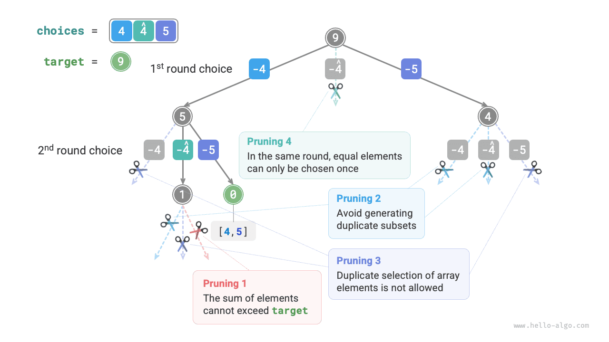

# 부분 집합 합 문제

## 중복 원소가 없는 경우

!!! question "문제"

    양의 정수 배열 `nums`와 목표 양의 정수 `target`이 주어진다. 원소의 합이 `target`인 모든 조합을 찾아라. 배열에는 중복 원소가 없고, 각 원소는 여러 번 선택할 수 있다. 조합들을 리스트로 반환하되 중복 조합이 없어야 한다.

예를 들어 입력 집합이 $\{3, 4, 5\}$이고 목표 정수가 $9$이면 해는 $\{3, 3, 3\}, \{4, 5\}$다. 다음 두 가지에 주의하자.

- 입력 집합의 원소는 횟수 제한 없이 반복 선택할 수 있다.
- 부분 집합에서는 원소의 순서를 구분하지 않는다. 예를 들어 $\{4, 5\}$와 $\{5, 4\}$는 같은 부분 집합이다.

### 모든 순열 풀이 참고

모든 순열 문제처럼 부분 집합을 만드는 과정을 연속된 선택의 결과로 볼 수 있다. 선택할 때마다 '원소의 합'을 갱신하고, 합이 `target`이 되면 해당 부분 집합을 결과 리스트에 기록한다.

모든 순열 문제와 달리 **이 문제에서는 집합의 원소를 횟수 제한 없이 선택할 수 있다**. 따라서 선택 여부를 기록하는 불리언 리스트 `selected`가 필요하지 않다. 모든 순열 코드를 조금 수정하면 다음과 같은 첫 풀이를 얻는다.

```src
[file]{subset_sum_i_naive}-[class]{}-[func]{subset_sum_i_naive}
```

위 코드에 배열 $[3, 4, 5]$와 목표 원소 $9$를 넣으면 $[3, 3, 3], [4, 5], [5, 4]$가 나온다. **합이 $9$인 모든 부분 집합을 찾았지만 $[4, 5]$와 $[5, 4]$는 중복이다**.

탐색 과정에서는 선택 순서를 구분하지만 부분 집합에서는 구분하지 않기 때문이다. 아래 그림에서 $4$ 다음 $5$를 고르는 것과 $5$ 다음 $4$를 고르는 것은 서로 다른 가지이지만 같은 부분 집합에 대응한다.


중복 부분 집합을 제거하는 **직접적인 방법은 결과 리스트에서 중복을 제거하는 것**이다. 하지만 다음 두 이유로 매우 비효율적이다.

- 배열 원소가 많고 특히 `target`이 크면 탐색 과정에서 중복 부분 집합이 매우 많이 생긴다.
- 부분 집합(배열)이 같은지 비교하는 데 시간이 많이 든다. 먼저 배열을 정렬한 뒤 원소를 하나씩 비교해야 한다.

### 중복 부분 집합 가지치기

**탐색 중 가지치기로 중복을 제거해 보자**. 아래 그림에서 중복 부분 집합은 배열 원소를 서로 다른 순서로 선택할 때 생긴다. 예를 들면 다음과 같다.

1. 첫 번째와 두 번째에 각각 $3$과 $4$를 선택하면 이 두 원소를 포함하는 모든 부분 집합 $[3, 4, \dots]$가 만들어진다.
2. 이후 첫 번째에 $4$를 선택하면 **두 번째에서는 $3$을 건너뛰어야 한다**. 이 선택으로 만드는 $[4, 3, \dots]$는 `1.` 단계에서 만든 부분 집합과 완전히 중복되기 때문이다.

탐색에서 각 레벨의 선택은 왼쪽부터 오른쪽 순서로 시도하므로, 오른쪽으로 갈수록 잘라 내는 가지가 많아진다.

1. 첫 두 차례에 $3$과 $5$를 선택하여 부분 집합 $[3, 5, \dots]$를 만든다.
2. 첫 두 차례에 $4$와 $5$를 선택하여 부분 집합 $[4, 5, \dots]$를 만든다.
3. 첫 번째에 $5$를 선택한다면 **두 번째에서는 $3$과 $4$를 건너뛰어야 한다**. $[5, 3, \dots]$와 $[5, 4, \dots]$는 `1.` 단계와 `2.` 단계의 부분 집합과 완전히 중복되기 때문이다.


정리하면 입력 배열이 $[x_1, x_2, \dots, x_n]$일 때 선택 순서 $[x_{i_1}, x_{i_2}, \dots, x_{i_m}]$는 $i_1 \leq i_2 \leq \dots \leq i_m$을 만족해야 한다. **이 조건을 만족하지 않는 선택 순서는 중복을 만들므로 가지치기해야 한다**.

### 코드 구현

이 가지치기를 위해 순회 시작점을 나타내는 변수 `start`를 초기화한다. **$x_{i}$를 선택한 뒤 다음 차례는 인덱스 $i$부터 순회하도록 설정한다**. 그러면 선택 순서가 $i_1 \leq i_2 \leq \dots \leq i_m$을 만족하여 부분 집합의 유일성을 보장한다.

이 밖에도 다음 두 가지를 최적화했다.

- 탐색을 시작하기 전에 배열 `nums`를 정렬한다. 선택지를 순회하다가 **부분 집합의 합이 `target`을 넘으면 반복문을 바로 종료한다**. 뒤의 원소들은 더 크므로 합도 반드시 `target`을 넘기 때문이다.
- 원소 합 변수 `total`을 없애고 **`target`에서 값을 빼는 방식으로 합을 추적한다**. `target`이 $0$이 되면 해를 기록한다.

```src
[file]{subset_sum_i}-[class]{}-[func]{subset_sum_i}
```

아래 그림은 배열 $[3, 4, 5]$와 목표 원소 $9$를 위 코드에 넣었을 때의 전체 백트래킹 과정이다.


## 중복 원소가 있는 경우

!!! question "문제"

    양의 정수 배열 `nums`와 목표 양의 정수 `target`이 주어진다. 원소의 합이 `target`인 모든 조합을 찾아라. **배열에는 중복 원소가 있을 수 있고, 각 원소는 한 번만 선택할 수 있다**. 조합들을 리스트로 반환하되 중복 조합이 없어야 한다.

앞 문제와 달리 **입력 배열에 중복 원소가 있을 수 있어** 새로운 문제가 생긴다. 예를 들어 배열 $[4, \hat{4}, 5]$와 목표 원소 $9$를 기존 코드에 넣으면 $[4, 5], [\hat{4}, 5]$가 나와 부분 집합이 중복된다.

**중복의 원인은 값이 같은 원소를 한 차례의 선택에서 여러 번 고르기 때문이다**. 아래 그림에서 첫 차례의 세 선택지 중 두 개가 $4$여서 중복된 두 탐색 가지가 만들어지고, 같은 부분 집합을 출력한다. 마찬가지로 두 번째 차례의 두 $4$도 중복을 만든다.


### 같은 값의 원소 가지치기

이를 해결하려면 **각 차례에서 같은 값의 원소를 한 번만 선택하도록 제한해야 한다**. 구현 방법은 간단하면서도 기발하다. 배열이 정렬되어 있으므로 같은 원소끼리는 인접한다. 따라서 한 차례의 선택에서 현재 원소가 왼쪽 원소와 같다면 이미 선택한 값이라는 뜻이므로 바로 건너뛴다.

또한 **이 문제에서는 각 배열 원소를 한 번만 선택할 수 있다**. 다행히 `start`로 이 제약도 만족시킬 수 있다. $x_{i}$를 선택한 뒤 다음 차례는 인덱스 $i + 1$부터 배열의 끝을 향해 순회하도록 설정한다. 그러면 중복 부분 집합과 같은 원소의 반복 선택을 모두 막을 수 있다.

### 코드 구현

```src
[file]{subset_sum_ii}-[class]{}-[func]{subset_sum_ii}
```

아래 그림은 배열 $[4, 4, 5]$와 목표 원소 $9$의 백트래킹 과정으로, 네 가지 가지치기를 포함한다. 그림과 코드 주석을 함께 보면서 전체 탐색 과정과 각 가지치기가 어떻게 작동하는지 이해해 보자.


