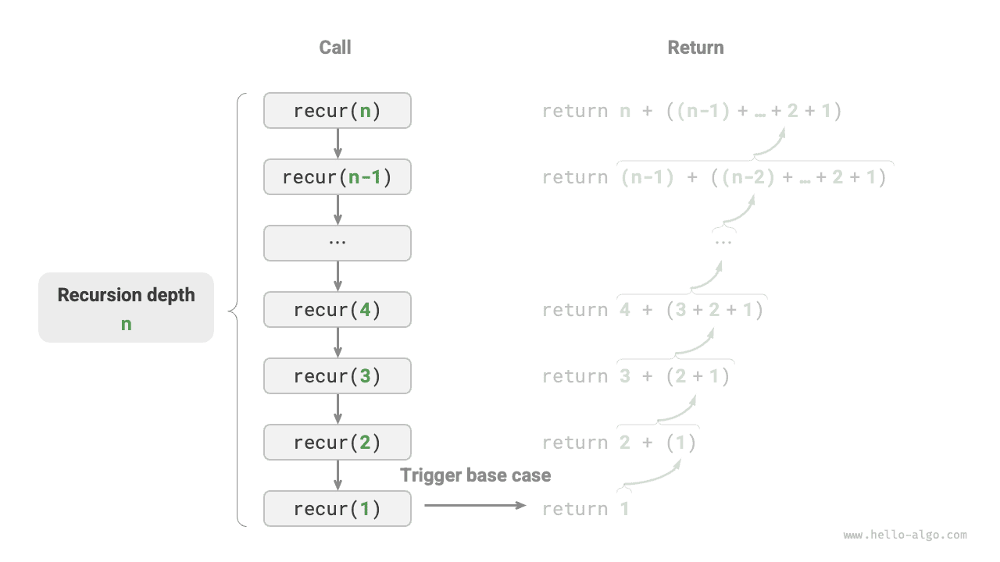

# 반복과 재귀

알고리즘에서는 특정 작업을 반복해서 실행하는 일이 흔하며, 이는 복잡도 분석과 밀접하게 연결되어 있다. 따라서 시간 복잡도와 공간 복잡도를 소개하기 전에, 프로그램에서 작업을 반복 실행하는 두 가지 기본 제어 구조인 반복과 재귀부터 알아보자.

## 반복

<u>반복(iteration)</u>은 특정 작업을 거듭 실행하는 제어 구조다. 반복에서는 일정한 조건을 만족하는 동안 코드 일부를 계속 실행하다가, 조건을 더 이상 만족하지 않으면 멈춘다.

### for 반복문

`for` 반복문은 가장 흔한 반복 형식 중 하나로, **반복 횟수를 미리 알고 있을 때 적합하다**.

다음 함수는 `for` 반복문으로 $1 + 2 + \dots + n$을 계산하고, 그 합을 변수 `res`에 기록한다. Python의 `range(a, b)`는 왼쪽 끝을 포함하고 오른쪽 끝은 포함하지 않는 구간이므로, 순회 범위는 $a, a + 1, \dots, b-1$이다.

```src
[file]{iteration}-[class]{}-[func]{for_loop}
```

아래 그림은 이 합계 함수의 순서도다.


이 합계 함수의 연산 횟수는 입력 데이터 크기 $n$에 비례한다. 이를 ‘선형 관계’라고도 한다. 실제로 **시간 복잡도가 설명하는 것이 바로 이 ‘선형 관계’다**. 관련 내용은 다음 절에서 자세히 소개한다.

### while 반복문

`for` 반복문과 마찬가지로 `while` 반복문도 반복을 구현하는 방법이다. `while` 반복문은 매번 먼저 조건을 검사하여 참이면 실행을 계속하고, 그렇지 않으면 반복을 끝낸다.

다음은 `while` 반복문으로 $1 + 2 + \dots + n$을 계산하는 코드다.

```src
[file]{iteration}-[class]{}-[func]{while_loop}
```

**`while` 반복문은 `for` 반복문보다 자유도가 높다**. `while` 반복문에서는 조건 변수의 초기화와 갱신 단계를 자유롭게 설계할 수 있다.

예를 들어 다음 코드에서는 조건 변수 $i$를 매번 두 차례 갱신한다. 이런 경우에는 `for` 반복문으로 구현하기가 다소 불편하다.

```src
[file]{iteration}-[class]{}-[func]{while_loop_ii}
```

전반적으로 **`for` 반복문은 코드가 더 간결하고, `while` 반복문은 더 유연하다**. 둘 다 반복 구조를 구현할 수 있으며, 어떤 것을 쓸지는 문제의 구체적인 요구에 따라 결정해야 한다.

### 중첩 반복문

하나의 반복 구조 안에 다른 반복 구조를 중첩할 수 있다. 다음은 `for` 반복문을 사용한 예다.

```src
[file]{iteration}-[class]{}-[func]{nested_for_loop}
```

아래 그림은 이 중첩 반복문의 순서도다.


이 경우 함수의 연산 횟수는 $n^2$에 비례한다. 즉, 알고리즘 실행 시간과 입력 데이터 크기 $n$ 사이에는 ‘제곱 관계’가 있다.

반복문을 계속 중첩할 수도 있다. 한 번 중첩할 때마다 ‘차원이 하나씩 늘어나’ 시간 복잡도가 ‘세제곱 관계’, ‘네제곱 관계’ 등으로 높아진다.

## 재귀

 <u>재귀(recursion)</u>는 함수가 자기 자신을 호출하여 문제를 해결하는 알고리즘 전략이다. 크게 두 단계로 이루어진다.

1. **내려가기**: 프로그램이 자기 자신을 계속 더 깊이 호출한다. 보통 더 작거나 단순한 인수를 전달하며, ‘종료 조건’에 도달할 때까지 이어진다.
2. **돌아오기**: ‘종료 조건’에 도달하면 가장 깊은 재귀 함수부터 한 단계씩 반환하며, 각 단계의 결과를 모은다.

구현 관점에서 보면 재귀 코드는 크게 세 요소로 이루어진다.

1. **종료 조건**: ‘내려가기’에서 ‘돌아오기’로 전환할 시점을 결정한다.
2. **재귀 호출**: ‘내려가기’에 해당한다. 함수가 자기 자신을 호출하며, 보통 더 작거나 단순한 인수를 입력한다.
3. **결과 반환**: ‘돌아오기’에 해당한다. 현재 재귀 단계의 결과를 이전 단계로 반환한다.

다음 코드를 보면, 함수 `recur(n)`을 호출하기만 하면 $1 + 2 + \dots + n$을 계산할 수 있다.

```src
[file]{recursion}-[class]{}-[func]{recur}
```

아래 그림은 이 함수의 재귀 과정을 보여 준다.


반복과 재귀는 계산 결과가 같을 수 있지만, **문제를 생각하고 해결하는 방식은 완전히 다르다**.

- **반복**: ‘상향식’으로 문제를 해결한다. 가장 기본적인 단계에서 시작해 그 단계를 계속 반복하거나 누적하여 작업을 완료한다.
- **재귀**: ‘하향식’으로 문제를 해결한다. 원래 문제를 같은 형태의 더 작은 부분 문제로 나눈다. 그런 다음 부분 문제를 더 작은 부분 문제로 계속 나누다가 기저 사례에 도달하면 멈춘다(기저 사례의 해는 이미 알고 있다).

앞의 합계 함수를 예로 들어, 문제를 $f(n) = 1 + 2 + \dots + n$이라고 하자.

- **반복**: 반복문에서 합을 구하는 과정을 재현한다. $1$부터 $n$까지 순회하면서 매번 더하면 $f(n)$을 구할 수 있다.
- **재귀**: 문제를 부분 문제 $f(n) = n + f(n-1)$로 나누고, 계속 재귀적으로 나누다가 기저 사례 $f(1) = 1$에 도달하면 멈춘다.

### 호출 스택

재귀 함수가 자기 자신을 호출할 때마다 시스템은 새로 실행되는 함수를 위해 메모리를 할당하고 지역 변수, 호출 주소 등의 정보를 저장한다. 이로 인해 두 가지 결과가 나타난다.

- 함수의 문맥 데이터는 ‘스택 프레임 공간’이라는 메모리 영역에 저장되며, 함수가 반환된 뒤에야 해제된다. 따라서 **재귀는 보통 반복보다 더 많은 메모리 공간을 사용한다**.
- 재귀 함수 호출에는 추가 비용이 발생한다. **따라서 재귀는 보통 반복문보다 시간 효율이 낮다**.

아래 그림과 같이 종료 조건에 도달하기 전에는 아직 반환되지 않은 재귀 함수가 $n$개 동시에 존재하므로, **재귀 깊이는 $n$이다**.



실제로 프로그래밍 언어가 허용하는 재귀 깊이는 보통 제한되어 있으며, 재귀가 너무 깊어지면 스택 오버플로 오류가 발생할 수 있다.

### 꼬리 재귀

흥미롭게도 **함수가 반환하기 직전의 마지막 단계에서 재귀 호출을 수행하면**, 컴파일러나 인터프리터가 이를 최적화하여 반복과 비슷한 공간 효율을 얻을 수 있다. 이런 경우를 <u>꼬리 재귀(tail recursion)</u>라고 한다.

- **일반 재귀**: 함수가 이전 단계의 함수로 반환된 뒤에도 실행할 코드가 남아 있으므로, 시스템은 이전 호출의 문맥을 저장해야 한다.
- **꼬리 재귀**: 재귀 호출이 함수 반환 전의 마지막 연산이다. 따라서 이전 단계로 반환된 뒤에 다른 연산을 수행할 필요가 없으므로, 시스템은 이전 함수의 문맥을 저장하지 않아도 된다.

$1 + 2 + \dots + n$을 계산하는 예에서 결과 변수 `res`를 함수 매개변수로 두면 꼬리 재귀를 구현할 수 있다.

```src
[file]{recursion}-[class]{}-[func]{tail_recur}
```

꼬리 재귀의 실행 과정은 아래 그림과 같다. 일반 재귀와 꼬리 재귀를 비교하면 합을 구하는 시점이 다르다.

- **일반 재귀**: ‘돌아오기’ 과정에서 합을 구한다. 각 단계가 반환된 뒤에 덧셈을 한 번씩 수행한다.
- **꼬리 재귀**: ‘내려가기’ 과정에서 합을 구한다. ‘돌아오기’ 과정에서는 단계별로 반환만 하면 된다.


!!! tip "참고"

    많은 컴파일러와 인터프리터가 꼬리 재귀 최적화를 지원하지 않는다는 점에 주의하자. 예를 들어 Python은 기본적으로 꼬리 재귀 최적화를 지원하지 않으므로, 함수가 꼬리 재귀 형태여도 스택 오버플로 문제가 발생할 수 있다.

### 재귀 트리

‘분할 정복’과 관련된 알고리즘 문제에서는 재귀가 반복보다 생각하기 쉽고 코드도 읽기 쉬운 경우가 많다. ‘피보나치 수열’을 예로 살펴보자.

!!! question "문제"

    피보나치 수열 $0, 1, 1, 2, 3, 5, 8, 13, \dots$가 주어졌을 때, 이 수열의 $n$번째 수를 구하라.

피보나치 수열의 $n$번째 수를 $f(n)$이라고 하면 다음 두 가지 사실을 쉽게 알 수 있다.

- 수열의 첫 두 수는 $f(1) = 0$과 $f(2) = 1$이다.
- 수열의 각 수는 앞의 두 수의 합이다. 즉, $f(n) = f(n - 1) + f(n - 2)$이다.

점화 관계에 따라 재귀 호출을 하고 첫 두 수를 종료 조건으로 삼으면 재귀 코드를 작성할 수 있다. `fib(n)`을 호출하면 피보나치 수열의 $n$번째 수를 얻는다.

```src
[file]{recursion}-[class]{}-[func]{fib}
```

위 코드는 함수 안에서 두 번의 재귀 호출을 수행한다. **이는 하나의 호출에서 두 개의 호출 분기가 생긴다는 뜻이다**. 아래 그림과 같이 재귀 호출을 계속하면 최종적으로 $n$개 층으로 이루어진 <u>재귀 트리(recursion tree)</u>가 만들어진다.


본질적으로 재귀는 ‘문제를 더 작은 부분 문제로 나누는’ 사고방식을 보여 준다. 이러한 분할 정복 전략은 매우 중요하다.

- 알고리즘 관점에서 탐색, 정렬, 백트래킹, 분할 정복, 동적 계획법 등 중요한 알고리즘 전략 다수가 이 사고방식을 직간접적으로 활용한다.
- 자료 구조 관점에서 재귀는 연결 리스트, 트리, 그래프와 관련된 문제를 다루는 데 자연스럽게 어울린다. 이들은 분할 정복 관점으로 분석하기에 매우 적합하기 때문이다.

## 두 방식의 비교

앞의 내용을 정리하면, 아래 표와 같이 반복과 재귀는 구현, 성능, 적용 범위에서 차이가 있다.

<p align="center"> 표 <id> &nbsp; 반복과 재귀의 특징 비교 </p>

|          | 반복                                   | 재귀                                                         |
| -------- | -------------------------------------- | ------------------------------------------------------------ |
| 구현 방식 | 반복 구조                               | 함수가 자기 자신을 호출                                                 |
| 시간 효율 | 보통 효율이 높고 함수 호출 비용이 없음           | 함수 호출마다 비용이 발생함                                     |
| 메모리 사용 | 보통 고정 크기의 메모리 공간을 사용함             | 함수 호출이 누적되면 스택 프레임 공간을 많이 사용할 수 있음                           |
| 적합한 문제 | 간단한 반복 작업에 적합하며 코드가 직관적이고 읽기 쉬움 | 트리, 그래프, 분할 정복, 백트래킹 등 부분 문제로 나누는 문제에 적합하며 코드 구조가 간결하고 명확함 |

!!! tip "참고"

    다음 내용이 이해하기 어렵다면 ‘스택’ 장을 읽은 뒤에 다시 복습해도 좋다.

그렇다면 반복과 재귀는 내부적으로 어떤 관계가 있을까? 앞의 재귀 함수를 예로 들면, 합을 구하는 연산은 재귀의 ‘돌아오기’ 단계에서 수행된다. 즉, 가장 먼저 호출된 함수가 실제로는 가장 나중에 자신의 덧셈을 마친다. **이 작동 방식은 스택의 ‘후입선출’ 원리와 통한다**.

실제로 ‘호출 스택’, ‘스택 프레임 공간’ 같은 재귀 관련 용어에도 재귀와 스택의 밀접한 관계가 드러난다.

1. **내려가기**: 함수가 호출되면 시스템은 ‘호출 스택’에 새로운 스택 프레임을 할당하여 함수의 지역 변수, 매개변수, 반환 주소 등의 데이터를 저장한다.
2. **돌아오기**: 함수가 실행을 마치고 반환되면 해당 스택 프레임이 ‘호출 스택’에서 제거되고, 이전 함수의 실행 환경이 복원된다.

따라서 **명시적인 스택으로 호출 스택의 동작을 재현하면**, 재귀를 반복 형태로 바꿀 수 있다.

```src
[file]{recursion}-[class]{}-[func]{for_loop_recur}
```

위 코드를 보면 재귀를 반복으로 바꾸자 코드가 더 복잡해졌다. 반복과 재귀는 많은 경우 서로 변환할 수 있지만, 다음 두 가지 이유로 항상 그럴 가치가 있는 것은 아니다.

- 변환한 코드가 더 이해하기 어렵고 가독성이 떨어질 수 있다.
- 복잡한 문제에서는 시스템 호출 스택의 동작을 재현하기가 매우 어려울 수 있다.

결국 **반복과 재귀 중 어떤 것을 선택할지는 문제의 구체적인 성격에 달려 있다**. 실제 프로그래밍에서는 둘의 장단점을 비교하고 상황에 맞는 방법을 선택하는 것이 중요하다.
