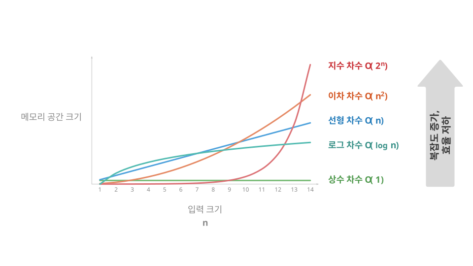
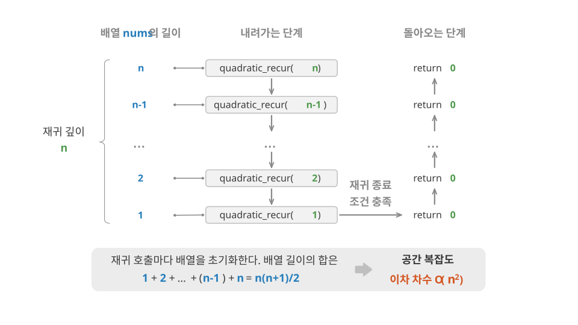
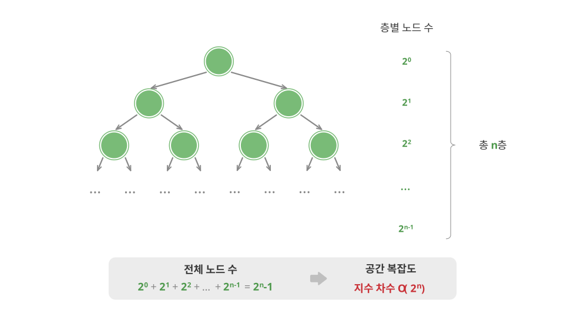

# 공간 복잡도

<u>공간 복잡도(space complexity)</u>는 데이터 양이 많아질 때 알고리즘이 차지하는 메모리 공간이 증가하는 추세를 측정한다. 시간 복잡도와 매우 비슷한 개념으로, ‘실행 시간’을 ‘차지하는 메모리 공간’으로 바꾸면 된다.

## 알고리즘과 관련된 공간

알고리즘이 실행 중 사용하는 메모리 공간에는 주로 다음과 같은 종류가 있다.

- **입력 공간**: 알고리즘의 입력 데이터를 저장한다.
- **임시 공간**: 실행 중의 변수, 객체, 함수 문맥 등의 데이터를 저장한다.
- **출력 공간**: 알고리즘의 출력 데이터를 저장한다.

일반적으로 공간 복잡도에 포함하는 범위는 ‘임시 공간’과 ‘출력 공간’의 합이다.

임시 공간은 다시 세 부분으로 나눌 수 있다.

- **임시 데이터**: 실행 중의 각종 상수, 변수, 객체 등을 저장한다.
- **스택 프레임 공간**: 호출한 함수의 문맥 데이터를 저장한다. 시스템은 함수가 호출될 때마다 스택 맨 위에 스택 프레임을 만들며, 함수가 반환되면 이 공간을 해제한다.
- **명령어 공간**: 컴파일된 프로그램 명령어를 저장하며, 실제 계산에서는 보통 무시한다.

프로그램의 공간 복잡도를 분석할 때는 아래 그림과 같이 **보통 임시 데이터, 스택 프레임 공간, 출력 데이터의 세 부분을 계산한다**.


관련 코드는 다음과 같다.

```snippet
space_categories
```

## 계산 방법

공간 복잡도를 구하는 방법은 시간 복잡도와 대체로 같다. 계산 대상을 ‘연산 횟수’에서 ‘사용 공간의 크기’로 바꾸면 된다.

시간 복잡도와 달리 **보통 최악 공간 복잡도에만 관심을 둔다**. 메모리 공간은 반드시 충족해야 하는 요구 사항이므로, 어떤 입력 데이터에서도 충분한 메모리 공간이 확보되어 있어야 하기 때문이다.

다음 코드를 보면 최악 공간 복잡도에서 ‘최악’은 두 가지 의미를 지닌다.

1. **가장 불리한 입력 데이터를 기준으로 한다**: $n < 10$이면 공간 복잡도는 $O(1)$이다. 그러나 $n > 10$이면 초기화한 배열 `nums`가 $O(n)$ 공간을 차지하므로 최악 공간 복잡도는 $O(n)$이다.
2. **알고리즘 실행 중 최대 메모리 사용량을 기준으로 한다**: 예를 들어 프로그램이 마지막 줄을 실행하기 전에는 $O(1)$ 공간을 차지하지만, 배열 `nums`를 초기화하면 $O(n)$ 공간을 차지한다. 따라서 최악 공간 복잡도는 $O(n)$이다.

```snippet
worst_case_space
```

**재귀 함수에서는 스택 프레임 공간을 계산하는 데 주의해야 한다**. 다음 코드를 살펴보자.

```snippet
loop_vs_recursion_space
```

함수 `loop()`와 `recur()`의 시간 복잡도는 모두 $O(n)$이지만 공간 복잡도는 다르다.

- 함수 `loop()`는 반복문에서 `function()`을 $n$번 호출한다. 매번 `function()`이 반환되어 스택 프레임 공간이 해제되므로, 공간 복잡도는 여전히 $O(1)$이다.
- 재귀 함수 `recur()`의 실행 중에는 아직 반환되지 않은 `recur()`가 $n$개 동시에 존재하므로, $O(n)$의 스택 프레임 공간을 차지한다.

## 대표적인 유형

입력 데이터 크기를 $n$이라고 할 때, 아래 그림은 대표적인 공간 복잡도 유형을 낮은 순서대로 보여 준다.

$$
\begin{aligned}
& O(1) < O(\log n) < O(n) < O(n^2) < O(2^n) \newline
& \text{상수} < \text{로그} < \text{선형} < \text{제곱} < \text{지수}
\end{aligned}
$$



### 상수 공간 $O(1)$

상수 공간은 개수가 입력 데이터 크기 $n$과 무관한 상수, 변수, 객체에서 흔히 나타난다.

반복문에서 변수를 초기화하거나 함수를 호출할 때 사용하는 메모리는 다음 반복에 들어가면 해제되므로 공간이 누적되지 않는다. 따라서 공간 복잡도는 여전히 $O(1)$이다.

```src
[file]{space_complexity}-[class]{}-[func]{constant}
```

### 선형 공간 $O(n)$

선형 공간은 원소 수가 $n$에 비례하는 배열, 연결 리스트, 스택, 큐 등에 흔히 나타난다.

```src
[file]{space_complexity}-[class]{}-[func]{linear}
```

아래 그림과 같이 이 함수의 재귀 깊이는 $n$이다. 즉, 아직 반환되지 않은 `linear_recur()` 함수가 $n$개 동시에 존재하며 $O(n)$ 크기의 스택 프레임 공간을 사용한다.

```src
[file]{space_complexity}-[class]{}-[func]{linear_recur}
```


### 제곱 공간 $O(n^2)$

제곱 공간은 원소 수가 $n$의 제곱에 비례하는 행렬과 그래프에 흔히 나타난다.

```src
[file]{space_complexity}-[class]{}-[func]{quadratic}
```

아래 그림과 같이 이 함수의 재귀 깊이는 $n$이고, 각 재귀 함수에서 길이가 각각 $n$, $n-1$, $\dots$, $2$, $1$인 배열을 초기화한다. 평균 길이는 $n / 2$이므로 전체적으로 $O(n^2)$ 공간을 차지한다.

```src
[file]{space_complexity}-[class]{}-[func]{quadratic_recur}
```



### 지수 공간 $O(2^n)$

지수 공간은 이진 트리에 흔히 나타난다. 아래 그림에서 층수가 $n$인 ‘포화 이진 트리’의 노드 수는 $2^n - 1$이므로 $O(2^n)$ 공간을 차지한다.

```src
[file]{space_complexity}-[class]{}-[func]{build_tree}
```



### 로그 공간 $O(\log n)$

로그 공간은 분할 정복 알고리즘에 흔히 나타난다. 예를 들어 병합 정렬은 길이가 $n$인 배열을 입력받아 재귀 호출마다 중간 지점에서 반으로 나눈다. 높이가 $\log n$인 재귀 트리가 만들어지므로 $O(\log n)$의 스택 프레임 공간을 사용한다.

또 다른 예로 수를 문자열로 변환하는 경우를 보자. 양의 정수 $n$을 입력받으면 자릿수는 $\lfloor \log_{10} n \rfloor + 1$이며, 대응하는 문자열 길이도 $\lfloor \log_{10} n \rfloor + 1$이다. 따라서 공간 복잡도는 $O(\log_{10} n + 1) = O(\log n)$이다.

## 시간과 공간의 절충

이상적으로는 알고리즘의 시간 복잡도와 공간 복잡도가 모두 최적이기를 바란다. 그러나 실제로 두 복잡도를 동시에 최적화하기는 대개 매우 어렵다.

**시간 복잡도를 낮추려면 보통 공간 복잡도가 높아지는 대가를 치러야 하며, 그 반대도 마찬가지다**. 메모리 공간을 더 사용하여 실행 속도를 높이는 방식을 ‘공간으로 시간을 절약하기’, 반대의 방식을 ‘시간으로 공간을 절약하기’라고 한다.

어떤 방식을 선택할지는 어느 쪽을 더 중시하는지에 달려 있다. 대부분의 경우 시간이 공간보다 귀하므로 ‘공간으로 시간을 절약하기’가 더 널리 쓰인다. 물론 데이터 양이 매우 많다면 공간 복잡도를 관리하는 것 역시 중요하다.
