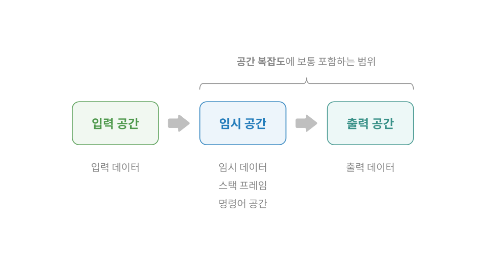
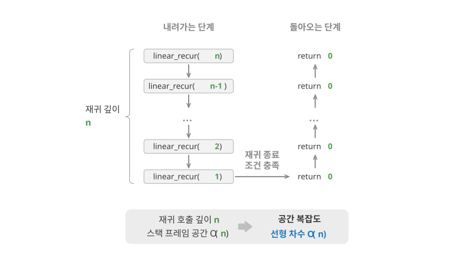

# 공간 복잡도

<u>공간 복잡도(space complexity)</u>는 입력 크기가 커질 때 알고리즘이 차지하는 메모리 공간이 어떻게 증가하는지를 나타낸다. 시간 복잡도에서 ‘실행 시간’을 ‘메모리 사용량’으로 바꾸면 되는, 매우 비슷한 개념이다.

## 알고리즘이 사용하는 공간

알고리즘이 실행 중에 사용하는 메모리 공간은 크게 다음과 같이 나뉜다.

- **입력 공간**은 알고리즘의 입력 데이터를 저장한다.
- **임시 공간**은 실행 중에 필요한 변수, 객체, 함수의 실행 상태 등을 저장한다.
- **출력 공간**은 알고리즘의 출력 데이터를 저장한다.

보통 공간 복잡도를 구할 때는 임시 공간과 출력 공간을 합한다.

임시 공간은 다시 세 부분으로 나눌 수 있다.

- **임시 데이터**에는 실행 중에 보관하는 각종 상수, 변수, 객체 등이 있다.
- **스택 프레임 공간**은 호출한 함수의 실행 상태를 보관한다. 함수를 호출할 때마다 시스템이 스택 꼭대기에 프레임을 하나 만들고, 함수가 반환하면 그 공간을 해제한다.
- **명령어 공간**은 컴파일한 프로그램 명령어를 저장한다. 실제 계산에서는 보통 무시한다.

프로그램의 공간 복잡도를 분석할 때는 아래 그림처럼 **일반적으로 임시 데이터, 스택 프레임 공간, 출력 데이터 세 부분을 계산한다**.



이를 코드로 나타내면 다음과 같다.

```snippet
space_categories
```

## 공간 복잡도 구하기

공간 복잡도를 구하는 방법은 시간 복잡도와 거의 같다. ‘연산 횟수’ 대신 ‘사용하는 공간의 크기’를 계산하면 된다.

시간 복잡도와 한 가지 다른 점은 **보통 최악 공간 복잡도에만 주목한다**는 것이다. 메모리는 반드시 충족해야 하는 요구 사항이므로 어떤 입력이 들어와도 충분한 공간을 확보해야 하기 때문이다.

다음 코드를 보면 최악 공간 복잡도의 ‘최악’에는 두 가지 의미가 있다.

1. **가장 많은 공간이 필요한 입력을 기준으로 한다**. $n < 10$이면 공간 복잡도는 $O(1)$이다. 그러나 $n > 10$이면 초기화한 배열 `nums`가 $O(n)$의 공간을 차지하므로 최악 공간 복잡도는 $O(n)$이다.
2. **실행 중 메모리를 가장 많이 쓰는 시점을 기준으로 한다**. 예를 들어 마지막 줄을 실행하기 전까지 프로그램이 차지하는 공간은 $O(1)$이다. 배열 `nums`를 초기화하면 $O(n)$의 공간을 차지하므로 최악 공간 복잡도는 $O(n)$이다.

```snippet
worst_case_space
```

**재귀 함수에서는 스택 프레임 공간을 빠뜨리지 않도록 주의하자**. 다음 코드를 살펴보자.

```snippet
loop_vs_recursion_space
```

함수 `loop()`와 `recur()`의 시간 복잡도는 모두 $O(n)$이지만 공간 복잡도는 다르다.

- 함수 `loop()`에서는 반복문 안에서 `function()`을 $n$번 호출한다. 매번 `function()`이 반환하면서 스택 프레임 공간을 해제하므로 공간 복잡도는 여전히 $O(1)$이다.
- 재귀 함수 `recur()`가 실행되는 동안 아직 반환하지 않은 `recur()` 호출이 동시에 $n$개 존재하므로 스택 프레임에 $O(n)$의 공간이 필요하다.

## 대표적인 유형

입력 크기를 $n$이라고 하자. 다음 그림은 대표적인 공간 복잡도를 낮은 것부터 높은 것까지 보여 준다.

$$
\begin{aligned}
& O(1) < O(\log n) < O(n) < O(n^2) < O(2^n) \newline
& \text{상수 차수} < \text{로그 차수} < \text{선형 차수} < \text{이차 차수} < \text{지수 차수}
\end{aligned}
$$


### 상수 차수 $O(1)$

상수 차수의 대표적인 예는 입력 크기 $n$과 무관하게 개수가 일정한 상수, 변수, 객체다.

반복문 안에서 변수를 초기화하거나 함수를 호출할 때 쓴 메모리는 다음 반복으로 넘어가면 해제된다는 점에 주의하자. 공간 사용량이 누적되지 않으므로 공간 복잡도는 여전히 $O(1)$이다.

```src
[file]{space_complexity}-[class]{}-[func]{constant}
```

### 선형 차수 $O(n)$

원소 수가 $n$에 비례하는 배열, 연결 리스트, 스택, 큐 등에서 선형 공간 복잡도를 흔히 볼 수 있다.

```src
[file]{space_complexity}-[class]{}-[func]{linear}
```

아래 그림에서 함수의 재귀 깊이는 $n$이다. 즉, 아직 반환하지 않은 `linear_recur()` 호출이 동시에 $n$개 존재해 스택 프레임에 $O(n)$의 공간을 사용한다.

```src
[file]{space_complexity}-[class]{}-[func]{linear_recur}
```



### 이차 차수 $O(n^2)$

행렬과 그래프처럼 원소 수가 $n$의 제곱에 비례하는 경우에는 흔히 이차 공간 복잡도가 나타난다.

```src
[file]{space_complexity}-[class]{}-[func]{quadratic}
```

다음 그림에서 함수의 재귀 깊이는 $n$이며 각 호출에서 배열 하나를 초기화한다. 길이는 각각 $n$, $n-1$, $\dots$, $2$, $1$이고 평균 길이는 $n / 2$이므로 전체 공간 사용량은 $O(n^2)$이다.

```src
[file]{space_complexity}-[class]{}-[func]{quadratic_recur}
```


### 지수 차수 $O(2^n)$

이진 트리에서는 지수 공간 복잡도를 흔히 볼 수 있다. 아래 그림처럼 층수가 $n$인 포화 이진 트리는 노드 수가 $2^n - 1$이므로 $O(2^n)$의 공간을 차지한다.

```src
[file]{space_complexity}-[class]{}-[func]{build_tree}
```


### 로그 차수 $O(\log n)$

로그 차수는 분할 정복 알고리즘에서 흔히 나타난다. 예를 들어 병합 정렬은 길이가 $n$인 배열을 입력받아 재귀 단계마다 가운데에서 반으로 나눈다. 그 결과 높이가 $\log n$인 재귀 트리가 만들어지며 스택 프레임에 $O(\log n)$의 공간을 사용한다.

수를 문자열로 바꾸는 예도 살펴보자. 양의 정수 $n$의 자릿수는 $\lfloor \log_{10} n \rfloor + 1$이므로 대응하는 문자열의 길이도 $\lfloor \log_{10} n \rfloor + 1$이다. 따라서 공간 복잡도는 $O(\log_{10} n + 1) = O(\log n)$이다.

## 시간과 공간의 절충

이상적으로는 알고리즘의 시간 복잡도와 공간 복잡도를 모두 최적으로 만들고 싶다. 하지만 실제로 두 가지를 동시에 최적화하기는 대개 매우 어렵다.

**시간 복잡도를 낮추려면 대개 공간 복잡도가 높아지고, 그 반대도 마찬가지다**. 메모리를 더 써서 실행 속도를 높이는 것을 ‘공간으로 시간을 절약한다’고 하고, 반대의 경우를 ‘시간을 들여 공간을 절약한다’고 한다.

무엇을 선택할지는 어느 쪽을 더 중요하게 여기는지에 달려 있다. 대개는 공간보다 시간이 더 귀하므로 공간을 더 써서 시간을 줄이는 전략을 많이 쓴다. 물론 데이터가 매우 많으면 공간 복잡도를 억제하는 일도 중요하다.
