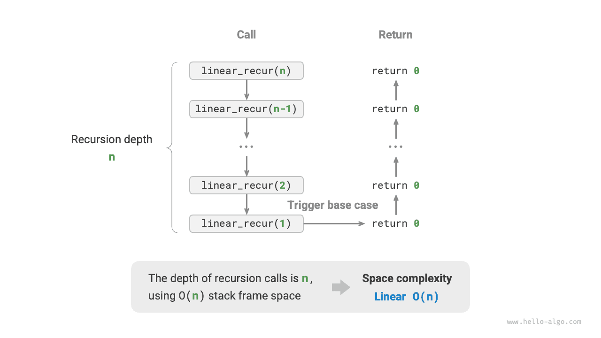
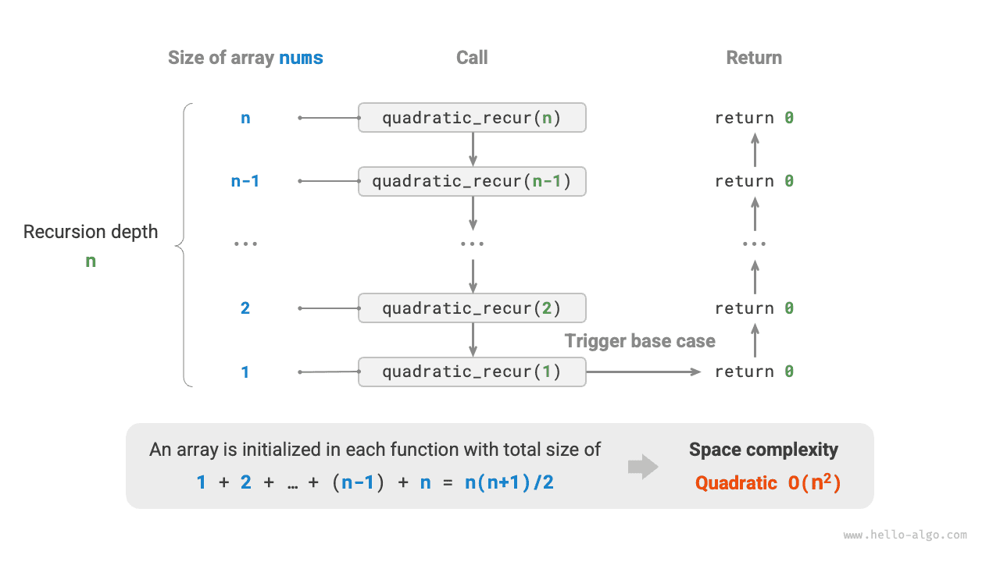

# 공간 복잡도

<u>공간 복잡도(space complexity)</u>는 데이터 양이 많아질 때 알고리즘이 차지하는 메모리 공간이 증가하는 추세를 측정한다. 시간 복잡도와 매우 비슷한 개념으로, ‘실행 시간’을 ‘차지하는 메모리 공간’으로 바꾸면 된다.

## 알고리즘과 관련된 공간

알고리즘이 실행 중 사용하는 메모리 공간에는 주로 다음과 같은 종류가 있다.

- **입력 공간**: 알고리즘의 입력 데이터를 저장한다.
- **임시 공간**: 실행 중의 변수, 객체, 함수 문맥 등의 데이터를 저장한다.
- **출력 공간**: 알고리즘의 출력 데이터를 저장한다.

일반적으로 공간 복잡도에 포함하는 범위는 ‘임시 공간’과 ‘출력 공간’의 합이다.

임시 공간은 다시 세 부분으로 나눌 수 있다.

- **임시 데이터**: 실행 중의 각종 상수, 변수, 객체 등을 저장한다.
- **스택 프레임 공간**: 호출한 함수의 문맥 데이터를 저장한다. 시스템은 함수가 호출될 때마다 스택 맨 위에 스택 프레임을 만들며, 함수가 반환되면 이 공간을 해제한다.
- **명령어 공간**: 컴파일된 프로그램 명령어를 저장하며, 실제 계산에서는 보통 무시한다.

프로그램의 공간 복잡도를 분석할 때는 아래 그림과 같이 **보통 임시 데이터, 스택 프레임 공간, 출력 데이터의 세 부분을 계산한다**.


관련 코드는 다음과 같다.

=== "Python"

    ```python title=""
    class Node:
        """클래스"""
        def __init__(self, x: int):
            self.val: int = x              # 노드 값
            self.next: Node | None = None  # 다음 노드를 가리키는 참조

    def function() -> int:
        """함수"""
        # 몇 가지 연산 수행...
        return 0

    def algorithm(n) -> int:  # 입력 데이터
        A = 0                 # 임시 데이터(상수, 보통 대문자로 표기)
        b = 0                 # 임시 데이터(변수)
        node = Node(0)        # 임시 데이터(객체)
        c = function()        # 스택 프레임 공간(함수 호출)
        return A + b + c      # 출력 데이터
    ```

=== "C++"

    ```cpp title=""
    /* 구조체 */
    struct Node {
        int val;
        Node *next;
        Node(int x) : val(x), next(nullptr) {}
    };

    /* 함수 */
    int func() {
        // 몇 가지 연산 수행...
        return 0;
    }

    int algorithm(int n) {        // 입력 데이터
        const int a = 0;          // 임시 데이터(상수)
        int b = 0;                // 임시 데이터(변수)
        Node* node = new Node(0); // 임시 데이터(객체)
        int c = func();           // 스택 프레임 공간(함수 호출)
        return a + b + c;         // 출력 데이터
    }
    ```

=== "Java"

    ```java title=""
    /* 클래스 */
    class Node {
        int val;
        Node next;
        Node(int x) { val = x; }
    }
    
    /* 함수 */
    int function() {
        // 몇 가지 연산 수행...
        return 0;
    }
    
    int algorithm(int n) {        // 입력 데이터
        final int a = 0;          // 임시 데이터(상수)
        int b = 0;                // 임시 데이터(변수)
        Node node = new Node(0);  // 임시 데이터(객체)
        int c = function();       // 스택 프레임 공간(함수 호출)
        return a + b + c;         // 출력 데이터
    }
    ```

=== "C#"

    ```csharp title=""
    /* 클래스 */
    class Node(int x) {
        int val = x;
        Node next;
    }

    /* 함수 */
    int Function() {
        // 몇 가지 연산 수행...
        return 0;
    }

    int Algorithm(int n) {        // 입력 데이터
        const int a = 0;          // 임시 데이터(상수)
        int b = 0;                // 임시 데이터(변수)
        Node node = new(0);       // 임시 데이터(객체)
        int c = Function();       // 스택 프레임 공간(함수 호출)
        return a + b + c;         // 출력 데이터
    }
    ```

=== "Go"

    ```go title=""
    /* 구조체 */
    type node struct {
        val  int
        next *node
    }

    /* node 구조체 생성  */
    func newNode(val int) *node {
        return &node{val: val}
    }
    
    /* 함수 */
    func function() int {
        // 몇 가지 연산 수행...
        return 0
    }

    func algorithm(n int) int { // 입력 데이터
        const a = 0             // 임시 데이터(상수)
        b := 0                  // 임시 데이터(변수)
        newNode(0)              // 임시 데이터(객체)
        c := function()         // 스택 프레임 공간(함수 호출)
        return a + b + c        // 출력 데이터
    }
    ```

=== "Swift"

    ```swift title=""
    /* 클래스 */
    class Node {
        var val: Int
        var next: Node?

        init(x: Int) {
            val = x
        }
    }

    /* 함수 */
    func function() -> Int {
        // 몇 가지 연산 수행...
        return 0
    }

    func algorithm(n: Int) -> Int { // 입력 데이터
        let a = 0             // 임시 데이터(상수)
        var b = 0             // 임시 데이터(변수)
        let node = Node(x: 0) // 임시 데이터(객체)
        let c = function()    // 스택 프레임 공간(함수 호출)
        return a + b + c      // 출력 데이터
    }
    ```

=== "JS"

    ```javascript title=""
    /* 클래스 */
    class Node {
        val;
        next;
        constructor(val) {
            this.val = val === undefined ? 0 : val; // 노드 값
            this.next = null;                       // 다음 노드를 가리키는 참조
        }
    }

    /* 함수 */
    function constFunc() {
        // 몇 가지 연산 수행
        return 0;
    }

    function algorithm(n) {       // 입력 데이터
        const a = 0;              // 임시 데이터(상수)
        let b = 0;                // 임시 데이터(변수)
        const node = new Node(0); // 임시 데이터(객체)
        const c = constFunc();    // 스택 프레임 공간(함수 호출)
        return a + b + c;         // 출력 데이터
    }
    ```

=== "TS"

    ```typescript title=""
    /* 클래스 */
    class Node {
        val: number;
        next: Node | null;
        constructor(val?: number) {
            this.val = val === undefined ? 0 : val; // 노드 값
            this.next = null;                       // 다음 노드를 가리키는 참조
        }
    }

    /* 함수 */
    function constFunc(): number {
        // 몇 가지 연산 수행
        return 0;
    }

    function algorithm(n: number): number { // 입력 데이터
        const a = 0;                        // 임시 데이터(상수)
        let b = 0;                          // 임시 데이터(변수)
        const node = new Node(0);           // 임시 데이터(객체)
        const c = constFunc();              // 스택 프레임 공간(함수 호출)
        return a + b + c;                   // 출력 데이터
    }
    ```

=== "Dart"

    ```dart title=""
    /* 클래스 */
    class Node {
      int val;
      Node next;
      Node(this.val, [this.next]);
    }

    /* 함수 */
    int function() {
      // 몇 가지 연산 수행...
      return 0;
    }

    int algorithm(int n) {  // 입력 데이터
      const int a = 0;      // 임시 데이터(상수)
      int b = 0;            // 임시 데이터(변수)
      Node node = Node(0);  // 임시 데이터(객체)
      int c = function();   // 스택 프레임 공간(함수 호출)
      return a + b + c;     // 출력 데이터
    }
    ```

=== "Rust"

    ```rust title=""
    use std::rc::Rc;
    use std::cell::RefCell;
    
    /* 구조체 */
    struct Node {
        val: i32,
        next: Option<Rc<RefCell<Node>>>,
    }

    /* Node 구조체 생성 */
    impl Node {
        fn new(val: i32) -> Self {
            Self { val: val, next: None }
        }
    }

    /* 함수 */
    fn function() -> i32 {      
        // 몇 가지 연산 수행...
        return 0;
    }

    fn algorithm(n: i32) -> i32 {       // 입력 데이터
        const a: i32 = 0;               // 임시 데이터(상수)
        let mut b = 0;                  // 임시 데이터(변수)
        let node = Node::new(0);        // 임시 데이터(객체)
        let c = function();             // 스택 프레임 공간(함수 호출)
        return a + b + c;               // 출력 데이터
    }
    ```

=== "C"

    ```c title=""
    /* 함수 */
    int func() {
        // 몇 가지 연산 수행...
        return 0;
    }

    int algorithm(int n) { // 입력 데이터
        const int a = 0;   // 임시 데이터(상수)
        int b = 0;         // 임시 데이터(변수)
        int c = func();    // 스택 프레임 공간(함수 호출)
        return a + b + c;  // 출력 데이터
    }
    ```

=== "Kotlin"

    ```kotlin title=""
    /* 클래스 */
    class Node(var _val: Int) {
        var next: Node? = null
    }

    /* 함수 */
    fun function(): Int {
        // 몇 가지 연산 수행...
        return 0
    }

    fun algorithm(n: Int): Int { // 입력 데이터
        val a = 0                // 임시 데이터(상수)
        var b = 0                // 임시 데이터(변수)
        val node = Node(0)       // 임시 데이터(객체)
        val c = function()       // 스택 프레임 공간(함수 호출)
        return a + b + c         // 출력 데이터
    }
    ```

=== "Ruby"

    ```ruby title=""
    ### 클래스 ###
    class Node
        attr_accessor :val      # 노드 값
        attr_accessor :next     # 다음 노드를 가리키는 참조

        def initialize(x)
            @val = x
        end
    end

    ### 함수 ###
    def function
        # 몇 가지 연산 수행...
        0
    end

    ### 알고리즘 ###
    def algorithm(n)        # 입력 데이터
        a = 0               # 임시 데이터(상수)
        b = 0               # 임시 데이터(변수)
        node = Node.new(0)  # 임시 데이터(객체)
        c = function        # 스택 프레임 공간(함수 호출)
        a + b + c           # 출력 데이터
    end
    ```

## 계산 방법

공간 복잡도를 구하는 방법은 시간 복잡도와 대체로 같다. 계산 대상을 ‘연산 횟수’에서 ‘사용 공간의 크기’로 바꾸면 된다.

시간 복잡도와 달리 **보통 최악 공간 복잡도에만 관심을 둔다**. 메모리 공간은 반드시 충족해야 하는 요구 사항이므로, 어떤 입력 데이터에서도 충분한 메모리 공간이 확보되어 있어야 하기 때문이다.

다음 코드를 보면 최악 공간 복잡도에서 ‘최악’은 두 가지 의미를 지닌다.

1. **가장 불리한 입력 데이터를 기준으로 한다**: $n < 10$이면 공간 복잡도는 $O(1)$이다. 그러나 $n > 10$이면 초기화한 배열 `nums`가 $O(n)$ 공간을 차지하므로 최악 공간 복잡도는 $O(n)$이다.
2. **알고리즘 실행 중 최대 메모리 사용량을 기준으로 한다**: 예를 들어 프로그램이 마지막 줄을 실행하기 전에는 $O(1)$ 공간을 차지하지만, 배열 `nums`를 초기화하면 $O(n)$ 공간을 차지한다. 따라서 최악 공간 복잡도는 $O(n)$이다.

=== "Python"

    ```python title=""
    def algorithm(n: int):
        a = 0               # O(1)
        b = [0] * 10000     # O(1)
        if n > 10:
            nums = [0] * n  # O(n)
    ```

=== "C++"

    ```cpp title=""
    void algorithm(int n) {
        int a = 0;               // O(1)
        vector<int> b(10000);    // O(1)
        if (n > 10)
            vector<int> nums(n); // O(n)
    }
    ```

=== "Java"

    ```java title=""
    void algorithm(int n) {
        int a = 0;                   // O(1)
        int[] b = new int[10000];    // O(1)
        if (n > 10)
            int[] nums = new int[n]; // O(n)
    }
    ```

=== "C#"

    ```csharp title=""
    void Algorithm(int n) {
        int a = 0;                   // O(1)
        int[] b = new int[10000];    // O(1)
        if (n > 10) {
            int[] nums = new int[n]; // O(n)
        }
    }
    ```

=== "Go"

    ```go title=""
    func algorithm(n int) {
        a := 0                      // O(1)
        b := make([]int, 10000)     // O(1)
        var nums []int
        if n > 10 {
            nums := make([]int, n)  // O(n)
        }
        fmt.Println(a, b, nums)
    }
    ```

=== "Swift"

    ```swift title=""
    func algorithm(n: Int) {
        let a = 0 // O(1)
        let b = Array(repeating: 0, count: 10000) // O(1)
        if n > 10 {
            let nums = Array(repeating: 0, count: n) // O(n)
        }
    }
    ```

=== "JS"

    ```javascript title=""
    function algorithm(n) {
        const a = 0;                   // O(1)
        const b = new Array(10000);    // O(1)
        if (n > 10) {
            const nums = new Array(n); // O(n)
        }
    }
    ```

=== "TS"

    ```typescript title=""
    function algorithm(n: number): void {
        const a = 0;                   // O(1)
        const b = new Array(10000);    // O(1)
        if (n > 10) {
            const nums = new Array(n); // O(n)
        }
    }
    ```

=== "Dart"

    ```dart title=""
    void algorithm(int n) {
      int a = 0;                            // O(1)
      List<int> b = List.filled(10000, 0);  // O(1)
      if (n > 10) {
        List<int> nums = List.filled(n, 0); // O(n)
      }
    }
    ```

=== "Rust"

    ```rust title=""
    fn algorithm(n: i32) {
        let a = 0;                              // O(1)
        let b = [0; 10000];                     // O(1)
        if n > 10 {
            let nums = vec![0; n as usize];     // O(n)
        }
    }
    ```

=== "C"

    ```c title=""
    void algorithm(int n) {
        int a = 0;               // O(1)
        int b[10000];            // O(1)
        if (n > 10)
            int nums[n] = {0};   // O(n)
    }
    ```

=== "Kotlin"

    ```kotlin title=""
    fun algorithm(n: Int) {
        val a = 0                    // O(1)
        val b = IntArray(10000)      // O(1)
        if (n > 10) {
            val nums = IntArray(n)   // O(n)
        }
    }
    ```

=== "Ruby"

    ```ruby title=""
    def algorithm(n)
        a = 0                           # O(1)
        b = Array.new(10000)            # O(1)
        nums = Array.new(n) if n > 10   # O(n)
    end
    ```

**재귀 함수에서는 스택 프레임 공간을 계산하는 데 주의해야 한다**. 다음 코드를 살펴보자.

=== "Python"

    ```python title=""
    def function() -> int:
        # 몇 가지 연산 수행
        return 0

    def loop(n: int):
        """반복문의 공간 복잡도는 O(1)"""
        for _ in range(n):
            function()

    def recur(n: int):
        """재귀의 공간 복잡도는 O(n)"""
        if n == 1:
            return
        return recur(n - 1)
    ```

=== "C++"

    ```cpp title=""
    int func() {
        // 몇 가지 연산 수행
        return 0;
    }
    /* 반복문의 공간 복잡도는 O(1) */
    void loop(int n) {
        for (int i = 0; i < n; i++) {
            func();
        }
    }
    /* 재귀의 공간 복잡도는 O(n) */
    void recur(int n) {
        if (n == 1) return;
        recur(n - 1);
    }
    ```

=== "Java"

    ```java title=""
    int function() {
        // 몇 가지 연산 수행
        return 0;
    }
    /* 반복문의 공간 복잡도는 O(1) */
    void loop(int n) {
        for (int i = 0; i < n; i++) {
            function();
        }
    }
    /* 재귀의 공간 복잡도는 O(n) */
    void recur(int n) {
        if (n == 1) return;
        recur(n - 1);
    }
    ```

=== "C#"

    ```csharp title=""
    int Function() {
        // 몇 가지 연산 수행
        return 0;
    }
    /* 반복문의 공간 복잡도는 O(1) */
    void Loop(int n) {
        for (int i = 0; i < n; i++) {
            Function();
        }
    }
    /* 재귀의 공간 복잡도는 O(n) */
    int Recur(int n) {
        if (n == 1) return 1;
        return Recur(n - 1);
    }
    ```

=== "Go"

    ```go title=""
    func function() int {
        // 몇 가지 연산 수행
        return 0
    }
    
    /* 반복문의 공간 복잡도는 O(1) */
    func loop(n int) {
        for i := 0; i < n; i++ {
            function()
        }
    }
    
    /* 재귀의 공간 복잡도는 O(n) */
    func recur(n int) {
        if n == 1 {
            return
        }
        recur(n - 1)
    }
    ```

=== "Swift"

    ```swift title=""
    @discardableResult
    func function() -> Int {
        // 몇 가지 연산 수행
        return 0
    }

    /* 반복문의 공간 복잡도는 O(1) */
    func loop(n: Int) {
        for _ in 0 ..< n {
            function()
        }
    }

    /* 재귀의 공간 복잡도는 O(n) */
    func recur(n: Int) {
        if n == 1 {
            return
        }
        recur(n: n - 1)
    }
    ```

=== "JS"

    ```javascript title=""
    function constFunc() {
        // 몇 가지 연산 수행
        return 0;
    }
    /* 반복문의 공간 복잡도는 O(1) */
    function loop(n) {
        for (let i = 0; i < n; i++) {
            constFunc();
        }
    }
    /* 재귀의 공간 복잡도는 O(n) */
    function recur(n) {
        if (n === 1) return;
        return recur(n - 1);
    }
    ```

=== "TS"

    ```typescript title=""
    function constFunc(): number {
        // 몇 가지 연산 수행
        return 0;
    }
    /* 반복문의 공간 복잡도는 O(1) */
    function loop(n: number): void {
        for (let i = 0; i < n; i++) {
            constFunc();
        }
    }
    /* 재귀의 공간 복잡도는 O(n) */
    function recur(n: number): void {
        if (n === 1) return;
        return recur(n - 1);
    }
    ```

=== "Dart"

    ```dart title=""
    int function() {
      // 몇 가지 연산 수행
      return 0;
    }
    /* 반복문의 공간 복잡도는 O(1) */
    void loop(int n) {
      for (int i = 0; i < n; i++) {
        function();
      }
    }
    /* 재귀의 공간 복잡도는 O(n) */
    void recur(int n) {
      if (n == 1) return;
      recur(n - 1);
    }
    ```

=== "Rust"

    ```rust title=""
    fn function() -> i32 {
        // 몇 가지 연산 수행
        return 0;
    }
    /* 반복문의 공간 복잡도는 O(1) */
    fn loop(n: i32) {
        for i in 0..n {
            function();
        }
    }
    /* 재귀의 공간 복잡도는 O(n) */
    fn recur(n: i32) {
        if n == 1 {
            return;
        }
        recur(n - 1);
    }
    ```

=== "C"

    ```c title=""
    int func() {
        // 몇 가지 연산 수행
        return 0;
    }
    /* 반복문의 공간 복잡도는 O(1) */
    void loop(int n) {
        for (int i = 0; i < n; i++) {
            func();
        }
    }
    /* 재귀의 공간 복잡도는 O(n) */
    void recur(int n) {
        if (n == 1) return;
        recur(n - 1);
    }
    ```

=== "Kotlin"

    ```kotlin title=""
    fun function(): Int {
        // 몇 가지 연산 수행
        return 0
    }
    /* 반복문의 공간 복잡도는 O(1) */
    fun loop(n: Int) {
        for (i in 0..<n) {
            function()
        }
    }
    /* 재귀의 공간 복잡도는 O(n) */
    fun recur(n: Int) {
        if (n == 1) return
        return recur(n - 1)
    }
    ```

=== "Ruby"

    ```ruby title=""
    def function
        # 몇 가지 연산 수행
        0
    end

    ### 반복문의 공간 복잡도는 O(1) ###
    def loop(n)
        (0...n).each { function }
    end

    ### 재귀의 공간 복잡도는 O(n) ###
    def recur(n)
        return if n == 1
        recur(n - 1)
    end
    ```

함수 `loop()`와 `recur()`의 시간 복잡도는 모두 $O(n)$이지만 공간 복잡도는 다르다.

- 함수 `loop()`는 반복문에서 `function()`을 $n$번 호출한다. 매번 `function()`이 반환되어 스택 프레임 공간이 해제되므로, 공간 복잡도는 여전히 $O(1)$이다.
- 재귀 함수 `recur()`의 실행 중에는 아직 반환되지 않은 `recur()`가 $n$개 동시에 존재하므로, $O(n)$의 스택 프레임 공간을 차지한다.

## 대표적인 유형

입력 데이터 크기를 $n$이라고 할 때, 아래 그림은 대표적인 공간 복잡도 유형을 낮은 순서대로 보여 준다.

$$
\begin{aligned}
& O(1) < O(\log n) < O(n) < O(n^2) < O(2^n) \newline
& \text{상수} < \text{로그} < \text{선형} < \text{제곱} < \text{지수}
\end{aligned}
$$


### 상수 공간 $O(1)$

상수 공간은 개수가 입력 데이터 크기 $n$과 무관한 상수, 변수, 객체에서 흔히 나타난다.

반복문에서 변수를 초기화하거나 함수를 호출할 때 사용하는 메모리는 다음 반복에 들어가면 해제되므로 공간이 누적되지 않는다. 따라서 공간 복잡도는 여전히 $O(1)$이다.

```src
[file]{space_complexity}-[class]{}-[func]{constant}
```

### 선형 공간 $O(n)$

선형 공간은 원소 수가 $n$에 비례하는 배열, 연결 리스트, 스택, 큐 등에 흔히 나타난다.

```src
[file]{space_complexity}-[class]{}-[func]{linear}
```

아래 그림과 같이 이 함수의 재귀 깊이는 $n$이다. 즉, 아직 반환되지 않은 `linear_recur()` 함수가 $n$개 동시에 존재하며 $O(n)$ 크기의 스택 프레임 공간을 사용한다.

```src
[file]{space_complexity}-[class]{}-[func]{linear_recur}
```



### 제곱 공간 $O(n^2)$

제곱 공간은 원소 수가 $n$의 제곱에 비례하는 행렬과 그래프에 흔히 나타난다.

```src
[file]{space_complexity}-[class]{}-[func]{quadratic}
```

아래 그림과 같이 이 함수의 재귀 깊이는 $n$이고, 각 재귀 함수에서 길이가 각각 $n$, $n-1$, $\dots$, $2$, $1$인 배열을 초기화한다. 평균 길이는 $n / 2$이므로 전체적으로 $O(n^2)$ 공간을 차지한다.

```src
[file]{space_complexity}-[class]{}-[func]{quadratic_recur}
```



### 지수 공간 $O(2^n)$

지수 공간은 이진 트리에 흔히 나타난다. 아래 그림에서 층수가 $n$인 ‘포화 이진 트리’의 노드 수는 $2^n - 1$이므로 $O(2^n)$ 공간을 차지한다.

```src
[file]{space_complexity}-[class]{}-[func]{build_tree}
```


### 로그 공간 $O(\log n)$

로그 공간은 분할 정복 알고리즘에 흔히 나타난다. 예를 들어 병합 정렬은 길이가 $n$인 배열을 입력받아 재귀 호출마다 중간 지점에서 반으로 나눈다. 높이가 $\log n$인 재귀 트리가 만들어지므로 $O(\log n)$의 스택 프레임 공간을 사용한다.

또 다른 예로 수를 문자열로 변환하는 경우를 보자. 양의 정수 $n$을 입력받으면 자릿수는 $\lfloor \log_{10} n \rfloor + 1$이며, 대응하는 문자열 길이도 $\lfloor \log_{10} n \rfloor + 1$이다. 따라서 공간 복잡도는 $O(\log_{10} n + 1) = O(\log n)$이다.

## 시간과 공간의 절충

이상적으로는 알고리즘의 시간 복잡도와 공간 복잡도가 모두 최적이기를 바란다. 그러나 실제로 두 복잡도를 동시에 최적화하기는 대개 매우 어렵다.

**시간 복잡도를 낮추려면 보통 공간 복잡도가 높아지는 대가를 치러야 하며, 그 반대도 마찬가지다**. 메모리 공간을 더 사용하여 실행 속도를 높이는 방식을 ‘공간으로 시간을 절약하기’, 반대의 방식을 ‘시간으로 공간을 절약하기’라고 한다.

어떤 방식을 선택할지는 어느 쪽을 더 중시하는지에 달려 있다. 대부분의 경우 시간이 공간보다 귀하므로 ‘공간으로 시간을 절약하기’가 더 널리 쓰인다. 물론 데이터 양이 매우 많다면 공간 복잡도를 관리하는 것 역시 중요하다.
