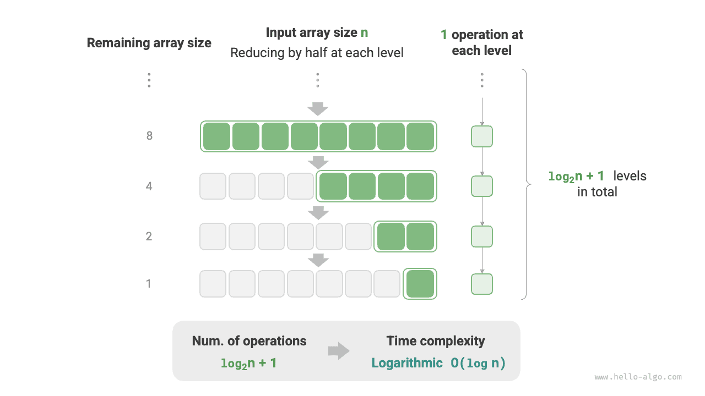

# 시간 복잡도

실행 시간은 알고리즘 효율을 직관적이고 정확하게 보여 준다. 코드의 실행 시간을 정확히 추정하려면 어떻게 해야 할까?

1. **실행 플랫폼을 정한다**. 하드웨어 구성, 프로그래밍 언어, 시스템 환경 등이 포함되며, 모두 코드의 실행 효율에 영향을 준다.
2. **각 연산에 필요한 실행 시간을 평가한다**. 예를 들어 덧셈 연산 `+`는 1 ns, 곱셈 연산 `*`는 10 ns, 출력 연산 `print()`는 5 ns가 걸린다고 하자.
3. **코드에 있는 모든 연산을 센다**. 그런 다음 각 연산의 실행 시간을 모두 더해 전체 실행 시간을 구한다.

예를 들어 다음 코드에서 입력 데이터 크기는 $n$이다.

=== "Python"

    ```python title=""
    # 어떤 실행 플랫폼에서
    def algorithm(n: int):
        a = 2      # 1 ns
        a = a + 1  # 1 ns
        a = a * 2  # 10 ns
        # n번 반복
        for _ in range(n):  # 1 ns
            print(0)        # 5 ns
    ```

=== "C++"

    ```cpp title=""
    // 어떤 실행 플랫폼에서
    void algorithm(int n) {
        int a = 2;  // 1 ns
        a = a + 1;  // 1 ns
        a = a * 2;  // 10 ns
        // n번 반복
        for (int i = 0; i < n; i++) {  // 1 ns
            cout << 0 << endl;         // 5 ns
        }
    }
    ```

=== "Java"

    ```java title=""
    // 어떤 실행 플랫폼에서
    void algorithm(int n) {
        int a = 2;  // 1 ns
        a = a + 1;  // 1 ns
        a = a * 2;  // 10 ns
        // n번 반복
        for (int i = 0; i < n; i++) {  // 1 ns
            System.out.println(0);     // 5 ns
        }
    }
    ```

=== "C#"

    ```csharp title=""
    // 어떤 실행 플랫폼에서
    void Algorithm(int n) {
        int a = 2;  // 1 ns
        a = a + 1;  // 1 ns
        a = a * 2;  // 10 ns
        // n번 반복
        for (int i = 0; i < n; i++) {  // 1 ns
            Console.WriteLine(0);      // 5 ns
        }
    }
    ```

=== "Go"

    ```go title=""
    // 어떤 실행 플랫폼에서
    func algorithm(n int) {
        a := 2     // 1 ns
        a = a + 1  // 1 ns
        a = a * 2  // 10 ns
        // n번 반복
        for i := 0; i < n; i++ {  // 1 ns
            fmt.Println(a)        // 5 ns
        }
    }
    ```

=== "Swift"

    ```swift title=""
    // 어떤 실행 플랫폼에서
    func algorithm(n: Int) {
        var a = 2 // 1 ns
        a = a + 1 // 1 ns
        a = a * 2 // 10 ns
        // n번 반복
        for _ in 0 ..< n { // 1 ns
            print(0) // 5 ns
        }
    }
    ```

=== "JS"

    ```javascript title=""
    // 어떤 실행 플랫폼에서
    function algorithm(n) {
        var a = 2; // 1 ns
        a = a + 1; // 1 ns
        a = a * 2; // 10 ns
        // n번 반복
        for(let i = 0; i < n; i++) { // 1 ns
            console.log(0); // 5 ns
        }
    }
    ```

=== "TS"

    ```typescript title=""
    // 어떤 실행 플랫폼에서
    function algorithm(n: number): void {
        var a: number = 2; // 1 ns
        a = a + 1; // 1 ns
        a = a * 2; // 10 ns
        // n번 반복
        for(let i = 0; i < n; i++) { // 1 ns
            console.log(0); // 5 ns
        }
    }
    ```

=== "Dart"

    ```dart title=""
    // 어떤 실행 플랫폼에서
    void algorithm(int n) {
      int a = 2; // 1 ns
      a = a + 1; // 1 ns
      a = a * 2; // 10 ns
      // n번 반복
      for (int i = 0; i < n; i++) { // 1 ns
        print(0); // 5 ns
      }
    }
    ```

=== "Rust"

    ```rust title=""
    // 어떤 실행 플랫폼에서
    fn algorithm(n: i32) {
        let mut a = 2;      // 1 ns
        a = a + 1;          // 1 ns
        a = a * 2;          // 10 ns
        // n번 반복
        for _ in 0..n {     // 1 ns
            println!("{}", 0);  // 5 ns
        }
    }
    ```

=== "C"

    ```c title=""
    // 어떤 실행 플랫폼에서
    void algorithm(int n) {
        int a = 2;  // 1 ns
        a = a + 1;  // 1 ns
        a = a * 2;  // 10 ns
        // n번 반복
        for (int i = 0; i < n; i++) {   // 1 ns
            printf("%d", 0);            // 5 ns
        }
    }
    ```

=== "Kotlin"

    ```kotlin title=""
    // 어떤 실행 플랫폼에서
    fun algorithm(n: Int) {
        var a = 2 // 1 ns
        a = a + 1 // 1 ns
        a = a * 2 // 10 ns
        // n번 반복
        for (i in 0..<n) {  // 1 ns
            println(0)      // 5 ns
        }
    }
    ```

=== "Ruby"

    ```ruby title=""
    # 어떤 실행 플랫폼에서
    def algorithm(n)
        a = 2       # 1 ns
        a = a + 1   # 1 ns
        a = a * 2   # 10 ns
        # n번 반복
        (0...n).each do # 1 ns
            puts 0      # 5 ns
        end
    end
    ```

위 방법으로 구한 알고리즘의 실행 시간은 $(6n + 12)$ ns다.

$$
1 + 1 + 10 + (1 + 5) \times n = 6n + 12
$$

그러나 실제로 **알고리즘의 실행 시간을 이렇게 계산하는 것은 합리적이지도 현실적이지도 않다**. 우선 알고리즘은 여러 플랫폼에서 실행되어야 하므로 추정 시간을 특정 실행 플랫폼에 묶고 싶지 않다. 또한 각 연산의 실행 시간을 알아내기 어려워 추정 과정이 매우 복잡해진다.

## 시간의 증가 추세 계산

시간 복잡도 분석이 계산하는 것은 알고리즘 실행 시간 자체가 아니라, **데이터 양이 많아질 때 알고리즘 실행 시간이 증가하는 추세다**.

‘시간의 증가 추세’는 추상적인 개념이므로 예를 통해 이해해 보자. 입력 데이터 크기가 $n$이고, 세 알고리즘 `A`, `B`, `C`가 주어졌다고 하자.

=== "Python"

    ```python title=""
    # 알고리즘 A의 시간 복잡도: 상수 시간
    def algorithm_A(n: int):
        print(0)
    # 알고리즘 B의 시간 복잡도: 선형 시간
    def algorithm_B(n: int):
        for _ in range(n):
            print(0)
    # 알고리즘 C의 시간 복잡도: 상수 시간
    def algorithm_C(n: int):
        for _ in range(1000000):
            print(0)
    ```

=== "C++"

    ```cpp title=""
    // 알고리즘 A의 시간 복잡도: 상수 시간
    void algorithm_A(int n) {
        cout << 0 << endl;
    }
    // 알고리즘 B의 시간 복잡도: 선형 시간
    void algorithm_B(int n) {
        for (int i = 0; i < n; i++) {
            cout << 0 << endl;
        }
    }
    // 알고리즘 C의 시간 복잡도: 상수 시간
    void algorithm_C(int n) {
        for (int i = 0; i < 1000000; i++) {
            cout << 0 << endl;
        }
    }
    ```

=== "Java"

    ```java title=""
    // 알고리즘 A의 시간 복잡도: 상수 시간
    void algorithm_A(int n) {
        System.out.println(0);
    }
    // 알고리즘 B의 시간 복잡도: 선형 시간
    void algorithm_B(int n) {
        for (int i = 0; i < n; i++) {
            System.out.println(0);
        }
    }
    // 알고리즘 C의 시간 복잡도: 상수 시간
    void algorithm_C(int n) {
        for (int i = 0; i < 1000000; i++) {
            System.out.println(0);
        }
    }
    ```

=== "C#"

    ```csharp title=""
    // 알고리즘 A의 시간 복잡도: 상수 시간
    void AlgorithmA(int n) {
        Console.WriteLine(0);
    }
    // 알고리즘 B의 시간 복잡도: 선형 시간
    void AlgorithmB(int n) {
        for (int i = 0; i < n; i++) {
            Console.WriteLine(0);
        }
    }
    // 알고리즘 C의 시간 복잡도: 상수 시간
    void AlgorithmC(int n) {
        for (int i = 0; i < 1000000; i++) {
            Console.WriteLine(0);
        }
    }
    ```

=== "Go"

    ```go title=""
    // 알고리즘 A의 시간 복잡도: 상수 시간
    func algorithm_A(n int) {
        fmt.Println(0)
    }
    // 알고리즘 B의 시간 복잡도: 선형 시간
    func algorithm_B(n int) {
        for i := 0; i < n; i++ {
            fmt.Println(0)
        }
    }
    // 알고리즘 C의 시간 복잡도: 상수 시간
    func algorithm_C(n int) {
        for i := 0; i < 1000000; i++ {
            fmt.Println(0)
        }
    }
    ```

=== "Swift"

    ```swift title=""
    // 알고리즘 A의 시간 복잡도: 상수 시간
    func algorithmA(n: Int) {
        print(0)
    }

    // 알고리즘 B의 시간 복잡도: 선형 시간
    func algorithmB(n: Int) {
        for _ in 0 ..< n {
            print(0)
        }
    }

    // 알고리즘 C의 시간 복잡도: 상수 시간
    func algorithmC(n: Int) {
        for _ in 0 ..< 1_000_000 {
            print(0)
        }
    }
    ```

=== "JS"

    ```javascript title=""
    // 알고리즘 A의 시간 복잡도: 상수 시간
    function algorithm_A(n) {
        console.log(0);
    }
    // 알고리즘 B의 시간 복잡도: 선형 시간
    function algorithm_B(n) {
        for (let i = 0; i < n; i++) {
            console.log(0);
        }
    }
    // 알고리즘 C의 시간 복잡도: 상수 시간
    function algorithm_C(n) {
        for (let i = 0; i < 1000000; i++) {
            console.log(0);
        }
    }

    ```

=== "TS"

    ```typescript title=""
    // 알고리즘 A의 시간 복잡도: 상수 시간
    function algorithm_A(n: number): void {
        console.log(0);
    }
    // 알고리즘 B의 시간 복잡도: 선형 시간
    function algorithm_B(n: number): void {
        for (let i = 0; i < n; i++) {
            console.log(0);
        }
    }
    // 알고리즘 C의 시간 복잡도: 상수 시간
    function algorithm_C(n: number): void {
        for (let i = 0; i < 1000000; i++) {
            console.log(0);
        }
    }
    ```

=== "Dart"

    ```dart title=""
    // 알고리즘 A의 시간 복잡도: 상수 시간
    void algorithmA(int n) {
      print(0);
    }
    // 알고리즘 B의 시간 복잡도: 선형 시간
    void algorithmB(int n) {
      for (int i = 0; i < n; i++) {
        print(0);
      }
    }
    // 알고리즘 C의 시간 복잡도: 상수 시간
    void algorithmC(int n) {
      for (int i = 0; i < 1000000; i++) {
        print(0);
      }
    }
    ```

=== "Rust"

    ```rust title=""
    // 알고리즘 A의 시간 복잡도: 상수 시간
    fn algorithm_A(n: i32) {
        println!("{}", 0);
    }
    // 알고리즘 B의 시간 복잡도: 선형 시간
    fn algorithm_B(n: i32) {
        for _ in 0..n {
            println!("{}", 0);
        }
    }
    // 알고리즘 C의 시간 복잡도: 상수 시간
    fn algorithm_C(n: i32) {
        for _ in 0..1000000 {
            println!("{}", 0);
        }
    }
    ```

=== "C"

    ```c title=""
    // 알고리즘 A의 시간 복잡도: 상수 시간
    void algorithm_A(int n) {
        printf("%d", 0);
    }
    // 알고리즘 B의 시간 복잡도: 선형 시간
    void algorithm_B(int n) {
        for (int i = 0; i < n; i++) {
            printf("%d", 0);
        }
    }
    // 알고리즘 C의 시간 복잡도: 상수 시간
    void algorithm_C(int n) {
        for (int i = 0; i < 1000000; i++) {
            printf("%d", 0);
        }
    }
    ```

=== "Kotlin"

    ```kotlin title=""
    // 알고리즘 A의 시간 복잡도: 상수 시간
    fun algoritm_A(n: Int) {
        println(0)
    }
    // 알고리즘 B의 시간 복잡도: 선형 시간
    fun algorithm_B(n: Int) {
        for (i in 0..<n){
            println(0)
        }
    }
    // 알고리즘 C의 시간 복잡도: 상수 시간
    fun algorithm_C(n: Int) {
        for (i in 0..<1000000) {
            println(0)
        }
    }
    ```

=== "Ruby"

    ```ruby title=""
    # 알고리즘 A의 시간 복잡도: 상수 시간
    def algorithm_A(n)
        puts 0
    end

    # 알고리즘 B의 시간 복잡도: 선형 시간
    def algorithm_B(n)
        (0...n).each { puts 0 }
    end

    # 알고리즘 C의 시간 복잡도: 상수 시간
    def algorithm_C(n)
        (0...1_000_000).each { puts 0 }
    end
    ```

아래 그림은 이 세 알고리즘 함수의 시간 복잡도를 보여 준다.

- 알고리즘 `A`에는 출력 연산이 $1$번뿐이므로, $n$이 커져도 실행 시간이 늘어나지 않는다. 이런 알고리즘의 시간 복잡도를 ‘상수 시간’이라고 한다.
- 알고리즘 `B`의 출력 연산은 $n$번 반복되므로, $n$이 커짐에 따라 실행 시간이 선형으로 증가한다. 이런 알고리즘의 시간 복잡도를 ‘선형 시간’이라고 한다.
- 알고리즘 `C`의 출력 연산은 $1000000$번 반복된다. 실행 시간은 길지만 입력 데이터 크기 $n$과는 무관하다. 따라서 `C`의 시간 복잡도는 `A`와 같은 ‘상수 시간’이다.


알고리즘의 실행 시간을 직접 계산하는 방식과 비교하면 시간 복잡도 분석에는 어떤 특징이 있을까?

- **시간 복잡도는 알고리즘 효율을 효과적으로 평가할 수 있다**. 예를 들어 알고리즘 `B`의 실행 시간은 선형으로 증가하므로 $n > 1$이면 알고리즘 `A`보다 느리고, $n > 1000000$이면 알고리즘 `C`보다 느리다. 실제로 입력 데이터 크기 $n$이 충분히 크면 ‘상수 시간’ 알고리즘은 반드시 ‘선형 시간’ 알고리즘보다 유리하다. 이것이 바로 시간의 증가 추세가 뜻하는 바다.
- **시간 복잡도를 구하는 방법은 더 간단하다**. 실행 플랫폼과 연산 종류는 알고리즘 실행 시간의 증가 추세와 무관하다. 따라서 시간 복잡도 분석에서는 모든 연산의 실행 시간을 같은 ‘단위 시간’으로 볼 수 있다. 그러면 ‘연산 실행 시간 계산’을 ‘연산 횟수 계산’으로 단순화할 수 있어 추정이 훨씬 쉬워진다.
- **시간 복잡도에도 한계는 있다**. 예를 들어 알고리즘 `A`와 `C`의 시간 복잡도는 같지만 실제 실행 시간에는 큰 차이가 있다. 마찬가지로 알고리즘 `B`의 시간 복잡도는 `C`보다 높지만, 입력 데이터 크기 $n$이 작으면 `B`가 `C`보다 확실히 유리하다. 이런 경우에는 시간 복잡도만으로 효율의 우열을 판단하기 어렵다. 물론 이러한 문제에도 불구하고 복잡도 분석은 여전히 알고리즘 효율을 평가하는 가장 효과적이고 널리 쓰이는 방법이다.

## 함수의 점근적 상한

입력 크기가 $n$인 다음 함수를 살펴보자.

=== "Python"

    ```python title=""
    def algorithm(n: int):
        a = 1      # +1
        a = a + 1  # +1
        a = a * 2  # +1
        # n번 반복
        for i in range(n):  # +1
            print(0)        # +1
    ```

=== "C++"

    ```cpp title=""
    void algorithm(int n) {
        int a = 1;  // +1
        a = a + 1;  // +1
        a = a * 2;  // +1
        // n번 반복
        for (int i = 0; i < n; i++) { // +1(매번 i ++ 실행)
            cout << 0 << endl;    // +1
        }
    }
    ```

=== "Java"

    ```java title=""
    void algorithm(int n) {
        int a = 1;  // +1
        a = a + 1;  // +1
        a = a * 2;  // +1
        // n번 반복
        for (int i = 0; i < n; i++) { // +1(매번 i ++ 실행)
            System.out.println(0);    // +1
        }
    }
    ```

=== "C#"

    ```csharp title=""
    void Algorithm(int n) {
        int a = 1;  // +1
        a = a + 1;  // +1
        a = a * 2;  // +1
        // n번 반복
        for (int i = 0; i < n; i++) {   // +1(매번 i ++ 실행)
            Console.WriteLine(0);   // +1
        }
    }
    ```

=== "Go"

    ```go title=""
    func algorithm(n int) {
        a := 1      // +1
        a = a + 1   // +1
        a = a * 2   // +1
        // n번 반복
        for i := 0; i < n; i++ {   // +1
            fmt.Println(a)         // +1
        }
    }
    ```

=== "Swift"

    ```swift title=""
    func algorithm(n: Int) {
        var a = 1 // +1
        a = a + 1 // +1
        a = a * 2 // +1
        // n번 반복
        for _ in 0 ..< n { // +1
            print(0) // +1
        }
    }
    ```

=== "JS"

    ```javascript title=""
    function algorithm(n) {
        var a = 1; // +1
        a += 1; // +1
        a *= 2; // +1
        // n번 반복
        for(let i = 0; i < n; i++){ // +1(매번 i ++ 실행)
            console.log(0); // +1
        }
    }
    ```

=== "TS"

    ```typescript title=""
    function algorithm(n: number): void{
        var a: number = 1; // +1
        a += 1; // +1
        a *= 2; // +1
        // n번 반복
        for(let i = 0; i < n; i++){ // +1(매번 i ++ 실행)
            console.log(0); // +1
        }
    }
    ```

=== "Dart"

    ```dart title=""
    void algorithm(int n) {
      int a = 1; // +1
      a = a + 1; // +1
      a = a * 2; // +1
      // n번 반복
      for (int i = 0; i < n; i++) { // +1(매번 i ++ 실행)
        print(0); // +1
      }
    }
    ```

=== "Rust"

    ```rust title=""
    fn algorithm(n: i32) {
        let mut a = 1;   // +1
        a = a + 1;      // +1
        a = a * 2;      // +1

        // n번 반복
        for _ in 0..n { // +1(매번 i ++ 실행)
            println!("{}", 0); // +1
        }
    }
    ```

=== "C"

    ```c title=""
    void algorithm(int n) {
        int a = 1;  // +1
        a = a + 1;  // +1
        a = a * 2;  // +1
        // n번 반복
        for (int i = 0; i < n; i++) {   // +1(매번 i ++ 실행)
            printf("%d", 0);            // +1
        }
    }
    ```

=== "Kotlin"

    ```kotlin title=""
    fun algorithm(n: Int) {
        var a = 1 // +1
        a = a + 1 // +1
        a = a * 2 // +1
        // n번 반복
        for (i in 0..<n) { // +1(매번 i ++ 실행)
            println(0) // +1
        }
    }
    ```

=== "Ruby"

    ```ruby title=""
    def algorithm(n)
        a = 1       # +1
        a = a + 1   # +1
        a = a * 2   # +1
        # n번 반복
        (0...n).each do # +1
            puts 0      # +1
        end
    end
    ```

알고리즘의 연산 횟수를 입력 데이터 크기 $n$에 대한 함수 $T(n)$으로 나타내면, 위 함수의 연산 횟수는 다음과 같다.

$$
T(n) = 3 + 2n
$$

$T(n)$은 일차 함수이므로 실행 시간이 선형으로 증가한다. 따라서 시간 복잡도는 선형 시간이다.

선형 시간 복잡도를 $O(n)$으로 표기한다. 이 수학 기호를 <u>빅 $O$ 표기법(big-$O$ notation)</u>이라고 하며, 함수 $T(n)$의 <u>점근적 상한(asymptotic upper bound)</u>을 나타낸다.

시간 복잡도 분석은 본질적으로 ‘연산 횟수 $T(n)$’의 점근적 상한을 계산하는 것으로, 명확한 수학적 정의가 있다.

!!! note "함수의 점근적 상한"

    양의 실수 $c$와 실수 $n_0$가 존재하여 모든 $n > n_0$에 대해 $T(n) \leq c \cdot f(n)$이면, $f(n)$은 $T(n)$의 점근적 상한을 제공한다고 하며 $T(n) = O(f(n))$으로 표기한다.

아래 그림과 같이 점근적 상한을 계산한다는 것은 함수 $f(n)$을 찾는 것이다. 이 함수는 $n$이 무한대로 향할 때 $T(n)$과 $f(n)$의 증가 차수가 같고 상수 계수 $c$만큼만 차이가 나도록 해야 한다.


## 계산 방법

점근적 상한은 수학적인 느낌이 강하므로, 완전히 이해되지 않아도 걱정할 필요 없다. 우선 계산 방법을 익힌 뒤 반복해서 연습하면 그 수학적 의미도 점차 이해할 수 있다.

정의에 따르면 $f(n)$을 정하면 시간 복잡도 $O(f(n))$을 얻는다. 그렇다면 점근적 상한 $f(n)$은 어떻게 정할까? 크게 두 단계로 나뉜다. 먼저 연산 횟수를 세고, 그다음 점근적 상한을 판단한다.

### 1단계: 연산 횟수 세기

코드를 위에서 아래로 한 줄씩 살펴보며 계산하면 된다. 다만 앞서 본 $c \cdot f(n)$의 상수 계수 $c$는 어떤 크기든 가능하므로, **연산 횟수 $T(n)$의 각종 계수와 상수항은 무시해도 된다**. 이 원리를 바탕으로 계산을 단순화하는 다음 요령을 얻을 수 있다.

1. **$T(n)$의 상수를 무시한다**. 상수는 $n$과 무관하므로 시간 복잡도에 영향을 주지 않는다.
2. **모든 계수를 생략한다**. 예를 들어 $2n$번, $5n + 1$번 등의 반복은 모두 $n$번으로 단순화할 수 있다. $n$ 앞의 계수는 시간 복잡도에 영향을 주지 않기 때문이다.
3. **중첩 반복문에는 곱셈을 사용한다**. 전체 연산 횟수는 바깥쪽 반복문과 안쪽 반복문의 연산 횟수의 곱이며, 각 반복문에는 여전히 `1.`과 `2.`의 요령을 따로 적용할 수 있다.

다음 함수에 위 요령을 적용하여 연산 횟수를 세어 보자.

=== "Python"

    ```python title=""
    def algorithm(n: int):
        a = 1      # +0(요령 1)
        a = a + n  # +0(요령 1)
        # +n(요령 2)
        for i in range(5 * n + 1):
            print(0)
        # +n*n(요령 3)
        for i in range(2 * n):
            for j in range(n + 1):
                print(0)
    ```

=== "C++"

    ```cpp title=""
    void algorithm(int n) {
        int a = 1;  // +0(요령 1)
        a = a + n;  // +0(요령 1)
        // +n(요령 2)
        for (int i = 0; i < 5 * n + 1; i++) {
            cout << 0 << endl;
        }
        // +n*n(요령 3)
        for (int i = 0; i < 2 * n; i++) {
            for (int j = 0; j < n + 1; j++) {
                cout << 0 << endl;
            }
        }
    }
    ```

=== "Java"

    ```java title=""
    void algorithm(int n) {
        int a = 1;  // +0(요령 1)
        a = a + n;  // +0(요령 1)
        // +n(요령 2)
        for (int i = 0; i < 5 * n + 1; i++) {
            System.out.println(0);
        }
        // +n*n(요령 3)
        for (int i = 0; i < 2 * n; i++) {
            for (int j = 0; j < n + 1; j++) {
                System.out.println(0);
            }
        }
    }
    ```

=== "C#"

    ```csharp title=""
    void Algorithm(int n) {
        int a = 1;  // +0(요령 1)
        a = a + n;  // +0(요령 1)
        // +n(요령 2)
        for (int i = 0; i < 5 * n + 1; i++) {
            Console.WriteLine(0);
        }
        // +n*n(요령 3)
        for (int i = 0; i < 2 * n; i++) {
            for (int j = 0; j < n + 1; j++) {
                Console.WriteLine(0);
            }
        }
    }
    ```

=== "Go"

    ```go title=""
    func algorithm(n int) {
        a := 1     // +0(요령 1)
        a = a + n  // +0(요령 1)
        // +n(요령 2)
        for i := 0; i < 5 * n + 1; i++ {
            fmt.Println(0)
        }
        // +n*n(요령 3)
        for i := 0; i < 2 * n; i++ {
            for j := 0; j < n + 1; j++ {
                fmt.Println(0)
            }
        }
    }
    ```

=== "Swift"

    ```swift title=""
    func algorithm(n: Int) {
        var a = 1 // +0(요령 1)
        a = a + n // +0(요령 1)
        // +n(요령 2)
        for _ in 0 ..< (5 * n + 1) {
            print(0)
        }
        // +n*n(요령 3)
        for _ in 0 ..< (2 * n) {
            for _ in 0 ..< (n + 1) {
                print(0)
            }
        }
    }
    ```

=== "JS"

    ```javascript title=""
    function algorithm(n) {
        let a = 1;  // +0(요령 1)
        a = a + n;  // +0(요령 1)
        // +n(요령 2)
        for (let i = 0; i < 5 * n + 1; i++) {
            console.log(0);
        }
        // +n*n(요령 3)
        for (let i = 0; i < 2 * n; i++) {
            for (let j = 0; j < n + 1; j++) {
                console.log(0);
            }
        }
    }
    ```

=== "TS"

    ```typescript title=""
    function algorithm(n: number): void {
        let a = 1;  // +0(요령 1)
        a = a + n;  // +0(요령 1)
        // +n(요령 2)
        for (let i = 0; i < 5 * n + 1; i++) {
            console.log(0);
        }
        // +n*n(요령 3)
        for (let i = 0; i < 2 * n; i++) {
            for (let j = 0; j < n + 1; j++) {
                console.log(0);
            }
        }
    }
    ```

=== "Dart"

    ```dart title=""
    void algorithm(int n) {
      int a = 1; // +0(요령 1)
      a = a + n; // +0(요령 1)
      // +n(요령 2)
      for (int i = 0; i < 5 * n + 1; i++) {
        print(0);
      }
      // +n*n(요령 3)
      for (int i = 0; i < 2 * n; i++) {
        for (int j = 0; j < n + 1; j++) {
          print(0);
        }
      }
    }
    ```

=== "Rust"

    ```rust title=""
    fn algorithm(n: i32) {
        let mut a = 1;     // +0(요령 1)
        a = a + n;        // +0(요령 1)

        // +n(요령 2)
        for i in 0..(5 * n + 1) {
            println!("{}", 0);
        }

        // +n*n(요령 3)
        for i in 0..(2 * n) {
            for j in 0..(n + 1) {
                println!("{}", 0);
            }
        }
    }
    ```

=== "C"

    ```c title=""
    void algorithm(int n) {
        int a = 1;  // +0(요령 1)
        a = a + n;  // +0(요령 1)
        // +n(요령 2)
        for (int i = 0; i < 5 * n + 1; i++) {
            printf("%d", 0);
        }
        // +n*n(요령 3)
        for (int i = 0; i < 2 * n; i++) {
            for (int j = 0; j < n + 1; j++) {
                printf("%d", 0);
            }
        }
    }
    ```

=== "Kotlin"

    ```kotlin title=""
    fun algorithm(n: Int) {
        var a = 1   // +0(요령 1)
        a = a + n   // +0(요령 1)
        // +n(요령 2)
        for (i in 0..<5 * n + 1) {
            println(0)
        }
        // +n*n(요령 3)
        for (i in 0..<2 * n) {
            for (j in 0..<n + 1) {
                println(0)
            }
        }
    }
    ```

=== "Ruby"

    ```ruby title=""
    def algorithm(n)
        a = 1       # +0(요령 1)
        a = a + n   # +0(요령 1)
        # +n(요령 2)
        (0...(5 * n + 1)).each do { puts 0 }
        # +n*n(요령 3)
        (0...(2 * n)).each do
            (0...(n + 1)).each do { puts 0 }
        end
    end
    ```

아래 식은 위 요령을 적용하기 전과 후의 계산 결과를 보여 준다. 두 결과에서 구한 시간 복잡도는 모두 $O(n^2)$이다.

$$
\begin{aligned}
T(n) & = 2n(n + 1) + (5n + 1) + 2 & \text{빠짐없이 계산 (-.-|||)} \newline
& = 2n^2 + 7n + 3 \newline
T(n) & = n^2 + n & \text{간단히 계산 (o.O)}
\end{aligned}
$$

### 2단계: 점근적 상한 판단

**시간 복잡도는 $T(n)$에서 가장 높은 차수의 항으로 결정된다**. $n$이 무한대로 향하면 가장 높은 차수의 항이 지배적인 영향을 주므로 나머지 항의 영향은 무시할 수 있기 때문이다.

아래 표는 몇 가지 예를 보여 준다. 일부 값이 과장되어 있는 이유는 ‘계수로는 차수를 뒤집을 수 없다’는 결론을 강조하기 위해서다. $n$이 무한대로 향하면 이러한 상수는 중요하지 않게 된다.

<p align="center"> 표 <id> &nbsp; 연산 횟수에 따른 시간 복잡도 </p>

| 연산 횟수 $T(n)$        | 시간 복잡도 $O(f(n))$ |
| ---------------------- | -------------------- |
| $100000$               | $O(1)$               |
| $3n + 2$               | $O(n)$               |
| $2n^2 + 3n + 2$        | $O(n^2)$             |
| $n^3 + 10000n^2$       | $O(n^3)$             |
| $2^n + 10000n^{10000}$ | $O(2^n)$             |

## 대표적인 유형

입력 데이터 크기를 $n$이라고 할 때, 대표적인 시간 복잡도 유형은 아래 그림과 같다(낮은 순서대로 나열).

$$
\begin{aligned}
& O(1) < O(\log n) < O(n) < O(n \log n) < O(n^2) < O(2^n) < O(n!) \newline
& \text{상수} < \text{로그} < \text{선형} < \text{선형 로그} < \text{제곱} < \text{지수} < \text{팩토리얼}
\end{aligned}
$$


### 상수 시간 $O(1)$

상수 시간의 연산 횟수는 입력 데이터 크기 $n$과 무관하며, $n$이 변해도 달라지지 않는다.

다음 함수에서 연산 횟수 `size`는 매우 클 수 있지만 입력 데이터 크기 $n$과 무관하므로, 시간 복잡도는 여전히 $O(1)$이다.

```src
[file]{time_complexity}-[class]{}-[func]{constant}
```

### 선형 시간 $O(n)$

선형 시간의 연산 횟수는 입력 데이터 크기 $n$에 대해 선형으로 증가한다. 선형 시간은 보통 단일 반복문에서 나타난다.

```src
[file]{time_complexity}-[class]{}-[func]{linear}
```

배열 순회와 연결 리스트 순회 등의 연산은 시간 복잡도가 모두 $O(n)$이다. 여기서 $n$은 배열이나 연결 리스트의 길이다.

```src
[file]{time_complexity}-[class]{}-[func]{array_traversal}
```

**입력 데이터 크기 $n$은 입력 데이터의 종류에 따라 구체적으로 정해야 한다**는 점에 주의하자. 첫 번째 예에서는 변수 $n$이 입력 데이터 크기이고, 두 번째 예에서는 배열의 길이 $n$이 데이터 크기다.

### 제곱 시간 $O(n^2)$

제곱 시간의 연산 횟수는 입력 데이터 크기 $n$의 제곱에 비례하여 증가한다. 보통 중첩 반복문에서 나타나며, 바깥쪽과 안쪽 반복문의 시간 복잡도가 각각 $O(n)$이므로 전체 시간 복잡도는 $O(n^2)$이다.

```src
[file]{time_complexity}-[class]{}-[func]{quadratic}
```

아래 그림은 상수 시간, 선형 시간, 제곱 시간의 세 가지 시간 복잡도를 비교한다.


버블 정렬을 예로 들면, 바깥쪽 반복문은 $n - 1$번 실행되고 안쪽 반복문은 $n-1$, $n-2$, $\dots$, $2$, $1$번, 평균 $n / 2$번 실행된다. 따라서 시간 복잡도는 $O((n - 1) n / 2) = O(n^2)$이다.

```src
[file]{time_complexity}-[class]{}-[func]{bubble_sort}
```

### 지수 시간 $O(2^n)$

생물학의 ‘세포 분열’은 지수적 증가의 대표적인 예다. 처음에는 세포가 $1$개이고, 한 차례 분열하면 $2$개, 두 차례 분열하면 $4$개가 된다. 이처럼 $n$차례 분열하면 세포는 $2^n$개가 된다.

아래 그림과 코드는 세포 분열 과정을 재현하며, 시간 복잡도는 $O(2^n)$이다. 입력 $n$은 분열이 진행되는 라운드 수이고, 반환값 `count`는 전체 분열 횟수라는 점에 주의하자.

```src
[file]{time_complexity}-[class]{}-[func]{exponential}
```


실제 알고리즘에서 지수 시간은 재귀 함수에 자주 나타난다. 예를 들어 다음 코드는 재귀적으로 둘로 나뉘며, $n$번 나뉜 뒤 멈춘다.

```src
[file]{time_complexity}-[class]{}-[func]{exp_recur}
```

지수 시간은 매우 빠르게 증가하며 완전 열거(완전 탐색, 백트래킹 등)에 흔히 나타난다. 데이터가 많은 문제에서는 지수 시간을 감당하기 어려우므로, 보통 동적 계획법이나 탐욕 알고리즘 등으로 해결해야 한다.

### 로그 시간 $O(\log n)$

지수 시간과 반대로 로그 시간은 ‘매번 절반으로 줄어드는’ 상황을 나타낸다. 입력 데이터 크기가 $n$이고 매번 절반으로 줄어들므로, 반복 횟수는 $2^n$의 역함수인 $\log_2 n$이다.

아래 그림과 코드는 ‘매번 절반으로 줄어드는’ 과정을 재현한다. 시간 복잡도는 $O(\log_2 n)$이며, 줄여서 $O(\log n)$으로 쓴다.

```src
[file]{time_complexity}-[class]{}-[func]{logarithmic}
```



지수 시간처럼 로그 시간도 재귀 함수에 자주 나타난다. 다음 코드는 높이가 $\log_2 n$인 재귀 트리를 만든다.

```src
[file]{time_complexity}-[class]{}-[func]{log_recur}
```

로그 시간은 분할 정복 전략에 기반한 알고리즘에 자주 나타나며, ‘하나를 여러 개로 나누기’, ‘복잡한 것을 단순하게 만들기’라는 알고리즘 사고방식을 보여 준다. 증가 속도가 느려 상수 시간 다음으로 이상적인 시간 복잡도다.

!!! tip "$O(\log n)$의 밑은 무엇인가?"

    정확히 말하면, ‘하나를 $m$개로 나누기’에 해당하는 시간 복잡도는 $O(\log_m n)$이다. 로그의 밑 변환 공식을 적용하면 밑이 달라도 같은 시간 복잡도를 얻는다.

    $$
    O(\log_m n) = O(\log_k n / \log_k m) = O(\log_k n)
    $$

    즉, 밑 $m$은 복잡도에 영향을 주지 않고 바꿀 수 있다. 따라서 보통 밑 $m$을 생략하고 로그 시간을 $O(\log n)$으로 표기한다.

### 선형 로그 시간 $O(n \log n)$

선형 로그 시간은 중첩 반복문에 자주 나타나며, 두 반복문의 시간 복잡도는 각각 $O(\log n)$과 $O(n)$이다. 관련 코드는 다음과 같다.

```src
[file]{time_complexity}-[class]{}-[func]{linear_log_recur}
```

아래 그림은 선형 로그 시간이 만들어지는 방식을 보여 준다. 이진 트리의 각 층에서 수행하는 전체 연산 횟수는 $n$이고, 층수는 $\log_2 n + 1$이므로 시간 복잡도는 $O(n \log n)$이다.


퀵 정렬, 병합 정렬, 힙 정렬 등 널리 쓰이는 정렬 알고리즘의 시간 복잡도는 보통 $O(n \log n)$이다.

### 팩토리얼 시간 $O(n!)$

팩토리얼 시간은 수학의 ‘모든 순열 구하기’ 문제에 해당한다. 서로 다른 원소 $n$개가 주어졌을 때 가능한 모든 순열을 구하면, 그 개수는 다음과 같다.

$$
n! = n \times (n - 1) \times (n - 2) \times \dots \times 2 \times 1
$$

팩토리얼은 보통 재귀로 구현한다. 아래 그림과 코드에서 첫 번째 층은 $n$개로, 두 번째 층은 $n - 1$개로 분기하며, 이를 반복하다가 $n$번째 층에 도달하면 분기를 멈춘다.

```src
[file]{time_complexity}-[class]{}-[func]{factorial_recur}
```


$n \geq 4$이면 항상 $n! > 2^n$이므로 팩토리얼 시간은 지수 시간보다 더 빠르게 증가한다. 따라서 $n$이 클 때는 이 역시 감당하기 어렵다.

## 최악, 최선, 평균 시간 복잡도

**알고리즘의 시간 효율은 고정되어 있지 않고 입력 데이터의 분포에 따라 달라지는 경우가 많다**. 길이가 $n$인 배열 `nums`를 입력받는다고 하자. `nums`에는 $1$부터 $n$까지의 수가 한 번씩 들어 있으며, 원소 순서는 무작위로 섞여 있다. 목표는 원소 $1$의 인덱스를 반환하는 것이다. 여기서 다음과 같은 결론을 얻는다.

- `nums = [?, ?, ..., 1]`, 즉 마지막 원소가 $1$이면 배열 전체를 순회해야 하므로 **최악 시간 복잡도 $O(n)$에 도달한다**.
- `nums = [1, ?, ?, ...]`, 즉 첫 번째 원소가 $1$이면 배열 길이에 관계없이 더 순회할 필요가 없으므로 **최선 시간 복잡도 $\Omega(1)$에 도달한다**.

‘최악 시간 복잡도’는 함수의 점근적 상한에 해당하며 빅 $O$ 표기법으로 나타낸다. 이에 대응하여 ‘최선 시간 복잡도’는 함수의 점근적 하한에 해당하며 $\Omega$ 표기법으로 나타낸다.

```src
[file]{worst_best_time_complexity}-[class]{}-[func]{find_one}
```

실제로 최선 시간 복잡도는 거의 사용하지 않는다. 보통 최선의 경우가 발생할 확률이 매우 낮아 오해를 줄 수 있기 때문이다. **최악 시간 복잡도는 효율의 안전한 기준을 제시하므로 더 실용적이며**, 이를 통해 안심하고 알고리즘을 사용할 수 있다.

앞의 예에서 최악 시간 복잡도와 최선 시간 복잡도는 ‘특수한 데이터 분포’에서만 나타난다. 이러한 경우는 발생 확률이 낮을 수 있어 실제 실행 효율을 제대로 반영하지 못한다. 반면 **평균 시간 복잡도는 무작위 입력 데이터에서의 알고리즘 실행 효율을 나타내며**, $\Theta$ 표기법으로 표시한다.

일부 알고리즘은 무작위 데이터 분포에서의 평균 상황을 간단히 계산할 수 있다. 앞의 예에서는 입력 배열이 섞여 있으므로 원소 $1$이 어느 인덱스에 있을 확률도 같다. 따라서 평균 반복 횟수는 배열 길이의 절반인 $n / 2$이며, 평균 시간 복잡도는 $\Theta(n / 2) = \Theta(n)$이다.

하지만 더 복잡한 알고리즘에서는 데이터 분포에 따른 전체 기댓값을 분석하기 어려워 평균 시간 복잡도를 구하기 힘든 경우가 많다. 이럴 때는 보통 최악 시간 복잡도를 알고리즘 효율의 평가 기준으로 삼는다.

!!! question "$\Theta$ 기호는 왜 보기 드문가?"

    $O$ 기호가 워낙 익숙해서인지 평균 시간 복잡도에도 이를 자주 사용한다. 그러나 엄밀하게는 올바른 표기 방식이 아니다. 이 책이나 다른 자료에서 ‘평균 시간 복잡도 $O(n)$’ 같은 표현을 만나면 $\Theta(n)$으로 이해하면 된다.
