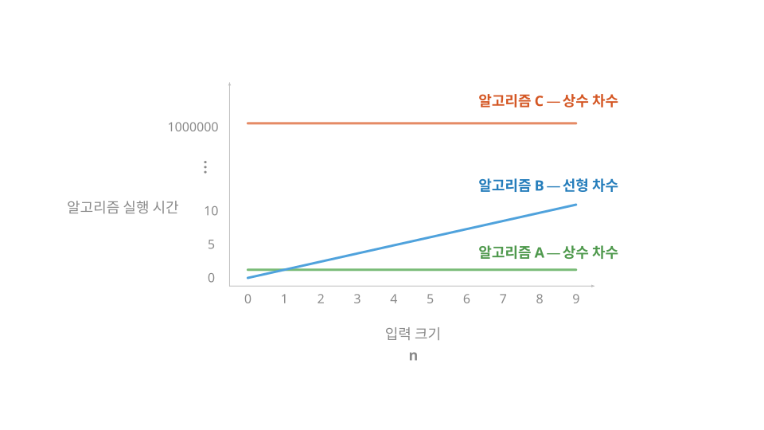
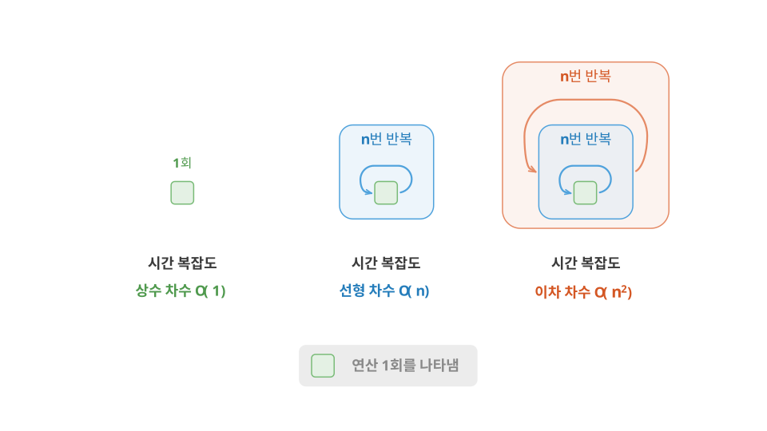
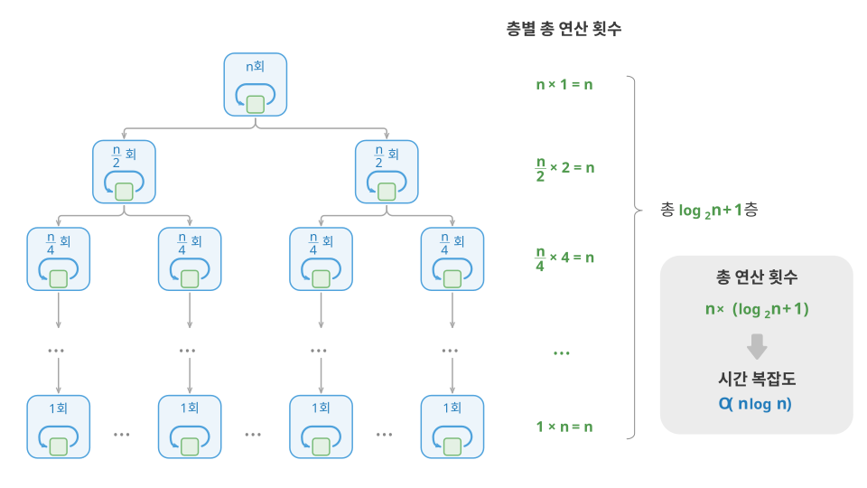

# 2.3 &nbsp; 시간 복잡도

실행 시간은 알고리즘의 효율을 직관적이고 정확하게 보여 준다. 그렇다면 코드의 실행 시간을 정확히 예측하려면 어떻게 해야 할까?

1. **실행 환경을 정한다**. 하드웨어 구성, 프로그래밍 언어, 시스템 환경 등이 모두 코드의 실행 효율에 영향을 준다.
2. **각 연산에 걸리는 시간을 추정한다**. 예를 들어 덧셈 연산(`+`)에 1 ns, 곱셈 연산(`*`)에 10 ns, 출력 연산(`print()`)에 5 ns가 걸린다고 하자.
3. **코드의 모든 연산을 센다**. 각 연산에 걸리는 시간을 모두 더하면 실행 시간이 나온다.

예를 들어 다음 코드의 입력 크기가 $n$이라고 하자.

=== "Python"

    ```python title=""
    # 특정 실행 환경에서
    def algorithm(n: int):
        a = 2      # 1 ns
        a = a + 1  # 1 ns
        a = a * 2  # 10 ns
        # n번 반복한다
        for _ in range(n):  # 1 ns
            print(0)        # 5 ns
    ```

=== "C++"

    ```cpp title=""
    // 특정 실행 환경에서
    void algorithm(int n) {
        int a = 2;  // 1 ns
        a = a + 1;  // 1 ns
        a = a * 2;  // 10 ns
        // n번 반복한다
        for (int i = 0; i < n; i++) {  // 1 ns
            cout << 0 << endl;         // 5 ns
        }
    }
    ```

=== "Java"

    ```java title=""
    // 특정 실행 환경에서
    void algorithm(int n) {
        int a = 2;  // 1 ns
        a = a + 1;  // 1 ns
        a = a * 2;  // 10 ns
        // n번 반복한다
        for (int i = 0; i < n; i++) {  // 1 ns
            System.out.println(0);     // 5 ns
        }
    }
    ```

=== "C#"

    ```csharp title=""
    // 특정 실행 환경에서
    void Algorithm(int n) {
        int a = 2;  // 1 ns
        a = a + 1;  // 1 ns
        a = a * 2;  // 10 ns
        // n번 반복한다
        for (int i = 0; i < n; i++) {  // 1 ns
            Console.WriteLine(0);      // 5 ns
        }
    }
    ```

=== "Go"

    ```go title=""
    // 특정 실행 환경에서
    func algorithm(n int) {
        a := 2     // 1 ns
        a = a + 1  // 1 ns
        a = a * 2  // 10 ns
        // n번 반복한다
        for i := 0; i < n; i++ {  // 1 ns
            fmt.Println(a)        // 5 ns
        }
    }
    ```

=== "Swift"

    ```swift title=""
    // 특정 실행 환경에서
    func algorithm(n: Int) {
        var a = 2 // 1 ns
        a = a + 1 // 1 ns
        a = a * 2 // 10 ns
        // n번 반복한다
        for _ in 0 ..< n { // 1 ns
            print(0) // 5 ns
        }
    }
    ```

=== "JS"

    ```javascript title=""
    // 특정 실행 환경에서
    function algorithm(n) {
        var a = 2; // 1 ns
        a = a + 1; // 1 ns
        a = a * 2; // 10 ns
        // n번 반복한다
        for(let i = 0; i < n; i++) { // 1 ns
            console.log(0); // 5 ns
        }
    }
    ```

=== "TS"

    ```typescript title=""
    // 특정 실행 환경에서
    function algorithm(n: number): void {
        var a: number = 2; // 1 ns
        a = a + 1; // 1 ns
        a = a * 2; // 10 ns
        // n번 반복한다
        for(let i = 0; i < n; i++) { // 1 ns
            console.log(0); // 5 ns
        }
    }
    ```

=== "Dart"

    ```dart title=""
    // 특정 실행 환경에서
    void algorithm(int n) {
      int a = 2; // 1 ns
      a = a + 1; // 1 ns
      a = a * 2; // 10 ns
      // n번 반복한다
      for (int i = 0; i < n; i++) { // 1 ns
        print(0); // 5 ns
      }
    }
    ```

=== "Rust"

    ```rust title=""
    // 특정 실행 환경에서
    fn algorithm(n: i32) {
        let mut a = 2;      // 1 ns
        a = a + 1;          // 1 ns
        a = a * 2;          // 10 ns
        // n번 반복한다
        for _ in 0..n {     // 1 ns
            println!("{}", 0);  // 5 ns
        }
    }
    ```

=== "C"

    ```c title=""
    // 특정 실행 환경에서
    void algorithm(int n) {
        int a = 2;  // 1 ns
        a = a + 1;  // 1 ns
        a = a * 2;  // 10 ns
        // n번 반복한다
        for (int i = 0; i < n; i++) {   // 1 ns
            printf("%d", 0);            // 5 ns
        }
    }
    ```

=== "Kotlin"

    ```kotlin title=""
    // 특정 실행 환경에서
    fun algorithm(n: Int) {
        var a = 2 // 1 ns
        a = a + 1 // 1 ns
        a = a * 2 // 10 ns
        // n번 반복한다
        for (i in 0..<n) {  // 1 ns
            println(0)      // 5 ns
        }
    }
    ```

=== "Ruby"

    ```ruby title=""
    # 특정 실행 환경에서
    def algorithm(n)
        a = 2       # 1 ns
        a = a + 1   # 1 ns
        a = a * 2   # 10 ns
        # n번 반복한다
        (0...n).each do # 1 ns
            puts 0      # 5 ns
        end
    end
    ```

위 방법으로 계산하면 알고리즘의 실행 시간은 $(6n + 12)$ ns이다.

$$
1 + 1 + 10 + (1 + 5) \times n = 6n + 12
$$

그러나 실제로 **이렇게 알고리즘의 실행 시간을 계산하는 것은 타당하지도 현실적이지도 않다**. 먼저 알고리즘은 여러 플랫폼에서 실행되어야 하므로 추정 시간을 특정 플랫폼에 종속시키고 싶지 않다. 게다가 각 연산에 걸리는 시간을 알아내기 어려워 추정 자체가 매우 까다롭다.

## 2.3.1 &nbsp; 실행 시간의 증가 추세 파악하기

시간 복잡도 분석에서 살펴보는 것은 실행 시간 자체가 아니라 **입력 크기가 커질 때 실행 시간이 어떻게 증가하는가**이다.

‘시간의 증가 추세’란 다소 추상적이므로 예를 들어 보자. 입력 크기를 $n$이라고 하고 다음 세 알고리즘 `A`, `B`, `C`를 살펴보자.

=== "Python"

    ```python title=""
    # 알고리즘 A의 시간 복잡도: 상수 차수
    def algorithm_A(n: int):
        print(0)
    # 알고리즘 B의 시간 복잡도: 선형 차수
    def algorithm_B(n: int):
        for _ in range(n):
            print(0)
    # 알고리즘 C의 시간 복잡도: 상수 차수
    def algorithm_C(n: int):
        for _ in range(1000000):
            print(0)
    ```

=== "C++"

    ```cpp title=""
    // 알고리즘 A의 시간 복잡도: 상수 차수
    void algorithm_A(int n) {
        cout << 0 << endl;
    }
    // 알고리즘 B의 시간 복잡도: 선형 차수
    void algorithm_B(int n) {
        for (int i = 0; i < n; i++) {
            cout << 0 << endl;
        }
    }
    // 알고리즘 C의 시간 복잡도: 상수 차수
    void algorithm_C(int n) {
        for (int i = 0; i < 1000000; i++) {
            cout << 0 << endl;
        }
    }
    ```

=== "Java"

    ```java title=""
    // 알고리즘 A의 시간 복잡도: 상수 차수
    void algorithm_A(int n) {
        System.out.println(0);
    }
    // 알고리즘 B의 시간 복잡도: 선형 차수
    void algorithm_B(int n) {
        for (int i = 0; i < n; i++) {
            System.out.println(0);
        }
    }
    // 알고리즘 C의 시간 복잡도: 상수 차수
    void algorithm_C(int n) {
        for (int i = 0; i < 1000000; i++) {
            System.out.println(0);
        }
    }
    ```

=== "C#"

    ```csharp title=""
    // 알고리즘 A의 시간 복잡도: 상수 차수
    void AlgorithmA(int n) {
        Console.WriteLine(0);
    }
    // 알고리즘 B의 시간 복잡도: 선형 차수
    void AlgorithmB(int n) {
        for (int i = 0; i < n; i++) {
            Console.WriteLine(0);
        }
    }
    // 알고리즘 C의 시간 복잡도: 상수 차수
    void AlgorithmC(int n) {
        for (int i = 0; i < 1000000; i++) {
            Console.WriteLine(0);
        }
    }
    ```

=== "Go"

    ```go title=""
    // 알고리즘 A의 시간 복잡도: 상수 차수
    func algorithm_A(n int) {
        fmt.Println(0)
    }
    // 알고리즘 B의 시간 복잡도: 선형 차수
    func algorithm_B(n int) {
        for i := 0; i < n; i++ {
            fmt.Println(0)
        }
    }
    // 알고리즘 C의 시간 복잡도: 상수 차수
    func algorithm_C(n int) {
        for i := 0; i < 1000000; i++ {
            fmt.Println(0)
        }
    }
    ```

=== "Swift"

    ```swift title=""
    // 알고리즘 A의 시간 복잡도: 상수 차수
    func algorithmA(n: Int) {
        print(0)
    }

    // 알고리즘 B의 시간 복잡도: 선형 차수
    func algorithmB(n: Int) {
        for _ in 0 ..< n {
            print(0)
        }
    }

    // 알고리즘 C의 시간 복잡도: 상수 차수
    func algorithmC(n: Int) {
        for _ in 0 ..< 1_000_000 {
            print(0)
        }
    }
    ```

=== "JS"

    ```javascript title=""
    // 알고리즘 A의 시간 복잡도: 상수 차수
    function algorithm_A(n) {
        console.log(0);
    }
    // 알고리즘 B의 시간 복잡도: 선형 차수
    function algorithm_B(n) {
        for (let i = 0; i < n; i++) {
            console.log(0);
        }
    }
    // 알고리즘 C의 시간 복잡도: 상수 차수
    function algorithm_C(n) {
        for (let i = 0; i < 1000000; i++) {
            console.log(0);
        }
    }

    ```

=== "TS"

    ```typescript title=""
    // 알고리즘 A의 시간 복잡도: 상수 차수
    function algorithm_A(n: number): void {
        console.log(0);
    }
    // 알고리즘 B의 시간 복잡도: 선형 차수
    function algorithm_B(n: number): void {
        for (let i = 0; i < n; i++) {
            console.log(0);
        }
    }
    // 알고리즘 C의 시간 복잡도: 상수 차수
    function algorithm_C(n: number): void {
        for (let i = 0; i < 1000000; i++) {
            console.log(0);
        }
    }
    ```

=== "Dart"

    ```dart title=""
    // 알고리즘 A의 시간 복잡도: 상수 차수
    void algorithmA(int n) {
      print(0);
    }
    // 알고리즘 B의 시간 복잡도: 선형 차수
    void algorithmB(int n) {
      for (int i = 0; i < n; i++) {
        print(0);
      }
    }
    // 알고리즘 C의 시간 복잡도: 상수 차수
    void algorithmC(int n) {
      for (int i = 0; i < 1000000; i++) {
        print(0);
      }
    }
    ```

=== "Rust"

    ```rust title=""
    // 알고리즘 A의 시간 복잡도: 상수 차수
    fn algorithm_A(n: i32) {
        println!("{}", 0);
    }
    // 알고리즘 B의 시간 복잡도: 선형 차수
    fn algorithm_B(n: i32) {
        for _ in 0..n {
            println!("{}", 0);
        }
    }
    // 알고리즘 C의 시간 복잡도: 상수 차수
    fn algorithm_C(n: i32) {
        for _ in 0..1000000 {
            println!("{}", 0);
        }
    }
    ```

=== "C"

    ```c title=""
    // 알고리즘 A의 시간 복잡도: 상수 차수
    void algorithm_A(int n) {
        printf("%d", 0);
    }
    // 알고리즘 B의 시간 복잡도: 선형 차수
    void algorithm_B(int n) {
        for (int i = 0; i < n; i++) {
            printf("%d", 0);
        }
    }
    // 알고리즘 C의 시간 복잡도: 상수 차수
    void algorithm_C(int n) {
        for (int i = 0; i < 1000000; i++) {
            printf("%d", 0);
        }
    }
    ```

=== "Kotlin"

    ```kotlin title=""
    // 알고리즘 A의 시간 복잡도: 상수 차수
    fun algorithm_A(n: Int) {
        println(0)
    }
    // 알고리즘 B의 시간 복잡도: 선형 차수
    fun algorithm_B(n: Int) {
        for (i in 0..<n){
            println(0)
        }
    }
    // 알고리즘 C의 시간 복잡도: 상수 차수
    fun algorithm_C(n: Int) {
        for (i in 0..<1000000) {
            println(0)
        }
    }
    ```

=== "Ruby"

    ```ruby title=""
    # 알고리즘 A의 시간 복잡도: 상수 차수
    def algorithm_A(n)
        puts 0
    end

    # 알고리즘 B의 시간 복잡도: 선형 차수
    def algorithm_B(n)
        (0...n).each { puts 0 }
    end

    # 알고리즘 C의 시간 복잡도: 상수 차수
    def algorithm_C(n)
        (0...1_000_000).each { puts 0 }
    end
    ```

다음 그림(2-7)은 위 세 알고리즘의 시간 복잡도를 보여 준다.

- 알고리즘 `A`는 출력 연산을 $1$번만 수행하므로 $n$이 커져도 실행 시간이 늘지 않는다. 이런 시간 복잡도를 ‘상수 차수’라고 한다.
- 알고리즘 `B`는 출력 연산을 $n$번 반복하므로 $n$이 커질 때 실행 시간이 선형으로 증가한다. 이런 시간 복잡도를 ‘선형 차수’라고 한다.
- 알고리즘 `C`는 출력 연산을 $1000000$번 반복한다. 실행 시간은 길지만 입력 크기 $n$과 무관하다. 따라서 `C`의 시간 복잡도는 `A`와 같은 상수 차수다.

{ class="animation-figure" }

<p align="center"> 그림 2-7 &nbsp; 알고리즘 A, B, C의 실행 시간 증가 추세 </p>

실행 시간을 직접 계산하는 것과 비교하면 시간 복잡도 분석에는 어떤 특징이 있을까?

- **시간 복잡도로 알고리즘의 효율을 효과적으로 평가할 수 있다**. 예를 들어 알고리즘 `B`의 실행 시간은 선형으로 증가해 $n > 1$이면 알고리즘 `A`보다 느리고 $n > 1000000$이면 알고리즘 `C`보다 느리다. 입력 크기 $n$이 충분히 크면 상수 차수 알고리즘이 선형 차수 알고리즘보다 반드시 빠르다. 이것이 시간의 증가 추세가 의미하는 바다.
- **시간 복잡도는 더 간단히 추정할 수 있다**. 실행 시간의 증가 추세는 실행 플랫폼이나 연산의 종류에 좌우되지 않는다. 따라서 시간 복잡도를 분석할 때는 모든 연산에 같은 ‘단위 시간’이 걸린다고 보아도 된다. 각 연산의 실행 시간을 계산하는 대신 연산 횟수만 세면 되므로 추정이 훨씬 쉬워진다.
- **시간 복잡도에도 한계가 있다**. 예를 들어 알고리즘 `A`와 `C`는 시간 복잡도가 같지만 실제 실행 시간은 크게 다르다. 알고리즘 `B`는 `C`보다 시간 복잡도가 높지만 입력 크기 $n$이 작을 때는 `B`가 `C`보다 훨씬 빠르다. 이럴 때는 시간 복잡도만으로 효율의 우열을 가리기 어렵다. 이런 한계에도 불구하고 복잡도 분석은 알고리즘의 효율을 평가하는 데 가장 효과적이고 널리 쓰이는 방법이다.

## 2.3.2 &nbsp; 함수의 점근적 상한

입력 크기가 $n$인 다음 함수를 생각해 보자.

=== "Python"

    ```python title=""
    def algorithm(n: int):
        a = 1      # +1
        a = a + 1  # +1
        a = a * 2  # +1
        # n번 반복한다
        for i in range(n):  # +1
            print(0)        # +1
    ```

=== "C++"

    ```cpp title=""
    void algorithm(int n) {
        int a = 1;  // +1
        a = a + 1;  // +1
        a = a * 2;  // +1
        // n번 반복한다
        for (int i = 0; i < n; i++) { // +1(반복할 때마다 i ++ 실행)
            cout << 0 << endl;    // +1
        }
    }
    ```

=== "Java"

    ```java title=""
    void algorithm(int n) {
        int a = 1;  // +1
        a = a + 1;  // +1
        a = a * 2;  // +1
        // n번 반복한다
        for (int i = 0; i < n; i++) { // +1(반복할 때마다 i ++ 실행)
            System.out.println(0);    // +1
        }
    }
    ```

=== "C#"

    ```csharp title=""
    void Algorithm(int n) {
        int a = 1;  // +1
        a = a + 1;  // +1
        a = a * 2;  // +1
        // n번 반복한다
        for (int i = 0; i < n; i++) {   // +1(반복할 때마다 i ++ 실행)
            Console.WriteLine(0);   // +1
        }
    }
    ```

=== "Go"

    ```go title=""
    func algorithm(n int) {
        a := 1      // +1
        a = a + 1   // +1
        a = a * 2   // +1
        // n번 반복한다
        for i := 0; i < n; i++ {   // +1
            fmt.Println(a)         // +1
        }
    }
    ```

=== "Swift"

    ```swift title=""
    func algorithm(n: Int) {
        var a = 1 // +1
        a = a + 1 // +1
        a = a * 2 // +1
        // n번 반복한다
        for _ in 0 ..< n { // +1
            print(0) // +1
        }
    }
    ```

=== "JS"

    ```javascript title=""
    function algorithm(n) {
        var a = 1; // +1
        a += 1; // +1
        a *= 2; // +1
        // n번 반복한다
        for(let i = 0; i < n; i++){ // +1(반복할 때마다 i ++ 실행)
            console.log(0); // +1
        }
    }
    ```

=== "TS"

    ```typescript title=""
    function algorithm(n: number): void{
        var a: number = 1; // +1
        a += 1; // +1
        a *= 2; // +1
        // n번 반복한다
        for(let i = 0; i < n; i++){ // +1(반복할 때마다 i ++ 실행)
            console.log(0); // +1
        }
    }
    ```

=== "Dart"

    ```dart title=""
    void algorithm(int n) {
      int a = 1; // +1
      a = a + 1; // +1
      a = a * 2; // +1
      // n번 반복한다
      for (int i = 0; i < n; i++) { // +1(반복할 때마다 i ++ 실행)
        print(0); // +1
      }
    }
    ```

=== "Rust"

    ```rust title=""
    fn algorithm(n: i32) {
        let mut a = 1;   // +1
        a = a + 1;      // +1
        a = a * 2;      // +1

        // n번 반복한다
        for _ in 0..n { // +1(반복할 때마다 i ++ 실행)
            println!("{}", 0); // +1
        }
    }
    ```

=== "C"

    ```c title=""
    void algorithm(int n) {
        int a = 1;  // +1
        a = a + 1;  // +1
        a = a * 2;  // +1
        // n번 반복한다
        for (int i = 0; i < n; i++) {   // +1(반복할 때마다 i ++ 실행)
            printf("%d", 0);            // +1
        }
    }
    ```

=== "Kotlin"

    ```kotlin title=""
    fun algorithm(n: Int) {
        var a = 1 // +1
        a = a + 1 // +1
        a = a * 2 // +1
        // n번 반복한다
        for (i in 0..<n) { // +1(반복할 때마다 i ++ 실행)
            println(0) // +1
        }
    }
    ```

=== "Ruby"

    ```ruby title=""
    def algorithm(n)
        a = 1       # +1
        a = a + 1   # +1
        a = a * 2   # +1
        # n번 반복한다
        (0...n).each do # +1
            puts 0      # +1
        end
    end
    ```

알고리즘의 연산 횟수를 입력 크기 $n$의 함수 $T(n)$으로 나타내면 위 함수의 연산 횟수는 다음과 같다.

$$
T(n) = 3 + 2n
$$

$T(n)$은 일차 함수다. 실행 시간은 선형으로 증가하므로 시간 복잡도는 선형 차수다.

선형 시간 복잡도는 $O(n)$으로 쓴다. 이 수학 표기를 <u>빅 $O$ 표기법(big-$O$ notation)</u>이라고 하며 함수 $T(n)$의 <u>점근적 상한(asymptotic upper bound)</u>을 나타낸다.

시간 복잡도 분석은 본질적으로 ‘연산 횟수 $T(n)$’의 점근적 상한을 구하는 일이다. 점근적 상한에는 다음과 같은 수학적 정의가 있다.

!!! note "함수의 점근적 상한"

    모든 $n > n_0$에서 $T(n) \leq c \cdot f(n)$이 성립하도록 양의 실수 $c$와 실수 $n_0$을 정할 수 있다면, 함수 $f(n)$는 $T(n)$의 점근적 상한이다. 이를 $T(n) = O(f(n))$으로 쓴다.

아래 그림(2-8)처럼 점근적 상한을 구하는 일은 함수 $f(n)$을 찾는 것이다. $n$이 무한대로 갈 때 $T(n)$과 $f(n)$의 증가 차수가 같고 상수 계수 $c$만큼만 차이가 나는 함수를 찾는다.

{ class="animation-figure" }

<p align="center"> 그림 2-8 &nbsp; 함수의 점근적 상한 </p>

## 2.3.3 &nbsp; 시간 복잡도 구하기

점근적 상한은 다소 수학적인 개념이라 아직 완전히 이해하지 못했어도 괜찮다. 먼저 구하는 방법을 익히고 여러 번 적용해 보면 수학적 의미도 차츰 와닿을 것이다.

정의에 따르면 $f(n)$을 정하면 시간 복잡도 $O(f(n))$을 얻는다. 그러면 점근적 상한 $f(n)$은 어떻게 정할까? 먼저 연산 횟수를 세고, 다음으로 점근적 상한을 판단한다.

### 1. &nbsp; 1단계: 연산 횟수 세기

코드의 각 줄을 위에서 아래로 따라가며 횟수를 세면 된다. 앞서 본 $c \cdot f(n)$에서 상수 계수 $c$의 크기는 자유롭게 정할 수 있으므로 **연산 횟수 $T(n)$에 붙은 계수와 상수항은 무시할 수 있다**. 이에 따라 계산을 단순화하는 요령을 정리할 수 있다.

1. **$T(n)$의 상수항은 무시한다**. 이 항들은 $n$과 무관하므로 시간 복잡도에 영향을 주지 않는다.
2. **계수는 모두 생략한다**. 예를 들어 $2n$번이나 $5n + 1$번 반복하는 경우는 모두 $n$번으로 간단히 적을 수 있다. $n$ 앞의 계수가 시간 복잡도에 영향을 주지 않기 때문이다.
3. **반복문이 중첩되면 곱셈을 이용한다**. 전체 연산 횟수는 바깥 반복문과 안쪽 반복문의 횟수를 곱해 구한다. 각 반복문에는 앞의 `1.`, `2.`에서 설명한 요령을 따로 적용할 수 있다.

다음 함수에 이 요령을 적용해 연산 횟수를 세어 보자.

=== "Python"

    ```python title=""
    def algorithm(n: int):
        a = 1      # +0(요령 1)
        a = a + n  # +0(요령 1)
        # +n(요령 2)
        for i in range(5 * n + 1):
            print(0)
        # +n*n(요령 3)
        for i in range(2 * n):
            for j in range(n + 1):
                print(0)
    ```

=== "C++"

    ```cpp title=""
    void algorithm(int n) {
        int a = 1;  // +0(요령 1)
        a = a + n;  // +0(요령 1)
        // +n(요령 2)
        for (int i = 0; i < 5 * n + 1; i++) {
            cout << 0 << endl;
        }
        // +n*n(요령 3)
        for (int i = 0; i < 2 * n; i++) {
            for (int j = 0; j < n + 1; j++) {
                cout << 0 << endl;
            }
        }
    }
    ```

=== "Java"

    ```java title=""
    void algorithm(int n) {
        int a = 1;  // +0(요령 1)
        a = a + n;  // +0(요령 1)
        // +n(요령 2)
        for (int i = 0; i < 5 * n + 1; i++) {
            System.out.println(0);
        }
        // +n*n(요령 3)
        for (int i = 0; i < 2 * n; i++) {
            for (int j = 0; j < n + 1; j++) {
                System.out.println(0);
            }
        }
    }
    ```

=== "C#"

    ```csharp title=""
    void Algorithm(int n) {
        int a = 1;  // +0(요령 1)
        a = a + n;  // +0(요령 1)
        // +n(요령 2)
        for (int i = 0; i < 5 * n + 1; i++) {
            Console.WriteLine(0);
        }
        // +n*n(요령 3)
        for (int i = 0; i < 2 * n; i++) {
            for (int j = 0; j < n + 1; j++) {
                Console.WriteLine(0);
            }
        }
    }
    ```

=== "Go"

    ```go title=""
    func algorithm(n int) {
        a := 1     // +0(요령 1)
        a = a + n  // +0(요령 1)
        // +n(요령 2)
        for i := 0; i < 5 * n + 1; i++ {
            fmt.Println(0)
        }
        // +n*n(요령 3)
        for i := 0; i < 2 * n; i++ {
            for j := 0; j < n + 1; j++ {
                fmt.Println(0)
            }
        }
    }
    ```

=== "Swift"

    ```swift title=""
    func algorithm(n: Int) {
        var a = 1 // +0(요령 1)
        a = a + n // +0(요령 1)
        // +n(요령 2)
        for _ in 0 ..< (5 * n + 1) {
            print(0)
        }
        // +n*n(요령 3)
        for _ in 0 ..< (2 * n) {
            for _ in 0 ..< (n + 1) {
                print(0)
            }
        }
    }
    ```

=== "JS"

    ```javascript title=""
    function algorithm(n) {
        let a = 1;  // +0(요령 1)
        a = a + n;  // +0(요령 1)
        // +n(요령 2)
        for (let i = 0; i < 5 * n + 1; i++) {
            console.log(0);
        }
        // +n*n(요령 3)
        for (let i = 0; i < 2 * n; i++) {
            for (let j = 0; j < n + 1; j++) {
                console.log(0);
            }
        }
    }
    ```

=== "TS"

    ```typescript title=""
    function algorithm(n: number): void {
        let a = 1;  // +0(요령 1)
        a = a + n;  // +0(요령 1)
        // +n(요령 2)
        for (let i = 0; i < 5 * n + 1; i++) {
            console.log(0);
        }
        // +n*n(요령 3)
        for (let i = 0; i < 2 * n; i++) {
            for (let j = 0; j < n + 1; j++) {
                console.log(0);
            }
        }
    }
    ```

=== "Dart"

    ```dart title=""
    void algorithm(int n) {
      int a = 1; // +0(요령 1)
      a = a + n; // +0(요령 1)
      // +n(요령 2)
      for (int i = 0; i < 5 * n + 1; i++) {
        print(0);
      }
      // +n*n(요령 3)
      for (int i = 0; i < 2 * n; i++) {
        for (int j = 0; j < n + 1; j++) {
          print(0);
        }
      }
    }
    ```

=== "Rust"

    ```rust title=""
    fn algorithm(n: i32) {
        let mut a = 1;     // +0(요령 1)
        a = a + n;        // +0(요령 1)

        // +n(요령 2)
        for i in 0..(5 * n + 1) {
            println!("{}", 0);
        }

        // +n*n(요령 3)
        for i in 0..(2 * n) {
            for j in 0..(n + 1) {
                println!("{}", 0);
            }
        }
    }
    ```

=== "C"

    ```c title=""
    void algorithm(int n) {
        int a = 1;  // +0(요령 1)
        a = a + n;  // +0(요령 1)
        // +n(요령 2)
        for (int i = 0; i < 5 * n + 1; i++) {
            printf("%d", 0);
        }
        // +n*n(요령 3)
        for (int i = 0; i < 2 * n; i++) {
            for (int j = 0; j < n + 1; j++) {
                printf("%d", 0);
            }
        }
    }
    ```

=== "Kotlin"

    ```kotlin title=""
    fun algorithm(n: Int) {
        var a = 1   // +0(요령 1)
        a = a + n   // +0(요령 1)
        // +n(요령 2)
        for (i in 0..<5 * n + 1) {
            println(0)
        }
        // +n*n(요령 3)
        for (i in 0..<2 * n) {
            for (j in 0..<n + 1) {
                println(0)
            }
        }
    }
    ```

=== "Ruby"

    ```ruby title=""
    def algorithm(n)
        a = 1       # +0(요령 1)
        a = a + n   # +0(요령 1)
        # +n(요령 2)
        (0...(5 * n + 1)).each { puts 0 }
        # +n*n(요령 3)
        (0...(2 * n)).each do
            (0...(n + 1)).each { puts 0 }
        end
    end
    ```

다음 식은 요령을 적용하기 전과 후의 계산 결과를 보여 준다. 어느 식에서 구하든 시간 복잡도는 $O(n^2)$이다.

$$
\begin{aligned}
T(n) & = 2n(n + 1) + (5n + 1) + 2 & \text{빠짐없이 센 결과 (-.-|||)} \newline
& = 2n^2 + 7n + 3 \newline
T(n) & = n^2 + n & \text{간단히 센 결과 (o.O)}
\end{aligned}
$$

### 2. &nbsp; 2단계: 점근적 상한 판단하기

**시간 복잡도는 $T(n)$에서 차수가 가장 높은 항이 결정한다**. $n$이 무한대로 갈수록 최고차항의 영향이 지배적이 되어 다른 항의 영향은 무시할 수 있기 때문이다.

다음 표(2-2)에 몇 가지 예를 들었다. 일부 값이 유난히 큰 것은 ‘계수가 아무리 커도 차수는 바뀌지 않는다’는 점을 강조하기 위해서다. $n$이 무한대로 가면 이러한 상수의 영향은 미미해진다.

<p align="center"> 표 2-2 &nbsp; 연산 횟수에 따른 시간 복잡도 </p>

<div class="center-table" markdown>

| 연산 횟수 $T(n)$        | 시간 복잡도 $O(f(n))$ |
| ---------------------- | -------------------- |
| $100000$               | $O(1)$               |
| $3n + 2$               | $O(n)$               |
| $2n^2 + 3n + 2$        | $O(n^2)$             |
| $n^3 + 10000n^2$       | $O(n^3)$             |
| $2^n + 10000n^{10000}$ | $O(2^n)$             |

</div>

## 2.3.4 &nbsp; 대표적인 유형

입력 크기를 $n$이라고 하자. 다음 그림(2-9)은 대표적인 시간 복잡도를 낮은 것부터 높은 것까지 보여 준다.

$$
\begin{aligned}
& O(1) < O(\log n) < O(n) < O(n \log n) < O(n^2) < O(2^n) < O(n!) \newline
& \text{상수 차수} < \text{로그 차수} < \text{선형 차수} < \text{선형 로그 차수} < \text{이차 차수} < \text{지수 차수} < \text{팩토리얼 차수}
\end{aligned}
$$

{ class="animation-figure" }

<p align="center"> 그림 2-9 &nbsp; 대표적인 시간 복잡도 유형 </p>

### 1. &nbsp; 상수 차수 $O(1)$ {data-toc-label="1. &nbsp; 상수 차수"}

상수 차수에서는 연산 횟수가 입력 크기 $n$과 무관하다. 즉, $n$이 변해도 연산 횟수는 변하지 않는다.

다음 함수에서 연산 횟수 `size`는 매우 클 수도 있지만 입력 크기 $n$과 무관하므로 시간 복잡도는 여전히 $O(1)$이다.

=== "Python"

    ```python title="time_complexity.py"
    def constant(n: int) -> int:
        """상수 차수"""
        count = 0
        size = 100000
        for _ in range(size):
            count += 1
        return count
    ```

=== "C++"

    ```cpp title="time_complexity.cpp"
    /* 상수 차수 */
    int constant(int n) {
        int count = 0;
        int size = 100000;
        for (int i = 0; i < size; i++)
            count++;
        return count;
    }
    ```

=== "Java"

    ```java title="time_complexity.java"
    /* 상수 차수 */
    int constant(int n) {
        int count = 0;
        int size = 100000;
        for (int i = 0; i < size; i++)
            count++;
        return count;
    }
    ```

=== "C#"

    ```csharp title="time_complexity.cs"
    /* 상수 차수 */
    int Constant(int n) {
        int count = 0;
        int size = 100000;
        for (int i = 0; i < size; i++)
            count++;
        return count;
    }
    ```

=== "Go"

    ```go title="time_complexity.go"
    /* 상수 차수 */
    func constant(n int) int {
        count := 0
        size := 100000
        for i := 0; i < size; i++ {
            count++
        }
        return count
    }
    ```

=== "Swift"

    ```swift title="time_complexity.swift"
    /* 상수 차수 */
    func constant(n: Int) -> Int {
        var count = 0
        let size = 100_000
        for _ in 0 ..< size {
            count += 1
        }
        return count
    }
    ```

=== "JS"

    ```javascript title="time_complexity.js"
    /* 상수 차수 */
    function constant(n) {
        let count = 0;
        const size = 100000;
        for (let i = 0; i < size; i++) count++;
        return count;
    }
    ```

=== "TS"

    ```typescript title="time_complexity.ts"
    /* 상수 차수 */
    function constant(n: number): number {
        let count = 0;
        const size = 100000;
        for (let i = 0; i < size; i++) count++;
        return count;
    }
    ```

=== "Dart"

    ```dart title="time_complexity.dart"
    /* 상수 차수 */
    int constant(int n) {
      int count = 0;
      int size = 100000;
      for (var i = 0; i < size; i++) {
        count++;
      }
      return count;
    }
    ```

=== "Rust"

    ```rust title="time_complexity.rs"
    /* 상수 차수 */
    fn constant(n: i32) -> i32 {
        _ = n;
        let mut count = 0;
        let size = 100_000;
        for _ in 0..size {
            count += 1;
        }
        count
    }
    ```

=== "C"

    ```c title="time_complexity.c"
    /* 상수 차수 */
    int constant(int n) {
        int count = 0;
        int size = 100000;
        for (int i = 0; i < size; i++) {
            count++;
        }
        return count;
    }
    ```

=== "Kotlin"

    ```kotlin title="time_complexity.kt"
    /* 상수 차수 */
    fun constant(n: Int): Int {
        var count = 0
        val size = 100000
        for (i in 0..<size)
            count++
        return count
    }
    ```

=== "Ruby"

    ```ruby title="time_complexity.rb"
    ### 상수 차수 ###
    def constant(n)
      count = 0
      size = 100000

      (0...size).each { count += 1 }

      count
    end
    ```

??? pythontutor "실행 과정 시각화"

    <div style="height: 459px; width: 100%;"><iframe class="pythontutor-iframe" title="실행 과정 시각화" src="https://pythontutor.com/iframe-embed.html#code=def%20constant%28n%3A%20int%29%20-%3E%20int%3A%0A%20%20%20%20%22%22%22%EC%83%81%EC%88%98%20%EC%B0%A8%EC%88%98%22%22%22%0A%20%20%20%20count%20%3D%200%0A%20%20%20%20size%20%3D%2010%0A%20%20%20%20for%20_%20in%20range%28size%29%3A%0A%20%20%20%20%20%20%20%20count%20%2B%3D%201%0A%20%20%20%20return%20count%0A%0A%22%22%22Driver%20Code%22%22%22%0Aif%20__name__%20%3D%3D%20%22__main__%22%3A%0A%20%20%20%20n%20%3D%208%0A%20%20%20%20print%28%22%EC%9E%85%EB%A0%A5%20%ED%81%AC%EA%B8%B0%20n%20%3D%22,%20n%29%0A%0A%20%20%20%20count%20%3D%20constant%28n%29%0A%20%20%20%20print%28%22%EC%83%81%EC%88%98%20%EC%B0%A8%EC%88%98%20%EC%97%B0%EC%82%B0%20%ED%9A%9F%EC%88%98%20%3D%22,%20count%29&codeDivHeight=472&codeDivWidth=350&cumulative=false&curInstr=3&heapPrimitives=nevernest&origin=opt-frontend.js&py=311&rawInputLstJSON=%5B%5D&textReferences=false"> </iframe></div>
    <div style="margin-top: 5px;"><a href="https://pythontutor.com/iframe-embed.html#code=def%20constant%28n%3A%20int%29%20-%3E%20int%3A%0A%20%20%20%20%22%22%22%EC%83%81%EC%88%98%20%EC%B0%A8%EC%88%98%22%22%22%0A%20%20%20%20count%20%3D%200%0A%20%20%20%20size%20%3D%2010%0A%20%20%20%20for%20_%20in%20range%28size%29%3A%0A%20%20%20%20%20%20%20%20count%20%2B%3D%201%0A%20%20%20%20return%20count%0A%0A%22%22%22Driver%20Code%22%22%22%0Aif%20__name__%20%3D%3D%20%22__main__%22%3A%0A%20%20%20%20n%20%3D%208%0A%20%20%20%20print%28%22%EC%9E%85%EB%A0%A5%20%ED%81%AC%EA%B8%B0%20n%20%3D%22,%20n%29%0A%0A%20%20%20%20count%20%3D%20constant%28n%29%0A%20%20%20%20print%28%22%EC%83%81%EC%88%98%20%EC%B0%A8%EC%88%98%20%EC%97%B0%EC%82%B0%20%ED%9A%9F%EC%88%98%20%3D%22,%20count%29&codeDivHeight=800&codeDivWidth=600&cumulative=false&curInstr=3&heapPrimitives=nevernest&origin=opt-frontend.js&py=311&rawInputLstJSON=%5B%5D&textReferences=false" target="_blank" rel="noopener noreferrer">전체 화면으로 보기 ></a></div>

### 2. &nbsp; 선형 차수 $O(n)$ {data-toc-label="2. &nbsp; 선형 차수"}

선형 차수에서는 연산 횟수가 입력 크기 $n$에 비례해 증가한다. 보통 다음과 같은 단일 반복문에서 나타난다.

=== "Python"

    ```python title="time_complexity.py"
    def linear(n: int) -> int:
        """선형 차수"""
        count = 0
        for _ in range(n):
            count += 1
        return count
    ```

=== "C++"

    ```cpp title="time_complexity.cpp"
    /* 선형 차수 */
    int linear(int n) {
        int count = 0;
        for (int i = 0; i < n; i++)
            count++;
        return count;
    }
    ```

=== "Java"

    ```java title="time_complexity.java"
    /* 선형 차수 */
    int linear(int n) {
        int count = 0;
        for (int i = 0; i < n; i++)
            count++;
        return count;
    }
    ```

=== "C#"

    ```csharp title="time_complexity.cs"
    /* 선형 차수 */
    int Linear(int n) {
        int count = 0;
        for (int i = 0; i < n; i++)
            count++;
        return count;
    }
    ```

=== "Go"

    ```go title="time_complexity.go"
    /* 선형 차수 */
    func linear(n int) int {
        count := 0
        for i := 0; i < n; i++ {
            count++
        }
        return count
    }
    ```

=== "Swift"

    ```swift title="time_complexity.swift"
    /* 선형 차수 */
    func linear(n: Int) -> Int {
        var count = 0
        for _ in 0 ..< n {
            count += 1
        }
        return count
    }
    ```

=== "JS"

    ```javascript title="time_complexity.js"
    /* 선형 차수 */
    function linear(n) {
        let count = 0;
        for (let i = 0; i < n; i++) count++;
        return count;
    }
    ```

=== "TS"

    ```typescript title="time_complexity.ts"
    /* 선형 차수 */
    function linear(n: number): number {
        let count = 0;
        for (let i = 0; i < n; i++) count++;
        return count;
    }
    ```

=== "Dart"

    ```dart title="time_complexity.dart"
    /* 선형 차수 */
    int linear(int n) {
      int count = 0;
      for (var i = 0; i < n; i++) {
        count++;
      }
      return count;
    }
    ```

=== "Rust"

    ```rust title="time_complexity.rs"
    /* 선형 차수 */
    fn linear(n: i32) -> i32 {
        let mut count = 0;
        for _ in 0..n {
            count += 1;
        }
        count
    }
    ```

=== "C"

    ```c title="time_complexity.c"
    /* 선형 차수 */
    int linear(int n) {
        int count = 0;
        for (int i = 0; i < n; i++) {
            count++;
        }
        return count;
    }
    ```

=== "Kotlin"

    ```kotlin title="time_complexity.kt"
    /* 선형 차수 */
    fun linear(n: Int): Int {
        var count = 0
        for (i in 0..<n)
            count++
        return count
    }
    ```

=== "Ruby"

    ```ruby title="time_complexity.rb"
    ### 선형 차수 ###
    def linear(n)
      count = 0
      (0...n).each { count += 1 }
      count
    end
    ```

??? pythontutor "실행 과정 시각화"

    <div style="height: 441px; width: 100%;"><iframe class="pythontutor-iframe" title="실행 과정 시각화" src="https://pythontutor.com/iframe-embed.html#code=def%20linear%28n%29%20-%3E%20int%3A%0A%20%20%20%20%22%22%22%EC%84%A0%ED%98%95%20%EC%B0%A8%EC%88%98%22%22%22%0A%20%20%20%20count%20%3D%200%0A%20%20%20%20for%20_%20in%20range%28n%29%3A%0A%20%20%20%20%20%20%20%20count%20%2B%3D%201%0A%20%20%20%20return%20count%0A%0A%22%22%22Driver%20Code%22%22%22%0Aif%20__name__%20%3D%3D%20%22__main__%22%3A%0A%20%20%20%20n%20%3D%208%0A%20%20%20%20print%28%22%EC%9E%85%EB%A0%A5%20%ED%81%AC%EA%B8%B0%20n%20%3D%22,%20n%29%0A%0A%20%20%20%20count%20%3D%20linear%28n%29%0A%20%20%20%20print%28%22%EC%84%A0%ED%98%95%20%EC%B0%A8%EC%88%98%20%EC%97%B0%EC%82%B0%20%ED%9A%9F%EC%88%98%20%3D%22,%20count%29&codeDivHeight=472&codeDivWidth=350&cumulative=false&curInstr=3&heapPrimitives=nevernest&origin=opt-frontend.js&py=311&rawInputLstJSON=%5B%5D&textReferences=false"> </iframe></div>
    <div style="margin-top: 5px;"><a href="https://pythontutor.com/iframe-embed.html#code=def%20linear%28n%29%20-%3E%20int%3A%0A%20%20%20%20%22%22%22%EC%84%A0%ED%98%95%20%EC%B0%A8%EC%88%98%22%22%22%0A%20%20%20%20count%20%3D%200%0A%20%20%20%20for%20_%20in%20range%28n%29%3A%0A%20%20%20%20%20%20%20%20count%20%2B%3D%201%0A%20%20%20%20return%20count%0A%0A%22%22%22Driver%20Code%22%22%22%0Aif%20__name__%20%3D%3D%20%22__main__%22%3A%0A%20%20%20%20n%20%3D%208%0A%20%20%20%20print%28%22%EC%9E%85%EB%A0%A5%20%ED%81%AC%EA%B8%B0%20n%20%3D%22,%20n%29%0A%0A%20%20%20%20count%20%3D%20linear%28n%29%0A%20%20%20%20print%28%22%EC%84%A0%ED%98%95%20%EC%B0%A8%EC%88%98%20%EC%97%B0%EC%82%B0%20%ED%9A%9F%EC%88%98%20%3D%22,%20count%29&codeDivHeight=800&codeDivWidth=600&cumulative=false&curInstr=3&heapPrimitives=nevernest&origin=opt-frontend.js&py=311&rawInputLstJSON=%5B%5D&textReferences=false" target="_blank" rel="noopener noreferrer">전체 화면으로 보기 ></a></div>

배열 순회와 연결 리스트 순회의 시간 복잡도는 모두 $O(n)$이다. 여기서 $n$은 배열 또는 연결 리스트의 길이다.

=== "Python"

    ```python title="time_complexity.py"
    def array_traversal(nums: list[int]) -> int:
        """선형 차수(배열 순회)"""
        count = 0
        # 반복 횟수는 배열 길이에 비례한다
        for num in nums:
            count += 1
        return count
    ```

=== "C++"

    ```cpp title="time_complexity.cpp"
    /* 선형 차수(배열 순회) */
    int arrayTraversal(vector<int> &nums) {
        int count = 0;
        // 반복 횟수는 배열 길이에 비례한다
        for (int num : nums) {
            count++;
        }
        return count;
    }
    ```

=== "Java"

    ```java title="time_complexity.java"
    /* 선형 차수(배열 순회) */
    int arrayTraversal(int[] nums) {
        int count = 0;
        // 반복 횟수는 배열 길이에 비례한다
        for (int num : nums) {
            count++;
        }
        return count;
    }
    ```

=== "C#"

    ```csharp title="time_complexity.cs"
    /* 선형 차수(배열 순회) */
    int ArrayTraversal(int[] nums) {
        int count = 0;
        // 반복 횟수는 배열 길이에 비례한다
        foreach (int num in nums) {
            count++;
        }
        return count;
    }
    ```

=== "Go"

    ```go title="time_complexity.go"
    /* 선형 차수(배열 순회) */
    func arrayTraversal(nums []int) int {
        count := 0
        // 반복 횟수는 배열 길이에 비례한다
        for range nums {
            count++
        }
        return count
    }
    ```

=== "Swift"

    ```swift title="time_complexity.swift"
    /* 선형 차수(배열 순회) */
    func arrayTraversal(nums: [Int]) -> Int {
        var count = 0
        // 반복 횟수는 배열 길이에 비례한다
        for _ in nums {
            count += 1
        }
        return count
    }
    ```

=== "JS"

    ```javascript title="time_complexity.js"
    /* 선형 차수(배열 순회) */
    function arrayTraversal(nums) {
        let count = 0;
        // 반복 횟수는 배열 길이에 비례한다
        for (let i = 0; i < nums.length; i++) {
            count++;
        }
        return count;
    }
    ```

=== "TS"

    ```typescript title="time_complexity.ts"
    /* 선형 차수(배열 순회) */
    function arrayTraversal(nums: number[]): number {
        let count = 0;
        // 반복 횟수는 배열 길이에 비례한다
        for (let i = 0; i < nums.length; i++) {
            count++;
        }
        return count;
    }
    ```

=== "Dart"

    ```dart title="time_complexity.dart"
    /* 선형 차수(배열 순회) */
    int arrayTraversal(List<int> nums) {
      int count = 0;
      // 반복 횟수는 배열 길이에 비례한다
      for (var _num in nums) {
        count++;
      }
      return count;
    }
    ```

=== "Rust"

    ```rust title="time_complexity.rs"
    /* 선형 차수(배열 순회) */
    fn array_traversal(nums: &[i32]) -> i32 {
        let mut count = 0;
        // 반복 횟수는 배열 길이에 비례한다
        for _ in nums {
            count += 1;
        }
        count
    }
    ```

=== "C"

    ```c title="time_complexity.c"
    /* 선형 차수(배열 순회) */
    int arrayTraversal(int *nums, int n) {
        int count = 0;
        // 반복 횟수는 배열 길이에 비례한다
        for (int i = 0; i < n; i++) {
            count++;
        }
        return count;
    }
    ```

=== "Kotlin"

    ```kotlin title="time_complexity.kt"
    /* 선형 차수(배열 순회) */
    fun arrayTraversal(nums: IntArray): Int {
        var count = 0
        // 반복 횟수는 배열 길이에 비례한다
        for (num in nums) {
            count++
        }
        return count
    }
    ```

=== "Ruby"

    ```ruby title="time_complexity.rb"
    ### 선형 차수(배열 순회)###
    def array_traversal(nums)
      count = 0

      # 반복 횟수는 배열 길이에 비례한다
      for num in nums
        count += 1
      end

      count
    end
    ```

??? pythontutor "실행 과정 시각화"

    <div style="height: 459px; width: 100%;"><iframe class="pythontutor-iframe" title="실행 과정 시각화" src="https://pythontutor.com/iframe-embed.html#code=def%20array_traversal%28nums%3A%20list%5Bint%5D%29%20-%3E%20int%3A%0A%20%20%20%20%22%22%22%EC%84%A0%ED%98%95%20%EC%B0%A8%EC%88%98%28%EB%B0%B0%EC%97%B4%20%EC%88%9C%ED%9A%8C%29%22%22%22%0A%20%20%20%20count%20%3D%200%0A%20%20%20%20%23%20%EB%B0%98%EB%B3%B5%20%ED%9A%9F%EC%88%98%EB%8A%94%20%EB%B0%B0%EC%97%B4%20%EA%B8%B8%EC%9D%B4%EC%97%90%20%EB%B9%84%EB%A1%80%ED%95%9C%EB%8B%A4%0A%20%20%20%20for%20num%20in%20nums%3A%0A%20%20%20%20%20%20%20%20count%20%2B%3D%201%0A%20%20%20%20return%20count%0A%0A%22%22%22Driver%20Code%22%22%22%0Aif%20__name__%20%3D%3D%20%22__main__%22%3A%0A%20%20%20%20n%20%3D%208%0A%20%20%20%20print%28%22%EC%9E%85%EB%A0%A5%20%ED%81%AC%EA%B8%B0%20n%20%3D%22,%20n%29%0A%0A%20%20%20%20count%20%3D%20array_traversal%28%5B0%5D%20%2A%20n%29%0A%20%20%20%20print%28%22%EC%84%A0%ED%98%95%20%EC%B0%A8%EC%88%98%28%EB%B0%B0%EC%97%B4%20%EC%88%9C%ED%9A%8C%29%20%EC%97%B0%EC%82%B0%20%ED%9A%9F%EC%88%98%20%3D%22,%20count%29&codeDivHeight=472&codeDivWidth=350&cumulative=false&curInstr=3&heapPrimitives=nevernest&origin=opt-frontend.js&py=311&rawInputLstJSON=%5B%5D&textReferences=false"> </iframe></div>
    <div style="margin-top: 5px;"><a href="https://pythontutor.com/iframe-embed.html#code=def%20array_traversal%28nums%3A%20list%5Bint%5D%29%20-%3E%20int%3A%0A%20%20%20%20%22%22%22%EC%84%A0%ED%98%95%20%EC%B0%A8%EC%88%98%28%EB%B0%B0%EC%97%B4%20%EC%88%9C%ED%9A%8C%29%22%22%22%0A%20%20%20%20count%20%3D%200%0A%20%20%20%20%23%20%EB%B0%98%EB%B3%B5%20%ED%9A%9F%EC%88%98%EB%8A%94%20%EB%B0%B0%EC%97%B4%20%EA%B8%B8%EC%9D%B4%EC%97%90%20%EB%B9%84%EB%A1%80%ED%95%9C%EB%8B%A4%0A%20%20%20%20for%20num%20in%20nums%3A%0A%20%20%20%20%20%20%20%20count%20%2B%3D%201%0A%20%20%20%20return%20count%0A%0A%22%22%22Driver%20Code%22%22%22%0Aif%20__name__%20%3D%3D%20%22__main__%22%3A%0A%20%20%20%20n%20%3D%208%0A%20%20%20%20print%28%22%EC%9E%85%EB%A0%A5%20%ED%81%AC%EA%B8%B0%20n%20%3D%22,%20n%29%0A%0A%20%20%20%20count%20%3D%20array_traversal%28%5B0%5D%20%2A%20n%29%0A%20%20%20%20print%28%22%EC%84%A0%ED%98%95%20%EC%B0%A8%EC%88%98%28%EB%B0%B0%EC%97%B4%20%EC%88%9C%ED%9A%8C%29%20%EC%97%B0%EC%82%B0%20%ED%9A%9F%EC%88%98%20%3D%22,%20count%29&codeDivHeight=800&codeDivWidth=600&cumulative=false&curInstr=3&heapPrimitives=nevernest&origin=opt-frontend.js&py=311&rawInputLstJSON=%5B%5D&textReferences=false" target="_blank" rel="noopener noreferrer">전체 화면으로 보기 ></a></div>

**입력 크기 $n$을 무엇으로 볼지는 입력 데이터의 유형에 따라 정해야 한다**. 첫 번째 예에서는 변수 $n$의 값이 입력 크기이고 두 번째 예에서는 배열의 길이 $n$이 입력 크기다.

### 3. &nbsp; 이차 차수 $O(n^2)$ {data-toc-label="3. &nbsp; 이차 차수"}

이차 차수에서는 연산 횟수가 입력 크기 $n$의 제곱에 비례해 증가한다. 보통 중첩 반복문에서 나타난다. 바깥 반복문과 안쪽 반복문의 시간 복잡도가 각각 $O(n)$이면 전체 시간 복잡도는 $O(n^2)$이다.

=== "Python"

    ```python title="time_complexity.py"
    def quadratic(n: int) -> int:
        """이차 차수"""
        count = 0
        # 반복 횟수는 데이터 크기 n의 제곱에 비례한다
        for i in range(n):
            for j in range(n):
                count += 1
        return count
    ```

=== "C++"

    ```cpp title="time_complexity.cpp"
    /* 이차 차수 */
    int quadratic(int n) {
        int count = 0;
        // 반복 횟수는 데이터 크기 n의 제곱에 비례한다
        for (int i = 0; i < n; i++) {
            for (int j = 0; j < n; j++) {
                count++;
            }
        }
        return count;
    }
    ```

=== "Java"

    ```java title="time_complexity.java"
    /* 이차 차수 */
    int quadratic(int n) {
        int count = 0;
        // 반복 횟수는 데이터 크기 n의 제곱에 비례한다
        for (int i = 0; i < n; i++) {
            for (int j = 0; j < n; j++) {
                count++;
            }
        }
        return count;
    }
    ```

=== "C#"

    ```csharp title="time_complexity.cs"
    /* 이차 차수 */
    int Quadratic(int n) {
        int count = 0;
        // 반복 횟수는 데이터 크기 n의 제곱에 비례한다
        for (int i = 0; i < n; i++) {
            for (int j = 0; j < n; j++) {
                count++;
            }
        }
        return count;
    }
    ```

=== "Go"

    ```go title="time_complexity.go"
    /* 이차 차수 */
    func quadratic(n int) int {
        count := 0
        // 반복 횟수는 데이터 크기 n의 제곱에 비례한다
        for i := 0; i < n; i++ {
            for j := 0; j < n; j++ {
                count++
            }
        }
        return count
    }
    ```

=== "Swift"

    ```swift title="time_complexity.swift"
    /* 이차 차수 */
    func quadratic(n: Int) -> Int {
        var count = 0
        // 반복 횟수는 데이터 크기 n의 제곱에 비례한다
        for _ in 0 ..< n {
            for _ in 0 ..< n {
                count += 1
            }
        }
        return count
    }
    ```

=== "JS"

    ```javascript title="time_complexity.js"
    /* 이차 차수 */
    function quadratic(n) {
        let count = 0;
        // 반복 횟수는 데이터 크기 n의 제곱에 비례한다
        for (let i = 0; i < n; i++) {
            for (let j = 0; j < n; j++) {
                count++;
            }
        }
        return count;
    }
    ```

=== "TS"

    ```typescript title="time_complexity.ts"
    /* 이차 차수 */
    function quadratic(n: number): number {
        let count = 0;
        // 반복 횟수는 데이터 크기 n의 제곱에 비례한다
        for (let i = 0; i < n; i++) {
            for (let j = 0; j < n; j++) {
                count++;
            }
        }
        return count;
    }
    ```

=== "Dart"

    ```dart title="time_complexity.dart"
    /* 이차 차수 */
    int quadratic(int n) {
      int count = 0;
      // 반복 횟수는 데이터 크기 n의 제곱에 비례한다
      for (int i = 0; i < n; i++) {
        for (int j = 0; j < n; j++) {
          count++;
        }
      }
      return count;
    }
    ```

=== "Rust"

    ```rust title="time_complexity.rs"
    /* 이차 차수 */
    fn quadratic(n: i32) -> i32 {
        let mut count = 0;
        // 반복 횟수는 데이터 크기 n의 제곱에 비례한다
        for _ in 0..n {
            for _ in 0..n {
                count += 1;
            }
        }
        count
    }
    ```

=== "C"

    ```c title="time_complexity.c"
    /* 이차 차수 */
    int quadratic(int n) {
        int count = 0;
        // 반복 횟수는 데이터 크기 n의 제곱에 비례한다
        for (int i = 0; i < n; i++) {
            for (int j = 0; j < n; j++) {
                count++;
            }
        }
        return count;
    }
    ```

=== "Kotlin"

    ```kotlin title="time_complexity.kt"
    /* 이차 차수 */
    fun quadratic(n: Int): Int {
        var count = 0
        // 반복 횟수는 데이터 크기 n의 제곱에 비례한다
        for (i in 0..<n) {
            for (j in 0..<n) {
                count++
            }
        }
        return count
    }
    ```

=== "Ruby"

    ```ruby title="time_complexity.rb"
    ### 이차 차수 ###
    def quadratic(n)
      count = 0

      # 반복 횟수는 데이터 크기 n의 제곱에 비례한다
      for i in 0...n
        for j in 0...n
          count += 1
        end
      end

      count
    end
    ```

??? pythontutor "실행 과정 시각화"

    <div style="height: 477px; width: 100%;"><iframe class="pythontutor-iframe" title="실행 과정 시각화" src="https://pythontutor.com/iframe-embed.html#code=def%20quadratic%28n%29%20-%3E%20int%3A%0A%20%20%20%20%22%22%22%EC%9D%B4%EC%B0%A8%20%EC%B0%A8%EC%88%98%22%22%22%0A%20%20%20%20count%20%3D%200%0A%20%20%20%20%23%20%EB%B0%98%EB%B3%B5%20%ED%9A%9F%EC%88%98%EB%8A%94%20%EB%8D%B0%EC%9D%B4%ED%84%B0%20%ED%81%AC%EA%B8%B0%20n%EC%9D%98%20%EC%A0%9C%EA%B3%B1%EC%97%90%20%EB%B9%84%EB%A1%80%ED%95%9C%EB%8B%A4%0A%20%20%20%20for%20i%20in%20range%28n%29%3A%0A%20%20%20%20%20%20%20%20for%20j%20in%20range%28n%29%3A%0A%20%20%20%20%20%20%20%20%20%20%20%20count%20%2B%3D%201%0A%20%20%20%20return%20count%0A%0A%22%22%22Driver%20Code%22%22%22%0Aif%20__name__%20%3D%3D%20%22__main__%22%3A%0A%20%20%20%20n%20%3D%208%0A%20%20%20%20print%28%22%EC%9E%85%EB%A0%A5%20%ED%81%AC%EA%B8%B0%20n%20%3D%22,%20n%29%0A%0A%20%20%20%20count%20%3D%20quadratic%28n%29%0A%20%20%20%20print%28%22%EC%9D%B4%EC%B0%A8%20%EC%B0%A8%EC%88%98%20%EC%97%B0%EC%82%B0%20%ED%9A%9F%EC%88%98%20%3D%22,%20count%29&codeDivHeight=472&codeDivWidth=350&cumulative=false&curInstr=3&heapPrimitives=nevernest&origin=opt-frontend.js&py=311&rawInputLstJSON=%5B%5D&textReferences=false"> </iframe></div>
    <div style="margin-top: 5px;"><a href="https://pythontutor.com/iframe-embed.html#code=def%20quadratic%28n%29%20-%3E%20int%3A%0A%20%20%20%20%22%22%22%EC%9D%B4%EC%B0%A8%20%EC%B0%A8%EC%88%98%22%22%22%0A%20%20%20%20count%20%3D%200%0A%20%20%20%20%23%20%EB%B0%98%EB%B3%B5%20%ED%9A%9F%EC%88%98%EB%8A%94%20%EB%8D%B0%EC%9D%B4%ED%84%B0%20%ED%81%AC%EA%B8%B0%20n%EC%9D%98%20%EC%A0%9C%EA%B3%B1%EC%97%90%20%EB%B9%84%EB%A1%80%ED%95%9C%EB%8B%A4%0A%20%20%20%20for%20i%20in%20range%28n%29%3A%0A%20%20%20%20%20%20%20%20for%20j%20in%20range%28n%29%3A%0A%20%20%20%20%20%20%20%20%20%20%20%20count%20%2B%3D%201%0A%20%20%20%20return%20count%0A%0A%22%22%22Driver%20Code%22%22%22%0Aif%20__name__%20%3D%3D%20%22__main__%22%3A%0A%20%20%20%20n%20%3D%208%0A%20%20%20%20print%28%22%EC%9E%85%EB%A0%A5%20%ED%81%AC%EA%B8%B0%20n%20%3D%22,%20n%29%0A%0A%20%20%20%20count%20%3D%20quadratic%28n%29%0A%20%20%20%20print%28%22%EC%9D%B4%EC%B0%A8%20%EC%B0%A8%EC%88%98%20%EC%97%B0%EC%82%B0%20%ED%9A%9F%EC%88%98%20%3D%22,%20count%29&codeDivHeight=800&codeDivWidth=600&cumulative=false&curInstr=3&heapPrimitives=nevernest&origin=opt-frontend.js&py=311&rawInputLstJSON=%5B%5D&textReferences=false" target="_blank" rel="noopener noreferrer">전체 화면으로 보기 ></a></div>

다음 그림(2-10)은 상수, 선형, 이차 시간 복잡도를 비교한다.

{ class="animation-figure" }

<p align="center"> 그림 2-10 &nbsp; 상수, 선형, 이차 시간 복잡도 </p>

버블 정렬을 예로 들어 보자. 바깥 반복문은 $n - 1$번 실행된다. 안쪽 반복문은 차례로 $n-1$, $n-2$, $\dots$, $2$, $1$번 실행되어 평균 $n / 2$번이다. 따라서 시간 복잡도는 $O((n - 1) n / 2) = O(n^2)$이다.

=== "Python"

    ```python title="time_complexity.py"
    def bubble_sort(nums: list[int]) -> int:
        """이차 차수(버블 정렬)"""
        count = 0  # 카운터
        # 바깥 반복문: 정렬되지 않은 구간은 [0, i]이다
        for i in range(len(nums) - 1, 0, -1):
            # 안쪽 반복문: 정렬되지 않은 구간 [0, i]에서 가장 큰 원소를 교환을 통해 맨 오른쪽으로 보낸다
            for j in range(i):
                if nums[j] > nums[j + 1]:
                    # nums[j]와 nums[j + 1]의 값을 맞바꾼다
                    tmp: int = nums[j]
                    nums[j] = nums[j + 1]
                    nums[j + 1] = tmp
                    count += 3  # 두 원소를 교환하는 데는 기본 연산 3회가 필요하다
        return count
    ```

=== "C++"

    ```cpp title="time_complexity.cpp"
    /* 이차 차수(버블 정렬) */
    int bubbleSort(vector<int> &nums) {
        int count = 0; // 카운터
        // 바깥 반복문: 정렬되지 않은 구간은 [0, i]이다
        for (int i = nums.size() - 1; i > 0; i--) {
            // 안쪽 반복문: 정렬되지 않은 구간 [0, i]에서 가장 큰 원소를 교환을 통해 맨 오른쪽으로 보낸다
            for (int j = 0; j < i; j++) {
                if (nums[j] > nums[j + 1]) {
                    // nums[j]와 nums[j + 1]의 값을 맞바꾼다
                    int tmp = nums[j];
                    nums[j] = nums[j + 1];
                    nums[j + 1] = tmp;
                    count += 3; // 두 원소를 교환하는 데는 기본 연산 3회가 필요하다
                }
            }
        }
        return count;
    }
    ```

=== "Java"

    ```java title="time_complexity.java"
    /* 이차 차수(버블 정렬) */
    int bubbleSort(int[] nums) {
        int count = 0; // 카운터
        // 바깥 반복문: 정렬되지 않은 구간은 [0, i]이다
        for (int i = nums.length - 1; i > 0; i--) {
            // 안쪽 반복문: 정렬되지 않은 구간 [0, i]에서 가장 큰 원소를 교환을 통해 맨 오른쪽으로 보낸다
            for (int j = 0; j < i; j++) {
                if (nums[j] > nums[j + 1]) {
                    // nums[j]와 nums[j + 1]의 값을 맞바꾼다
                    int tmp = nums[j];
                    nums[j] = nums[j + 1];
                    nums[j + 1] = tmp;
                    count += 3; // 두 원소를 교환하는 데는 기본 연산 3회가 필요하다
                }
            }
        }
        return count;
    }
    ```

=== "C#"

    ```csharp title="time_complexity.cs"
    /* 이차 차수(버블 정렬) */
    int BubbleSort(int[] nums) {
        int count = 0;  // 카운터
        // 바깥 반복문: 정렬되지 않은 구간은 [0, i]이다
        for (int i = nums.Length - 1; i > 0; i--) {
            // 안쪽 반복문: 정렬되지 않은 구간 [0, i]에서 가장 큰 원소를 교환을 통해 맨 오른쪽으로 보낸다
            for (int j = 0; j < i; j++) {
                if (nums[j] > nums[j + 1]) {
                    // nums[j]와 nums[j + 1]의 값을 맞바꾼다
                    (nums[j + 1], nums[j]) = (nums[j], nums[j + 1]);
                    count += 3;  // 두 원소를 교환하는 데는 기본 연산 3회가 필요하다
                }
            }
        }
        return count;
    }
    ```

=== "Go"

    ```go title="time_complexity.go"
    /* 이차 차수(버블 정렬) */
    func bubbleSort(nums []int) int {
        count := 0 // 카운터
        // 바깥 반복문: 정렬되지 않은 구간은 [0, i]이다
        for i := len(nums) - 1; i > 0; i-- {
            // 안쪽 반복문: 정렬되지 않은 구간 [0, i]에서 가장 큰 원소를 교환을 통해 맨 오른쪽으로 보낸다
            for j := 0; j < i; j++ {
                if nums[j] > nums[j+1] {
                    // nums[j]와 nums[j + 1]의 값을 맞바꾼다
                    tmp := nums[j]
                    nums[j] = nums[j+1]
                    nums[j+1] = tmp
                    count += 3 // 두 원소를 교환하는 데는 기본 연산 3회가 필요하다
                }
            }
        }
        return count
    }
    ```

=== "Swift"

    ```swift title="time_complexity.swift"
    /* 이차 차수(버블 정렬) */
    func bubbleSort(nums: inout [Int]) -> Int {
        var count = 0 // 카운터
        // 바깥 반복문: 정렬되지 않은 구간은 [0, i]이다
        for i in nums.indices.dropFirst().reversed() {
            // 안쪽 반복문: 정렬되지 않은 구간 [0, i]에서 가장 큰 원소를 교환을 통해 맨 오른쪽으로 보낸다
            for j in 0 ..< i {
                if nums[j] > nums[j + 1] {
                    // nums[j]와 nums[j + 1]의 값을 맞바꾼다
                    let tmp = nums[j]
                    nums[j] = nums[j + 1]
                    nums[j + 1] = tmp
                    count += 3 // 두 원소를 교환하는 데는 기본 연산 3회가 필요하다
                }
            }
        }
        return count
    }
    ```

=== "JS"

    ```javascript title="time_complexity.js"
    /* 이차 차수(버블 정렬) */
    function bubbleSort(nums) {
        let count = 0; // 카운터
        // 바깥 반복문: 정렬되지 않은 구간은 [0, i]이다
        for (let i = nums.length - 1; i > 0; i--) {
            // 안쪽 반복문: 정렬되지 않은 구간 [0, i]에서 가장 큰 원소를 교환을 통해 맨 오른쪽으로 보낸다
            for (let j = 0; j < i; j++) {
                if (nums[j] > nums[j + 1]) {
                    // nums[j]와 nums[j + 1]의 값을 맞바꾼다
                    let tmp = nums[j];
                    nums[j] = nums[j + 1];
                    nums[j + 1] = tmp;
                    count += 3; // 두 원소를 교환하는 데는 기본 연산 3회가 필요하다
                }
            }
        }
        return count;
    }
    ```

=== "TS"

    ```typescript title="time_complexity.ts"
    /* 이차 차수(버블 정렬) */
    function bubbleSort(nums: number[]): number {
        let count = 0; // 카운터
        // 바깥 반복문: 정렬되지 않은 구간은 [0, i]이다
        for (let i = nums.length - 1; i > 0; i--) {
            // 안쪽 반복문: 정렬되지 않은 구간 [0, i]에서 가장 큰 원소를 교환을 통해 맨 오른쪽으로 보낸다
            for (let j = 0; j < i; j++) {
                if (nums[j] > nums[j + 1]) {
                    // nums[j]와 nums[j + 1]의 값을 맞바꾼다
                    let tmp = nums[j];
                    nums[j] = nums[j + 1];
                    nums[j + 1] = tmp;
                    count += 3; // 두 원소를 교환하는 데는 기본 연산 3회가 필요하다
                }
            }
        }
        return count;
    }
    ```

=== "Dart"

    ```dart title="time_complexity.dart"
    /* 이차 차수(버블 정렬) */
    int bubbleSort(List<int> nums) {
      int count = 0; // 카운터
      // 바깥 반복문: 정렬되지 않은 구간은 [0, i]이다
      for (var i = nums.length - 1; i > 0; i--) {
        // 안쪽 반복문: 정렬되지 않은 구간 [0, i]에서 가장 큰 원소를 교환을 통해 맨 오른쪽으로 보낸다
        for (var j = 0; j < i; j++) {
          if (nums[j] > nums[j + 1]) {
            // nums[j]와 nums[j + 1]의 값을 맞바꾼다
            int tmp = nums[j];
            nums[j] = nums[j + 1];
            nums[j + 1] = tmp;
            count += 3; // 두 원소를 교환하는 데는 기본 연산 3회가 필요하다
          }
        }
      }
      return count;
    }
    ```

=== "Rust"

    ```rust title="time_complexity.rs"
    /* 이차 차수(버블 정렬) */
    fn bubble_sort(nums: &mut [i32]) -> i32 {
        let mut count = 0; // 카운터

        // 바깥 반복문: 정렬되지 않은 구간은 [0, i]이다
        for i in (1..nums.len()).rev() {
            // 안쪽 반복문: 정렬되지 않은 구간 [0, i]에서 가장 큰 원소를 교환을 통해 맨 오른쪽으로 보낸다
            for j in 0..i {
                if nums[j] > nums[j + 1] {
                    // nums[j]와 nums[j + 1]의 값을 맞바꾼다
                    let tmp = nums[j];
                    nums[j] = nums[j + 1];
                    nums[j + 1] = tmp;
                    count += 3; // 두 원소를 교환하는 데는 기본 연산 3회가 필요하다
                }
            }
        }
        count
    }
    ```

=== "C"

    ```c title="time_complexity.c"
    /* 이차 차수(버블 정렬) */
    int bubbleSort(int *nums, int n) {
        int count = 0; // 카운터
        // 바깥 반복문: 정렬되지 않은 구간은 [0, i]이다
        for (int i = n - 1; i > 0; i--) {
            // 안쪽 반복문: 정렬되지 않은 구간 [0, i]에서 가장 큰 원소를 교환을 통해 맨 오른쪽으로 보낸다
            for (int j = 0; j < i; j++) {
                if (nums[j] > nums[j + 1]) {
                    // nums[j]와 nums[j + 1]의 값을 맞바꾼다
                    int tmp = nums[j];
                    nums[j] = nums[j + 1];
                    nums[j + 1] = tmp;
                    count += 3; // 두 원소를 교환하는 데는 기본 연산 3회가 필요하다
                }
            }
        }
        return count;
    }
    ```

=== "Kotlin"

    ```kotlin title="time_complexity.kt"
    /* 이차 차수(버블 정렬) */
    fun bubbleSort(nums: IntArray): Int {
        var count = 0 // 카운터
        // 바깥 반복문: 정렬되지 않은 구간은 [0, i]이다
        for (i in nums.size - 1 downTo 1) {
            // 안쪽 반복문: 정렬되지 않은 구간 [0, i]에서 가장 큰 원소를 교환을 통해 맨 오른쪽으로 보낸다
            for (j in 0..<i) {
                if (nums[j] > nums[j + 1]) {
                    // nums[j]와 nums[j + 1]의 값을 맞바꾼다
                    val temp = nums[j]
                    nums[j] = nums[j + 1]
                    nums[j + 1] = temp
                    count += 3 // 두 원소를 교환하는 데는 기본 연산 3회가 필요하다
                }
            }
        }
        return count
    }
    ```

=== "Ruby"

    ```ruby title="time_complexity.rb"
    ### 이차 차수(버블 정렬)###
    def bubble_sort(nums)
      count = 0  # 카운터

      # 바깥 반복문: 정렬되지 않은 구간은 [0, i]이다
      for i in (nums.length - 1).downto(0)
        # 안쪽 반복문: 정렬되지 않은 구간 [0, i]에서 가장 큰 원소를 교환을 통해 맨 오른쪽으로 보낸다
        for j in 0...i
          if nums[j] > nums[j + 1]
            # nums[j]와 nums[j + 1]의 값을 맞바꾼다
            tmp = nums[j]
            nums[j] = nums[j + 1]
            nums[j + 1] = tmp
            count += 3 # 두 원소를 교환하는 데는 기본 연산 3회가 필요하다
          end
        end
      end

      count
    end
    ```

??? pythontutor "실행 과정 시각화"

    <div style="height: 549px; width: 100%;"><iframe class="pythontutor-iframe" title="실행 과정 시각화" src="https://pythontutor.com/iframe-embed.html#code=def%20bubble_sort%28nums%3A%20list%5Bint%5D%29%20-%3E%20int%3A%0A%20%20%20%20%22%22%22%EC%9D%B4%EC%B0%A8%20%EC%B0%A8%EC%88%98%28%EB%B2%84%EB%B8%94%20%EC%A0%95%EB%A0%AC%29%22%22%22%0A%20%20%20%20count%20%3D%200%20%20%23%20%EC%B9%B4%EC%9A%B4%ED%84%B0%0A%20%20%20%20%23%20%EB%B0%94%EA%B9%A5%20%EB%B0%98%EB%B3%B5%EB%AC%B8%3A%20%EC%A0%95%EB%A0%AC%EB%90%98%EC%A7%80%20%EC%95%8A%EC%9D%80%20%EA%B5%AC%EA%B0%84%EC%9D%80%20%5B0,%20i%5D%EC%9D%B4%EB%8B%A4%0A%20%20%20%20for%20i%20in%20range%28len%28nums%29%20-%201,%200,%20-1%29%3A%0A%20%20%20%20%20%20%20%20%23%20%EC%95%88%EC%AA%BD%20%EB%B0%98%EB%B3%B5%EB%AC%B8%3A%20%EC%A0%95%EB%A0%AC%EB%90%98%EC%A7%80%20%EC%95%8A%EC%9D%80%20%EA%B5%AC%EA%B0%84%20%5B0,%20i%5D%EC%97%90%EC%84%9C%20%EA%B0%80%EC%9E%A5%20%ED%81%B0%20%EC%9B%90%EC%86%8C%EB%A5%BC%20%EA%B5%90%ED%99%98%EC%9D%84%20%ED%86%B5%ED%95%B4%20%EB%A7%A8%20%EC%98%A4%EB%A5%B8%EC%AA%BD%EC%9C%BC%EB%A1%9C%20%EB%B3%B4%EB%82%B8%EB%8B%A4%0A%20%20%20%20%20%20%20%20for%20j%20in%20range%28i%29%3A%0A%20%20%20%20%20%20%20%20%20%20%20%20if%20nums%5Bj%5D%20%3E%20nums%5Bj%20%2B%201%5D%3A%0A%20%20%20%20%20%20%20%20%20%20%20%20%20%20%20%20%23%20nums%5Bj%5D%EC%99%80%20nums%5Bj%20%2B%201%5D%EC%9D%98%20%EA%B0%92%EC%9D%84%20%EB%A7%9E%EB%B0%94%EA%BE%BC%EB%8B%A4%0A%20%20%20%20%20%20%20%20%20%20%20%20%20%20%20%20tmp%20%3D%20nums%5Bj%5D%0A%20%20%20%20%20%20%20%20%20%20%20%20%20%20%20%20nums%5Bj%5D%20%3D%20nums%5Bj%20%2B%201%5D%0A%20%20%20%20%20%20%20%20%20%20%20%20%20%20%20%20nums%5Bj%20%2B%201%5D%20%3D%20tmp%0A%20%20%20%20%20%20%20%20%20%20%20%20%20%20%20%20count%20%2B%3D%203%20%20%23%20%EB%91%90%20%EC%9B%90%EC%86%8C%EB%A5%BC%20%EA%B5%90%ED%99%98%ED%95%98%EB%8A%94%20%EB%8D%B0%EB%8A%94%20%EA%B8%B0%EB%B3%B8%20%EC%97%B0%EC%82%B0%203%ED%9A%8C%EA%B0%80%20%ED%95%84%EC%9A%94%ED%95%98%EB%8B%A4%0A%20%20%20%20return%20count%0A%0A%22%22%22Driver%20Code%22%22%22%0Aif%20__name__%20%3D%3D%20%22__main__%22%3A%0A%20%20%20%20n%20%3D%208%0A%20%20%20%20print%28%22%EC%9E%85%EB%A0%A5%20%ED%81%AC%EA%B8%B0%20n%20%3D%22,%20n%29%0A%0A%20%20%20%20nums%20%3D%20%5Bi%20for%20i%20in%20range%28n,%200,%20-1%29%5D%20%20%23%20%5Bn,%20n-1,%20...,%202,%201%5D%0A%20%20%20%20count%20%3D%20bubble_sort%28nums%29%0A%20%20%20%20print%28%22%EC%9D%B4%EC%B0%A8%20%EC%B0%A8%EC%88%98%28%EB%B2%84%EB%B8%94%20%EC%A0%95%EB%A0%AC%29%20%EC%97%B0%EC%82%B0%20%ED%9A%9F%EC%88%98%20%3D%22,%20count%29&codeDivHeight=472&codeDivWidth=350&cumulative=false&curInstr=3&heapPrimitives=nevernest&origin=opt-frontend.js&py=311&rawInputLstJSON=%5B%5D&textReferences=false"> </iframe></div>
    <div style="margin-top: 5px;"><a href="https://pythontutor.com/iframe-embed.html#code=def%20bubble_sort%28nums%3A%20list%5Bint%5D%29%20-%3E%20int%3A%0A%20%20%20%20%22%22%22%EC%9D%B4%EC%B0%A8%20%EC%B0%A8%EC%88%98%28%EB%B2%84%EB%B8%94%20%EC%A0%95%EB%A0%AC%29%22%22%22%0A%20%20%20%20count%20%3D%200%20%20%23%20%EC%B9%B4%EC%9A%B4%ED%84%B0%0A%20%20%20%20%23%20%EB%B0%94%EA%B9%A5%20%EB%B0%98%EB%B3%B5%EB%AC%B8%3A%20%EC%A0%95%EB%A0%AC%EB%90%98%EC%A7%80%20%EC%95%8A%EC%9D%80%20%EA%B5%AC%EA%B0%84%EC%9D%80%20%5B0,%20i%5D%EC%9D%B4%EB%8B%A4%0A%20%20%20%20for%20i%20in%20range%28len%28nums%29%20-%201,%200,%20-1%29%3A%0A%20%20%20%20%20%20%20%20%23%20%EC%95%88%EC%AA%BD%20%EB%B0%98%EB%B3%B5%EB%AC%B8%3A%20%EC%A0%95%EB%A0%AC%EB%90%98%EC%A7%80%20%EC%95%8A%EC%9D%80%20%EA%B5%AC%EA%B0%84%20%5B0,%20i%5D%EC%97%90%EC%84%9C%20%EA%B0%80%EC%9E%A5%20%ED%81%B0%20%EC%9B%90%EC%86%8C%EB%A5%BC%20%EA%B5%90%ED%99%98%EC%9D%84%20%ED%86%B5%ED%95%B4%20%EB%A7%A8%20%EC%98%A4%EB%A5%B8%EC%AA%BD%EC%9C%BC%EB%A1%9C%20%EB%B3%B4%EB%82%B8%EB%8B%A4%0A%20%20%20%20%20%20%20%20for%20j%20in%20range%28i%29%3A%0A%20%20%20%20%20%20%20%20%20%20%20%20if%20nums%5Bj%5D%20%3E%20nums%5Bj%20%2B%201%5D%3A%0A%20%20%20%20%20%20%20%20%20%20%20%20%20%20%20%20%23%20nums%5Bj%5D%EC%99%80%20nums%5Bj%20%2B%201%5D%EC%9D%98%20%EA%B0%92%EC%9D%84%20%EB%A7%9E%EB%B0%94%EA%BE%BC%EB%8B%A4%0A%20%20%20%20%20%20%20%20%20%20%20%20%20%20%20%20tmp%20%3D%20nums%5Bj%5D%0A%20%20%20%20%20%20%20%20%20%20%20%20%20%20%20%20nums%5Bj%5D%20%3D%20nums%5Bj%20%2B%201%5D%0A%20%20%20%20%20%20%20%20%20%20%20%20%20%20%20%20nums%5Bj%20%2B%201%5D%20%3D%20tmp%0A%20%20%20%20%20%20%20%20%20%20%20%20%20%20%20%20count%20%2B%3D%203%20%20%23%20%EB%91%90%20%EC%9B%90%EC%86%8C%EB%A5%BC%20%EA%B5%90%ED%99%98%ED%95%98%EB%8A%94%20%EB%8D%B0%EB%8A%94%20%EA%B8%B0%EB%B3%B8%20%EC%97%B0%EC%82%B0%203%ED%9A%8C%EA%B0%80%20%ED%95%84%EC%9A%94%ED%95%98%EB%8B%A4%0A%20%20%20%20return%20count%0A%0A%22%22%22Driver%20Code%22%22%22%0Aif%20__name__%20%3D%3D%20%22__main__%22%3A%0A%20%20%20%20n%20%3D%208%0A%20%20%20%20print%28%22%EC%9E%85%EB%A0%A5%20%ED%81%AC%EA%B8%B0%20n%20%3D%22,%20n%29%0A%0A%20%20%20%20nums%20%3D%20%5Bi%20for%20i%20in%20range%28n,%200,%20-1%29%5D%20%20%23%20%5Bn,%20n-1,%20...,%202,%201%5D%0A%20%20%20%20count%20%3D%20bubble_sort%28nums%29%0A%20%20%20%20print%28%22%EC%9D%B4%EC%B0%A8%20%EC%B0%A8%EC%88%98%28%EB%B2%84%EB%B8%94%20%EC%A0%95%EB%A0%AC%29%20%EC%97%B0%EC%82%B0%20%ED%9A%9F%EC%88%98%20%3D%22,%20count%29&codeDivHeight=800&codeDivWidth=600&cumulative=false&curInstr=3&heapPrimitives=nevernest&origin=opt-frontend.js&py=311&rawInputLstJSON=%5B%5D&textReferences=false" target="_blank" rel="noopener noreferrer">전체 화면으로 보기 ></a></div>

### 4. &nbsp; 지수 차수 $O(2^n)$ {data-toc-label="4. &nbsp; 지수 차수"}

생물학의 세포 분열은 지수 증가의 대표적인 예다. 처음에 세포가 $1$개 있다면 한 차례 분열한 뒤에는 $2$개, 두 차례 뒤에는 $4$개가 된다. 이렇게 $n$차례 분열하면 세포가 $2^n$개가 된다.

다음 그림(2-11)과 코드는 세포 분열 과정을 모의하며 시간 복잡도는 $O(2^n)$이다. 입력 $n$은 분열을 반복한 라운드 수이고, 반환값 `count`는 그동안 일어난 개별 분열의 총횟수라는 점에 주의하자.

=== "Python"

    ```python title="time_complexity.py"
    def exponential(n: int) -> int:
        """지수 차수(반복 구현)"""
        count = 0
        base = 1
        # 세포가 매번 둘로 분열하여 그 수가 1, 2, 4, 8, ..., 2^(n-1)이 된다
        for _ in range(n):
            for _ in range(base):
                count += 1
            base *= 2
        # count = 1 + 2 + 4 + 8 + .. + 2^(n-1) = 2^n - 1
        return count
    ```

=== "C++"

    ```cpp title="time_complexity.cpp"
    /* 지수 차수(반복 구현) */
    int exponential(int n) {
        int count = 0, base = 1;
        // 세포가 매번 둘로 분열하여 그 수가 1, 2, 4, 8, ..., 2^(n-1)이 된다
        for (int i = 0; i < n; i++) {
            for (int j = 0; j < base; j++) {
                count++;
            }
            base *= 2;
        }
        // count = 1 + 2 + 4 + 8 + .. + 2^(n-1) = 2^n - 1
        return count;
    }
    ```

=== "Java"

    ```java title="time_complexity.java"
    /* 지수 차수(반복 구현) */
    int exponential(int n) {
        int count = 0, base = 1;
        // 세포가 매번 둘로 분열하여 그 수가 1, 2, 4, 8, ..., 2^(n-1)이 된다
        for (int i = 0; i < n; i++) {
            for (int j = 0; j < base; j++) {
                count++;
            }
            base *= 2;
        }
        // count = 1 + 2 + 4 + 8 + .. + 2^(n-1) = 2^n - 1
        return count;
    }
    ```

=== "C#"

    ```csharp title="time_complexity.cs"
    /* 지수 차수(반복 구현) */
    int Exponential(int n) {
        int count = 0, bas = 1;
        // 세포가 매번 둘로 분열하여 그 수가 1, 2, 4, 8, ..., 2^(n-1)이 된다
        for (int i = 0; i < n; i++) {
            for (int j = 0; j < bas; j++) {
                count++;
            }
            bas *= 2;
        }
        // count = 1 + 2 + 4 + 8 + .. + 2^(n-1) = 2^n - 1
        return count;
    }
    ```

=== "Go"

    ```go title="time_complexity.go"
    /* 지수 차수(반복 구현)*/
    func exponential(n int) int {
        count, base := 0, 1
        // 세포가 매번 둘로 분열하여 그 수가 1, 2, 4, 8, ..., 2^(n-1)이 된다
        for i := 0; i < n; i++ {
            for j := 0; j < base; j++ {
                count++
            }
            base *= 2
        }
        // count = 1 + 2 + 4 + 8 + .. + 2^(n-1) = 2^n - 1
        return count
    }
    ```

=== "Swift"

    ```swift title="time_complexity.swift"
    /* 지수 차수(반복 구현) */
    func exponential(n: Int) -> Int {
        var count = 0
        var base = 1
        // 세포가 매번 둘로 분열하여 그 수가 1, 2, 4, 8, ..., 2^(n-1)이 된다
        for _ in 0 ..< n {
            for _ in 0 ..< base {
                count += 1
            }
            base *= 2
        }
        // count = 1 + 2 + 4 + 8 + .. + 2^(n-1) = 2^n - 1
        return count
    }
    ```

=== "JS"

    ```javascript title="time_complexity.js"
    /* 지수 차수(반복 구현) */
    function exponential(n) {
        let count = 0,
            base = 1;
        // 세포가 매번 둘로 분열하여 그 수가 1, 2, 4, 8, ..., 2^(n-1)이 된다
        for (let i = 0; i < n; i++) {
            for (let j = 0; j < base; j++) {
                count++;
            }
            base *= 2;
        }
        // count = 1 + 2 + 4 + 8 + .. + 2^(n-1) = 2^n - 1
        return count;
    }
    ```

=== "TS"

    ```typescript title="time_complexity.ts"
    /* 지수 차수(반복 구현) */
    function exponential(n: number): number {
        let count = 0,
            base = 1;
        // 세포가 매번 둘로 분열하여 그 수가 1, 2, 4, 8, ..., 2^(n-1)이 된다
        for (let i = 0; i < n; i++) {
            for (let j = 0; j < base; j++) {
                count++;
            }
            base *= 2;
        }
        // count = 1 + 2 + 4 + 8 + .. + 2^(n-1) = 2^n - 1
        return count;
    }
    ```

=== "Dart"

    ```dart title="time_complexity.dart"
    /* 지수 차수(반복 구현) */
    int exponential(int n) {
      int count = 0, base = 1;
      // 세포가 매번 둘로 분열하여 그 수가 1, 2, 4, 8, ..., 2^(n-1)이 된다
      for (var i = 0; i < n; i++) {
        for (var j = 0; j < base; j++) {
          count++;
        }
        base *= 2;
      }
      // count = 1 + 2 + 4 + 8 + .. + 2^(n-1) = 2^n - 1
      return count;
    }
    ```

=== "Rust"

    ```rust title="time_complexity.rs"
    /* 지수 차수(반복 구현) */
    fn exponential(n: i32) -> i32 {
        let mut count = 0;
        let mut base = 1;
        // 세포가 매번 둘로 분열하여 그 수가 1, 2, 4, 8, ..., 2^(n-1)이 된다
        for _ in 0..n {
            for _ in 0..base {
                count += 1
            }
            base *= 2;
        }
        // count = 1 + 2 + 4 + 8 + .. + 2^(n-1) = 2^n - 1
        count
    }
    ```

=== "C"

    ```c title="time_complexity.c"
    /* 지수 차수(반복 구현) */
    int exponential(int n) {
        int count = 0;
        int bas = 1;
        // 세포가 매번 둘로 분열하여 그 수가 1, 2, 4, 8, ..., 2^(n-1)이 된다
        for (int i = 0; i < n; i++) {
            for (int j = 0; j < bas; j++) {
                count++;
            }
            bas *= 2;
        }
        // count = 1 + 2 + 4 + 8 + .. + 2^(n-1) = 2^n - 1
        return count;
    }
    ```

=== "Kotlin"

    ```kotlin title="time_complexity.kt"
    /* 지수 차수(반복 구현) */
    fun exponential(n: Int): Int {
        var count = 0
        var base = 1
        // 세포가 매번 둘로 분열하여 그 수가 1, 2, 4, 8, ..., 2^(n-1)이 된다
        for (i in 0..<n) {
            for (j in 0..<base) {
                count++
            }
            base *= 2
        }
        // count = 1 + 2 + 4 + 8 + .. + 2^(n-1) = 2^n - 1
        return count
    }
    ```

=== "Ruby"

    ```ruby title="time_complexity.rb"
    ### 지수 차수(반복 구현)###
    def exponential(n)
      count, base = 0, 1

      # 세포가 매번 둘로 분열하여 그 수가 1, 2, 4, 8, ..., 2^(n-1)이 된다
      (0...n).each do
        (0...base).each { count += 1 }
        base *= 2
      end

      # count = 1 + 2 + 4 + 8 + .. + 2^(n-1) = 2^n - 1
      count
    end
    ```

??? pythontutor "실행 과정 시각화"

    <div style="height: 531px; width: 100%;"><iframe class="pythontutor-iframe" title="실행 과정 시각화" src="https://pythontutor.com/iframe-embed.html#code=def%20exponential%28n%29%20-%3E%20int%3A%0A%20%20%20%20%22%22%22%EC%A7%80%EC%88%98%20%EC%B0%A8%EC%88%98%28%EB%B0%98%EB%B3%B5%20%EA%B5%AC%ED%98%84%29%22%22%22%0A%20%20%20%20count%20%3D%200%0A%20%20%20%20base%20%3D%201%0A%20%20%20%20%23%20%EC%84%B8%ED%8F%AC%EA%B0%80%20%EB%A7%A4%EB%B2%88%20%EB%91%98%EB%A1%9C%20%EB%B6%84%EC%97%B4%ED%95%98%EC%97%AC%20%EA%B7%B8%20%EC%88%98%EA%B0%80%201,%202,%204,%208,%20...,%202%5E%28n-1%29%EC%9D%B4%20%EB%90%9C%EB%8B%A4%0A%20%20%20%20for%20_%20in%20range%28n%29%3A%0A%20%20%20%20%20%20%20%20for%20_%20in%20range%28base%29%3A%0A%20%20%20%20%20%20%20%20%20%20%20%20count%20%2B%3D%201%0A%20%20%20%20%20%20%20%20base%20%2A%3D%202%0A%20%20%20%20%23%20count%20%3D%201%20%2B%202%20%2B%204%20%2B%208%20%2B%20..%20%2B%202%5E%28n-1%29%20%3D%202%5En%20-%201%0A%20%20%20%20return%20count%0A%0A%22%22%22Driver%20Code%22%22%22%0Aif%20__name__%20%3D%3D%20%22__main__%22%3A%0A%20%20%20%20n%20%3D%208%0A%20%20%20%20print%28%22%EC%9E%85%EB%A0%A5%20%ED%81%AC%EA%B8%B0%20n%20%3D%22,%20n%29%0A%0A%20%20%20%20count%20%3D%20exponential%28n%29%0A%20%20%20%20print%28%22%EC%A7%80%EC%88%98%20%EC%B0%A8%EC%88%98%28%EB%B0%98%EB%B3%B5%20%EA%B5%AC%ED%98%84%29%20%EC%97%B0%EC%82%B0%20%ED%9A%9F%EC%88%98%20%3D%22,%20count%29&codeDivHeight=472&codeDivWidth=350&cumulative=false&curInstr=3&heapPrimitives=nevernest&origin=opt-frontend.js&py=311&rawInputLstJSON=%5B%5D&textReferences=false"> </iframe></div>
    <div style="margin-top: 5px;"><a href="https://pythontutor.com/iframe-embed.html#code=def%20exponential%28n%29%20-%3E%20int%3A%0A%20%20%20%20%22%22%22%EC%A7%80%EC%88%98%20%EC%B0%A8%EC%88%98%28%EB%B0%98%EB%B3%B5%20%EA%B5%AC%ED%98%84%29%22%22%22%0A%20%20%20%20count%20%3D%200%0A%20%20%20%20base%20%3D%201%0A%20%20%20%20%23%20%EC%84%B8%ED%8F%AC%EA%B0%80%20%EB%A7%A4%EB%B2%88%20%EB%91%98%EB%A1%9C%20%EB%B6%84%EC%97%B4%ED%95%98%EC%97%AC%20%EA%B7%B8%20%EC%88%98%EA%B0%80%201,%202,%204,%208,%20...,%202%5E%28n-1%29%EC%9D%B4%20%EB%90%9C%EB%8B%A4%0A%20%20%20%20for%20_%20in%20range%28n%29%3A%0A%20%20%20%20%20%20%20%20for%20_%20in%20range%28base%29%3A%0A%20%20%20%20%20%20%20%20%20%20%20%20count%20%2B%3D%201%0A%20%20%20%20%20%20%20%20base%20%2A%3D%202%0A%20%20%20%20%23%20count%20%3D%201%20%2B%202%20%2B%204%20%2B%208%20%2B%20..%20%2B%202%5E%28n-1%29%20%3D%202%5En%20-%201%0A%20%20%20%20return%20count%0A%0A%22%22%22Driver%20Code%22%22%22%0Aif%20__name__%20%3D%3D%20%22__main__%22%3A%0A%20%20%20%20n%20%3D%208%0A%20%20%20%20print%28%22%EC%9E%85%EB%A0%A5%20%ED%81%AC%EA%B8%B0%20n%20%3D%22,%20n%29%0A%0A%20%20%20%20count%20%3D%20exponential%28n%29%0A%20%20%20%20print%28%22%EC%A7%80%EC%88%98%20%EC%B0%A8%EC%88%98%28%EB%B0%98%EB%B3%B5%20%EA%B5%AC%ED%98%84%29%20%EC%97%B0%EC%82%B0%20%ED%9A%9F%EC%88%98%20%3D%22,%20count%29&codeDivHeight=800&codeDivWidth=600&cumulative=false&curInstr=3&heapPrimitives=nevernest&origin=opt-frontend.js&py=311&rawInputLstJSON=%5B%5D&textReferences=false" target="_blank" rel="noopener noreferrer">전체 화면으로 보기 ></a></div>

{ class="animation-figure" }

<p align="center"> 그림 2-11 &nbsp; 지수 시간 복잡도 </p>

실제 알고리즘에서는 재귀 함수에서 지수 차수가 자주 나타난다. 예를 들어 다음 코드에서는 재귀적으로 둘로 나뉘다가 $n$차례 분기한 뒤 멈춘다.

=== "Python"

    ```python title="time_complexity.py"
    def exp_recur(n: int) -> int:
        """지수 차수(재귀 구현)"""
        if n == 1:
            return 1
        return exp_recur(n - 1) + exp_recur(n - 1) + 1
    ```

=== "C++"

    ```cpp title="time_complexity.cpp"
    /* 지수 차수(재귀 구현) */
    int expRecur(int n) {
        if (n == 1)
            return 1;
        return expRecur(n - 1) + expRecur(n - 1) + 1;
    }
    ```

=== "Java"

    ```java title="time_complexity.java"
    /* 지수 차수(재귀 구현) */
    int expRecur(int n) {
        if (n == 1)
            return 1;
        return expRecur(n - 1) + expRecur(n - 1) + 1;
    }
    ```

=== "C#"

    ```csharp title="time_complexity.cs"
    /* 지수 차수(재귀 구현) */
    int ExpRecur(int n) {
        if (n == 1) return 1;
        return ExpRecur(n - 1) + ExpRecur(n - 1) + 1;
    }
    ```

=== "Go"

    ```go title="time_complexity.go"
    /* 지수 차수(재귀 구현)*/
    func expRecur(n int) int {
        if n == 1 {
            return 1
        }
        return expRecur(n-1) + expRecur(n-1) + 1
    }
    ```

=== "Swift"

    ```swift title="time_complexity.swift"
    /* 지수 차수(재귀 구현) */
    func expRecur(n: Int) -> Int {
        if n == 1 {
            return 1
        }
        return expRecur(n: n - 1) + expRecur(n: n - 1) + 1
    }
    ```

=== "JS"

    ```javascript title="time_complexity.js"
    /* 지수 차수(재귀 구현) */
    function expRecur(n) {
        if (n === 1) return 1;
        return expRecur(n - 1) + expRecur(n - 1) + 1;
    }
    ```

=== "TS"

    ```typescript title="time_complexity.ts"
    /* 지수 차수(재귀 구현) */
    function expRecur(n: number): number {
        if (n === 1) return 1;
        return expRecur(n - 1) + expRecur(n - 1) + 1;
    }
    ```

=== "Dart"

    ```dart title="time_complexity.dart"
    /* 지수 차수(재귀 구현) */
    int expRecur(int n) {
      if (n == 1) return 1;
      return expRecur(n - 1) + expRecur(n - 1) + 1;
    }
    ```

=== "Rust"

    ```rust title="time_complexity.rs"
    /* 지수 차수(재귀 구현) */
    fn exp_recur(n: i32) -> i32 {
        if n == 1 {
            return 1;
        }
        exp_recur(n - 1) + exp_recur(n - 1) + 1
    }
    ```

=== "C"

    ```c title="time_complexity.c"
    /* 지수 차수(재귀 구현) */
    int expRecur(int n) {
        if (n == 1)
            return 1;
        return expRecur(n - 1) + expRecur(n - 1) + 1;
    }
    ```

=== "Kotlin"

    ```kotlin title="time_complexity.kt"
    /* 지수 차수(재귀 구현) */
    fun expRecur(n: Int): Int {
        if (n == 1) {
            return 1
        }
        return expRecur(n - 1) + expRecur(n - 1) + 1
    }
    ```

=== "Ruby"

    ```ruby title="time_complexity.rb"
    ### 지수 차수(재귀 구현)###
    def exp_recur(n)
      return 1 if n == 1
      exp_recur(n - 1) + exp_recur(n - 1) + 1
    end
    ```

??? pythontutor "실행 과정 시각화"

    <div style="height: 423px; width: 100%;"><iframe class="pythontutor-iframe" title="실행 과정 시각화" src="https://pythontutor.com/iframe-embed.html#code=def%20exp_recur%28n%29%20-%3E%20int%3A%0A%20%20%20%20%22%22%22%EC%A7%80%EC%88%98%20%EC%B0%A8%EC%88%98%28%EC%9E%AC%EA%B7%80%20%EA%B5%AC%ED%98%84%29%22%22%22%0A%20%20%20%20if%20n%20%3D%3D%201%3A%0A%20%20%20%20%20%20%20%20return%201%0A%20%20%20%20return%20exp_recur%28n%20-%201%29%20%2B%20exp_recur%28n%20-%201%29%20%2B%201%0A%0A%22%22%22Driver%20Code%22%22%22%0Aif%20__name__%20%3D%3D%20%22__main__%22%3A%0A%20%20%20%20n%20%3D%207%0A%20%20%20%20print%28%22%EC%9E%85%EB%A0%A5%20%ED%81%AC%EA%B8%B0%20n%20%3D%22,%20n%29%0A%0A%20%20%20%20count%20%3D%20exp_recur%28n%29%0A%20%20%20%20print%28%22%EC%A7%80%EC%88%98%20%EC%B0%A8%EC%88%98%28%EC%9E%AC%EA%B7%80%20%EA%B5%AC%ED%98%84%29%20%EC%97%B0%EC%82%B0%20%ED%9A%9F%EC%88%98%20%3D%22,%20count%29&codeDivHeight=472&codeDivWidth=350&cumulative=false&curInstr=3&heapPrimitives=nevernest&origin=opt-frontend.js&py=311&rawInputLstJSON=%5B%5D&textReferences=false"> </iframe></div>
    <div style="margin-top: 5px;"><a href="https://pythontutor.com/iframe-embed.html#code=def%20exp_recur%28n%29%20-%3E%20int%3A%0A%20%20%20%20%22%22%22%EC%A7%80%EC%88%98%20%EC%B0%A8%EC%88%98%28%EC%9E%AC%EA%B7%80%20%EA%B5%AC%ED%98%84%29%22%22%22%0A%20%20%20%20if%20n%20%3D%3D%201%3A%0A%20%20%20%20%20%20%20%20return%201%0A%20%20%20%20return%20exp_recur%28n%20-%201%29%20%2B%20exp_recur%28n%20-%201%29%20%2B%201%0A%0A%22%22%22Driver%20Code%22%22%22%0Aif%20__name__%20%3D%3D%20%22__main__%22%3A%0A%20%20%20%20n%20%3D%207%0A%20%20%20%20print%28%22%EC%9E%85%EB%A0%A5%20%ED%81%AC%EA%B8%B0%20n%20%3D%22,%20n%29%0A%0A%20%20%20%20count%20%3D%20exp_recur%28n%29%0A%20%20%20%20print%28%22%EC%A7%80%EC%88%98%20%EC%B0%A8%EC%88%98%28%EC%9E%AC%EA%B7%80%20%EA%B5%AC%ED%98%84%29%20%EC%97%B0%EC%82%B0%20%ED%9A%9F%EC%88%98%20%3D%22,%20count%29&codeDivHeight=800&codeDivWidth=600&cumulative=false&curInstr=3&heapPrimitives=nevernest&origin=opt-frontend.js&py=311&rawInputLstJSON=%5B%5D&textReferences=false" target="_blank" rel="noopener noreferrer">전체 화면으로 보기 ></a></div>

지수 차수는 매우 빠르게 증가하며 완전 탐색(무차별 대입 탐색, 백트래킹 등)에서 자주 나타난다. 입력이 큰 문제에서는 지수 차수를 감당하기 어려워 보통 동적 계획법이나 탐욕 알고리즘 같은 방법으로 풀어야 한다.

### 5. &nbsp; 로그 차수 $O(\log n)$ {data-toc-label="5. &nbsp; 로그 차수"}

지수 증가와 반대로, 로그 차수는 매번 규모를 절반으로 줄이는 경우에 나타난다. 입력 크기가 $n$이라면 매번 남은 크기를 반씩 줄이는 데 필요한 반복 횟수는 $\log_2 n$이다. 로그 함수는 $2^n$의 역함수다.

다음 그림(2-12)과 코드는 매번 절반으로 줄이는 과정을 보여 준다. 시간 복잡도는 $O(\log_2 n)$이며 줄여서 $O(\log n)$이라고 쓴다.

=== "Python"

    ```python title="time_complexity.py"
    def logarithmic(n: int) -> int:
        """로그 차수(반복 구현)"""
        count = 0
        while n > 1:
            n = n / 2
            count += 1
        return count
    ```

=== "C++"

    ```cpp title="time_complexity.cpp"
    /* 로그 차수(반복 구현) */
    int logarithmic(int n) {
        int count = 0;
        while (n > 1) {
            n = n / 2;
            count++;
        }
        return count;
    }
    ```

=== "Java"

    ```java title="time_complexity.java"
    /* 로그 차수(반복 구현) */
    int logarithmic(int n) {
        int count = 0;
        while (n > 1) {
            n = n / 2;
            count++;
        }
        return count;
    }
    ```

=== "C#"

    ```csharp title="time_complexity.cs"
    /* 로그 차수(반복 구현) */
    int Logarithmic(int n) {
        int count = 0;
        while (n > 1) {
            n /= 2;
            count++;
        }
        return count;
    }
    ```

=== "Go"

    ```go title="time_complexity.go"
    /* 로그 차수(반복 구현)*/
    func logarithmic(n int) int {
        count := 0
        for n > 1 {
            n = n / 2
            count++
        }
        return count
    }
    ```

=== "Swift"

    ```swift title="time_complexity.swift"
    /* 로그 차수(반복 구현) */
    func logarithmic(n: Int) -> Int {
        var count = 0
        var n = n
        while n > 1 {
            n = n / 2
            count += 1
        }
        return count
    }
    ```

=== "JS"

    ```javascript title="time_complexity.js"
    /* 로그 차수(반복 구현) */
    function logarithmic(n) {
        let count = 0;
        while (n > 1) {
            n = n / 2;
            count++;
        }
        return count;
    }
    ```

=== "TS"

    ```typescript title="time_complexity.ts"
    /* 로그 차수(반복 구현) */
    function logarithmic(n: number): number {
        let count = 0;
        while (n > 1) {
            n = n / 2;
            count++;
        }
        return count;
    }
    ```

=== "Dart"

    ```dart title="time_complexity.dart"
    /* 로그 차수(반복 구현) */
    int logarithmic(int n) {
      int count = 0;
      while (n > 1) {
        n = n ~/ 2;
        count++;
      }
      return count;
    }
    ```

=== "Rust"

    ```rust title="time_complexity.rs"
    /* 로그 차수(반복 구현) */
    fn logarithmic(mut n: i32) -> i32 {
        let mut count = 0;
        while n > 1 {
            n = n / 2;
            count += 1;
        }
        count
    }
    ```

=== "C"

    ```c title="time_complexity.c"
    /* 로그 차수(반복 구현) */
    int logarithmic(int n) {
        int count = 0;
        while (n > 1) {
            n = n / 2;
            count++;
        }
        return count;
    }
    ```

=== "Kotlin"

    ```kotlin title="time_complexity.kt"
    /* 로그 차수(반복 구현) */
    fun logarithmic(n: Int): Int {
        var n1 = n
        var count = 0
        while (n1 > 1) {
            n1 /= 2
            count++
        }
        return count
    }
    ```

=== "Ruby"

    ```ruby title="time_complexity.rb"
    ### 로그 차수(반복 구현)###
    def logarithmic(n)
      count = 0

      while n > 1
        n /= 2
        count += 1
      end

      count
    end
    ```

??? pythontutor "실행 과정 시각화"

    <div style="height: 459px; width: 100%;"><iframe class="pythontutor-iframe" title="실행 과정 시각화" src="https://pythontutor.com/iframe-embed.html#code=def%20logarithmic%28n%3A%20int%29%20-%3E%20int%3A%0A%20%20%20%20%22%22%22%EB%A1%9C%EA%B7%B8%20%EC%B0%A8%EC%88%98%28%EB%B0%98%EB%B3%B5%20%EA%B5%AC%ED%98%84%29%22%22%22%0A%20%20%20%20count%20%3D%200%0A%20%20%20%20while%20n%20%3E%201%3A%0A%20%20%20%20%20%20%20%20n%20%3D%20n%20/%202%0A%20%20%20%20%20%20%20%20count%20%2B%3D%201%0A%20%20%20%20return%20count%0A%0A%22%22%22Driver%20Code%22%22%22%0Aif%20__name__%20%3D%3D%20%22__main__%22%3A%0A%20%20%20%20n%20%3D%208%0A%20%20%20%20print%28%22%EC%9E%85%EB%A0%A5%20%ED%81%AC%EA%B8%B0%20n%20%3D%22,%20n%29%0A%0A%20%20%20%20count%20%3D%20logarithmic%28n%29%0A%20%20%20%20print%28%22%EB%A1%9C%EA%B7%B8%20%EC%B0%A8%EC%88%98%28%EB%B0%98%EB%B3%B5%20%EA%B5%AC%ED%98%84%29%20%EC%97%B0%EC%82%B0%20%ED%9A%9F%EC%88%98%20%3D%22,%20count%29&codeDivHeight=472&codeDivWidth=350&cumulative=false&curInstr=3&heapPrimitives=nevernest&origin=opt-frontend.js&py=311&rawInputLstJSON=%5B%5D&textReferences=false"> </iframe></div>
    <div style="margin-top: 5px;"><a href="https://pythontutor.com/iframe-embed.html#code=def%20logarithmic%28n%3A%20int%29%20-%3E%20int%3A%0A%20%20%20%20%22%22%22%EB%A1%9C%EA%B7%B8%20%EC%B0%A8%EC%88%98%28%EB%B0%98%EB%B3%B5%20%EA%B5%AC%ED%98%84%29%22%22%22%0A%20%20%20%20count%20%3D%200%0A%20%20%20%20while%20n%20%3E%201%3A%0A%20%20%20%20%20%20%20%20n%20%3D%20n%20/%202%0A%20%20%20%20%20%20%20%20count%20%2B%3D%201%0A%20%20%20%20return%20count%0A%0A%22%22%22Driver%20Code%22%22%22%0Aif%20__name__%20%3D%3D%20%22__main__%22%3A%0A%20%20%20%20n%20%3D%208%0A%20%20%20%20print%28%22%EC%9E%85%EB%A0%A5%20%ED%81%AC%EA%B8%B0%20n%20%3D%22,%20n%29%0A%0A%20%20%20%20count%20%3D%20logarithmic%28n%29%0A%20%20%20%20print%28%22%EB%A1%9C%EA%B7%B8%20%EC%B0%A8%EC%88%98%28%EB%B0%98%EB%B3%B5%20%EA%B5%AC%ED%98%84%29%20%EC%97%B0%EC%82%B0%20%ED%9A%9F%EC%88%98%20%3D%22,%20count%29&codeDivHeight=800&codeDivWidth=600&cumulative=false&curInstr=3&heapPrimitives=nevernest&origin=opt-frontend.js&py=311&rawInputLstJSON=%5B%5D&textReferences=false" target="_blank" rel="noopener noreferrer">전체 화면으로 보기 ></a></div>

{ class="animation-figure" }

<p align="center"> 그림 2-12 &nbsp; 로그 시간 복잡도 </p>

지수 차수와 마찬가지로 로그 차수도 재귀 함수에서 자주 나타난다. 다음 코드에서는 높이가 $\log_2 n$인 재귀 트리가 만들어진다.

=== "Python"

    ```python title="time_complexity.py"
    def log_recur(n: int) -> int:
        """로그 차수(재귀 구현)"""
        if n <= 1:
            return 0
        return log_recur(n / 2) + 1
    ```

=== "C++"

    ```cpp title="time_complexity.cpp"
    /* 로그 차수(재귀 구현) */
    int logRecur(int n) {
        if (n <= 1)
            return 0;
        return logRecur(n / 2) + 1;
    }
    ```

=== "Java"

    ```java title="time_complexity.java"
    /* 로그 차수(재귀 구현) */
    int logRecur(int n) {
        if (n <= 1)
            return 0;
        return logRecur(n / 2) + 1;
    }
    ```

=== "C#"

    ```csharp title="time_complexity.cs"
    /* 로그 차수(재귀 구현) */
    int LogRecur(int n) {
        if (n <= 1) return 0;
        return LogRecur(n / 2) + 1;
    }
    ```

=== "Go"

    ```go title="time_complexity.go"
    /* 로그 차수(재귀 구현)*/
    func logRecur(n int) int {
        if n <= 1 {
            return 0
        }
        return logRecur(n/2) + 1
    }
    ```

=== "Swift"

    ```swift title="time_complexity.swift"
    /* 로그 차수(재귀 구현) */
    func logRecur(n: Int) -> Int {
        if n <= 1 {
            return 0
        }
        return logRecur(n: n / 2) + 1
    }
    ```

=== "JS"

    ```javascript title="time_complexity.js"
    /* 로그 차수(재귀 구현) */
    function logRecur(n) {
        if (n <= 1) return 0;
        return logRecur(n / 2) + 1;
    }
    ```

=== "TS"

    ```typescript title="time_complexity.ts"
    /* 로그 차수(재귀 구현) */
    function logRecur(n: number): number {
        if (n <= 1) return 0;
        return logRecur(n / 2) + 1;
    }
    ```

=== "Dart"

    ```dart title="time_complexity.dart"
    /* 로그 차수(재귀 구현) */
    int logRecur(int n) {
      if (n <= 1) return 0;
      return logRecur(n ~/ 2) + 1;
    }
    ```

=== "Rust"

    ```rust title="time_complexity.rs"
    /* 로그 차수(재귀 구현) */
    fn log_recur(n: i32) -> i32 {
        if n <= 1 {
            return 0;
        }
        log_recur(n / 2) + 1
    }
    ```

=== "C"

    ```c title="time_complexity.c"
    /* 로그 차수(재귀 구현) */
    int logRecur(int n) {
        if (n <= 1)
            return 0;
        return logRecur(n / 2) + 1;
    }
    ```

=== "Kotlin"

    ```kotlin title="time_complexity.kt"
    /* 로그 차수(재귀 구현) */
    fun logRecur(n: Int): Int {
        if (n <= 1)
            return 0
        return logRecur(n / 2) + 1
    }
    ```

=== "Ruby"

    ```ruby title="time_complexity.rb"
    ### 로그 차수(재귀 구현)###
    def log_recur(n)
      return 0 unless n > 1
      log_recur(n / 2) + 1
    end
    ```

??? pythontutor "실행 과정 시각화"

    <div style="height: 423px; width: 100%;"><iframe class="pythontutor-iframe" title="실행 과정 시각화" src="https://pythontutor.com/iframe-embed.html#code=def%20log_recur%28n%3A%20int%29%20-%3E%20int%3A%0A%20%20%20%20%22%22%22%EB%A1%9C%EA%B7%B8%20%EC%B0%A8%EC%88%98%28%EC%9E%AC%EA%B7%80%20%EA%B5%AC%ED%98%84%29%22%22%22%0A%20%20%20%20if%20n%20%3C%3D%201%3A%0A%20%20%20%20%20%20%20%20return%200%0A%20%20%20%20return%20log_recur%28n%20/%202%29%20%2B%201%0A%0A%22%22%22Driver%20Code%22%22%22%0Aif%20__name__%20%3D%3D%20%22__main__%22%3A%0A%20%20%20%20n%20%3D%208%0A%20%20%20%20print%28%22%EC%9E%85%EB%A0%A5%20%ED%81%AC%EA%B8%B0%20n%20%3D%22,%20n%29%0A%0A%20%20%20%20count%20%3D%20log_recur%28n%29%0A%20%20%20%20print%28%22%EB%A1%9C%EA%B7%B8%20%EC%B0%A8%EC%88%98%28%EC%9E%AC%EA%B7%80%20%EA%B5%AC%ED%98%84%29%20%EC%97%B0%EC%82%B0%20%ED%9A%9F%EC%88%98%20%3D%22,%20count%29&codeDivHeight=472&codeDivWidth=350&cumulative=false&curInstr=4&heapPrimitives=nevernest&origin=opt-frontend.js&py=311&rawInputLstJSON=%5B%5D&textReferences=false"> </iframe></div>
    <div style="margin-top: 5px;"><a href="https://pythontutor.com/iframe-embed.html#code=def%20log_recur%28n%3A%20int%29%20-%3E%20int%3A%0A%20%20%20%20%22%22%22%EB%A1%9C%EA%B7%B8%20%EC%B0%A8%EC%88%98%28%EC%9E%AC%EA%B7%80%20%EA%B5%AC%ED%98%84%29%22%22%22%0A%20%20%20%20if%20n%20%3C%3D%201%3A%0A%20%20%20%20%20%20%20%20return%200%0A%20%20%20%20return%20log_recur%28n%20/%202%29%20%2B%201%0A%0A%22%22%22Driver%20Code%22%22%22%0Aif%20__name__%20%3D%3D%20%22__main__%22%3A%0A%20%20%20%20n%20%3D%208%0A%20%20%20%20print%28%22%EC%9E%85%EB%A0%A5%20%ED%81%AC%EA%B8%B0%20n%20%3D%22,%20n%29%0A%0A%20%20%20%20count%20%3D%20log_recur%28n%29%0A%20%20%20%20print%28%22%EB%A1%9C%EA%B7%B8%20%EC%B0%A8%EC%88%98%28%EC%9E%AC%EA%B7%80%20%EA%B5%AC%ED%98%84%29%20%EC%97%B0%EC%82%B0%20%ED%9A%9F%EC%88%98%20%3D%22,%20count%29&codeDivHeight=800&codeDivWidth=600&cumulative=false&curInstr=4&heapPrimitives=nevernest&origin=opt-frontend.js&py=311&rawInputLstJSON=%5B%5D&textReferences=false" target="_blank" rel="noopener noreferrer">전체 화면으로 보기 ></a></div>

로그 차수는 분할 정복 전략에 기반한 알고리즘에서 흔히 나타나며, 하나를 여럿으로 나누어 복잡한 문제를 단순화하는 사고방식을 보여 준다. 매우 느리게 증가하므로 상수 차수 다음으로 좋은 시간 복잡도다.

!!! tip "$O(\log n)$에서 로그의 밑은 얼마인가?"

    엄밀히 말해 크기를 $m$등분하는 경우에 대응하는 시간 복잡도는 $O(\log_m n)$이다. 로그의 밑 변환 공식을 이용하면 밑이 달라도 시간 복잡도가 같다는 것을 알 수 있다.

    $$
    O(\log_m n) = O(\log_k n / \log_k m) = O(\log_k n)
    $$

    즉, 밑 $m$을 바꾸어도 복잡도는 달라지지 않는다. 그래서 보통 밑 $m$을 생략하고 로그 차수를 $O(\log n)$으로 쓴다.

### 6. &nbsp; 선형 로그 차수 $O(n \log n)$ {data-toc-label="6. &nbsp; 선형 로그 차수"}

선형 로그 차수는 두 반복문의 시간 복잡도가 각각 $O(\log n)$과 $O(n)$인 중첩 반복문에서 흔히 나타난다. 관련 코드는 다음과 같다.

=== "Python"

    ```python title="time_complexity.py"
    def linear_log_recur(n: int) -> int:
        """선형 로그 차수"""
        if n <= 1:
            return 1
        # 둘로 나누면 부분 문제의 크기가 절반으로 줄어든다
        count = linear_log_recur(n // 2) + linear_log_recur(n // 2)
        # 현재 부분 문제에는 연산 n회가 필요하다
        for _ in range(n):
            count += 1
        return count
    ```

=== "C++"

    ```cpp title="time_complexity.cpp"
    /* 선형 로그 차수 */
    int linearLogRecur(int n) {
        if (n <= 1)
            return 1;
        int count = linearLogRecur(n / 2) + linearLogRecur(n / 2);
        for (int i = 0; i < n; i++) {
            count++;
        }
        return count;
    }
    ```

=== "Java"

    ```java title="time_complexity.java"
    /* 선형 로그 차수 */
    int linearLogRecur(int n) {
        if (n <= 1)
            return 1;
        int count = linearLogRecur(n / 2) + linearLogRecur(n / 2);
        for (int i = 0; i < n; i++) {
            count++;
        }
        return count;
    }
    ```

=== "C#"

    ```csharp title="time_complexity.cs"
    /* 선형 로그 차수 */
    int LinearLogRecur(int n) {
        if (n <= 1) return 1;
        int count = LinearLogRecur(n / 2) + LinearLogRecur(n / 2);
        for (int i = 0; i < n; i++) {
            count++;
        }
        return count;
    }
    ```

=== "Go"

    ```go title="time_complexity.go"
    /* 선형 로그 차수 */
    func linearLogRecur(n int) int {
        if n <= 1 {
            return 1
        }
        count := linearLogRecur(n/2) + linearLogRecur(n/2)
        for i := 0; i < n; i++ {
            count++
        }
        return count
    }
    ```

=== "Swift"

    ```swift title="time_complexity.swift"
    /* 선형 로그 차수 */
    func linearLogRecur(n: Int) -> Int {
        if n <= 1 {
            return 1
        }
        var count = linearLogRecur(n: n / 2) + linearLogRecur(n: n / 2)
        for _ in stride(from: 0, to: n, by: 1) {
            count += 1
        }
        return count
    }
    ```

=== "JS"

    ```javascript title="time_complexity.js"
    /* 선형 로그 차수 */
    function linearLogRecur(n) {
        if (n <= 1) return 1;
        const half = Math.floor(n / 2);
        let count = linearLogRecur(half) + linearLogRecur(half);
        for (let i = 0; i < n; i++) {
            count++;
        }
        return count;
    }
    ```

=== "TS"

    ```typescript title="time_complexity.ts"
    /* 선형 로그 차수 */
    function linearLogRecur(n: number): number {
        if (n <= 1) return 1;
        const half = Math.floor(n / 2);
        let count = linearLogRecur(half) + linearLogRecur(half);
        for (let i = 0; i < n; i++) {
            count++;
        }
        return count;
    }
    ```

=== "Dart"

    ```dart title="time_complexity.dart"
    /* 선형 로그 차수 */
    int linearLogRecur(int n) {
      if (n <= 1) return 1;
      int count = linearLogRecur(n ~/ 2) + linearLogRecur(n ~/ 2);
      for (var i = 0; i < n; i++) {
        count++;
      }
      return count;
    }
    ```

=== "Rust"

    ```rust title="time_complexity.rs"
    /* 선형 로그 차수 */
    fn linear_log_recur(n: i32) -> i32 {
        if n <= 1 {
            return 1;
        }
        let mut count = linear_log_recur(n / 2) + linear_log_recur(n / 2);
        for _ in 0..n {
            count += 1;
        }
        return count;
    }
    ```

=== "C"

    ```c title="time_complexity.c"
    /* 선형 로그 차수 */
    int linearLogRecur(int n) {
        if (n <= 1)
            return 1;
        int count = linearLogRecur(n / 2) + linearLogRecur(n / 2);
        for (int i = 0; i < n; i++) {
            count++;
        }
        return count;
    }
    ```

=== "Kotlin"

    ```kotlin title="time_complexity.kt"
    /* 선형 로그 차수 */
    fun linearLogRecur(n: Int): Int {
        if (n <= 1)
            return 1
        var count = linearLogRecur(n / 2) + linearLogRecur(n / 2)
        for (i in 0..<n) {
            count++
        }
        return count
    }
    ```

=== "Ruby"

    ```ruby title="time_complexity.rb"
    ### 선형 로그 차수 ###
    def linear_log_recur(n)
      return 1 unless n > 1

      count = linear_log_recur(n / 2) + linear_log_recur(n / 2)
      (0...n).each { count += 1 }

      count
    end
    ```

??? pythontutor "실행 과정 시각화"

    <div style="height: 477px; width: 100%;"><iframe class="pythontutor-iframe" title="실행 과정 시각화" src="https://pythontutor.com/iframe-embed.html#code=def%20linear_log_recur%28n%3A%20int%29%20-%3E%20int%3A%0A%20%20%20%20%22%22%22%EC%84%A0%ED%98%95%20%EB%A1%9C%EA%B7%B8%20%EC%B0%A8%EC%88%98%22%22%22%0A%20%20%20%20if%20n%20%3C%3D%201%3A%0A%20%20%20%20%20%20%20%20return%201%0A%20%20%20%20count%20%3D%20linear_log_recur%28n%20//%202%29%20%2B%20linear_log_recur%28n%20//%202%29%0A%20%20%20%20for%20_%20in%20range%28n%29%3A%0A%20%20%20%20%20%20%20%20count%20%2B%3D%201%0A%20%20%20%20return%20count%0A%0A%22%22%22Driver%20Code%22%22%22%0Aif%20__name__%20%3D%3D%20%22__main__%22%3A%0A%20%20%20%20n%20%3D%208%0A%20%20%20%20print%28%22%EC%9E%85%EB%A0%A5%20%ED%81%AC%EA%B8%B0%20n%20%3D%22,%20n%29%0A%0A%20%20%20%20count%20%3D%20linear_log_recur%28n%29%0A%20%20%20%20print%28%22%EC%84%A0%ED%98%95%20%EB%A1%9C%EA%B7%B8%20%EC%B0%A8%EC%88%98%28%EC%9E%AC%EA%B7%80%20%EA%B5%AC%ED%98%84%29%20%EC%97%B0%EC%82%B0%20%ED%9A%9F%EC%88%98%20%3D%22,%20count%29&codeDivHeight=472&codeDivWidth=350&cumulative=false&curInstr=4&heapPrimitives=nevernest&origin=opt-frontend.js&py=311&rawInputLstJSON=%5B%5D&textReferences=false"> </iframe></div>
    <div style="margin-top: 5px;"><a href="https://pythontutor.com/iframe-embed.html#code=def%20linear_log_recur%28n%3A%20int%29%20-%3E%20int%3A%0A%20%20%20%20%22%22%22%EC%84%A0%ED%98%95%20%EB%A1%9C%EA%B7%B8%20%EC%B0%A8%EC%88%98%22%22%22%0A%20%20%20%20if%20n%20%3C%3D%201%3A%0A%20%20%20%20%20%20%20%20return%201%0A%20%20%20%20count%20%3D%20linear_log_recur%28n%20//%202%29%20%2B%20linear_log_recur%28n%20//%202%29%0A%20%20%20%20for%20_%20in%20range%28n%29%3A%0A%20%20%20%20%20%20%20%20count%20%2B%3D%201%0A%20%20%20%20return%20count%0A%0A%22%22%22Driver%20Code%22%22%22%0Aif%20__name__%20%3D%3D%20%22__main__%22%3A%0A%20%20%20%20n%20%3D%208%0A%20%20%20%20print%28%22%EC%9E%85%EB%A0%A5%20%ED%81%AC%EA%B8%B0%20n%20%3D%22,%20n%29%0A%0A%20%20%20%20count%20%3D%20linear_log_recur%28n%29%0A%20%20%20%20print%28%22%EC%84%A0%ED%98%95%20%EB%A1%9C%EA%B7%B8%20%EC%B0%A8%EC%88%98%28%EC%9E%AC%EA%B7%80%20%EA%B5%AC%ED%98%84%29%20%EC%97%B0%EC%82%B0%20%ED%9A%9F%EC%88%98%20%3D%22,%20count%29&codeDivHeight=800&codeDivWidth=600&cumulative=false&curInstr=4&heapPrimitives=nevernest&origin=opt-frontend.js&py=311&rawInputLstJSON=%5B%5D&textReferences=false" target="_blank" rel="noopener noreferrer">전체 화면으로 보기 ></a></div>

다음 그림(2-13)은 선형 로그 차수가 어떻게 나오는지 보여 준다. 이진 트리의 각 층에서 전체 연산 횟수는 $n$이고 트리는 모두 $\log_2 n + 1$개 층이므로 시간 복잡도는 $O(n \log n)$이다.

{ class="animation-figure" }

<p align="center"> 그림 2-13 &nbsp; 선형 로그 시간 복잡도 </p>

퀵 정렬, 병합 정렬, 힙 정렬 등 널리 쓰이는 정렬 알고리즘의 시간 복잡도는 보통 $O(n \log n)$이다.

### 7. &nbsp; 팩토리얼 차수 $O(n!)$ {data-toc-label="7. &nbsp; 팩토리얼 차수"}

팩토리얼 차수는 수학의 순열 문제에 대응한다. 서로 다른 $n$개 원소로 만들 수 있는 모든 순열을 구할 때 가능한 순열의 수는 다음과 같다.

$$
n! = n \times (n - 1) \times (n - 2) \times \dots \times 2 \times 1
$$

팩토리얼은 보통 재귀로 구현한다. 다음 그림(2-14)과 코드에서 첫 층에서는 $n$갈래, 둘째 층에서는 각각 $n - 1$갈래로 나뉜다. 이런 식으로 이어지다가 $n$번째 층에서 분기가 끝난다.

=== "Python"

    ```python title="time_complexity.py"
    def factorial_recur(n: int) -> int:
        """팩토리얼 차수(재귀 구현)"""
        if n == 0:
            return 1
        count = 0
        # 하나가 n개로 나뉜다
        for _ in range(n):
            count += factorial_recur(n - 1)
        return count
    ```

=== "C++"

    ```cpp title="time_complexity.cpp"
    /* 팩토리얼 차수(재귀 구현) */
    int factorialRecur(int n) {
        if (n == 0)
            return 1;
        int count = 0;
        // 하나가 n개로 나뉜다
        for (int i = 0; i < n; i++) {
            count += factorialRecur(n - 1);
        }
        return count;
    }
    ```

=== "Java"

    ```java title="time_complexity.java"
    /* 팩토리얼 차수(재귀 구현) */
    int factorialRecur(int n) {
        if (n == 0)
            return 1;
        int count = 0;
        // 하나가 n개로 나뉜다
        for (int i = 0; i < n; i++) {
            count += factorialRecur(n - 1);
        }
        return count;
    }
    ```

=== "C#"

    ```csharp title="time_complexity.cs"
    /* 팩토리얼 차수(재귀 구현) */
    int FactorialRecur(int n) {
        if (n == 0) return 1;
        int count = 0;
        // 하나가 n개로 나뉜다
        for (int i = 0; i < n; i++) {
            count += FactorialRecur(n - 1);
        }
        return count;
    }
    ```

=== "Go"

    ```go title="time_complexity.go"
    /* 팩토리얼 차수(재귀 구현) */
    func factorialRecur(n int) int {
        if n == 0 {
            return 1
        }
        count := 0
        // 하나가 n개로 나뉜다
        for i := 0; i < n; i++ {
            count += factorialRecur(n - 1)
        }
        return count
    }
    ```

=== "Swift"

    ```swift title="time_complexity.swift"
    /* 팩토리얼 차수(재귀 구현) */
    func factorialRecur(n: Int) -> Int {
        if n == 0 {
            return 1
        }
        var count = 0
        // 하나가 n개로 나뉜다
        for _ in 0 ..< n {
            count += factorialRecur(n: n - 1)
        }
        return count
    }
    ```

=== "JS"

    ```javascript title="time_complexity.js"
    /* 팩토리얼 차수(재귀 구현) */
    function factorialRecur(n) {
        if (n === 0) return 1;
        let count = 0;
        // 하나가 n개로 나뉜다
        for (let i = 0; i < n; i++) {
            count += factorialRecur(n - 1);
        }
        return count;
    }
    ```

=== "TS"

    ```typescript title="time_complexity.ts"
    /* 팩토리얼 차수(재귀 구현) */
    function factorialRecur(n: number): number {
        if (n === 0) return 1;
        let count = 0;
        // 하나가 n개로 나뉜다
        for (let i = 0; i < n; i++) {
            count += factorialRecur(n - 1);
        }
        return count;
    }
    ```

=== "Dart"

    ```dart title="time_complexity.dart"
    /* 팩토리얼 차수(재귀 구현) */
    int factorialRecur(int n) {
      if (n == 0) return 1;
      int count = 0;
      // 하나가 n개로 나뉜다
      for (var i = 0; i < n; i++) {
        count += factorialRecur(n - 1);
      }
      return count;
    }
    ```

=== "Rust"

    ```rust title="time_complexity.rs"
    /* 팩토리얼 차수(재귀 구현) */
    fn factorial_recur(n: i32) -> i32 {
        if n == 0 {
            return 1;
        }
        let mut count = 0;
        // 하나가 n개로 나뉜다
        for _ in 0..n {
            count += factorial_recur(n - 1);
        }
        count
    }
    ```

=== "C"

    ```c title="time_complexity.c"
    /* 팩토리얼 차수(재귀 구현) */
    int factorialRecur(int n) {
        if (n == 0)
            return 1;
        int count = 0;
        for (int i = 0; i < n; i++) {
            count += factorialRecur(n - 1);
        }
        return count;
    }
    ```

=== "Kotlin"

    ```kotlin title="time_complexity.kt"
    /* 팩토리얼 차수(재귀 구현) */
    fun factorialRecur(n: Int): Int {
        if (n == 0)
            return 1
        var count = 0
        // 하나가 n개로 나뉜다
        for (i in 0..<n) {
            count += factorialRecur(n - 1)
        }
        return count
    }
    ```

=== "Ruby"

    ```ruby title="time_complexity.rb"
    ### 팩토리얼 차수(재귀 구현)###
    def factorial_recur(n)
      return 1 if n == 0

      count = 0
      # 하나가 n개로 나뉜다
      (0...n).each { count += factorial_recur(n - 1) }

      count
    end
    ```

??? pythontutor "실행 과정 시각화"

    <div style="height: 495px; width: 100%;"><iframe class="pythontutor-iframe" title="실행 과정 시각화" src="https://pythontutor.com/iframe-embed.html#code=def%20factorial_recur%28n%29%20-%3E%20int%3A%0A%20%20%20%20%22%22%22%ED%8C%A9%ED%86%A0%EB%A6%AC%EC%96%BC%20%EC%B0%A8%EC%88%98%28%EC%9E%AC%EA%B7%80%20%EA%B5%AC%ED%98%84%29%22%22%22%0A%20%20%20%20if%20n%20%3D%3D%200%3A%0A%20%20%20%20%20%20%20%20return%201%0A%20%20%20%20count%20%3D%200%0A%20%20%20%20%23%20%ED%95%98%EB%82%98%EA%B0%80%20n%EA%B0%9C%EB%A1%9C%20%EB%82%98%EB%89%9C%EB%8B%A4%0A%20%20%20%20for%20_%20in%20range%28n%29%3A%0A%20%20%20%20%20%20%20%20count%20%2B%3D%20factorial_recur%28n%20-%201%29%0A%20%20%20%20return%20count%0A%0A%22%22%22Driver%20Code%22%22%22%0Aif%20__name__%20%3D%3D%20%22__main__%22%3A%0A%20%20%20%20n%20%3D%204%0A%20%20%20%20print%28%22%EC%9E%85%EB%A0%A5%20%ED%81%AC%EA%B8%B0%20n%20%3D%22,%20n%29%0A%0A%20%20%20%20count%20%3D%20factorial_recur%28n%29%0A%20%20%20%20print%28%22%ED%8C%A9%ED%86%A0%EB%A6%AC%EC%96%BC%20%EC%B0%A8%EC%88%98%28%EC%9E%AC%EA%B7%80%20%EA%B5%AC%ED%98%84%29%20%EC%97%B0%EC%82%B0%20%ED%9A%9F%EC%88%98%20%3D%22,%20count%29&codeDivHeight=472&codeDivWidth=350&cumulative=false&curInstr=3&heapPrimitives=nevernest&origin=opt-frontend.js&py=311&rawInputLstJSON=%5B%5D&textReferences=false"> </iframe></div>
    <div style="margin-top: 5px;"><a href="https://pythontutor.com/iframe-embed.html#code=def%20factorial_recur%28n%29%20-%3E%20int%3A%0A%20%20%20%20%22%22%22%ED%8C%A9%ED%86%A0%EB%A6%AC%EC%96%BC%20%EC%B0%A8%EC%88%98%28%EC%9E%AC%EA%B7%80%20%EA%B5%AC%ED%98%84%29%22%22%22%0A%20%20%20%20if%20n%20%3D%3D%200%3A%0A%20%20%20%20%20%20%20%20return%201%0A%20%20%20%20count%20%3D%200%0A%20%20%20%20%23%20%ED%95%98%EB%82%98%EA%B0%80%20n%EA%B0%9C%EB%A1%9C%20%EB%82%98%EB%89%9C%EB%8B%A4%0A%20%20%20%20for%20_%20in%20range%28n%29%3A%0A%20%20%20%20%20%20%20%20count%20%2B%3D%20factorial_recur%28n%20-%201%29%0A%20%20%20%20return%20count%0A%0A%22%22%22Driver%20Code%22%22%22%0Aif%20__name__%20%3D%3D%20%22__main__%22%3A%0A%20%20%20%20n%20%3D%204%0A%20%20%20%20print%28%22%EC%9E%85%EB%A0%A5%20%ED%81%AC%EA%B8%B0%20n%20%3D%22,%20n%29%0A%0A%20%20%20%20count%20%3D%20factorial_recur%28n%29%0A%20%20%20%20print%28%22%ED%8C%A9%ED%86%A0%EB%A6%AC%EC%96%BC%20%EC%B0%A8%EC%88%98%28%EC%9E%AC%EA%B7%80%20%EA%B5%AC%ED%98%84%29%20%EC%97%B0%EC%82%B0%20%ED%9A%9F%EC%88%98%20%3D%22,%20count%29&codeDivHeight=800&codeDivWidth=600&cumulative=false&curInstr=3&heapPrimitives=nevernest&origin=opt-frontend.js&py=311&rawInputLstJSON=%5B%5D&textReferences=false" target="_blank" rel="noopener noreferrer">전체 화면으로 보기 ></a></div>

{ class="animation-figure" }

<p align="center"> 그림 2-14 &nbsp; 팩토리얼 시간 복잡도 </p>

$n \geq 4$일 때 항상 $n! > 2^n$이므로 팩토리얼 차수는 지수 차수보다 더 빠르게 증가한다. 따라서 $n$이 크면 이 역시 감당하기 어렵다.

## 2.3.5 &nbsp; 최악, 최선, 평균 시간 복잡도

**알고리즘의 시간 효율은 고정된 값이 아니라 입력 데이터의 분포에 따라 달라지는 경우가 많다**. 길이가 $n$인 배열 `nums`가 주어졌다고 하자. `nums`에는 $1$부터 $n$까지의 수가 한 번씩 들어 있고 순서는 무작위로 섞여 있다. 목표는 원소 $1$의 인덱스를 반환하는 것이다. 다음 두 경우를 생각해 보자.

- `nums = [?, ?, ..., 1]`처럼 마지막 원소가 $1$이면 배열 전체를 순회해야 하므로 **최악 시간 복잡도 $O(n)$에 이른다**.
- `nums = [1, ?, ?, ...]`처럼 첫 원소가 $1$이면 배열 길이와 무관하게 더 순회할 필요가 없으므로 **최선 시간 복잡도 $\Omega(1)$에 이른다**.

‘최악 시간 복잡도’는 함수의 점근적 상한에 대응하며 빅 $O$ 표기법으로 나타낸다. 마찬가지로 ‘최선 시간 복잡도’는 함수의 점근적 하한에 대응하며 $\Omega$ 표기법으로 나타낸다.

=== "Python"

    ```python title="worst_best_time_complexity.py"
    def random_numbers(n: int) -> list[int]:
        """1, 2, ..., n을 원소로 갖는 배열을 만들고 순서를 섞는다"""
        # 원소가 1, 2, 3, ..., n인 배열 nums를 만든다
        nums = [i for i in range(1, n + 1)]
        # 배열의 원소를 무작위로 섞는다
        random.shuffle(nums)
        return nums

    def find_one(nums: list[int]) -> int:
        """배열 nums에서 1의 인덱스를 찾는다"""
        for i in range(len(nums)):
            # 1이 배열 맨 앞에 있으면 최선 시간 복잡도 O(1)이 된다
            # 1이 배열 맨 뒤에 있으면 최악 시간 복잡도 O(n)이 된다
            if nums[i] == 1:
                return i
        return -1
    ```

=== "C++"

    ```cpp title="worst_best_time_complexity.cpp"
    /* { 1, 2, ..., n }을 원소로 갖는 배열을 만들고 순서를 섞는다 */
    vector<int> randomNumbers(int n) {
        vector<int> nums(n);
        // 배열 nums = { 1, 2, 3, ..., n }을 만든다
        for (int i = 0; i < n; i++) {
            nums[i] = i + 1;
        }
        // 시스템 시간으로 난수 시드를 생성한다
        unsigned seed = chrono::system_clock::now().time_since_epoch().count();
        // 배열의 원소를 무작위로 섞는다
        shuffle(nums.begin(), nums.end(), default_random_engine(seed));
        return nums;
    }

    /* 배열 nums에서 1의 인덱스를 찾는다 */
    int findOne(vector<int> &nums) {
        for (int i = 0; i < nums.size(); i++) {
            // 1이 배열 맨 앞에 있으면 최선 시간 복잡도 O(1)이 된다
            // 1이 배열 맨 뒤에 있으면 최악 시간 복잡도 O(n)이 된다
            if (nums[i] == 1)
                return i;
        }
        return -1;
    }
    ```

=== "Java"

    ```java title="worst_best_time_complexity.java"
    /* { 1, 2, ..., n }을 원소로 갖는 배열을 만들고 순서를 섞는다 */
    int[] randomNumbers(int n) {
        Integer[] nums = new Integer[n];
        // 배열 nums = { 1, 2, 3, ..., n }을 만든다
        for (int i = 0; i < n; i++) {
            nums[i] = i + 1;
        }
        // 배열의 원소를 무작위로 섞는다
        Collections.shuffle(Arrays.asList(nums));
        // Integer[] -> int[]
        int[] res = new int[n];
        for (int i = 0; i < n; i++) {
            res[i] = nums[i];
        }
        return res;
    }

    /* 배열 nums에서 1의 인덱스를 찾는다 */
    int findOne(int[] nums) {
        for (int i = 0; i < nums.length; i++) {
            // 1이 배열 맨 앞에 있으면 최선 시간 복잡도 O(1)이 된다
            // 1이 배열 맨 뒤에 있으면 최악 시간 복잡도 O(n)이 된다
            if (nums[i] == 1)
                return i;
        }
        return -1;
    }
    ```

=== "C#"

    ```csharp title="worst_best_time_complexity.cs"
    /* { 1, 2, ..., n }을 원소로 갖는 배열을 만들고 순서를 섞는다 */
    int[] RandomNumbers(int n) {
        int[] nums = new int[n];
        // 배열 nums = { 1, 2, 3, ..., n }을 만든다
        for (int i = 0; i < n; i++) {
            nums[i] = i + 1;
        }

        // 배열의 원소를 무작위로 섞는다
        for (int i = 0; i < nums.Length; i++) {
            int index = new Random().Next(i, nums.Length);
            (nums[i], nums[index]) = (nums[index], nums[i]);
        }
        return nums;
    }

    /* 배열 nums에서 1의 인덱스를 찾는다 */
    int FindOne(int[] nums) {
        for (int i = 0; i < nums.Length; i++) {
            // 1이 배열 맨 앞에 있으면 최선 시간 복잡도 O(1)이 된다
            // 1이 배열 맨 뒤에 있으면 최악 시간 복잡도 O(n)이 된다
            if (nums[i] == 1)
                return i;
        }
        return -1;
    }
    ```

=== "Go"

    ```go title="worst_best_time_complexity.go"
    /* { 1, 2, ..., n }을 원소로 갖는 배열을 만들고 순서를 섞는다 */
    func randomNumbers(n int) []int {
        nums := make([]int, n)
        // 배열 nums = { 1, 2, 3, ..., n }을 만든다
        for i := 0; i < n; i++ {
            nums[i] = i + 1
        }
        // 배열의 원소를 무작위로 섞는다
        rand.Shuffle(len(nums), func(i, j int) {
            nums[i], nums[j] = nums[j], nums[i]
        })
        return nums
    }

    /* 배열 nums에서 1의 인덱스를 찾는다 */
    func findOne(nums []int) int {
        for i := 0; i < len(nums); i++ {
            // 1이 배열 맨 앞에 있으면 최선 시간 복잡도 O(1)이 된다
            // 1이 배열 맨 뒤에 있으면 최악 시간 복잡도 O(n)이 된다
            if nums[i] == 1 {
                return i
            }
        }
        return -1
    }
    ```

=== "Swift"

    ```swift title="worst_best_time_complexity.swift"
    /* { 1, 2, ..., n }을 원소로 갖는 배열을 만들고 순서를 섞는다 */
    func randomNumbers(n: Int) -> [Int] {
        // 배열 nums = { 1, 2, 3, ..., n }을 만든다
        var nums = Array(1 ... n)
        // 배열의 원소를 무작위로 섞는다
        nums.shuffle()
        return nums
    }

    /* 배열 nums에서 1의 인덱스를 찾는다 */
    func findOne(nums: [Int]) -> Int {
        for i in nums.indices {
            // 1이 배열 맨 앞에 있으면 최선 시간 복잡도 O(1)이 된다
            // 1이 배열 맨 뒤에 있으면 최악 시간 복잡도 O(n)이 된다
            if nums[i] == 1 {
                return i
            }
        }
        return -1
    }
    ```

=== "JS"

    ```javascript title="worst_best_time_complexity.js"
    /* { 1, 2, ..., n }을 원소로 갖는 배열을 만들고 순서를 섞는다 */
    function randomNumbers(n) {
        const nums = Array(n);
        // 배열 nums = { 1, 2, 3, ..., n }을 만든다
        for (let i = 0; i < n; i++) {
            nums[i] = i + 1;
        }
        // 배열의 원소를 무작위로 섞는다
        for (let i = 0; i < n; i++) {
            const r = Math.floor(Math.random() * (i + 1));
            const temp = nums[i];
            nums[i] = nums[r];
            nums[r] = temp;
        }
        return nums;
    }

    /* 배열 nums에서 1의 인덱스를 찾는다 */
    function findOne(nums) {
        for (let i = 0; i < nums.length; i++) {
            // 1이 배열 맨 앞에 있으면 최선 시간 복잡도 O(1)이 된다
            // 1이 배열 맨 뒤에 있으면 최악 시간 복잡도 O(n)이 된다
            if (nums[i] === 1) {
                return i;
            }
        }
        return -1;
    }
    ```

=== "TS"

    ```typescript title="worst_best_time_complexity.ts"
    /* { 1, 2, ..., n }을 원소로 갖는 배열을 만들고 순서를 섞는다 */
    function randomNumbers(n: number): number[] {
        const nums = Array(n);
        // 배열 nums = { 1, 2, 3, ..., n }을 만든다
        for (let i = 0; i < n; i++) {
            nums[i] = i + 1;
        }
        // 배열의 원소를 무작위로 섞는다
        for (let i = 0; i < n; i++) {
            const r = Math.floor(Math.random() * (i + 1));
            const temp = nums[i];
            nums[i] = nums[r];
            nums[r] = temp;
        }
        return nums;
    }

    /* 배열 nums에서 1의 인덱스를 찾는다 */
    function findOne(nums: number[]): number {
        for (let i = 0; i < nums.length; i++) {
            // 1이 배열 맨 앞에 있으면 최선 시간 복잡도 O(1)이 된다
            // 1이 배열 맨 뒤에 있으면 최악 시간 복잡도 O(n)이 된다
            if (nums[i] === 1) {
                return i;
            }
        }
        return -1;
    }
    ```

=== "Dart"

    ```dart title="worst_best_time_complexity.dart"
    /* { 1, 2, ..., n }을 원소로 갖는 배열을 만들고 순서를 섞는다 */
    List<int> randomNumbers(int n) {
      final nums = List.filled(n, 0);
      // 배열 nums = { 1, 2, 3, ..., n }을 만든다
      for (var i = 0; i < n; i++) {
        nums[i] = i + 1;
      }
      // 배열의 원소를 무작위로 섞는다
      nums.shuffle();

      return nums;
    }

    /* 배열 nums에서 1의 인덱스를 찾는다 */
    int findOne(List<int> nums) {
      for (var i = 0; i < nums.length; i++) {
        // 1이 배열 맨 앞에 있으면 최선 시간 복잡도 O(1)이 된다
        // 1이 배열 맨 뒤에 있으면 최악 시간 복잡도 O(n)이 된다
        if (nums[i] == 1) return i;
      }

      return -1;
    }
    ```

=== "Rust"

    ```rust title="worst_best_time_complexity.rs"
    /* { 1, 2, ..., n }을 원소로 갖는 배열을 만들고 순서를 섞는다 */
    fn random_numbers(n: i32) -> Vec<i32> {
        // 배열 nums = { 1, 2, 3, ..., n }을 만든다
        let mut nums = (1..=n).collect::<Vec<i32>>();
        // 배열의 원소를 무작위로 섞는다
        nums.shuffle(&mut thread_rng());
        nums
    }

    /* 배열 nums에서 1의 인덱스를 찾는다 */
    fn find_one(nums: &[i32]) -> Option<usize> {
        for i in 0..nums.len() {
            // 1이 배열 맨 앞에 있으면 최선 시간 복잡도 O(1)이 된다
            // 1이 배열 맨 뒤에 있으면 최악 시간 복잡도 O(n)이 된다
            if nums[i] == 1 {
                return Some(i);
            }
        }
        None
    }
    ```

=== "C"

    ```c title="worst_best_time_complexity.c"
    /* { 1, 2, ..., n }을 원소로 갖는 배열을 만들고 순서를 섞는다 */
    int *randomNumbers(int n) {
        // 힙 메모리 할당(int형 원소 n개로 이루어진 가변 길이 1차원 배열 생성)
        int *nums = (int *)malloc(n * sizeof(int));
        // 배열 nums = { 1, 2, 3, ..., n }을 만든다
        for (int i = 0; i < n; i++) {
            nums[i] = i + 1;
        }
        // 배열의 원소를 무작위로 섞는다
        for (int i = n - 1; i > 0; i--) {
            int j = rand() % (i + 1);
            int temp = nums[i];
            nums[i] = nums[j];
            nums[j] = temp;
        }
        return nums;
    }

    /* 배열 nums에서 1의 인덱스를 찾는다 */
    int findOne(int *nums, int n) {
        for (int i = 0; i < n; i++) {
            // 1이 배열 맨 앞에 있으면 최선 시간 복잡도 O(1)이 된다
            // 1이 배열 맨 뒤에 있으면 최악 시간 복잡도 O(n)이 된다
            if (nums[i] == 1)
                return i;
        }
        return -1;
    }
    ```

=== "Kotlin"

    ```kotlin title="worst_best_time_complexity.kt"
    /* { 1, 2, ..., n }을 원소로 갖는 배열을 만들고 순서를 섞는다 */
    fun randomNumbers(n: Int): Array<Int?> {
        val nums = IntArray(n)
        // 배열 nums = { 1, 2, 3, ..., n }을 만든다
        for (i in 0..<n) {
            nums[i] = i + 1
        }
        // 배열의 원소를 무작위로 섞는다
        nums.shuffle()
        val res = arrayOfNulls<Int>(n)
        for (i in 0..<n) {
            res[i] = nums[i]
        }
        return res
    }

    /* 배열 nums에서 1의 인덱스를 찾는다 */
    fun findOne(nums: Array<Int?>): Int {
        for (i in nums.indices) {
            // 1이 배열 맨 앞에 있으면 최선 시간 복잡도 O(1)이 된다
            // 1이 배열 맨 뒤에 있으면 최악 시간 복잡도 O(n)이 된다
            if (nums[i] == 1)
                return i
        }
        return -1
    }
    ```

=== "Ruby"

    ```ruby title="worst_best_time_complexity.rb"
    ### 1, 2, ..., n을 원소로 갖는 배열을 만들고 순서를 섞는다 ###
    def random_numbers(n)
      # 원소가 1, 2, 3, ..., n인 배열 nums를 만든다
      nums = Array.new(n) { |i| i + 1 }
      # 배열의 원소를 무작위로 섞는다
      nums.shuffle!
    end

    ### 배열 nums에서 1의 인덱스를 찾는다 ###
    def find_one(nums)
      for i in 0...nums.length
        # 1이 배열 맨 앞에 있으면 최선 시간 복잡도 O(1)이 된다
        # 1이 배열 맨 뒤에 있으면 최악 시간 복잡도 O(n)이 된다
        return i if nums[i] == 1
      end

      -1
    end
    ```

??? pythontutor "실행 과정 시각화"

    <div style="height: 549px; width: 100%;"><iframe class="pythontutor-iframe" title="실행 과정 시각화" src="https://pythontutor.com/iframe-embed.html#code=import%20random%0A%0Adef%20random_numbers%28n%3A%20int%29%20-%3E%20list%5Bint%5D%3A%0A%20%20%20%20%22%22%221,%202,%20...,%20n%EC%9D%84%20%EC%9B%90%EC%86%8C%EB%A1%9C%20%EA%B0%96%EB%8A%94%20%EB%B0%B0%EC%97%B4%EC%9D%84%20%EB%A7%8C%EB%93%A4%EA%B3%A0%20%EC%88%9C%EC%84%9C%EB%A5%BC%20%EC%84%9E%EB%8A%94%EB%8B%A4%22%22%22%0A%20%20%20%20%23%20%EC%9B%90%EC%86%8C%EA%B0%80%201,%202,%203,%20...,%20n%EC%9D%B8%20%EB%B0%B0%EC%97%B4%20nums%EB%A5%BC%20%EB%A7%8C%EB%93%A0%EB%8B%A4%0A%20%20%20%20nums%20%3D%20%5Bi%20for%20i%20in%20range%281,%20n%20%2B%201%29%5D%0A%20%20%20%20%23%20%EB%B0%B0%EC%97%B4%EC%9D%98%20%EC%9B%90%EC%86%8C%EB%A5%BC%20%EB%AC%B4%EC%9E%91%EC%9C%84%EB%A1%9C%20%EC%84%9E%EB%8A%94%EB%8B%A4%0A%20%20%20%20random.shuffle%28nums%29%0A%20%20%20%20return%20nums%0A%0Adef%20find_one%28nums%3A%20list%5Bint%5D%29%20-%3E%20int%3A%0A%20%20%20%20%22%22%22%EB%B0%B0%EC%97%B4%20nums%EC%97%90%EC%84%9C%201%EC%9D%98%20%EC%9D%B8%EB%8D%B1%EC%8A%A4%EB%A5%BC%20%EC%B0%BE%EB%8A%94%EB%8B%A4%22%22%22%0A%20%20%20%20for%20i%20in%20range%28len%28nums%29%29%3A%0A%20%20%20%20%20%20%20%20%23%201%EC%9D%B4%20%EB%B0%B0%EC%97%B4%20%EB%A7%A8%20%EC%95%9E%EC%97%90%20%EC%9E%88%EC%9C%BC%EB%A9%B4%20%EC%B5%9C%EC%84%A0%20%EC%8B%9C%EA%B0%84%20%EB%B3%B5%EC%9E%A1%EB%8F%84%20O%281%29%EC%9D%B4%20%EB%90%9C%EB%8B%A4%0A%20%20%20%20%20%20%20%20%23%201%EC%9D%B4%20%EB%B0%B0%EC%97%B4%20%EB%A7%A8%20%EB%92%A4%EC%97%90%20%EC%9E%88%EC%9C%BC%EB%A9%B4%20%EC%B5%9C%EC%95%85%20%EC%8B%9C%EA%B0%84%20%EB%B3%B5%EC%9E%A1%EB%8F%84%20O%28n%29%EC%9D%B4%20%EB%90%9C%EB%8B%A4%0A%20%20%20%20%20%20%20%20if%20nums%5Bi%5D%20%3D%3D%201%3A%0A%20%20%20%20%20%20%20%20%20%20%20%20return%20i%0A%20%20%20%20return%20-1%0A%0A%22%22%22Driver%20Code%22%22%22%0Aif%20__name__%20%3D%3D%20%22__main__%22%3A%0A%20%20%20%20n%20%3D%2010%0A%20%20%20%20nums%20%3D%20random_numbers%28n%29%0A%20%20%20%20index%20%3D%20find_one%28nums%29%0A%20%20%20%20print%28%22%5Cn%EB%B0%B0%EC%97%B4%20%5B%201,%202,%20...,%20n%20%5D%EC%9D%84%20%EC%84%9E%EC%9D%80%20%EA%B2%B0%EA%B3%BC%20%3D%22,%20nums%29%0A%20%20%20%20print%28%22%EC%88%AB%EC%9E%90%201%EC%9D%98%20%EC%9D%B8%EB%8D%B1%EC%8A%A4%20%3D%22,%20index%29&codeDivHeight=472&codeDivWidth=350&cumulative=false&curInstr=25&heapPrimitives=nevernest&origin=opt-frontend.js&py=311&rawInputLstJSON=%5B%5D&textReferences=false"> </iframe></div>
    <div style="margin-top: 5px;"><a href="https://pythontutor.com/iframe-embed.html#code=import%20random%0A%0Adef%20random_numbers%28n%3A%20int%29%20-%3E%20list%5Bint%5D%3A%0A%20%20%20%20%22%22%221,%202,%20...,%20n%EC%9D%84%20%EC%9B%90%EC%86%8C%EB%A1%9C%20%EA%B0%96%EB%8A%94%20%EB%B0%B0%EC%97%B4%EC%9D%84%20%EB%A7%8C%EB%93%A4%EA%B3%A0%20%EC%88%9C%EC%84%9C%EB%A5%BC%20%EC%84%9E%EB%8A%94%EB%8B%A4%22%22%22%0A%20%20%20%20%23%20%EC%9B%90%EC%86%8C%EA%B0%80%201,%202,%203,%20...,%20n%EC%9D%B8%20%EB%B0%B0%EC%97%B4%20nums%EB%A5%BC%20%EB%A7%8C%EB%93%A0%EB%8B%A4%0A%20%20%20%20nums%20%3D%20%5Bi%20for%20i%20in%20range%281,%20n%20%2B%201%29%5D%0A%20%20%20%20%23%20%EB%B0%B0%EC%97%B4%EC%9D%98%20%EC%9B%90%EC%86%8C%EB%A5%BC%20%EB%AC%B4%EC%9E%91%EC%9C%84%EB%A1%9C%20%EC%84%9E%EB%8A%94%EB%8B%A4%0A%20%20%20%20random.shuffle%28nums%29%0A%20%20%20%20return%20nums%0A%0Adef%20find_one%28nums%3A%20list%5Bint%5D%29%20-%3E%20int%3A%0A%20%20%20%20%22%22%22%EB%B0%B0%EC%97%B4%20nums%EC%97%90%EC%84%9C%201%EC%9D%98%20%EC%9D%B8%EB%8D%B1%EC%8A%A4%EB%A5%BC%20%EC%B0%BE%EB%8A%94%EB%8B%A4%22%22%22%0A%20%20%20%20for%20i%20in%20range%28len%28nums%29%29%3A%0A%20%20%20%20%20%20%20%20%23%201%EC%9D%B4%20%EB%B0%B0%EC%97%B4%20%EB%A7%A8%20%EC%95%9E%EC%97%90%20%EC%9E%88%EC%9C%BC%EB%A9%B4%20%EC%B5%9C%EC%84%A0%20%EC%8B%9C%EA%B0%84%20%EB%B3%B5%EC%9E%A1%EB%8F%84%20O%281%29%EC%9D%B4%20%EB%90%9C%EB%8B%A4%0A%20%20%20%20%20%20%20%20%23%201%EC%9D%B4%20%EB%B0%B0%EC%97%B4%20%EB%A7%A8%20%EB%92%A4%EC%97%90%20%EC%9E%88%EC%9C%BC%EB%A9%B4%20%EC%B5%9C%EC%95%85%20%EC%8B%9C%EA%B0%84%20%EB%B3%B5%EC%9E%A1%EB%8F%84%20O%28n%29%EC%9D%B4%20%EB%90%9C%EB%8B%A4%0A%20%20%20%20%20%20%20%20if%20nums%5Bi%5D%20%3D%3D%201%3A%0A%20%20%20%20%20%20%20%20%20%20%20%20return%20i%0A%20%20%20%20return%20-1%0A%0A%22%22%22Driver%20Code%22%22%22%0Aif%20__name__%20%3D%3D%20%22__main__%22%3A%0A%20%20%20%20n%20%3D%2010%0A%20%20%20%20nums%20%3D%20random_numbers%28n%29%0A%20%20%20%20index%20%3D%20find_one%28nums%29%0A%20%20%20%20print%28%22%5Cn%EB%B0%B0%EC%97%B4%20%5B%201,%202,%20...,%20n%20%5D%EC%9D%84%20%EC%84%9E%EC%9D%80%20%EA%B2%B0%EA%B3%BC%20%3D%22,%20nums%29%0A%20%20%20%20print%28%22%EC%88%AB%EC%9E%90%201%EC%9D%98%20%EC%9D%B8%EB%8D%B1%EC%8A%A4%20%3D%22,%20index%29&codeDivHeight=800&codeDivWidth=600&cumulative=false&curInstr=25&heapPrimitives=nevernest&origin=opt-frontend.js&py=311&rawInputLstJSON=%5B%5D&textReferences=false" target="_blank" rel="noopener noreferrer">전체 화면으로 보기 ></a></div>

실제로 최선 시간 복잡도는 거의 쓰지 않는다. 최선의 경우가 일어날 확률이 대개 매우 낮아 효율에 대해 오해를 줄 수 있기 때문이다. **최악 시간 복잡도는 성능이 얼마나 나빠질 수 있는지 한계를 알려 주므로 더 실용적이다**. 이를 알면 알고리즘을 안심하고 사용할 수 있다.

앞의 예에서 보듯이 최악과 최선 시간 복잡도는 특정한 데이터 배치에서만 나타난다. 이런 경우는 드물 수 있어 실제 실행 효율을 제대로 반영하기 어렵다. 이에 비해 **평균 시간 복잡도는 무작위 입력에서의 실행 효율을 나타내며** $\Theta$ 표기법으로 표현한다.

일부 알고리즘은 무작위 입력 분포에서 평균적인 경우를 쉽게 추정할 수 있다. 앞의 예에서는 배열을 무작위로 섞으므로 어느 인덱스에나 원소 $1$이 있을 확률이 같다. 따라서 평균 반복 횟수는 배열 길이의 절반인 $n / 2$이며 평균 시간 복잡도는 $\Theta(n / 2) = \Theta(n)$이다.

복잡한 알고리즘은 입력 분포를 고려한 전체 기댓값을 구하기 어려워 평균 시간 복잡도를 계산하기가 까다로운 경우가 많다. 이때는 보통 최악 시간 복잡도를 효율 평가의 기준으로 삼는다.

!!! question "$\Theta$ 기호는 왜 보기 드물까?"

    $O$ 표기가 입에 익어서인지 평균 시간 복잡도에도 이를 자주 사용한다. 하지만 엄밀히 말하면 이러한 용법은 표준적이지 않다. 이 책이나 다른 자료에서 ‘평균 시간 복잡도 $O(n)$’과 같은 표현을 만나면 $\Theta(n)$이라는 뜻으로 이해하자.
