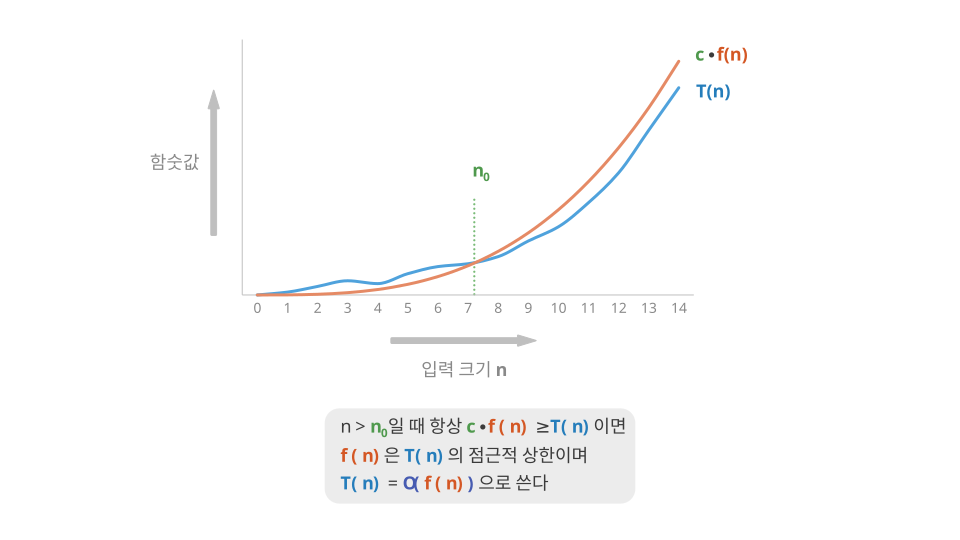
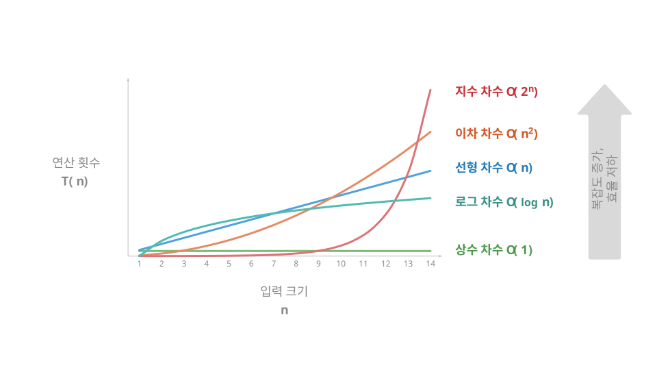
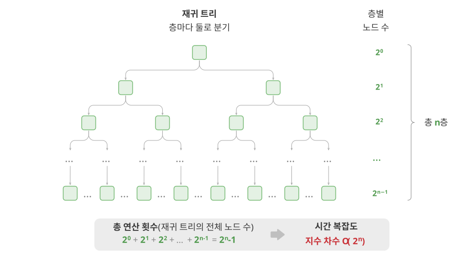
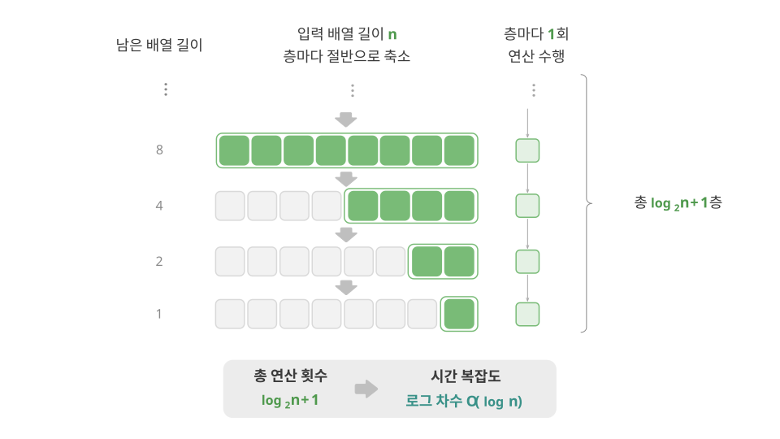
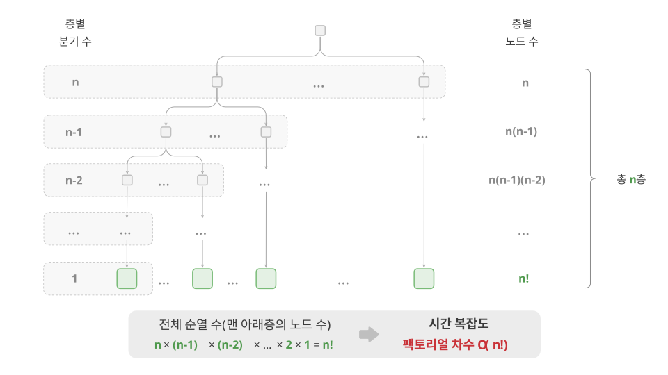

# 시간 복잡도

실행 시간은 알고리즘의 효율을 직관적이고 정확하게 보여 준다. 그렇다면 코드의 실행 시간을 정확히 예측하려면 어떻게 해야 할까?

1. **실행 환경을 정한다**. 하드웨어 구성, 프로그래밍 언어, 시스템 환경 등이 모두 코드의 실행 효율에 영향을 준다.
2. **각 연산에 걸리는 시간을 추정한다**. 예를 들어 덧셈 연산(`+`)에 1 ns, 곱셈 연산(`*`)에 10 ns, 출력 연산(`print()`)에 5 ns가 걸린다고 하자.
3. **코드의 모든 연산을 센다**. 각 연산에 걸리는 시간을 모두 더하면 실행 시간이 나온다.

예를 들어 다음 코드의 입력 크기가 $n$이라고 하자.

```snippet
run_time_estimate
```

위 방법으로 계산하면 알고리즘의 실행 시간은 $(6n + 12)$ ns이다.

$$
1 + 1 + 10 + (1 + 5) \times n = 6n + 12
$$

그러나 실제로 **이렇게 알고리즘의 실행 시간을 계산하는 것은 타당하지도 현실적이지도 않다**. 먼저 알고리즘은 여러 플랫폼에서 실행되어야 하므로 추정 시간을 특정 플랫폼에 종속시키고 싶지 않다. 게다가 각 연산에 걸리는 시간을 알아내기 어려워 추정 자체가 매우 까다롭다.

## 실행 시간의 증가 추세 파악하기

시간 복잡도 분석에서 살펴보는 것은 실행 시간 자체가 아니라 **입력 크기가 커질 때 실행 시간이 어떻게 증가하는가**이다.

‘시간의 증가 추세’란 다소 추상적이므로 예를 들어 보자. 입력 크기를 $n$이라고 하고 다음 세 알고리즘 `A`, `B`, `C`를 살펴보자.

```snippet
growth_trend
```

다음 그림은 위 세 알고리즘의 시간 복잡도를 보여 준다.

- 알고리즘 `A`는 출력 연산을 $1$번만 수행하므로 $n$이 커져도 실행 시간이 늘지 않는다. 이런 시간 복잡도를 ‘상수 차수’라고 한다.
- 알고리즘 `B`는 출력 연산을 $n$번 반복하므로 $n$이 커질 때 실행 시간이 선형으로 증가한다. 이런 시간 복잡도를 ‘선형 차수’라고 한다.
- 알고리즘 `C`는 출력 연산을 $1000000$번 반복한다. 실행 시간은 길지만 입력 크기 $n$과 무관하다. 따라서 `C`의 시간 복잡도는 `A`와 같은 상수 차수다.


실행 시간을 직접 계산하는 것과 비교하면 시간 복잡도 분석에는 어떤 특징이 있을까?

- **시간 복잡도로 알고리즘의 효율을 효과적으로 평가할 수 있다**. 예를 들어 알고리즘 `B`의 실행 시간은 선형으로 증가해 $n > 1$이면 알고리즘 `A`보다 느리고 $n > 1000000$이면 알고리즘 `C`보다 느리다. 입력 크기 $n$이 충분히 크면 상수 차수 알고리즘이 선형 차수 알고리즘보다 반드시 빠르다. 이것이 시간의 증가 추세가 의미하는 바다.
- **시간 복잡도는 더 간단히 추정할 수 있다**. 실행 시간의 증가 추세는 실행 플랫폼이나 연산의 종류에 좌우되지 않는다. 따라서 시간 복잡도를 분석할 때는 모든 연산에 같은 ‘단위 시간’이 걸린다고 보아도 된다. 각 연산의 실행 시간을 계산하는 대신 연산 횟수만 세면 되므로 추정이 훨씬 쉬워진다.
- **시간 복잡도에도 한계가 있다**. 예를 들어 알고리즘 `A`와 `C`는 시간 복잡도가 같지만 실제 실행 시간은 크게 다르다. 알고리즘 `B`는 `C`보다 시간 복잡도가 높지만 입력 크기 $n$이 작을 때는 `B`가 `C`보다 훨씬 빠르다. 이럴 때는 시간 복잡도만으로 효율의 우열을 가리기 어렵다. 이런 한계에도 불구하고 복잡도 분석은 알고리즘의 효율을 평가하는 데 가장 효과적이고 널리 쓰이는 방법이다.

## 함수의 점근적 상한

입력 크기가 $n$인 다음 함수를 생각해 보자.

```snippet
asymptotic_upper_bound
```

알고리즘의 연산 횟수를 입력 크기 $n$의 함수 $T(n)$으로 나타내면 위 함수의 연산 횟수는 다음과 같다.

$$
T(n) = 3 + 2n
$$

$T(n)$은 일차 함수다. 실행 시간은 선형으로 증가하므로 시간 복잡도는 선형 차수다.

선형 시간 복잡도는 $O(n)$으로 쓴다. 이 수학 표기를 <u>빅 $O$ 표기법(big-$O$ notation)</u>이라고 하며 함수 $T(n)$의 <u>점근적 상한(asymptotic upper bound)</u>을 나타낸다.

시간 복잡도 분석은 본질적으로 ‘연산 횟수 $T(n)$’의 점근적 상한을 구하는 일이다. 점근적 상한에는 다음과 같은 수학적 정의가 있다.

!!! note "함수의 점근적 상한"

    모든 $n > n_0$에서 $T(n) \leq c \cdot f(n)$이 성립하도록 양의 실수 $c$와 실수 $n_0$을 정할 수 있다면, 함수 $f(n)$는 $T(n)$의 점근적 상한이다. 이를 $T(n) = O(f(n))$으로 쓴다.

아래 그림처럼 점근적 상한을 구하는 일은 함수 $f(n)$을 찾는 것이다. $n$이 무한대로 갈 때 $T(n)$과 $f(n)$의 증가 차수가 같고 상수 계수 $c$만큼만 차이가 나는 함수를 찾는다.



## 시간 복잡도 구하기

점근적 상한은 다소 수학적인 개념이라 아직 완전히 이해하지 못했어도 괜찮다. 먼저 구하는 방법을 익히고 여러 번 적용해 보면 수학적 의미도 차츰 와닿을 것이다.

정의에 따르면 $f(n)$을 정하면 시간 복잡도 $O(f(n))$을 얻는다. 그러면 점근적 상한 $f(n)$은 어떻게 정할까? 먼저 연산 횟수를 세고, 다음으로 점근적 상한을 판단한다.

### 1단계: 연산 횟수 세기

코드의 각 줄을 위에서 아래로 따라가며 횟수를 세면 된다. 앞서 본 $c \cdot f(n)$에서 상수 계수 $c$의 크기는 자유롭게 정할 수 있으므로 **연산 횟수 $T(n)$에 붙은 계수와 상수항은 무시할 수 있다**. 이에 따라 계산을 단순화하는 요령을 정리할 수 있다.

1. **$T(n)$의 상수항은 무시한다**. 이 항들은 $n$과 무관하므로 시간 복잡도에 영향을 주지 않는다.
2. **계수는 모두 생략한다**. 예를 들어 $2n$번이나 $5n + 1$번 반복하는 경우는 모두 $n$번으로 간단히 적을 수 있다. $n$ 앞의 계수가 시간 복잡도에 영향을 주지 않기 때문이다.
3. **반복문이 중첩되면 곱셈을 이용한다**. 전체 연산 횟수는 바깥 반복문과 안쪽 반복문의 횟수를 곱해 구한다. 각 반복문에는 앞의 `1.`, `2.`에서 설명한 요령을 따로 적용할 수 있다.

다음 함수에 이 요령을 적용해 연산 횟수를 세어 보자.

```snippet
count_operations
```

다음 식은 요령을 적용하기 전과 후의 계산 결과를 보여 준다. 어느 식에서 구하든 시간 복잡도는 $O(n^2)$이다.

$$
\begin{aligned}
T(n) & = 2n(n + 1) + (5n + 1) + 2 & \text{빠짐없이 센 결과 (-.-|||)} \newline
& = 2n^2 + 7n + 3 \newline
T(n) & = n^2 + n & \text{간단히 센 결과 (o.O)}
\end{aligned}
$$

### 2단계: 점근적 상한 판단하기

**시간 복잡도는 $T(n)$에서 차수가 가장 높은 항이 결정한다**. $n$이 무한대로 갈수록 최고차항의 영향이 지배적이 되어 다른 항의 영향은 무시할 수 있기 때문이다.

다음 표에 몇 가지 예를 들었다. 일부 값이 유난히 큰 것은 ‘계수가 아무리 커도 차수는 바뀌지 않는다’는 점을 강조하기 위해서다. $n$이 무한대로 가면 이러한 상수의 영향은 미미해진다.

<p align="center"> 표 <id> &nbsp; 연산 횟수에 따른 시간 복잡도 </p>

| 연산 횟수 $T(n)$        | 시간 복잡도 $O(f(n))$ |
| ---------------------- | -------------------- |
| $100000$               | $O(1)$               |
| $3n + 2$               | $O(n)$               |
| $2n^2 + 3n + 2$        | $O(n^2)$             |
| $n^3 + 10000n^2$       | $O(n^3)$             |
| $2^n + 10000n^{10000}$ | $O(2^n)$             |

## 대표적인 유형

입력 크기를 $n$이라고 하자. 다음 그림은 대표적인 시간 복잡도를 낮은 것부터 높은 것까지 보여 준다.

$$
\begin{aligned}
& O(1) < O(\log n) < O(n) < O(n \log n) < O(n^2) < O(2^n) < O(n!) \newline
& \text{상수 차수} < \text{로그 차수} < \text{선형 차수} < \text{선형 로그 차수} < \text{이차 차수} < \text{지수 차수} < \text{팩토리얼 차수}
\end{aligned}
$$



### 상수 차수 $O(1)$

상수 차수에서는 연산 횟수가 입력 크기 $n$과 무관하다. 즉, $n$이 변해도 연산 횟수는 변하지 않는다.

다음 함수에서 연산 횟수 `size`는 매우 클 수도 있지만 입력 크기 $n$과 무관하므로 시간 복잡도는 여전히 $O(1)$이다.

```src
[file]{time_complexity}-[class]{}-[func]{constant}
```

### 선형 차수 $O(n)$

선형 차수에서는 연산 횟수가 입력 크기 $n$에 비례해 증가한다. 보통 다음과 같은 단일 반복문에서 나타난다.

```src
[file]{time_complexity}-[class]{}-[func]{linear}
```

배열 순회와 연결 리스트 순회의 시간 복잡도는 모두 $O(n)$이다. 여기서 $n$은 배열 또는 연결 리스트의 길이다.

```src
[file]{time_complexity}-[class]{}-[func]{array_traversal}
```

**입력 크기 $n$을 무엇으로 볼지는 입력 데이터의 유형에 따라 정해야 한다**. 첫 번째 예에서는 변수 $n$의 값이 입력 크기이고 두 번째 예에서는 배열의 길이 $n$이 입력 크기다.

### 이차 차수 $O(n^2)$

이차 차수에서는 연산 횟수가 입력 크기 $n$의 제곱에 비례해 증가한다. 보통 중첩 반복문에서 나타난다. 바깥 반복문과 안쪽 반복문의 시간 복잡도가 각각 $O(n)$이면 전체 시간 복잡도는 $O(n^2)$이다.

```src
[file]{time_complexity}-[class]{}-[func]{quadratic}
```

다음 그림은 상수, 선형, 이차 시간 복잡도를 비교한다.


버블 정렬을 예로 들어 보자. 바깥 반복문은 $n - 1$번 실행된다. 안쪽 반복문은 차례로 $n-1$, $n-2$, $\dots$, $2$, $1$번 실행되어 평균 $n / 2$번이다. 따라서 시간 복잡도는 $O((n - 1) n / 2) = O(n^2)$이다.

```src
[file]{time_complexity}-[class]{}-[func]{bubble_sort}
```

### 지수 차수 $O(2^n)$

생물학의 세포 분열은 지수 증가의 대표적인 예다. 처음에 세포가 $1$개 있다면 한 차례 분열한 뒤에는 $2$개, 두 차례 뒤에는 $4$개가 된다. 이렇게 $n$차례 분열하면 세포가 $2^n$개가 된다.

다음 그림과 코드는 세포 분열 과정을 모의하며 시간 복잡도는 $O(2^n)$이다. 입력 $n$은 분열을 반복한 라운드 수이고, 반환값 `count`는 그동안 일어난 개별 분열의 총횟수라는 점에 주의하자.

```src
[file]{time_complexity}-[class]{}-[func]{exponential}
```



실제 알고리즘에서는 재귀 함수에서 지수 차수가 자주 나타난다. 예를 들어 다음 코드에서는 재귀적으로 둘로 나뉘다가 $n$차례 분기한 뒤 멈춘다.

```src
[file]{time_complexity}-[class]{}-[func]{exp_recur}
```

지수 차수는 매우 빠르게 증가하며 완전 탐색(무차별 대입 탐색, 백트래킹 등)에서 자주 나타난다. 입력이 큰 문제에서는 지수 차수를 감당하기 어려워 보통 동적 계획법이나 탐욕 알고리즘 같은 방법으로 풀어야 한다.

### 로그 차수 $O(\log n)$

지수 증가와 반대로, 로그 차수는 매번 규모를 절반으로 줄이는 경우에 나타난다. 입력 크기가 $n$이라면 매번 남은 크기를 반씩 줄이는 데 필요한 반복 횟수는 $\log_2 n$이다. 로그 함수는 $2^n$의 역함수다.

다음 그림과 코드는 매번 절반으로 줄이는 과정을 보여 준다. 시간 복잡도는 $O(\log_2 n)$이며 줄여서 $O(\log n)$이라고 쓴다.

```src
[file]{time_complexity}-[class]{}-[func]{logarithmic}
```



지수 차수와 마찬가지로 로그 차수도 재귀 함수에서 자주 나타난다. 다음 코드에서는 높이가 $\log_2 n$인 재귀 트리가 만들어진다.

```src
[file]{time_complexity}-[class]{}-[func]{log_recur}
```

로그 차수는 분할 정복 전략에 기반한 알고리즘에서 흔히 나타나며, 하나를 여럿으로 나누어 복잡한 문제를 단순화하는 사고방식을 보여 준다. 매우 느리게 증가하므로 상수 차수 다음으로 좋은 시간 복잡도다.

!!! tip "$O(\log n)$에서 로그의 밑은 얼마인가?"

    엄밀히 말해 크기를 $m$등분하는 경우에 대응하는 시간 복잡도는 $O(\log_m n)$이다. 로그의 밑 변환 공식을 이용하면 밑이 달라도 시간 복잡도가 같다는 것을 알 수 있다.

    $$
    O(\log_m n) = O(\log_k n / \log_k m) = O(\log_k n)
    $$

    즉, 밑 $m$을 바꾸어도 복잡도는 달라지지 않는다. 그래서 보통 밑 $m$을 생략하고 로그 차수를 $O(\log n)$으로 쓴다.

### 선형 로그 차수 $O(n \log n)$

선형 로그 차수는 두 반복문의 시간 복잡도가 각각 $O(\log n)$과 $O(n)$인 중첩 반복문에서 흔히 나타난다. 관련 코드는 다음과 같다.

```src
[file]{time_complexity}-[class]{}-[func]{linear_log_recur}
```

다음 그림은 선형 로그 차수가 어떻게 나오는지 보여 준다. 이진 트리의 각 층에서 전체 연산 횟수는 $n$이고 트리는 모두 $\log_2 n + 1$개 층이므로 시간 복잡도는 $O(n \log n)$이다.


퀵 정렬, 병합 정렬, 힙 정렬 등 널리 쓰이는 정렬 알고리즘의 시간 복잡도는 보통 $O(n \log n)$이다.

### 팩토리얼 차수 $O(n!)$

팩토리얼 차수는 수학의 순열 문제에 대응한다. 서로 다른 $n$개 원소로 만들 수 있는 모든 순열을 구할 때 가능한 순열의 수는 다음과 같다.

$$
n! = n \times (n - 1) \times (n - 2) \times \dots \times 2 \times 1
$$

팩토리얼은 보통 재귀로 구현한다. 다음 그림과 코드에서 첫 층에서는 $n$갈래, 둘째 층에서는 각각 $n - 1$갈래로 나뉜다. 이런 식으로 이어지다가 $n$번째 층에서 분기가 끝난다.

```src
[file]{time_complexity}-[class]{}-[func]{factorial_recur}
```



$n \geq 4$일 때 항상 $n! > 2^n$이므로 팩토리얼 차수는 지수 차수보다 더 빠르게 증가한다. 따라서 $n$이 크면 이 역시 감당하기 어렵다.

## 최악, 최선, 평균 시간 복잡도

**알고리즘의 시간 효율은 고정된 값이 아니라 입력 데이터의 분포에 따라 달라지는 경우가 많다**. 길이가 $n$인 배열 `nums`가 주어졌다고 하자. `nums`에는 $1$부터 $n$까지의 수가 한 번씩 들어 있고 순서는 무작위로 섞여 있다. 목표는 원소 $1$의 인덱스를 반환하는 것이다. 다음 두 경우를 생각해 보자.

- `nums = [?, ?, ..., 1]`처럼 마지막 원소가 $1$이면 배열 전체를 순회해야 하므로 **최악 시간 복잡도 $O(n)$에 이른다**.
- `nums = [1, ?, ?, ...]`처럼 첫 원소가 $1$이면 배열 길이와 무관하게 더 순회할 필요가 없으므로 **최선 시간 복잡도 $\Omega(1)$에 이른다**.

‘최악 시간 복잡도’는 함수의 점근적 상한에 대응하며 빅 $O$ 표기법으로 나타낸다. 마찬가지로 ‘최선 시간 복잡도’는 함수의 점근적 하한에 대응하며 $\Omega$ 표기법으로 나타낸다.

```src
[file]{worst_best_time_complexity}-[class]{}-[func]{find_one}
```

실제로 최선 시간 복잡도는 거의 쓰지 않는다. 최선의 경우가 일어날 확률이 대개 매우 낮아 효율에 대해 오해를 줄 수 있기 때문이다. **최악 시간 복잡도는 성능이 얼마나 나빠질 수 있는지 한계를 알려 주므로 더 실용적이다**. 이를 알면 알고리즘을 안심하고 사용할 수 있다.

앞의 예에서 보듯이 최악과 최선 시간 복잡도는 특정한 데이터 배치에서만 나타난다. 이런 경우는 드물 수 있어 실제 실행 효율을 제대로 반영하기 어렵다. 이에 비해 **평균 시간 복잡도는 무작위 입력에서의 실행 효율을 나타내며** $\Theta$ 표기법으로 표현한다.

일부 알고리즘은 무작위 입력 분포에서 평균적인 경우를 쉽게 추정할 수 있다. 앞의 예에서는 배열을 무작위로 섞으므로 어느 인덱스에나 원소 $1$이 있을 확률이 같다. 따라서 평균 반복 횟수는 배열 길이의 절반인 $n / 2$이며 평균 시간 복잡도는 $\Theta(n / 2) = \Theta(n)$이다.

복잡한 알고리즘은 입력 분포를 고려한 전체 기댓값을 구하기 어려워 평균 시간 복잡도를 계산하기가 까다로운 경우가 많다. 이때는 보통 최악 시간 복잡도를 효율 평가의 기준으로 삼는다.

!!! question "$\Theta$ 기호는 왜 보기 드물까?"

    $O$ 표기가 입에 익어서인지 평균 시간 복잡도에도 이를 자주 사용한다. 하지만 엄밀히 말하면 이러한 용법은 표준적이지 않다. 이 책이나 다른 자료에서 ‘평균 시간 복잡도 $O(n)$’과 같은 표현을 만나면 $\Theta(n)$이라는 뜻으로 이해하자.
