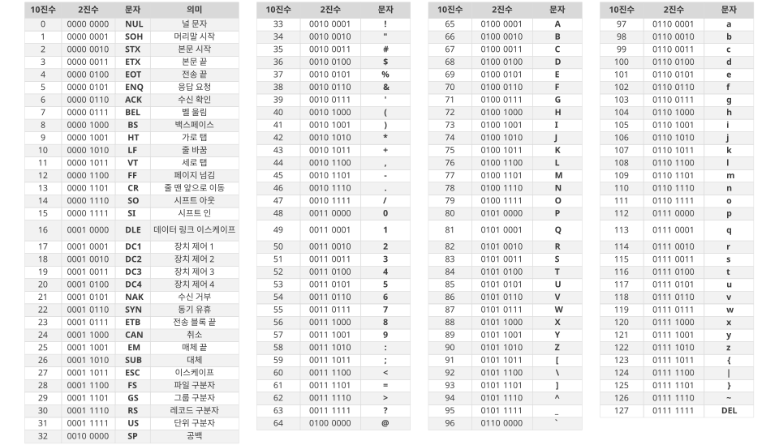
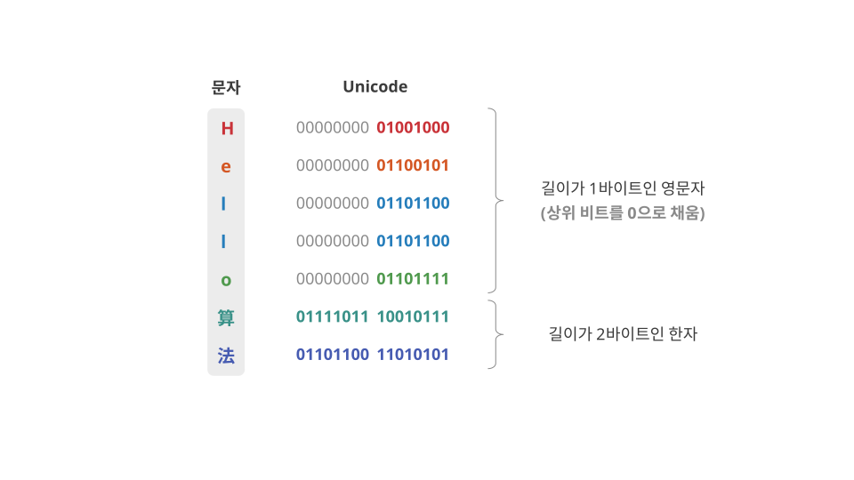
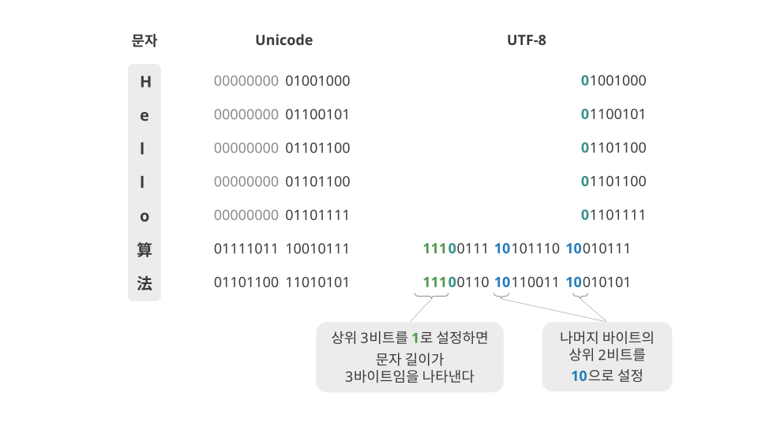

# 3.4 &nbsp; 문자 인코딩 *

컴퓨터에서는 모든 데이터를 이진수로 저장하며 문자 `char`도 예외가 아니다. 문자를 표현하려면 각 문자와 이진수 사이의 일대일 대응을 정한 ‘문자 집합’이 필요하다. 문자 집합이 있으면 컴퓨터는 대응표에서 값을 찾아 이진수를 문자로 바꿀 수 있다.

## 3.4.1 &nbsp; ASCII 문자 집합

<u>ASCII 코드</u>는 가장 일찍 등장한 문자 집합으로, 정식 명칭은 American Standard Code for Information Interchange(미국 정보 교환 표준 코드)이다. 7비트 이진수(한 바이트의 하위 7비트)로 문자 하나를 나타내므로 서로 다른 문자를 최대 128개 표현할 수 있다. 아래 그림(3-6)처럼 ASCII에는 영문 대소문자, 숫자 0~9, 일부 문장 부호와 줄 바꿈 및 탭 같은 제어 문자가 포함된다.

{ class="animation-figure" }

 그림 3-6 &nbsp; ASCII 코드 

하지만 **ASCII 코드로 표현할 수 있는 언어는 영어뿐이다**. 컴퓨터가 세계적으로 보급되면서 더 많은 언어를 표현할 수 있는 <u>EASCII</u> 문자 집합이 등장했다. ASCII의 7비트를 8비트로 확장해 서로 다른 문자 256개를 표현할 수 있다.

세계 각지에서 지역별 요구에 맞는 EASCII 문자 집합이 잇따라 등장했다. 모두 처음 128개 문자는 ASCII와 같고, 뒤의 128개 문자는 언어별 필요에 맞게 다르게 정의했다.

## 3.4.2 &nbsp; GBK 문자 집합

시간이 지나면서 **EASCII 코드로도 많은 언어에 필요한 문자를 모두 담을 수 없다는 점**이 드러났다. 예를 들어 한자는 거의 10만 자에 이르며 일상적으로 쓰는 것만도 수천 자이다. 1980년 중국 국가표준총국은 한자 6763자를 수록한 <u>GB2312</u> 문자 집합을 발표했다. 이로써 컴퓨터에서 한자를 처리하는 데 필요한 요구를 대체로 충족했다.

하지만 GB2312로는 일부 희귀 한자와 번체자를 처리할 수 없었다. GB2312를 확장한 <u>GBK</u> 문자 집합은 총 21886자의 한자를 수록했다. GBK 인코딩에서 ASCII 문자는 한 바이트로, 한자는 두 바이트로 표현한다.

## 3.4.3 &nbsp; Unicode 문자 집합

컴퓨터 기술이 빠르게 발전하면서 다양한 문자 집합과 인코딩 표준이 등장했고 여러 문제도 생겼다. 대개 특정 언어의 문자만 정의하므로 다국어 환경에서 제대로 작동하지 않았다. 같은 언어에도 여러 문자 집합 표준이 있어 두 컴퓨터가 서로 다른 인코딩 표준을 쓰면 정보를 주고받을 때 글자가 깨졌다.

당시 연구자들은 생각했다. **전 세계의 모든 언어와 기호를 담을 만큼 완전한 문자 집합을 만들면 여러 언어를 함께 다루는 문제와 글자 깨짐을 해결할 수 있지 않을까**? 이런 생각에서 방대한 통합 문자 집합인 Unicode가 탄생했다.

<u>Unicode</u>는 중국어로 ‘통일 코드(统一码)’라 불리며 이론적으로 100만 개가 넘는 문자를 수용할 수 있다. 전 세계 문자를 하나의 집합에 담아 여러 언어의 글을 처리하고 표시하는 공통 수단을 제공하고, 인코딩 표준 차이로 글자가 깨지는 문제를 줄이는 것이 목표이다. 1991년에 발표된 뒤 언어와 문자가 계속 추가되었다. 2022년 9월 기준 Unicode에는 각종 언어의 문자와 기호, 이모지 등 149186개 문자가 포함되어 있다.

범용 문자 집합인 Unicode는 각 문자에 고유한 ‘코드 포인트’(문자 번호)를 부여한다. 범위는 U+0000부터 U+10FFFF까지이며 하나의 통일된 문자 번호 공간을 이룬다. 그러나 **Unicode 자체는 이 코드 포인트들을 컴퓨터에 저장하는 방식을 정하지 않는다**. 길이가 다른 코드 포인트가 한 텍스트에 섞여 있으면 시스템은 어떻게 문자를 구분할까? 예를 들어 두 바이트가 주어졌을 때 이것이 2바이트 문자 하나인지 1바이트 문자 두 개인지 어떻게 알 수 있을까?

**한 가지 간단한 해법은 모든 문자를 같은 길이의 코드로 저장하는 것이다**. 아래 그림(3-7)에서 ‘Hello’의 각 문자는 1바이트, ‘算法’의 각 문자는 2바이트를 차지한다. 상위 비트를 0으로 채워 ‘Hello 算法’의 모든 문자를 2바이트로 인코딩할 수 있다. 그러면 시스템이 두 바이트씩 읽어 문자를 하나씩 해석하고 원래 문구를 복원할 수 있다.

{ class="animation-figure" }

 그림 3-7 &nbsp; Unicode 인코딩 예 

하지만 ASCII 코드에서 보았듯이 영문자 하나를 인코딩하는 데는 1바이트면 충분하다. 위 방식을 쓰면 영문 텍스트가 ASCII로 인코딩했을 때의 두 배 공간을 차지해 메모리를 크게 낭비한다. 따라서 더 효율적인 Unicode 인코딩 방식이 필요하다.

## 3.4.4 &nbsp; UTF-8 인코딩

현재 UTF-8은 세계에서 가장 널리 쓰이는 Unicode 인코딩 방식이다. **가변 길이 인코딩**으로, 문자에 따라 1~4바이트로 한 문자를 나타낸다. ASCII 문자는 1바이트면 되고, 확장 라틴 문자와 그리스 문자는 2바이트, 흔히 쓰이는 한자는 3바이트, 그 밖의 일부 드문 문자는 4바이트가 필요하다.

UTF-8의 인코딩 규칙은 간단하며 두 경우로 나뉜다.

- 길이가 1바이트인 문자는 최상위 비트를 $0$으로 두고 나머지 7비트에 Unicode 코드 포인트를 넣는다. Unicode 문자 집합의 처음 128개 코드 포인트는 ASCII 문자가 차지한다. 따라서 **UTF-8은 ASCII와 하위 호환된다**. 오래전에 작성한 ASCII 텍스트도 UTF-8로 읽을 수 있다는 뜻이다.
- 길이가 $n$바이트인 문자($n > 1$)는 첫 바이트의 상위 $n$비트를 모두 $1$로, 위에서 $n + 1$번째 비트를 $0$으로 둔다. 둘째 바이트부터는 각 바이트의 상위 두 비트를 $10$으로 두고, 나머지 비트에는 문자의 Unicode 코드 포인트를 채운다.

아래 그림(3-8)은 ‘Hello算法’의 UTF-8 인코딩을 보여 준다. 다중 바이트 문자는 첫 바이트의 상위 $n$비트가 모두 $1$이므로 시스템은 맨 앞에 연달아 나오는 $1$의 개수를 세어 문자 길이가 $n$바이트임을 알 수 있다.

그렇다면 나머지 모든 바이트의 상위 두 비트를 왜 $10$으로 둘까? 이 $10$은 오류를 확인하는 표지 역할을 할 수 있다. 시스템이 잘못된 바이트에서 텍스트 해석을 시작하면 바이트 앞의 $10$을 보고 이상을 빠르게 알아낼 수 있다.

$10$을 확인용 표지로 쓸 수 있는 이유는 UTF-8의 규칙상 문자의 첫 두 비트가 $10$일 수 없기 때문이다. 귀류법으로 증명해 보자. 어떤 문자의 첫 두 비트가 $10$라고 가정하면 맨 앞의 1이 하나이므로 문자 길이는 $1$바이트이고 ASCII에 해당한다. 그러나 ASCII의 최상위 비트는 $0$이어야 하므로 가정과 모순된다.

{ class="animation-figure" }

 그림 3-8 &nbsp; UTF-8 인코딩 예 

UTF-8 외에도 다음 두 인코딩 방식을 흔히 사용한다.

- **UTF-16 인코딩**: 한 문자를 2바이트 또는 4바이트로 표현한다. 모든 ASCII 문자와 자주 쓰이는 비영어권 문자는 2바이트로 표현하며 일부 문자는 4바이트가 필요하다. 2바이트로 표현하는 문자의 UTF-16 코드값은 Unicode 코드 포인트와 같다.
- **UTF-32 인코딩**: 모든 문자를 각각 4바이트로 표현한다. 따라서 UTF-32는 UTF-8이나 UTF-16보다 공간을 많이 차지하며, 특히 ASCII 문자 비율이 높은 텍스트에서 차이가 크다.

저장 공간 면에서는 영문자를 UTF-8로 표현하는 것이 매우 효율적이다. 1바이트면 충분하기 때문이다. 반면 한자 같은 일부 비영어권 문자는 UTF-16에서 2바이트면 되지만 UTF-8에서는 3바이트가 들 수 있으므로 UTF-16이 더 효율적이다.

호환성 면에서는 UTF-8의 범용성이 가장 높다. 많은 도구와 라이브러리가 UTF-8을 우선 지원한다.

## 3.4.5 &nbsp; 프로그래밍 언어의 문자 인코딩

과거에는 대부분의 프로그래밍 언어가 실행 중인 프로그램의 문자열에 UTF-16이나 UTF-32처럼 길이가 일정한 인코딩 단위를 사용했다. 길이가 일정하면 문자열을 배열처럼 다룰 수 있어 다음과 같은 장점이 있다.

- **임의 접근**: UTF-16으로 인코딩한 문자열에는 쉽게 임의 접근할 수 있다. UTF-8은 가변 길이 인코딩이므로 $i$번째 문자를 찾으려면 문자열 시작부터 $i$번째 문자까지 순회해야 하며 $O(n)$ 시간이 걸린다.
- **문자 수 세기**: 임의 접근과 마찬가지로 UTF-16 문자열의 길이를 구하는 것도 $O(1)$ 연산이다. 반면 UTF-8 문자열의 문자 수를 구하려면 문자열 전체를 순회해야 한다.
- **문자열 연산**: UTF-16 문자열에서는 분할, 연결, 삽입, 삭제 등 많은 연산을 더 쉽게 할 수 있다. UTF-8 문자열에서 이런 연산을 할 때는 잘못된 UTF-8 인코딩이 생기지 않도록 보통 추가 계산이 필요하다.

실제로 프로그래밍 언어의 문자 인코딩 설계는 여러 요소가 얽혀 있는 흥미로운 주제이다.

- Java의 `String` 타입은 UTF-16 인코딩을 사용하며 문자 단위 하나가 2바이트를 차지한다. Java를 처음 설계할 때는 16비트면 가능한 모든 문자를 표현할 수 있다고 생각했다. 하지만 이 판단은 틀렸다. 나중에 Unicode 규격이 16비트를 넘어 확장되면서 이제 Java의 한 문자를 16비트 값 두 개의 쌍인 ‘서로게이트 쌍’으로 나타내기도 한다.
- JavaScript와 TypeScript 문자열이 UTF-16을 쓰는 이유도 Java와 비슷하다. 1995년에 넷스케이프가 JavaScript를 처음 발표했을 때는 Unicode가 개발 초기 단계였고 16비트 인코딩으로 모든 Unicode 문자를 표현할 수 있었다.
- C#이 UTF-16을 사용하는 주된 이유는 .NET 플랫폼을 Microsoft가 설계했고 Windows 운영체제를 비롯한 Microsoft의 많은 기술이 UTF-16을 널리 사용하기 때문이다.

이 언어들은 문자 수를 과소평가했던 탓에 16비트를 넘는 Unicode 문자를 표현하려면 부득이하게 서로게이트 쌍을 사용해야 했다. 한편으로 서로게이트 쌍이 들어 있는 문자열에서는 한 문자가 2바이트 또는 4바이트를 차지해 고정 길이 인코딩의 장점이 사라진다. 다른 한편으로는 서로게이트 쌍을 처리할 코드가 더 필요해 프로그래밍이 복잡해지고 디버깅도 어려워진다.

이러한 이유로 일부 프로그래밍 언어는 다른 인코딩 방식을 채택했다.

- Python의 `str`는 Unicode를 사용하며 유연한 문자열 표현 방식을 취한다. 문자 하나를 저장하는 길이는 해당 문자열에서 가장 큰 Unicode 코드 포인트에 따라 정해진다. 모두 ASCII 문자이면 문자당 1바이트, ASCII 범위를 넘는 문자가 있지만 모두 기본 다국어 평면(BMP) 안에 있으면 문자당 2바이트, BMP를 벗어나는 문자가 있으면 문자당 4바이트이다.
- Go의 `string` 타입은 내부적으로 UTF-8 인코딩을 사용한다. Go는 단일 Unicode 코드 포인트를 나타내는 `rune` 타입도 제공한다.
- Rust의 `str`와 `String` 타입은 내부적으로 UTF-8 인코딩을 사용한다. 단일 Unicode 코드 포인트를 나타내는 `char` 타입도 제공한다.

지금까지 살펴본 것은 언어 내부에서 문자열을 저장하는 방식이다. **문자열을 파일에 저장하거나 네트워크로 전송하는 방식은 이와 별개의 문제이다**. 파일 저장과 네트워크 전송에서는 호환성과 공간 효율을 높이기 위해 보통 문자열을 UTF-8로 인코딩한다.
