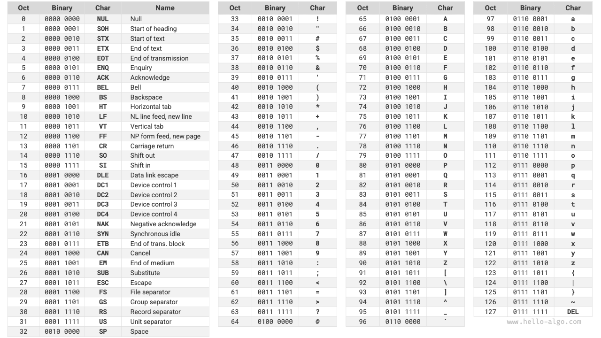

# 문자 인코딩 *

컴퓨터에서는 모든 데이터를 이진수 형태로 저장하며, 문자 `char`도 예외가 아니다. 문자를 표현하려면 각 문자와 이진수 사이의 일대일 대응 관계를 정한 ‘문자 집합’이 필요하다. 문자 집합이 있으면 컴퓨터는 대응표를 찾아 이진수를 문자로 바꿀 수 있다.

## ASCII 문자 집합

<u>ASCII 코드</u>는 가장 초기에 등장한 문자 집합으로, 정식 명칭은 American Standard Code for Information Interchange(미국 정보 교환 표준 부호)다. 7비트 이진수(한 바이트의 하위 7비트)로 문자 하나를 표현하여 최대 128개의 서로 다른 문자를 나타낸다. 아래 그림과 같이 영문 대소문자, 숫자 0 ~ 9, 일부 문장 부호와 제어 문자(줄바꿈, 탭 등)를 포함한다.

그러나 **ASCII 코드는 영어만 표현할 수 있다**. 컴퓨터가 전 세계로 보급되면서 더 많은 언어를 표현할 수 있는 <u>EASCII</u> 문자 집합이 등장했다. ASCII의 7비트를 8비트로 확장하여 서로 다른 문자 256개를 표현한다.

이후 세계 여러 지역에 맞는 EASCII 문자 집합이 잇따라 등장했다. 이 문자 집합들은 앞의 128개 문자는 모두 ASCII 코드로 통일하고, 뒤의 128개 문자는 각 언어의 필요에 맞게 서로 다르게 정의했다.

## GBK 문자 집합

하지만 **EASCII 코드도 여러 언어에 필요한 문자 수를 충족하지 못했다**. 예를 들어 한자는 거의 10만 자에 이르며, 일상에서 사용하는 것만 해도 수천 자다. 중국 국가표준총국은 1980년에 한자 6763자를 수록한 <u>GB2312</u> 문자 집합을 발표하여 컴퓨터의 한자 처리에 필요한 기본적인 요구를 충족했다.

그러나 GB2312는 일부 드문 한자와 번체자를 처리할 수 없었다. <u>GBK</u> 문자 집합은 GB2312를 확장한 것으로 총 21886자의 한자를 수록한다. GBK 인코딩에서는 ASCII 문자를 1바이트로, 한자를 2바이트로 표현한다.

## Unicode 문자 집합

컴퓨터 기술이 빠르게 발전하면서 문자 집합과 인코딩 표준이 다양하게 등장했지만, 이는 여러 문제를 낳았다. 한편으로는 문자 집합이 대개 특정 언어의 문자만 정의하여 다국어 환경에서 제대로 작동하지 못했다. 다른 한편으로는 같은 언어에도 여러 문자 집합 표준이 있어, 두 컴퓨터의 인코딩 표준이 다르면 정보를 주고받을 때 글자가 깨졌다.

당시 연구자들은 이렇게 생각했다. **세계의 모든 언어와 기호를 담을 만큼 완전한 문자 집합을 만들면 다국어 환경과 글자 깨짐 문제를 해결할 수 있지 않을까**? 이러한 생각에서 크고 포괄적인 문자 집합 Unicode가 탄생했다.

<u>Unicode</u>는 중국어로 ‘통일 부호’라는 뜻의 이름으로 불리며, 이론적으로 100만 개 이상의 문자를 수용할 수 있다. 전 세계 문자를 하나의 문자 집합에 통합하고, 여러 언어의 문자를 처리하고 표시하는 공통 문자 집합을 제공하여 인코딩 표준의 차이로 발생하는 글자 깨짐을 줄이는 것이 목표다. 1991년 발표된 뒤로 새로운 언어와 문자가 계속 추가되었다. 2022년 9월 기준으로 Unicode에는 여러 언어의 문자, 기호, 이모지 등을 포함하여 149186개의 문자가 들어 있다.

Unicode는 범용 문자 집합으로서 각 문자에 고유한 ‘코드 포인트’(문자 번호)를 부여한다. 범위는 U+0000부터 U+10FFFF까지이며, 하나로 통일된 문자 번호 공간을 이룬다. 그러나 **Unicode는 이러한 문자 코드 포인트를 컴퓨터에 어떻게 저장할지는 정하지 않는다**. 길이가 다른 Unicode 코드 포인트들이 한 텍스트에 함께 나타나면 시스템은 문자를 어떻게 해석할까? 예를 들어 길이가 2바이트인 인코딩이 주어졌을 때, 2바이트 문자 하나인지 1바이트 문자 두 개인지 어떻게 판단할까?

이 문제의 **직접적인 해결책은 모든 문자를 같은 길이로 인코딩하여 저장하는 것이다**. 아래 그림에서 ‘Hello’의 각 문자는 1바이트, ‘算法’의 각 문자는 2바이트를 차지한다. 상위 비트에 0을 채우면 ‘Hello 算法’의 모든 문자를 2바이트 길이로 인코딩할 수 있다. 그러면 시스템이 2바이트마다 문자 하나를 해석하여 원래 문구를 복원할 수 있다.

하지만 ASCII 코드에서 보았듯이 영어 문자를 인코딩하는 데는 1바이트면 충분하다. 위 방식을 사용하면 영어 텍스트가 ASCII 인코딩의 두 배 공간을 차지하여 메모리를 크게 낭비한다. 따라서 더 효율적인 Unicode 인코딩 방법이 필요하다.

## UTF-8 인코딩

현재 UTF-8은 세계에서 가장 널리 쓰이는 Unicode 인코딩 방식이다. **가변 길이 인코딩으로**, 문자의 복잡성에 따라 1~4바이트로 문자 하나를 표현한다. ASCII 문자는 1바이트, 라틴 문자와 그리스 문자는 2바이트, 자주 쓰는 중국어 문자는 3바이트, 일부 드문 문자는 4바이트가 필요하다.

UTF-8 인코딩 규칙은 복잡하지 않으며, 다음 두 경우로 나뉜다.

- 길이가 1바이트인 문자는 최상위 비트를 $0$으로 두고 나머지 7비트에 Unicode 코드 포인트를 넣는다. ASCII 문자는 Unicode 문자 집합의 처음 128개 코드 포인트를 차지한다. 즉, **UTF-8 인코딩은 ASCII 코드와 하위 호환된다**. 따라서 오래된 ASCII 텍스트도 UTF-8로 해석할 수 있다.
- 길이가 $n$바이트인 문자($n > 1$)는 첫 바이트의 상위 $n$비트를 모두 $1$로, $n + 1$번째 비트를 $0$으로 둔다. 두 번째 바이트부터는 각 바이트의 상위 2비트를 $10$으로 두고, 나머지 모든 비트에 문자의 Unicode 코드 포인트를 채운다.

아래 그림은 ‘Hello算法’의 UTF-8 인코딩을 보여 준다. 상위 $n$비트가 모두 $1$이므로 시스템은 맨 앞에서 연속된 $1$의 개수를 읽어 문자 길이가 $n$임을 알 수 있다.

그렇다면 나머지 바이트의 상위 2비트를 모두 $10$으로 두는 이유는 무엇일까? 이 $10$은 검사 표식 역할을 한다. 시스템이 잘못된 바이트에서 텍스트를 해석하기 시작했을 때, 바이트 앞부분의 $10$을 통해 이상을 빠르게 감지할 수 있다.

$10$을 검사 표식으로 쓰는 이유는 UTF-8 규칙상 문자 인코딩의 맨 앞 두 비트가 $10$일 수 없기 때문이다. 이는 귀류법으로 증명할 수 있다. 문자 인코딩의 맨 앞 두 비트가 $10$이라고 가정하면, 길이가 $1$바이트인 ASCII 문자라는 뜻이다. 하지만 ASCII 코드의 최상위 비트는 $0$이어야 하므로 가정과 모순된다.

UTF-8 외에도 다음 두 인코딩 방식이 널리 쓰인다.

- **UTF-16 인코딩**: 2바이트 또는 4바이트로 문자 하나를 표현한다. 모든 ASCII 문자와 자주 쓰는 비영어권 문자는 2바이트로 표현하고, 일부 문자는 4바이트가 필요하다. 2바이트 문자는 UTF-16 인코딩 값이 Unicode 코드 포인트와 같다.
- **UTF-32 인코딩**: 모든 문자에 4바이트를 사용한다. 따라서 UTF-8이나 UTF-16보다 공간을 더 많이 차지하며, 특히 ASCII 문자의 비중이 큰 텍스트에서 차이가 크다.

저장 공간 관점에서 UTF-8은 영어 문자를 1바이트만으로 표현하므로 매우 효율적이다. 반면 중국어 같은 일부 비영어권 문자는 UTF-16으로 인코딩하는 것이 더 효율적이다. UTF-16은 2바이트면 되지만 UTF-8은 3바이트가 필요할 수 있기 때문이다.

호환성 관점에서는 UTF-8의 범용성이 가장 뛰어나며, 많은 도구와 라이브러리가 UTF-8을 우선 지원한다.

## 프로그래밍 언어의 문자 인코딩

과거의 대다수 프로그래밍 언어에서는 실행 중인 프로그램의 문자열에 UTF-16이나 UTF-32 같은 고정 길이 인코딩을 사용했다. 고정 길이 인코딩에서는 문자열을 배열처럼 다룰 수 있어 다음과 같은 장점이 있다.

- **임의 접근**: UTF-16 문자열은 임의 접근이 쉽다. UTF-8은 가변 길이 인코딩이므로 $i$번째 문자를 찾으려면 문자열의 처음부터 $i$번째 문자까지 순회해야 하며, $O(n)$ 시간이 필요하다.
- **문자 수 계산**: 임의 접근과 마찬가지로 UTF-16 문자열의 길이 계산도 $O(1)$ 연산이다. 반면 UTF-8 문자열의 길이를 계산하려면 문자열 전체를 순회해야 한다.
- **문자열 연산**: UTF-16 문자열에서는 분할, 연결, 삽입, 삭제 등 여러 문자열 연산을 더 쉽게 수행할 수 있다. UTF-8 문자열에서는 잘못된 UTF-8 인코딩이 생기지 않도록 보장하기 위해 보통 추가 계산이 필요하다.

프로그래밍 언어의 문자 인코딩 설계는 여러 요소가 관련된 흥미로운 주제다.

- Java의 `String`은 UTF-16 인코딩을 사용하며 각 문자는 2바이트를 차지한다. Java를 처음 설계할 당시에는 16비트로 가능한 모든 문자를 표현할 수 있다고 생각했기 때문이다. 그러나 이는 잘못된 판단이었다. 이후 Unicode 규격이 16비트를 넘어 확장되면서, 현재 Java의 문자는 16비트 값 두 개로 이루어진 ‘서로게이트 쌍’으로 표현될 수 있다.
- JavaScript와 TypeScript의 문자열이 UTF-16을 사용하는 이유도 Java와 비슷하다. Netscape가 1995년에 JavaScript를 처음 발표했을 때 Unicode는 초기 발전 단계였으며, 당시에는 16비트 인코딩으로 모든 Unicode 문자를 표현할 수 있었다.
- C#이 UTF-16을 사용하는 주된 이유는 .NET 플랫폼을 Microsoft가 설계했으며, Windows 운영체제를 비롯한 Microsoft의 여러 기술에서 UTF-16을 널리 사용하기 때문이다.

이 언어들은 문자 수를 과소평가했기 때문에 16비트를 넘는 Unicode 문자를 표현하려고 ‘서로게이트 쌍’을 도입할 수밖에 없었다. 이는 불가피한 선택이었다. 한편으로는 서로게이트 쌍이 포함된 문자열에서 문자 하나가 2바이트 또는 4바이트를 차지하여 고정 길이 인코딩의 장점을 잃는다. 다른 한편으로는 서로게이트 쌍을 처리하는 코드가 더 필요해 프로그래밍이 복잡해지고 디버깅도 어려워진다.

이러한 이유로 일부 프로그래밍 언어는 다른 인코딩 방식을 채택했다.

- Python의 `str`은 Unicode 인코딩과 유연한 문자열 표현을 사용한다. 저장되는 문자 길이는 문자열에서 가장 큰 Unicode 코드 포인트에 따라 정해진다. 모든 문자가 ASCII이면 문자마다 1바이트를 사용한다. ASCII 범위를 넘는 문자가 있지만 모두 기본 다국어 평면(BMP)에 속하면 문자마다 2바이트를 사용한다. BMP를 벗어나는 문자가 있으면 문자마다 4바이트를 사용한다.
- Go의 `string`은 내부적으로 UTF-8 인코딩을 사용한다. Go는 Unicode 코드 포인트 하나를 나타내는 `rune` 자료형도 제공한다.
- Rust의 `str`과 `String`은 내부적으로 UTF-8 인코딩을 사용한다. Rust도 Unicode 코드 포인트 하나를 나타내는 `char` 자료형을 제공한다.

위 내용은 프로그래밍 언어 안에서 문자열을 저장하는 방식에 관한 것이다. **이는 문자열을 파일에 저장하거나 네트워크로 전송하는 방식과는 별개의 문제다**. 파일 저장이나 네트워크 전송에서는 보통 호환성과 공간 효율을 높이기 위해 문자열을 UTF-8 형식으로 인코딩한다.
