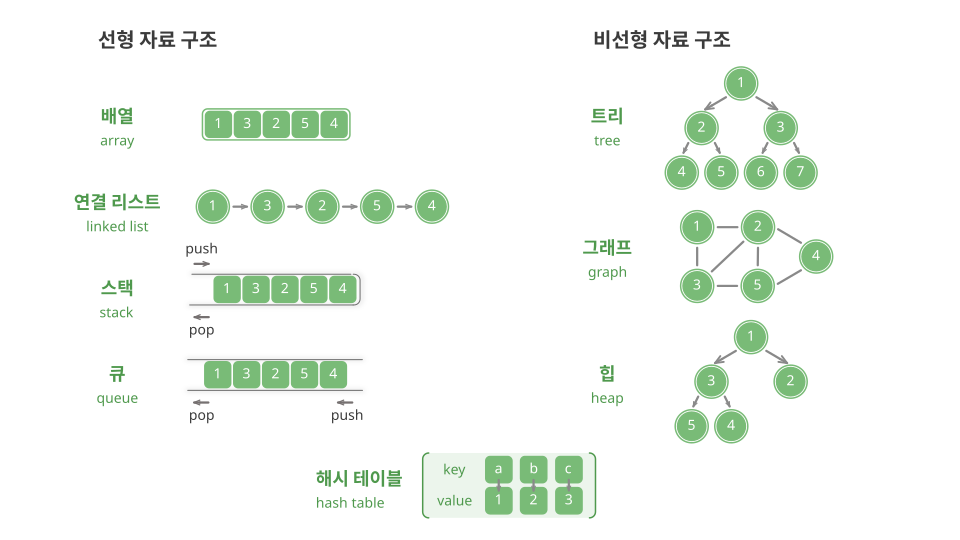
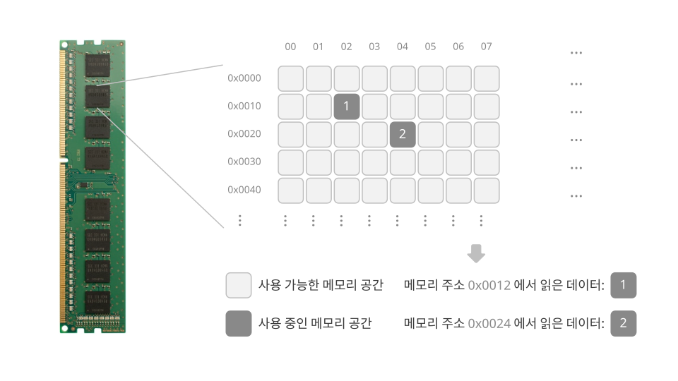
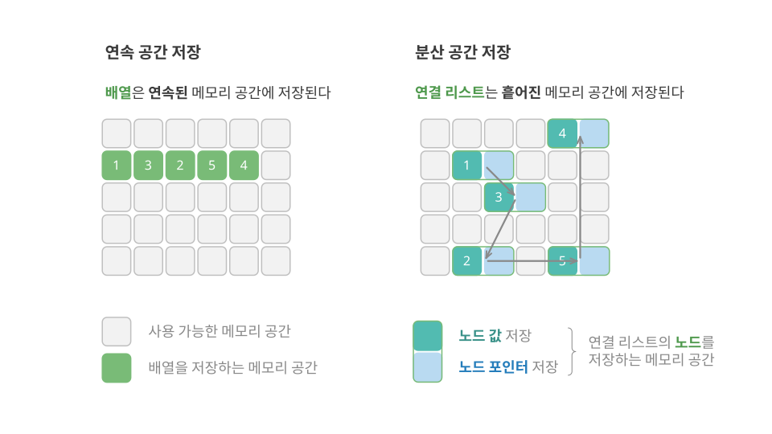

# 3.1 &nbsp; 자료 구조의 분류

대표적인 자료 구조에는 배열, 연결 리스트, 스택, 큐, 해시 테이블, 트리, 힙, 그래프가 있다. ‘논리 구조’와 ‘물리 구조’ 두 관점에서 이를 분류할 수 있다.

## 3.1.1 &nbsp; 논리 구조: 선형과 비선형

**논리 구조는 데이터 원소 사이의 논리적 관계를 보여 준다**. 배열과 연결 리스트에서는 데이터가 일정한 순서로 놓여 선형 관계를 이룬다. 트리에서는 데이터가 위에서 아래로 층을 이루어 ‘조상’에서 ‘자손’이 갈라져 나오는 관계를 나타낸다. 그래프는 노드와 간선으로 이루어져 복잡한 네트워크 관계를 나타낸다.

아래 그림(3-1)처럼 논리 구조는 크게 ‘선형’과 ‘비선형’으로 나뉜다. 선형 구조는 직관적이다. 데이터가 논리적으로 한 줄로 배열된다. 반대로 비선형 구조에서는 데이터가 한 줄로 배열되지 않는다.

- **선형 자료 구조**: 배열, 연결 리스트, 스택, 큐가 있다. 원소 사이에는 일대일의 순서 관계가 있다.
- **비선형 자료 구조**: 트리, 힙, 그래프가 있다.

대표적인 비선형 구조에는 트리 구조와 망 구조가 있다.

- **트리 구조**: 트리와 힙에서는 원소들이 일대다 관계를 이룬다.
- **망 구조**: 그래프에서는 원소들이 다대다 관계를 이룬다.

해시 테이블에서는 키로 값을 찾는다. 그림에는 이 대응 관계를 따로 표시했다.

{ class="animation-figure" }

 그림 3-1 &nbsp; 선형 자료 구조와 비선형 자료 구조 

## 3.1.2 &nbsp; 물리 구조: 연속 저장과 분산 저장

**알고리즘을 구현한 프로그램이 실행될 때 처리 중인 데이터는 주로 메모리에 저장된다**. 아래 그림(3-2)은 컴퓨터의 메모리 모듈이다. 검은 사각형마다 일정한 메모리 공간이 들어 있다. 메모리를 커다란 Excel 표로 생각해 보자. 각 셀에는 일정한 크기의 데이터를 저장할 수 있다.

**시스템은 메모리 주소로 원하는 위치의 데이터에 접근한다**. 아래 그림(3-2)처럼 컴퓨터는 일정한 규칙에 따라 표의 각 셀에 번호를 매겨 모든 메모리 위치가 고유한 주소를 갖게 한다. 프로그램은 이 주소로 메모리의 데이터에 접근할 수 있다.

{ class="animation-figure" }

 그림 3-2 &nbsp; 메모리 모듈, 메모리 공간, 메모리 주소 

!!! tip

    메모리를 Excel 표에 비유한 것은 단순화한 설명이다. 실제 메모리의 동작 원리는 더 복잡하며 주소 공간, 메모리 관리, 캐시, 가상 메모리와 물리 메모리 등의 개념이 관련된다.

메모리는 모든 프로그램이 함께 사용하는 자원이다. 특정 메모리 영역을 한 프로그램이 사용하고 있으면 보통 다른 프로그램은 그 영역을 동시에 쓸 수 없다. **따라서 메모리 자원은 자료 구조와 알고리즘을 설계할 때 중요하게 고려해야 한다**. 예를 들어 알고리즘의 최대 메모리 사용량은 시스템에 남은 가용 메모리를 넘지 않아야 한다. 큰 연속 공간이 없다면 흩어진 메모리 공간에도 저장할 수 있는 자료 구조를 선택해야 한다.

아래 그림(3-3)처럼 **물리 구조는 데이터를 컴퓨터 메모리에 저장하는 방식을 나타내며**, 연속 공간 저장(배열)과 분산 공간 저장(연결 리스트)으로 나뉜다. 물리 구조에 따라 데이터에 접근하고 갱신하고 추가하거나 삭제하는 기본 방식이 정해진다. 두 방식은 시간 효율과 공간 효율에서 서로 보완적인 특성을 보인다.

{ class="animation-figure" }

 그림 3-3 &nbsp; 연속 공간 저장과 분산 공간 저장 

**모든 자료 구조는 배열이나 연결 리스트 또는 둘의 조합으로 구현된다**. 예를 들어 스택과 큐는 배열로도, 연결 리스트로도 구현할 수 있다. 해시 테이블 구현에는 배열과 연결 리스트가 함께 쓰일 수 있다.

- **배열로 구현할 수 있는 구조**: 스택, 큐, 해시 테이블, 트리, 힙, 그래프, 행렬, 텐서(차원이 $\geq 3$인 배열) 등이 있다.
- **연결 리스트로 구현할 수 있는 구조**: 스택, 큐, 해시 테이블, 트리, 힙, 그래프 등이 있다.

연결 리스트는 초기화한 뒤에도 프로그램 실행 중에 길이를 조절할 수 있어 ‘동적 자료 구조’라고도 한다. 배열은 초기화한 뒤에 길이를 바꿀 수 없어 ‘정적 자료 구조’라고도 한다. 다만 메모리를 다시 할당하면 배열의 길이를 바꿀 수 있어 어느 정도 ‘동적’으로 사용할 수 있다.

!!! tip

    물리 구조를 이해하기 어렵다면 다음 장을 먼저 읽은 뒤 이 절을 다시 살펴보라.
