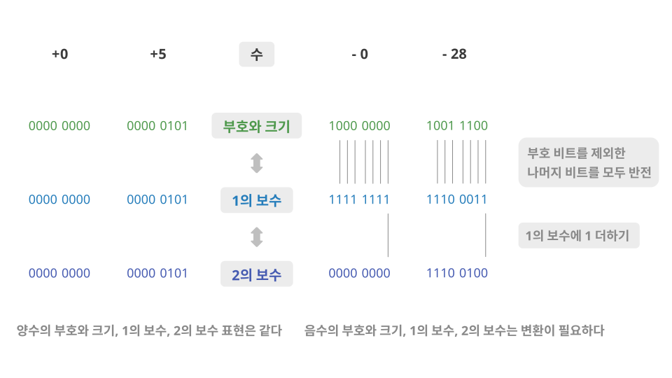
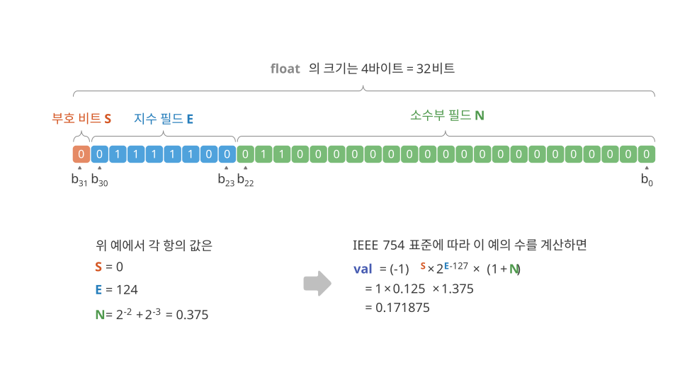

# 수의 인코딩 *

!!! tip

    이 책에서 제목에 * 표시가 있는 절은 선택해서 읽는 내용이다. 시간이 부족하거나 이해하기 어렵다면 먼저 건너뛰고 필수 부분을 공부한 뒤 따로 살펴보아도 된다.

## 부호와 크기, 1의 보수, 2의 보수

앞 절의 표에서 모든 정수형은 표현 가능한 음수가 양수보다 하나 더 많았다. 예를 들어 `byte`의 범위는 $[-128, 127]$이다. 다소 직관에 어긋나는 이 현상을 이해하려면 부호와 크기, 1의 보수, 2의 보수를 알아야 한다.

먼저 **컴퓨터는 정수를 ‘2의 보수’ 형태로 저장한다**. 그 이유를 살펴보기 전에 세 표현을 정의해 보자.

- **부호와 크기**: 이진 표현의 최상위 비트를 부호 비트로 사용한다. $0$은 양수, $1$은 음수를 나타내며 나머지 비트는 수의 크기를 나타낸다.
- **1의 보수**: 양수의 1의 보수는 부호와 크기 표현과 같다. 음수의 1의 보수는 부호와 크기 표현에서 부호 비트를 제외한 모든 비트를 반전한 것이다.
- **2의 보수**: 양수의 2의 보수는 부호와 크기 표현과 같다. 음수의 2의 보수는 1의 보수에 $1$을 더한 것이다.

아래 그림은 부호와 크기, 1의 보수, 2의 보수 사이의 변환 방법을 보여 준다.

<u>부호와 크기(sign-magnitude)</u>는 가장 직관적이지만 한계가 있다. 우선 **음수의 부호와 크기 표현은 그대로 연산에 쓸 수 없다**. 예를 들어 부호와 크기 표현으로 $1 + (-2)$를 계산하면 $-3$이 나오는데, 이는 명백히 틀린 결과이다.

$$
\begin{aligned}
& 1 + (-2) \newline
& \rightarrow 0000 \; 0001 + 1000 \; 0010 \newline
& = 1000 \; 0011 \newline
& \rightarrow -3
\end{aligned}
$$

이 문제를 해결하기 위해 컴퓨터에 <u>1의 보수(1's complement)</u>가 도입되었다. 먼저 부호와 크기 표현을 1의 보수로 바꾸고 $1 + (-2)$를 계산한 뒤, 결과를 다시 부호와 크기 표현으로 바꾸면 올바른 값 $-1$을 얻는다.

$$
\begin{aligned}
& 1 + (-2) \newline
& \rightarrow 0000 \; 0001 \; \text{(부호와 크기)} + 1000 \; 0010 \; \text{(부호와 크기)} \newline
& = 0000 \; 0001 \; \text{(1의 보수)} + 1111  \; 1101 \; \text{(1의 보수)} \newline
& = 1111 \; 1110 \; \text{(1의 보수)} \newline
& = 1000 \; 0001 \; \text{(부호와 크기)} \newline
& \rightarrow -1
\end{aligned}
$$

또 다른 한계는 **부호와 크기 방식에서 0을 $+0$과 $-0$의 두 가지로 표현한다는 점**이다. 수 0에 서로 다른 두 이진 코드가 대응해 모호해질 수 있다. 예를 들어 조건을 판별할 때 양의 0과 음의 0을 구분하지 않으면 결과가 잘못될 수 있다. 이 모호함을 처리하려면 추가 판단이 필요하므로 컴퓨터의 연산 효율이 떨어질 수 있다.

$$
\begin{aligned}
+0 & \rightarrow 0000 \; 0000 \newline
-0 & \rightarrow 1000 \; 0000
\end{aligned}
$$

1의 보수도 부호와 크기 표현처럼 양의 0과 음의 0이 구분되는 문제가 있다. 이를 해결하려고 컴퓨터에 <u>2의 보수(2's complement)</u>가 도입되었다. 먼저 음의 0을 부호와 크기에서 1의 보수, 2의 보수로 변환하는 과정을 살펴보자.

$$
\begin{aligned}
-0 \rightarrow \; & 1000 \; 0000 \; \text{(부호와 크기)} \newline
= \; & 1111 \; 1111 \; \text{(1의 보수)} \newline
= 1 \; & 0000 \; 0000 \; \text{(2의 보수)} \newline
\end{aligned}
$$

음의 0의 1의 보수에 $1$을 더하면 올림이 발생한다. 하지만 `byte` 타입의 길이는 8비트뿐이므로 아홉 번째 비트로 넘어간 $1$은 버린다. 즉 **음의 0의 2의 보수는 $0000 \; 0000$으로 양의 0의 2의 보수와 같다**. 따라서 2의 보수에서는 0의 표현이 하나뿐이므로 양의 0과 음의 0의 모호함이 사라진다.

마지막 의문이 남는다. `byte`의 범위가 $[-128, 127]$일 때 하나 더 있는 음수 $-128$은 어디서 나올까? 구간 $[-127, +127]$의 모든 정수에는 각각 부호와 크기, 1의 보수, 2의 보수 표현이 있으며 부호와 크기와 2의 보수 사이를 서로 변환할 수 있다.

그러나 **2의 보수 $1000 \; 0000$은 대응하는 부호와 크기 표현이 없는 예외이다**. 변환 방법을 적용하면 이 비트열의 부호와 크기 표현은 $0000 \; 0000$이 된다. 하지만 이것은 수 $0$을 나타내며 그 2의 보수는 자기 자신이어야 하므로 모순이다. 컴퓨터에서는 이 특수한 2의 보수 $1000 \; 0000$을 $-128$로 정한다. 실제로 2의 보수로 $(-1) + (-127)$을 계산하면 $-128$이 나온다.

$$
\begin{aligned}
& (-127) + (-1) \newline
& \rightarrow 1111 \; 1111 \; \text{(부호와 크기)} + 1000 \; 0001 \; \text{(부호와 크기)} \newline
& = 1000 \; 0000 \; \text{(1의 보수)} + 1111  \; 1110 \; \text{(1의 보수)} \newline
& = 1000 \; 0001 \; \text{(2의 보수)} + 1111  \; 1111 \; \text{(2의 보수)} \newline
& = 1000 \; 0000 \; \text{(2의 보수)} \newline
& \rightarrow -128
\end{aligned}
$$

눈치챘겠지만 지금까지의 계산은 모두 덧셈이었다. 여기에는 중요한 사실이 숨어 있다. **컴퓨터 내부의 하드웨어 회로는 주로 덧셈을 바탕으로 설계된다**. 덧셈은 곱셈, 나눗셈, 뺄셈 등 다른 연산보다 하드웨어로 구현하기 간단하고 병렬로 처리하기 쉬우며 연산 속도도 빠르기 때문이다.

그렇다고 컴퓨터가 덧셈만 할 수 있다는 뜻은 아니다. **컴퓨터는 덧셈과 몇 가지 기본 논리 연산을 결합해 다른 여러 수학 연산을 구현할 수 있다**. 예를 들어 뺄셈 $a - b$는 덧셈 $a + (-b)$으로 바꿀 수 있고, 곱셈과 나눗셈은 여러 번의 덧셈이나 뺄셈으로 바꿀 수 있다.

이제 컴퓨터가 2의 보수를 쓰는 이유를 정리할 수 있다. 2의 보수를 사용하면 같은 회로와 연산으로 양수와 음수의 덧셈을 처리할 수 있다. 뺄셈용 하드웨어 회로를 따로 설계하거나 양의 0과 음의 0을 별도로 처리할 필요도 없다. 덕분에 하드웨어 설계가 크게 단순해지고 연산 효율이 높아진다.

2의 보수는 매우 정교하게 설계된 표현이다. 지면 관계상 여기까지만 소개한다. 흥미가 있다면 더 깊이 알아보자.

## 부동소수점 수의 인코딩

`int`와 `float`는 길이가 모두 4바이트인데 왜 `float`의 범위가 `int`보다 훨씬 넓을까? 직관적으로는 `float`가 소수까지 표현해야 하므로 범위가 좁아져야 할 것 같다.

그 이유는 **부동소수점형 `float`가 다른 표현 방식을 사용하기 때문이다**. 32비트 이진수를 다음과 같이 표기하자.

$$
b_{31} b_{30} b_{29} \ldots b_2 b_1 b_0
$$

IEEE 754 표준에 따르면 32비트 `float`는 다음 세 부분으로 이루어진다.

- 부호 비트 $\mathrm{S}$: 1비트이며 $b_{31}$에 해당한다.
- 지수 필드 $\mathrm{E}$: 8비트이며 $b_{30} b_{29} \ldots b_{23}$에 해당한다.
- 소수부 필드 $\mathrm{N}$: 23비트이며 $b_{22} b_{21} \ldots b_0$에 해당한다.

`float`의 이진 표현에 대응하는 값은 다음과 같이 계산한다.

$$
\text {val} = (-1)^{b_{31}} \times 2^{\left(b_{30} b_{29} \ldots b_{23}\right)_2-127} \times\left(1 . b_{22} b_{21} \ldots b_0\right)_2
$$

십진수로 바꾸어 쓴 계산식은 다음과 같다.

$$
\text {val}=(-1)^{\mathrm{S}} \times 2^{\mathrm{E} -127} \times (1 + \mathrm{N})
$$

각 항의 값이 가질 수 있는 범위는 다음과 같다.

$$
\begin{aligned}
\mathrm{S} \in & \{ 0, 1\}, \quad \mathrm{E} \in \{ 1, 2, \dots, 254 \} \newline
(1 + \mathrm{N}) = & (1 + \sum_{i=1}^{23} b_{23-i} 2^{-i}) \subset [1, 2 - 2^{-23}]
\end{aligned}
$$

위 그림의 예에서 $\mathrm{S} = 0$, $\mathrm{E} = 124$, $\mathrm{N} = 2^{-2} + 2^{-3} = 0.375$일 때 다음과 같이 계산한다.

$$
\text { val } = (-1)^0 \times 2^{124 - 127} \times (1 + 0.375) = 0.171875
$$

이제 처음 질문에 답할 수 있다. **`float`는 지수 필드가 있어 `int`보다 훨씬 넓은 범위를 표현할 수 있다**. 위 계산에 따르면 `float`가 표현할 수 있는 가장 큰 양수는 $2^{254 - 127} \times (2 - 2^{-23}) \approx 3.4 \times 10^{38}$이다. 부호 비트를 바꾸면 가장 작은 음수를 얻는다.

**부동소수점형 `float`는 표현 범위를 넓히는 대신 정밀도를 희생한다**. 정수형 `int`는 32비트 전체로 수를 표현하며 수 사이의 간격이 일정하다. 반면 부동소수점형 `float`는 지수 필드가 있어서 값이 커질수록 이웃한 두 표현 가능 수의 차이도 대체로 커진다.

아래 표처럼 지수 필드의 값 $\mathrm{E} = 0$과 $\mathrm{E} = 255$에는 특별한 의미가 있다. **0, 무한대, $\mathrm{NaN}$ 등을 표현할 때 사용한다**.

 표 <id> &nbsp; 지수 필드의 의미 

| 지수 필드 E           | 소수부 $\mathrm{N} = 0$ | 소수부 $\mathrm{N} \ne 0$ | 계산식                                                               |
| ------------------ | ----------------------- | ------------------------- | ---------------------------------------------------------------------- |
| $0$                | $\pm 0$                 | 비정규수                  | $(-1)^{\mathrm{S}} \times 2^{-126} \times (0.\mathrm{N})$              |
| $1, 2, \dots, 254$ | 정규수                  | 정규수                    | $(-1)^{\mathrm{S}} \times 2^{(\mathrm{E} -127)} \times (1.\mathrm{N})$ |
| $255$              | $\pm \infty$            | $\mathrm{NaN}$            |                                                                        |

비정규수는 부동소수점 수가 0 근처의 작은 값을 표현하는 정밀도를 크게 높인다. 가장 작은 양의 정규수는 $2^{-126}$이고 가장 작은 양의 비정규수는 $2^{-126} \times 2^{-23}$이다.

배정밀도 `double`도 `float`와 비슷한 방식으로 표현하므로 자세한 설명은 생략한다.
