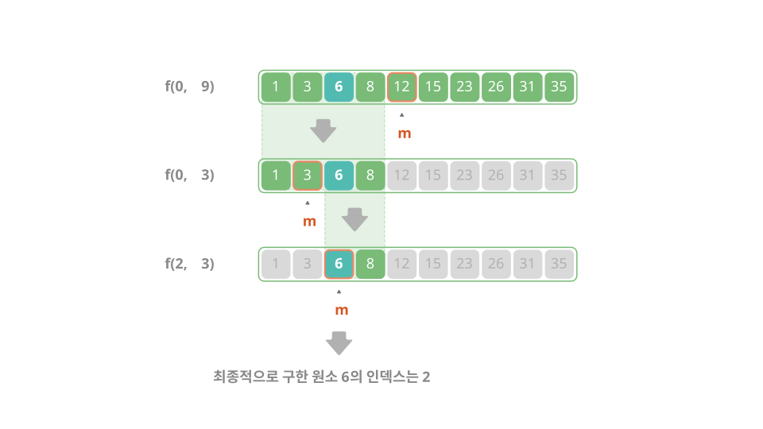

# 분할 정복 탐색 전략

앞서 탐색 알고리즘을 두 가지 범주로 나누어 살펴보았다.

- **완전 탐색**: 자료 구조를 순회하여 탐색하며 시간 복잡도는 $O(n)$이다.
- **적응형 탐색**: 데이터 고유의 구성 방식이나 사전 정보를 활용하며 시간 복잡도는 $O(\log n)$, 나아가 $O(1)$에 이를 수 있다.

실제로 이진 탐색이나 트리에서의 탐색처럼 **시간 복잡도가 $O(\log n)$인 탐색 알고리즘은 보통 분할 정복 전략에 기반한다**.

- 이진 탐색은 매 단계에서 배열에서 목표 원소를 찾는 문제를 배열의 절반에서 찾는 더 작은 문제로 바꾼다. 배열이 비거나 목표 원소를 찾을 때까지 이 과정을 반복한다.
- 트리는 분할 정복을 대표하는 구조이다. 이진 탐색 트리, AVL 트리, 힙 등에서는 각종 연산의 시간 복잡도가 모두 $O(\log n)$이다.

이진 탐색의 분할 정복 전략은 다음과 같다.

- **문제를 나눌 수 있다**. 가운데 원소와 목표 원소를 비교하면 원래 문제(배열에서 찾기)를 더 작은 문제(배열의 절반에서 찾기)로 재귀적으로 나눌 수 있다.
- **부분 문제가 독립적이다**. 이진 탐색은 매 단계에서 부분 문제 하나만 처리하며 다른 부분 문제의 영향을 받지 않는다.
- **부분 문제의 해를 합칠 필요가 없다**. 특정 원소 하나를 찾는 것이 목적이므로 부분 문제의 해를 합치지 않아도 된다. 부분 문제가 풀리면 원래 문제도 풀린다.

완전 탐색은 한 단계에서 선택지 하나만 제외할 수 있지만, **분할 정복 탐색은 한 단계에서 선택지의 절반을 제외할 수 있다**. 이 차이가 탐색 효율을 높인다.

### 분할 정복으로 이진 탐색 구현하기

앞 장에서는 반복을 이용해 이진 탐색을 구현했다. 이번에는 분할 정복과 재귀로 구현해 보자.

!!! question

    길이가 $n$이고 모든 원소가 서로 다른 정렬된 배열 `nums`에서 원소 `target`을 찾아라.

분할 정복의 관점에서 탐색 구간 $[i, j]$에 해당하는 부분 문제를 $f(i, j)$로 나타내자.

원래 문제 $f(0, n-1)$에서 출발해 다음 단계로 이진 탐색을 수행한다.

1. 탐색 구간 $[i, j]$의 중점 $m$을 구하고 이를 기준으로 탐색 구간의 절반을 제외한다.
2. 크기가 절반으로 줄어든 부분 문제 $f(i, m-1)$ 또는 $f(m+1, j)$을 재귀적으로 푼다.
3. `1.` 단계와 `2.` 단계를 반복하다가 `target`을 찾거나 구간이 비면 반환한다.

아래 그림은 배열에서 원소 $6$을 이진 탐색으로 찾는 분할 정복 과정이다.



코드에서는 재귀 함수 `dfs()`를 정의해 문제 $f(i, j)$을 푼다.

```src
[file]{binary_search_recur}-[class]{}-[func]{binary_search}
```
