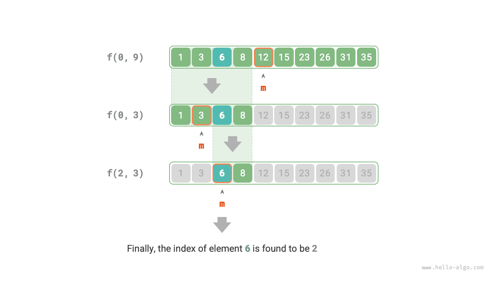

# 12.2 &nbsp; 분할 정복 탐색 전략

앞에서 배웠듯이 탐색 알고리즘은 크게 두 종류로 나뉜다.

- **완전 탐색**: 자료 구조를 순회하며, 시간 복잡도는 $O(n)$이다.
- **적응형 탐색**: 데이터 고유의 구성 방식이나 사전 정보를 이용하며, 시간 복잡도가 $O(\log n)$ 또는 $O(1)$에 이를 수 있다.

실제로 **시간 복잡도가 $O(\log n)$인 탐색 알고리즘은 보통 분할 정복 전략을 기반으로 구현된다**. 이진 탐색과 트리가 그 예다.

- 이진 탐색은 각 단계에서 원래 문제(배열에서 목표 원소 찾기)를 더 작은 문제(배열의 절반에서 목표 원소 찾기)로 나눈다. 배열이 비거나 목표 원소를 찾을 때까지 계속한다.
- 트리는 분할 정복 사고의 대표적인 예다. 이진 탐색 트리, AVL 트리, 힙 등의 자료 구조에서 여러 연산의 시간 복잡도는 $O(\log n)$이다.

이진 탐색의 분할 정복 전략은 다음과 같다.

- **문제를 나눌 수 있다**: 중간 원소와 목표 원소를 비교하여 원래 문제(배열에서 찾기)를 부분 문제(배열의 절반에서 찾기)로 재귀적으로 나눈다.
- **부분 문제가 독립적이다**: 이진 탐색은 매번 부분 문제 하나만 처리하며 다른 부분 문제의 영향을 받지 않는다.
- **부분 문제의 해를 합칠 필요가 없다**: 특정 원소 하나를 찾는 것이 목적이므로 부분 문제의 해를 합칠 필요가 없다. 부분 문제를 해결하면 원래 문제도 함께 해결된다.

분할 정복이 탐색 효율을 높이는 근본적인 이유는 완전 탐색이 매번 선택지 하나만 제외하는 데 비해 **분할 정복 탐색은 매번 선택지의 절반을 제외할 수 있기 때문**이다.

### 1. &nbsp; 분할 정복으로 이진 탐색 구현

앞 장에서는 이진 탐색을 반복 방식으로 구현했다. 이제 분할 정복(재귀)으로 구현해 보자.

!!! question "문제"

    길이가 $n$이고 모든 원소가 서로 다른 정렬된 배열 `nums`가 주어진다. 원소 `target`을 찾아라.

분할 정복의 관점에서 탐색 구간 $[i, j]$에 해당하는 부분 문제를 $f(i, j)$라고 하자.

원래 문제 $f(0, n-1)$에서 시작하여 다음 단계로 이진 탐색을 수행한다.

1. 탐색 구간 $[i, j]$의 중간 인덱스 $m$을 계산하고, 이를 기준으로 탐색 구간의 절반을 제외한다.
2. 크기가 절반으로 줄어든 부분 문제 $f(i, m-1)$ 또는 $f(m+1, j)$를 재귀적으로 푼다.
3. `target`을 찾거나 구간이 빌 때까지 `1.` 단계와 `2.` 단계를 반복한 뒤 반환한다.

아래 그림(12-4)은 배열에서 원소 $6$을 이진 탐색하는 분할 정복 과정을 보여 준다.

{ class="animation-figure" }

<p align="center"> 그림 12-4 &nbsp; 이진 탐색의 분할 정복 과정 </p>

구현 코드에서는 문제 $f(i, j)$를 푸는 재귀 함수 `dfs()`를 정의한다.

=== "Python"

    ```python title="binary_search_recur.py"
    def dfs(nums: list[int], target: int, i: int, j: int) -> int:
        """이진 탐색: 문제 f(i, j)"""
        # 구간이 비어 있으면 목표 원소가 없다는 뜻이므로 -1을 반환한다
        if i > j:
            return -1
        # 중간 인덱스 m을 계산한다
        m = (i + j) // 2
        if nums[m] < target:
            # 부분 문제 f(m+1, j)를 재귀적으로 푼다
            return dfs(nums, target, m + 1, j)
        elif nums[m] > target:
            # 부분 문제 f(i, m-1)를 재귀적으로 푼다
            return dfs(nums, target, i, m - 1)
        else:
            # 목표 원소를 찾았으므로 해당 인덱스를 반환한다
            return m

    def binary_search(nums: list[int], target: int) -> int:
        """이진 탐색"""
        n = len(nums)
        # 문제 f(0, n-1)을 푼다
        return dfs(nums, target, 0, n - 1)
    ```

=== "C++"

    ```cpp title="binary_search_recur.cpp"
    /* 이진 탐색: 문제 f(i, j) */
    int dfs(vector<int> &nums, int target, int i, int j) {
        // 구간이 비어 있으면 목표 원소가 없다는 뜻이므로 -1을 반환한다
        if (i > j) {
            return -1;
        }
        // 중간 인덱스 m을 계산한다
        int m = (i + j) / 2;
        if (nums[m] < target) {
            // 부분 문제 f(m+1, j)를 재귀적으로 푼다
            return dfs(nums, target, m + 1, j);
        } else if (nums[m] > target) {
            // 부분 문제 f(i, m-1)를 재귀적으로 푼다
            return dfs(nums, target, i, m - 1);
        } else {
            // 목표 원소를 찾았으므로 해당 인덱스를 반환한다
            return m;
        }
    }

    /* 이진 탐색 */
    int binarySearch(vector<int> &nums, int target) {
        int n = nums.size();
        // 문제 f(0, n-1)을 푼다
        return dfs(nums, target, 0, n - 1);
    }
    ```

=== "Java"

    ```java title="binary_search_recur.java"
    /* 이진 탐색: 문제 f(i, j) */
    int dfs(int[] nums, int target, int i, int j) {
        // 구간이 비어 있으면 목표 원소가 없다는 뜻이므로 -1을 반환한다
        if (i > j) {
            return -1;
        }
        // 중간 인덱스 m을 계산한다
        int m = (i + j) / 2;
        if (nums[m] < target) {
            // 부분 문제 f(m+1, j)를 재귀적으로 푼다
            return dfs(nums, target, m + 1, j);
        } else if (nums[m] > target) {
            // 부분 문제 f(i, m-1)를 재귀적으로 푼다
            return dfs(nums, target, i, m - 1);
        } else {
            // 목표 원소를 찾았으므로 해당 인덱스를 반환한다
            return m;
        }
    }

    /* 이진 탐색 */
    int binarySearch(int[] nums, int target) {
        int n = nums.length;
        // 문제 f(0, n-1)을 푼다
        return dfs(nums, target, 0, n - 1);
    }
    ```

=== "C#"

    ```csharp title="binary_search_recur.cs"
    /* 이진 탐색: 문제 f(i, j) */
    int DFS(int[] nums, int target, int i, int j) {
        // 구간이 비어 있으면 목표 원소가 없다는 뜻이므로 -1을 반환한다
        if (i > j) {
            return -1;
        }
        // 중간 인덱스 m을 계산한다
        int m = (i + j) / 2;
        if (nums[m] < target) {
            // 부분 문제 f(m+1, j)를 재귀적으로 푼다
            return DFS(nums, target, m + 1, j);
        } else if (nums[m] > target) {
            // 부분 문제 f(i, m-1)를 재귀적으로 푼다
            return DFS(nums, target, i, m - 1);
        } else {
            // 목표 원소를 찾았으므로 해당 인덱스를 반환한다
            return m;
        }
    }

    /* 이진 탐색 */
    int BinarySearch(int[] nums, int target) {
        int n = nums.Length;
        // 문제 f(0, n-1)을 푼다
        return DFS(nums, target, 0, n - 1);
    }
    ```

=== "Go"

    ```go title="binary_search_recur.go"
    /* 이진 탐색: 문제 f(i, j) */
    func dfs(nums []int, target, i, j int) int {
        // 구간이 비어 있으면 목표 원소가 없다는 뜻이므로 -1을 반환한다
        if i > j {
            return -1
        }
        //    중간 인덱스를 계산한다
        m := i + ((j - i) >> 1)
        //중간 원소와 목표 원소의 크기를 비교한다
        if nums[m] < target {
            // 중간 원소가 더 작으면 배열의 오른쪽 절반을 재귀적으로 탐색한다
            // 부분 문제 f(m+1, j)를 재귀적으로 푼다
            return dfs(nums, target, m+1, j)
        } else if nums[m] > target {
            // 중간 원소가 더 크면 배열의 왼쪽 절반을 재귀적으로 탐색한다
            // 부분 문제 f(i, m-1)를 재귀적으로 푼다
            return dfs(nums, target, i, m-1)
        } else {
            // 목표 원소를 찾았으므로 해당 인덱스를 반환한다
            return m
        }
    }

    /* 이진 탐색 */
    func binarySearch(nums []int, target int) int {
        n := len(nums)
        return dfs(nums, target, 0, n-1)
    }
    ```

=== "Swift"

    ```swift title="binary_search_recur.swift"
    /* 이진 탐색: 문제 f(i, j) */
    func dfs(nums: [Int], target: Int, i: Int, j: Int) -> Int {
        // 구간이 비어 있으면 목표 원소가 없다는 뜻이므로 -1을 반환한다
        if i > j {
            return -1
        }
        // 중간 인덱스 m을 계산한다
        let m = (i + j) / 2
        if nums[m] < target {
            // 부분 문제 f(m+1, j)를 재귀적으로 푼다
            return dfs(nums: nums, target: target, i: m + 1, j: j)
        } else if nums[m] > target {
            // 부분 문제 f(i, m-1)를 재귀적으로 푼다
            return dfs(nums: nums, target: target, i: i, j: m - 1)
        } else {
            // 목표 원소를 찾았으므로 해당 인덱스를 반환한다
            return m
        }
    }

    /* 이진 탐색 */
    func binarySearch(nums: [Int], target: Int) -> Int {
        // 문제 f(0, n-1)을 푼다
        dfs(nums: nums, target: target, i: nums.startIndex, j: nums.endIndex - 1)
    }
    ```

=== "JS"

    ```javascript title="binary_search_recur.js"
    /* 이진 탐색: 문제 f(i, j) */
    function dfs(nums, target, i, j) {
        // 구간이 비어 있으면 목표 원소가 없다는 뜻이므로 -1을 반환한다
        if (i > j) {
            return -1;
        }
        // 중간 인덱스 m을 계산한다
        const m = i + ((j - i) >> 1);
        if (nums[m] < target) {
            // 부분 문제 f(m+1, j)를 재귀적으로 푼다
            return dfs(nums, target, m + 1, j);
        } else if (nums[m] > target) {
            // 부분 문제 f(i, m-1)를 재귀적으로 푼다
            return dfs(nums, target, i, m - 1);
        } else {
            // 목표 원소를 찾았으므로 해당 인덱스를 반환한다
            return m;
        }
    }

    /* 이진 탐색 */
    function binarySearch(nums, target) {
        const n = nums.length;
        // 문제 f(0, n-1)을 푼다
        return dfs(nums, target, 0, n - 1);
    }
    ```

=== "TS"

    ```typescript title="binary_search_recur.ts"
    /* 이진 탐색: 문제 f(i, j) */
    function dfs(nums: number[], target: number, i: number, j: number): number {
        // 구간이 비어 있으면 목표 원소가 없다는 뜻이므로 -1을 반환한다
        if (i > j) {
            return -1;
        }
        // 중간 인덱스 m을 계산한다
        const m = i + ((j - i) >> 1);
        if (nums[m] < target) {
            // 부분 문제 f(m+1, j)를 재귀적으로 푼다
            return dfs(nums, target, m + 1, j);
        } else if (nums[m] > target) {
            // 부분 문제 f(i, m-1)를 재귀적으로 푼다
            return dfs(nums, target, i, m - 1);
        } else {
            // 목표 원소를 찾았으므로 해당 인덱스를 반환한다
            return m;
        }
    }

    /* 이진 탐색 */
    function binarySearch(nums: number[], target: number): number {
        const n = nums.length;
        // 문제 f(0, n-1)을 푼다
        return dfs(nums, target, 0, n - 1);
    }
    ```

=== "Dart"

    ```dart title="binary_search_recur.dart"
    /* 이진 탐색: 문제 f(i, j) */
    int dfs(List<int> nums, int target, int i, int j) {
      // 구간이 비어 있으면 목표 원소가 없다는 뜻이므로 -1을 반환한다
      if (i > j) {
        return -1;
      }
      // 중간 인덱스 m을 계산한다
      int m = (i + j) ~/ 2;
      if (nums[m] < target) {
        // 부분 문제 f(m+1, j)를 재귀적으로 푼다
        return dfs(nums, target, m + 1, j);
      } else if (nums[m] > target) {
        // 부분 문제 f(i, m-1)를 재귀적으로 푼다
        return dfs(nums, target, i, m - 1);
      } else {
        // 목표 원소를 찾았으므로 해당 인덱스를 반환한다
        return m;
      }
    }

    /* 이진 탐색 */
    int binarySearch(List<int> nums, int target) {
      int n = nums.length;
      // 문제 f(0, n-1)을 푼다
      return dfs(nums, target, 0, n - 1);
    }
    ```

=== "Rust"

    ```rust title="binary_search_recur.rs"
    /* 이진 탐색: 문제 f(i, j) */
    fn dfs(nums: &[i32], target: i32, i: i32, j: i32) -> i32 {
        // 구간이 비어 있으면 목표 원소가 없다는 뜻이므로 -1을 반환한다
        if i > j {
            return -1;
        }
        let m: i32 = i + (j - i) / 2;
        if nums[m as usize] < target {
            // 부분 문제 f(m+1, j)를 재귀적으로 푼다
            return dfs(nums, target, m + 1, j);
        } else if nums[m as usize] > target {
            // 부분 문제 f(i, m-1)를 재귀적으로 푼다
            return dfs(nums, target, i, m - 1);
        } else {
            // 목표 원소를 찾았으므로 해당 인덱스를 반환한다
            return m;
        }
    }

    /* 이진 탐색 */
    fn binary_search(nums: &[i32], target: i32) -> i32 {
        let n = nums.len() as i32;
        // 문제 f(0, n-1)을 푼다
        dfs(nums, target, 0, n - 1)
    }
    ```

=== "C"

    ```c title="binary_search_recur.c"
    /* 이진 탐색: 문제 f(i, j) */
    int dfs(int nums[], int target, int i, int j) {
        // 구간이 비어 있으면 목표 원소가 없다는 뜻이므로 -1을 반환한다
        if (i > j) {
            return -1;
        }
        // 중간 인덱스 m을 계산한다
        int m = (i + j) / 2;
        if (nums[m] < target) {
            // 부분 문제 f(m+1, j)를 재귀적으로 푼다
            return dfs(nums, target, m + 1, j);
        } else if (nums[m] > target) {
            // 부분 문제 f(i, m-1)를 재귀적으로 푼다
            return dfs(nums, target, i, m - 1);
        } else {
            // 목표 원소를 찾았으므로 해당 인덱스를 반환한다
            return m;
        }
    }

    /* 이진 탐색 */
    int binarySearch(int nums[], int target, int numsSize) {
        int n = numsSize;
        // 문제 f(0, n-1)을 푼다
        return dfs(nums, target, 0, n - 1);
    }
    ```

=== "Kotlin"

    ```kotlin title="binary_search_recur.kt"
    /* 이진 탐색: 문제 f(i, j) */
    fun dfs(
        nums: IntArray,
        target: Int,
        i: Int,
        j: Int
    ): Int {
        // 구간이 비어 있으면 목표 원소가 없다는 뜻이므로 -1을 반환한다
        if (i > j) {
            return -1
        }
        // 중간 인덱스 m을 계산한다
        val m = (i + j) / 2
        return if (nums[m] < target) {
            // 부분 문제 f(m+1, j)를 재귀적으로 푼다
            dfs(nums, target, m + 1, j)
        } else if (nums[m] > target) {
            // 부분 문제 f(i, m-1)를 재귀적으로 푼다
            dfs(nums, target, i, m - 1)
        } else {
            // 목표 원소를 찾았으므로 해당 인덱스를 반환한다
            m
        }
    }

    /* 이진 탐색 */
    fun binarySearch(nums: IntArray, target: Int): Int {
        val n = nums.size
        // 문제 f(0, n-1)을 푼다
        return dfs(nums, target, 0, n - 1)
    }
    ```

=== "Ruby"

    ```ruby title="binary_search_recur.rb"
    ### 이진 탐색: 문제 f(i, j) ###
    def dfs(nums, target, i, j)
      # 구간이 비어 있으면 목표 원소가 없다는 뜻이므로 -1을 반환한다
      return -1 if i > j
      
      # 중간 인덱스 m을 계산한다
      m = (i + j) / 2

      if nums[m] < target
        # 부분 문제 f(m+1, j)를 재귀적으로 푼다
        return dfs(nums, target, m + 1, j)
      elsif nums[m] > target
        # 부분 문제 f(i, m-1)를 재귀적으로 푼다
        return dfs(nums, target, i, m - 1)
      else
        # 목표 원소를 찾았으므로 해당 인덱스를 반환한다
        return m
      end
    end

    ### 이진 탐색 ###
    def binary_search(nums, target)
      n = nums.length
      # 문제 f(0, n-1)을 푼다
      dfs(nums, target, 0, n - 1)
    end
    ```

??? pythontutor "코드 시각화"

    <div style="height: 549px; width: 100%;"><iframe class="pythontutor-iframe" title="코드 시각화" src="https://pythontutor.com/iframe-embed.html#code=def%20dfs%28nums%3A%20list%5Bint%5D,%20target%3A%20int,%20i%3A%20int,%20j%3A%20int%29%20-%3E%20int%3A%0A%20%20%20%20%22%22%22%EC%9D%B4%EC%A7%84%20%ED%83%90%EC%83%89%3A%20%EB%AC%B8%EC%A0%9C%20f%28i,%20j%29%22%22%22%0A%20%20%20%20%23%20%EA%B5%AC%EA%B0%84%EC%9D%B4%20%EB%B9%84%EC%96%B4%20%EC%9E%88%EC%9C%BC%EB%A9%B4%20%EB%AA%A9%ED%91%9C%20%EC%9B%90%EC%86%8C%EA%B0%80%20%EC%97%86%EB%8B%A4%EB%8A%94%20%EB%9C%BB%EC%9D%B4%EB%AF%80%EB%A1%9C%20-1%EC%9D%84%20%EB%B0%98%ED%99%98%ED%95%9C%EB%8B%A4%0A%20%20%20%20if%20i%20%3E%20j%3A%0A%20%20%20%20%20%20%20%20return%20-1%0A%20%20%20%20%23%20%EC%A4%91%EA%B0%84%20%EC%9D%B8%EB%8D%B1%EC%8A%A4%20m%EC%9D%84%20%EA%B3%84%EC%82%B0%ED%95%9C%EB%8B%A4%0A%20%20%20%20m%20%3D%20%28i%20%2B%20j%29%20//%202%0A%20%20%20%20if%20nums%5Bm%5D%20%3C%20target%3A%0A%20%20%20%20%20%20%20%20%23%20%EB%B6%80%EB%B6%84%20%EB%AC%B8%EC%A0%9C%20f%28m%2B1,%20j%29%EB%A5%BC%20%EC%9E%AC%EA%B7%80%EC%A0%81%EC%9C%BC%EB%A1%9C%20%ED%91%BC%EB%8B%A4%0A%20%20%20%20%20%20%20%20return%20dfs%28nums,%20target,%20m%20%2B%201,%20j%29%0A%20%20%20%20elif%20nums%5Bm%5D%20%3E%20target%3A%0A%20%20%20%20%20%20%20%20%23%20%EB%B6%80%EB%B6%84%20%EB%AC%B8%EC%A0%9C%20f%28i,%20m-1%29%EB%A5%BC%20%EC%9E%AC%EA%B7%80%EC%A0%81%EC%9C%BC%EB%A1%9C%20%ED%91%BC%EB%8B%A4%0A%20%20%20%20%20%20%20%20return%20dfs%28nums,%20target,%20i,%20m%20-%201%29%0A%20%20%20%20else%3A%0A%20%20%20%20%20%20%20%20%23%20%EB%AA%A9%ED%91%9C%20%EC%9B%90%EC%86%8C%EB%A5%BC%20%EC%B0%BE%EC%95%98%EC%9C%BC%EB%AF%80%EB%A1%9C%20%ED%95%B4%EB%8B%B9%20%EC%9D%B8%EB%8D%B1%EC%8A%A4%EB%A5%BC%20%EB%B0%98%ED%99%98%ED%95%9C%EB%8B%A4%0A%20%20%20%20%20%20%20%20return%20m%0A%0Adef%20binary_search%28nums%3A%20list%5Bint%5D,%20target%3A%20int%29%20-%3E%20int%3A%0A%20%20%20%20%22%22%22%EC%9D%B4%EC%A7%84%20%ED%83%90%EC%83%89%22%22%22%0A%20%20%20%20n%20%3D%20len%28nums%29%0A%20%20%20%20%23%20%EB%AC%B8%EC%A0%9C%20f%280,%20n-1%29%EC%9D%84%20%ED%91%BC%EB%8B%A4%0A%20%20%20%20return%20dfs%28nums,%20target,%200,%20n%20-%201%29%0A%0A%22%22%22%EC%8B%A4%ED%96%89%20%EC%BD%94%EB%93%9C%22%22%22%0Aif%20__name__%20%3D%3D%20%22__main__%22%3A%0A%20%20%20%20target%20%3D%206%0A%20%20%20%20nums%20%3D%20%5B1,%203,%206,%208,%2012,%2015,%2023,%2026,%2031,%2035%5D%0A%0A%20%20%20%20%23%20%EC%9D%B4%EC%A7%84%20%ED%83%90%EC%83%89%28%EC%96%91%20%EB%81%9D%EC%9D%84%20%ED%8F%AC%ED%95%A8%ED%95%98%EB%8A%94%20%EB%8B%AB%ED%9E%8C%20%EA%B5%AC%EA%B0%84%29%0A%20%20%20%20index%20%3D%20binary_search%28nums,%20target%29%0A%20%20%20%20print%28%22%EB%AA%A9%ED%91%9C%20%EC%9B%90%EC%86%8C%206%EC%9D%98%20%EC%9D%B8%EB%8D%B1%EC%8A%A4%20%3D%20%22,%20index%29&codeDivHeight=472&codeDivWidth=350&cumulative=false&curInstr=6&heapPrimitives=nevernest&origin=opt-frontend.js&py=311&rawInputLstJSON=%5B%5D&textReferences=false"> </iframe></div>
    <div style="margin-top: 5px;"><a href="https://pythontutor.com/iframe-embed.html#code=def%20dfs%28nums%3A%20list%5Bint%5D,%20target%3A%20int,%20i%3A%20int,%20j%3A%20int%29%20-%3E%20int%3A%0A%20%20%20%20%22%22%22%EC%9D%B4%EC%A7%84%20%ED%83%90%EC%83%89%3A%20%EB%AC%B8%EC%A0%9C%20f%28i,%20j%29%22%22%22%0A%20%20%20%20%23%20%EA%B5%AC%EA%B0%84%EC%9D%B4%20%EB%B9%84%EC%96%B4%20%EC%9E%88%EC%9C%BC%EB%A9%B4%20%EB%AA%A9%ED%91%9C%20%EC%9B%90%EC%86%8C%EA%B0%80%20%EC%97%86%EB%8B%A4%EB%8A%94%20%EB%9C%BB%EC%9D%B4%EB%AF%80%EB%A1%9C%20-1%EC%9D%84%20%EB%B0%98%ED%99%98%ED%95%9C%EB%8B%A4%0A%20%20%20%20if%20i%20%3E%20j%3A%0A%20%20%20%20%20%20%20%20return%20-1%0A%20%20%20%20%23%20%EC%A4%91%EA%B0%84%20%EC%9D%B8%EB%8D%B1%EC%8A%A4%20m%EC%9D%84%20%EA%B3%84%EC%82%B0%ED%95%9C%EB%8B%A4%0A%20%20%20%20m%20%3D%20%28i%20%2B%20j%29%20//%202%0A%20%20%20%20if%20nums%5Bm%5D%20%3C%20target%3A%0A%20%20%20%20%20%20%20%20%23%20%EB%B6%80%EB%B6%84%20%EB%AC%B8%EC%A0%9C%20f%28m%2B1,%20j%29%EB%A5%BC%20%EC%9E%AC%EA%B7%80%EC%A0%81%EC%9C%BC%EB%A1%9C%20%ED%91%BC%EB%8B%A4%0A%20%20%20%20%20%20%20%20return%20dfs%28nums,%20target,%20m%20%2B%201,%20j%29%0A%20%20%20%20elif%20nums%5Bm%5D%20%3E%20target%3A%0A%20%20%20%20%20%20%20%20%23%20%EB%B6%80%EB%B6%84%20%EB%AC%B8%EC%A0%9C%20f%28i,%20m-1%29%EB%A5%BC%20%EC%9E%AC%EA%B7%80%EC%A0%81%EC%9C%BC%EB%A1%9C%20%ED%91%BC%EB%8B%A4%0A%20%20%20%20%20%20%20%20return%20dfs%28nums,%20target,%20i,%20m%20-%201%29%0A%20%20%20%20else%3A%0A%20%20%20%20%20%20%20%20%23%20%EB%AA%A9%ED%91%9C%20%EC%9B%90%EC%86%8C%EB%A5%BC%20%EC%B0%BE%EC%95%98%EC%9C%BC%EB%AF%80%EB%A1%9C%20%ED%95%B4%EB%8B%B9%20%EC%9D%B8%EB%8D%B1%EC%8A%A4%EB%A5%BC%20%EB%B0%98%ED%99%98%ED%95%9C%EB%8B%A4%0A%20%20%20%20%20%20%20%20return%20m%0A%0Adef%20binary_search%28nums%3A%20list%5Bint%5D,%20target%3A%20int%29%20-%3E%20int%3A%0A%20%20%20%20%22%22%22%EC%9D%B4%EC%A7%84%20%ED%83%90%EC%83%89%22%22%22%0A%20%20%20%20n%20%3D%20len%28nums%29%0A%20%20%20%20%23%20%EB%AC%B8%EC%A0%9C%20f%280,%20n-1%29%EC%9D%84%20%ED%91%BC%EB%8B%A4%0A%20%20%20%20return%20dfs%28nums,%20target,%200,%20n%20-%201%29%0A%0A%22%22%22%EC%8B%A4%ED%96%89%20%EC%BD%94%EB%93%9C%22%22%22%0Aif%20__name__%20%3D%3D%20%22__main__%22%3A%0A%20%20%20%20target%20%3D%206%0A%20%20%20%20nums%20%3D%20%5B1,%203,%206,%208,%2012,%2015,%2023,%2026,%2031,%2035%5D%0A%0A%20%20%20%20%23%20%EC%9D%B4%EC%A7%84%20%ED%83%90%EC%83%89%28%EC%96%91%20%EB%81%9D%EC%9D%84%20%ED%8F%AC%ED%95%A8%ED%95%98%EB%8A%94%20%EB%8B%AB%ED%9E%8C%20%EA%B5%AC%EA%B0%84%29%0A%20%20%20%20index%20%3D%20binary_search%28nums,%20target%29%0A%20%20%20%20print%28%22%EB%AA%A9%ED%91%9C%20%EC%9B%90%EC%86%8C%206%EC%9D%98%20%EC%9D%B8%EB%8D%B1%EC%8A%A4%20%3D%20%22,%20index%29&codeDivHeight=800&codeDivWidth=600&cumulative=false&curInstr=6&heapPrimitives=nevernest&origin=opt-frontend.js&py=311&rawInputLstJSON=%5B%5D&textReferences=false" target="_blank" rel="noopener noreferrer">전체 화면 ></a></div>
