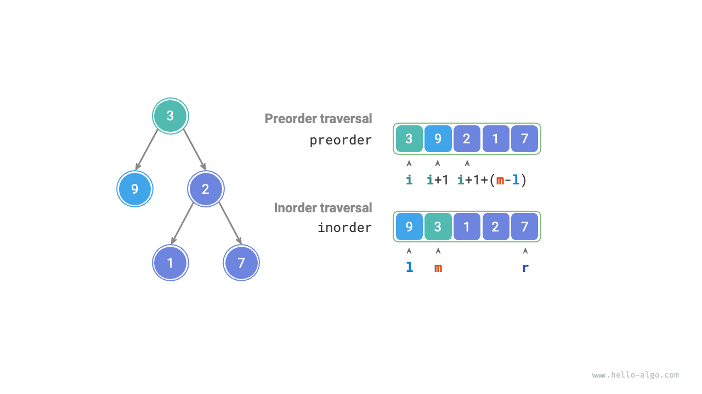
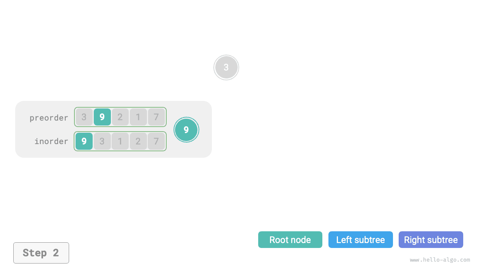
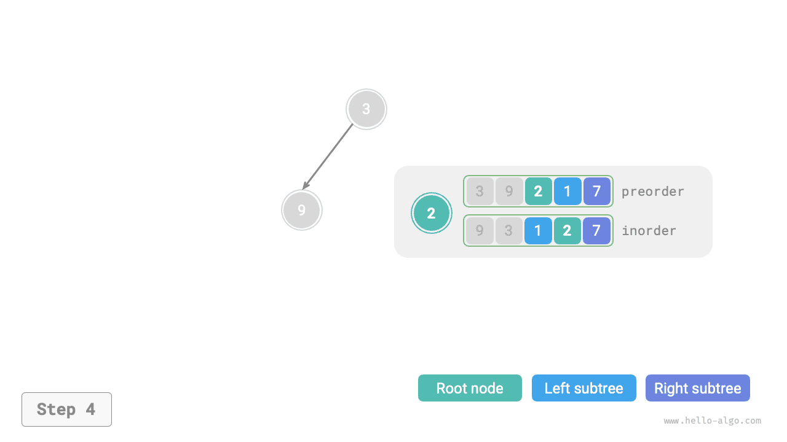
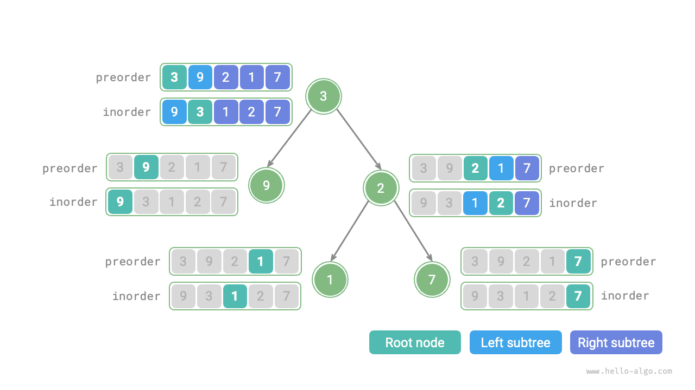

# 이진 트리 구성 문제

!!! question "문제"

    이진 트리의 전위 순회 `preorder`와 중위 순회 `inorder`가 주어진다. 이를 이용해 이진 트리를 구성하고 루트 노드를 반환하라. 트리에는 값이 중복되는 노드가 없다고 가정한다(아래 그림 참고).


### 분할 정복 문제인지 판단

원래 문제는 `preorder`와 `inorder`로 이진 트리를 구성하는 것으로, 전형적인 분할 정복 문제다.

- **문제를 나눌 수 있다**: 원래 문제를 왼쪽 서브트리 구성과 오른쪽 서브트리 구성이라는 두 부분 문제로 나누고, 루트 노드 초기화 연산을 하나 더할 수 있다. 각 서브트리(부분 문제)에도 같은 방법을 적용해 더 작은 서브트리(부분 문제)로 나눌 수 있으며, 가장 작은 부분 문제인 빈 서브트리에 도달하면 종료한다.
- **부분 문제가 독립적이다**: 왼쪽 서브트리와 오른쪽 서브트리는 겹치는 부분 없이 서로 독립적이다. 왼쪽 서브트리를 구성할 때는 중위 순회와 전위 순회에서 왼쪽 서브트리에 해당하는 부분만 보면 된다. 오른쪽도 마찬가지다.
- **부분 문제의 해를 합칠 수 있다**: 왼쪽 서브트리와 오른쪽 서브트리(부분 문제의 해)를 얻으면 루트 노드에 연결하여 원래 문제의 해를 만들 수 있다.

### 서브트리를 나누는 방법

위 분석에 따르면 분할 정복으로 해결할 수 있다. **그런데 전위 순회 `preorder`와 중위 순회 `inorder`로 왼쪽과 오른쪽 서브트리를 어떻게 나눌까**?

정의에 따르면 `preorder`와 `inorder`는 모두 세 부분으로 나뉜다.

- 전위 순회: `[ 루트 노드 | 왼쪽 서브트리 | 오른쪽 서브트리 ]`. 예를 들어 위 그림의 트리는 `[ 3 | 9 | 2 1 7 ]`에 해당한다.
- 중위 순회: `[ 왼쪽 서브트리 | 루트 노드 | 오른쪽 서브트리 ]`. 예를 들어 위 그림의 트리는 `[ 9 | 3 | 1 2 7 ]`에 해당한다.

위 그림의 데이터를 예로 들면 다음 그림의 단계로 나눌 수 있다.

1. 전위 순회의 첫 원소 3은 루트 노드의 값이다.
2. `inorder`에서 루트 노드 3의 인덱스를 찾아 이를 기준으로 `inorder`를 `[ 9 | 3 | 1 2 7 ]`로 나눈다.
3. `inorder`의 분할 결과로 왼쪽 서브트리의 노드 수는 1, 오른쪽은 3임을 알 수 있다. 따라서 `preorder`를 `[ 3 | 9 | 2 1 7 ]`로 나눌 수 있다.


### 변수로 서브트리 구간 표현

위 방법으로 **`preorder`와 `inorder`에서 루트 노드, 왼쪽 서브트리, 오른쪽 서브트리의 인덱스 구간을 구했다**. 이 구간들을 표현하려면 몇 개의 포인터 변수가 필요하다.

- 현재 트리의 루트 노드가 `preorder`에서 갖는 인덱스를 $i$라고 한다.
- 현재 트리의 루트 노드가 `inorder`에서 갖는 인덱스를 $m$이라고 한다.
- 현재 트리가 `inorder`에서 차지하는 인덱스 구간을 $[l, r]$이라고 한다.

아래 표와 같이 이 변수들로 `preorder`에서 루트 노드의 인덱스와 `inorder`에서 서브트리의 인덱스 구간을 나타낼 수 있다.

<p align="center"> 표 <id> &nbsp; 전위 순회와 중위 순회에서 루트 노드와 서브트리의 인덱스 </p>

|        | `preorder`에서 루트 노드의 인덱스 | `inorder`에서 서브트리의 인덱스 구간 |
| ------ | ---------------------------- | ----------------------------- |
| 현재 트리 | $i$                          | $[l, r]$                      |
| 왼쪽 서브트리 | $i + 1$                      | $[l, m-1]$                    |
| 오른쪽 서브트리 | $i + 1 + (m - l)$            | $[m+1, r]$                    |

오른쪽 서브트리의 루트 인덱스에 있는 $(m-l)$은 '왼쪽 서브트리의 노드 수'를 뜻한다. 아래 그림과 함께 이해해 보자.



### 코드 구현

$m$을 더 효율적으로 조회하기 위해 해시 테이블 `hmap`에 배열 `inorder`의 원소와 인덱스 사이의 매핑을 저장한다.

```src
[file]{build_tree}-[class]{}-[func]{build_tree}
```

아래 그림은 이진 트리 구성의 재귀 과정을 보여 준다. 각 노드는 아래로 '호출'하는 과정에서 만들어지고, 간선(참조)은 위로 '반환'하는 과정에서 만들어진다.

=== "<1>"
    

=== "<2>"
    

=== "<3>"
    

=== "<4>"
    

=== "<5>"
    

=== "<6>"
    

=== "<7>"
    

=== "<8>"
    

=== "<9>"
    

각 재귀 함수에서 전위 순회 `preorder`와 중위 순회 `inorder`를 나눈 결과는 아래 그림과 같다.



트리의 노드 수가 $n$일 때 노드 하나를 초기화하는 데(재귀 함수 `dfs()` 한 번 실행) $O(1)$ 시간이 걸린다. **따라서 전체 시간 복잡도는 $O(n)$이다**.

해시 테이블은 `inorder` 원소와 인덱스의 매핑을 저장하므로 공간 복잡도가 $O(n)$이다. 최악의 경우인 이진 트리가 연결 리스트로 퇴화한 경우에는 재귀 깊이가 $n$에 이르러 $O(n)$의 스택 프레임 공간을 사용한다. **따라서 전체 공간 복잡도는 $O(n)$이다**.
