# 이진 트리 구성 문제

!!! question

    이진 트리의 전위 순회 `preorder`와 중위 순회 `inorder`가 주어질 때 이진 트리를 구성하고 루트 노드를 반환하라. 트리에서 값이 같은 노드는 없다고 가정한다(아래 그림 참조).

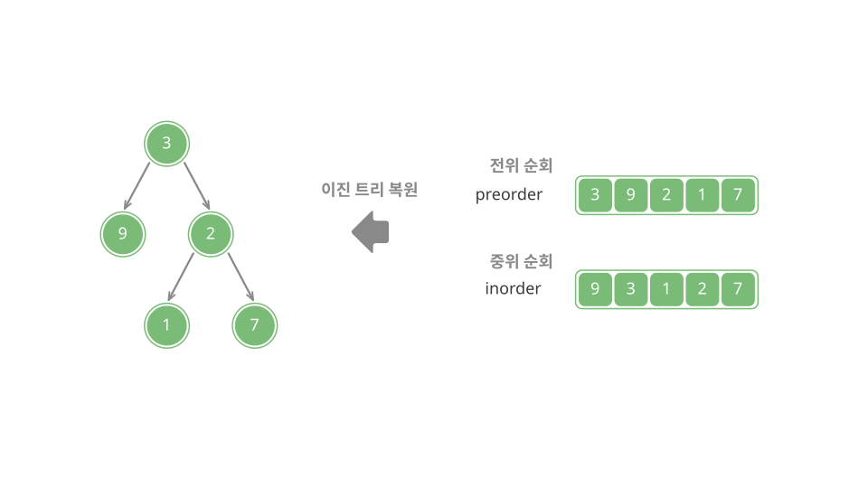

### 분할 정복 문제인지 판단하기

원래 문제는 `preorder`와 `inorder`로 이진 트리를 구성하는 것으로, 전형적인 분할 정복 문제이다.

- **문제를 나눌 수 있다**. 루트 노드를 초기화하고, 왼쪽 서브트리 구성과 오른쪽 서브트리 구성이라는 두 부분 문제로 나눈다. 각 서브트리(부분 문제)에도 같은 방법을 적용해 더 작은 서브트리로 나누다가 가장 작은 부분 문제인 빈 서브트리에 도달하면 멈춘다.
- **부분 문제가 독립적이다**. 왼쪽과 오른쪽 서브트리는 서로 겹치지 않아 독립적이다. 왼쪽 서브트리를 구성할 때는 중위 순회와 전위 순회에서 왼쪽 서브트리에 해당하는 부분만 보면 된다. 오른쪽도 마찬가지이다.
- **부분 문제의 해를 합칠 수 있다**. 왼쪽과 오른쪽 서브트리(부분 문제의 해)를 구하면 둘을 루트 노드에 연결해 원래 문제의 해를 얻는다.

### 서브트리 나누기

이 문제를 분할 정복으로 풀 수 있다는 것을 알았다. **전위 순회 `preorder`와 중위 순회 `inorder`를 이용해 왼쪽과 오른쪽 서브트리를 어떻게 나눌까**?

정의에 따라 `preorder`와 `inorder`는 각각 세 부분으로 나눌 수 있다.

- 전위 순회: `[ 루트 노드 | 왼쪽 서브트리 | 오른쪽 서브트리 ]`. 위 그림의 트리는 `[ 3 | 9 | 2 1 7 ]`에 해당한다.
- 중위 순회: `[ 왼쪽 서브트리 | 루트 노드 | 오른쪽 서브트리 ]`. 위 그림의 트리는 `[ 9 | 3 | 1 2 7 ]`에 해당한다.

위 예제 데이터를 아래 그림의 순서로 나누어 보자.

1. 전위 순회의 첫 원소 3이 루트 노드의 값이다.
2. `inorder`에서 루트 노드 3의 인덱스를 찾는다. 이 인덱스를 기준으로 `inorder`를 `[ 9 | 3 | 1 2 7 ]`로 나눌 수 있다.
3. `inorder`의 분할 결과에서 왼쪽 서브트리의 노드는 1개, 오른쪽 서브트리의 노드는 3개임을 알 수 있다. 따라서 `preorder`를 `[ 3 | 9 | 2 1 7 ]`로 나눌 수 있다.

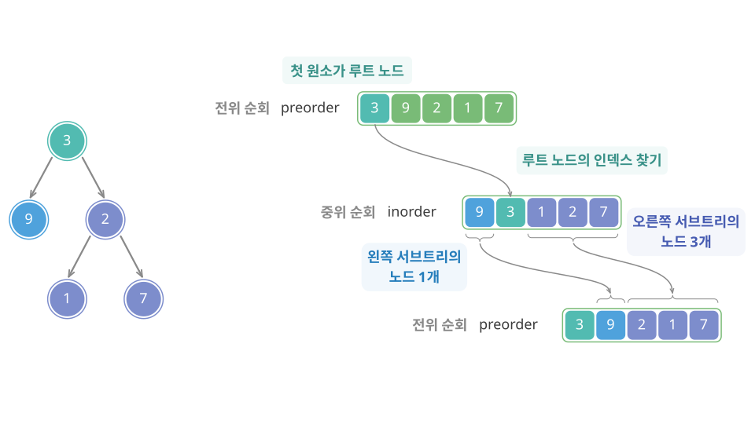

### 변수로 서브트리 구간 나타내기

이 방법으로 **`preorder`와 `inorder`에서 루트 노드와 양쪽 서브트리에 해당하는 인덱스 구간을 구했다**. 몇 개의 포인터 변수로 이 구간들을 나타내 보자.

- `preorder`에서 현재 트리의 루트 노드 인덱스를 $i$라 하자.
- `inorder`에서 현재 트리의 루트 노드 인덱스를 $m$이라 하자.
- `inorder`에서 현재 트리가 차지하는 인덱스 구간을 $[l, r]$이라 하자.

아래 표처럼 이 변수들로 `preorder`에서 루트 노드의 인덱스를, `inorder`에서 서브트리의 인덱스 구간을 나타낼 수 있다.

<p align="center"> 표 <id> &nbsp; 전위 순회와 중위 순회에서 루트 노드와 서브트리의 인덱스 </p>

|        | `preorder`에서 루트 노드의 인덱스 | `inorder`에서 서브트리의 인덱스 구간 |
| ------ | ---------------------------- | ----------------------------- |
| 현재 트리 | $i$                          | $[l, r]$                      |
| 왼쪽 서브트리 | $i + 1$                      | $[l, m-1]$                    |
| 오른쪽 서브트리 | $i + 1 + (m - l)$            | $[m+1, r]$                    |

오른쪽 서브트리의 루트 인덱스를 구하는 식에서 $(m-l)$은 왼쪽 서브트리의 노드 수이다. 아래 그림과 함께 살펴보자.

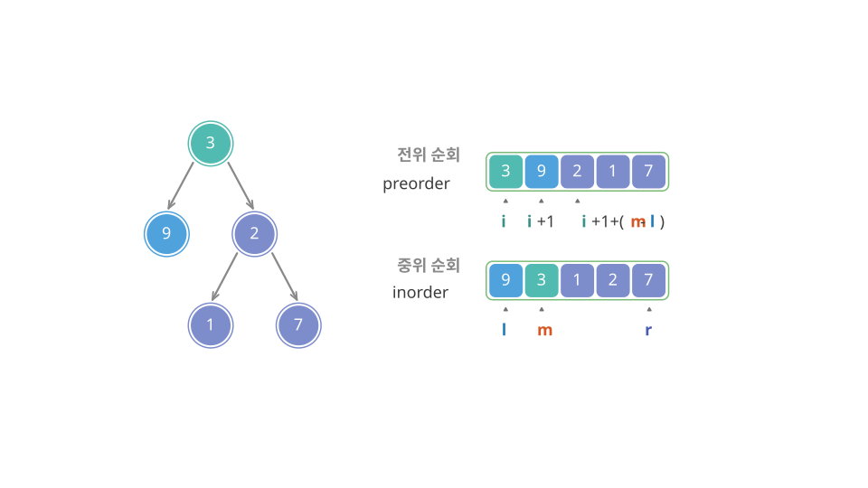

### 코드 구현

$m$을 빠르게 찾기 위해 해시 테이블 `hmap`에 배열 `inorder`의 각 원소와 그 인덱스의 대응 관계를 저장한다.

```src
[file]{build_tree}-[class]{}-[func]{build_tree}
```

아래 그림은 재귀적으로 이진 트리를 구성하는 과정이다. 호출이 아래로 내려갈 때 노드를 만들고, 위로 돌아올 때 간선(참조)을 연결한다.

=== "<1>"
    

=== "<2>"
    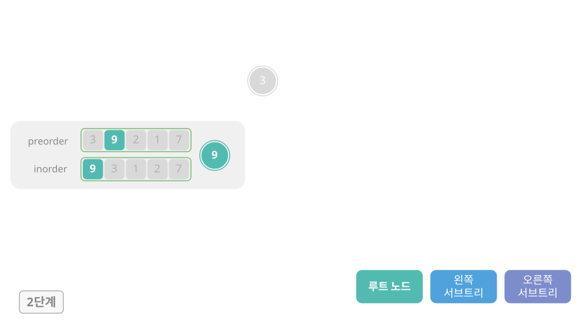

=== "<3>"
    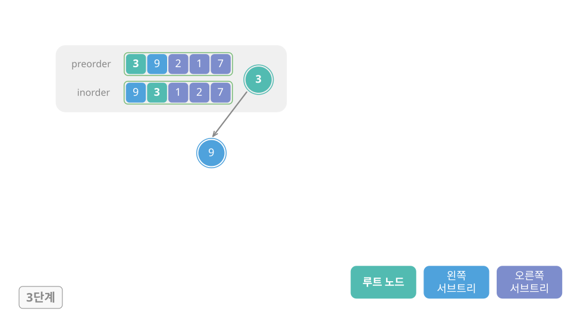

=== "<4>"
    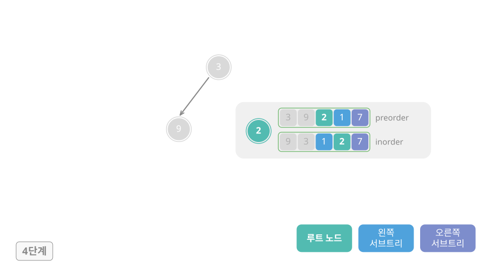

=== "<5>"
    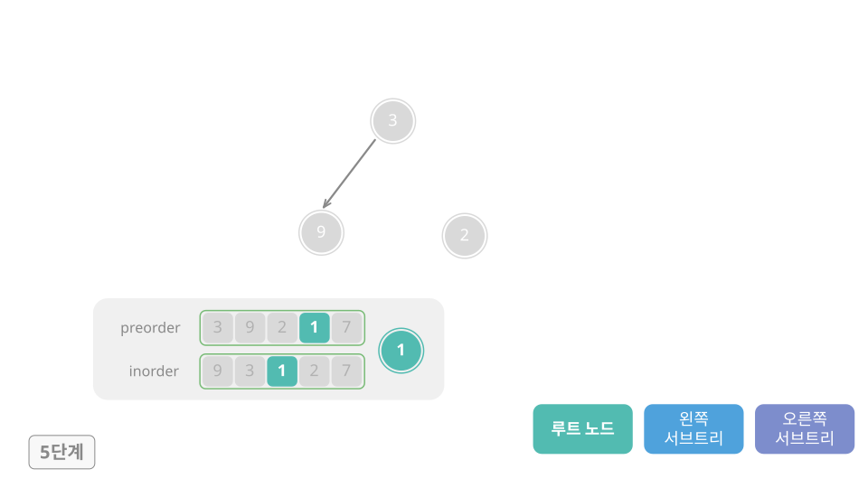

=== "<6>"
    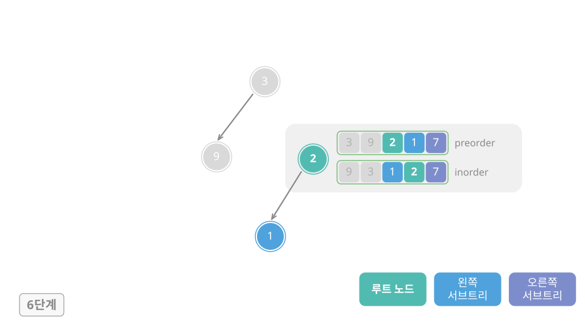

=== "<7>"
    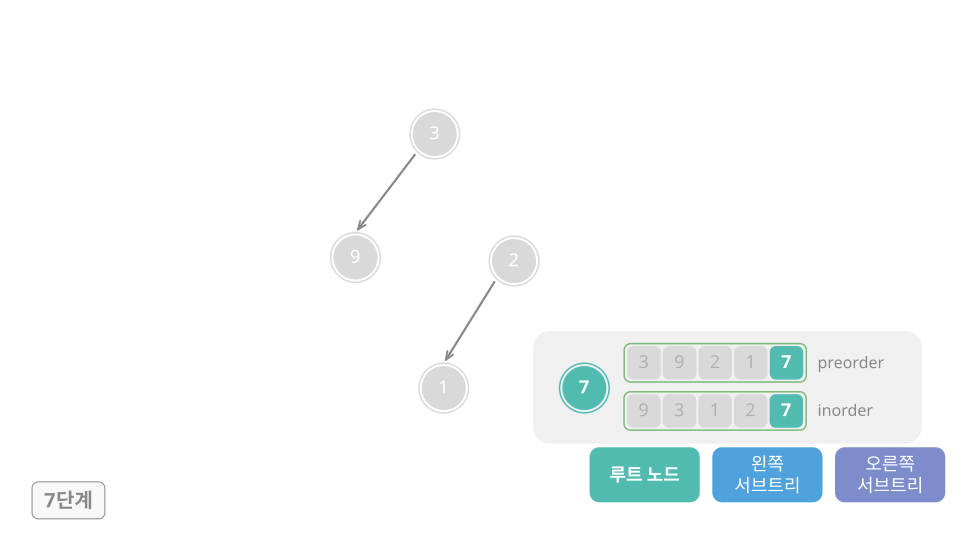

=== "<8>"
    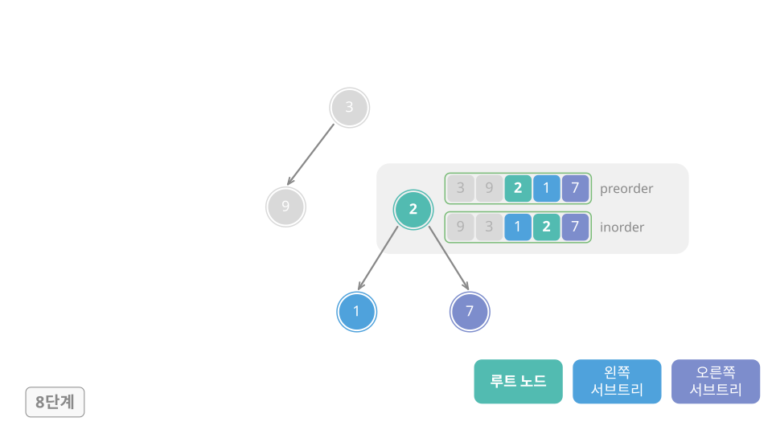

=== "<9>"
    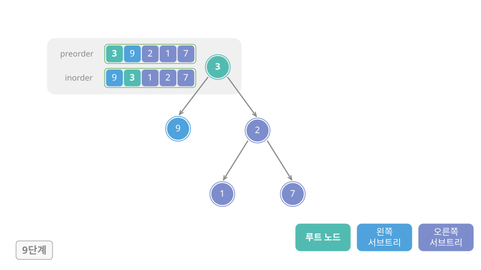

각 재귀 호출에서 전위 순회 `preorder`와 중위 순회 `inorder`를 나눈 결과는 아래 그림과 같다.

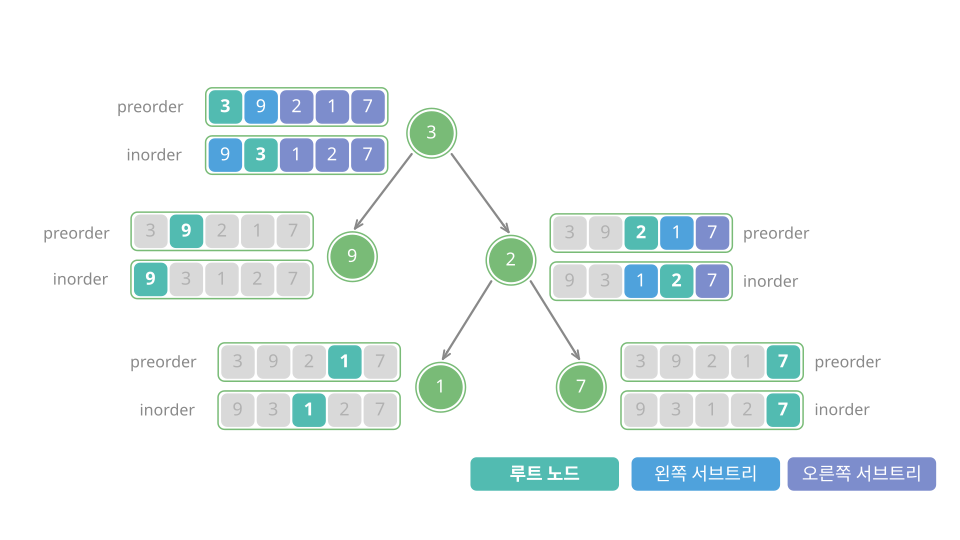

노드가 $n$개인 트리에서 각 노드를 초기화하는 데(재귀 함수 `dfs()`를 한 번 실행하는 데) $O(1)$ 시간이 든다. **따라서 전체 시간 복잡도는 $O(n)$이다**.

해시 테이블은 `inorder`의 원소와 인덱스의 대응 관계를 저장하므로 공간 복잡도는 $O(n)$이다. 최악의 경우 이진 트리가 연결 리스트 모양으로 치우치면 재귀 깊이는 $n$에 이르고 스택 프레임에 $O(n)$ 공간이 든다. **따라서 전체 공간 복잡도는 $O(n)$이다**.
