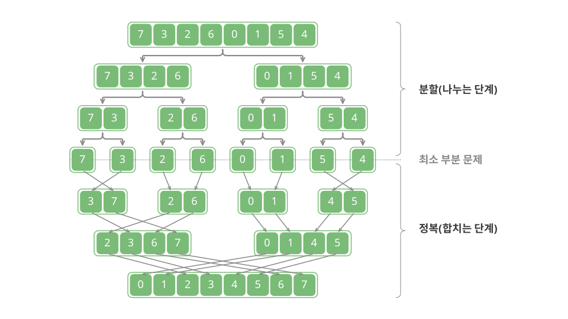
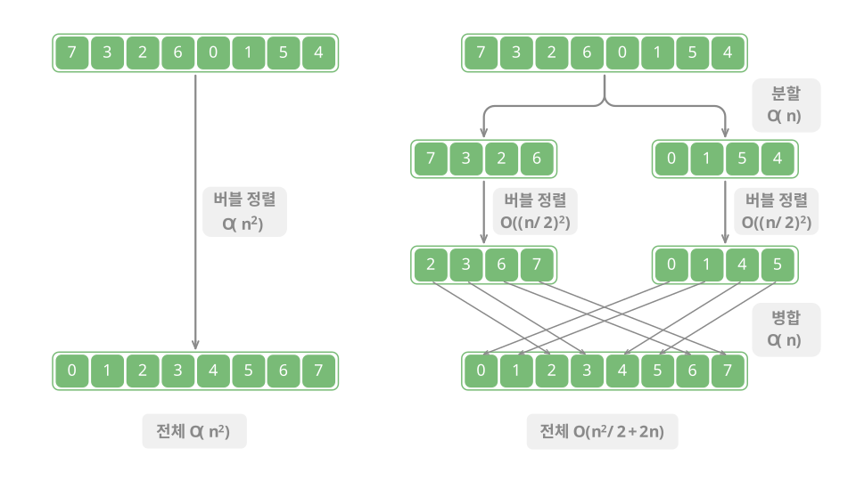
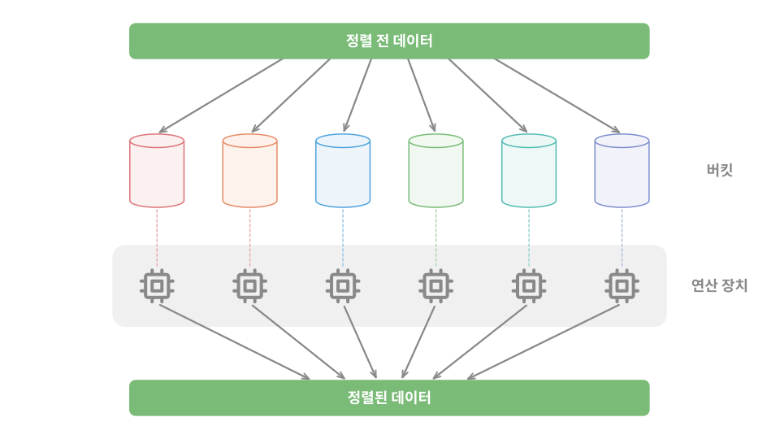

# 분할 정복 알고리즘

<u>분할 정복(divide and conquer)</u>은 문제를 나누어 해결하는 중요하고 널리 쓰이는 알고리즘 전략이다. 보통 재귀로 구현하며 분할과 정복의 두 단계로 이루어진다.

1. **분할(나누는 단계)**: 원래 문제를 둘 이상의 부분 문제로 재귀적으로 나누고 가장 작은 부분 문제에 도달하면 멈춘다.
2. **정복(합치는 단계)**: 해를 아는 가장 작은 부분 문제에서 시작해 아래에서 위로 부분 문제의 해를 합쳐 원래 문제의 해를 구한다.

아래 그림의 병합 정렬은 분할 정복의 대표적인 예이다.

1. **분할**: 원래 배열(원래 문제)을 두 개의 부분 배열(부분 문제)로 재귀적으로 나눈다. 부분 배열에 원소가 하나만 남으면 가장 작은 부분 문제에 도달한 것이다.
2. **정복**: 정렬된 부분 배열(부분 문제의 해)을 아래에서 위로 병합해 전체가 정렬된 배열(원래 문제의 해)을 얻는다.

## 분할 정복이 적합한지 판단하기

문제를 분할 정복으로 풀기에 적합한지 판단할 때는 보통 다음 기준을 살펴본다.

1. **문제를 나눌 수 있다**. 원래 문제를 더 작고 비슷한 부분 문제들로 나누고, 같은 방식으로 재귀적으로 분할할 수 있다.
2. **부분 문제가 독립적이다**. 부분 문제들이 서로 겹치거나 의존하지 않아 독립적으로 풀 수 있다.
3. **부분 문제의 해를 합칠 수 있다**. 부분 문제의 해를 합쳐 원래 문제의 해를 구할 수 있다.

병합 정렬은 세 가지 기준을 모두 만족한다.

1. **문제를 나눌 수 있다**. 배열(원래 문제)을 두 부분 배열(부분 문제)로 재귀적으로 나눈다.
2. **부분 문제가 독립적이다**. 각 부분 배열을 독립적으로 정렬할 수 있다. 즉, 부분 문제를 따로 풀 수 있다.
3. **부분 문제의 해를 합칠 수 있다**. 정렬된 두 부분 배열(부분 문제의 해)을 하나의 정렬된 배열(원래 문제의 해)로 합칠 수 있다.

## 분할 정복으로 효율 높이기

**분할 정복은 알고리즘 문제를 효과적으로 풀 뿐 아니라 효율도 높이는 경우가 많다**. 퀵 정렬, 병합 정렬, 힙 정렬이 선택 정렬, 버블 정렬, 삽입 정렬보다 빠른 것도 분할 정복 전략을 활용하기 때문이다.

**분할 정복이 효율을 높이는 원리는 무엇일까**? 큰 문제를 여러 부분 문제로 나누고, 각각 푼 뒤, 그 해를 합치는 과정이 왜 원래 문제를 직접 푸는 것보다 효율적일까? 연산 횟수와 병렬 계산이라는 두 측면에서 살펴보자.

### 연산 횟수 줄이기

길이가 $n$인 배열을 버블 정렬하는 데는 $O(n^2)$ 시간이 걸린다. 아래 그림처럼 가운데에서 둘로 나누면 분할에 $O(n)$, 각 부분 배열의 정렬에 $O((n / 2)^2)$, 두 부분 배열의 병합에 $O(n)$ 시간이 든다. 전체 시간 복잡도는 다음과 같다.

$$
O(n + (\frac{n}{2})^2 \times 2 + n) = O(\frac{n^2}{2} + 2n)
$$

다음 부등식을 풀어 보자. 왼쪽과 오른쪽은 각각 분할 전과 분할 후의 총 연산 횟수를 나타낸다.

$$
\begin{aligned}
n^2 & > \frac{n^2}{2} + 2n \newline
n^2 - \frac{n^2}{2} - 2n & > 0 \newline
n(n - 4) & > 0
\end{aligned}
$$

**$n > 4$이면 분할 후의 연산 횟수가 더 적으므로 정렬 효율이 높아질 것으로 기대할 수 있다**. 분할 후에도 시간 복잡도는 여전히 이차 차수 $O(n^2)$이고 상수 계수만 작아진다.

한 걸음 더 나아가 **각 부분 배열을 가운데에서 다시 둘로 나누는 과정을 반복해** 원소가 하나 남을 때 멈추면 어떨까? 이것이 바로 병합 정렬이며 시간 복잡도는 $O(n \log n)$이다.

이번에는 **분할점을 여러 개 두어** 원래 배열을 $k$개의 부분 배열로 균등하게 나누면 어떨까? 이는 버킷 정렬과 매우 비슷하다. 버킷 정렬은 대량의 데이터를 정렬하는 데 적합하며 이론적으로 시간 복잡도가 $O(n + k)$에 이를 수 있다.

### 병렬 계산 활용하기

분할 정복으로 생긴 부분 문제들은 서로 독립적이므로 **대개 병렬로 풀 수 있다**. 따라서 분할 정복은 시간 복잡도를 낮출 수 있고 **운영 체제가 병렬 처리로 성능을 높이는 데도 유리하다**.

여러 코어나 프로세서가 있는 환경에서는 여러 부분 문제를 동시에 처리할 수 있다. 계산 자원을 더 충분히 활용해 전체 실행 시간을 크게 줄일 수 있어 병렬화가 특히 효과적이다.

예를 들어 아래 버킷 정렬에서는 대량의 데이터를 각 버킷에 고르게 분배한다. 그런 다음 버킷별 정렬 작업을 여러 연산 장치에 나누어 맡기고 완료된 결과를 합칠 수 있다.

## 분할 정복의 활용

분할 정복으로 여러 고전적인 알고리즘 문제를 풀 수 있다.

- **가장 가까운 점 쌍 찾기**: 점 집합을 둘로 나누어 각 부분에서 가장 가까운 점 쌍을 찾고, 마지막으로 두 부분에 걸쳐 있는 가장 가까운 점 쌍을 찾는다.
- **큰 정수의 곱셈**: 예를 들어 카라추바(Karatsuba) 알고리즘은 큰 정수의 곱셈을 더 작은 정수들의 곱셈과 덧셈으로 나눈다.
- **행렬 곱셈**: 예를 들어 슈트라센(Strassen) 알고리즘은 큰 행렬의 곱셈을 여러 작은 행렬의 곱셈과 덧셈으로 나눈다.
- **하노이의 탑 문제**: 재귀로 풀 수 있으며 분할 정복 전략을 적용하는 대표적인 예이다.
- **역전 쌍 구하기**: 수열에서 앞의 수가 뒤의 수보다 크면 두 수가 역전 쌍을 이룬다. 분할 정복의 원리를 이용하는 병합 정렬로 역전 쌍을 구할 수 있다.

분할 정복은 알고리즘과 자료 구조를 설계할 때도 널리 쓰인다.

- **이진 탐색**: 정렬된 배열을 가운데 인덱스에서 둘로 나눈다. 목표값과 가운데 원솟값을 비교해 어느 쪽을 제외할지 결정하고 남은 구간에서 같은 과정을 반복한다.
- **병합 정렬**: 이 절의 앞부분에서 살펴보았다.
- **퀵 정렬**: 피벗을 고르고 피벗보다 작은 원소와 큰 원소를 두 부분 배열로 나눈다. 부분 배열에 원소가 하나 남을 때까지 같은 분할 과정을 반복한다.
- **버킷 정렬**: 데이터를 여러 버킷에 분배해 각 버킷 안의 원소를 정렬한다. 마지막으로 버킷별로 원소를 차례로 꺼내 정렬된 배열을 얻는다.
- **트리**: 이진 탐색 트리, AVL 트리, 레드-블랙 트리, B 트리, B+ 트리 등의 탐색, 삽입, 삭제 연산은 모두 분할 정복의 응용으로 볼 수 있다.
- **힙**: 특수한 완전 이진 트리로, 삽입, 삭제, 힙 구성 등의 연산에 분할 정복의 원리가 담겨 있다.
- **해시 테이블**: 분할 정복을 직접 사용하지는 않지만 일부 해시 충돌 처리 방식에서는 간접적으로 활용한다. 예를 들어 체이닝에서 긴 연결 리스트를 레드-블랙 트리로 바꾸어 검색 효율을 높이는 경우가 있다.

이처럼 **분할 정복은 다양한 알고리즘과 자료 구조에 자연스럽게 스며 있는 사고방식이다**.
