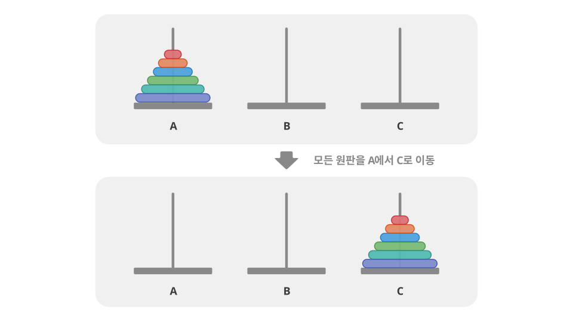
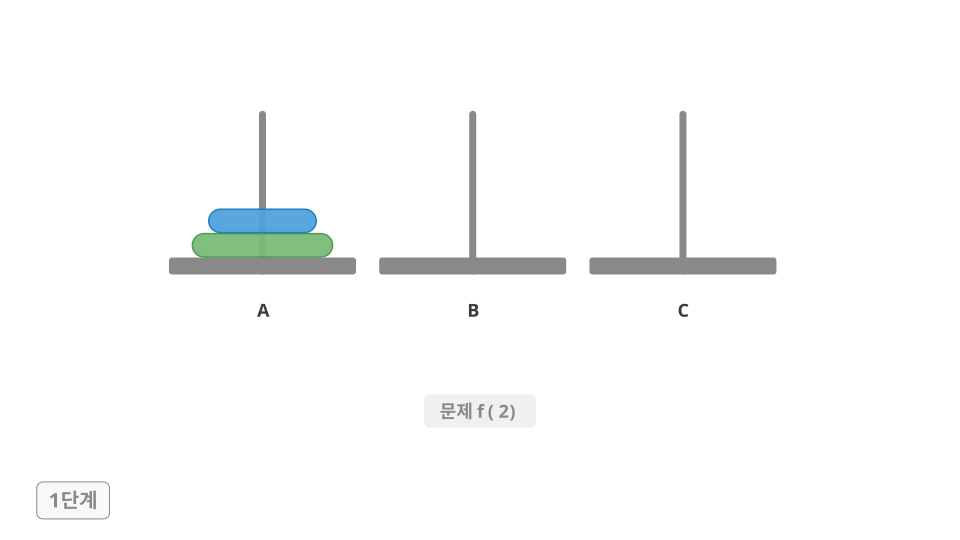
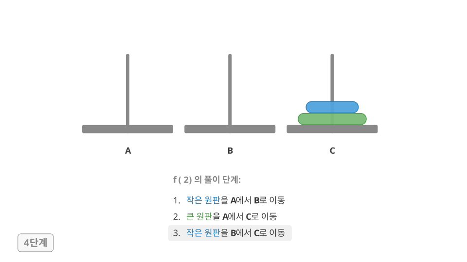
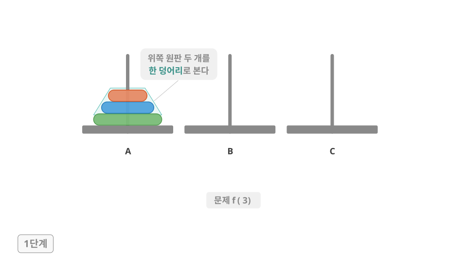
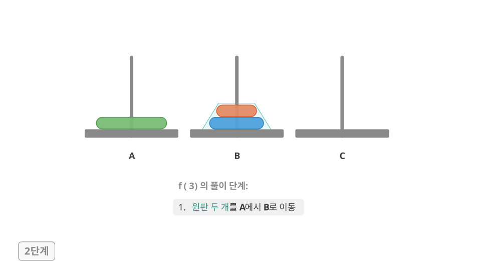
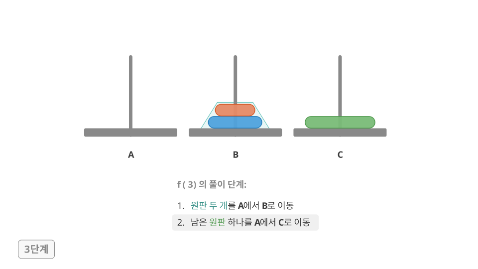
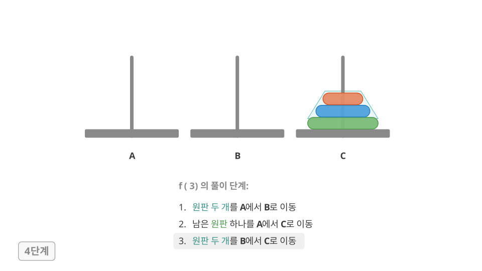
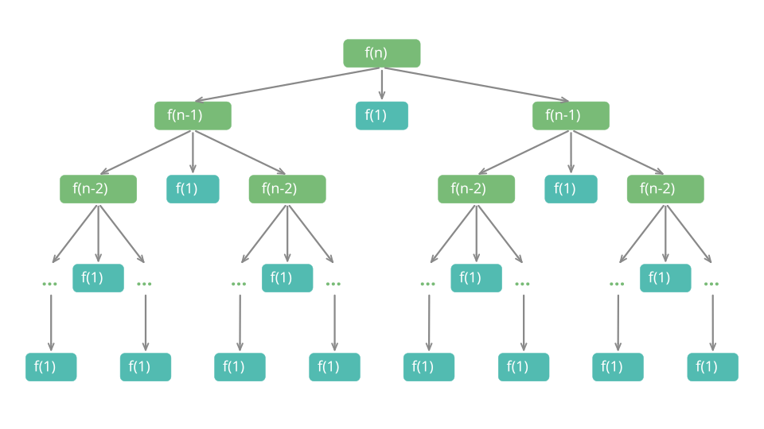

# 하노이의 탑 문제

병합 정렬과 이진 트리 구성에서는 원래 문제를 크기가 절반인 두 부분 문제로 나누었다. 하노이의 탑에서는 다른 분할 전략을 쓴다.

!!! question

    세 기둥을 각각 `A`, `B`, `C`라 하자. 처음에는 `A`에 원판 $n$개가 위에서 아래로 작은 것부터 큰 것 순으로 쌓여 있다. 목표는 아래 그림처럼 원래 순서를 유지하면서 원판 $n$개를 `C`으로 옮기는 것이다. 원판을 옮길 때는 다음 규칙을 지켜야 한다.
    
    1. 한 기둥의 맨 위에서만 원판을 꺼낼 수 있고 다른 기둥의 맨 위에만 놓을 수 있다.
    2. 한 번에 원판 하나만 옮길 수 있다.
    3. 작은 원판은 항상 큰 원판 위에 있어야 한다.



**크기가 $i$인 하노이의 탑 문제를 $f(i)$로 나타내자**. 예를 들어 $f(3)$은 원판 $3$개를 `A`에서 `C`로 옮기는 문제이다.

### 기본 경우 살펴보기

아래 그림처럼 $f(1)$에서는 원판이 하나뿐이므로 `A`에서 `C`로 바로 옮기면 된다.

=== "<1>"
    

=== "<2>"
    

아래 그림의 $f(2)$처럼 원판이 두 개라면 **작은 원판이 항상 큰 원판 위에 있어야 하므로 `B`를 보조 기둥으로 사용해야 한다**.

1. 먼저 위의 작은 원판을 `A`에서 `B`로 옮긴다.
2. 이어서 큰 원판을 `A`에서 `C`로 옮긴다.
3. 마지막으로 작은 원판을 `B`에서 `C`로 옮긴다.

=== "<1>"
    

=== "<2>"
    

=== "<3>"
    

=== "<4>"
    

$f(2)$을 푸는 과정은 **`B`를 보조 기둥으로 써서 원판 두 개를 `A`에서 `C`로 옮기는 것**이다. 이때 `C`를 목적 기둥, `B`를 보조 기둥이라 한다.

### 부분 문제로 나누기

$f(3)$처럼 원판이 세 개가 되면 상황이 조금 복잡해진다.

$f(1)$과 $f(2)$의 해를 이미 알고 있으므로 분할 정복으로 생각해 보자. **`A` 위의 원판 두 개를 한 덩어리로 보고** 아래 그림의 단계를 따르면 원판 세 개를 모두 `A`에서 `C`로 옮길 수 있다.

1. `B`를 목적 기둥, `C`를 보조 기둥으로 써서 원판 두 개를 `A`에서 `B`로 옮긴다.
2. `A`에 남은 원판 하나를 `A`에서 `C`로 바로 옮긴다.
3. `C`를 목적 기둥, `A`를 보조 기둥으로 써서 원판 두 개를 `B`에서 `C`로 옮긴다.

=== "<1>"
    

=== "<2>"
    

=== "<3>"
    

=== "<4>"
    

결국 **문제 $f(3)$을 $f(2)$ 두 개와 $f(1)$ 하나로 나눈 것이다**. 세 부분 문제를 차례로 풀면 원래 문제도 풀린다. 이는 부분 문제가 독립적이고 해를 합칠 수 있음을 보여 준다.

이제 아래 그림처럼 하노이의 탑의 분할 정복 전략을 정리할 수 있다. 원래 문제 $f(n)$을 $f(n-1)$ 두 개와 $f(1)$ 하나로 나누고 다음 순서로 푼다.

1. 원판 $n-1$개를 `C`를 보조 기둥으로 써서 `A`에서 `B`로 옮긴다.
2. 남은 원판 $1$개를 `A`에서 `C`로 바로 옮긴다.
3. 원판 $n-1$개를 `A`를 보조 기둥으로 써서 `B`에서 `C`로 옮긴다.

두 $f(n-1)$ 부분 문제도 **같은 방식으로 재귀적으로 나누어** 가장 작은 부분 문제 $f(1)$에 도달할 수 있다. $f(1)$의 해는 이미 알고 있다. 원판을 한 번 옮기면 된다.


### 코드 구현

코드에서 재귀 함수 `dfs(i, src, buf, tar)`는 기둥 `src` 위의 원판 $i$개를 목적 기둥 `tar`로 옮긴다. 이때 `buf`를 보조 기둥으로 쓴다.

```src
[file]{hanota}-[class]{}-[func]{solve_hanota}
```

아래 그림처럼 하노이의 탑 문제는 높이가 $n$인 재귀 트리를 이룬다. 각 노드는 하나의 부분 문제이며 `dfs()` 함수 호출 하나에 대응한다. **따라서 시간 복잡도는 $O(2^n)$이고 공간 복잡도는 $O(n)$이다**.



!!! quote

    하노이의 탑 문제는 오래된 전설에서 유래했다. 고대 인도의 어느 사원에는 높은 다이아몬드 기둥 세 개와 크기가 다른 황금 원판 $64$개가 있었다. 승려들은 마지막 원판을 제자리에 놓는 순간 세상이 끝난다고 믿으며 원판을 계속 옮겼다.

    하지만 1초에 한 번씩 옮겨도 약 $2^{64} \approx 1.84×10^{19}$초, 즉 약 $5850$억 년이 걸린다. 이는 현재 추정되는 우주의 나이보다 훨씬 길다. 전설이 사실이라 해도 세상의 종말을 걱정할 필요는 없을 듯하다.
