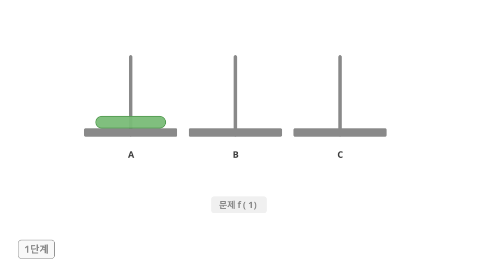
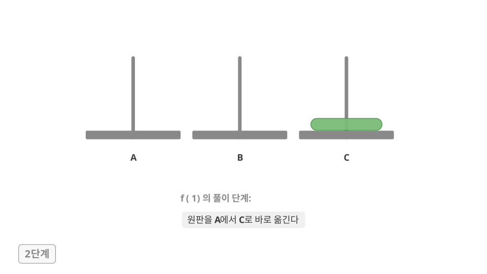
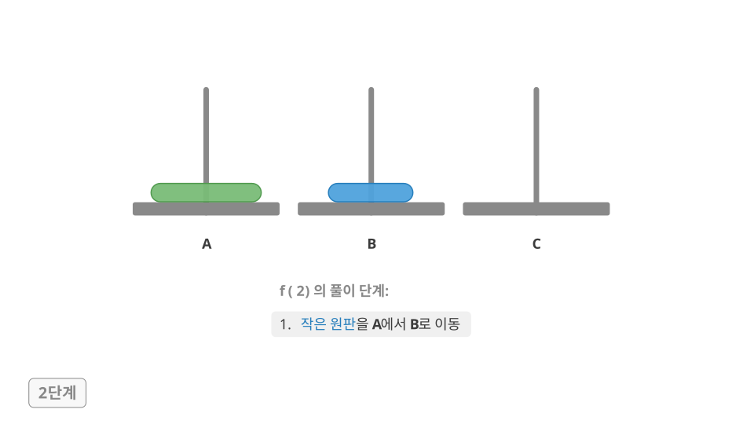
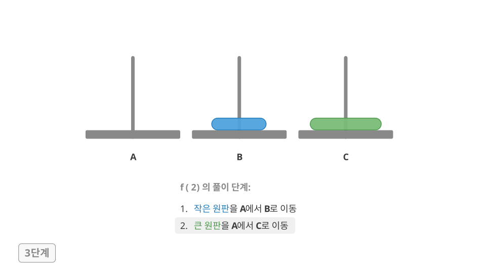
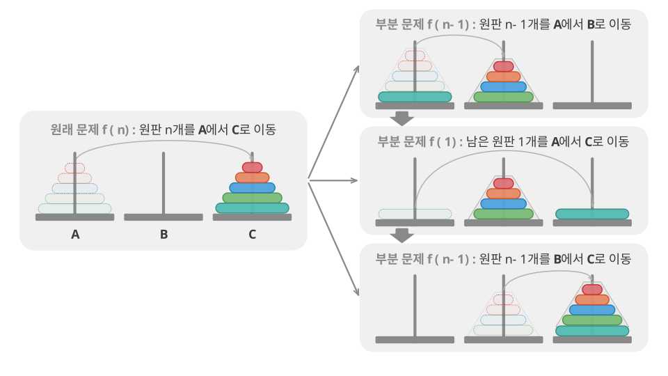

# 12.4 &nbsp; 하노이의 탑 문제

병합 정렬과 이진 트리 구성에서는 원래 문제를 크기가 절반인 두 부분 문제로 나누었다. 하노이의 탑에서는 다른 분할 전략을 쓴다.

!!! question

    세 기둥을 각각 `A`, `B`, `C`라 하자. 처음에는 `A`에 원판 $n$개가 위에서 아래로 작은 것부터 큰 것 순으로 쌓여 있다. 목표는 아래 그림(12-10)처럼 원래 순서를 유지하면서 원판 $n$개를 `C`로 옮기는 것이다. 원판을 옮길 때는 다음 규칙을 지켜야 한다.
    
    1. 한 기둥의 맨 위에서만 원판을 꺼낼 수 있고 다른 기둥의 맨 위에만 놓을 수 있다.
    2. 한 번에 원판 하나만 옮길 수 있다.
    3. 작은 원판은 항상 큰 원판 위에 있어야 한다.

{ class="animation-figure" }

<p align="center"> 그림 12-10 &nbsp; 하노이의 탑 문제 예시 </p>

**크기가 $i$인 하노이의 탑 문제를 $f(i)$로 나타내자**. 예를 들어 $f(3)$은 원판 $3$개를 `A`에서 `C`로 옮기는 문제이다.

### 1. &nbsp; 기본 경우 살펴보기

아래 그림(12-11)처럼 $f(1)$에서는 원판이 하나뿐이므로 `A`에서 `C`로 바로 옮기면 된다.

=== "<1>"
    { class="animation-figure" }

=== "<2>"
    { class="animation-figure" }

<p align="center"> 그림 12-11 &nbsp; 크기가 1인 문제의 해 </p>

아래 그림(12-12)의 $f(2)$처럼 원판이 두 개라면 **작은 원판이 항상 큰 원판 위에 있어야 하므로 `B`를 보조 기둥으로 사용해야 한다**.

1. 먼저 위의 작은 원판을 `A`에서 `B`로 옮긴다.
2. 이어서 큰 원판을 `A`에서 `C`로 옮긴다.
3. 마지막으로 작은 원판을 `B`에서 `C`로 옮긴다.

=== "<1>"
    { class="animation-figure" }

=== "<2>"
    { class="animation-figure" }

=== "<3>"
    { class="animation-figure" }

=== "<4>"
    { class="animation-figure" }

<p align="center"> 그림 12-12 &nbsp; 크기가 2인 문제의 해 </p>

$f(2)$를 푸는 과정은 **`B`를 보조 기둥으로 써서 원판 두 개를 `A`에서 `C`로 옮기는 것**이다. 이때 `C`를 목적 기둥, `B`를 보조 기둥이라 한다.

### 2. &nbsp; 부분 문제로 나누기

$f(3)$처럼 원판이 세 개가 되면 상황이 조금 복잡해진다.

$f(1)$과 $f(2)$의 해를 이미 알고 있으므로 분할 정복으로 생각해 보자. **`A` 위의 원판 두 개를 한 덩어리로 보고** 아래 그림(12-13)의 단계를 따르면 원판 세 개를 모두 `A`에서 `C`로 옮길 수 있다.

1. `B`를 목적 기둥, `C`를 보조 기둥으로 써서 원판 두 개를 `A`에서 `B`로 옮긴다.
2. `A`에 남은 원판 하나를 `A`에서 `C`로 바로 옮긴다.
3. `C`를 목적 기둥, `A`를 보조 기둥으로 써서 원판 두 개를 `B`에서 `C`로 옮긴다.

=== "<1>"
    { class="animation-figure" }

=== "<2>"
    { class="animation-figure" }

=== "<3>"
    { class="animation-figure" }

=== "<4>"
    { class="animation-figure" }

<p align="center"> 그림 12-13 &nbsp; 크기가 3인 문제의 해 </p>

결국 **문제 $f(3)$을 $f(2)$ 두 개와 $f(1)$ 하나로 나눈 것이다**. 세 부분 문제를 차례로 풀면 원래 문제도 풀린다. 이는 부분 문제가 독립적이고 해를 합칠 수 있음을 보여 준다.

이제 아래 그림(12-14)처럼 하노이의 탑의 분할 정복 전략을 정리할 수 있다. 원래 문제 $f(n)$을 $f(n-1)$ 두 개와 $f(1)$ 하나로 나누고 다음 순서로 푼다.

1. 원판 $n-1$개를 `C`를 보조 기둥으로 써서 `A`에서 `B`로 옮긴다.
2. 남은 원판 $1$개를 `A`에서 `C`로 바로 옮긴다.
3. 원판 $n-1$개를 `A`를 보조 기둥으로 써서 `B`에서 `C`로 옮긴다.

두 $f(n-1)$ 부분 문제도 **같은 방식으로 재귀적으로 나누어** 가장 작은 부분 문제 $f(1)$에 도달할 수 있다. $f(1)$의 해는 이미 알고 있다. 원판을 한 번 옮기면 된다.

{ class="animation-figure" }

<p align="center"> 그림 12-14 &nbsp; 하노이의 탑 문제를 푸는 분할 정복 전략 </p>

### 3. &nbsp; 코드 구현

코드에서 재귀 함수 `dfs(i, src, buf, tar)`는 기둥 `src` 위의 원판 $i$개를 목적 기둥 `tar`로 옮긴다. 이때 `buf`를 보조 기둥으로 쓴다.

=== "Python"

    ```python title="hanota.py"
    def move(src: list[int], tar: list[int]):
        """원판 하나를 옮긴다"""
        # src 맨 위의 원판 하나를 꺼낸다
        pan = src.pop()
        # 원판을 tar 맨 위에 놓는다
        tar.append(pan)

    def dfs(i: int, src: list[int], buf: list[int], tar: list[int]):
        """하노이의 탑 문제 f(i)를 푼다"""
        # src에 원판 하나만 남으면 바로 tar로 옮긴다
        if i == 1:
            move(src, tar)
            return
        # 부분 문제 f(i-1): tar를 보조 기둥으로 써서 src 위의 원판 i-1개를 buf로 옮긴다
        dfs(i - 1, src, tar, buf)
        # 부분 문제 f(1): src에 남은 원판 하나를 tar로 옮긴다
        move(src, tar)
        # 부분 문제 f(i-1): src를 보조 기둥으로 써서 buf 위의 원판 i-1개를 tar로 옮긴다
        dfs(i - 1, buf, src, tar)

    def solve_hanota(A: list[int], B: list[int], C: list[int]):
        """하노이의 탑 문제 풀기"""
        n = len(A)
        # B를 보조 기둥으로 써서 A 위의 원판 n개를 C로 옮긴다
        dfs(n, A, B, C)
    ```

=== "C++"

    ```cpp title="hanota.cpp"
    /* 원판 하나를 옮긴다 */
    void move(vector<int> &src, vector<int> &tar) {
        // src 맨 위의 원판 하나를 꺼낸다
        int pan = src.back();
        src.pop_back();
        // 원판을 tar 맨 위에 놓는다
        tar.push_back(pan);
    }

    /* 하노이의 탑 문제 f(i)를 푼다 */
    void dfs(int i, vector<int> &src, vector<int> &buf, vector<int> &tar) {
        // src에 원판 하나만 남으면 바로 tar로 옮긴다
        if (i == 1) {
            move(src, tar);
            return;
        }
        // 부분 문제 f(i-1): tar를 보조 기둥으로 써서 src 위의 원판 i-1개를 buf로 옮긴다
        dfs(i - 1, src, tar, buf);
        // 부분 문제 f(1): src에 남은 원판 하나를 tar로 옮긴다
        move(src, tar);
        // 부분 문제 f(i-1): src를 보조 기둥으로 써서 buf 위의 원판 i-1개를 tar로 옮긴다
        dfs(i - 1, buf, src, tar);
    }

    /* 하노이의 탑 문제 풀기 */
    void solveHanota(vector<int> &A, vector<int> &B, vector<int> &C) {
        int n = A.size();
        // B를 보조 기둥으로 써서 A 위의 원판 n개를 C로 옮긴다
        dfs(n, A, B, C);
    }
    ```

=== "Java"

    ```java title="hanota.java"
    /* 원판 하나를 옮긴다 */
    void move(List<Integer> src, List<Integer> tar) {
        // src 맨 위의 원판 하나를 꺼낸다
        Integer pan = src.remove(src.size() - 1);
        // 원판을 tar 맨 위에 놓는다
        tar.add(pan);
    }

    /* 하노이의 탑 문제 f(i)를 푼다 */
    void dfs(int i, List<Integer> src, List<Integer> buf, List<Integer> tar) {
        // src에 원판 하나만 남으면 바로 tar로 옮긴다
        if (i == 1) {
            move(src, tar);
            return;
        }
        // 부분 문제 f(i-1): tar를 보조 기둥으로 써서 src 위의 원판 i-1개를 buf로 옮긴다
        dfs(i - 1, src, tar, buf);
        // 부분 문제 f(1): src에 남은 원판 하나를 tar로 옮긴다
        move(src, tar);
        // 부분 문제 f(i-1): src를 보조 기둥으로 써서 buf 위의 원판 i-1개를 tar로 옮긴다
        dfs(i - 1, buf, src, tar);
    }

    /* 하노이의 탑 문제 풀기 */
    void solveHanota(List<Integer> A, List<Integer> B, List<Integer> C) {
        int n = A.size();
        // B를 보조 기둥으로 써서 A 위의 원판 n개를 C로 옮긴다
        dfs(n, A, B, C);
    }
    ```

=== "C#"

    ```csharp title="hanota.cs"
    /* 원판 하나를 옮긴다 */
    void Move(List<int> src, List<int> tar) {
        // src 맨 위의 원판 하나를 꺼낸다
        int pan = src[^1];
        src.RemoveAt(src.Count - 1);
        // 원판을 tar 맨 위에 놓는다
        tar.Add(pan);
    }

    /* 하노이의 탑 문제 f(i)를 푼다 */
    void DFS(int i, List<int> src, List<int> buf, List<int> tar) {
        // src에 원판 하나만 남으면 바로 tar로 옮긴다
        if (i == 1) {
            Move(src, tar);
            return;
        }
        // 부분 문제 f(i-1): tar를 보조 기둥으로 써서 src 위의 원판 i-1개를 buf로 옮긴다
        DFS(i - 1, src, tar, buf);
        // 부분 문제 f(1): src에 남은 원판 하나를 tar로 옮긴다
        Move(src, tar);
        // 부분 문제 f(i-1): src를 보조 기둥으로 써서 buf 위의 원판 i-1개를 tar로 옮긴다
        DFS(i - 1, buf, src, tar);
    }

    /* 하노이의 탑 문제 풀기 */
    void SolveHanota(List<int> A, List<int> B, List<int> C) {
        int n = A.Count;
        // B를 보조 기둥으로 써서 A 위의 원판 n개를 C로 옮긴다
        DFS(n, A, B, C);
    }
    ```

=== "Go"

    ```go title="hanota.go"
    /* 원판 하나를 옮긴다 */
    func move(src, tar *list.List) {
        // src 맨 위의 원판 하나를 꺼낸다
        pan := src.Back()
        // 원판을 tar 맨 위에 놓는다
        tar.PushBack(pan.Value)
        // src 맨 위의 원판을 꺼낸다
        src.Remove(pan)
    }

    /* 하노이의 탑 문제 f(i)를 푼다 */
    func dfsHanota(i int, src, buf, tar *list.List) {
        // src에 원판 하나만 남으면 바로 tar로 옮긴다
        if i == 1 {
            move(src, tar)
            return
        }
        // 부분 문제 f(i-1): tar를 보조 기둥으로 써서 src 위의 원판 i-1개를 buf로 옮긴다
        dfsHanota(i-1, src, tar, buf)
        // 부분 문제 f(1): src에 남은 원판 하나를 tar로 옮긴다
        move(src, tar)
        // 부분 문제 f(i-1): src를 보조 기둥으로 써서 buf 위의 원판 i-1개를 tar로 옮긴다
        dfsHanota(i-1, buf, src, tar)
    }

    /* 하노이의 탑 문제 풀기 */
    func solveHanota(A, B, C *list.List) {
        n := A.Len()
        // B를 보조 기둥으로 써서 A 위의 원판 n개를 C로 옮긴다
        dfsHanota(n, A, B, C)
    }
    ```

=== "Swift"

    ```swift title="hanota.swift"
    /* 원판 하나를 옮긴다 */
    func move(src: inout [Int], tar: inout [Int]) {
        // src 맨 위의 원판 하나를 꺼낸다
        let pan = src.popLast()!
        // 원판을 tar 맨 위에 놓는다
        tar.append(pan)
    }

    /* 하노이의 탑 문제 f(i)를 푼다 */
    func dfs(i: Int, src: inout [Int], buf: inout [Int], tar: inout [Int]) {
        // src에 원판 하나만 남으면 바로 tar로 옮긴다
        if i == 1 {
            move(src: &src, tar: &tar)
            return
        }
        // 부분 문제 f(i-1): tar를 보조 기둥으로 써서 src 위의 원판 i-1개를 buf로 옮긴다
        dfs(i: i - 1, src: &src, buf: &tar, tar: &buf)
        // 부분 문제 f(1): src에 남은 원판 하나를 tar로 옮긴다
        move(src: &src, tar: &tar)
        // 부분 문제 f(i-1): src를 보조 기둥으로 써서 buf 위의 원판 i-1개를 tar로 옮긴다
        dfs(i: i - 1, src: &buf, buf: &src, tar: &tar)
    }

    /* 하노이의 탑 문제 풀기 */
    func solveHanota(A: inout [Int], B: inout [Int], C: inout [Int]) {
        let n = A.count
        // 리스트의 끝이 기둥의 맨 위에 해당한다
        // B를 보조 기둥으로 써서 src 위의 원판 n개를 C로 옮긴다
        dfs(i: n, src: &A, buf: &B, tar: &C)
    }
    ```

=== "JS"

    ```javascript title="hanota.js"
    /* 원판 하나를 옮긴다 */
    function move(src, tar) {
        // src 맨 위의 원판 하나를 꺼낸다
        const pan = src.pop();
        // 원판을 tar 맨 위에 놓는다
        tar.push(pan);
    }

    /* 하노이의 탑 문제 f(i)를 푼다 */
    function dfs(i, src, buf, tar) {
        // src에 원판 하나만 남으면 바로 tar로 옮긴다
        if (i === 1) {
            move(src, tar);
            return;
        }
        // 부분 문제 f(i-1): tar를 보조 기둥으로 써서 src 위의 원판 i-1개를 buf로 옮긴다
        dfs(i - 1, src, tar, buf);
        // 부분 문제 f(1): src에 남은 원판 하나를 tar로 옮긴다
        move(src, tar);
        // 부분 문제 f(i-1): src를 보조 기둥으로 써서 buf 위의 원판 i-1개를 tar로 옮긴다
        dfs(i - 1, buf, src, tar);
    }

    /* 하노이의 탑 문제 풀기 */
    function solveHanota(A, B, C) {
        const n = A.length;
        // B를 보조 기둥으로 써서 A 위의 원판 n개를 C로 옮긴다
        dfs(n, A, B, C);
    }
    ```

=== "TS"

    ```typescript title="hanota.ts"
    /* 원판 하나를 옮긴다 */
    function move(src: number[], tar: number[]): void {
        // src 맨 위의 원판 하나를 꺼낸다
        const pan = src.pop();
        // 원판을 tar 맨 위에 놓는다
        tar.push(pan);
    }

    /* 하노이의 탑 문제 f(i)를 푼다 */
    function dfs(i: number, src: number[], buf: number[], tar: number[]): void {
        // src에 원판 하나만 남으면 바로 tar로 옮긴다
        if (i === 1) {
            move(src, tar);
            return;
        }
        // 부분 문제 f(i-1): tar를 보조 기둥으로 써서 src 위의 원판 i-1개를 buf로 옮긴다
        dfs(i - 1, src, tar, buf);
        // 부분 문제 f(1): src에 남은 원판 하나를 tar로 옮긴다
        move(src, tar);
        // 부분 문제 f(i-1): src를 보조 기둥으로 써서 buf 위의 원판 i-1개를 tar로 옮긴다
        dfs(i - 1, buf, src, tar);
    }

    /* 하노이의 탑 문제 풀기 */
    function solveHanota(A: number[], B: number[], C: number[]): void {
        const n = A.length;
        // B를 보조 기둥으로 써서 A 위의 원판 n개를 C로 옮긴다
        dfs(n, A, B, C);
    }
    ```

=== "Dart"

    ```dart title="hanota.dart"
    /* 원판 하나를 옮긴다 */
    void move(List<int> src, List<int> tar) {
      // src 맨 위의 원판 하나를 꺼낸다
      int pan = src.removeLast();
      // 원판을 tar 맨 위에 놓는다
      tar.add(pan);
    }

    /* 하노이의 탑 문제 f(i)를 푼다 */
    void dfs(int i, List<int> src, List<int> buf, List<int> tar) {
      // src에 원판 하나만 남으면 바로 tar로 옮긴다
      if (i == 1) {
        move(src, tar);
        return;
      }
      // 부분 문제 f(i-1): tar를 보조 기둥으로 써서 src 위의 원판 i-1개를 buf로 옮긴다
      dfs(i - 1, src, tar, buf);
      // 부분 문제 f(1): src에 남은 원판 하나를 tar로 옮긴다
      move(src, tar);
      // 부분 문제 f(i-1): src를 보조 기둥으로 써서 buf 위의 원판 i-1개를 tar로 옮긴다
      dfs(i - 1, buf, src, tar);
    }

    /* 하노이의 탑 문제 풀기 */
    void solveHanota(List<int> A, List<int> B, List<int> C) {
      int n = A.length;
      // B를 보조 기둥으로 써서 A 위의 원판 n개를 C로 옮긴다
      dfs(n, A, B, C);
    }
    ```

=== "Rust"

    ```rust title="hanota.rs"
    /* 원판 하나를 옮긴다 */
    fn move_pan(src: &mut Vec<i32>, tar: &mut Vec<i32>) {
        // src 맨 위의 원판 하나를 꺼낸다
        let pan = src.pop().unwrap();
        // 원판을 tar 맨 위에 놓는다
        tar.push(pan);
    }

    /* 하노이의 탑 문제 f(i)를 푼다 */
    fn dfs(i: i32, src: &mut Vec<i32>, buf: &mut Vec<i32>, tar: &mut Vec<i32>) {
        // src에 원판 하나만 남으면 바로 tar로 옮긴다
        if i == 1 {
            move_pan(src, tar);
            return;
        }
        // 부분 문제 f(i-1): tar를 보조 기둥으로 써서 src 위의 원판 i-1개를 buf로 옮긴다
        dfs(i - 1, src, tar, buf);
        // 부분 문제 f(1): src에 남은 원판 하나를 tar로 옮긴다
        move_pan(src, tar);
        // 부분 문제 f(i-1): src를 보조 기둥으로 써서 buf 위의 원판 i-1개를 tar로 옮긴다
        dfs(i - 1, buf, src, tar);
    }

    /* 하노이의 탑 문제 풀기 */
    fn solve_hanota(A: &mut Vec<i32>, B: &mut Vec<i32>, C: &mut Vec<i32>) {
        let n = A.len() as i32;
        // B를 보조 기둥으로 써서 A 위의 원판 n개를 C로 옮긴다
        dfs(n, A, B, C);
    }
    ```

=== "C"

    ```c title="hanota.c"
    /* 원판 하나를 옮긴다 */
    void move(int *src, int *srcSize, int *tar, int *tarSize) {
        // src 맨 위의 원판 하나를 꺼낸다
        int pan = src[*srcSize - 1];
        src[*srcSize - 1] = 0;
        (*srcSize)--;
        // 원판을 tar 맨 위에 놓는다
        tar[*tarSize] = pan;
        (*tarSize)++;
    }

    /* 하노이의 탑 문제 f(i)를 푼다 */
    void dfs(int i, int *src, int *srcSize, int *buf, int *bufSize, int *tar, int *tarSize) {
        // src에 원판 하나만 남으면 바로 tar로 옮긴다
        if (i == 1) {
            move(src, srcSize, tar, tarSize);
            return;
        }
        // 부분 문제 f(i-1): tar를 보조 기둥으로 써서 src 위의 원판 i-1개를 buf로 옮긴다
        dfs(i - 1, src, srcSize, tar, tarSize, buf, bufSize);
        // 부분 문제 f(1): src에 남은 원판 하나를 tar로 옮긴다
        move(src, srcSize, tar, tarSize);
        // 부분 문제 f(i-1): src를 보조 기둥으로 써서 buf 위의 원판 i-1개를 tar로 옮긴다
        dfs(i - 1, buf, bufSize, src, srcSize, tar, tarSize);
    }

    /* 하노이의 탑 문제 풀기 */
    void solveHanota(int *A, int *ASize, int *B, int *BSize, int *C, int *CSize) {
        // B를 보조 기둥으로 써서 A 위의 원판 n개를 C로 옮긴다
        dfs(*ASize, A, ASize, B, BSize, C, CSize);
    }
    ```

=== "Kotlin"

    ```kotlin title="hanota.kt"
    /* 원판 하나를 옮긴다 */
    fun move(src: MutableList<Int>, tar: MutableList<Int>) {
        // src 맨 위의 원판 하나를 꺼낸다
        val pan = src.removeAt(src.size - 1)
        // 원판을 tar 맨 위에 놓는다
        tar.add(pan)
    }

    /* 하노이의 탑 문제 f(i)를 푼다 */
    fun dfs(i: Int, src: MutableList<Int>, buf: MutableList<Int>, tar: MutableList<Int>) {
        // src에 원판 하나만 남으면 바로 tar로 옮긴다
        if (i == 1) {
            move(src, tar)
            return
        }
        // 부분 문제 f(i-1): tar를 보조 기둥으로 써서 src 위의 원판 i-1개를 buf로 옮긴다
        dfs(i - 1, src, tar, buf)
        // 부분 문제 f(1): src에 남은 원판 하나를 tar로 옮긴다
        move(src, tar)
        // 부분 문제 f(i-1): src를 보조 기둥으로 써서 buf 위의 원판 i-1개를 tar로 옮긴다
        dfs(i - 1, buf, src, tar)
    }

    /* 하노이의 탑 문제 풀기 */
    fun solveHanota(A: MutableList<Int>, B: MutableList<Int>, C: MutableList<Int>) {
        val n = A.size
        // B를 보조 기둥으로 써서 A 위의 원판 n개를 C로 옮긴다
        dfs(n, A, B, C)
    }
    ```

=== "Ruby"

    ```ruby title="hanota.rb"
    ### 원판 하나를 옮긴다 ###
    def move(src, tar)
      # src 맨 위의 원판 하나를 꺼낸다
      pan = src.pop
      # 원판을 tar 맨 위에 놓는다
      tar << pan
    end

    ### 하노이의 탑 문제 f(i)를 푼다 ###
    def dfs(i, src, buf, tar)
      # src에 원판 하나만 남으면 바로 tar로 옮긴다
      if i == 1
        move(src, tar)
        return
      end

      # 부분 문제 f(i-1): tar를 보조 기둥으로 써서 src 위의 원판 i-1개를 buf로 옮긴다
      dfs(i - 1, src, tar, buf)
      # 부분 문제 f(1): src에 남은 원판 하나를 tar로 옮긴다
      move(src, tar)
      # 부분 문제 f(i-1): src를 보조 기둥으로 써서 buf 위의 원판 i-1개를 tar로 옮긴다
      dfs(i - 1, buf, src, tar)
    end

    ### 하노이의 탑 문제 풀기 ###
    def solve_hanota(_A, _B, _C)
      n = _A.length
      # B를 보조 기둥으로 써서 A 위의 원판 n개를 C로 옮긴다
      dfs(n, _A, _B, _C)
    end
    ```

??? pythontutor "실행 과정 시각화"

    <div style="height: 549px; width: 100%;"><iframe class="pythontutor-iframe" title="실행 과정 시각화" src="https://pythontutor.com/iframe-embed.html#code=def%20move%28src%3A%20list%5Bint%5D,%20tar%3A%20list%5Bint%5D%29%3A%0A%20%20%20%20%22%22%22%EC%9B%90%ED%8C%90%20%ED%95%98%EB%82%98%EB%A5%BC%20%EC%98%AE%EA%B8%B4%EB%8B%A4%22%22%22%0A%20%20%20%20%23%20src%20%EB%A7%A8%20%EC%9C%84%EC%9D%98%20%EC%9B%90%ED%8C%90%20%ED%95%98%EB%82%98%EB%A5%BC%20%EA%BA%BC%EB%82%B8%EB%8B%A4%0A%20%20%20%20pan%20%3D%20src.pop%28%29%0A%20%20%20%20%23%20%EC%9B%90%ED%8C%90%EC%9D%84%20tar%20%EB%A7%A8%20%EC%9C%84%EC%97%90%20%EB%86%93%EB%8A%94%EB%8B%A4%0A%20%20%20%20tar.append%28pan%29%0A%0A%0Adef%20dfs%28i%3A%20int,%20src%3A%20list%5Bint%5D,%20buf%3A%20list%5Bint%5D,%20tar%3A%20list%5Bint%5D%29%3A%0A%20%20%20%20%22%22%22%ED%95%98%EB%85%B8%EC%9D%B4%EC%9D%98%20%ED%83%91%20%EB%AC%B8%EC%A0%9C%20f%28i%29%EB%A5%BC%20%ED%91%BC%EB%8B%A4%22%22%22%0A%20%20%20%20%23%20src%EC%97%90%20%EC%9B%90%ED%8C%90%20%ED%95%98%EB%82%98%EB%A7%8C%20%EB%82%A8%EC%9C%BC%EB%A9%B4%20%EB%B0%94%EB%A1%9C%20tar%EB%A1%9C%20%EC%98%AE%EA%B8%B4%EB%8B%A4%0A%20%20%20%20if%20i%20%3D%3D%201%3A%0A%20%20%20%20%20%20%20%20move%28src,%20tar%29%0A%20%20%20%20%20%20%20%20return%0A%20%20%20%20%23%20%EB%B6%80%EB%B6%84%20%EB%AC%B8%EC%A0%9C%20f%28i-1%29%3A%20tar%EB%A5%BC%20%EB%B3%B4%EC%A1%B0%20%EA%B8%B0%EB%91%A5%EC%9C%BC%EB%A1%9C%20%EC%8D%A8%EC%84%9C%20src%20%EC%9C%84%EC%9D%98%20%EC%9B%90%ED%8C%90%20i-1%EA%B0%9C%EB%A5%BC%20buf%EB%A1%9C%20%EC%98%AE%EA%B8%B4%EB%8B%A4%0A%20%20%20%20dfs%28i%20-%201,%20src,%20tar,%20buf%29%0A%20%20%20%20%23%20%EB%B6%80%EB%B6%84%20%EB%AC%B8%EC%A0%9C%20f%281%29%3A%20src%EC%97%90%20%EB%82%A8%EC%9D%80%20%EC%9B%90%ED%8C%90%20%ED%95%98%EB%82%98%EB%A5%BC%20tar%EB%A1%9C%20%EC%98%AE%EA%B8%B4%EB%8B%A4%0A%20%20%20%20move%28src,%20tar%29%0A%20%20%20%20%23%20%EB%B6%80%EB%B6%84%20%EB%AC%B8%EC%A0%9C%20f%28i-1%29%3A%20src%EB%A5%BC%20%EB%B3%B4%EC%A1%B0%20%EA%B8%B0%EB%91%A5%EC%9C%BC%EB%A1%9C%20%EC%8D%A8%EC%84%9C%20buf%20%EC%9C%84%EC%9D%98%20%EC%9B%90%ED%8C%90%20i-1%EA%B0%9C%EB%A5%BC%20tar%EB%A1%9C%20%EC%98%AE%EA%B8%B4%EB%8B%A4%0A%20%20%20%20dfs%28i%20-%201,%20buf,%20src,%20tar%29%0A%0A%0Adef%20solve_hanota%28A%3A%20list%5Bint%5D,%20B%3A%20list%5Bint%5D,%20C%3A%20list%5Bint%5D%29%3A%0A%20%20%20%20%22%22%22%ED%95%98%EB%85%B8%EC%9D%B4%EC%9D%98%20%ED%83%91%20%EB%AC%B8%EC%A0%9C%20%ED%92%80%EA%B8%B0%22%22%22%0A%20%20%20%20n%20%3D%20len%28A%29%0A%20%20%20%20%23%20B%EB%A5%BC%20%EB%B3%B4%EC%A1%B0%20%EA%B8%B0%EB%91%A5%EC%9C%BC%EB%A1%9C%20%EC%8D%A8%EC%84%9C%20A%20%EC%9C%84%EC%9D%98%20%EC%9B%90%ED%8C%90%20n%EA%B0%9C%EB%A5%BC%20C%EB%A1%9C%20%EC%98%AE%EA%B8%B4%EB%8B%A4%0A%20%20%20%20dfs%28n,%20A,%20B,%20C%29%0A%0A%0A%22%22%22Driver%20Code%22%22%22%0Aif%20__name__%20%3D%3D%20%22__main__%22%3A%0A%20%20%20%20%23%20%EB%A6%AC%EC%8A%A4%ED%8A%B8%EC%9D%98%20%EB%81%9D%EC%9D%B4%20%EA%B8%B0%EB%91%A5%EC%9D%98%20%EB%A7%A8%20%EC%9C%84%EC%97%90%20%ED%95%B4%EB%8B%B9%ED%95%9C%EB%8B%A4%0A%20%20%20%20A%20%3D%20%5B5,%204,%203,%202,%201%5D%0A%20%20%20%20B%20%3D%20%5B%5D%0A%20%20%20%20C%20%3D%20%5B%5D%0A%20%20%20%20print%28%22%EC%B4%88%EA%B8%B0%20%EC%83%81%ED%83%9C%3A%22%29%0A%20%20%20%20print%28f%22A%20%3D%20%7BA%7D%22%29%0A%20%20%20%20print%28f%22B%20%3D%20%7BB%7D%22%29%0A%20%20%20%20print%28f%22C%20%3D%20%7BC%7D%22%29%0A%0A%20%20%20%20solve_hanota%28A,%20B,%20C%29%0A%0A%20%20%20%20print%28%22%EC%9B%90%ED%8C%90%20%EC%9D%B4%EB%8F%99%20%EC%99%84%EB%A3%8C%20%ED%9B%84%3A%22%29%0A%20%20%20%20print%28f%22A%20%3D%20%7BA%7D%22%29%0A%20%20%20%20print%28f%22B%20%3D%20%7BB%7D%22%29%0A%20%20%20%20print%28f%22C%20%3D%20%7BC%7D%22%29&codeDivHeight=472&codeDivWidth=350&cumulative=false&curInstr=12&heapPrimitives=nevernest&origin=opt-frontend.js&py=311&rawInputLstJSON=%5B%5D&textReferences=false"> </iframe></div>
    <div style="margin-top: 5px;"><a href="https://pythontutor.com/iframe-embed.html#code=def%20move%28src%3A%20list%5Bint%5D,%20tar%3A%20list%5Bint%5D%29%3A%0A%20%20%20%20%22%22%22%EC%9B%90%ED%8C%90%20%ED%95%98%EB%82%98%EB%A5%BC%20%EC%98%AE%EA%B8%B4%EB%8B%A4%22%22%22%0A%20%20%20%20%23%20src%20%EB%A7%A8%20%EC%9C%84%EC%9D%98%20%EC%9B%90%ED%8C%90%20%ED%95%98%EB%82%98%EB%A5%BC%20%EA%BA%BC%EB%82%B8%EB%8B%A4%0A%20%20%20%20pan%20%3D%20src.pop%28%29%0A%20%20%20%20%23%20%EC%9B%90%ED%8C%90%EC%9D%84%20tar%20%EB%A7%A8%20%EC%9C%84%EC%97%90%20%EB%86%93%EB%8A%94%EB%8B%A4%0A%20%20%20%20tar.append%28pan%29%0A%0A%0Adef%20dfs%28i%3A%20int,%20src%3A%20list%5Bint%5D,%20buf%3A%20list%5Bint%5D,%20tar%3A%20list%5Bint%5D%29%3A%0A%20%20%20%20%22%22%22%ED%95%98%EB%85%B8%EC%9D%B4%EC%9D%98%20%ED%83%91%20%EB%AC%B8%EC%A0%9C%20f%28i%29%EB%A5%BC%20%ED%91%BC%EB%8B%A4%22%22%22%0A%20%20%20%20%23%20src%EC%97%90%20%EC%9B%90%ED%8C%90%20%ED%95%98%EB%82%98%EB%A7%8C%20%EB%82%A8%EC%9C%BC%EB%A9%B4%20%EB%B0%94%EB%A1%9C%20tar%EB%A1%9C%20%EC%98%AE%EA%B8%B4%EB%8B%A4%0A%20%20%20%20if%20i%20%3D%3D%201%3A%0A%20%20%20%20%20%20%20%20move%28src,%20tar%29%0A%20%20%20%20%20%20%20%20return%0A%20%20%20%20%23%20%EB%B6%80%EB%B6%84%20%EB%AC%B8%EC%A0%9C%20f%28i-1%29%3A%20tar%EB%A5%BC%20%EB%B3%B4%EC%A1%B0%20%EA%B8%B0%EB%91%A5%EC%9C%BC%EB%A1%9C%20%EC%8D%A8%EC%84%9C%20src%20%EC%9C%84%EC%9D%98%20%EC%9B%90%ED%8C%90%20i-1%EA%B0%9C%EB%A5%BC%20buf%EB%A1%9C%20%EC%98%AE%EA%B8%B4%EB%8B%A4%0A%20%20%20%20dfs%28i%20-%201,%20src,%20tar,%20buf%29%0A%20%20%20%20%23%20%EB%B6%80%EB%B6%84%20%EB%AC%B8%EC%A0%9C%20f%281%29%3A%20src%EC%97%90%20%EB%82%A8%EC%9D%80%20%EC%9B%90%ED%8C%90%20%ED%95%98%EB%82%98%EB%A5%BC%20tar%EB%A1%9C%20%EC%98%AE%EA%B8%B4%EB%8B%A4%0A%20%20%20%20move%28src,%20tar%29%0A%20%20%20%20%23%20%EB%B6%80%EB%B6%84%20%EB%AC%B8%EC%A0%9C%20f%28i-1%29%3A%20src%EB%A5%BC%20%EB%B3%B4%EC%A1%B0%20%EA%B8%B0%EB%91%A5%EC%9C%BC%EB%A1%9C%20%EC%8D%A8%EC%84%9C%20buf%20%EC%9C%84%EC%9D%98%20%EC%9B%90%ED%8C%90%20i-1%EA%B0%9C%EB%A5%BC%20tar%EB%A1%9C%20%EC%98%AE%EA%B8%B4%EB%8B%A4%0A%20%20%20%20dfs%28i%20-%201,%20buf,%20src,%20tar%29%0A%0A%0Adef%20solve_hanota%28A%3A%20list%5Bint%5D,%20B%3A%20list%5Bint%5D,%20C%3A%20list%5Bint%5D%29%3A%0A%20%20%20%20%22%22%22%ED%95%98%EB%85%B8%EC%9D%B4%EC%9D%98%20%ED%83%91%20%EB%AC%B8%EC%A0%9C%20%ED%92%80%EA%B8%B0%22%22%22%0A%20%20%20%20n%20%3D%20len%28A%29%0A%20%20%20%20%23%20B%EB%A5%BC%20%EB%B3%B4%EC%A1%B0%20%EA%B8%B0%EB%91%A5%EC%9C%BC%EB%A1%9C%20%EC%8D%A8%EC%84%9C%20A%20%EC%9C%84%EC%9D%98%20%EC%9B%90%ED%8C%90%20n%EA%B0%9C%EB%A5%BC%20C%EB%A1%9C%20%EC%98%AE%EA%B8%B4%EB%8B%A4%0A%20%20%20%20dfs%28n,%20A,%20B,%20C%29%0A%0A%0A%22%22%22Driver%20Code%22%22%22%0Aif%20__name__%20%3D%3D%20%22__main__%22%3A%0A%20%20%20%20%23%20%EB%A6%AC%EC%8A%A4%ED%8A%B8%EC%9D%98%20%EB%81%9D%EC%9D%B4%20%EA%B8%B0%EB%91%A5%EC%9D%98%20%EB%A7%A8%20%EC%9C%84%EC%97%90%20%ED%95%B4%EB%8B%B9%ED%95%9C%EB%8B%A4%0A%20%20%20%20A%20%3D%20%5B5,%204,%203,%202,%201%5D%0A%20%20%20%20B%20%3D%20%5B%5D%0A%20%20%20%20C%20%3D%20%5B%5D%0A%20%20%20%20print%28%22%EC%B4%88%EA%B8%B0%20%EC%83%81%ED%83%9C%3A%22%29%0A%20%20%20%20print%28f%22A%20%3D%20%7BA%7D%22%29%0A%20%20%20%20print%28f%22B%20%3D%20%7BB%7D%22%29%0A%20%20%20%20print%28f%22C%20%3D%20%7BC%7D%22%29%0A%0A%20%20%20%20solve_hanota%28A,%20B,%20C%29%0A%0A%20%20%20%20print%28%22%EC%9B%90%ED%8C%90%20%EC%9D%B4%EB%8F%99%20%EC%99%84%EB%A3%8C%20%ED%9B%84%3A%22%29%0A%20%20%20%20print%28f%22A%20%3D%20%7BA%7D%22%29%0A%20%20%20%20print%28f%22B%20%3D%20%7BB%7D%22%29%0A%20%20%20%20print%28f%22C%20%3D%20%7BC%7D%22%29&codeDivHeight=800&codeDivWidth=600&cumulative=false&curInstr=12&heapPrimitives=nevernest&origin=opt-frontend.js&py=311&rawInputLstJSON=%5B%5D&textReferences=false" target="_blank" rel="noopener noreferrer">전체 화면으로 보기 ></a></div>

아래 그림(12-15)처럼 하노이의 탑 문제는 높이가 $n$인 재귀 트리를 이룬다. 각 노드는 하나의 부분 문제이며 `dfs()` 함수 호출 하나에 대응한다. **따라서 시간 복잡도는 $O(2^n)$이고 공간 복잡도는 $O(n)$이다**.

{ class="animation-figure" }

<p align="center"> 그림 12-15 &nbsp; 하노이의 탑 문제의 재귀 트리 </p>

!!! quote

    하노이의 탑 문제는 오래된 전설에서 유래했다. 고대 인도의 어느 사원에는 높은 다이아몬드 기둥 세 개와 크기가 다른 황금 원판 $64$개가 있었다. 승려들은 마지막 원판을 제자리에 놓는 순간 세상이 끝난다고 믿으며 원판을 계속 옮겼다.

    하지만 1초에 한 번씩 옮겨도 약 $2^{64} \approx 1.84×10^{19}$초, 즉 약 $5850$억 년이 걸린다. 이는 현재 추정되는 우주의 나이보다 훨씬 길다. 전설이 사실이라 해도 세상의 종말을 걱정할 필요는 없을 듯하다.
