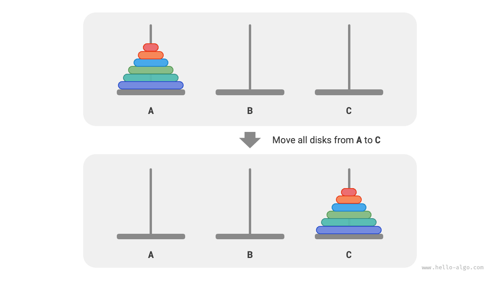
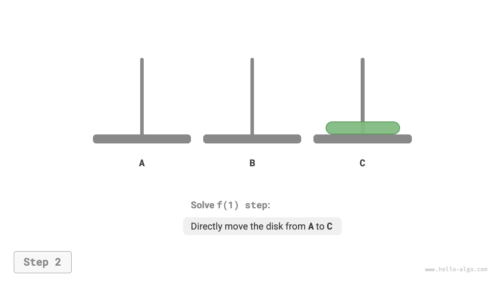
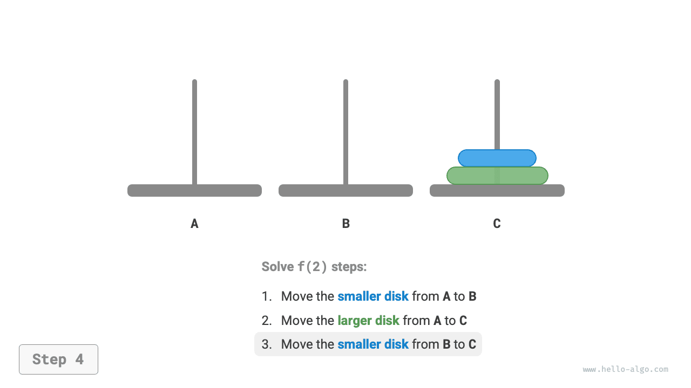
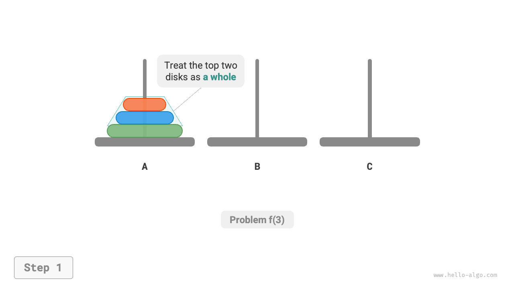

# 하노이의 탑 문제

병합 정렬과 이진 트리 구성에서는 원래 문제를 크기가 절반인 두 부분 문제로 나누었다. 하지만 하노이의 탑 문제에서는 다른 분할 전략을 사용한다.

!!! question "문제"

    기둥 세 개를 `A`, `B`, `C`라고 하자. 처음에는 기둥 `A`에 원판 $n$ 개가 위에서 아래로 작은 것부터 큰 것 순서로 꽂혀 있다. 목표는 원래 순서를 유지하면서 이 원판 $n$ 개를 기둥 `C`로 옮기는 것이다(아래 그림 참고). 원판을 옮길 때는 다음 규칙을 지켜야 한다.
    
    1. 원판은 한 기둥의 맨 위에서만 꺼내어 다른 기둥의 맨 위에 놓을 수 있다.
    2. 한 번에 원판 하나만 옮길 수 있다.
    3. 작은 원판은 항상 큰 원판 위에 있어야 한다.



**크기가 $i$인 하노이의 탑 문제를 $f(i)$라고 하자**. 예를 들어 $f(3)$은 원판 $3$ 개를 `A`에서 `C`로 옮기는 문제다.

### 기본 경우 살펴보기

아래 그림과 같이 $f(1)$, 즉 원판이 하나뿐이면 `A`에서 `C`로 바로 옮기면 된다.

=== "<1>"
    

=== "<2>"
    

아래 그림과 같이 $f(2)$, 즉 원판이 두 개이면 **작은 원판이 항상 큰 원판 위에 있어야 하므로 `B`를 이용해야 한다**.

1. 위의 작은 원판을 `A`에서 `B`로 옮긴다.
2. 큰 원판을 `A`에서 `C`로 옮긴다.
3. 작은 원판을 `B`에서 `C`로 옮긴다.

=== "<1>"
    

=== "<2>"
    

=== "<3>"
    

=== "<4>"
    

$f(2)$의 해결 과정은 **`B`를 이용하여 원판 두 개를 `A`에서 `C`로 옮기는 것**으로 요약할 수 있다. 여기서 `C`를 목표 기둥, `B`를 보조 기둥이라고 한다.

### 부분 문제로 나누기

$f(3)$, 즉 원판이 세 개이면 상황이 조금 더 복잡해진다.

$f(1)$과 $f(2)$의 해를 이미 알고 있으므로 분할 정복의 관점에서 생각해 보자. **`A` 위쪽의 원판 두 개를 하나의 묶음으로 보고** 아래 그림의 단계를 수행하면 세 원판을 `A`에서 `C`로 옮길 수 있다.

1. `B`를 목표 기둥, `C`를 보조 기둥으로 삼아 원판 두 개를 `A`에서 `B`로 옮긴다.
2. `A`에 남은 원판 하나를 `C`로 바로 옮긴다.
3. `C`를 목표 기둥, `A`를 보조 기둥으로 삼아 원판 두 개를 `B`에서 `C`로 옮긴다.

=== "<1>"
    

=== "<2>"
    

=== "<3>"
    

=== "<4>"
    

본질적으로 **문제 $f(3)$을 부분 문제 $f(2)$ 두 개와 $f(1)$ 하나로 나눈 것**이다. 세 부분 문제를 순서대로 해결하면 원래 문제도 해결된다. 이는 부분 문제들이 독립적이고 해를 합칠 수 있음을 보여 준다.

이제 아래 그림과 같이 하노이의 탑을 푸는 분할 정복 전략을 정리할 수 있다. 원래 문제 $f(n)$을 부분 문제 $f(n-1)$ 두 개와 $f(1)$ 하나로 나누고, 다음 순서로 해결한다.

1. `C`를 이용하여 원판 $n-1$ 개를 `A`에서 `B`로 옮긴다.
2. 남은 원판 $1$ 개를 `A`에서 `C`로 바로 옮긴다.
3. `A`를 이용하여 원판 $n-1$ 개를 `B`에서 `C`로 옮긴다.

두 부분 문제 $f(n-1)$도 **같은 방식으로 재귀적으로 나눌 수 있으며**, 가장 작은 부분 문제 $f(1)$에 도달하면 멈춘다. $f(1)$의 해는 이미 알고 있고, 한 번만 옮기면 된다.


### 코드 구현

코드에서는 재귀 함수 `dfs(i, src, buf, tar)`를 정의한다. 이 함수는 기둥 `src` 위쪽의 원판 $i$ 개를 보조 기둥 `buf`를 이용하여 목표 기둥 `tar`로 옮긴다.

```src
[file]{hanota}-[class]{}-[func]{solve_hanota}
```

아래 그림과 같이 하노이의 탑 문제는 높이가 $n$인 재귀 트리를 이룬다. 각 노드는 부분 문제 하나를 나타내며 호출된 `dfs()` 함수 하나에 대응한다. **따라서 시간 복잡도는 $O(2^n)$, 공간 복잡도는 $O(n)$이다**.


!!! quote "하노이의 탑 전설"

    하노이의 탑 문제에는 오래된 전설이 전해진다. 고대 인도의 한 사원에서 승려들이 세 개의 높은 다이아몬드 기둥과 크기가 서로 다른 금 원판 $64$ 개를 가지고 있었다. 승려들은 원판을 계속 옮기며 마지막 원판이 올바른 위치에 놓이는 순간 세상이 끝난다고 믿었다.

    하지만 매초 원판을 하나씩 옮겨도 총 $2^{64} \approx 1.84×10^{19}$ 초, 약 $5850$ 억 년이 필요하다. 이는 현재 추정하는 우주의 나이보다 훨씬 길다. 따라서 전설이 사실이라고 해도 세상의 종말을 걱정할 필요는 없을 것이다.
