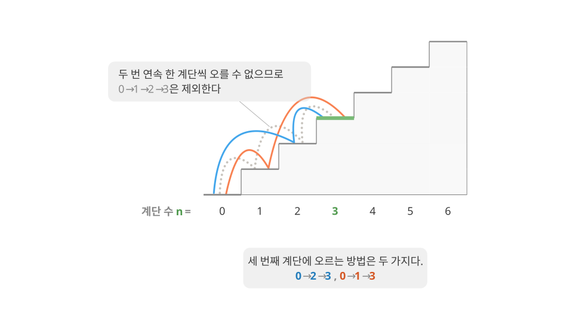
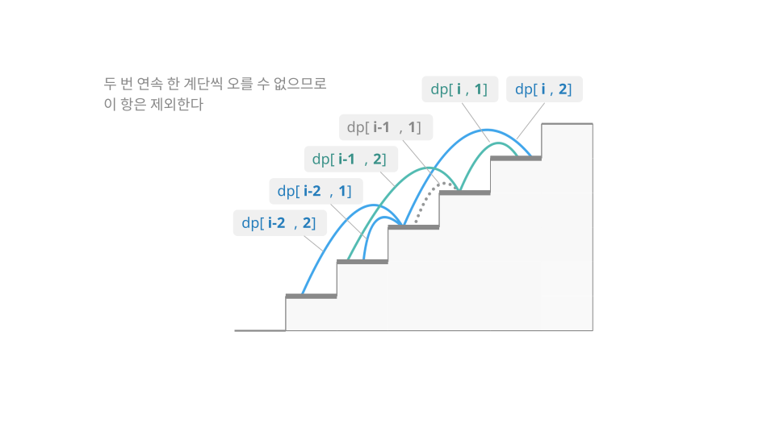

# 14.2 &nbsp; 동적 계획법 문제의 특성

앞 절에서는 동적 계획법이 원래 문제를 부분 문제로 나누어 푸는 과정을 살펴보았다. 문제를 나누는 발상은 여러 알고리즘에서 쓰이지만, 분할 정복과 동적 계획법, 백트래킹은 각각 강조점이 다르다.

- 분할 정복은 원래 문제를 서로 독립적인 부분 문제로 재귀적으로 나눈다. 가장 작은 부분 문제에 도달하면 재귀 호출에서 돌아오면서 해를 합쳐 원래 문제의 해를 얻는다.
- 동적 계획법도 문제를 재귀적으로 나눈다. 분할 정복과 가장 큰 차이는 부분 문제들이 서로 의존하며, 분해하는 과정에서 같은 부분 문제가 여러 번 나타난다는 점이다.
- 백트래킹은 선택을 시도하고 취소하면서 가능한 해를 모두 탐색하고, 가지치기로 불필요한 분기를 피한다. 원래 문제의 해는 일련의 선택으로 이루어지므로 각 선택에 이르기까지의 선택열을 하나의 부분 문제로 볼 수 있다.

동적 계획법은 최적화 문제를 푸는 데 자주 쓰인다. 이러한 문제에는 중복되는 부분 문제 외에도 최적 부분 구조와 무후효성이라는 두 가지 중요한 특성이 있다.

## 14.2.1 &nbsp; 최적 부분 구조

최적 부분 구조라는 개념이 더 잘 드러나도록 계단 오르기 문제를 조금 바꾸어 보자.

!!! question "계단 오르기의 최소 비용"

    계단을 한 번에 $1$계단 또는 $2$계단씩 오를 수 있다. 각 계단에는 그곳을 밟을 때 내야 하는 비용이 음이 아닌 정수로 적혀 있다. 음이 아닌 정수 배열 $cost$가 주어지며, $cost[i]$는 $i$번째 계단의 비용이고 $cost[0]$은 지면(출발점)에 해당한다. 꼭대기까지 오르는 데 필요한 최소 비용은 얼마인가?

아래 그림(14-6)처럼 $1$, $2$, $3$번째 계단의 비용이 각각 $1$, $10$, $1$이면 지면에서 $3$번째 계단까지 오르는 최소 비용은 $2$이다.

{ class="animation-figure" }

<p align="center"> 그림 14-6 &nbsp; 세 번째 계단에 오르는 최소 비용 </p>

$dp[i]$를 $i$번째 계단까지 오르는 데 든 누적 비용이라 하자. $i$번째 계단으로는 $i - 1$번째 또는 $i - 2$번째 계단에서만 올 수 있으므로 $dp[i]$는 $dp[i - 1] + cost[i]$ 또는 $dp[i - 2] + cost[i]$이다. 비용을 최소화하려면 두 값 중 작은 쪽을 택해야 한다.

$$
dp[i] = \min(dp[i-1], dp[i-2]) + cost[i]
$$

여기서 최적 부분 구조의 의미를 알 수 있다. **부분 문제의 최적해로 원래 문제의 최적해를 구성할 수 있다**.

이 문제에는 최적 부분 구조가 있다. 두 부분 문제의 최적해 $dp[i-1]$과 $dp[i-2]$ 중 더 나은 쪽을 선택해 원래 문제 $dp[i]$의 최적해를 구성한다.

그렇다면 앞 절의 계단 오르기 문제에도 최적 부분 구조가 있을까? 방법의 수를 구하므로 단순한 계수 문제처럼 보인다. 그런데 “가능한 방법을 최대 몇 가지 찾을 수 있는가?”라고 물어보자. **문제의 의미는 그대로인데 최적 부분 구조가 드러난다**. $n$번째 계단에 오르는 최대 방법 수는 $n-1$번째와 $n-2$번째 계단에 오르는 최대 방법 수의 합이다. 이처럼 최적 부분 구조는 문제에 따라 다르게 해석할 수 있다.

상태 전이식과 초기 상태 $dp[1] = cost[1]$, $dp[2] = cost[2]$를 이용하면 다음과 같이 동적 계획법을 구현할 수 있다.

=== "Python"

    ```python title="min_cost_climbing_stairs_dp.py"
    def min_cost_climbing_stairs_dp(cost: list[int]) -> int:
        """계단 오르기의 최소 비용: 동적 계획법"""
        n = len(cost) - 1
        if n == 1 or n == 2:
            return cost[n]
        # 부분 문제의 해를 저장할 dp 테이블 초기화
        dp = [0] * (n + 1)
        # 초기 상태: 가장 작은 부분 문제의 해를 설정한다
        dp[1], dp[2] = cost[1], cost[2]
        # 상태 전이: 작은 부분 문제부터 큰 부분 문제까지 차례로 푼다
        for i in range(3, n + 1):
            dp[i] = min(dp[i - 1], dp[i - 2]) + cost[i]
        return dp[n]
    ```

=== "C++"

    ```cpp title="min_cost_climbing_stairs_dp.cpp"
    /* 계단 오르기의 최소 비용: 동적 계획법 */
    int minCostClimbingStairsDP(vector<int> &cost) {
        int n = cost.size() - 1;
        if (n == 1 || n == 2)
            return cost[n];
        // 부분 문제의 해를 저장할 dp 테이블 초기화
        vector<int> dp(n + 1);
        // 초기 상태: 가장 작은 부분 문제의 해를 설정한다
        dp[1] = cost[1];
        dp[2] = cost[2];
        // 상태 전이: 작은 부분 문제부터 큰 부분 문제까지 차례로 푼다
        for (int i = 3; i <= n; i++) {
            dp[i] = min(dp[i - 1], dp[i - 2]) + cost[i];
        }
        return dp[n];
    }
    ```

=== "Java"

    ```java title="min_cost_climbing_stairs_dp.java"
    /* 계단 오르기의 최소 비용: 동적 계획법 */
    int minCostClimbingStairsDP(int[] cost) {
        int n = cost.length - 1;
        if (n == 1 || n == 2)
            return cost[n];
        // 부분 문제의 해를 저장할 dp 테이블 초기화
        int[] dp = new int[n + 1];
        // 초기 상태: 가장 작은 부분 문제의 해를 설정한다
        dp[1] = cost[1];
        dp[2] = cost[2];
        // 상태 전이: 작은 부분 문제부터 큰 부분 문제까지 차례로 푼다
        for (int i = 3; i <= n; i++) {
            dp[i] = Math.min(dp[i - 1], dp[i - 2]) + cost[i];
        }
        return dp[n];
    }
    ```

=== "C#"

    ```csharp title="min_cost_climbing_stairs_dp.cs"
    /* 계단 오르기의 최소 비용: 동적 계획법 */
    int MinCostClimbingStairsDP(int[] cost) {
        int n = cost.Length - 1;
        if (n == 1 || n == 2)
            return cost[n];
        // 부분 문제의 해를 저장할 dp 테이블 초기화
        int[] dp = new int[n + 1];
        // 초기 상태: 가장 작은 부분 문제의 해를 설정한다
        dp[1] = cost[1];
        dp[2] = cost[2];
        // 상태 전이: 작은 부분 문제부터 큰 부분 문제까지 차례로 푼다
        for (int i = 3; i <= n; i++) {
            dp[i] = Math.Min(dp[i - 1], dp[i - 2]) + cost[i];
        }
        return dp[n];
    }
    ```

=== "Go"

    ```go title="min_cost_climbing_stairs_dp.go"
    /* 계단 오르기의 최소 비용: 동적 계획법 */
    func minCostClimbingStairsDP(cost []int) int {
        n := len(cost) - 1
        if n == 1 || n == 2 {
            return cost[n]
        }
        min := func(a, b int) int {
            if a < b {
                return a
            }
            return b
        }
        // 부분 문제의 해를 저장할 dp 테이블 초기화
        dp := make([]int, n+1)
        // 초기 상태: 가장 작은 부분 문제의 해를 설정한다
        dp[1] = cost[1]
        dp[2] = cost[2]
        // 상태 전이: 작은 부분 문제부터 큰 부분 문제까지 차례로 푼다
        for i := 3; i <= n; i++ {
            dp[i] = min(dp[i-1], dp[i-2]) + cost[i]
        }
        return dp[n]
    }
    ```

=== "Swift"

    ```swift title="min_cost_climbing_stairs_dp.swift"
    /* 계단 오르기의 최소 비용: 동적 계획법 */
    func minCostClimbingStairsDP(cost: [Int]) -> Int {
        let n = cost.count - 1
        if n == 1 || n == 2 {
            return cost[n]
        }
        // 부분 문제의 해를 저장할 dp 테이블 초기화
        var dp = Array(repeating: 0, count: n + 1)
        // 초기 상태: 가장 작은 부분 문제의 해를 설정한다
        dp[1] = cost[1]
        dp[2] = cost[2]
        // 상태 전이: 작은 부분 문제부터 큰 부분 문제까지 차례로 푼다
        for i in 3 ... n {
            dp[i] = min(dp[i - 1], dp[i - 2]) + cost[i]
        }
        return dp[n]
    }
    ```

=== "JS"

    ```javascript title="min_cost_climbing_stairs_dp.js"
    /* 계단 오르기의 최소 비용: 동적 계획법 */
    function minCostClimbingStairsDP(cost) {
        const n = cost.length - 1;
        if (n === 1 || n === 2) {
            return cost[n];
        }
        // 부분 문제의 해를 저장할 dp 테이블 초기화
        const dp = new Array(n + 1);
        // 초기 상태: 가장 작은 부분 문제의 해를 설정한다
        dp[1] = cost[1];
        dp[2] = cost[2];
        // 상태 전이: 작은 부분 문제부터 큰 부분 문제까지 차례로 푼다
        for (let i = 3; i <= n; i++) {
            dp[i] = Math.min(dp[i - 1], dp[i - 2]) + cost[i];
        }
        return dp[n];
    }
    ```

=== "TS"

    ```typescript title="min_cost_climbing_stairs_dp.ts"
    /* 계단 오르기의 최소 비용: 동적 계획법 */
    function minCostClimbingStairsDP(cost: Array<number>): number {
        const n = cost.length - 1;
        if (n === 1 || n === 2) {
            return cost[n];
        }
        // 부분 문제의 해를 저장할 dp 테이블 초기화
        const dp = new Array(n + 1);
        // 초기 상태: 가장 작은 부분 문제의 해를 설정한다
        dp[1] = cost[1];
        dp[2] = cost[2];
        // 상태 전이: 작은 부분 문제부터 큰 부분 문제까지 차례로 푼다
        for (let i = 3; i <= n; i++) {
            dp[i] = Math.min(dp[i - 1], dp[i - 2]) + cost[i];
        }
        return dp[n];
    }
    ```

=== "Dart"

    ```dart title="min_cost_climbing_stairs_dp.dart"
    /* 계단 오르기의 최소 비용: 동적 계획법 */
    int minCostClimbingStairsDP(List<int> cost) {
      int n = cost.length - 1;
      if (n == 1 || n == 2) return cost[n];
      // 부분 문제의 해를 저장할 dp 테이블 초기화
      List<int> dp = List.filled(n + 1, 0);
      // 초기 상태: 가장 작은 부분 문제의 해를 설정한다
      dp[1] = cost[1];
      dp[2] = cost[2];
      // 상태 전이: 작은 부분 문제부터 큰 부분 문제까지 차례로 푼다
      for (int i = 3; i <= n; i++) {
        dp[i] = min(dp[i - 1], dp[i - 2]) + cost[i];
      }
      return dp[n];
    }
    ```

=== "Rust"

    ```rust title="min_cost_climbing_stairs_dp.rs"
    /* 계단 오르기의 최소 비용: 동적 계획법 */
    fn min_cost_climbing_stairs_dp(cost: &[i32]) -> i32 {
        let n = cost.len() - 1;
        if n == 1 || n == 2 {
            return cost[n];
        }
        // 부분 문제의 해를 저장할 dp 테이블 초기화
        let mut dp = vec![-1; n + 1];
        // 초기 상태: 가장 작은 부분 문제의 해를 설정한다
        dp[1] = cost[1];
        dp[2] = cost[2];
        // 상태 전이: 작은 부분 문제부터 큰 부분 문제까지 차례로 푼다
        for i in 3..=n {
            dp[i] = cmp::min(dp[i - 1], dp[i - 2]) + cost[i];
        }
        dp[n]
    }
    ```

=== "C"

    ```c title="min_cost_climbing_stairs_dp.c"
    /* 계단 오르기의 최소 비용: 동적 계획법 */
    int minCostClimbingStairsDP(int cost[], int costSize) {
        int n = costSize - 1;
        if (n == 1 || n == 2)
            return cost[n];
        // 부분 문제의 해를 저장할 dp 테이블 초기화
        int *dp = calloc(n + 1, sizeof(int));
        // 초기 상태: 가장 작은 부분 문제의 해를 설정한다
        dp[1] = cost[1];
        dp[2] = cost[2];
        // 상태 전이: 작은 부분 문제부터 큰 부분 문제까지 차례로 푼다
        for (int i = 3; i <= n; i++) {
            dp[i] = myMin(dp[i - 1], dp[i - 2]) + cost[i];
        }
        int res = dp[n];
        // 메모리 해제
        free(dp);
        return res;
    }
    ```

=== "Kotlin"

    ```kotlin title="min_cost_climbing_stairs_dp.kt"
    /* 계단 오르기의 최소 비용: 동적 계획법 */
    fun minCostClimbingStairsDP(cost: IntArray): Int {
        val n = cost.size - 1
        if (n == 1 || n == 2) return cost[n]
        // 부분 문제의 해를 저장할 dp 테이블 초기화
        val dp = IntArray(n + 1)
        // 초기 상태: 가장 작은 부분 문제의 해를 설정한다
        dp[1] = cost[1]
        dp[2] = cost[2]
        // 상태 전이: 작은 부분 문제부터 큰 부분 문제까지 차례로 푼다
        for (i in 3..n) {
            dp[i] = min(dp[i - 1], dp[i - 2]) + cost[i]
        }
        return dp[n]
    }
    ```

=== "Ruby"

    ```ruby title="min_cost_climbing_stairs_dp.rb"
    ### 계단 오르기의 최소 비용: 동적 계획법 ###
    def min_cost_climbing_stairs_dp(cost)
      n = cost.length - 1
      return cost[n] if n == 1 || n == 2
      # 부분 문제의 해를 저장할 dp 테이블 초기화
      dp = Array.new(n + 1, 0)
      # 초기 상태: 가장 작은 부분 문제의 해를 설정한다
      dp[1], dp[2] = cost[1], cost[2]
      # 상태 전이: 작은 부분 문제부터 큰 부분 문제까지 차례로 푼다
      (3...(n + 1)).each { |i| dp[i] = [dp[i - 1], dp[i - 2]].min + cost[i] }
      dp[n]
    end
    ```

??? pythontutor "실행 과정 시각화"

    <div style="height: 549px; width: 100%;"><iframe class="pythontutor-iframe" title="실행 과정 시각화" src="https://pythontutor.com/iframe-embed.html#code=def%20min_cost_climbing_stairs_dp%28cost%3A%20list%5Bint%5D%29%20-%3E%20int%3A%0A%20%20%20%20%22%22%22%EA%B3%84%EB%8B%A8%20%EC%98%A4%EB%A5%B4%EA%B8%B0%EC%9D%98%20%EC%B5%9C%EC%86%8C%20%EB%B9%84%EC%9A%A9%3A%20%EB%8F%99%EC%A0%81%20%EA%B3%84%ED%9A%8D%EB%B2%95%22%22%22%0A%20%20%20%20n%20%3D%20len%28cost%29%20-%201%0A%20%20%20%20if%20n%20%3D%3D%201%20or%20n%20%3D%3D%202%3A%0A%20%20%20%20%20%20%20%20return%20cost%5Bn%5D%0A%20%20%20%20%23%20%EB%B6%80%EB%B6%84%20%EB%AC%B8%EC%A0%9C%EC%9D%98%20%ED%95%B4%EB%A5%BC%20%EC%A0%80%EC%9E%A5%ED%95%A0%20dp%20%ED%85%8C%EC%9D%B4%EB%B8%94%20%EC%B4%88%EA%B8%B0%ED%99%94%0A%20%20%20%20dp%20%3D%20%5B0%5D%20%2A%20%28n%20%2B%201%29%0A%20%20%20%20%23%20%EC%B4%88%EA%B8%B0%20%EC%83%81%ED%83%9C%3A%20%EA%B0%80%EC%9E%A5%20%EC%9E%91%EC%9D%80%20%EB%B6%80%EB%B6%84%20%EB%AC%B8%EC%A0%9C%EC%9D%98%20%ED%95%B4%EB%A5%BC%20%EC%84%A4%EC%A0%95%ED%95%9C%EB%8B%A4%0A%20%20%20%20dp%5B1%5D,%20dp%5B2%5D%20%3D%20cost%5B1%5D,%20cost%5B2%5D%0A%20%20%20%20%23%20%EC%83%81%ED%83%9C%20%EC%A0%84%EC%9D%B4%3A%20%EC%9E%91%EC%9D%80%20%EB%B6%80%EB%B6%84%20%EB%AC%B8%EC%A0%9C%EB%B6%80%ED%84%B0%20%ED%81%B0%20%EB%B6%80%EB%B6%84%20%EB%AC%B8%EC%A0%9C%EA%B9%8C%EC%A7%80%20%EC%B0%A8%EB%A1%80%EB%A1%9C%20%ED%91%BC%EB%8B%A4%0A%20%20%20%20for%20i%20in%20range%283,%20n%20%2B%201%29%3A%0A%20%20%20%20%20%20%20%20dp%5Bi%5D%20%3D%20min%28dp%5Bi%20-%201%5D,%20dp%5Bi%20-%202%5D%29%20%2B%20cost%5Bi%5D%0A%20%20%20%20return%20dp%5Bn%5D%0A%0A%0A%22%22%22Driver%20Code%22%22%22%0Aif%20__name__%20%3D%3D%20%22__main__%22%3A%0A%20%20%20%20cost%20%3D%20%5B0,%201,%2010,%201,%201,%201,%2010,%201,%201,%2010,%201%5D%0A%20%20%20%20print%28f%22%EC%9E%85%EB%A0%A5%ED%95%9C%20%EA%B3%84%EB%8B%A8%EB%B3%84%20%EB%B9%84%EC%9A%A9%20%EB%AA%A9%EB%A1%9D%3A%20%7Bcost%7D%22%29%0A%0A%20%20%20%20res%20%3D%20min_cost_climbing_stairs_dp%28cost%29%0A%20%20%20%20print%28f%22%EA%B3%84%EB%8B%A8%EC%9D%84%20%EB%AA%A8%EB%91%90%20%EC%98%A4%EB%A5%B4%EB%8A%94%20%EC%B5%9C%EC%86%8C%20%EB%B9%84%EC%9A%A9%3A%20%7Bres%7D%22%29&codeDivHeight=472&codeDivWidth=350&cumulative=false&curInstr=4&heapPrimitives=nevernest&origin=opt-frontend.js&py=311&rawInputLstJSON=%5B%5D&textReferences=false"> </iframe></div>
    <div style="margin-top: 5px;"><a href="https://pythontutor.com/iframe-embed.html#code=def%20min_cost_climbing_stairs_dp%28cost%3A%20list%5Bint%5D%29%20-%3E%20int%3A%0A%20%20%20%20%22%22%22%EA%B3%84%EB%8B%A8%20%EC%98%A4%EB%A5%B4%EA%B8%B0%EC%9D%98%20%EC%B5%9C%EC%86%8C%20%EB%B9%84%EC%9A%A9%3A%20%EB%8F%99%EC%A0%81%20%EA%B3%84%ED%9A%8D%EB%B2%95%22%22%22%0A%20%20%20%20n%20%3D%20len%28cost%29%20-%201%0A%20%20%20%20if%20n%20%3D%3D%201%20or%20n%20%3D%3D%202%3A%0A%20%20%20%20%20%20%20%20return%20cost%5Bn%5D%0A%20%20%20%20%23%20%EB%B6%80%EB%B6%84%20%EB%AC%B8%EC%A0%9C%EC%9D%98%20%ED%95%B4%EB%A5%BC%20%EC%A0%80%EC%9E%A5%ED%95%A0%20dp%20%ED%85%8C%EC%9D%B4%EB%B8%94%20%EC%B4%88%EA%B8%B0%ED%99%94%0A%20%20%20%20dp%20%3D%20%5B0%5D%20%2A%20%28n%20%2B%201%29%0A%20%20%20%20%23%20%EC%B4%88%EA%B8%B0%20%EC%83%81%ED%83%9C%3A%20%EA%B0%80%EC%9E%A5%20%EC%9E%91%EC%9D%80%20%EB%B6%80%EB%B6%84%20%EB%AC%B8%EC%A0%9C%EC%9D%98%20%ED%95%B4%EB%A5%BC%20%EC%84%A4%EC%A0%95%ED%95%9C%EB%8B%A4%0A%20%20%20%20dp%5B1%5D,%20dp%5B2%5D%20%3D%20cost%5B1%5D,%20cost%5B2%5D%0A%20%20%20%20%23%20%EC%83%81%ED%83%9C%20%EC%A0%84%EC%9D%B4%3A%20%EC%9E%91%EC%9D%80%20%EB%B6%80%EB%B6%84%20%EB%AC%B8%EC%A0%9C%EB%B6%80%ED%84%B0%20%ED%81%B0%20%EB%B6%80%EB%B6%84%20%EB%AC%B8%EC%A0%9C%EA%B9%8C%EC%A7%80%20%EC%B0%A8%EB%A1%80%EB%A1%9C%20%ED%91%BC%EB%8B%A4%0A%20%20%20%20for%20i%20in%20range%283,%20n%20%2B%201%29%3A%0A%20%20%20%20%20%20%20%20dp%5Bi%5D%20%3D%20min%28dp%5Bi%20-%201%5D,%20dp%5Bi%20-%202%5D%29%20%2B%20cost%5Bi%5D%0A%20%20%20%20return%20dp%5Bn%5D%0A%0A%0A%22%22%22Driver%20Code%22%22%22%0Aif%20__name__%20%3D%3D%20%22__main__%22%3A%0A%20%20%20%20cost%20%3D%20%5B0,%201,%2010,%201,%201,%201,%2010,%201,%201,%2010,%201%5D%0A%20%20%20%20print%28f%22%EC%9E%85%EB%A0%A5%ED%95%9C%20%EA%B3%84%EB%8B%A8%EB%B3%84%20%EB%B9%84%EC%9A%A9%20%EB%AA%A9%EB%A1%9D%3A%20%7Bcost%7D%22%29%0A%0A%20%20%20%20res%20%3D%20min_cost_climbing_stairs_dp%28cost%29%0A%20%20%20%20print%28f%22%EA%B3%84%EB%8B%A8%EC%9D%84%20%EB%AA%A8%EB%91%90%20%EC%98%A4%EB%A5%B4%EB%8A%94%20%EC%B5%9C%EC%86%8C%20%EB%B9%84%EC%9A%A9%3A%20%7Bres%7D%22%29&codeDivHeight=800&codeDivWidth=600&cumulative=false&curInstr=4&heapPrimitives=nevernest&origin=opt-frontend.js&py=311&rawInputLstJSON=%5B%5D&textReferences=false" target="_blank" rel="noopener noreferrer">전체 화면으로 보기 ></a></div>

아래 그림(14-7)은 위 코드에서 상태가 갱신되는 과정을 보여 준다.

{ class="animation-figure" }

<p align="center"> 그림 14-7 &nbsp; 동적 계획법으로 계단 오르기의 최소 비용을 구하는 과정 </p>

이 문제에서도 공간을 최적화할 수 있다. 1차원 배열을 몇 개의 변수로 압축하면 공간 복잡도가 $O(n)$에서 $O(1)$로 줄어든다.

=== "Python"

    ```python title="min_cost_climbing_stairs_dp.py"
    def min_cost_climbing_stairs_dp_comp(cost: list[int]) -> int:
        """계단 오르기의 최소 비용: 공간 최적화 동적 계획법"""
        n = len(cost) - 1
        if n == 1 or n == 2:
            return cost[n]
        a, b = cost[1], cost[2]
        for i in range(3, n + 1):
            a, b = b, min(a, b) + cost[i]
        return b
    ```

=== "C++"

    ```cpp title="min_cost_climbing_stairs_dp.cpp"
    /* 계단 오르기의 최소 비용: 공간 최적화 동적 계획법 */
    int minCostClimbingStairsDPComp(vector<int> &cost) {
        int n = cost.size() - 1;
        if (n == 1 || n == 2)
            return cost[n];
        int a = cost[1], b = cost[2];
        for (int i = 3; i <= n; i++) {
            int tmp = b;
            b = min(a, tmp) + cost[i];
            a = tmp;
        }
        return b;
    }
    ```

=== "Java"

    ```java title="min_cost_climbing_stairs_dp.java"
    /* 계단 오르기의 최소 비용: 공간 최적화 동적 계획법 */
    int minCostClimbingStairsDPComp(int[] cost) {
        int n = cost.length - 1;
        if (n == 1 || n == 2)
            return cost[n];
        int a = cost[1], b = cost[2];
        for (int i = 3; i <= n; i++) {
            int tmp = b;
            b = Math.min(a, tmp) + cost[i];
            a = tmp;
        }
        return b;
    }
    ```

=== "C#"

    ```csharp title="min_cost_climbing_stairs_dp.cs"
    /* 계단 오르기의 최소 비용: 공간 최적화 동적 계획법 */
    int MinCostClimbingStairsDPComp(int[] cost) {
        int n = cost.Length - 1;
        if (n == 1 || n == 2)
            return cost[n];
        int a = cost[1], b = cost[2];
        for (int i = 3; i <= n; i++) {
            int tmp = b;
            b = Math.Min(a, tmp) + cost[i];
            a = tmp;
        }
        return b;
    }
    ```

=== "Go"

    ```go title="min_cost_climbing_stairs_dp.go"
    /* 계단 오르기의 최소 비용: 공간 최적화 동적 계획법 */
    func minCostClimbingStairsDPComp(cost []int) int {
        n := len(cost) - 1
        if n == 1 || n == 2 {
            return cost[n]
        }
        min := func(a, b int) int {
            if a < b {
                return a
            }
            return b
        }
        // 초기 상태: 가장 작은 부분 문제의 해를 설정한다
        a, b := cost[1], cost[2]
        // 상태 전이: 작은 부분 문제부터 큰 부분 문제까지 차례로 푼다
        for i := 3; i <= n; i++ {
            tmp := b
            b = min(a, tmp) + cost[i]
            a = tmp
        }
        return b
    }
    ```

=== "Swift"

    ```swift title="min_cost_climbing_stairs_dp.swift"
    /* 계단 오르기의 최소 비용: 공간 최적화 동적 계획법 */
    func minCostClimbingStairsDPComp(cost: [Int]) -> Int {
        let n = cost.count - 1
        if n == 1 || n == 2 {
            return cost[n]
        }
        var (a, b) = (cost[1], cost[2])
        for i in 3 ... n {
            (a, b) = (b, min(a, b) + cost[i])
        }
        return b
    }
    ```

=== "JS"

    ```javascript title="min_cost_climbing_stairs_dp.js"
    /* 계단 오르기의 최소 비용: 공간 최적화 동적 계획법 */
    function minCostClimbingStairsDPComp(cost) {
        const n = cost.length - 1;
        if (n === 1 || n === 2) {
            return cost[n];
        }
        let a = cost[1],
            b = cost[2];
        for (let i = 3; i <= n; i++) {
            const tmp = b;
            b = Math.min(a, tmp) + cost[i];
            a = tmp;
        }
        return b;
    }
    ```

=== "TS"

    ```typescript title="min_cost_climbing_stairs_dp.ts"
    /* 계단 오르기의 최소 비용: 공간 최적화 동적 계획법 */
    function minCostClimbingStairsDPComp(cost: Array<number>): number {
        const n = cost.length - 1;
        if (n === 1 || n === 2) {
            return cost[n];
        }
        let a = cost[1],
            b = cost[2];
        for (let i = 3; i <= n; i++) {
            const tmp = b;
            b = Math.min(a, tmp) + cost[i];
            a = tmp;
        }
        return b;
    }
    ```

=== "Dart"

    ```dart title="min_cost_climbing_stairs_dp.dart"
    /* 계단 오르기의 최소 비용: 공간 최적화 동적 계획법 */
    int minCostClimbingStairsDPComp(List<int> cost) {
      int n = cost.length - 1;
      if (n == 1 || n == 2) return cost[n];
      int a = cost[1], b = cost[2];
      for (int i = 3; i <= n; i++) {
        int tmp = b;
        b = min(a, tmp) + cost[i];
        a = tmp;
      }
      return b;
    }
    ```

=== "Rust"

    ```rust title="min_cost_climbing_stairs_dp.rs"
    /* 계단 오르기의 최소 비용: 공간 최적화 동적 계획법 */
    fn min_cost_climbing_stairs_dp_comp(cost: &[i32]) -> i32 {
        let n = cost.len() - 1;
        if n == 1 || n == 2 {
            return cost[n];
        };
        let (mut a, mut b) = (cost[1], cost[2]);
        for i in 3..=n {
            let tmp = b;
            b = cmp::min(a, tmp) + cost[i];
            a = tmp;
        }
        b
    }
    ```

=== "C"

    ```c title="min_cost_climbing_stairs_dp.c"
    /* 계단 오르기의 최소 비용: 공간 최적화 동적 계획법 */
    int minCostClimbingStairsDPComp(int cost[], int costSize) {
        int n = costSize - 1;
        if (n == 1 || n == 2)
            return cost[n];
        int a = cost[1], b = cost[2];
        for (int i = 3; i <= n; i++) {
            int tmp = b;
            b = myMin(a, tmp) + cost[i];
            a = tmp;
        }
        return b;
    }
    ```

=== "Kotlin"

    ```kotlin title="min_cost_climbing_stairs_dp.kt"
    /* 계단 오르기의 최소 비용: 공간 최적화 동적 계획법 */
    fun minCostClimbingStairsDPComp(cost: IntArray): Int {
        val n = cost.size - 1
        if (n == 1 || n == 2) return cost[n]
        var a = cost[1]
        var b = cost[2]
        for (i in 3..n) {
            val tmp = b
            b = min(a, tmp) + cost[i]
            a = tmp
        }
        return b
    }
    ```

=== "Ruby"

    ```ruby title="min_cost_climbing_stairs_dp.rb"
    ### 계단 오르기의 최소 비용: 공간 최적화 동적 계획법 ###
    def min_cost_climbing_stairs_dp_comp(cost)
      n = cost.length - 1
      return cost[n] if n == 1 || n == 2
      a, b = cost[1], cost[2]
      (3...(n + 1)).each { |i| a, b = b, [a, b].min + cost[i] }
      b
    end
    ```

??? pythontutor "실행 과정 시각화"

    <div style="height: 513px; width: 100%;"><iframe class="pythontutor-iframe" title="실행 과정 시각화" src="https://pythontutor.com/iframe-embed.html#code=def%20min_cost_climbing_stairs_dp_comp%28cost%3A%20list%5Bint%5D%29%20-%3E%20int%3A%0A%20%20%20%20%22%22%22%EA%B3%84%EB%8B%A8%20%EC%98%A4%EB%A5%B4%EA%B8%B0%EC%9D%98%20%EC%B5%9C%EC%86%8C%20%EB%B9%84%EC%9A%A9%3A%20%EA%B3%B5%EA%B0%84%20%EC%B5%9C%EC%A0%81%ED%99%94%20%EB%8F%99%EC%A0%81%20%EA%B3%84%ED%9A%8D%EB%B2%95%22%22%22%0A%20%20%20%20n%20%3D%20len%28cost%29%20-%201%0A%20%20%20%20if%20n%20%3D%3D%201%20or%20n%20%3D%3D%202%3A%0A%20%20%20%20%20%20%20%20return%20cost%5Bn%5D%0A%20%20%20%20a,%20b%20%3D%20cost%5B1%5D,%20cost%5B2%5D%0A%20%20%20%20for%20i%20in%20range%283,%20n%20%2B%201%29%3A%0A%20%20%20%20%20%20%20%20a,%20b%20%3D%20b,%20min%28a,%20b%29%20%2B%20cost%5Bi%5D%0A%20%20%20%20return%20b%0A%0A%0A%22%22%22Driver%20Code%22%22%22%0Aif%20__name__%20%3D%3D%20%22__main__%22%3A%0A%20%20%20%20cost%20%3D%20%5B0,%201,%2010,%201,%201,%201,%2010,%201,%201,%2010,%201%5D%0A%20%20%20%20print%28f%22%EC%9E%85%EB%A0%A5%ED%95%9C%20%EA%B3%84%EB%8B%A8%EB%B3%84%20%EB%B9%84%EC%9A%A9%20%EB%AA%A9%EB%A1%9D%3A%20%7Bcost%7D%22%29%0A%0A%20%20%20%20res%20%3D%20min_cost_climbing_stairs_dp_comp%28cost%29%0A%20%20%20%20print%28f%22%EA%B3%84%EB%8B%A8%EC%9D%84%20%EB%AA%A8%EB%91%90%20%EC%98%A4%EB%A5%B4%EB%8A%94%20%EC%B5%9C%EC%86%8C%20%EB%B9%84%EC%9A%A9%3A%20%7Bres%7D%22%29&codeDivHeight=472&codeDivWidth=350&cumulative=false&curInstr=5&heapPrimitives=nevernest&origin=opt-frontend.js&py=311&rawInputLstJSON=%5B%5D&textReferences=false"> </iframe></div>
    <div style="margin-top: 5px;"><a href="https://pythontutor.com/iframe-embed.html#code=def%20min_cost_climbing_stairs_dp_comp%28cost%3A%20list%5Bint%5D%29%20-%3E%20int%3A%0A%20%20%20%20%22%22%22%EA%B3%84%EB%8B%A8%20%EC%98%A4%EB%A5%B4%EA%B8%B0%EC%9D%98%20%EC%B5%9C%EC%86%8C%20%EB%B9%84%EC%9A%A9%3A%20%EA%B3%B5%EA%B0%84%20%EC%B5%9C%EC%A0%81%ED%99%94%20%EB%8F%99%EC%A0%81%20%EA%B3%84%ED%9A%8D%EB%B2%95%22%22%22%0A%20%20%20%20n%20%3D%20len%28cost%29%20-%201%0A%20%20%20%20if%20n%20%3D%3D%201%20or%20n%20%3D%3D%202%3A%0A%20%20%20%20%20%20%20%20return%20cost%5Bn%5D%0A%20%20%20%20a,%20b%20%3D%20cost%5B1%5D,%20cost%5B2%5D%0A%20%20%20%20for%20i%20in%20range%283,%20n%20%2B%201%29%3A%0A%20%20%20%20%20%20%20%20a,%20b%20%3D%20b,%20min%28a,%20b%29%20%2B%20cost%5Bi%5D%0A%20%20%20%20return%20b%0A%0A%0A%22%22%22Driver%20Code%22%22%22%0Aif%20__name__%20%3D%3D%20%22__main__%22%3A%0A%20%20%20%20cost%20%3D%20%5B0,%201,%2010,%201,%201,%201,%2010,%201,%201,%2010,%201%5D%0A%20%20%20%20print%28f%22%EC%9E%85%EB%A0%A5%ED%95%9C%20%EA%B3%84%EB%8B%A8%EB%B3%84%20%EB%B9%84%EC%9A%A9%20%EB%AA%A9%EB%A1%9D%3A%20%7Bcost%7D%22%29%0A%0A%20%20%20%20res%20%3D%20min_cost_climbing_stairs_dp_comp%28cost%29%0A%20%20%20%20print%28f%22%EA%B3%84%EB%8B%A8%EC%9D%84%20%EB%AA%A8%EB%91%90%20%EC%98%A4%EB%A5%B4%EB%8A%94%20%EC%B5%9C%EC%86%8C%20%EB%B9%84%EC%9A%A9%3A%20%7Bres%7D%22%29&codeDivHeight=800&codeDivWidth=600&cumulative=false&curInstr=5&heapPrimitives=nevernest&origin=opt-frontend.js&py=311&rawInputLstJSON=%5B%5D&textReferences=false" target="_blank" rel="noopener noreferrer">전체 화면으로 보기 ></a></div>

## 14.2.2 &nbsp; 무후효성

무후효성은 동적 계획법으로 문제를 효과적으로 풀 수 있게 하는 중요한 특성이다. **상태가 하나로 정해지면 이후의 전개는 현재 상태에만 달려 있고 이전에 거쳐 온 상태와는 무관하다**는 뜻이다.

계단 오르기를 예로 들면, 상태 $i$에서는 $i+1$과 $i+2$로 나아갈 수 있다. 각각 $1$계단, $2$계단을 오르는 선택이다. 둘 중 하나를 선택할 때 $i$ 이전의 상태를 고려할 필요가 없다. 그 상태들은 $i$ 이후의 선택에 영향을 주지 않는다.

그런데 계단 오르기 문제에 제약을 하나 더하면 상황이 달라진다.

!!! question "제약이 있는 계단 오르기"

    계단이 모두 $n$개 있고, 한 번에 $1$계단 또는 $2$계단씩 오를 수 있다. **단, 두 번 연속으로 $1$계단씩 오를 수는 없다**. 꼭대기까지 오르는 방법은 몇 가지인가?

아래 그림(14-8)처럼 $3$번째 계단에 오르는 방법은 $2$가지만 남는다. 세 번 연속 $1$계단씩 오르는 방법은 제약에 어긋나므로 제외한다.

{ class="animation-figure" }

<p align="center"> 그림 14-8 &nbsp; 제약 조건이 있을 때 세 번째 계단에 오르는 방법의 수 </p>

이 문제에서 직전에 $1$계단을 올랐다면 다음에는 반드시 $2$계단을 올라야 한다. 즉, **다음 선택은 현재 상태(지금 서 있는 계단)만으로 결정할 수 없고 이전 상태(직전에 서 있던 계단)에도 의존한다**.

따라서 이 상태 정의로는 무후효성이 성립하지 않고 상태 전이식 $dp[i] = dp[i-1] + dp[i-2]$도 쓸 수 없다. $dp[i-1]$은 이번에 $1$계단을 오르는 경우에 해당하지만, 그 안에는 직전에도 $1$계단을 오른 방법이 많이 포함되어 있다. 제약을 지키려면 $dp[i-1]$을 통째로 $dp[i]$에 더해서는 안 된다.

이를 해결하려면 상태 정의를 확장해야 한다. **상태 $[i, j]$는 현재 $i$번째 계단에 있고 직전에 $j$계단을 올랐음을 뜻한다**. 여기서 $j \in \{1, 2\}$이다. 이렇게 하면 직전에 $1$계단을 올랐는지 $2$계단을 올랐는지가 구분되므로 현재 상태가 어디에서 왔는지 판단할 수 있다.

- 직전에 $1$계단을 올랐다면 그 전에는 반드시 $2$계단을 올랐다. 즉, $dp[i, 1]$로는 $dp[i-1, 2]$에서만 전이할 수 있다.
- 직전에 $2$계단을 올랐다면 그 전에는 $1$계단 또는 $2$계단을 올랐을 수 있다. 즉, $dp[i, 2]$로는 $dp[i-2, 1]$ 또는 $dp[i-2, 2]$에서 전이할 수 있다.

아래 그림(14-9)처럼 이 정의에서 $dp[i, j]$는 상태 $[i, j]$에 해당하는 방법의 수다. 상태 전이식은 다음과 같다.

$$
\begin{cases}
dp[i, 1] = dp[i-1, 2] \\
dp[i, 2] = dp[i-2, 1] + dp[i-2, 2]
\end{cases}
$$

{ class="animation-figure" }

<p align="center"> 그림 14-9 &nbsp; 제약 조건을 반영한 점화 관계 </p>

마지막에 $dp[n, 1] + dp[n, 2]$를 반환하면 된다. 두 값의 합이 $n$번째 계단에 오르는 전체 방법 수다.

=== "Python"

    ```python title="climbing_stairs_constraint_dp.py"
    def climbing_stairs_constraint_dp(n: int) -> int:
        """제약이 있는 계단 오르기: 동적 계획법"""
        if n == 1 or n == 2:
            return 1
        # 부분 문제의 해를 저장할 dp 테이블 초기화
        dp = [[0] * 3 for _ in range(n + 1)]
        # 초기 상태: 가장 작은 부분 문제의 해를 설정한다
        dp[1][1], dp[1][2] = 1, 0
        dp[2][1], dp[2][2] = 0, 1
        # 상태 전이: 작은 부분 문제부터 큰 부분 문제까지 차례로 푼다
        for i in range(3, n + 1):
            dp[i][1] = dp[i - 1][2]
            dp[i][2] = dp[i - 2][1] + dp[i - 2][2]
        return dp[n][1] + dp[n][2]
    ```

=== "C++"

    ```cpp title="climbing_stairs_constraint_dp.cpp"
    /* 제약이 있는 계단 오르기: 동적 계획법 */
    int climbingStairsConstraintDP(int n) {
        if (n == 1 || n == 2) {
            return 1;
        }
        // 부분 문제의 해를 저장할 dp 테이블 초기화
        vector<vector<int>> dp(n + 1, vector<int>(3, 0));
        // 초기 상태: 가장 작은 부분 문제의 해를 설정한다
        dp[1][1] = 1;
        dp[1][2] = 0;
        dp[2][1] = 0;
        dp[2][2] = 1;
        // 상태 전이: 작은 부분 문제부터 큰 부분 문제까지 차례로 푼다
        for (int i = 3; i <= n; i++) {
            dp[i][1] = dp[i - 1][2];
            dp[i][2] = dp[i - 2][1] + dp[i - 2][2];
        }
        return dp[n][1] + dp[n][2];
    }
    ```

=== "Java"

    ```java title="climbing_stairs_constraint_dp.java"
    /* 제약이 있는 계단 오르기: 동적 계획법 */
    int climbingStairsConstraintDP(int n) {
        if (n == 1 || n == 2) {
            return 1;
        }
        // 부분 문제의 해를 저장할 dp 테이블 초기화
        int[][] dp = new int[n + 1][3];
        // 초기 상태: 가장 작은 부분 문제의 해를 설정한다
        dp[1][1] = 1;
        dp[1][2] = 0;
        dp[2][1] = 0;
        dp[2][2] = 1;
        // 상태 전이: 작은 부분 문제부터 큰 부분 문제까지 차례로 푼다
        for (int i = 3; i <= n; i++) {
            dp[i][1] = dp[i - 1][2];
            dp[i][2] = dp[i - 2][1] + dp[i - 2][2];
        }
        return dp[n][1] + dp[n][2];
    }
    ```

=== "C#"

    ```csharp title="climbing_stairs_constraint_dp.cs"
    /* 제약이 있는 계단 오르기: 동적 계획법 */
    int ClimbingStairsConstraintDP(int n) {
        if (n == 1 || n == 2) {
            return 1;
        }
        // 부분 문제의 해를 저장할 dp 테이블 초기화
        int[,] dp = new int[n + 1, 3];
        // 초기 상태: 가장 작은 부분 문제의 해를 설정한다
        dp[1, 1] = 1;
        dp[1, 2] = 0;
        dp[2, 1] = 0;
        dp[2, 2] = 1;
        // 상태 전이: 작은 부분 문제부터 큰 부분 문제까지 차례로 푼다
        for (int i = 3; i <= n; i++) {
            dp[i, 1] = dp[i - 1, 2];
            dp[i, 2] = dp[i - 2, 1] + dp[i - 2, 2];
        }
        return dp[n, 1] + dp[n, 2];
    }
    ```

=== "Go"

    ```go title="climbing_stairs_constraint_dp.go"
    /* 제약이 있는 계단 오르기: 동적 계획법 */
    func climbingStairsConstraintDP(n int) int {
        if n == 1 || n == 2 {
            return 1
        }
        // 부분 문제의 해를 저장할 dp 테이블 초기화
        dp := make([][3]int, n+1)
        // 초기 상태: 가장 작은 부분 문제의 해를 설정한다
        dp[1][1] = 1
        dp[1][2] = 0
        dp[2][1] = 0
        dp[2][2] = 1
        // 상태 전이: 작은 부분 문제부터 큰 부분 문제까지 차례로 푼다
        for i := 3; i <= n; i++ {
            dp[i][1] = dp[i-1][2]
            dp[i][2] = dp[i-2][1] + dp[i-2][2]
        }
        return dp[n][1] + dp[n][2]
    }
    ```

=== "Swift"

    ```swift title="climbing_stairs_constraint_dp.swift"
    /* 제약이 있는 계단 오르기: 동적 계획법 */
    func climbingStairsConstraintDP(n: Int) -> Int {
        if n == 1 || n == 2 {
            return 1
        }
        // 부분 문제의 해를 저장할 dp 테이블 초기화
        var dp = Array(repeating: Array(repeating: 0, count: 3), count: n + 1)
        // 초기 상태: 가장 작은 부분 문제의 해를 설정한다
        dp[1][1] = 1
        dp[1][2] = 0
        dp[2][1] = 0
        dp[2][2] = 1
        // 상태 전이: 작은 부분 문제부터 큰 부분 문제까지 차례로 푼다
        for i in 3 ... n {
            dp[i][1] = dp[i - 1][2]
            dp[i][2] = dp[i - 2][1] + dp[i - 2][2]
        }
        return dp[n][1] + dp[n][2]
    }
    ```

=== "JS"

    ```javascript title="climbing_stairs_constraint_dp.js"
    /* 제약이 있는 계단 오르기: 동적 계획법 */
    function climbingStairsConstraintDP(n) {
        if (n === 1 || n === 2) {
            return 1;
        }
        // 부분 문제의 해를 저장할 dp 테이블 초기화
        const dp = Array.from(new Array(n + 1), () => new Array(3));
        // 초기 상태: 가장 작은 부분 문제의 해를 설정한다
        dp[1][1] = 1;
        dp[1][2] = 0;
        dp[2][1] = 0;
        dp[2][2] = 1;
        // 상태 전이: 작은 부분 문제부터 큰 부분 문제까지 차례로 푼다
        for (let i = 3; i <= n; i++) {
            dp[i][1] = dp[i - 1][2];
            dp[i][2] = dp[i - 2][1] + dp[i - 2][2];
        }
        return dp[n][1] + dp[n][2];
    }
    ```

=== "TS"

    ```typescript title="climbing_stairs_constraint_dp.ts"
    /* 제약이 있는 계단 오르기: 동적 계획법 */
    function climbingStairsConstraintDP(n: number): number {
        if (n === 1 || n === 2) {
            return 1;
        }
        // 부분 문제의 해를 저장할 dp 테이블 초기화
        const dp = Array.from({ length: n + 1 }, () => new Array(3));
        // 초기 상태: 가장 작은 부분 문제의 해를 설정한다
        dp[1][1] = 1;
        dp[1][2] = 0;
        dp[2][1] = 0;
        dp[2][2] = 1;
        // 상태 전이: 작은 부분 문제부터 큰 부분 문제까지 차례로 푼다
        for (let i = 3; i <= n; i++) {
            dp[i][1] = dp[i - 1][2];
            dp[i][2] = dp[i - 2][1] + dp[i - 2][2];
        }
        return dp[n][1] + dp[n][2];
    }
    ```

=== "Dart"

    ```dart title="climbing_stairs_constraint_dp.dart"
    /* 제약이 있는 계단 오르기: 동적 계획법 */
    int climbingStairsConstraintDP(int n) {
      if (n == 1 || n == 2) {
        return 1;
      }
      // 부분 문제의 해를 저장할 dp 테이블 초기화
      List<List<int>> dp = List.generate(n + 1, (index) => List.filled(3, 0));
      // 초기 상태: 가장 작은 부분 문제의 해를 설정한다
      dp[1][1] = 1;
      dp[1][2] = 0;
      dp[2][1] = 0;
      dp[2][2] = 1;
      // 상태 전이: 작은 부분 문제부터 큰 부분 문제까지 차례로 푼다
      for (int i = 3; i <= n; i++) {
        dp[i][1] = dp[i - 1][2];
        dp[i][2] = dp[i - 2][1] + dp[i - 2][2];
      }
      return dp[n][1] + dp[n][2];
    }
    ```

=== "Rust"

    ```rust title="climbing_stairs_constraint_dp.rs"
    /* 제약이 있는 계단 오르기: 동적 계획법 */
    fn climbing_stairs_constraint_dp(n: usize) -> i32 {
        if n == 1 || n == 2 {
            return 1;
        };
        // 부분 문제의 해를 저장할 dp 테이블 초기화
        let mut dp = vec![vec![-1; 3]; n + 1];
        // 초기 상태: 가장 작은 부분 문제의 해를 설정한다
        dp[1][1] = 1;
        dp[1][2] = 0;
        dp[2][1] = 0;
        dp[2][2] = 1;
        // 상태 전이: 작은 부분 문제부터 큰 부분 문제까지 차례로 푼다
        for i in 3..=n {
            dp[i][1] = dp[i - 1][2];
            dp[i][2] = dp[i - 2][1] + dp[i - 2][2];
        }
        dp[n][1] + dp[n][2]
    }
    ```

=== "C"

    ```c title="climbing_stairs_constraint_dp.c"
    /* 제약이 있는 계단 오르기: 동적 계획법 */
    int climbingStairsConstraintDP(int n) {
        if (n == 1 || n == 2) {
            return 1;
        }
        // 부분 문제의 해를 저장할 dp 테이블 초기화
        int **dp = malloc((n + 1) * sizeof(int *));
        for (int i = 0; i <= n; i++) {
            dp[i] = calloc(3, sizeof(int));
        }
        // 초기 상태: 가장 작은 부분 문제의 해를 설정한다
        dp[1][1] = 1;
        dp[1][2] = 0;
        dp[2][1] = 0;
        dp[2][2] = 1;
        // 상태 전이: 작은 부분 문제부터 큰 부분 문제까지 차례로 푼다
        for (int i = 3; i <= n; i++) {
            dp[i][1] = dp[i - 1][2];
            dp[i][2] = dp[i - 2][1] + dp[i - 2][2];
        }
        int res = dp[n][1] + dp[n][2];
        // 메모리 해제
        for (int i = 0; i <= n; i++) {
            free(dp[i]);
        }
        free(dp);
        return res;
    }
    ```

=== "Kotlin"

    ```kotlin title="climbing_stairs_constraint_dp.kt"
    /* 제약이 있는 계단 오르기: 동적 계획법 */
    fun climbingStairsConstraintDP(n: Int): Int {
        if (n == 1 || n == 2) {
            return 1
        }
        // 부분 문제의 해를 저장할 dp 테이블 초기화
        val dp = Array(n + 1) { IntArray(3) }
        // 초기 상태: 가장 작은 부분 문제의 해를 설정한다
        dp[1][1] = 1
        dp[1][2] = 0
        dp[2][1] = 0
        dp[2][2] = 1
        // 상태 전이: 작은 부분 문제부터 큰 부분 문제까지 차례로 푼다
        for (i in 3..n) {
            dp[i][1] = dp[i - 1][2]
            dp[i][2] = dp[i - 2][1] + dp[i - 2][2]
        }
        return dp[n][1] + dp[n][2]
    }
    ```

=== "Ruby"

    ```ruby title="climbing_stairs_constraint_dp.rb"
    ### 제약이 있는 계단 오르기: 동적 계획법 ###
    def climbing_stairs_constraint_dp(n)
      return 1 if n == 1 || n == 2

      # 부분 문제의 해를 저장할 dp 테이블 초기화
      dp = Array.new(n + 1) { Array.new(3, 0) }
      # 초기 상태: 가장 작은 부분 문제의 해를 설정한다
      dp[1][1], dp[1][2] = 1, 0
      dp[2][1], dp[2][2] = 0, 1
      # 상태 전이: 작은 부분 문제부터 큰 부분 문제까지 차례로 푼다
      for i in 3...(n + 1)
        dp[i][1] = dp[i - 1][2]
        dp[i][2] = dp[i - 2][1] + dp[i - 2][2]
      end

      dp[n][1] + dp[n][2]
    end
    ```

??? pythontutor "실행 과정 시각화"

    <div style="height: 549px; width: 100%;"><iframe class="pythontutor-iframe" title="실행 과정 시각화" src="https://pythontutor.com/iframe-embed.html#code=def%20climbing_stairs_constraint_dp%28n%3A%20int%29%20-%3E%20int%3A%0A%20%20%20%20%22%22%22%EC%A0%9C%EC%95%BD%EC%9D%B4%20%EC%9E%88%EB%8A%94%20%EA%B3%84%EB%8B%A8%20%EC%98%A4%EB%A5%B4%EA%B8%B0%3A%20%EB%8F%99%EC%A0%81%20%EA%B3%84%ED%9A%8D%EB%B2%95%22%22%22%0A%20%20%20%20if%20n%20%3D%3D%201%20or%20n%20%3D%3D%202%3A%0A%20%20%20%20%20%20%20%20return%201%0A%20%20%20%20%23%20%EB%B6%80%EB%B6%84%20%EB%AC%B8%EC%A0%9C%EC%9D%98%20%ED%95%B4%EB%A5%BC%20%EC%A0%80%EC%9E%A5%ED%95%A0%20dp%20%ED%85%8C%EC%9D%B4%EB%B8%94%20%EC%B4%88%EA%B8%B0%ED%99%94%0A%20%20%20%20dp%20%3D%20%5B%5B0%5D%20%2A%203%20for%20_%20in%20range%28n%20%2B%201%29%5D%0A%20%20%20%20%23%20%EC%B4%88%EA%B8%B0%20%EC%83%81%ED%83%9C%3A%20%EA%B0%80%EC%9E%A5%20%EC%9E%91%EC%9D%80%20%EB%B6%80%EB%B6%84%20%EB%AC%B8%EC%A0%9C%EC%9D%98%20%ED%95%B4%EB%A5%BC%20%EC%84%A4%EC%A0%95%ED%95%9C%EB%8B%A4%0A%20%20%20%20dp%5B1%5D%5B1%5D,%20dp%5B1%5D%5B2%5D%20%3D%201,%200%0A%20%20%20%20dp%5B2%5D%5B1%5D,%20dp%5B2%5D%5B2%5D%20%3D%200,%201%0A%20%20%20%20%23%20%EC%83%81%ED%83%9C%20%EC%A0%84%EC%9D%B4%3A%20%EC%9E%91%EC%9D%80%20%EB%B6%80%EB%B6%84%20%EB%AC%B8%EC%A0%9C%EB%B6%80%ED%84%B0%20%ED%81%B0%20%EB%B6%80%EB%B6%84%20%EB%AC%B8%EC%A0%9C%EA%B9%8C%EC%A7%80%20%EC%B0%A8%EB%A1%80%EB%A1%9C%20%ED%91%BC%EB%8B%A4%0A%20%20%20%20for%20i%20in%20range%283,%20n%20%2B%201%29%3A%0A%20%20%20%20%20%20%20%20dp%5Bi%5D%5B1%5D%20%3D%20dp%5Bi%20-%201%5D%5B2%5D%0A%20%20%20%20%20%20%20%20dp%5Bi%5D%5B2%5D%20%3D%20dp%5Bi%20-%202%5D%5B1%5D%20%2B%20dp%5Bi%20-%202%5D%5B2%5D%0A%20%20%20%20return%20dp%5Bn%5D%5B1%5D%20%2B%20dp%5Bn%5D%5B2%5D%0A%0A%0A%22%22%22Driver%20Code%22%22%22%0Aif%20__name__%20%3D%3D%20%22__main__%22%3A%0A%20%20%20%20n%20%3D%209%0A%0A%20%20%20%20res%20%3D%20climbing_stairs_constraint_dp%28n%29%0A%20%20%20%20print%28f%22%EA%B3%84%EB%8B%A8%20%7Bn%7D%EA%B0%9C%EB%A5%BC%20%EC%98%A4%EB%A5%B4%EB%8A%94%20%EB%B0%A9%EB%B2%95%EC%9D%80%20%7Bres%7D%EA%B0%80%EC%A7%80%22%29&codeDivHeight=472&codeDivWidth=350&cumulative=false&curInstr=4&heapPrimitives=nevernest&origin=opt-frontend.js&py=311&rawInputLstJSON=%5B%5D&textReferences=false"> </iframe></div>
    <div style="margin-top: 5px;"><a href="https://pythontutor.com/iframe-embed.html#code=def%20climbing_stairs_constraint_dp%28n%3A%20int%29%20-%3E%20int%3A%0A%20%20%20%20%22%22%22%EC%A0%9C%EC%95%BD%EC%9D%B4%20%EC%9E%88%EB%8A%94%20%EA%B3%84%EB%8B%A8%20%EC%98%A4%EB%A5%B4%EA%B8%B0%3A%20%EB%8F%99%EC%A0%81%20%EA%B3%84%ED%9A%8D%EB%B2%95%22%22%22%0A%20%20%20%20if%20n%20%3D%3D%201%20or%20n%20%3D%3D%202%3A%0A%20%20%20%20%20%20%20%20return%201%0A%20%20%20%20%23%20%EB%B6%80%EB%B6%84%20%EB%AC%B8%EC%A0%9C%EC%9D%98%20%ED%95%B4%EB%A5%BC%20%EC%A0%80%EC%9E%A5%ED%95%A0%20dp%20%ED%85%8C%EC%9D%B4%EB%B8%94%20%EC%B4%88%EA%B8%B0%ED%99%94%0A%20%20%20%20dp%20%3D%20%5B%5B0%5D%20%2A%203%20for%20_%20in%20range%28n%20%2B%201%29%5D%0A%20%20%20%20%23%20%EC%B4%88%EA%B8%B0%20%EC%83%81%ED%83%9C%3A%20%EA%B0%80%EC%9E%A5%20%EC%9E%91%EC%9D%80%20%EB%B6%80%EB%B6%84%20%EB%AC%B8%EC%A0%9C%EC%9D%98%20%ED%95%B4%EB%A5%BC%20%EC%84%A4%EC%A0%95%ED%95%9C%EB%8B%A4%0A%20%20%20%20dp%5B1%5D%5B1%5D,%20dp%5B1%5D%5B2%5D%20%3D%201,%200%0A%20%20%20%20dp%5B2%5D%5B1%5D,%20dp%5B2%5D%5B2%5D%20%3D%200,%201%0A%20%20%20%20%23%20%EC%83%81%ED%83%9C%20%EC%A0%84%EC%9D%B4%3A%20%EC%9E%91%EC%9D%80%20%EB%B6%80%EB%B6%84%20%EB%AC%B8%EC%A0%9C%EB%B6%80%ED%84%B0%20%ED%81%B0%20%EB%B6%80%EB%B6%84%20%EB%AC%B8%EC%A0%9C%EA%B9%8C%EC%A7%80%20%EC%B0%A8%EB%A1%80%EB%A1%9C%20%ED%91%BC%EB%8B%A4%0A%20%20%20%20for%20i%20in%20range%283,%20n%20%2B%201%29%3A%0A%20%20%20%20%20%20%20%20dp%5Bi%5D%5B1%5D%20%3D%20dp%5Bi%20-%201%5D%5B2%5D%0A%20%20%20%20%20%20%20%20dp%5Bi%5D%5B2%5D%20%3D%20dp%5Bi%20-%202%5D%5B1%5D%20%2B%20dp%5Bi%20-%202%5D%5B2%5D%0A%20%20%20%20return%20dp%5Bn%5D%5B1%5D%20%2B%20dp%5Bn%5D%5B2%5D%0A%0A%0A%22%22%22Driver%20Code%22%22%22%0Aif%20__name__%20%3D%3D%20%22__main__%22%3A%0A%20%20%20%20n%20%3D%209%0A%0A%20%20%20%20res%20%3D%20climbing_stairs_constraint_dp%28n%29%0A%20%20%20%20print%28f%22%EA%B3%84%EB%8B%A8%20%7Bn%7D%EA%B0%9C%EB%A5%BC%20%EC%98%A4%EB%A5%B4%EB%8A%94%20%EB%B0%A9%EB%B2%95%EC%9D%80%20%7Bres%7D%EA%B0%80%EC%A7%80%22%29&codeDivHeight=800&codeDivWidth=600&cumulative=false&curInstr=4&heapPrimitives=nevernest&origin=opt-frontend.js&py=311&rawInputLstJSON=%5B%5D&textReferences=false" target="_blank" rel="noopener noreferrer">전체 화면으로 보기 ></a></div>

위 예에서는 한 단계 이전의 상태만 더 고려하면 되므로 상태 정의를 확장해 무후효성을 회복할 수 있었다. 그러나 과거 상태의 영향이 훨씬 큰 문제도 있다.

!!! question "장애물이 생기는 계단 오르기"

    계단은 모두 $n$개이고, 한 번에 $1$계단 또는 $2$계단씩 오를 수 있다. **$i$번째 계단에 오르면 시스템이 자동으로 $2i$번째 계단에 장애물을 놓는다. 이후로는 $2i$번째 계단에 오를 수 없다**. 예를 들어 처음 두 번에 걸쳐 $2$번째와 $3$번째 계단을 차례로 밟으면 이후에는 $4$번째와 $6$번째 계단을 밟을 수 없다. 꼭대기까지 오르는 방법은 몇 가지인가?

여기서는 다음 걸음이 과거의 모든 상태에 의존한다. 한 걸음 오를 때마다 더 높은 계단에 장애물이 생겨 이후의 걸음에 영향을 주기 때문이다. 이런 문제는 동적 계획법으로 풀기 어려운 경우가 많다.

외판원 문제를 비롯한 복잡한 조합 최적화 문제 중에는 무후효성을 만족하지 않는 것이 많다. 이럴 때는 보통 휴리스틱 탐색, 유전 알고리즘, 강화 학습 등의 방법으로 한정된 시간 안에 활용할 만한 국소 최적해를 구한다.
