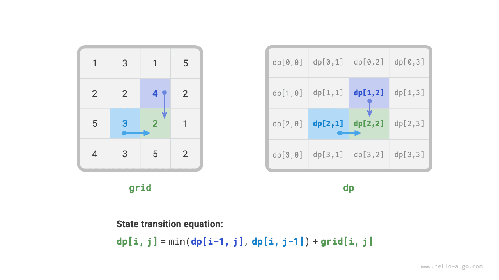
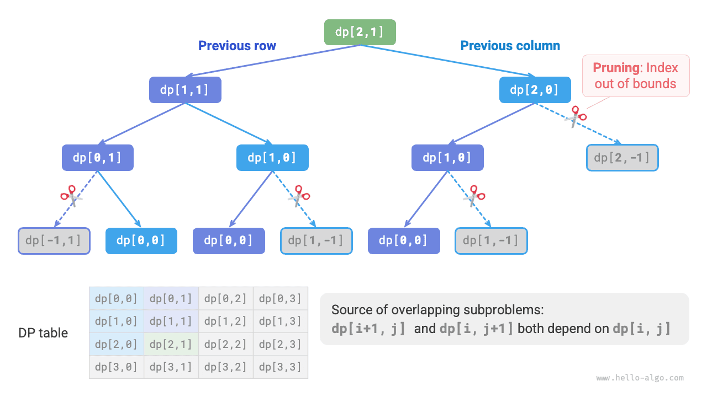
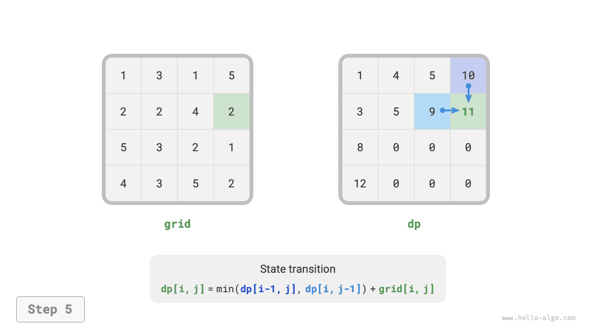
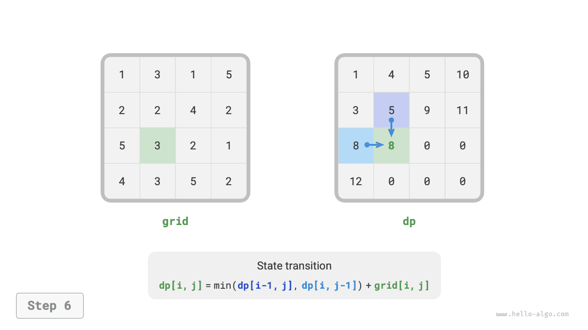
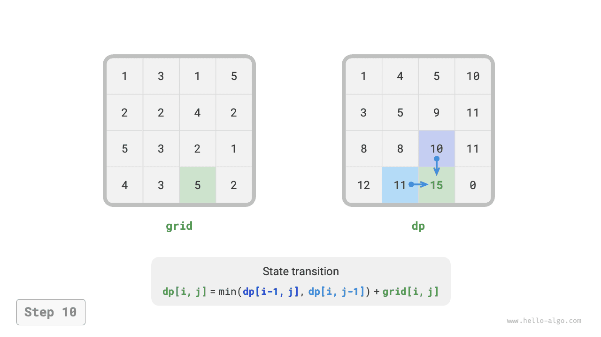

# 14.3 &nbsp; 동적 계획법 문제 풀이 방법

앞의 두 절에서는 동적 계획법 문제의 주요 특성을 살펴보았다. 이제 더 실용적인 두 질문을 알아보자.

1. 어떤 문제가 동적 계획법 문제인지 어떻게 판단할까?
2. 동적 계획법 문제는 어디서 시작하며, 전체 풀이 단계는 어떻게 될까?

## 14.3.1 &nbsp; 문제 판단

대체로 중복 부분 문제와 최적 부분 구조가 있고 무후효성을 만족하면 동적 계획법에 적합하다. 하지만 문제 설명에서 이러한 특성을 바로 끌어내기는 어렵다. 따라서 보통 조건을 완화하여 **먼저 백트래킹(모든 경우 열거)으로 풀기에 적합한지 살펴본다**.

**백트래킹에 적합한 문제는 보통 '의사 결정 트리 모형'을 따른다**. 각 노드가 결정 하나를, 각 경로가 결정의 순서를 나타내는 트리 구조로 표현할 수 있는 문제다.

즉, 명확한 결정 개념이 있고 연속된 결정을 통해 해가 만들어진다면 의사 결정 트리 모형을 만족하며, 보통 백트래킹으로 해결할 수 있다.

여기에 더해 동적 계획법 문제로 판단할 때 '가산점'이 되는 요소도 있다.

- 최댓값, 최솟값, 가장 많은 수, 가장 적은 수 등의 최적화 표현이 포함되어 있다.
- 상태를 리스트, 다차원 행렬, 트리로 표현할 수 있고, 한 상태와 주변 상태들 사이에 점화 관계가 있다.

반대로 '감점' 요소도 있다.

- 최적해 하나가 아니라 가능한 모든 해결 방법을 찾는 것이 목표다.
- 문제 설명에 순열이나 조합의 특성이 뚜렷하며, 구체적인 여러 방법을 반환해야 한다.

의사 결정 트리 모형을 만족하면서 '가산점' 요소가 뚜렷하다면, 우선 동적 계획법 문제라고 가정하고 풀이 과정에서 확인해 볼 수 있다.

## 14.3.2 &nbsp; 문제 해결 단계

동적 계획법의 풀이 흐름은 문제의 성격과 난이도에 따라 다르지만, 보통 결정 설명, 상태 정의, $dp$ 테이블 구성, 상태 전이 식 도출, 경계 조건 결정 등의 단계를 따른다.

단계를 더 구체적으로 보여 주기 위해 대표적인 '최소 경로 합' 문제를 예로 든다.

!!! question "문제"

    $n \times m$의 2차원 격자 `grid`가 주어진다. 각 칸에는 그 칸의 비용인 음이 아닌 정수가 들어 있다. 로봇은 왼쪽 위에서 출발하여 매번 아래 또는 오른쪽으로 한 칸씩만 이동하고, 오른쪽 아래에 도착한다. 왼쪽 위에서 오른쪽 아래까지의 최소 경로 합을 반환하라.

아래 그림(14-10)의 격자에서는 최소 경로 합이 $13$이다.

{ class="animation-figure" }

<p align="center"> 그림 14-10 &nbsp; 최소 경로 합 예시 데이터 </p>

**1단계: 매 차례의 결정을 생각하고 상태를 정의하여 $dp$ 테이블을 얻는다**

이 문제에서 매 차례의 결정은 현재 칸에서 아래 또는 오른쪽으로 한 칸 이동하는 것이다. 현재 칸의 행과 열 인덱스가 $[i, j]$라면 이동 후에는 $[i+1, j]$ 또는 $[i, j+1]$이 된다. 따라서 상태는 행 인덱스와 열 인덱스라는 두 변수를 포함해야 하며 $[i, j]$로 표시한다.

상태 $[i, j]$의 부분 문제는 출발점 $[0, 0]$에서 $[i, j]$까지의 최소 경로 합이고, 해를 $dp[i, j]$라고 한다.

이로써 아래 그림(14-11)처럼 입력 격자 $grid$와 크기가 같은 2차원 $dp$ 행렬을 얻는다.

{ class="animation-figure" }

<p align="center"> 그림 14-11 &nbsp; 상태 정의와 dp 테이블 </p>

!!! note "참고"

    동적 계획법과 백트래킹 과정은 결정의 순서로 표현할 수 있으며, 상태는 모든 결정 변수로 이루어진다. 상태에는 풀이의 진행 정도를 나타내는 모든 변수가 포함되어야 한다. 즉, 다음 상태를 도출하기에 충분한 정보가 있어야 한다.
    
    각 상태는 부분 문제 하나에 대응하며, 모든 부분 문제의 해를 저장하기 위해 $dp$ 테이블을 정의한다. 상태의 독립 변수 각각이 $dp$ 테이블의 한 차원이 된다. 본질적으로 $dp$ 테이블은 상태와 부분 문제의 해 사이의 매핑이다.

**2단계: 최적 부분 구조를 찾아 상태 전이 식을 도출한다**

상태 $[i, j]$는 위쪽 칸 $[i-1, j]$ 또는 왼쪽 칸 $[i, j-1]$에서만 올 수 있다. 따라서 최적 부분 구조는 다음과 같다. $[i, j]$까지의 최소 경로 합은 $[i, j-1]$까지의 최소 경로 합과 $[i-1, j]$까지의 최소 경로 합 중 작은 쪽에 의해 결정된다.

위 분석으로 아래 그림(14-12)의 상태 전이 식을 얻는다.

$$
dp[i, j] = \min(dp[i-1, j], dp[i, j-1]) + grid[i, j]
$$

{ class="animation-figure" }

<p align="center"> 그림 14-12 &nbsp; 최적 부분 구조와 상태 전이 식 </p>

!!! note "참고"

    정의한 $dp$ 테이블을 바탕으로 원래 문제와 부분 문제의 관계를 생각하고, 부분 문제의 최적해로 원래 문제의 최적해를 만드는 방법, 즉 최적 부분 구조를 찾는다.

    최적 부분 구조를 찾으면 이를 이용해 상태 전이 식을 세울 수 있다.

**3단계: 경계 조건과 상태 전이 순서를 정한다**

이 문제에서 첫 행의 상태는 왼쪽 상태에서만, 첫 열의 상태는 위쪽 상태에서만 올 수 있다. 따라서 첫 행 $i = 0$과 첫 열 $j = 0$이 경계 조건이다.

아래 그림(14-13)과 같이 각 칸은 왼쪽 칸과 위쪽 칸에서 전이되므로, 바깥 반복문은 행을, 안쪽 반복문은 열을 순회한다.

{ class="animation-figure" }

<p align="center"> 그림 14-13 &nbsp; 경계 조건과 상태 전이 순서 </p>

!!! note "참고"

    경계 조건은 동적 계획법에서 $dp$ 테이블을 초기화하는 데, 탐색에서는 가지치기에 사용한다.
    
    상태 전이 순서의 핵심은 현재 문제의 해를 계산하기 전에 그 해가 의존하는 모든 작은 부분 문제의 해가 올바르게 계산되어 있도록 하는 것이다.

이제 동적 계획법 코드를 바로 작성할 수 있다. 하지만 부분 문제로 나누는 사고는 위에서 아래로 진행하므로, '완전 탐색 $\rightarrow$ 메모이제이션을 이용한 탐색 $\rightarrow$ 동적 계획법' 순서로 구현하는 편이 사고 흐름에 더 자연스럽다.

### 1. &nbsp; 방법 1: 완전 탐색

상태 $[i, j]$에서 탐색을 시작하여 더 작은 상태 $[i-1, j]$와 $[i, j-1]$로 계속 나눈다. 재귀 함수에는 다음 요소가 포함된다.

- **재귀 매개변수**: 상태 $[i, j]$.
- **반환값**: $[0, 0]$에서 $[i, j]$까지의 최소 경로 합 $dp[i, j]$.
- **종료 조건**: $i = 0$이고 $j = 0$이면 비용 $grid[0, 0]$을 반환한다.
- **가지치기**: $i < 0$ 또는 $j < 0$이면 인덱스가 범위를 벗어나므로 불가능함을 나타내는 비용 $+\infty$를 반환한다.

구현 코드는 다음과 같다.

=== "Python"

    ```python title="min_path_sum.py"
    def min_path_sum_dfs(grid: list[list[int]], i: int, j: int) -> int:
        """최소 경로 합: 완전 탐색"""
        # 왼쪽 위 모서리의 칸이면 탐색을 종료한다
        if i == 0 and j == 0:
            return grid[0][0]
        # 행 또는 열 인덱스가 범위를 벗어나면 비용 +∞를 반환한다
        if i < 0 or j < 0:
            return inf
        # 왼쪽 위 모서리에서 (i-1, j)와 (i, j-1)까지의 최소 경로 비용을 계산한다
        up = min_path_sum_dfs(grid, i - 1, j)
        left = min_path_sum_dfs(grid, i, j - 1)
        # 왼쪽 위 모서리에서 (i, j)까지의 최소 경로 비용을 반환한다
        return min(left, up) + grid[i][j]
    ```

=== "C++"

    ```cpp title="min_path_sum.cpp"
    /* 최소 경로 합: 완전 탐색 */
    int minPathSumDFS(vector<vector<int>> &grid, int i, int j) {
        // 왼쪽 위 모서리의 칸이면 탐색을 종료한다
        if (i == 0 && j == 0) {
            return grid[0][0];
        }
        // 행 또는 열 인덱스가 범위를 벗어나면 비용 +∞를 반환한다
        if (i < 0 || j < 0) {
            return INT_MAX;
        }
        // 왼쪽 위 모서리에서 (i-1, j)와 (i, j-1)까지의 최소 경로 비용을 계산한다
        int up = minPathSumDFS(grid, i - 1, j);
        int left = minPathSumDFS(grid, i, j - 1);
        // 왼쪽 위 모서리에서 (i, j)까지의 최소 경로 비용을 반환한다
        return min(left, up) != INT_MAX ? min(left, up) + grid[i][j] : INT_MAX;
    }
    ```

=== "Java"

    ```java title="min_path_sum.java"
    /* 최소 경로 합: 완전 탐색 */
    int minPathSumDFS(int[][] grid, int i, int j) {
        // 왼쪽 위 모서리의 칸이면 탐색을 종료한다
        if (i == 0 && j == 0) {
            return grid[0][0];
        }
        // 행 또는 열 인덱스가 범위를 벗어나면 비용 +∞를 반환한다
        if (i < 0 || j < 0) {
            return Integer.MAX_VALUE;
        }
        // 왼쪽 위 모서리에서 (i-1, j)와 (i, j-1)까지의 최소 경로 비용을 계산한다
        int up = minPathSumDFS(grid, i - 1, j);
        int left = minPathSumDFS(grid, i, j - 1);
        // 왼쪽 위 모서리에서 (i, j)까지의 최소 경로 비용을 반환한다
        return Math.min(left, up) + grid[i][j];
    }
    ```

=== "C#"

    ```csharp title="min_path_sum.cs"
    /* 최소 경로 합: 완전 탐색 */
    int MinPathSumDFS(int[][] grid, int i, int j) {
        // 왼쪽 위 모서리의 칸이면 탐색을 종료한다
        if (i == 0 && j == 0) {
            return grid[0][0];
        }
        // 행 또는 열 인덱스가 범위를 벗어나면 비용 +∞를 반환한다
        if (i < 0 || j < 0) {
            return int.MaxValue;
        }
        // 왼쪽 위 모서리에서 (i-1, j)와 (i, j-1)까지의 최소 경로 비용을 계산한다
        int up = MinPathSumDFS(grid, i - 1, j);
        int left = MinPathSumDFS(grid, i, j - 1);
        // 왼쪽 위 모서리에서 (i, j)까지의 최소 경로 비용을 반환한다
        return Math.Min(left, up) + grid[i][j];
    }
    ```

=== "Go"

    ```go title="min_path_sum.go"
    /* 최소 경로 합: 완전 탐색 */
    func minPathSumDFS(grid [][]int, i, j int) int {
        // 왼쪽 위 모서리의 칸이면 탐색을 종료한다
        if i == 0 && j == 0 {
            return grid[0][0]
        }
        // 행 또는 열 인덱스가 범위를 벗어나면 비용 +∞를 반환한다
        if i < 0 || j < 0 {
            return math.MaxInt
        }
        // 왼쪽 위 모서리에서 (i-1, j)와 (i, j-1)까지의 최소 경로 비용을 계산한다
        up := minPathSumDFS(grid, i-1, j)
        left := minPathSumDFS(grid, i, j-1)
        // 왼쪽 위 모서리에서 (i, j)까지의 최소 경로 비용을 반환한다
        return int(math.Min(float64(left), float64(up))) + grid[i][j]
    }
    ```

=== "Swift"

    ```swift title="min_path_sum.swift"
    /* 최소 경로 합: 완전 탐색 */
    func minPathSumDFS(grid: [[Int]], i: Int, j: Int) -> Int {
        // 왼쪽 위 모서리의 칸이면 탐색을 종료한다
        if i == 0, j == 0 {
            return grid[0][0]
        }
        // 행 또는 열 인덱스가 범위를 벗어나면 비용 +∞를 반환한다
        if i < 0 || j < 0 {
            return .max
        }
        // 왼쪽 위 모서리에서 (i-1, j)와 (i, j-1)까지의 최소 경로 비용을 계산한다
        let up = minPathSumDFS(grid: grid, i: i - 1, j: j)
        let left = minPathSumDFS(grid: grid, i: i, j: j - 1)
        // 왼쪽 위 모서리에서 (i, j)까지의 최소 경로 비용을 반환한다
        return min(left, up) + grid[i][j]
    }
    ```

=== "JS"

    ```javascript title="min_path_sum.js"
    /* 최소 경로 합: 완전 탐색 */
    function minPathSumDFS(grid, i, j) {
        // 왼쪽 위 모서리의 칸이면 탐색을 종료한다
        if (i === 0 && j === 0) {
            return grid[0][0];
        }
        // 행 또는 열 인덱스가 범위를 벗어나면 비용 +∞를 반환한다
        if (i < 0 || j < 0) {
            return Infinity;
        }
        // 왼쪽 위 모서리에서 (i-1, j)와 (i, j-1)까지의 최소 경로 비용을 계산한다
        const up = minPathSumDFS(grid, i - 1, j);
        const left = minPathSumDFS(grid, i, j - 1);
        // 왼쪽 위 모서리에서 (i, j)까지의 최소 경로 비용을 반환한다
        return Math.min(left, up) + grid[i][j];
    }
    ```

=== "TS"

    ```typescript title="min_path_sum.ts"
    /* 최소 경로 합: 완전 탐색 */
    function minPathSumDFS(
        grid: Array<Array<number>>,
        i: number,
        j: number
    ): number {
        // 왼쪽 위 모서리의 칸이면 탐색을 종료한다
        if (i === 0 && j == 0) {
            return grid[0][0];
        }
        // 행 또는 열 인덱스가 범위를 벗어나면 비용 +∞를 반환한다
        if (i < 0 || j < 0) {
            return Infinity;
        }
        // 왼쪽 위 모서리에서 (i-1, j)와 (i, j-1)까지의 최소 경로 비용을 계산한다
        const up = minPathSumDFS(grid, i - 1, j);
        const left = minPathSumDFS(grid, i, j - 1);
        // 왼쪽 위 모서리에서 (i, j)까지의 최소 경로 비용을 반환한다
        return Math.min(left, up) + grid[i][j];
    }
    ```

=== "Dart"

    ```dart title="min_path_sum.dart"
    /* 최소 경로 합: 완전 탐색 */
    int minPathSumDFS(List<List<int>> grid, int i, int j) {
      // 왼쪽 위 모서리의 칸이면 탐색을 종료한다
      if (i == 0 && j == 0) {
        return grid[0][0];
      }
      // 행 또는 열 인덱스가 범위를 벗어나면 비용 +∞를 반환한다
      if (i < 0 || j < 0) {
        // Dart의 int 타입은 범위가 고정된 정수이며, 무한대를 나타내는 값이 없다
        return BigInt.from(2).pow(31).toInt();
      }
      // 왼쪽 위 모서리에서 (i-1, j)와 (i, j-1)까지의 최소 경로 비용을 계산한다
      int up = minPathSumDFS(grid, i - 1, j);
      int left = minPathSumDFS(grid, i, j - 1);
      // 왼쪽 위 모서리에서 (i, j)까지의 최소 경로 비용을 반환한다
      return min(left, up) + grid[i][j];
    }
    ```

=== "Rust"

    ```rust title="min_path_sum.rs"
    /* 최소 경로 합: 완전 탐색 */
    fn min_path_sum_dfs(grid: &Vec<Vec<i32>>, i: i32, j: i32) -> i32 {
        // 왼쪽 위 모서리의 칸이면 탐색을 종료한다
        if i == 0 && j == 0 {
            return grid[0][0];
        }
        // 행 또는 열 인덱스가 범위를 벗어나면 비용 +∞를 반환한다
        if i < 0 || j < 0 {
            return i32::MAX;
        }
        // 왼쪽 위 모서리에서 (i-1, j)와 (i, j-1)까지의 최소 경로 비용을 계산한다
        let up = min_path_sum_dfs(grid, i - 1, j);
        let left = min_path_sum_dfs(grid, i, j - 1);
        // 왼쪽 위 모서리에서 (i, j)까지의 최소 경로 비용을 반환한다
        std::cmp::min(left, up) + grid[i as usize][j as usize]
    }
    ```

=== "C"

    ```c title="min_path_sum.c"
    /* 최소 경로 합: 완전 탐색 */
    int minPathSumDFS(int grid[MAX_SIZE][MAX_SIZE], int i, int j) {
        // 왼쪽 위 모서리의 칸이면 탐색을 종료한다
        if (i == 0 && j == 0) {
            return grid[0][0];
        }
        // 행 또는 열 인덱스가 범위를 벗어나면 비용 +∞를 반환한다
        if (i < 0 || j < 0) {
            return INT_MAX;
        }
        // 왼쪽 위 모서리에서 (i-1, j)와 (i, j-1)까지의 최소 경로 비용을 계산한다
        int up = minPathSumDFS(grid, i - 1, j);
        int left = minPathSumDFS(grid, i, j - 1);
        // 왼쪽 위 모서리에서 (i, j)까지의 최소 경로 비용을 반환한다
        return myMin(left, up) != INT_MAX ? myMin(left, up) + grid[i][j] : INT_MAX;
    }
    ```

=== "Kotlin"

    ```kotlin title="min_path_sum.kt"
    /* 최소 경로 합: 완전 탐색 */
    fun minPathSumDFS(grid: Array<IntArray>, i: Int, j: Int): Int {
        // 왼쪽 위 모서리의 칸이면 탐색을 종료한다
        if (i == 0 && j == 0) {
            return grid[0][0]
        }
        // 행 또는 열 인덱스가 범위를 벗어나면 비용 +∞를 반환한다
        if (i < 0 || j < 0) {
            return Int.MAX_VALUE
        }
        // 왼쪽 위 모서리에서 (i-1, j)와 (i, j-1)까지의 최소 경로 비용을 계산한다
        val up = minPathSumDFS(grid, i - 1, j)
        val left = minPathSumDFS(grid, i, j - 1)
        // 왼쪽 위 모서리에서 (i, j)까지의 최소 경로 비용을 반환한다
        return min(left, up) + grid[i][j]
    }
    ```

=== "Ruby"

    ```ruby title="min_path_sum.rb"
    ### 최소 경로 합: 완전 탐색 ###
    def min_path_sum_dfs(grid, i, j)
      # 왼쪽 위 모서리의 칸이면 탐색을 종료한다
      return grid[i][j] if i == 0 && j == 0
      # 행 또는 열 인덱스가 범위를 벗어나면 비용 +∞를 반환한다
      return Float::INFINITY if i < 0 || j < 0
      # 왼쪽 위 모서리에서 (i-1, j)와 (i, j-1)까지의 최소 경로 비용을 계산한다
      up = min_path_sum_dfs(grid, i - 1, j)
      left = min_path_sum_dfs(grid, i, j - 1)
      # 왼쪽 위 모서리에서 (i, j)까지의 최소 경로 비용을 반환한다
      [left, up].min + grid[i][j]
    end
    ```

??? pythontutor "코드 시각화"

    <div style="height: 549px; width: 100%;"><iframe class="pythontutor-iframe" title="코드 시각화" src="https://pythontutor.com/iframe-embed.html#code=from%20math%20import%20inf%0A%0Adef%20min_path_sum_dfs%28grid%3A%20list%5Blist%5Bint%5D%5D,%20i%3A%20int,%20j%3A%20int%29%20-%3E%20int%3A%0A%20%20%20%20%22%22%22%EC%B5%9C%EC%86%8C%20%EA%B2%BD%EB%A1%9C%20%ED%95%A9%3A%20%EC%99%84%EC%A0%84%20%ED%83%90%EC%83%89%22%22%22%0A%20%20%20%20%23%20%EC%99%BC%EC%AA%BD%20%EC%9C%84%20%EB%AA%A8%EC%84%9C%EB%A6%AC%EC%9D%98%20%EC%B9%B8%EC%9D%B4%EB%A9%B4%20%ED%83%90%EC%83%89%EC%9D%84%20%EC%A2%85%EB%A3%8C%ED%95%9C%EB%8B%A4%0A%20%20%20%20if%20i%20%3D%3D%200%20and%20j%20%3D%3D%200%3A%0A%20%20%20%20%20%20%20%20return%20grid%5B0%5D%5B0%5D%0A%20%20%20%20%23%20%ED%96%89%20%EB%98%90%EB%8A%94%20%EC%97%B4%20%EC%9D%B8%EB%8D%B1%EC%8A%A4%EA%B0%80%20%EB%B2%94%EC%9C%84%EB%A5%BC%20%EB%B2%97%EC%96%B4%EB%82%98%EB%A9%B4%20%EB%B9%84%EC%9A%A9%20%2B%E2%88%9E%EB%A5%BC%20%EB%B0%98%ED%99%98%ED%95%9C%EB%8B%A4%0A%20%20%20%20if%20i%20%3C%200%20or%20j%20%3C%200%3A%0A%20%20%20%20%20%20%20%20return%20inf%0A%20%20%20%20%23%20%EC%99%BC%EC%AA%BD%20%EC%9C%84%20%EB%AA%A8%EC%84%9C%EB%A6%AC%EC%97%90%EC%84%9C%20%28i-1,%20j%29%EC%99%80%20%28i,%20j-1%29%EA%B9%8C%EC%A7%80%EC%9D%98%20%EC%B5%9C%EC%86%8C%20%EA%B2%BD%EB%A1%9C%20%EB%B9%84%EC%9A%A9%EC%9D%84%20%EA%B3%84%EC%82%B0%ED%95%9C%EB%8B%A4%0A%20%20%20%20up%20%3D%20min_path_sum_dfs%28grid,%20i%20-%201,%20j%29%0A%20%20%20%20left%20%3D%20min_path_sum_dfs%28grid,%20i,%20j%20-%201%29%0A%20%20%20%20%23%20%EC%99%BC%EC%AA%BD%20%EC%9C%84%20%EB%AA%A8%EC%84%9C%EB%A6%AC%EC%97%90%EC%84%9C%20%28i,%20j%29%EA%B9%8C%EC%A7%80%EC%9D%98%20%EC%B5%9C%EC%86%8C%20%EA%B2%BD%EB%A1%9C%20%EB%B9%84%EC%9A%A9%EC%9D%84%20%EB%B0%98%ED%99%98%ED%95%9C%EB%8B%A4%0A%20%20%20%20return%20min%28left,%20up%29%20%2B%20grid%5Bi%5D%5Bj%5D%0A%0A%0A%22%22%22%EC%8B%A4%ED%96%89%20%EC%BD%94%EB%93%9C%22%22%22%0Aif%20__name__%20%3D%3D%20%22__main__%22%3A%0A%20%20%20%20grid%20%3D%20%5B%5B1,%203,%201,%205%5D,%20%5B2,%202,%204,%202%5D,%20%5B5,%203,%202,%201%5D,%20%5B4,%203,%205,%202%5D%5D%0A%20%20%20%20n,%20m%20%3D%20len%28grid%29,%20len%28grid%5B0%5D%29%0A%0A%20%20%20%20%23%20%EC%99%84%EC%A0%84%20%ED%83%90%EC%83%89%0A%20%20%20%20res%20%3D%20min_path_sum_dfs%28grid,%20n%20-%201,%20m%20-%201%29%0A%20%20%20%20print%28f%22%EC%99%BC%EC%AA%BD%20%EC%9C%84%EC%97%90%EC%84%9C%20%EC%98%A4%EB%A5%B8%EC%AA%BD%20%EC%95%84%EB%9E%98%EA%B9%8C%EC%A7%80%EC%9D%98%20%EC%B5%9C%EC%86%8C%20%EA%B2%BD%EB%A1%9C%20%ED%95%A9%3A%20%7Bres%7D%22%29&codeDivHeight=472&codeDivWidth=350&cumulative=false&curInstr=6&heapPrimitives=nevernest&origin=opt-frontend.js&py=311&rawInputLstJSON=%5B%5D&textReferences=false"> </iframe></div>
    <div style="margin-top: 5px;"><a href="https://pythontutor.com/iframe-embed.html#code=from%20math%20import%20inf%0A%0Adef%20min_path_sum_dfs%28grid%3A%20list%5Blist%5Bint%5D%5D,%20i%3A%20int,%20j%3A%20int%29%20-%3E%20int%3A%0A%20%20%20%20%22%22%22%EC%B5%9C%EC%86%8C%20%EA%B2%BD%EB%A1%9C%20%ED%95%A9%3A%20%EC%99%84%EC%A0%84%20%ED%83%90%EC%83%89%22%22%22%0A%20%20%20%20%23%20%EC%99%BC%EC%AA%BD%20%EC%9C%84%20%EB%AA%A8%EC%84%9C%EB%A6%AC%EC%9D%98%20%EC%B9%B8%EC%9D%B4%EB%A9%B4%20%ED%83%90%EC%83%89%EC%9D%84%20%EC%A2%85%EB%A3%8C%ED%95%9C%EB%8B%A4%0A%20%20%20%20if%20i%20%3D%3D%200%20and%20j%20%3D%3D%200%3A%0A%20%20%20%20%20%20%20%20return%20grid%5B0%5D%5B0%5D%0A%20%20%20%20%23%20%ED%96%89%20%EB%98%90%EB%8A%94%20%EC%97%B4%20%EC%9D%B8%EB%8D%B1%EC%8A%A4%EA%B0%80%20%EB%B2%94%EC%9C%84%EB%A5%BC%20%EB%B2%97%EC%96%B4%EB%82%98%EB%A9%B4%20%EB%B9%84%EC%9A%A9%20%2B%E2%88%9E%EB%A5%BC%20%EB%B0%98%ED%99%98%ED%95%9C%EB%8B%A4%0A%20%20%20%20if%20i%20%3C%200%20or%20j%20%3C%200%3A%0A%20%20%20%20%20%20%20%20return%20inf%0A%20%20%20%20%23%20%EC%99%BC%EC%AA%BD%20%EC%9C%84%20%EB%AA%A8%EC%84%9C%EB%A6%AC%EC%97%90%EC%84%9C%20%28i-1,%20j%29%EC%99%80%20%28i,%20j-1%29%EA%B9%8C%EC%A7%80%EC%9D%98%20%EC%B5%9C%EC%86%8C%20%EA%B2%BD%EB%A1%9C%20%EB%B9%84%EC%9A%A9%EC%9D%84%20%EA%B3%84%EC%82%B0%ED%95%9C%EB%8B%A4%0A%20%20%20%20up%20%3D%20min_path_sum_dfs%28grid,%20i%20-%201,%20j%29%0A%20%20%20%20left%20%3D%20min_path_sum_dfs%28grid,%20i,%20j%20-%201%29%0A%20%20%20%20%23%20%EC%99%BC%EC%AA%BD%20%EC%9C%84%20%EB%AA%A8%EC%84%9C%EB%A6%AC%EC%97%90%EC%84%9C%20%28i,%20j%29%EA%B9%8C%EC%A7%80%EC%9D%98%20%EC%B5%9C%EC%86%8C%20%EA%B2%BD%EB%A1%9C%20%EB%B9%84%EC%9A%A9%EC%9D%84%20%EB%B0%98%ED%99%98%ED%95%9C%EB%8B%A4%0A%20%20%20%20return%20min%28left,%20up%29%20%2B%20grid%5Bi%5D%5Bj%5D%0A%0A%0A%22%22%22%EC%8B%A4%ED%96%89%20%EC%BD%94%EB%93%9C%22%22%22%0Aif%20__name__%20%3D%3D%20%22__main__%22%3A%0A%20%20%20%20grid%20%3D%20%5B%5B1,%203,%201,%205%5D,%20%5B2,%202,%204,%202%5D,%20%5B5,%203,%202,%201%5D,%20%5B4,%203,%205,%202%5D%5D%0A%20%20%20%20n,%20m%20%3D%20len%28grid%29,%20len%28grid%5B0%5D%29%0A%0A%20%20%20%20%23%20%EC%99%84%EC%A0%84%20%ED%83%90%EC%83%89%0A%20%20%20%20res%20%3D%20min_path_sum_dfs%28grid,%20n%20-%201,%20m%20-%201%29%0A%20%20%20%20print%28f%22%EC%99%BC%EC%AA%BD%20%EC%9C%84%EC%97%90%EC%84%9C%20%EC%98%A4%EB%A5%B8%EC%AA%BD%20%EC%95%84%EB%9E%98%EA%B9%8C%EC%A7%80%EC%9D%98%20%EC%B5%9C%EC%86%8C%20%EA%B2%BD%EB%A1%9C%20%ED%95%A9%3A%20%7Bres%7D%22%29&codeDivHeight=800&codeDivWidth=600&cumulative=false&curInstr=6&heapPrimitives=nevernest&origin=opt-frontend.js&py=311&rawInputLstJSON=%5B%5D&textReferences=false" target="_blank" rel="noopener noreferrer">전체 화면 ></a></div>

아래 그림(14-14)은 $dp[2, 1]$을 루트로 하는 재귀 트리다. 중복 부분 문제가 포함되어 있으며, 그 수는 격자 `grid`의 크기가 커질수록 급격히 늘어난다.

중복 부분 문제가 생기는 근본적인 이유는 **왼쪽 위에서 어떤 칸에 도달하는 경로가 여러 개 있기 때문**이다.

{ class="animation-figure" }

<p align="center"> 그림 14-14 &nbsp; 완전 탐색의 재귀 트리 </p>

각 상태에는 아래와 오른쪽이라는 두 선택이 있고, 왼쪽 위에서 오른쪽 아래까지는 총 $m + n - 2$ 번 이동해야 한다. 따라서 최악의 시간 복잡도는 $O(2^{m + n})$이며, $n$과 $m$은 각각 격자의 행 수와 열 수다. 이 계산은 경계 근처의 상황을 고려하지 않았다. 격자 경계에서는 선택이 하나뿐이므로 실제 경로 수는 이보다 적다.

### 2. &nbsp; 방법 2: 메모이제이션을 이용한 탐색

격자 `grid`와 같은 크기의 메모이제이션 리스트 `mem`을 도입하여 각 부분 문제의 해를 기록하고 중복 부분 문제를 가지치기한다.

=== "Python"

    ```python title="min_path_sum.py"
    def min_path_sum_dfs_mem(
        grid: list[list[int]], mem: list[list[int]], i: int, j: int
    ) -> int:
        """최소 경로 합: 메모이제이션을 이용한 탐색"""
        # 왼쪽 위 모서리의 칸이면 탐색을 종료한다
        if i == 0 and j == 0:
            return grid[0][0]
        # 행 또는 열 인덱스가 범위를 벗어나면 비용 +∞를 반환한다
        if i < 0 or j < 0:
            return inf
        # 기록이 이미 있으면 바로 반환한다
        if mem[i][j] != -1:
            return mem[i][j]
        # 왼쪽 칸과 위쪽 칸까지의 최소 경로 비용
        up = min_path_sum_dfs_mem(grid, mem, i - 1, j)
        left = min_path_sum_dfs_mem(grid, mem, i, j - 1)
        # 왼쪽 위 모서리에서 (i, j)까지의 최소 경로 비용을 기록하고 반환한다
        mem[i][j] = min(left, up) + grid[i][j]
        return mem[i][j]
    ```

=== "C++"

    ```cpp title="min_path_sum.cpp"
    /* 최소 경로 합: 메모이제이션을 이용한 탐색 */
    int minPathSumDFSMem(vector<vector<int>> &grid, vector<vector<int>> &mem, int i, int j) {
        // 왼쪽 위 모서리의 칸이면 탐색을 종료한다
        if (i == 0 && j == 0) {
            return grid[0][0];
        }
        // 행 또는 열 인덱스가 범위를 벗어나면 비용 +∞를 반환한다
        if (i < 0 || j < 0) {
            return INT_MAX;
        }
        // 기록이 이미 있으면 바로 반환한다
        if (mem[i][j] != -1) {
            return mem[i][j];
        }
        // 왼쪽 칸과 위쪽 칸까지의 최소 경로 비용
        int up = minPathSumDFSMem(grid, mem, i - 1, j);
        int left = minPathSumDFSMem(grid, mem, i, j - 1);
        // 왼쪽 위 모서리에서 (i, j)까지의 최소 경로 비용을 기록하고 반환한다
        mem[i][j] = min(left, up) != INT_MAX ? min(left, up) + grid[i][j] : INT_MAX;
        return mem[i][j];
    }
    ```

=== "Java"

    ```java title="min_path_sum.java"
    /* 최소 경로 합: 메모이제이션을 이용한 탐색 */
    int minPathSumDFSMem(int[][] grid, int[][] mem, int i, int j) {
        // 왼쪽 위 모서리의 칸이면 탐색을 종료한다
        if (i == 0 && j == 0) {
            return grid[0][0];
        }
        // 행 또는 열 인덱스가 범위를 벗어나면 비용 +∞를 반환한다
        if (i < 0 || j < 0) {
            return Integer.MAX_VALUE;
        }
        // 기록이 이미 있으면 바로 반환한다
        if (mem[i][j] != -1) {
            return mem[i][j];
        }
        // 왼쪽 칸과 위쪽 칸까지의 최소 경로 비용
        int up = minPathSumDFSMem(grid, mem, i - 1, j);
        int left = minPathSumDFSMem(grid, mem, i, j - 1);
        // 왼쪽 위 모서리에서 (i, j)까지의 최소 경로 비용을 기록하고 반환한다
        mem[i][j] = Math.min(left, up) + grid[i][j];
        return mem[i][j];
    }
    ```

=== "C#"

    ```csharp title="min_path_sum.cs"
    /* 최소 경로 합: 메모이제이션을 이용한 탐색 */
    int MinPathSumDFSMem(int[][] grid, int[][] mem, int i, int j) {
        // 왼쪽 위 모서리의 칸이면 탐색을 종료한다
        if (i == 0 && j == 0) {
            return grid[0][0];
        }
        // 행 또는 열 인덱스가 범위를 벗어나면 비용 +∞를 반환한다
        if (i < 0 || j < 0) {
            return int.MaxValue;
        }
        // 기록이 이미 있으면 바로 반환한다
        if (mem[i][j] != -1) {
            return mem[i][j];
        }
        // 왼쪽 칸과 위쪽 칸까지의 최소 경로 비용
        int up = MinPathSumDFSMem(grid, mem, i - 1, j);
        int left = MinPathSumDFSMem(grid, mem, i, j - 1);
        // 왼쪽 위 모서리에서 (i, j)까지의 최소 경로 비용을 기록하고 반환한다
        mem[i][j] = Math.Min(left, up) + grid[i][j];
        return mem[i][j];
    }
    ```

=== "Go"

    ```go title="min_path_sum.go"
    /* 최소 경로 합: 메모이제이션을 이용한 탐색 */
    func minPathSumDFSMem(grid, mem [][]int, i, j int) int {
        // 왼쪽 위 모서리의 칸이면 탐색을 종료한다
        if i == 0 && j == 0 {
            return grid[0][0]
        }
        // 행 또는 열 인덱스가 범위를 벗어나면 비용 +∞를 반환한다
        if i < 0 || j < 0 {
            return math.MaxInt
        }
        // 기록이 이미 있으면 바로 반환한다
        if mem[i][j] != -1 {
            return mem[i][j]
        }
        // 왼쪽 칸과 위쪽 칸까지의 최소 경로 비용
        up := minPathSumDFSMem(grid, mem, i-1, j)
        left := minPathSumDFSMem(grid, mem, i, j-1)
        // 왼쪽 위 모서리에서 (i, j)까지의 최소 경로 비용을 기록하고 반환한다
        mem[i][j] = int(math.Min(float64(left), float64(up))) + grid[i][j]
        return mem[i][j]
    }
    ```

=== "Swift"

    ```swift title="min_path_sum.swift"
    /* 최소 경로 합: 메모이제이션을 이용한 탐색 */
    func minPathSumDFSMem(grid: [[Int]], mem: inout [[Int]], i: Int, j: Int) -> Int {
        // 왼쪽 위 모서리의 칸이면 탐색을 종료한다
        if i == 0, j == 0 {
            return grid[0][0]
        }
        // 행 또는 열 인덱스가 범위를 벗어나면 비용 +∞를 반환한다
        if i < 0 || j < 0 {
            return .max
        }
        // 기록이 이미 있으면 바로 반환한다
        if mem[i][j] != -1 {
            return mem[i][j]
        }
        // 왼쪽 칸과 위쪽 칸까지의 최소 경로 비용
        let up = minPathSumDFSMem(grid: grid, mem: &mem, i: i - 1, j: j)
        let left = minPathSumDFSMem(grid: grid, mem: &mem, i: i, j: j - 1)
        // 왼쪽 위 모서리에서 (i, j)까지의 최소 경로 비용을 기록하고 반환한다
        mem[i][j] = min(left, up) + grid[i][j]
        return mem[i][j]
    }
    ```

=== "JS"

    ```javascript title="min_path_sum.js"
    /* 최소 경로 합: 메모이제이션을 이용한 탐색 */
    function minPathSumDFSMem(grid, mem, i, j) {
        // 왼쪽 위 모서리의 칸이면 탐색을 종료한다
        if (i === 0 && j === 0) {
            return grid[0][0];
        }
        // 행 또는 열 인덱스가 범위를 벗어나면 비용 +∞를 반환한다
        if (i < 0 || j < 0) {
            return Infinity;
        }
        // 기록이 이미 있으면 바로 반환한다
        if (mem[i][j] !== -1) {
            return mem[i][j];
        }
        // 왼쪽 칸과 위쪽 칸까지의 최소 경로 비용
        const up = minPathSumDFSMem(grid, mem, i - 1, j);
        const left = minPathSumDFSMem(grid, mem, i, j - 1);
        // 왼쪽 위 모서리에서 (i, j)까지의 최소 경로 비용을 기록하고 반환한다
        mem[i][j] = Math.min(left, up) + grid[i][j];
        return mem[i][j];
    }
    ```

=== "TS"

    ```typescript title="min_path_sum.ts"
    /* 최소 경로 합: 메모이제이션을 이용한 탐색 */
    function minPathSumDFSMem(
        grid: Array<Array<number>>,
        mem: Array<Array<number>>,
        i: number,
        j: number
    ): number {
        // 왼쪽 위 모서리의 칸이면 탐색을 종료한다
        if (i === 0 && j === 0) {
            return grid[0][0];
        }
        // 행 또는 열 인덱스가 범위를 벗어나면 비용 +∞를 반환한다
        if (i < 0 || j < 0) {
            return Infinity;
        }
        // 기록이 이미 있으면 바로 반환한다
        if (mem[i][j] != -1) {
            return mem[i][j];
        }
        // 왼쪽 칸과 위쪽 칸까지의 최소 경로 비용
        const up = minPathSumDFSMem(grid, mem, i - 1, j);
        const left = minPathSumDFSMem(grid, mem, i, j - 1);
        // 왼쪽 위 모서리에서 (i, j)까지의 최소 경로 비용을 기록하고 반환한다
        mem[i][j] = Math.min(left, up) + grid[i][j];
        return mem[i][j];
    }
    ```

=== "Dart"

    ```dart title="min_path_sum.dart"
    /* 최소 경로 합: 메모이제이션을 이용한 탐색 */
    int minPathSumDFSMem(List<List<int>> grid, List<List<int>> mem, int i, int j) {
      // 왼쪽 위 모서리의 칸이면 탐색을 종료한다
      if (i == 0 && j == 0) {
        return grid[0][0];
      }
      // 행 또는 열 인덱스가 범위를 벗어나면 비용 +∞를 반환한다
      if (i < 0 || j < 0) {
        // Dart의 int 타입은 범위가 고정된 정수이며, 무한대를 나타내는 값이 없다
        return BigInt.from(2).pow(31).toInt();
      }
      // 기록이 이미 있으면 바로 반환한다
      if (mem[i][j] != -1) {
        return mem[i][j];
      }
      // 왼쪽 칸과 위쪽 칸까지의 최소 경로 비용
      int up = minPathSumDFSMem(grid, mem, i - 1, j);
      int left = minPathSumDFSMem(grid, mem, i, j - 1);
      // 왼쪽 위 모서리에서 (i, j)까지의 최소 경로 비용을 기록하고 반환한다
      mem[i][j] = min(left, up) + grid[i][j];
      return mem[i][j];
    }
    ```

=== "Rust"

    ```rust title="min_path_sum.rs"
    /* 최소 경로 합: 메모이제이션을 이용한 탐색 */
    fn min_path_sum_dfs_mem(grid: &Vec<Vec<i32>>, mem: &mut Vec<Vec<i32>>, i: i32, j: i32) -> i32 {
        // 왼쪽 위 모서리의 칸이면 탐색을 종료한다
        if i == 0 && j == 0 {
            return grid[0][0];
        }
        // 행 또는 열 인덱스가 범위를 벗어나면 비용 +∞를 반환한다
        if i < 0 || j < 0 {
            return i32::MAX;
        }
        // 기록이 이미 있으면 바로 반환한다
        if mem[i as usize][j as usize] != -1 {
            return mem[i as usize][j as usize];
        }
        // 왼쪽 칸과 위쪽 칸까지의 최소 경로 비용
        let up = min_path_sum_dfs_mem(grid, mem, i - 1, j);
        let left = min_path_sum_dfs_mem(grid, mem, i, j - 1);
        // 왼쪽 위 모서리에서 (i, j)까지의 최소 경로 비용을 기록하고 반환한다
        mem[i as usize][j as usize] = std::cmp::min(left, up) + grid[i as usize][j as usize];
        mem[i as usize][j as usize]
    }
    ```

=== "C"

    ```c title="min_path_sum.c"
    /* 최소 경로 합: 메모이제이션을 이용한 탐색 */
    int minPathSumDFSMem(int grid[MAX_SIZE][MAX_SIZE], int mem[MAX_SIZE][MAX_SIZE], int i, int j) {
        // 왼쪽 위 모서리의 칸이면 탐색을 종료한다
        if (i == 0 && j == 0) {
            return grid[0][0];
        }
        // 행 또는 열 인덱스가 범위를 벗어나면 비용 +∞를 반환한다
        if (i < 0 || j < 0) {
            return INT_MAX;
        }
        // 기록이 이미 있으면 바로 반환한다
        if (mem[i][j] != -1) {
            return mem[i][j];
        }
        // 왼쪽 칸과 위쪽 칸까지의 최소 경로 비용
        int up = minPathSumDFSMem(grid, mem, i - 1, j);
        int left = minPathSumDFSMem(grid, mem, i, j - 1);
        // 왼쪽 위 모서리에서 (i, j)까지의 최소 경로 비용을 기록하고 반환한다
        mem[i][j] = myMin(left, up) != INT_MAX ? myMin(left, up) + grid[i][j] : INT_MAX;
        return mem[i][j];
    }
    ```

=== "Kotlin"

    ```kotlin title="min_path_sum.kt"
    /* 최소 경로 합: 메모이제이션을 이용한 탐색 */
    fun minPathSumDFSMem(
        grid: Array<IntArray>,
        mem: Array<IntArray>,
        i: Int,
        j: Int
    ): Int {
        // 왼쪽 위 모서리의 칸이면 탐색을 종료한다
        if (i == 0 && j == 0) {
            return grid[0][0]
        }
        // 행 또는 열 인덱스가 범위를 벗어나면 비용 +∞를 반환한다
        if (i < 0 || j < 0) {
            return Int.MAX_VALUE
        }
        // 기록이 이미 있으면 바로 반환한다
        if (mem[i][j] != -1) {
            return mem[i][j]
        }
        // 왼쪽 칸과 위쪽 칸까지의 최소 경로 비용
        val up = minPathSumDFSMem(grid, mem, i - 1, j)
        val left = minPathSumDFSMem(grid, mem, i, j - 1)
        // 왼쪽 위 모서리에서 (i, j)까지의 최소 경로 비용을 기록하고 반환한다
        mem[i][j] = min(left, up) + grid[i][j]
        return mem[i][j]
    }
    ```

=== "Ruby"

    ```ruby title="min_path_sum.rb"
    ### 최소 경로 합: 메모이제이션을 이용한 탐색 ###
    def min_path_sum_dfs_mem(grid, mem, i, j)
      # 왼쪽 위 모서리의 칸이면 탐색을 종료한다
      return grid[0][0] if i == 0 && j == 0
      # 행 또는 열 인덱스가 범위를 벗어나면 비용 +∞를 반환한다
      return Float::INFINITY if i < 0 || j < 0
      # 기록이 이미 있으면 바로 반환한다
      return mem[i][j] if mem[i][j] != -1
      # 왼쪽 칸과 위쪽 칸까지의 최소 경로 비용
      up = min_path_sum_dfs_mem(grid, mem, i - 1, j)
      left = min_path_sum_dfs_mem(grid, mem, i, j - 1)
      # 왼쪽 위 모서리에서 (i, j)까지의 최소 경로 비용을 기록하고 반환한다
      mem[i][j] = [left, up].min + grid[i][j]
    end
    ```

??? pythontutor "코드 시각화"

    <div style="height: 549px; width: 100%;"><iframe class="pythontutor-iframe" title="코드 시각화" src="https://pythontutor.com/iframe-embed.html#code=from%20math%20import%20inf%0A%0Adef%20min_path_sum_dfs_mem%28%0A%20%20%20%20grid%3A%20list%5Blist%5Bint%5D%5D,%20mem%3A%20list%5Blist%5Bint%5D%5D,%20i%3A%20int,%20j%3A%20int%0A%29%20-%3E%20int%3A%0A%20%20%20%20%22%22%22%EC%B5%9C%EC%86%8C%20%EA%B2%BD%EB%A1%9C%20%ED%95%A9%3A%20%EB%A9%94%EB%AA%A8%EC%9D%B4%EC%A0%9C%EC%9D%B4%EC%85%98%EC%9D%84%20%EC%9D%B4%EC%9A%A9%ED%95%9C%20%ED%83%90%EC%83%89%22%22%22%0A%20%20%20%20%23%20%EC%99%BC%EC%AA%BD%20%EC%9C%84%20%EB%AA%A8%EC%84%9C%EB%A6%AC%EC%9D%98%20%EC%B9%B8%EC%9D%B4%EB%A9%B4%20%ED%83%90%EC%83%89%EC%9D%84%20%EC%A2%85%EB%A3%8C%ED%95%9C%EB%8B%A4%0A%20%20%20%20if%20i%20%3D%3D%200%20and%20j%20%3D%3D%200%3A%0A%20%20%20%20%20%20%20%20return%20grid%5B0%5D%5B0%5D%0A%20%20%20%20%23%20%ED%96%89%20%EB%98%90%EB%8A%94%20%EC%97%B4%20%EC%9D%B8%EB%8D%B1%EC%8A%A4%EA%B0%80%20%EB%B2%94%EC%9C%84%EB%A5%BC%20%EB%B2%97%EC%96%B4%EB%82%98%EB%A9%B4%20%EB%B9%84%EC%9A%A9%20%2B%E2%88%9E%EB%A5%BC%20%EB%B0%98%ED%99%98%ED%95%9C%EB%8B%A4%0A%20%20%20%20if%20i%20%3C%200%20or%20j%20%3C%200%3A%0A%20%20%20%20%20%20%20%20return%20inf%0A%20%20%20%20%23%20%EA%B8%B0%EB%A1%9D%EC%9D%B4%20%EC%9D%B4%EB%AF%B8%20%EC%9E%88%EC%9C%BC%EB%A9%B4%20%EB%B0%94%EB%A1%9C%20%EB%B0%98%ED%99%98%ED%95%9C%EB%8B%A4%0A%20%20%20%20if%20mem%5Bi%5D%5Bj%5D%20%21%3D%20-1%3A%0A%20%20%20%20%20%20%20%20return%20mem%5Bi%5D%5Bj%5D%0A%20%20%20%20%23%20%EC%99%BC%EC%AA%BD%20%EC%B9%B8%EA%B3%BC%20%EC%9C%84%EC%AA%BD%20%EC%B9%B8%EA%B9%8C%EC%A7%80%EC%9D%98%20%EC%B5%9C%EC%86%8C%20%EA%B2%BD%EB%A1%9C%20%EB%B9%84%EC%9A%A9%0A%20%20%20%20up%20%3D%20min_path_sum_dfs_mem%28grid,%20mem,%20i%20-%201,%20j%29%0A%20%20%20%20left%20%3D%20min_path_sum_dfs_mem%28grid,%20mem,%20i,%20j%20-%201%29%0A%20%20%20%20%23%20%EC%99%BC%EC%AA%BD%20%EC%9C%84%20%EB%AA%A8%EC%84%9C%EB%A6%AC%EC%97%90%EC%84%9C%20%28i,%20j%29%EA%B9%8C%EC%A7%80%EC%9D%98%20%EC%B5%9C%EC%86%8C%20%EA%B2%BD%EB%A1%9C%20%EB%B9%84%EC%9A%A9%EC%9D%84%20%EA%B8%B0%EB%A1%9D%ED%95%98%EA%B3%A0%20%EB%B0%98%ED%99%98%ED%95%9C%EB%8B%A4%0A%20%20%20%20mem%5Bi%5D%5Bj%5D%20%3D%20min%28left,%20up%29%20%2B%20grid%5Bi%5D%5Bj%5D%0A%20%20%20%20return%20mem%5Bi%5D%5Bj%5D%0A%0A%0A%22%22%22%EC%8B%A4%ED%96%89%20%EC%BD%94%EB%93%9C%22%22%22%0Aif%20__name__%20%3D%3D%20%22__main__%22%3A%0A%20%20%20%20grid%20%3D%20%5B%5B1,%203,%201,%205%5D,%20%5B2,%202,%204,%202%5D,%20%5B5,%203,%202,%201%5D,%20%5B4,%203,%205,%202%5D%5D%0A%20%20%20%20n,%20m%20%3D%20len%28grid%29,%20len%28grid%5B0%5D%29%0A%0A%20%20%20%23%20%EB%A9%94%EB%AA%A8%EC%9D%B4%EC%A0%9C%EC%9D%B4%EC%85%98%EC%9D%84%20%EC%9D%B4%EC%9A%A9%ED%95%9C%20%ED%83%90%EC%83%89%0A%20%20%20%20mem%20%3D%20%5B%5B-1%5D%20%2A%20m%20for%20_%20in%20range%28n%29%5D%0A%20%20%20%20res%20%3D%20min_path_sum_dfs_mem%28grid,%20mem,%20n%20-%201,%20m%20-%201%29%0A%20%20%20%20print%28f%22%EC%99%BC%EC%AA%BD%20%EC%9C%84%EC%97%90%EC%84%9C%20%EC%98%A4%EB%A5%B8%EC%AA%BD%20%EC%95%84%EB%9E%98%EA%B9%8C%EC%A7%80%EC%9D%98%20%EC%B5%9C%EC%86%8C%20%EA%B2%BD%EB%A1%9C%20%ED%95%A9%3A%20%7Bres%7D%22%29&codeDivHeight=472&codeDivWidth=350&cumulative=false&curInstr=16&heapPrimitives=nevernest&origin=opt-frontend.js&py=311&rawInputLstJSON=%5B%5D&textReferences=false"> </iframe></div>
    <div style="margin-top: 5px;"><a href="https://pythontutor.com/iframe-embed.html#code=from%20math%20import%20inf%0A%0Adef%20min_path_sum_dfs_mem%28%0A%20%20%20%20grid%3A%20list%5Blist%5Bint%5D%5D,%20mem%3A%20list%5Blist%5Bint%5D%5D,%20i%3A%20int,%20j%3A%20int%0A%29%20-%3E%20int%3A%0A%20%20%20%20%22%22%22%EC%B5%9C%EC%86%8C%20%EA%B2%BD%EB%A1%9C%20%ED%95%A9%3A%20%EB%A9%94%EB%AA%A8%EC%9D%B4%EC%A0%9C%EC%9D%B4%EC%85%98%EC%9D%84%20%EC%9D%B4%EC%9A%A9%ED%95%9C%20%ED%83%90%EC%83%89%22%22%22%0A%20%20%20%20%23%20%EC%99%BC%EC%AA%BD%20%EC%9C%84%20%EB%AA%A8%EC%84%9C%EB%A6%AC%EC%9D%98%20%EC%B9%B8%EC%9D%B4%EB%A9%B4%20%ED%83%90%EC%83%89%EC%9D%84%20%EC%A2%85%EB%A3%8C%ED%95%9C%EB%8B%A4%0A%20%20%20%20if%20i%20%3D%3D%200%20and%20j%20%3D%3D%200%3A%0A%20%20%20%20%20%20%20%20return%20grid%5B0%5D%5B0%5D%0A%20%20%20%20%23%20%ED%96%89%20%EB%98%90%EB%8A%94%20%EC%97%B4%20%EC%9D%B8%EB%8D%B1%EC%8A%A4%EA%B0%80%20%EB%B2%94%EC%9C%84%EB%A5%BC%20%EB%B2%97%EC%96%B4%EB%82%98%EB%A9%B4%20%EB%B9%84%EC%9A%A9%20%2B%E2%88%9E%EB%A5%BC%20%EB%B0%98%ED%99%98%ED%95%9C%EB%8B%A4%0A%20%20%20%20if%20i%20%3C%200%20or%20j%20%3C%200%3A%0A%20%20%20%20%20%20%20%20return%20inf%0A%20%20%20%20%23%20%EA%B8%B0%EB%A1%9D%EC%9D%B4%20%EC%9D%B4%EB%AF%B8%20%EC%9E%88%EC%9C%BC%EB%A9%B4%20%EB%B0%94%EB%A1%9C%20%EB%B0%98%ED%99%98%ED%95%9C%EB%8B%A4%0A%20%20%20%20if%20mem%5Bi%5D%5Bj%5D%20%21%3D%20-1%3A%0A%20%20%20%20%20%20%20%20return%20mem%5Bi%5D%5Bj%5D%0A%20%20%20%20%23%20%EC%99%BC%EC%AA%BD%20%EC%B9%B8%EA%B3%BC%20%EC%9C%84%EC%AA%BD%20%EC%B9%B8%EA%B9%8C%EC%A7%80%EC%9D%98%20%EC%B5%9C%EC%86%8C%20%EA%B2%BD%EB%A1%9C%20%EB%B9%84%EC%9A%A9%0A%20%20%20%20up%20%3D%20min_path_sum_dfs_mem%28grid,%20mem,%20i%20-%201,%20j%29%0A%20%20%20%20left%20%3D%20min_path_sum_dfs_mem%28grid,%20mem,%20i,%20j%20-%201%29%0A%20%20%20%20%23%20%EC%99%BC%EC%AA%BD%20%EC%9C%84%20%EB%AA%A8%EC%84%9C%EB%A6%AC%EC%97%90%EC%84%9C%20%28i,%20j%29%EA%B9%8C%EC%A7%80%EC%9D%98%20%EC%B5%9C%EC%86%8C%20%EA%B2%BD%EB%A1%9C%20%EB%B9%84%EC%9A%A9%EC%9D%84%20%EA%B8%B0%EB%A1%9D%ED%95%98%EA%B3%A0%20%EB%B0%98%ED%99%98%ED%95%9C%EB%8B%A4%0A%20%20%20%20mem%5Bi%5D%5Bj%5D%20%3D%20min%28left,%20up%29%20%2B%20grid%5Bi%5D%5Bj%5D%0A%20%20%20%20return%20mem%5Bi%5D%5Bj%5D%0A%0A%0A%22%22%22%EC%8B%A4%ED%96%89%20%EC%BD%94%EB%93%9C%22%22%22%0Aif%20__name__%20%3D%3D%20%22__main__%22%3A%0A%20%20%20%20grid%20%3D%20%5B%5B1,%203,%201,%205%5D,%20%5B2,%202,%204,%202%5D,%20%5B5,%203,%202,%201%5D,%20%5B4,%203,%205,%202%5D%5D%0A%20%20%20%20n,%20m%20%3D%20len%28grid%29,%20len%28grid%5B0%5D%29%0A%0A%20%20%20%23%20%EB%A9%94%EB%AA%A8%EC%9D%B4%EC%A0%9C%EC%9D%B4%EC%85%98%EC%9D%84%20%EC%9D%B4%EC%9A%A9%ED%95%9C%20%ED%83%90%EC%83%89%0A%20%20%20%20mem%20%3D%20%5B%5B-1%5D%20%2A%20m%20for%20_%20in%20range%28n%29%5D%0A%20%20%20%20res%20%3D%20min_path_sum_dfs_mem%28grid,%20mem,%20n%20-%201,%20m%20-%201%29%0A%20%20%20%20print%28f%22%EC%99%BC%EC%AA%BD%20%EC%9C%84%EC%97%90%EC%84%9C%20%EC%98%A4%EB%A5%B8%EC%AA%BD%20%EC%95%84%EB%9E%98%EA%B9%8C%EC%A7%80%EC%9D%98%20%EC%B5%9C%EC%86%8C%20%EA%B2%BD%EB%A1%9C%20%ED%95%A9%3A%20%7Bres%7D%22%29&codeDivHeight=800&codeDivWidth=600&cumulative=false&curInstr=16&heapPrimitives=nevernest&origin=opt-frontend.js&py=311&rawInputLstJSON=%5B%5D&textReferences=false" target="_blank" rel="noopener noreferrer">전체 화면 ></a></div>

아래 그림(14-15)과 같이 메모이제이션을 도입하면 모든 부분 문제의 해를 한 번만 계산한다. 따라서 시간 복잡도는 전체 상태 수, 즉 격자 크기인 $O(nm)$에 의해 결정된다.

{ class="animation-figure" }

<p align="center"> 그림 14-15 &nbsp; 메모이제이션을 이용한 탐색의 재귀 트리 </p>

### 3. &nbsp; 방법 3: 동적 계획법

반복을 이용한 동적 계획법 구현은 다음과 같다.

=== "Python"

    ```python title="min_path_sum.py"
    def min_path_sum_dp(grid: list[list[int]]) -> int:
        """최소 경로 합: 동적 계획법"""
        n, m = len(grid), len(grid[0])
        # dp 테이블을 초기화한다
        dp = [[0] * m for _ in range(n)]
        dp[0][0] = grid[0][0]
        # 상태 전이: 첫 번째 행
        for j in range(1, m):
            dp[0][j] = dp[0][j - 1] + grid[0][j]
        # 상태 전이: 첫 번째 열
        for i in range(1, n):
            dp[i][0] = dp[i - 1][0] + grid[i][0]
        # 상태 전이: 나머지 행과 열
        for i in range(1, n):
            for j in range(1, m):
                dp[i][j] = min(dp[i][j - 1], dp[i - 1][j]) + grid[i][j]
        return dp[n - 1][m - 1]
    ```

=== "C++"

    ```cpp title="min_path_sum.cpp"
    /* 최소 경로 합: 동적 계획법 */
    int minPathSumDP(vector<vector<int>> &grid) {
        int n = grid.size(), m = grid[0].size();
        // dp 테이블을 초기화한다
        vector<vector<int>> dp(n, vector<int>(m));
        dp[0][0] = grid[0][0];
        // 상태 전이: 첫 번째 행
        for (int j = 1; j < m; j++) {
            dp[0][j] = dp[0][j - 1] + grid[0][j];
        }
        // 상태 전이: 첫 번째 열
        for (int i = 1; i < n; i++) {
            dp[i][0] = dp[i - 1][0] + grid[i][0];
        }
        // 상태 전이: 나머지 행과 열
        for (int i = 1; i < n; i++) {
            for (int j = 1; j < m; j++) {
                dp[i][j] = min(dp[i][j - 1], dp[i - 1][j]) + grid[i][j];
            }
        }
        return dp[n - 1][m - 1];
    }
    ```

=== "Java"

    ```java title="min_path_sum.java"
    /* 최소 경로 합: 동적 계획법 */
    int minPathSumDP(int[][] grid) {
        int n = grid.length, m = grid[0].length;
        // dp 테이블을 초기화한다
        int[][] dp = new int[n][m];
        dp[0][0] = grid[0][0];
        // 상태 전이: 첫 번째 행
        for (int j = 1; j < m; j++) {
            dp[0][j] = dp[0][j - 1] + grid[0][j];
        }
        // 상태 전이: 첫 번째 열
        for (int i = 1; i < n; i++) {
            dp[i][0] = dp[i - 1][0] + grid[i][0];
        }
        // 상태 전이: 나머지 행과 열
        for (int i = 1; i < n; i++) {
            for (int j = 1; j < m; j++) {
                dp[i][j] = Math.min(dp[i][j - 1], dp[i - 1][j]) + grid[i][j];
            }
        }
        return dp[n - 1][m - 1];
    }
    ```

=== "C#"

    ```csharp title="min_path_sum.cs"
    /* 최소 경로 합: 동적 계획법 */
    int MinPathSumDP(int[][] grid) {
        int n = grid.Length, m = grid[0].Length;
        // dp 테이블을 초기화한다
        int[,] dp = new int[n, m];
        dp[0, 0] = grid[0][0];
        // 상태 전이: 첫 번째 행
        for (int j = 1; j < m; j++) {
            dp[0, j] = dp[0, j - 1] + grid[0][j];
        }
        // 상태 전이: 첫 번째 열
        for (int i = 1; i < n; i++) {
            dp[i, 0] = dp[i - 1, 0] + grid[i][0];
        }
        // 상태 전이: 나머지 행과 열
        for (int i = 1; i < n; i++) {
            for (int j = 1; j < m; j++) {
                dp[i, j] = Math.Min(dp[i, j - 1], dp[i - 1, j]) + grid[i][j];
            }
        }
        return dp[n - 1, m - 1];
    }
    ```

=== "Go"

    ```go title="min_path_sum.go"
    /* 최소 경로 합: 동적 계획법 */
    func minPathSumDP(grid [][]int) int {
        n, m := len(grid), len(grid[0])
        // dp 테이블을 초기화한다
        dp := make([][]int, n)
        for i := 0; i < n; i++ {
            dp[i] = make([]int, m)
        }
        dp[0][0] = grid[0][0]
        // 상태 전이: 첫 번째 행
        for j := 1; j < m; j++ {
            dp[0][j] = dp[0][j-1] + grid[0][j]
        }
        // 상태 전이: 첫 번째 열
        for i := 1; i < n; i++ {
            dp[i][0] = dp[i-1][0] + grid[i][0]
        }
        // 상태 전이: 나머지 행과 열
        for i := 1; i < n; i++ {
            for j := 1; j < m; j++ {
                dp[i][j] = int(math.Min(float64(dp[i][j-1]), float64(dp[i-1][j]))) + grid[i][j]
            }
        }
        return dp[n-1][m-1]
    }
    ```

=== "Swift"

    ```swift title="min_path_sum.swift"
    /* 최소 경로 합: 동적 계획법 */
    func minPathSumDP(grid: [[Int]]) -> Int {
        let n = grid.count
        let m = grid[0].count
        // dp 테이블을 초기화한다
        var dp = Array(repeating: Array(repeating: 0, count: m), count: n)
        dp[0][0] = grid[0][0]
        // 상태 전이: 첫 번째 행
        for j in 1 ..< m {
            dp[0][j] = dp[0][j - 1] + grid[0][j]
        }
        // 상태 전이: 첫 번째 열
        for i in 1 ..< n {
            dp[i][0] = dp[i - 1][0] + grid[i][0]
        }
        // 상태 전이: 나머지 행과 열
        for i in 1 ..< n {
            for j in 1 ..< m {
                dp[i][j] = min(dp[i][j - 1], dp[i - 1][j]) + grid[i][j]
            }
        }
        return dp[n - 1][m - 1]
    }
    ```

=== "JS"

    ```javascript title="min_path_sum.js"
    /* 최소 경로 합: 동적 계획법 */
    function minPathSumDP(grid) {
        const n = grid.length,
            m = grid[0].length;
        // dp 테이블을 초기화한다
        const dp = Array.from({ length: n }, () =>
            Array.from({ length: m }, () => 0)
        );
        dp[0][0] = grid[0][0];
        // 상태 전이: 첫 번째 행
        for (let j = 1; j < m; j++) {
            dp[0][j] = dp[0][j - 1] + grid[0][j];
        }
        // 상태 전이: 첫 번째 열
        for (let i = 1; i < n; i++) {
            dp[i][0] = dp[i - 1][0] + grid[i][0];
        }
        // 상태 전이: 나머지 행과 열
        for (let i = 1; i < n; i++) {
            for (let j = 1; j < m; j++) {
                dp[i][j] = Math.min(dp[i][j - 1], dp[i - 1][j]) + grid[i][j];
            }
        }
        return dp[n - 1][m - 1];
    }
    ```

=== "TS"

    ```typescript title="min_path_sum.ts"
    /* 최소 경로 합: 동적 계획법 */
    function minPathSumDP(grid: Array<Array<number>>): number {
        const n = grid.length,
            m = grid[0].length;
        // dp 테이블을 초기화한다
        const dp = Array.from({ length: n }, () =>
            Array.from({ length: m }, () => 0)
        );
        dp[0][0] = grid[0][0];
        // 상태 전이: 첫 번째 행
        for (let j = 1; j < m; j++) {
            dp[0][j] = dp[0][j - 1] + grid[0][j];
        }
        // 상태 전이: 첫 번째 열
        for (let i = 1; i < n; i++) {
            dp[i][0] = dp[i - 1][0] + grid[i][0];
        }
        // 상태 전이: 나머지 행과 열
        for (let i = 1; i < n; i++) {
            for (let j: number = 1; j < m; j++) {
                dp[i][j] = Math.min(dp[i][j - 1], dp[i - 1][j]) + grid[i][j];
            }
        }
        return dp[n - 1][m - 1];
    }
    ```

=== "Dart"

    ```dart title="min_path_sum.dart"
    /* 최소 경로 합: 동적 계획법 */
    int minPathSumDP(List<List<int>> grid) {
      int n = grid.length, m = grid[0].length;
      // dp 테이블을 초기화한다
      List<List<int>> dp = List.generate(n, (i) => List.filled(m, 0));
      dp[0][0] = grid[0][0];
      // 상태 전이: 첫 번째 행
      for (int j = 1; j < m; j++) {
        dp[0][j] = dp[0][j - 1] + grid[0][j];
      }
      // 상태 전이: 첫 번째 열
      for (int i = 1; i < n; i++) {
        dp[i][0] = dp[i - 1][0] + grid[i][0];
      }
      // 상태 전이: 나머지 행과 열
      for (int i = 1; i < n; i++) {
        for (int j = 1; j < m; j++) {
          dp[i][j] = min(dp[i][j - 1], dp[i - 1][j]) + grid[i][j];
        }
      }
      return dp[n - 1][m - 1];
    }
    ```

=== "Rust"

    ```rust title="min_path_sum.rs"
    /* 최소 경로 합: 동적 계획법 */
    fn min_path_sum_dp(grid: &Vec<Vec<i32>>) -> i32 {
        let (n, m) = (grid.len(), grid[0].len());
        // dp 테이블을 초기화한다
        let mut dp = vec![vec![0; m]; n];
        dp[0][0] = grid[0][0];
        // 상태 전이: 첫 번째 행
        for j in 1..m {
            dp[0][j] = dp[0][j - 1] + grid[0][j];
        }
        // 상태 전이: 첫 번째 열
        for i in 1..n {
            dp[i][0] = dp[i - 1][0] + grid[i][0];
        }
        // 상태 전이: 나머지 행과 열
        for i in 1..n {
            for j in 1..m {
                dp[i][j] = std::cmp::min(dp[i][j - 1], dp[i - 1][j]) + grid[i][j];
            }
        }
        dp[n - 1][m - 1]
    }
    ```

=== "C"

    ```c title="min_path_sum.c"
    /* 최소 경로 합: 동적 계획법 */
    int minPathSumDP(int grid[MAX_SIZE][MAX_SIZE], int n, int m) {
        // dp 테이블을 초기화한다
        int **dp = malloc(n * sizeof(int *));
        for (int i = 0; i < n; i++) {
            dp[i] = calloc(m, sizeof(int));
        }
        dp[0][0] = grid[0][0];
        // 상태 전이: 첫 번째 행
        for (int j = 1; j < m; j++) {
            dp[0][j] = dp[0][j - 1] + grid[0][j];
        }
        // 상태 전이: 첫 번째 열
        for (int i = 1; i < n; i++) {
            dp[i][0] = dp[i - 1][0] + grid[i][0];
        }
        // 상태 전이: 나머지 행과 열
        for (int i = 1; i < n; i++) {
            for (int j = 1; j < m; j++) {
                dp[i][j] = myMin(dp[i][j - 1], dp[i - 1][j]) + grid[i][j];
            }
        }
        int res = dp[n - 1][m - 1];
        // 메모리 해제
        for (int i = 0; i < n; i++) {
            free(dp[i]);
        }
        return res;
    }
    ```

=== "Kotlin"

    ```kotlin title="min_path_sum.kt"
    /* 최소 경로 합: 동적 계획법 */
    fun minPathSumDP(grid: Array<IntArray>): Int {
        val n = grid.size
        val m = grid[0].size
        // dp 테이블을 초기화한다
        val dp = Array(n) { IntArray(m) }
        dp[0][0] = grid[0][0]
        // 상태 전이: 첫 번째 행
        for (j in 1..<m) {
            dp[0][j] = dp[0][j - 1] + grid[0][j]
        }
        // 상태 전이: 첫 번째 열
        for (i in 1..<n) {
            dp[i][0] = dp[i - 1][0] + grid[i][0]
        }
        // 상태 전이: 나머지 행과 열
        for (i in 1..<n) {
            for (j in 1..<m) {
                dp[i][j] = min(dp[i][j - 1], dp[i - 1][j]) + grid[i][j]
            }
        }
        return dp[n - 1][m - 1]
    }
    ```

=== "Ruby"

    ```ruby title="min_path_sum.rb"
    ### 최소 경로 합: 동적 계획법 ###
    def min_path_sum_dp(grid)
      n, m = grid.length, grid.first.length
      # dp 테이블을 초기화한다
      dp = Array.new(n) { Array.new(m, 0) }
      dp[0][0] = grid[0][0]
      # 상태 전이: 첫 번째 행
      (1...m).each { |j| dp[0][j] = dp[0][j - 1] + grid[0][j] }
      # 상태 전이: 첫 번째 열
      (1...n).each { |i| dp[i][0] = dp[i - 1][0] + grid[i][0] }
      # 상태 전이: 나머지 행과 열
      for i in 1...n
        for j in 1...m
          dp[i][j] = [dp[i][j - 1], dp[i - 1][j]].min + grid[i][j]
        end
      end
      dp[n -1][m -1]
    end
    ```

??? pythontutor "코드 시각화"

    <div style="height: 549px; width: 100%;"><iframe class="pythontutor-iframe" title="코드 시각화" src="https://pythontutor.com/iframe-embed.html#code=from%20math%20import%20inf%0A%0Adef%20min_path_sum_dp%28grid%3A%20list%5Blist%5Bint%5D%5D%29%20-%3E%20int%3A%0A%20%20%20%20%22%22%22%EC%B5%9C%EC%86%8C%20%EA%B2%BD%EB%A1%9C%20%ED%95%A9%3A%20%EB%8F%99%EC%A0%81%20%EA%B3%84%ED%9A%8D%EB%B2%95%22%22%22%0A%20%20%20%20n,%20m%20%3D%20len%28grid%29,%20len%28grid%5B0%5D%29%0A%20%20%20%20%23%20dp%20%ED%85%8C%EC%9D%B4%EB%B8%94%EC%9D%84%20%EC%B4%88%EA%B8%B0%ED%99%94%ED%95%9C%EB%8B%A4%0A%20%20%20%20dp%20%3D%20%5B%5B0%5D%20%2A%20m%20for%20_%20in%20range%28n%29%5D%0A%20%20%20%20dp%5B0%5D%5B0%5D%20%3D%20grid%5B0%5D%5B0%5D%0A%20%20%20%20%23%20%EC%83%81%ED%83%9C%20%EC%A0%84%EC%9D%B4%3A%20%EC%B2%AB%20%EB%B2%88%EC%A7%B8%20%ED%96%89%0A%20%20%20%20for%20j%20in%20range%281,%20m%29%3A%0A%20%20%20%20%20%20%20%20dp%5B0%5D%5Bj%5D%20%3D%20dp%5B0%5D%5Bj%20-%201%5D%20%2B%20grid%5B0%5D%5Bj%5D%0A%20%20%20%20%23%20%EC%83%81%ED%83%9C%20%EC%A0%84%EC%9D%B4%3A%20%EC%B2%AB%20%EB%B2%88%EC%A7%B8%20%EC%97%B4%0A%20%20%20%20for%20i%20in%20range%281,%20n%29%3A%0A%20%20%20%20%20%20%20%20dp%5Bi%5D%5B0%5D%20%3D%20dp%5Bi%20-%201%5D%5B0%5D%20%2B%20grid%5Bi%5D%5B0%5D%0A%20%20%20%20%23%20%EC%83%81%ED%83%9C%20%EC%A0%84%EC%9D%B4%3A%20%EB%82%98%EB%A8%B8%EC%A7%80%20%ED%96%89%EA%B3%BC%20%EC%97%B4%0A%20%20%20%20for%20i%20in%20range%281,%20n%29%3A%0A%20%20%20%20%20%20%20%20for%20j%20in%20range%281,%20m%29%3A%0A%20%20%20%20%20%20%20%20%20%20%20%20dp%5Bi%5D%5Bj%5D%20%3D%20min%28dp%5Bi%5D%5Bj%20-%201%5D,%20dp%5Bi%20-%201%5D%5Bj%5D%29%20%2B%20grid%5Bi%5D%5Bj%5D%0A%20%20%20%20return%20dp%5Bn%20-%201%5D%5Bm%20-%201%5D%0A%0A%0A%22%22%22%EC%8B%A4%ED%96%89%20%EC%BD%94%EB%93%9C%22%22%22%0Aif%20__name__%20%3D%3D%20%22__main__%22%3A%0A%20%20%20%20grid%20%3D%20%5B%5B1,%203,%201,%205%5D,%20%5B2,%202,%204,%202%5D,%20%5B5,%203,%202,%201%5D,%20%5B4,%203,%205,%202%5D%5D%0A%20%20%20%20n,%20m%20%3D%20len%28grid%29,%20len%28grid%5B0%5D%29%0A%0A%20%20%20%20%23%20%EB%8F%99%EC%A0%81%20%EA%B3%84%ED%9A%8D%EB%B2%95%0A%20%20%20%20res%20%3D%20min_path_sum_dp%28grid%29%0A%20%20%20%20print%28f%22%EC%99%BC%EC%AA%BD%20%EC%9C%84%EC%97%90%EC%84%9C%20%EC%98%A4%EB%A5%B8%EC%AA%BD%20%EC%95%84%EB%9E%98%EA%B9%8C%EC%A7%80%EC%9D%98%20%EC%B5%9C%EC%86%8C%20%EA%B2%BD%EB%A1%9C%20%ED%95%A9%3A%20%7Bres%7D%22%29&codeDivHeight=472&codeDivWidth=350&cumulative=false&curInstr=6&heapPrimitives=nevernest&origin=opt-frontend.js&py=311&rawInputLstJSON=%5B%5D&textReferences=false"> </iframe></div>
    <div style="margin-top: 5px;"><a href="https://pythontutor.com/iframe-embed.html#code=from%20math%20import%20inf%0A%0Adef%20min_path_sum_dp%28grid%3A%20list%5Blist%5Bint%5D%5D%29%20-%3E%20int%3A%0A%20%20%20%20%22%22%22%EC%B5%9C%EC%86%8C%20%EA%B2%BD%EB%A1%9C%20%ED%95%A9%3A%20%EB%8F%99%EC%A0%81%20%EA%B3%84%ED%9A%8D%EB%B2%95%22%22%22%0A%20%20%20%20n,%20m%20%3D%20len%28grid%29,%20len%28grid%5B0%5D%29%0A%20%20%20%20%23%20dp%20%ED%85%8C%EC%9D%B4%EB%B8%94%EC%9D%84%20%EC%B4%88%EA%B8%B0%ED%99%94%ED%95%9C%EB%8B%A4%0A%20%20%20%20dp%20%3D%20%5B%5B0%5D%20%2A%20m%20for%20_%20in%20range%28n%29%5D%0A%20%20%20%20dp%5B0%5D%5B0%5D%20%3D%20grid%5B0%5D%5B0%5D%0A%20%20%20%20%23%20%EC%83%81%ED%83%9C%20%EC%A0%84%EC%9D%B4%3A%20%EC%B2%AB%20%EB%B2%88%EC%A7%B8%20%ED%96%89%0A%20%20%20%20for%20j%20in%20range%281,%20m%29%3A%0A%20%20%20%20%20%20%20%20dp%5B0%5D%5Bj%5D%20%3D%20dp%5B0%5D%5Bj%20-%201%5D%20%2B%20grid%5B0%5D%5Bj%5D%0A%20%20%20%20%23%20%EC%83%81%ED%83%9C%20%EC%A0%84%EC%9D%B4%3A%20%EC%B2%AB%20%EB%B2%88%EC%A7%B8%20%EC%97%B4%0A%20%20%20%20for%20i%20in%20range%281,%20n%29%3A%0A%20%20%20%20%20%20%20%20dp%5Bi%5D%5B0%5D%20%3D%20dp%5Bi%20-%201%5D%5B0%5D%20%2B%20grid%5Bi%5D%5B0%5D%0A%20%20%20%20%23%20%EC%83%81%ED%83%9C%20%EC%A0%84%EC%9D%B4%3A%20%EB%82%98%EB%A8%B8%EC%A7%80%20%ED%96%89%EA%B3%BC%20%EC%97%B4%0A%20%20%20%20for%20i%20in%20range%281,%20n%29%3A%0A%20%20%20%20%20%20%20%20for%20j%20in%20range%281,%20m%29%3A%0A%20%20%20%20%20%20%20%20%20%20%20%20dp%5Bi%5D%5Bj%5D%20%3D%20min%28dp%5Bi%5D%5Bj%20-%201%5D,%20dp%5Bi%20-%201%5D%5Bj%5D%29%20%2B%20grid%5Bi%5D%5Bj%5D%0A%20%20%20%20return%20dp%5Bn%20-%201%5D%5Bm%20-%201%5D%0A%0A%0A%22%22%22%EC%8B%A4%ED%96%89%20%EC%BD%94%EB%93%9C%22%22%22%0Aif%20__name__%20%3D%3D%20%22__main__%22%3A%0A%20%20%20%20grid%20%3D%20%5B%5B1,%203,%201,%205%5D,%20%5B2,%202,%204,%202%5D,%20%5B5,%203,%202,%201%5D,%20%5B4,%203,%205,%202%5D%5D%0A%20%20%20%20n,%20m%20%3D%20len%28grid%29,%20len%28grid%5B0%5D%29%0A%0A%20%20%20%20%23%20%EB%8F%99%EC%A0%81%20%EA%B3%84%ED%9A%8D%EB%B2%95%0A%20%20%20%20res%20%3D%20min_path_sum_dp%28grid%29%0A%20%20%20%20print%28f%22%EC%99%BC%EC%AA%BD%20%EC%9C%84%EC%97%90%EC%84%9C%20%EC%98%A4%EB%A5%B8%EC%AA%BD%20%EC%95%84%EB%9E%98%EA%B9%8C%EC%A7%80%EC%9D%98%20%EC%B5%9C%EC%86%8C%20%EA%B2%BD%EB%A1%9C%20%ED%95%A9%3A%20%7Bres%7D%22%29&codeDivHeight=800&codeDivWidth=600&cumulative=false&curInstr=6&heapPrimitives=nevernest&origin=opt-frontend.js&py=311&rawInputLstJSON=%5B%5D&textReferences=false" target="_blank" rel="noopener noreferrer">전체 화면 ></a></div>

아래 그림(14-16)의 최소 경로 합 상태 전이 과정에서는 전체 격자를 순회하므로 **시간 복잡도는 $O(nm)$이다**.

배열 `dp`의 크기는 $n \times m$이므로 **공간 복잡도는 $O(nm)$이다**.

=== "<1>"
    { class="animation-figure" }

=== "<2>"
    { class="animation-figure" }

=== "<3>"
    { class="animation-figure" }

=== "<4>"
    { class="animation-figure" }

=== "<5>"
    { class="animation-figure" }

=== "<6>"
    { class="animation-figure" }

=== "<7>"
    { class="animation-figure" }

=== "<8>"
    { class="animation-figure" }

=== "<9>"
    { class="animation-figure" }

=== "<10>"
    { class="animation-figure" }

=== "<11>"
    { class="animation-figure" }

=== "<12>"
    { class="animation-figure" }

<p align="center"> 그림 14-16 &nbsp; 최소 경로 합의 동적 계획법 과정 </p>

### 4. &nbsp; 공간 최적화

각 칸은 왼쪽 칸과 위쪽 칸에만 의존하므로 한 행짜리 배열만으로 $dp$ 테이블을 구현할 수 있다.

배열 `dp`가 한 행의 상태만 나타내므로 첫 열의 상태를 미리 초기화할 수는 없다. 대신 각 행을 순회할 때 갱신해야 한다.

=== "Python"

    ```python title="min_path_sum.py"
    def min_path_sum_dp_comp(grid: list[list[int]]) -> int:
        """최소 경로 합: 공간을 최적화한 동적 계획법"""
        n, m = len(grid), len(grid[0])
        # dp 테이블을 초기화한다
        dp = [0] * m
        # 상태 전이: 첫 번째 행
        dp[0] = grid[0][0]
        for j in range(1, m):
            dp[j] = dp[j - 1] + grid[0][j]
        # 상태 전이: 나머지 행
        for i in range(1, n):
            # 상태 전이: 첫 번째 열
            dp[0] = dp[0] + grid[i][0]
            # 상태 전이: 나머지 열
            for j in range(1, m):
                dp[j] = min(dp[j - 1], dp[j]) + grid[i][j]
        return dp[m - 1]
    ```

=== "C++"

    ```cpp title="min_path_sum.cpp"
    /* 최소 경로 합: 공간을 최적화한 동적 계획법 */
    int minPathSumDPComp(vector<vector<int>> &grid) {
        int n = grid.size(), m = grid[0].size();
        // dp 테이블을 초기화한다
        vector<int> dp(m);
        // 상태 전이: 첫 번째 행
        dp[0] = grid[0][0];
        for (int j = 1; j < m; j++) {
            dp[j] = dp[j - 1] + grid[0][j];
        }
        // 상태 전이: 나머지 행
        for (int i = 1; i < n; i++) {
            // 상태 전이: 첫 번째 열
            dp[0] = dp[0] + grid[i][0];
            // 상태 전이: 나머지 열
            for (int j = 1; j < m; j++) {
                dp[j] = min(dp[j - 1], dp[j]) + grid[i][j];
            }
        }
        return dp[m - 1];
    }
    ```

=== "Java"

    ```java title="min_path_sum.java"
    /* 최소 경로 합: 공간을 최적화한 동적 계획법 */
    int minPathSumDPComp(int[][] grid) {
        int n = grid.length, m = grid[0].length;
        // dp 테이블을 초기화한다
        int[] dp = new int[m];
        // 상태 전이: 첫 번째 행
        dp[0] = grid[0][0];
        for (int j = 1; j < m; j++) {
            dp[j] = dp[j - 1] + grid[0][j];
        }
        // 상태 전이: 나머지 행
        for (int i = 1; i < n; i++) {
            // 상태 전이: 첫 번째 열
            dp[0] = dp[0] + grid[i][0];
            // 상태 전이: 나머지 열
            for (int j = 1; j < m; j++) {
                dp[j] = Math.min(dp[j - 1], dp[j]) + grid[i][j];
            }
        }
        return dp[m - 1];
    }
    ```

=== "C#"

    ```csharp title="min_path_sum.cs"
    /* 최소 경로 합: 공간을 최적화한 동적 계획법 */
    int MinPathSumDPComp(int[][] grid) {
        int n = grid.Length, m = grid[0].Length;
        // dp 테이블을 초기화한다
        int[] dp = new int[m];
        dp[0] = grid[0][0];
        // 상태 전이: 첫 번째 행
        for (int j = 1; j < m; j++) {
            dp[j] = dp[j - 1] + grid[0][j];
        }
        // 상태 전이: 나머지 행
        for (int i = 1; i < n; i++) {
            // 상태 전이: 첫 번째 열
            dp[0] = dp[0] + grid[i][0];
            // 상태 전이: 나머지 열
            for (int j = 1; j < m; j++) {
                dp[j] = Math.Min(dp[j - 1], dp[j]) + grid[i][j];
            }
        }
        return dp[m - 1];
    }
    ```

=== "Go"

    ```go title="min_path_sum.go"
    /* 최소 경로 합: 공간을 최적화한 동적 계획법 */
    func minPathSumDPComp(grid [][]int) int {
        n, m := len(grid), len(grid[0])
        // dp 테이블을 초기화한다
        dp := make([]int, m)
        // 상태 전이: 첫 번째 행
        dp[0] = grid[0][0]
        for j := 1; j < m; j++ {
            dp[j] = dp[j-1] + grid[0][j]
        }
        // 상태 전이: 나머지 행과 열
        for i := 1; i < n; i++ {
            // 상태 전이: 첫 번째 열
            dp[0] = dp[0] + grid[i][0]
            // 상태 전이: 나머지 열
            for j := 1; j < m; j++ {
                dp[j] = int(math.Min(float64(dp[j-1]), float64(dp[j]))) + grid[i][j]
            }
        }
        return dp[m-1]
    }
    ```

=== "Swift"

    ```swift title="min_path_sum.swift"
    /* 최소 경로 합: 공간을 최적화한 동적 계획법 */
    func minPathSumDPComp(grid: [[Int]]) -> Int {
        let n = grid.count
        let m = grid[0].count
        // dp 테이블을 초기화한다
        var dp = Array(repeating: 0, count: m)
        // 상태 전이: 첫 번째 행
        dp[0] = grid[0][0]
        for j in 1 ..< m {
            dp[j] = dp[j - 1] + grid[0][j]
        }
        // 상태 전이: 나머지 행
        for i in 1 ..< n {
            // 상태 전이: 첫 번째 열
            dp[0] = dp[0] + grid[i][0]
            // 상태 전이: 나머지 열
            for j in 1 ..< m {
                dp[j] = min(dp[j - 1], dp[j]) + grid[i][j]
            }
        }
        return dp[m - 1]
    }
    ```

=== "JS"

    ```javascript title="min_path_sum.js"
    /* 최소 경로 합: 공간을 최적화한 동적 계획법 */
    function minPathSumDPComp(grid) {
        const n = grid.length,
            m = grid[0].length;
        // dp 테이블을 초기화한다
        const dp = new Array(m);
        // 상태 전이: 첫 번째 행
        dp[0] = grid[0][0];
        for (let j = 1; j < m; j++) {
            dp[j] = dp[j - 1] + grid[0][j];
        }
        // 상태 전이: 나머지 행
        for (let i = 1; i < n; i++) {
            // 상태 전이: 첫 번째 열
            dp[0] = dp[0] + grid[i][0];
            // 상태 전이: 나머지 열
            for (let j = 1; j < m; j++) {
                dp[j] = Math.min(dp[j - 1], dp[j]) + grid[i][j];
            }
        }
        return dp[m - 1];
    }
    ```

=== "TS"

    ```typescript title="min_path_sum.ts"
    /* 최소 경로 합: 공간을 최적화한 동적 계획법 */
    function minPathSumDPComp(grid: Array<Array<number>>): number {
        const n = grid.length,
            m = grid[0].length;
        // dp 테이블을 초기화한다
        const dp = new Array(m);
        // 상태 전이: 첫 번째 행
        dp[0] = grid[0][0];
        for (let j = 1; j < m; j++) {
            dp[j] = dp[j - 1] + grid[0][j];
        }
        // 상태 전이: 나머지 행
        for (let i = 1; i < n; i++) {
            // 상태 전이: 첫 번째 열
            dp[0] = dp[0] + grid[i][0];
            // 상태 전이: 나머지 열
            for (let j = 1; j < m; j++) {
                dp[j] = Math.min(dp[j - 1], dp[j]) + grid[i][j];
            }
        }
        return dp[m - 1];
    }
    ```

=== "Dart"

    ```dart title="min_path_sum.dart"
    /* 최소 경로 합: 공간을 최적화한 동적 계획법 */
    int minPathSumDPComp(List<List<int>> grid) {
      int n = grid.length, m = grid[0].length;
      // dp 테이블을 초기화한다
      List<int> dp = List.filled(m, 0);
      dp[0] = grid[0][0];
      for (int j = 1; j < m; j++) {
        dp[j] = dp[j - 1] + grid[0][j];
      }
      // 상태 전이: 나머지 행
      for (int i = 1; i < n; i++) {
        // 상태 전이: 첫 번째 열
        dp[0] = dp[0] + grid[i][0];
        // 상태 전이: 나머지 열
        for (int j = 1; j < m; j++) {
          dp[j] = min(dp[j - 1], dp[j]) + grid[i][j];
        }
      }
      return dp[m - 1];
    }
    ```

=== "Rust"

    ```rust title="min_path_sum.rs"
    /* 최소 경로 합: 공간을 최적화한 동적 계획법 */
    fn min_path_sum_dp_comp(grid: &Vec<Vec<i32>>) -> i32 {
        let (n, m) = (grid.len(), grid[0].len());
        // dp 테이블을 초기화한다
        let mut dp = vec![0; m];
        // 상태 전이: 첫 번째 행
        dp[0] = grid[0][0];
        for j in 1..m {
            dp[j] = dp[j - 1] + grid[0][j];
        }
        // 상태 전이: 나머지 행
        for i in 1..n {
            // 상태 전이: 첫 번째 열
            dp[0] = dp[0] + grid[i][0];
            // 상태 전이: 나머지 열
            for j in 1..m {
                dp[j] = std::cmp::min(dp[j - 1], dp[j]) + grid[i][j];
            }
        }
        dp[m - 1]
    }
    ```

=== "C"

    ```c title="min_path_sum.c"
    /* 최소 경로 합: 공간을 최적화한 동적 계획법 */
    int minPathSumDPComp(int grid[MAX_SIZE][MAX_SIZE], int n, int m) {
        // dp 테이블을 초기화한다
        int *dp = calloc(m, sizeof(int));
        // 상태 전이: 첫 번째 행
        dp[0] = grid[0][0];
        for (int j = 1; j < m; j++) {
            dp[j] = dp[j - 1] + grid[0][j];
        }
        // 상태 전이: 나머지 행
        for (int i = 1; i < n; i++) {
            // 상태 전이: 첫 번째 열
            dp[0] = dp[0] + grid[i][0];
            // 상태 전이: 나머지 열
            for (int j = 1; j < m; j++) {
                dp[j] = myMin(dp[j - 1], dp[j]) + grid[i][j];
            }
        }
        int res = dp[m - 1];
        // 메모리 해제
        free(dp);
        return res;
    }
    ```

=== "Kotlin"

    ```kotlin title="min_path_sum.kt"
    /* 최소 경로 합: 공간을 최적화한 동적 계획법 */
    fun minPathSumDPComp(grid: Array<IntArray>): Int {
        val n = grid.size
        val m = grid[0].size
        // dp 테이블을 초기화한다
        val dp = IntArray(m)
        // 상태 전이: 첫 번째 행
        dp[0] = grid[0][0]
        for (j in 1..<m) {
            dp[j] = dp[j - 1] + grid[0][j]
        }
        // 상태 전이: 나머지 행
        for (i in 1..<n) {
            // 상태 전이: 첫 번째 열
            dp[0] = dp[0] + grid[i][0]
            // 상태 전이: 나머지 열
            for (j in 1..<m) {
                dp[j] = min(dp[j - 1], dp[j]) + grid[i][j]
            }
        }
        return dp[m - 1]
    }
    ```

=== "Ruby"

    ```ruby title="min_path_sum.rb"
    ### 최소 경로 합: 공간을 최적화한 동적 계획법 ###
    def min_path_sum_dp_comp(grid)
      n, m = grid.length, grid.first.length
      # dp 테이블을 초기화한다
      dp = Array.new(m, 0)
      # 상태 전이: 첫 번째 행
      dp[0] = grid[0][0]
      (1...m).each { |j| dp[j] = dp[j - 1] + grid[0][j] }
      # 상태 전이: 나머지 행
      for i in 1...n
        # 상태 전이: 첫 번째 열
        dp[0] = dp[0] + grid[i][0]
        # 상태 전이: 나머지 열
        (1...m).each { |j| dp[j] = [dp[j - 1], dp[j]].min + grid[i][j] }
      end
      dp[m - 1]
    end
    ```

??? pythontutor "코드 시각화"

    <div style="height: 549px; width: 100%;"><iframe class="pythontutor-iframe" title="코드 시각화" src="https://pythontutor.com/iframe-embed.html#code=from%20math%20import%20inf%0A%0Adef%20min_path_sum_dp_comp%28grid%3A%20list%5Blist%5Bint%5D%5D%29%20-%3E%20int%3A%0A%20%20%20%20%22%22%22%EC%B5%9C%EC%86%8C%20%EA%B2%BD%EB%A1%9C%20%ED%95%A9%3A%20%EA%B3%B5%EA%B0%84%EC%9D%84%20%EC%B5%9C%EC%A0%81%ED%99%94%ED%95%9C%20%EB%8F%99%EC%A0%81%20%EA%B3%84%ED%9A%8D%EB%B2%95%22%22%22%0A%20%20%20%20n,%20m%20%3D%20len%28grid%29,%20len%28grid%5B0%5D%29%0A%20%20%20%20%23%20dp%20%ED%85%8C%EC%9D%B4%EB%B8%94%EC%9D%84%20%EC%B4%88%EA%B8%B0%ED%99%94%ED%95%9C%EB%8B%A4%0A%20%20%20%20dp%20%3D%20%5B0%5D%20%2A%20m%0A%20%20%20%20%23%20%EC%83%81%ED%83%9C%20%EC%A0%84%EC%9D%B4%3A%20%EC%B2%AB%20%EB%B2%88%EC%A7%B8%20%ED%96%89%0A%20%20%20%20dp%5B0%5D%20%3D%20grid%5B0%5D%5B0%5D%0A%20%20%20%20for%20j%20in%20range%281,%20m%29%3A%0A%20%20%20%20%20%20%20%20dp%5Bj%5D%20%3D%20dp%5Bj%20-%201%5D%20%2B%20grid%5B0%5D%5Bj%5D%0A%20%20%20%20%23%20%EC%83%81%ED%83%9C%20%EC%A0%84%EC%9D%B4%3A%20%EB%82%98%EB%A8%B8%EC%A7%80%20%ED%96%89%0A%20%20%20%20for%20i%20in%20range%281,%20n%29%3A%0A%20%20%20%20%20%20%20%20%23%20%EC%83%81%ED%83%9C%20%EC%A0%84%EC%9D%B4%3A%20%EC%B2%AB%20%EB%B2%88%EC%A7%B8%20%EC%97%B4%0A%20%20%20%20%20%20%20%20dp%5B0%5D%20%3D%20dp%5B0%5D%20%2B%20grid%5Bi%5D%5B0%5D%0A%20%20%20%20%20%20%20%20%23%20%EC%83%81%ED%83%9C%20%EC%A0%84%EC%9D%B4%3A%20%EB%82%98%EB%A8%B8%EC%A7%80%20%EC%97%B4%0A%20%20%20%20%20%20%20%20for%20j%20in%20range%281,%20m%29%3A%0A%20%20%20%20%20%20%20%20%20%20%20%20dp%5Bj%5D%20%3D%20min%28dp%5Bj%20-%201%5D,%20dp%5Bj%5D%29%20%2B%20grid%5Bi%5D%5Bj%5D%0A%20%20%20%20return%20dp%5Bm%20-%201%5D%0A%0A%0A%22%22%22%EC%8B%A4%ED%96%89%20%EC%BD%94%EB%93%9C%22%22%22%0Aif%20__name__%20%3D%3D%20%22__main__%22%3A%0A%20%20%20%20grid%20%3D%20%5B%5B1,%203,%201,%205%5D,%20%5B2,%202,%204,%202%5D,%20%5B5,%203,%202,%201%5D,%20%5B4,%203,%205,%202%5D%5D%0A%20%20%20%20n,%20m%20%3D%20len%28grid%29,%20len%28grid%5B0%5D%29%0A%0A%20%20%20%20%23%20%EA%B3%B5%EA%B0%84%EC%9D%84%20%EC%B5%9C%EC%A0%81%ED%99%94%ED%95%9C%20%EB%8F%99%EC%A0%81%20%EA%B3%84%ED%9A%8D%EB%B2%95%0A%20%20%20%20res%20%3D%20min_path_sum_dp_comp%28grid%29%0A%20%20%20%20print%28f%22%EC%99%BC%EC%AA%BD%20%EC%9C%84%EC%97%90%EC%84%9C%20%EC%98%A4%EB%A5%B8%EC%AA%BD%20%EC%95%84%EB%9E%98%EA%B9%8C%EC%A7%80%EC%9D%98%20%EC%B5%9C%EC%86%8C%20%EA%B2%BD%EB%A1%9C%20%ED%95%A9%3A%20%7Bres%7D%22%29&codeDivHeight=472&codeDivWidth=350&cumulative=false&curInstr=6&heapPrimitives=nevernest&origin=opt-frontend.js&py=311&rawInputLstJSON=%5B%5D&textReferences=false"> </iframe></div>
    <div style="margin-top: 5px;"><a href="https://pythontutor.com/iframe-embed.html#code=from%20math%20import%20inf%0A%0Adef%20min_path_sum_dp_comp%28grid%3A%20list%5Blist%5Bint%5D%5D%29%20-%3E%20int%3A%0A%20%20%20%20%22%22%22%EC%B5%9C%EC%86%8C%20%EA%B2%BD%EB%A1%9C%20%ED%95%A9%3A%20%EA%B3%B5%EA%B0%84%EC%9D%84%20%EC%B5%9C%EC%A0%81%ED%99%94%ED%95%9C%20%EB%8F%99%EC%A0%81%20%EA%B3%84%ED%9A%8D%EB%B2%95%22%22%22%0A%20%20%20%20n,%20m%20%3D%20len%28grid%29,%20len%28grid%5B0%5D%29%0A%20%20%20%20%23%20dp%20%ED%85%8C%EC%9D%B4%EB%B8%94%EC%9D%84%20%EC%B4%88%EA%B8%B0%ED%99%94%ED%95%9C%EB%8B%A4%0A%20%20%20%20dp%20%3D%20%5B0%5D%20%2A%20m%0A%20%20%20%20%23%20%EC%83%81%ED%83%9C%20%EC%A0%84%EC%9D%B4%3A%20%EC%B2%AB%20%EB%B2%88%EC%A7%B8%20%ED%96%89%0A%20%20%20%20dp%5B0%5D%20%3D%20grid%5B0%5D%5B0%5D%0A%20%20%20%20for%20j%20in%20range%281,%20m%29%3A%0A%20%20%20%20%20%20%20%20dp%5Bj%5D%20%3D%20dp%5Bj%20-%201%5D%20%2B%20grid%5B0%5D%5Bj%5D%0A%20%20%20%20%23%20%EC%83%81%ED%83%9C%20%EC%A0%84%EC%9D%B4%3A%20%EB%82%98%EB%A8%B8%EC%A7%80%20%ED%96%89%0A%20%20%20%20for%20i%20in%20range%281,%20n%29%3A%0A%20%20%20%20%20%20%20%20%23%20%EC%83%81%ED%83%9C%20%EC%A0%84%EC%9D%B4%3A%20%EC%B2%AB%20%EB%B2%88%EC%A7%B8%20%EC%97%B4%0A%20%20%20%20%20%20%20%20dp%5B0%5D%20%3D%20dp%5B0%5D%20%2B%20grid%5Bi%5D%5B0%5D%0A%20%20%20%20%20%20%20%20%23%20%EC%83%81%ED%83%9C%20%EC%A0%84%EC%9D%B4%3A%20%EB%82%98%EB%A8%B8%EC%A7%80%20%EC%97%B4%0A%20%20%20%20%20%20%20%20for%20j%20in%20range%281,%20m%29%3A%0A%20%20%20%20%20%20%20%20%20%20%20%20dp%5Bj%5D%20%3D%20min%28dp%5Bj%20-%201%5D,%20dp%5Bj%5D%29%20%2B%20grid%5Bi%5D%5Bj%5D%0A%20%20%20%20return%20dp%5Bm%20-%201%5D%0A%0A%0A%22%22%22%EC%8B%A4%ED%96%89%20%EC%BD%94%EB%93%9C%22%22%22%0Aif%20__name__%20%3D%3D%20%22__main__%22%3A%0A%20%20%20%20grid%20%3D%20%5B%5B1,%203,%201,%205%5D,%20%5B2,%202,%204,%202%5D,%20%5B5,%203,%202,%201%5D,%20%5B4,%203,%205,%202%5D%5D%0A%20%20%20%20n,%20m%20%3D%20len%28grid%29,%20len%28grid%5B0%5D%29%0A%0A%20%20%20%20%23%20%EA%B3%B5%EA%B0%84%EC%9D%84%20%EC%B5%9C%EC%A0%81%ED%99%94%ED%95%9C%20%EB%8F%99%EC%A0%81%20%EA%B3%84%ED%9A%8D%EB%B2%95%0A%20%20%20%20res%20%3D%20min_path_sum_dp_comp%28grid%29%0A%20%20%20%20print%28f%22%EC%99%BC%EC%AA%BD%20%EC%9C%84%EC%97%90%EC%84%9C%20%EC%98%A4%EB%A5%B8%EC%AA%BD%20%EC%95%84%EB%9E%98%EA%B9%8C%EC%A7%80%EC%9D%98%20%EC%B5%9C%EC%86%8C%20%EA%B2%BD%EB%A1%9C%20%ED%95%A9%3A%20%7Bres%7D%22%29&codeDivHeight=800&codeDivWidth=600&cumulative=false&curInstr=6&heapPrimitives=nevernest&origin=opt-frontend.js&py=311&rawInputLstJSON=%5B%5D&textReferences=false" target="_blank" rel="noopener noreferrer">전체 화면 ></a></div>
