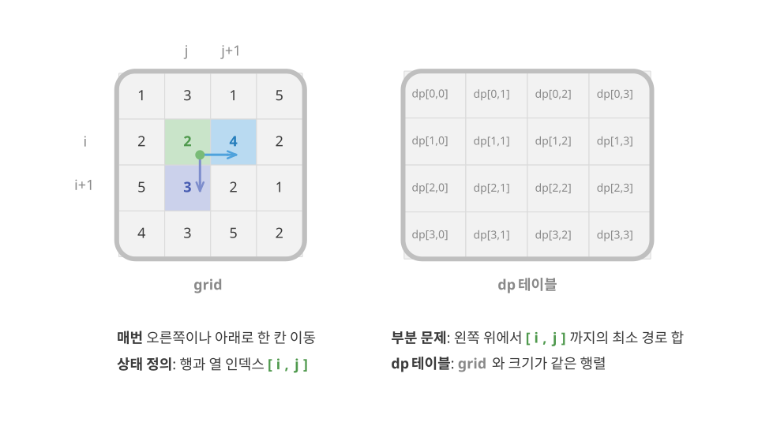
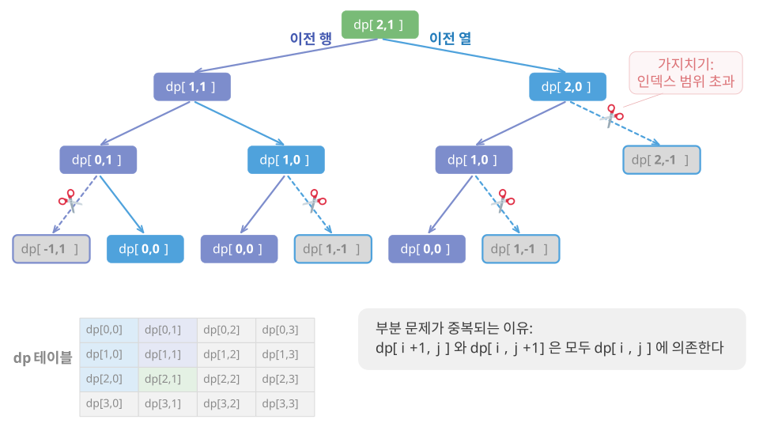
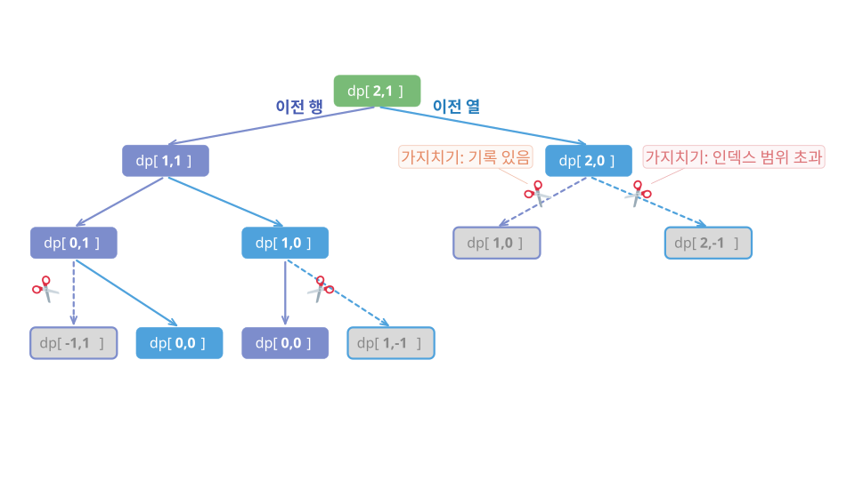
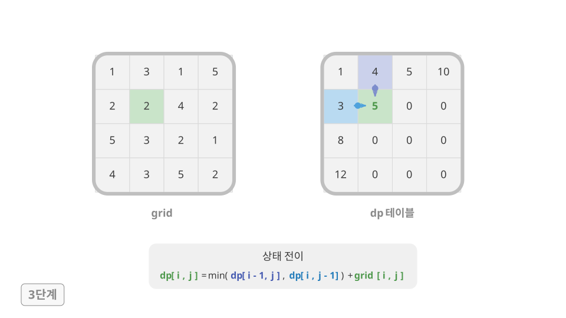
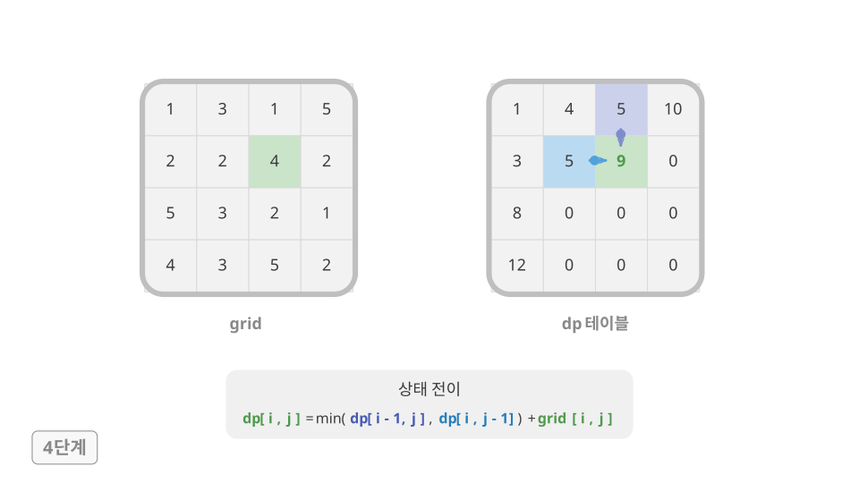
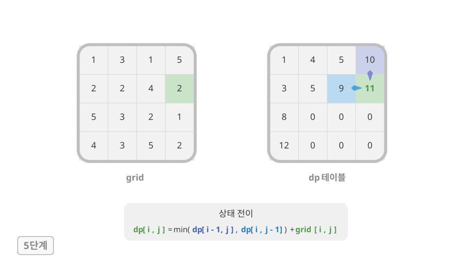
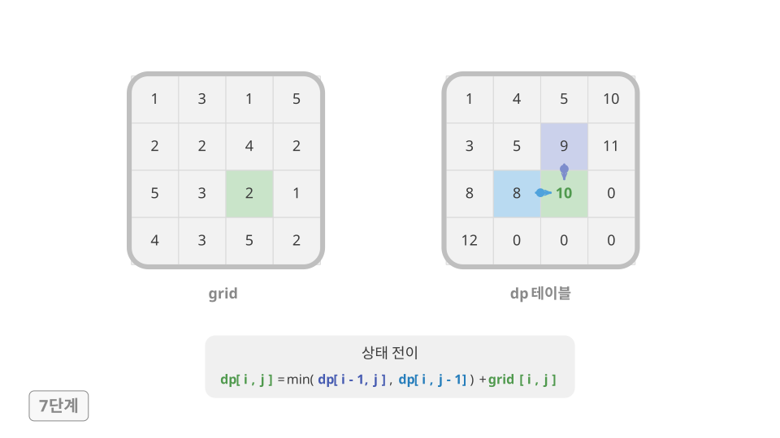
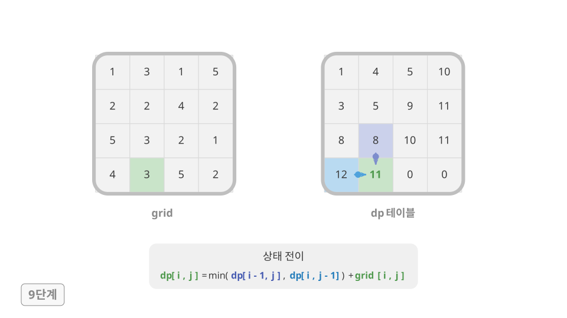
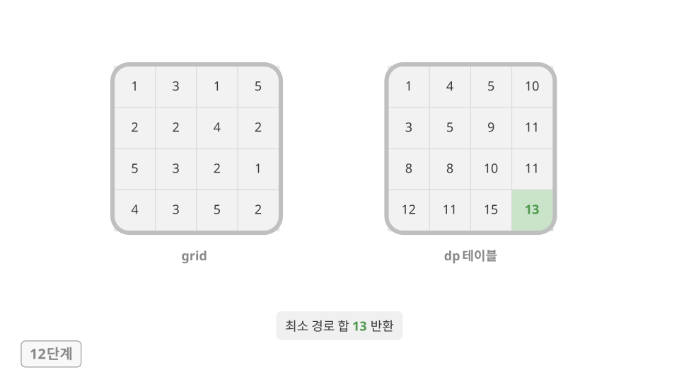

# 동적 계획법 문제 풀이

앞선 두 절에서 동적 계획법 문제의 주요 특성을 알아보았다. 이제 실제로 문제를 풀 때 마주치는 두 가지 질문을 살펴보자.

1. 동적 계획법으로 풀 문제인지 어떻게 판단하는가?
2. 동적 계획법 문제는 어디에서 시작해 어떤 순서로 풀어야 하는가?

## 문제 판별

일반적으로 중복되는 부분 문제와 최적 부분 구조가 있고 무후효성을 만족한다면 동적 계획법이 적합하다. 하지만 문제 설명만 보고 이런 특성을 바로 알아내기는 어렵다. 그래서 조건을 조금 완화하여 **백트래킹(완전 탐색)으로 풀 수 있는지 먼저 살펴본다**.

**백트래킹이 적합한 문제는 보통 ‘의사 결정 트리’로 나타낼 수 있다**. 각 노드는 하나의 결정을, 각 경로는 일련의 결정을 나타낸다.

다시 말해 무엇을 결정하는지가 명확하고 그러한 결정들이 모여 해가 된다면 의사 결정 트리로 모델링할 수 있으며, 대개 백트래킹으로 풀 수 있다.

여기에 다음과 같은 특징까지 있다면 동적 계획법이 적합할 가능성이 더 높다.

- 최대나 최소, 가장 많거나 가장 적은 수 등 최적화 목표가 주어진다.
- 리스트, 다차원 행렬 또는 트리로 상태를 나타낼 수 있고, 한 상태와 주변 상태 사이에 점화 관계가 있다.

반대로 다음과 같은 특징은 동적 계획법이 적합할 가능성을 낮춘다.

- 최적해 하나를 구하는 것이 아니라 가능한 모든 해를 찾아야 한다.
- 문제에 순열이나 조합의 특징이 뚜렷하며, 구체적인 방법을 여러 개 반환해야 한다.

문제를 의사 결정 트리로 나타낼 수 있고 동적 계획법에 유리한 특징이 뚜렷하면, 일단 동적 계획법 문제라고 가정하고 풀어 가면서 그 가정을 확인할 수 있다.

## 문제 풀이 단계

동적 계획법의 풀이 과정은 문제의 성격과 난이도에 따라 달라진다. 보통은 각 단계의 결정을 설명하고, 상태를 정의하고, $dp$ 테이블을 만든 뒤, 상태 전이식을 유도하고 경계 조건을 정한다.

풀이 단계를 구체적으로 살펴보기 위해 대표적인 문제인 ‘최소 경로 합’을 예로 들자.

!!! question

    크기가 $n \times m$인 2차원 격자 `grid`가 주어진다. 각 칸에는 그 칸의 비용을 나타내는 음이 아닌 정수가 들어 있다. 로봇은 왼쪽 위 칸에서 출발해 한 번에 아래나 오른쪽으로 한 칸씩 이동하여 오른쪽 아래 칸에 도달한다. 왼쪽 위에서 오른쪽 아래까지의 최소 경로 합을 반환하라.

아래 그림에서 주어진 격자의 최소 경로 합은 $13$이다.


**첫 번째 단계: 매번 내릴 결정을 생각하고 상태를 정의해 $dp$ 테이블 구성하기**

이 문제에서 매번 내리는 결정은 현재 칸에서 아래로 한 칸 갈지 오른쪽으로 한 칸 갈지다. 현재 칸의 행과 열 인덱스가 $[i, j]$이라면 아래나 오른쪽으로 움직인 뒤에는 각각 $[i+1, j]$ 또는 $[i, j+1]$이 된다. 따라서 상태에는 행 인덱스와 열 인덱스라는 두 변수가 필요하며 이를 $[i, j]$로 표기한다.

상태 $[i, j]$의 부분 문제는 출발점 $[0, 0]$에서 $[i, j]$까지의 최소 경로 합을 구하는 것이다. 그 해를 $dp[i, j]$로 표기한다.

이렇게 하면 아래 그림처럼 입력 격자 $grid$와 크기가 같은 2차원 $dp$ 행렬을 얻는다.



!!! note

    동적 계획법과 백트래킹의 과정은 일련의 결정으로 설명할 수 있다. 상태는 모든 결정 변수로 구성된다. 풀이가 어디까지 진행되었는지를 나타내는 변수를 빠짐없이 담아야 다음 상태를 유도하는 데 필요한 정보가 충분하다.
    
    각 상태는 하나의 부분 문제에 대응한다. 모든 부분 문제의 해를 저장할 $dp$ 테이블을 정의하면 상태의 각 독립변수가 $dp$ 테이블의 한 차원이 된다. 본질적으로 $dp$ 테이블은 상태를 그 부분 문제의 해에 대응시키는 표다.

**두 번째 단계: 최적 부분 구조를 찾고 상태 전이식 유도하기**

상태 $[i, j]$로는 위쪽 칸 $[i-1, j]$과 왼쪽 칸 $[i, j-1]$에서만 올 수 있다. 따라서 $[i, j]$까지의 최소 경로 합은 $[i, j-1]$까지의 최소 경로 합과 $[i-1, j]$까지의 최소 경로 합 중 작은 쪽으로 결정된다. 이것이 최적 부분 구조다.

이 관계로부터 아래 그림의 상태 전이식을 얻는다.

$$
dp[i, j] = \min(dp[i-1, j], dp[i, j-1]) + grid[i, j]
$$


!!! note

    정의한 $dp$ 테이블을 바탕으로 원래 문제와 부분 문제의 관계를 살펴본다. 부분 문제의 최적해로 원래 문제의 최적해를 구성하는 방법을 찾으면 그것이 최적 부분 구조다.

    최적 부분 구조를 찾으면 이를 바탕으로 상태 전이식을 세울 수 있다.

**세 번째 단계: 경계 조건과 상태 전이 순서 정하기**

이 문제에서 첫 행의 상태는 왼쪽 상태에서만, 첫 열의 상태는 위쪽 상태에서만 올 수 있다. 따라서 첫 행 $i = 0$과 첫 열 $j = 0$이 경계 조건이다.

아래 그림처럼 각 칸은 왼쪽 칸과 위쪽 칸에서 전이하므로 반복문으로 행렬을 순회한다. 바깥 반복문에서는 행을, 안쪽 반복문에서는 열을 차례로 방문한다.


!!! note

    경계 조건은 동적 계획법에서는 $dp$ 테이블을 초기화하는 데, 탐색에서는 가지치기에 쓰인다.
    
    상태 전이 순서를 정할 때는 현재 문제의 해를 구하는 시점에 그 해가 의존하는 더 작은 부분 문제들이 모두 올바르게 풀려 있도록 해야 한다.

지금까지의 분석만으로도 동적 계획법 코드를 바로 작성할 수 있다. 다만 부분 문제로 나누는 사고 과정은 하향식이므로 ‘완전 탐색 $\rightarrow$ 메모이제이션 탐색 $\rightarrow$ 동적 계획법’ 순서로 구현하는 편이 자연스럽다.

### 방법 1: 완전 탐색

상태 $[i, j]$에서 탐색을 시작해 더 작은 상태 $[i-1, j]$과 $[i, j-1]$로 계속 나눈다. 재귀 함수는 다음 요소로 구성된다.

- **재귀 호출의 매개변수**: 상태 $[i, j]$.
- **반환값**: $[0, 0]$에서 $[i, j]$까지의 최소 경로 합 $dp[i, j]$.
- **종료 조건**: $i = 0$이고 $j = 0$이면 비용 $grid[0, 0]$을 반환한다.
- **가지치기**: $i < 0$이거나 $j < 0$이면 인덱스가 범위를 벗어나므로, 불가능한 경로를 나타내는 비용 $+\infty$를 반환한다.

코드는 다음과 같다.

```src
[file]{min_path_sum}-[class]{}-[func]{min_path_sum_dfs}
```

아래 그림은 $dp[2, 1]$을 루트로 하는 재귀 트리다. 중복되는 부분 문제가 보이며, 그 수는 격자 `grid`의 크기가 커질수록 급격히 늘어난다.

부분 문제가 중복되는 근본적인 이유는 **왼쪽 위에서 어떤 칸까지 도달하는 경로가 여러 개일 수 있기 때문**이다.



각 상태에서는 아래와 오른쪽으로 가는 두 가지 선택이 있고, 왼쪽 위에서 오른쪽 아래까지는 총 $m + n - 2$걸음이 필요하다. 따라서 최악의 시간 복잡도는 $O(2^{m + n})$이다. 여기서 $n$과 $m$은 각각 격자의 행 수와 열 수다. 이 계산은 격자 경계 부근의 상황을 고려하지 않는다. 경계에 도달하면 선택지가 하나만 남으므로 실제 경로 수는 이보다 적다.

### 방법 2: 메모이제이션 탐색

격자 `grid`와 크기가 같은 메모 리스트 `mem`을 두어 각 부분 문제의 해를 기록하고 중복되는 부분 문제를 가지치기한다.

```src
[file]{min_path_sum}-[class]{}-[func]{min_path_sum_dfs_mem}
```

아래 그림처럼 메모이제이션을 적용하면 각 부분 문제의 해를 한 번만 계산한다. 따라서 시간 복잡도는 전체 상태 수, 즉 격자의 크기에 비례하는 $O(nm)$이다.



### 방법 3: 동적 계획법

반복문을 사용해 동적 계획법을 구현하면 다음과 같다.

```src
[file]{min_path_sum}-[class]{}-[func]{min_path_sum_dp}
```

아래 그림은 최소 경로 합을 구하는 상태 전이 과정이다. 격자 전체를 순회하므로 **시간 복잡도는 $O(nm)$이다**.

배열 `dp`의 크기는 $n \times m$이므로 **공간 복잡도는 $O(nm)$이다**.

=== "<1>"
    

=== "<2>"
    

=== "<3>"
    

=== "<4>"
    

=== "<5>"
    

=== "<6>"
    

=== "<7>"
    

=== "<8>"
    

=== "<9>"
    

=== "<10>"
    

=== "<11>"
    

=== "<12>"
    

### 공간 최적화

각 칸은 왼쪽 칸과 위쪽 칸에만 의존하므로 한 행짜리 배열 하나로 $dp$ 테이블을 구현할 수 있다.

배열 `dp`는 한 행의 상태만 나타낼 수 있다. 따라서 첫 열의 상태를 모두 미리 초기화할 수 없고, 각 행을 순회할 때 해당 값을 갱신해야 한다.

```src
[file]{min_path_sum}-[class]{}-[func]{min_path_sum_dp_comp}
```
