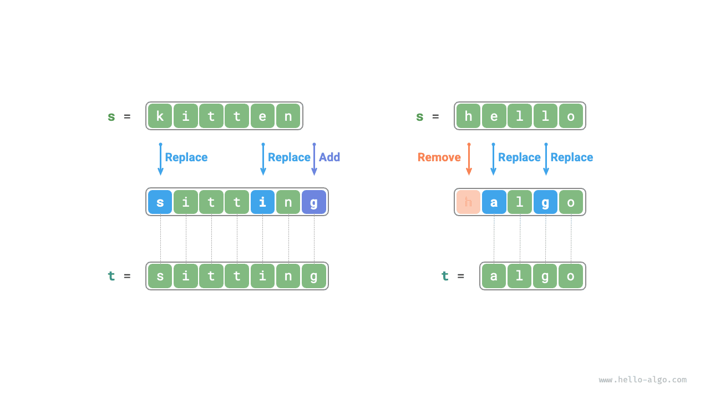
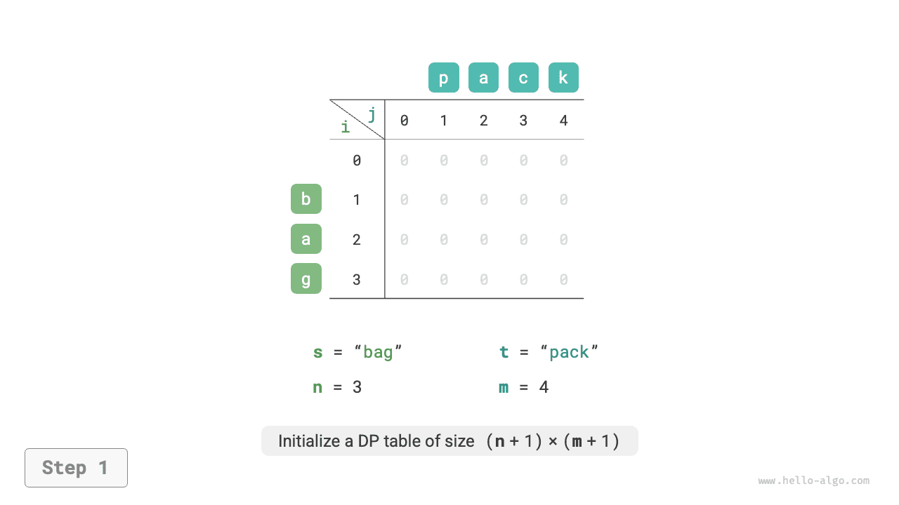
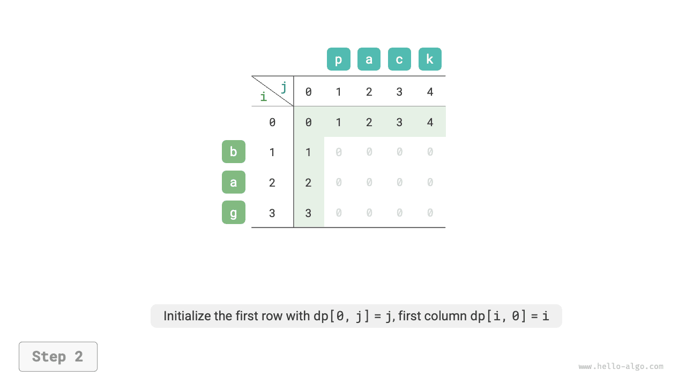
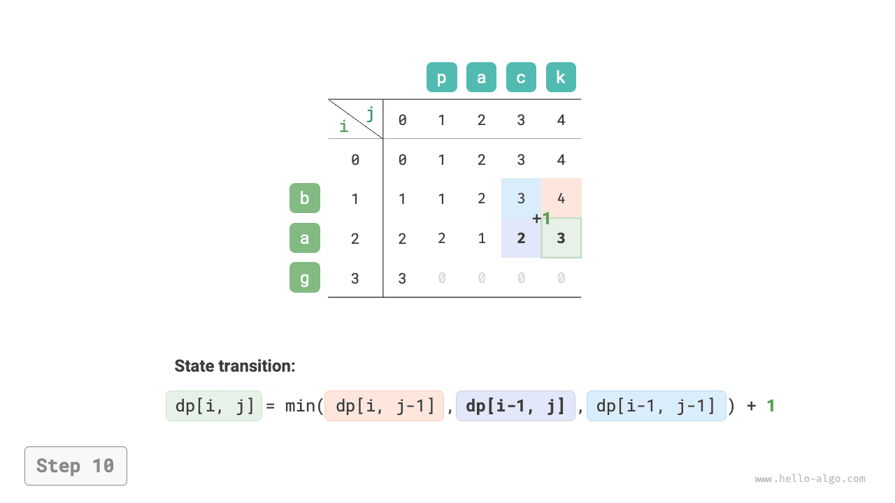

# 편집 거리 문제

편집 거리 또는 Levenshtein 거리는 두 문자열을 서로 바꾸는 데 필요한 최소 수정 횟수다. 정보 검색과 자연어 처리에서 두 시퀀스의 유사도를 측정할 때 자주 사용한다.

!!! question "문제"

    두 문자열 $s$와 $t$를 입력받아 $s$를 $t$로 바꾸는 데 필요한 최소 편집 횟수를 반환하라.
    
    문자열에 문자를 하나 삽입하거나, 하나 삭제하거나, 한 문자를 임의의 다른 문자로 바꾸는 세 연산을 할 수 있다.

아래 그림과 같이 `kitten`을 `sitting`으로 바꾸려면 교체 2회와 추가 1회로 총 3회 편집해야 한다. `hello`를 `algo`로 바꾸려면 교체 2회와 삭제 1회로 총 3회가 필요하다.



**편집 거리 문제는 의사 결정 트리 모형으로 자연스럽게 설명할 수 있다**. 문자열은 트리 노드에, 한 번의 결정(편집 연산)은 간선 하나에 대응한다.

아래 그림과 같이 연산을 제한하지 않으면 각 노드에서 다양한 연산에 대응하는 많은 간선이 뻗어 나온다. 즉, `hello`에서 `algo`로 가는 경로는 매우 많다.

의사 결정 트리의 관점에서 이 문제의 목표는 노드 `hello`와 노드 `algo` 사이의 최단 경로를 구하는 것이다.


### 동적 계획법 접근

**1단계: 매 차례의 결정을 생각하고 상태를 정의하여 $dp$ 테이블을 얻는다**

매 차례의 결정은 문자열 $s$에 편집 연산을 한 번 적용하는 것이다.

부분 문제를 만들려면 편집하는 동안 문제의 크기가 점차 줄어들어야 한다. 문자열 $s$와 $t$의 길이를 각각 $n$과 $m$이라고 하고, 두 문자열의 마지막 문자 $s[n-1]$과 $t[m-1]$을 먼저 살펴보자.

- $s[n-1]$과 $t[m-1]$이 같으면 두 문자를 건너뛰고 $s[n-2]$와 $t[m-2]$를 바로 살펴볼 수 있다.
- $s[n-1]$과 $t[m-1]$이 다르면 $s$에 편집(삽입, 삭제, 교체)을 한 번 적용하여 끝 문자가 같아지게 하고, 이를 건너뛰어 더 작은 문제를 살펴본다.

즉, 문자열 $s$에서 결정(편집 연산)을 할 때마다 $s$와 $t$에서 아직 맞추어야 하는 문자들이 달라진다. 따라서 현재 살펴보는 $s$의 $i$ 번째 문자와 $t$의 $j$ 번째 문자를 상태로 정의하고 $[i, j]$라고 한다.

상태 $[i, j]$의 부분 문제는 **$s$의 앞 $i$ 개 문자를 $t$의 앞 $j$ 개 문자로 바꾸는 최소 편집 횟수**다.

이로써 $(n+1) \times (m+1)$ 크기의 2차원 $dp$ 테이블을 얻는다.

**2단계: 최적 부분 구조를 찾아 상태 전이 식을 도출한다**

부분 문제 $dp[i, j]$에 해당하는 두 문자열의 끝 문자는 $s[i-1]$과 $t[j-1]$이다. 편집 연산에 따라 아래 그림의 세 경우로 나뉜다.

1. $s[i-1]$ 뒤에 $t[j-1]$을 추가하면 부분 문제 $dp[i, j-1]$이 남는다.
2. $s[i-1]$을 삭제하면 부분 문제 $dp[i-1, j]$가 남는다.
3. $s[i-1]$을 $t[j-1]$로 바꾸면 부분 문제 $dp[i-1, j-1]$이 남는다.


위 분석으로 최적 부분 구조를 얻는다. $dp[i, j]$의 최소 편집 횟수는 $dp[i, j-1]$, $dp[i-1, j]$, $dp[i-1, j-1]$ 중 가장 작은 편집 횟수에 이번 편집 횟수 $1$을 더한 값이다. 상태 전이 식은 다음과 같다.

$$
dp[i, j] = \min(dp[i, j-1], dp[i-1, j], dp[i-1, j-1]) + 1
$$

**$s[i-1]$과 $t[j-1]$이 같으면 현재 문자를 편집할 필요가 없으며**, 이때 상태 전이 식은 다음과 같다.

$$
dp[i, j] = dp[i-1, j-1]
$$

**3단계: 경계 조건과 상태 전이 순서를 정한다**

두 문자열이 모두 비어 있으면 편집 횟수는 $0$이므로 $dp[0, 0] = 0$이다. $s$만 비어 있고 $t$는 비어 있지 않으면 최소 편집 횟수는 $t$의 길이이므로 첫 행은 $dp[0, j] = j$다. 반대로 $s$는 비어 있지 않고 $t$가 비어 있으면 최소 편집 횟수는 $s$의 길이이므로 첫 열은 $dp[i, 0] = i$다.

상태 전이 식에서 $dp[i, j]$는 왼쪽, 위쪽, 왼쪽 위의 해에 의존하므로 이중 반복문으로 전체 $dp$ 테이블을 정방향으로 순회하면 된다.

### 코드 구현

```src
[file]{edit_distance}-[class]{}-[func]{edit_distance_dp}
```

아래 그림과 같이 편집 거리의 상태 전이는 배낭 문제와 매우 비슷하며, 모두 2차원 격자를 채우는 과정으로 볼 수 있다.

=== "<1>"
    

=== "<2>"
    

=== "<3>"
    

=== "<4>"
    

=== "<5>"
    

=== "<6>"
    

=== "<7>"
    

=== "<8>"
    

=== "<9>"
    

=== "<10>"
    

=== "<11>"
    

=== "<12>"
    

=== "<13>"
    

=== "<14>"
    

=== "<15>"
    

### 공간 최적화

$dp[i,j]$는 위쪽 $dp[i-1, j]$, 왼쪽 $dp[i, j-1]$, 왼쪽 위 $dp[i-1, j-1]$에서 전이된다. 그런데 정방향 순회는 왼쪽 위 값 $dp[i-1, j-1]$을 잃고, 역방향 순회는 $dp[i, j-1]$을 미리 계산하지 못하므로 두 순서 모두 그대로는 사용할 수 없다.

이를 위해 변수 `leftup`에 왼쪽 위의 해 $dp[i-1, j-1]$을 잠시 저장하면 왼쪽과 위쪽의 해만 고려하면 된다. 이때는 무한 배낭 문제와 같은 상황이므로 정방향 순회를 사용할 수 있다. 코드는 다음과 같다.

```src
[file]{edit_distance}-[class]{}-[func]{edit_distance_dp_comp}
```
