# 편집 거리 문제

편집 거리 또는 레벤슈타인(Levenshtein) 거리는 한 문자열을 다른 문자열로 바꾸는 데 필요한 최소 수정 횟수다. 정보 검색이나 자연어 처리에서 두 시퀀스의 유사도를 측정할 때 자주 쓰인다.

!!! question

    두 문자열 $s$와 $t$이 주어질 때 $s$를 $t$로 바꾸는 데 필요한 최소 편집 횟수를 반환하라.
    
    문자열에 허용되는 편집은 세 가지다. 문자 하나를 삽입하거나 삭제하거나 임의의 다른 문자로 교체할 수 있다.

아래 그림에서 `kitten`을 `sitting`으로 바꾸려면 두 번 교체하고 한 번 추가하는 총 3회의 편집이 필요하다. `hello`를 `algo`로 바꾸려면 두 번 교체하고 한 번 삭제하는 총 3회가 필요하다.

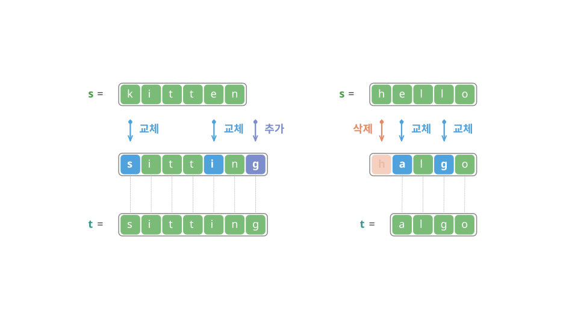

**편집 거리 문제는 의사 결정 트리로 자연스럽게 설명할 수 있다**. 문자열은 트리의 노드에, 한 번의 결정(편집 연산 한 번)은 간선 하나에 대응한다.

아래 그림처럼 연산을 제한하지 않으면 각 노드에서 많은 간선이 뻗어 나온다. 간선마다 한 가지 연산을 나타내므로 `hello`에서 `algo`로 가는 경로도 여러 가지다.

의사 결정 트리로 보면 이 문제의 목표는 노드 `hello`와 노드 `algo` 사이의 최단 경로를 찾는 것이다.

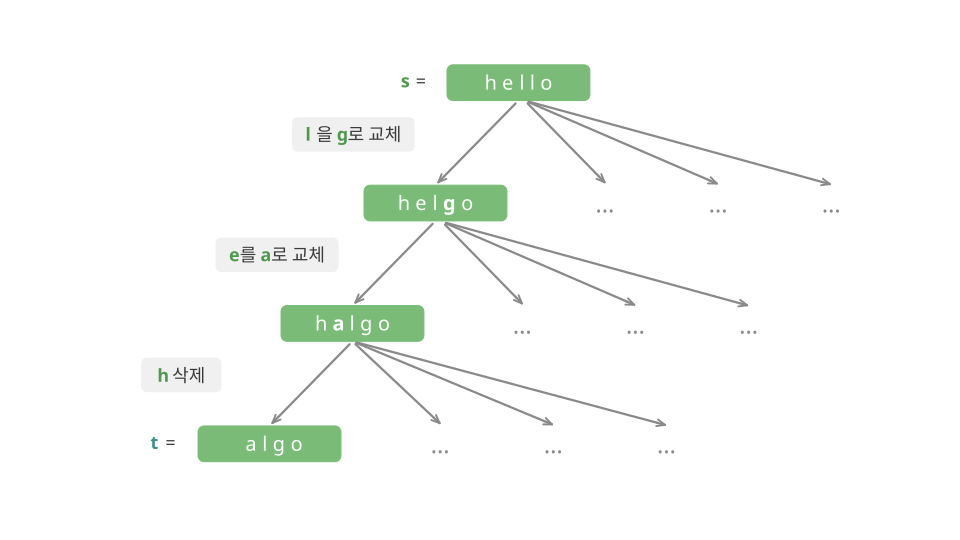

### 동적 계획법으로 접근하기

**첫 번째 단계: 매번 내릴 결정을 생각하고 상태를 정의해 $dp$ 테이블 구성하기**

매번 내릴 결정은 문자열 $s$에 어느 편집 연산을 한 번 적용할지다.

부분 문제를 구성하려면 편집할 때마다 문제의 크기가 줄어들어야 한다. 문자열 $s$와 $t$의 길이를 각각 $n$과 $m$이라 하고, 먼저 두 문자열의 마지막 문자 $s[n-1]$와 $t[m-1]$를 살펴보자.

- $s[n-1]$과 $t[m-1]$이 같으면 두 문자를 건너뛰고 바로 $s[n-2]$와 $t[m-2]$을 살펴볼 수 있다.
- $s[n-1]$과 $t[m-1]$이 다르면 $s$를 한 번 편집해(삽입, 삭제, 교체) 두 문자열의 끝을 맞춘다. 그러면 일치하는 문자를 건너뛰고 더 작은 문제를 다룰 수 있다.

즉, 문자열 $s$에 대해 내리는 매번의 결정(편집 연산)에 따라 $s$와 $t$에서 아직 맞춰야 할 문자가 달라진다. 따라서 $s$의 $i$번째 문자와 $t$의 $j$번째 문자를 현재 고려하는 상태를 $[i, j]$로 나타낸다.

상태 $[i, j]$에 해당하는 부분 문제는 **$s$의 앞 $i$개 문자를 $t$의 앞 $j$개 문자로 바꾸는 데 필요한 최소 편집 횟수**를 구하는 것이다.

이렇게 하면 크기가 $(n+1) \times (m+1)$인 2차원 $dp$ 테이블을 얻는다.

**두 번째 단계: 최적 부분 구조를 찾고 상태 전이식 유도하기**

부분 문제 $dp[i, j]$에서 두 문자열의 마지막 문자는 각각 $s[i-1]$과 $t[j-1]$다. 아래 그림처럼 편집 연산에 따라 세 경우로 나눌 수 있다.

1. $s[i-1]$ 뒤에 $t[j-1]$을 추가하면 남는 부분 문제는 $dp[i, j-1]$다.
2. $s[i-1]$을 삭제하면 남는 부분 문제는 $dp[i-1, j]$이다.
3. $s[i-1]$을 $t[j-1]$로 교체하면 남는 부분 문제는 $dp[i-1, j-1]$다.

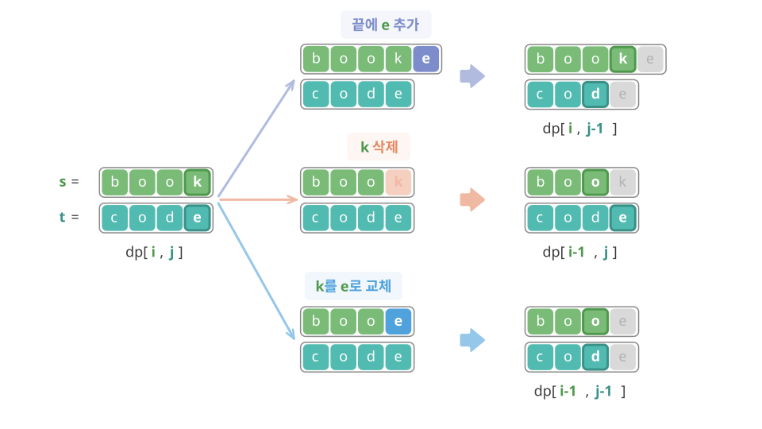

이제 최적 부분 구조가 드러난다. $dp[i, j]$의 최소 편집 횟수는 $dp[i, j-1]$, $dp[i-1, j]$, $dp[i-1, j-1]$의 최소 편집 횟수 중 가장 작은 값에 이번 편집 횟수 $1$을 더한 값이다. 이에 해당하는 상태 전이식은 다음과 같다.

$$
dp[i, j] = \min(dp[i, j-1], dp[i-1, j], dp[i-1, j-1]) + 1
$$

**$s[i-1]$과 $t[j-1]$가 같으면 현재 문자를 편집할 필요가 없다**. 이때 상태 전이식은 다음과 같다.

$$
dp[i, j] = dp[i-1, j-1]
$$

**세 번째 단계: 경계 조건과 상태 전이 순서 정하기**

두 문자열이 모두 비어 있으면 편집 횟수는 $0$이므로 $dp[0, 0] = 0$이다. $s$가 비어 있고 $t$가 비어 있지 않으면 최소 편집 횟수는 $t$의 길이이므로 첫 행은 $dp[0, j] = j$이다. $s$가 비어 있지 않고 $t$가 비어 있으면 최소 편집 횟수는 $s$의 길이이므로 첫 열은 $dp[i, 0] = i$이다.

상태 전이식에서 $dp[i, j]$는 왼쪽, 위쪽, 왼쪽 위 칸의 해에 의존한다. 따라서 이중 반복문으로 $dp$ 테이블 전체를 정순으로 순회하면 된다.

### 코드 구현

```src
[file]{edit_distance}-[class]{}-[func]{edit_distance_dp}
```

아래 그림처럼 편집 거리의 상태 전이 과정은 배낭 문제와 매우 비슷하다. 둘 다 2차원 격자를 채우는 과정으로 볼 수 있다.

=== "<1>"
    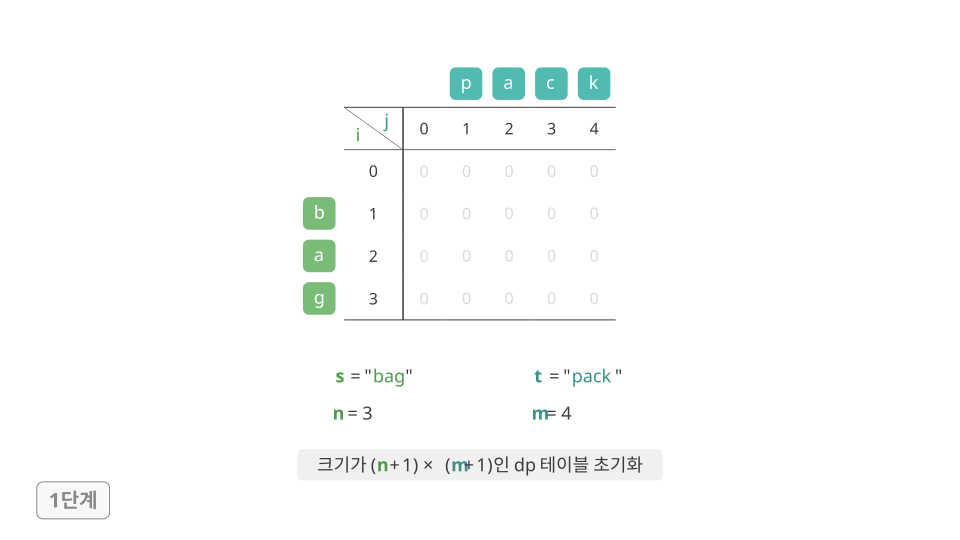

=== "<2>"
    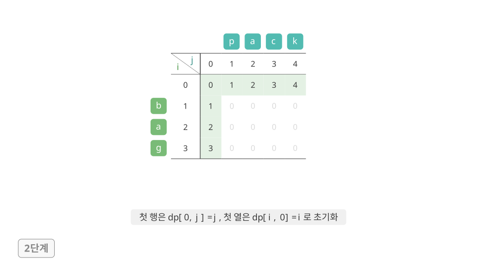

=== "<3>"
    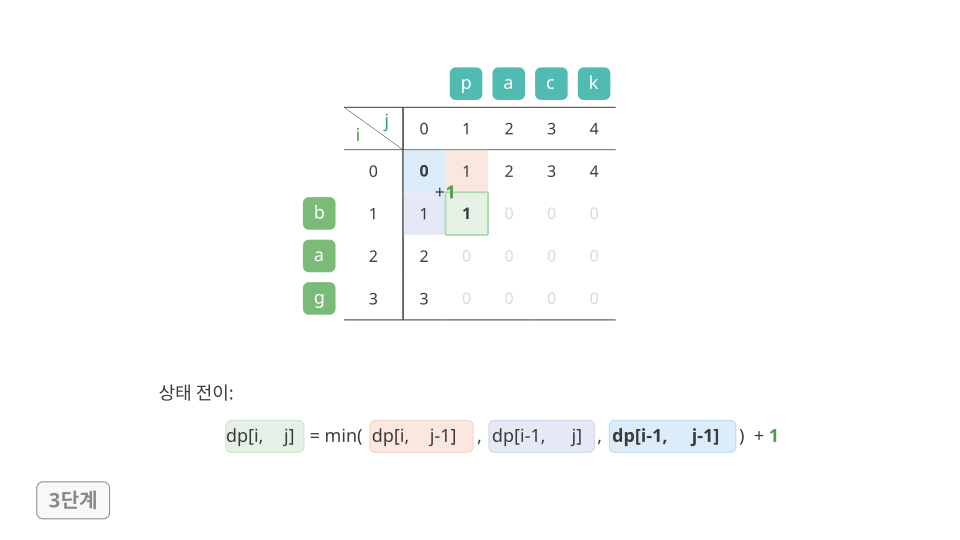

=== "<4>"
    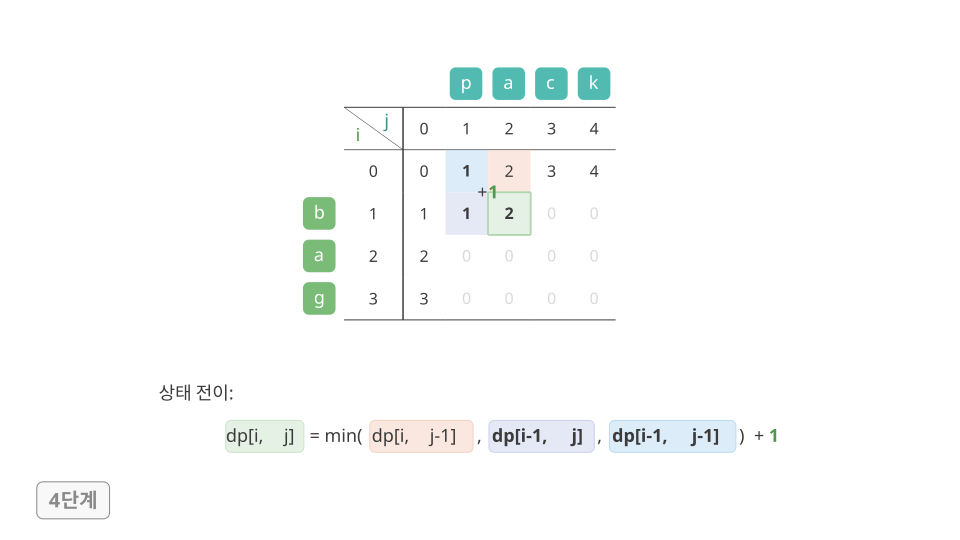

=== "<5>"
    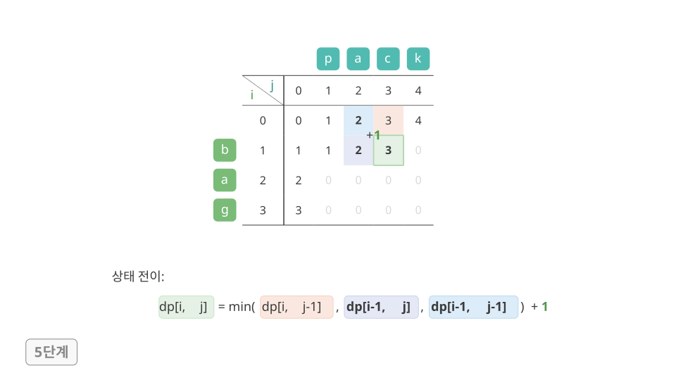

=== "<6>"
    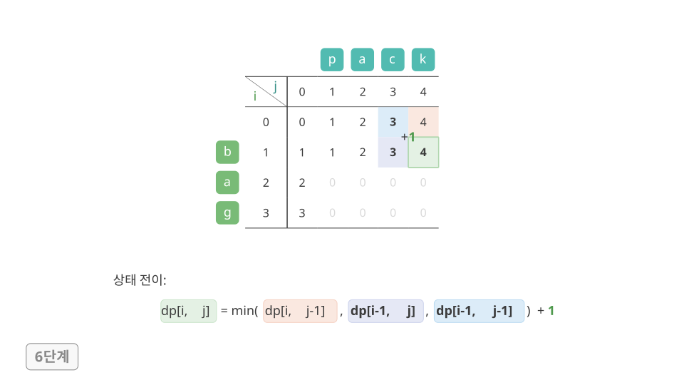

=== "<7>"
    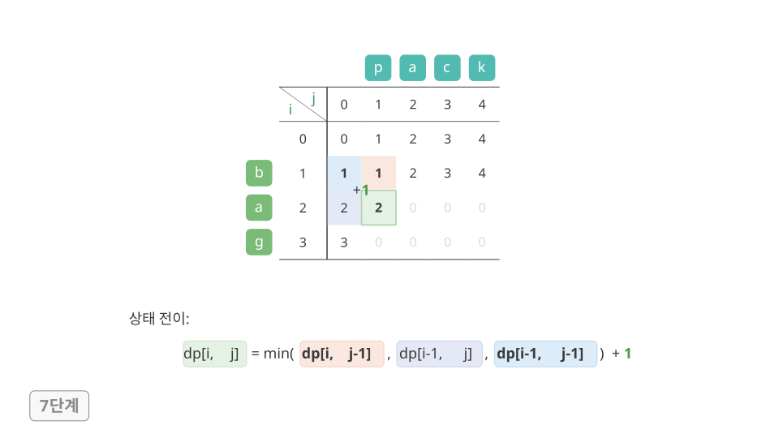

=== "<8>"
    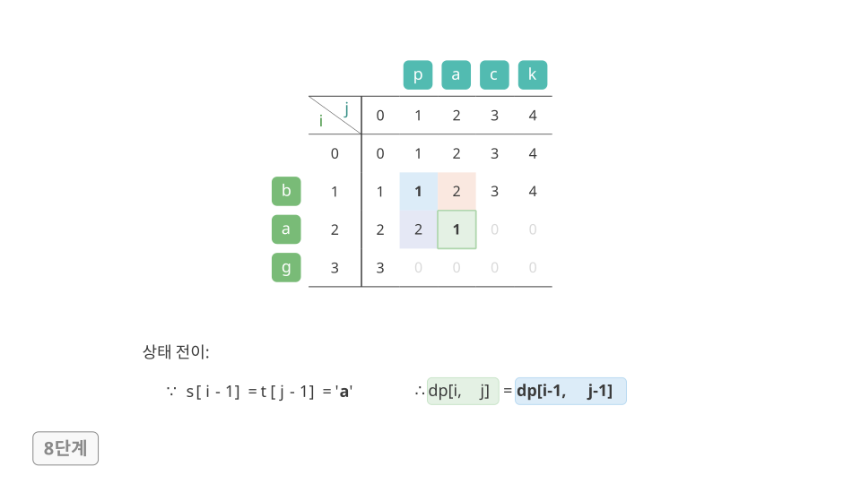

=== "<9>"
    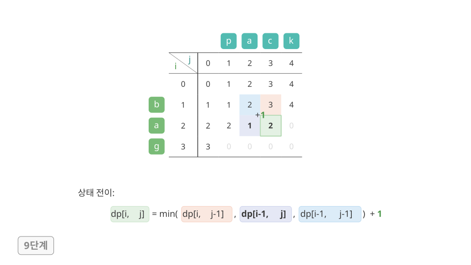

=== "<10>"
    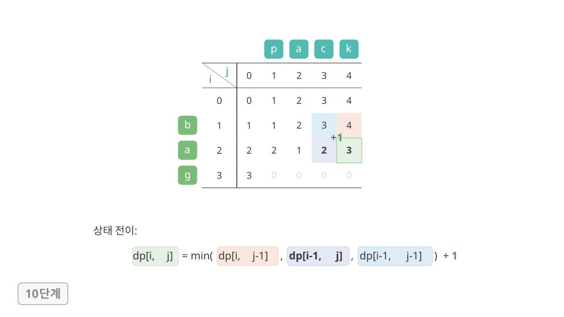

=== "<11>"
    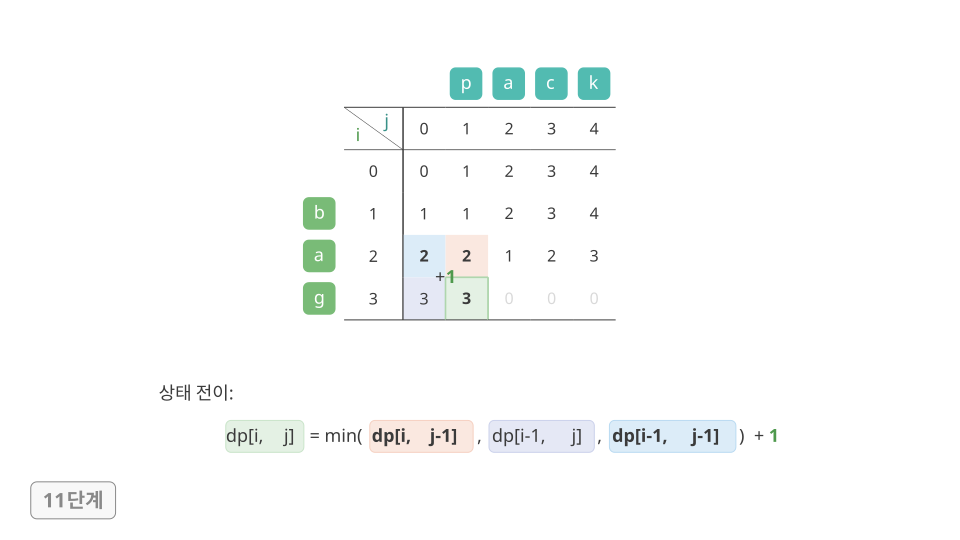

=== "<12>"
    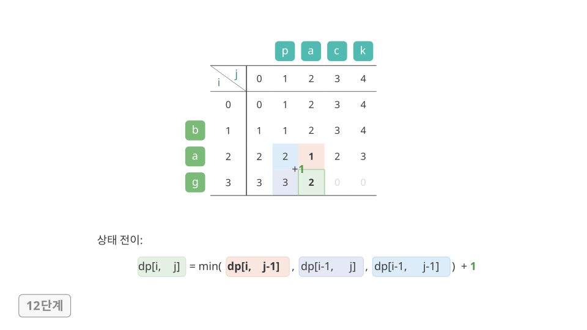

=== "<13>"
    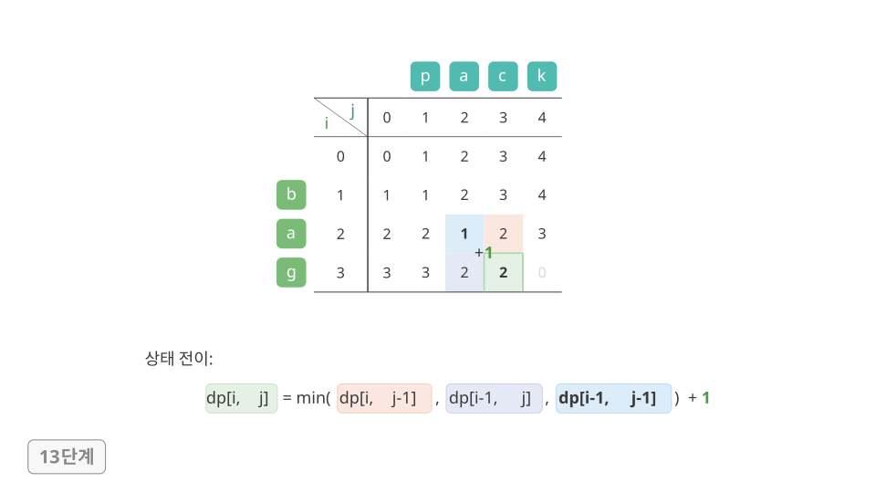

=== "<14>"
    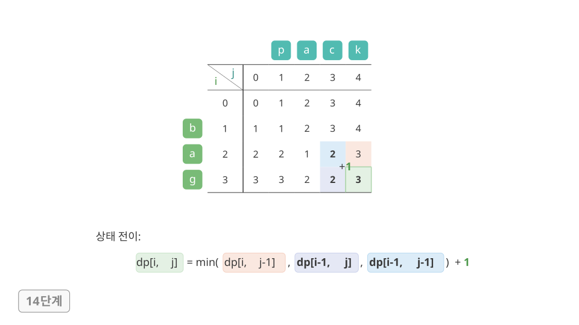

=== "<15>"
    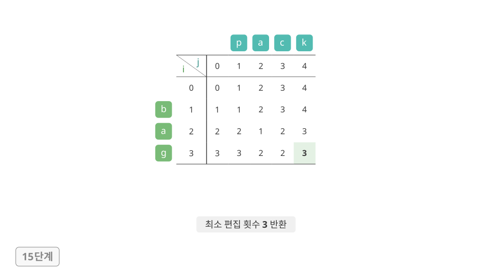

### 공간 최적화

$dp[i,j]$는 위쪽 $dp[i-1, j]$, 왼쪽 $dp[i, j-1]$, 왼쪽 위 $dp[i-1, j-1]$에서 전이한다. 정순으로 순회하면 왼쪽 위 값 $dp[i-1, j-1]$를 잃고, 역순으로 순회하면 $dp[i, j-1]$를 미리 계산할 수 없다. 따라서 어느 순서도 그대로는 쓸 수 없다.

변수 `leftup`에 왼쪽 위의 해 $dp[i-1, j-1]$을 잠시 보관하면 왼쪽과 위쪽의 해만 고려하면 된다. 그러면 무한 배낭 문제와 같은 상황이 되어 정순으로 순회할 수 있다. 코드는 다음과 같다.

```src
[file]{edit_distance}-[class]{}-[func]{edit_distance_dp_comp}
```
