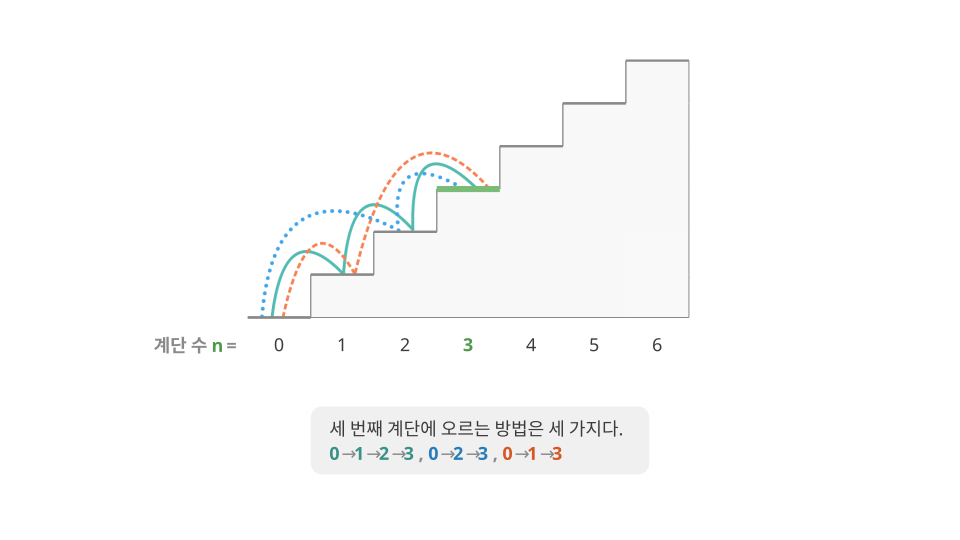
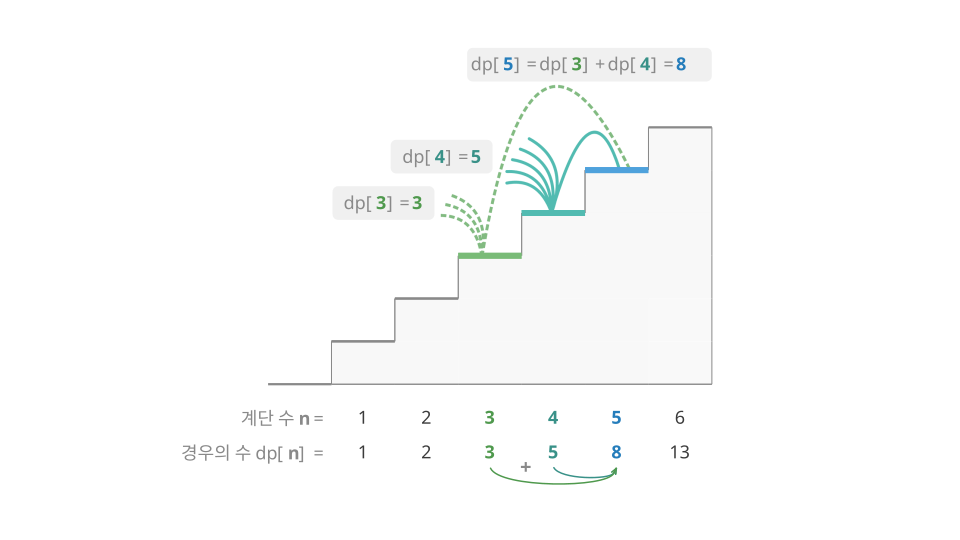
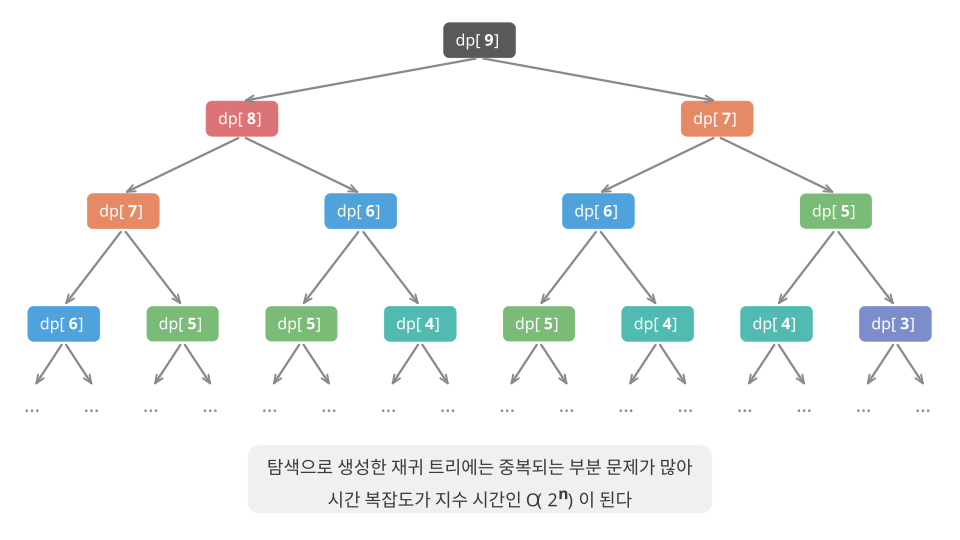
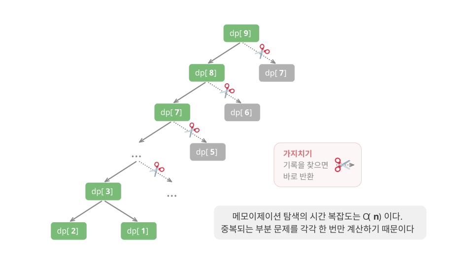
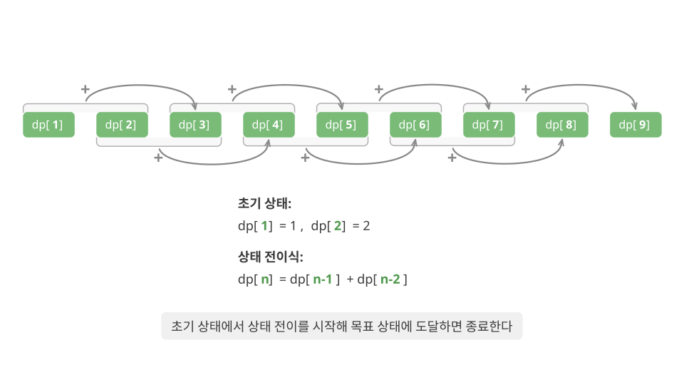

# 동적 계획법 첫걸음

<u>동적 계획법(dynamic programming)</u>은 문제를 더 작은 부분 문제들로 나누고 그 해를 저장해 중복 계산을 피하는 중요한 알고리즘 설계 방식이다. 이를 통해 실행 시간을 크게 줄일 수 있다.

이 절에서는 대표적인 예제를 백트래킹으로 완전 탐색하는 풀이부터 시작한다. 그 안에서 중복되는 부분 문제를 찾아보고, 더 효율적인 동적 계획법 풀이를 단계적으로 이끌어 내자.

!!! question "계단 오르기"

    계단이 모두 $n$개다. 한 번에 $1$계단이나 $2$계단을 오를 수 있다면 꼭대기까지 오르는 방법은 몇 가지인가?

아래 그림처럼 계단이 $3$개라면 꼭대기에 오르는 방법은 모두 $3$가지다.



목표는 방법의 수를 구하는 것이므로 **백트래킹으로 모든 가능성을 열거할 수 있다**. 계단 오르기를 여러 번 선택하는 과정으로 생각해 보자. 지면에서 출발해 매번 $1$계단이나 $2$계단을 오른다. 꼭대기에 도착할 때마다 방법 수에 $1$을 더하고, 꼭대기를 넘어가는 경우는 가지치기한다. 코드는 다음과 같다.

```src
[file]{climbing_stairs_backtrack}-[class]{}-[func]{climbing_stairs_backtrack}
```

## 방법 1: 완전 탐색

백트래킹에서는 보통 문제를 명시적으로 나누지 않는다. 문제 풀이를 일련의 결정으로 보고, 선택을 시도하고 불필요한 분기를 가지치기하면서 가능한 해를 모두 탐색한다.

이번에는 문제를 나누는 관점에서 살펴보자. $i$번째 계단까지 오르는 방법이 모두 $dp[i]$가지라면 풀고자 하는 원래 문제는 $dp[i]$이고, 부분 문제는 다음과 같다.

$$
dp[i-1], dp[i-2], \dots, dp[2], dp[1]
$$

한 번에 $1$계단이나 $2$계단만 오를 수 있다. 따라서 지금 $i$번째 계단에 있다면 직전에는 $i - 1$번째 또는 $i - 2$번째 계단에 있었다. 다시 말해 $i -1$번째나 $i - 2$번째 계단에서만 $i$번째 계단으로 오를 수 있다.

여기서 중요한 결론을 얻는다. **$i - 1$번째 계단에 오르는 방법 수와 $i - 2$번째 계단에 오르는 방법 수를 더하면 $i$번째 계단에 오르는 방법 수가 된다**. 식으로 쓰면 다음과 같다.

$$
dp[i] = dp[i-1] + dp[i-2]
$$

즉, 계단 오르기의 부분 문제들 사이에는 점화 관계가 있어 **부분 문제의 해로 원래 문제의 해를 구성할 수 있다**. 아래 그림은 이 관계를 보여 준다.



이 점화식으로 완전 탐색 풀이를 만들 수 있다. $dp[n]$에서 시작해 **큰 문제를 더 작은 두 문제의 해를 더하는 형태로 재귀적으로 나눈다**. 가장 작은 부분 문제 $dp[1]$과 $dp[2]$에 도달하면 값을 반환한다. 이 두 문제의 해는 이미 알고 있다. $dp[1] = 1$, $dp[2] = 2$이며, 이는 $1$번째와 $2$번째 계단에 오르는 방법이 각각 $1$가지와 $2$가지라는 뜻이다.

다음 코드는 표준적인 백트래킹 코드와 마찬가지로 깊이 우선 탐색을 수행하지만 더 간결하다.

```src
[file]{climbing_stairs_dfs}-[class]{}-[func]{climbing_stairs_dfs}
```

아래 그림은 완전 탐색으로 만들어지는 재귀 트리다. 문제 $dp[n]$의 재귀 트리 깊이는 $n$이고 시간 복잡도는 $O(2^n)$이다. 지수 함수는 폭발적으로 증가하므로 $n$이 조금만 커져도 결과를 한참 기다려야 한다.



그림에서 보듯 **시간 복잡도가 지수적으로 증가하는 이유는 ‘중복되는 부분 문제’ 때문이다**. 예를 들어 $dp[9]$는 $dp[8]$과 $dp[7]$로 나뉘고, $dp[8]$은 $dp[7]$과 $dp[6]$으로 나뉜다. 양쪽에 같은 부분 문제 $dp[7]$이 있다.

이런 부분 문제를 다시 나누면 더 작은 부분 문제들이 겹치고, 그 아래에서도 같은 일이 되풀이된다. 계산 자원의 대부분이 이렇게 중복되는 부분 문제에 쓰인다.

## 방법 2: 메모이제이션 탐색

효율을 높이려면 **중복되는 부분 문제를 각각 한 번만 계산해야 한다**. 이를 위해 배열 `mem`에 각 부분 문제의 해를 기록하고, 탐색 중에 같은 부분 문제가 나오면 가지치기한다.

1. $dp[i]$를 처음 계산할 때 그 값을 `mem[i]`에 기록해 두었다가 나중에 사용한다.
2. $dp[i]$가 다시 필요하면 `mem[i]`에서 바로 결과를 읽을 수 있어 같은 부분 문제를 다시 계산할 필요가 없다.

코드는 다음과 같다.

```src
[file]{climbing_stairs_dfs_mem}-[class]{}-[func]{climbing_stairs_dfs_mem}
```

아래 그림처럼 **메모이제이션을 적용하면 중복되는 부분 문제를 각각 한 번만 계산하므로 시간 복잡도가 $O(n)$으로 줄어든다**. 효율이 크게 향상된 것이다.



## 방법 3: 동적 계획법

**메모이제이션 탐색은 하향식 방법이다**. 원래 문제(루트 노드)에서 시작해 큰 부분 문제를 작은 부분 문제로 재귀적으로 나누다가, 해를 아는 가장 작은 부분 문제(리프 노드)에 도달한다. 그런 다음 되돌아가면서 층마다 부분 문제의 해를 모아 원래 문제의 해를 구성한다.

반대로 **동적 계획법은 상향식 방법이다**. 가장 작은 부분 문제의 해에서 시작해 더 큰 부분 문제의 해를 반복적으로 구성하여 원래 문제의 해를 얻는다.

동적 계획법에는 되돌아가는 과정이 없어 재귀 없이 반복문만으로 구현할 수 있다. 다음 코드에서는 배열 `dp`를 초기화해 부분 문제의 해를 저장한다. 이 배열은 메모이제이션 탐색의 배열 `mem`과 같은 기록 역할을 한다.

```src
[file]{climbing_stairs_dp}-[class]{}-[func]{climbing_stairs_dp}
```

아래 그림은 위 코드의 실행 과정을 보여 준다.



백트래킹과 마찬가지로 동적 계획법에서도 ‘상태’로 풀이의 특정 단계를 나타낸다. 각 상태에는 하나의 부분 문제와 그에 해당하는 국소 최적해가 대응한다. 예를 들어 계단 오르기에서 상태는 현재 서 있는 계단 번호 $i$이다.

지금까지 살펴본 내용을 바탕으로 동적 계획법에서 자주 쓰는 용어를 정리해 보자.

- 배열 `dp`를 <u>dp 테이블</u>이라고 한다. $dp[i]$는 상태 $i$에 해당하는 부분 문제의 해다.
- 가장 작은 부분 문제에 해당하는 상태($1$번째 계단과 $2$번째 계단)를 <u>초기 상태</u>라고 한다.
- 점화식 $dp[i] = dp[i-1] + dp[i-2]$를 <u>상태 전이식</u>이라고 한다.

## 공간 최적화

눈여겨보면 **$dp[i]$는 $dp[i-1]$과 $dp[i-2]$에만 의존하므로 배열 `dp`에 모든 부분 문제의 해를 저장할 필요가 없다**. 변수 두 개의 값을 차례로 바꾸어 나가면 된다. 코드는 다음과 같다.

```src
[file]{climbing_stairs_dp}-[class]{}-[func]{climbing_stairs_dp_comp}
```

위 코드에서는 배열 `dp`가 차지하던 공간이 필요 없어 공간 복잡도가 $O(n)$에서 $O(1)$로 줄었다.

동적 계획법에서 현재 상태는 바로 앞의 몇몇 상태에만 의존하는 경우가 많다. 이럴 때는 필요한 상태만 남겨 차원을 줄이면 메모리를 절약할 수 있다. **이러한 공간 최적화 기법을 ‘롤링 변수’ 또는 ‘롤링 배열’이라고 한다**.
