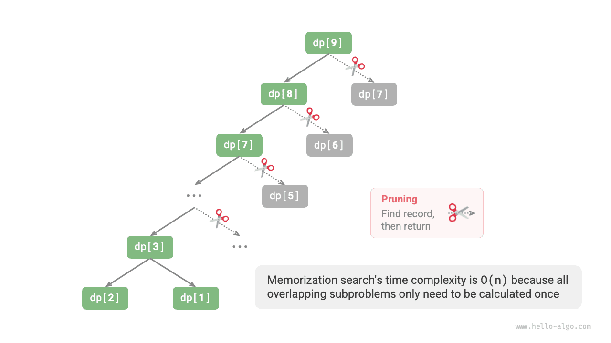

# 14.1 &nbsp; 동적 계획법 첫걸음

<u>동적 계획법(dynamic programming)</u>은 중요한 알고리즘 패러다임이다. 문제를 더 작은 부분 문제들로 나누고 그 해를 저장하여 중복 계산을 피함으로써 시간 효율을 크게 높인다.

이 절에서는 대표적인 예제에서 출발하여 먼저 완전 탐색을 수행하는 백트래킹 풀이를 제시한다. 그 안의 중복 부분 문제를 살펴보고, 더 효율적인 동적 계획법 풀이를 단계적으로 도출한다.

!!! question "계단 오르기"

    총 $n$ 칸인 계단이 있고, 한 번에 $1$ 칸 또는 $2$ 칸을 오를 수 있다. 맨 위까지 오르는 방법은 몇 가지인가?

아래 그림(14-1)과 같이 $3$ 칸짜리 계단의 맨 위에 오르는 방법은 총 $3$ 가지다.

{ class="animation-figure" }

<p align="center"> 그림 14-1 &nbsp; 3번째 칸까지 오르는 방법 수 </p>

이 문제는 방법의 수를 구하는 것이므로 **백트래킹으로 모든 가능성을 열거할 수 있다**. 계단 오르기를 여러 차례의 선택 과정으로 생각해 보자. 바닥에서 출발하여 매번 $1$ 칸 또는 $2$ 칸을 고른다. 맨 위에 도착할 때마다 방법 수를 $1$ 늘리고, 맨 위를 넘어가면 가지치기한다. 코드는 다음과 같다.

=== "Python"

    ```python title="climbing_stairs_backtrack.py"
    def backtrack(choices: list[int], state: int, n: int, res: list[int]) -> int:
        """백트래킹"""
        # n번째 계단에 도달하면 방법의 수에 1을 더한다
        if state == n:
            res[0] += 1
        # 모든 선택지를 순회한다
        for choice in choices:
            # 가지치기: n번째 계단을 넘어갈 수 없다
            if state + choice > n:
                continue
            # 시도: 선택하고 상태를 갱신한다
            backtrack(choices, state + choice, n, res)
            # 되돌리기

    def climbing_stairs_backtrack(n: int) -> int:
        """계단 오르기: 백트래킹"""
        choices = [1, 2]  # 한 계단 또는 두 계단 오르기를 선택할 수 있다
        state = 0  # 0번째 계단에서 오르기 시작한다
        res = [0]  # res[0]에 방법의 수를 기록한다
        backtrack(choices, state, n, res)
        return res[0]
    ```

=== "C++"

    ```cpp title="climbing_stairs_backtrack.cpp"
    /* 백트래킹 */
    void backtrack(vector<int> &choices, int state, int n, vector<int> &res) {
        // n번째 계단에 도달하면 방법의 수에 1을 더한다
        if (state == n)
            res[0]++;
        // 모든 선택지를 순회한다
        for (auto &choice : choices) {
            // 가지치기: n번째 계단을 넘어갈 수 없다
            if (state + choice > n)
                continue;
            // 시도: 선택하고 상태를 갱신한다
            backtrack(choices, state + choice, n, res);
            // 되돌리기
        }
    }

    /* 계단 오르기: 백트래킹 */
    int climbingStairsBacktrack(int n) {
        vector<int> choices = {1, 2}; // 한 계단 또는 두 계단 오르기를 선택할 수 있다
        int state = 0;                // 0번째 계단에서 오르기 시작한다
        vector<int> res = {0};        // res[0]에 방법의 수를 기록한다
        backtrack(choices, state, n, res);
        return res[0];
    }
    ```

=== "Java"

    ```java title="climbing_stairs_backtrack.java"
    /* 백트래킹 */
    void backtrack(List<Integer> choices, int state, int n, List<Integer> res) {
        // n번째 계단에 도달하면 방법의 수에 1을 더한다
        if (state == n)
            res.set(0, res.get(0) + 1);
        // 모든 선택지를 순회한다
        for (Integer choice : choices) {
            // 가지치기: n번째 계단을 넘어갈 수 없다
            if (state + choice > n)
                continue;
            // 시도: 선택하고 상태를 갱신한다
            backtrack(choices, state + choice, n, res);
            // 되돌리기
        }
    }

    /* 계단 오르기: 백트래킹 */
    int climbingStairsBacktrack(int n) {
        List<Integer> choices = Arrays.asList(1, 2); // 한 계단 또는 두 계단 오르기를 선택할 수 있다
        int state = 0; // 0번째 계단에서 오르기 시작한다
        List<Integer> res = new ArrayList<>();
        res.add(0); // res[0]에 방법의 수를 기록한다
        backtrack(choices, state, n, res);
        return res.get(0);
    }
    ```

=== "C#"

    ```csharp title="climbing_stairs_backtrack.cs"
    /* 백트래킹 */
    void Backtrack(List<int> choices, int state, int n, List<int> res) {
        // n번째 계단에 도달하면 방법의 수에 1을 더한다
        if (state == n)
            res[0]++;
        // 모든 선택지를 순회한다
        foreach (int choice in choices) {
            // 가지치기: n번째 계단을 넘어갈 수 없다
            if (state + choice > n)
                continue;
            // 시도: 선택하고 상태를 갱신한다
            Backtrack(choices, state + choice, n, res);
            // 되돌리기
        }
    }

    /* 계단 오르기: 백트래킹 */
    int ClimbingStairsBacktrack(int n) {
        List<int> choices = [1, 2]; // 한 계단 또는 두 계단 오르기를 선택할 수 있다
        int state = 0; // 0번째 계단에서 오르기 시작한다
        List<int> res = [0]; // res[0]에 방법의 수를 기록한다
        Backtrack(choices, state, n, res);
        return res[0];
    }
    ```

=== "Go"

    ```go title="climbing_stairs_backtrack.go"
    /* 백트래킹 */
    func backtrack(choices []int, state, n int, res []int) {
        // n번째 계단에 도달하면 방법의 수에 1을 더한다
        if state == n {
            res[0] = res[0] + 1
        }
        // 모든 선택지를 순회한다
        for _, choice := range choices {
            // 가지치기: n번째 계단을 넘어갈 수 없다
            if state+choice > n {
                continue
            }
            // 시도: 선택하고 상태를 갱신한다
            backtrack(choices, state+choice, n, res)
            // 되돌리기
        }
    }

    /* 계단 오르기: 백트래킹 */
    func climbingStairsBacktrack(n int) int {
        // 한 계단 또는 두 계단 오르기를 선택할 수 있다
        choices := []int{1, 2}
        // 0번째 계단에서 오르기 시작한다
        state := 0
        res := make([]int, 1)
        // res[0]에 방법의 수를 기록한다
        res[0] = 0
        backtrack(choices, state, n, res)
        return res[0]
    }
    ```

=== "Swift"

    ```swift title="climbing_stairs_backtrack.swift"
    /* 백트래킹 */
    func backtrack(choices: [Int], state: Int, n: Int, res: inout [Int]) {
        // n번째 계단에 도달하면 방법의 수에 1을 더한다
        if state == n {
            res[0] += 1
        }
        // 모든 선택지를 순회한다
        for choice in choices {
            // 가지치기: n번째 계단을 넘어갈 수 없다
            if state + choice > n {
                continue
            }
            // 시도: 선택하고 상태를 갱신한다
            backtrack(choices: choices, state: state + choice, n: n, res: &res)
            // 되돌리기
        }
    }

    /* 계단 오르기: 백트래킹 */
    func climbingStairsBacktrack(n: Int) -> Int {
        let choices = [1, 2] // 한 계단 또는 두 계단 오르기를 선택할 수 있다
        let state = 0 // 0번째 계단에서 오르기 시작한다
        var res: [Int] = []
        res.append(0) // res[0]에 방법의 수를 기록한다
        backtrack(choices: choices, state: state, n: n, res: &res)
        return res[0]
    }
    ```

=== "JS"

    ```javascript title="climbing_stairs_backtrack.js"
    /* 백트래킹 */
    function backtrack(choices, state, n, res) {
        // n번째 계단에 도달하면 방법의 수에 1을 더한다
        if (state === n) res.set(0, res.get(0) + 1);
        // 모든 선택지를 순회한다
        for (const choice of choices) {
            // 가지치기: n번째 계단을 넘어갈 수 없다
            if (state + choice > n) continue;
            // 시도: 선택하고 상태를 갱신한다
            backtrack(choices, state + choice, n, res);
            // 되돌리기
        }
    }

    /* 계단 오르기: 백트래킹 */
    function climbingStairsBacktrack(n) {
        const choices = [1, 2]; // 한 계단 또는 두 계단 오르기를 선택할 수 있다
        const state = 0; // 0번째 계단에서 오르기 시작한다
        const res = new Map();
        res.set(0, 0); // res[0]에 방법의 수를 기록한다
        backtrack(choices, state, n, res);
        return res.get(0);
    }
    ```

=== "TS"

    ```typescript title="climbing_stairs_backtrack.ts"
    /* 백트래킹 */
    function backtrack(
        choices: number[],
        state: number,
        n: number,
        res: Map<0, any>
    ): void {
        // n번째 계단에 도달하면 방법의 수에 1을 더한다
        if (state === n) res.set(0, res.get(0) + 1);
        // 모든 선택지를 순회한다
        for (const choice of choices) {
            // 가지치기: n번째 계단을 넘어갈 수 없다
            if (state + choice > n) continue;
            // 시도: 선택하고 상태를 갱신한다
            backtrack(choices, state + choice, n, res);
            // 되돌리기
        }
    }

    /* 계단 오르기: 백트래킹 */
    function climbingStairsBacktrack(n: number): number {
        const choices = [1, 2]; // 한 계단 또는 두 계단 오르기를 선택할 수 있다
        const state = 0; // 0번째 계단에서 오르기 시작한다
        const res = new Map();
        res.set(0, 0); // res[0]에 방법의 수를 기록한다
        backtrack(choices, state, n, res);
        return res.get(0);
    }
    ```

=== "Dart"

    ```dart title="climbing_stairs_backtrack.dart"
    /* 백트래킹 */
    void backtrack(List<int> choices, int state, int n, List<int> res) {
      // n번째 계단에 도달하면 방법의 수에 1을 더한다
      if (state == n) {
        res[0]++;
      }
      // 모든 선택지를 순회한다
      for (int choice in choices) {
        // 가지치기: n번째 계단을 넘어갈 수 없다
        if (state + choice > n) continue;
        // 시도: 선택하고 상태를 갱신한다
        backtrack(choices, state + choice, n, res);
        // 되돌리기
      }
    }

    /* 계단 오르기: 백트래킹 */
    int climbingStairsBacktrack(int n) {
      List<int> choices = [1, 2]; // 한 계단 또는 두 계단 오르기를 선택할 수 있다
      int state = 0; // 0번째 계단에서 오르기 시작한다
      List<int> res = [];
      res.add(0); // res[0]에 방법의 수를 기록한다
      backtrack(choices, state, n, res);
      return res[0];
    }
    ```

=== "Rust"

    ```rust title="climbing_stairs_backtrack.rs"
    /* 백트래킹 */
    fn backtrack(choices: &[i32], state: i32, n: i32, res: &mut [i32]) {
        // n번째 계단에 도달하면 방법의 수에 1을 더한다
        if state == n {
            res[0] = res[0] + 1;
        }
        // 모든 선택지를 순회한다
        for &choice in choices {
            // 가지치기: n번째 계단을 넘어갈 수 없다
            if state + choice > n {
                continue;
            }
            // 시도: 선택하고 상태를 갱신한다
            backtrack(choices, state + choice, n, res);
            // 되돌리기
        }
    }

    /* 계단 오르기: 백트래킹 */
    fn climbing_stairs_backtrack(n: usize) -> i32 {
        let choices = vec![1, 2]; // 한 계단 또는 두 계단 오르기를 선택할 수 있다
        let state = 0; // 0번째 계단에서 오르기 시작한다
        let mut res = Vec::new();
        res.push(0); // res[0]에 방법의 수를 기록한다
        backtrack(&choices, state, n as i32, &mut res);
        res[0]
    }
    ```

=== "C"

    ```c title="climbing_stairs_backtrack.c"
    /* 백트래킹 */
    void backtrack(int *choices, int state, int n, int *res, int len) {
        // n번째 계단에 도달하면 방법의 수에 1을 더한다
        if (state == n)
            res[0]++;
        // 모든 선택지를 순회한다
        for (int i = 0; i < len; i++) {
            int choice = choices[i];
            // 가지치기: n번째 계단을 넘어갈 수 없다
            if (state + choice > n)
                continue;
            // 시도: 선택하고 상태를 갱신한다
            backtrack(choices, state + choice, n, res, len);
            // 되돌리기
        }
    }

    /* 계단 오르기: 백트래킹 */
    int climbingStairsBacktrack(int n) {
        int choices[2] = {1, 2}; // 한 계단 또는 두 계단 오르기를 선택할 수 있다
        int state = 0;           // 0번째 계단에서 오르기 시작한다
        int *res = (int *)malloc(sizeof(int));
        *res = 0; // res[0]에 방법의 수를 기록한다
        int len = sizeof(choices) / sizeof(int);
        backtrack(choices, state, n, res, len);
        int result = *res;
        free(res);
        return result;
    }
    ```

=== "Kotlin"

    ```kotlin title="climbing_stairs_backtrack.kt"
    /* 백트래킹 */
    fun backtrack(
        choices: MutableList<Int>,
        state: Int,
        n: Int,
        res: MutableList<Int>
    ) {
        // n번째 계단에 도달하면 방법의 수에 1을 더한다
        if (state == n)
            res[0] = res[0] + 1
        // 모든 선택지를 순회한다
        for (choice in choices) {
            // 가지치기: n번째 계단을 넘어갈 수 없다
            if (state + choice > n) continue
            // 시도: 선택하고 상태를 갱신한다
            backtrack(choices, state + choice, n, res)
            // 되돌리기
        }
    }

    /* 계단 오르기: 백트래킹 */
    fun climbingStairsBacktrack(n: Int): Int {
        val choices = mutableListOf(1, 2) // 한 계단 또는 두 계단 오르기를 선택할 수 있다
        val state = 0 // 0번째 계단에서 오르기 시작한다
        val res = mutableListOf<Int>()
        res.add(0) // res[0]에 방법의 수를 기록한다
        backtrack(choices, state, n, res)
        return res[0]
    }
    ```

=== "Ruby"

    ```ruby title="climbing_stairs_backtrack.rb"
    ### 백트래킹 ###
    def backtrack(choices, state, n, res)
      # n번째 계단에 도달하면 방법의 수에 1을 더한다
      res[0] += 1 if state == n
      # 모든 선택지를 순회한다
      for choice in choices
        # 가지치기: n번째 계단을 넘어갈 수 없다
        next if state + choice > n

        # 시도: 선택하고 상태를 갱신한다
        backtrack(choices, state + choice, n, res)
      end
      # 되돌리기
    end

    ### 계단 오르기: 백트래킹 ###
    def climbing_stairs_backtrack(n)
      choices = [1, 2] # 한 계단 또는 두 계단 오르기를 선택할 수 있다
      state = 0 # 0번째 계단에서 오르기 시작한다
      res = [0] # res[0]에 방법의 수를 기록한다
      backtrack(choices, state, n, res)
      res.first
    end
    ```

??? pythontutor "코드 시각화"

    <div style="height: 549px; width: 100%;"><iframe class="pythontutor-iframe" title="코드 시각화" src="https://pythontutor.com/iframe-embed.html#code=def%20backtrack%28choices%3A%20list%5Bint%5D,%20state%3A%20int,%20n%3A%20int,%20res%3A%20list%5Bint%5D%29%20-%3E%20int%3A%0A%20%20%20%20%22%22%22%EB%B0%B1%ED%8A%B8%EB%9E%98%ED%82%B9%22%22%22%0A%20%20%20%20%23%20n%EB%B2%88%EC%A7%B8%20%EA%B3%84%EB%8B%A8%EC%97%90%20%EB%8F%84%EB%8B%AC%ED%95%98%EB%A9%B4%20%EB%B0%A9%EB%B2%95%EC%9D%98%20%EC%88%98%EC%97%90%201%EC%9D%84%20%EB%8D%94%ED%95%9C%EB%8B%A4%0A%20%20%20%20if%20state%20%3D%3D%20n%3A%0A%20%20%20%20%20%20%20%20res%5B0%5D%20%2B%3D%201%0A%20%20%20%20%23%20%EB%AA%A8%EB%93%A0%20%EC%84%A0%ED%83%9D%EC%A7%80%EB%A5%BC%20%EC%88%9C%ED%9A%8C%ED%95%9C%EB%8B%A4%0A%20%20%20%20for%20choice%20in%20choices%3A%0A%20%20%20%20%20%20%20%20%23%20%EA%B0%80%EC%A7%80%EC%B9%98%EA%B8%B0%3A%20n%EB%B2%88%EC%A7%B8%20%EA%B3%84%EB%8B%A8%EC%9D%84%20%EB%84%98%EC%96%B4%EA%B0%88%20%EC%88%98%20%EC%97%86%EB%8B%A4%0A%20%20%20%20%20%20%20%20if%20state%20%2B%20choice%20%3E%20n%3A%0A%20%20%20%20%20%20%20%20%20%20%20%20continue%0A%20%20%20%20%20%20%20%20%23%20%EC%8B%9C%EB%8F%84%3A%20%EC%84%A0%ED%83%9D%ED%95%98%EA%B3%A0%20%EC%83%81%ED%83%9C%EB%A5%BC%20%EA%B0%B1%EC%8B%A0%ED%95%9C%EB%8B%A4%0A%20%20%20%20%20%20%20%20backtrack%28choices,%20state%20%2B%20choice,%20n,%20res%29%0A%20%20%20%20%20%20%20%20%23%20%EB%90%98%EB%8F%8C%EB%A6%AC%EA%B8%B0%0A%0A%0Adef%20climbing_stairs_backtrack%28n%3A%20int%29%20-%3E%20int%3A%0A%20%20%20%20%22%22%22%EA%B3%84%EB%8B%A8%20%EC%98%A4%EB%A5%B4%EA%B8%B0%3A%20%EB%B0%B1%ED%8A%B8%EB%9E%98%ED%82%B9%22%22%22%0A%20%20%20%20choices%20%3D%20%5B1,%202%5D%20%20%23%20%ED%95%9C%20%EA%B3%84%EB%8B%A8%20%EB%98%90%EB%8A%94%20%EB%91%90%20%EA%B3%84%EB%8B%A8%20%EC%98%A4%EB%A5%B4%EA%B8%B0%EB%A5%BC%20%EC%84%A0%ED%83%9D%ED%95%A0%20%EC%88%98%20%EC%9E%88%EB%8B%A4%0A%20%20%20%20state%20%3D%200%20%20%23%200%EB%B2%88%EC%A7%B8%20%EA%B3%84%EB%8B%A8%EC%97%90%EC%84%9C%20%EC%98%A4%EB%A5%B4%EA%B8%B0%20%EC%8B%9C%EC%9E%91%ED%95%9C%EB%8B%A4%0A%20%20%20%20res%20%3D%20%5B0%5D%20%20%23%20res%5B0%5D%EC%97%90%20%EB%B0%A9%EB%B2%95%EC%9D%98%20%EC%88%98%EB%A5%BC%20%EA%B8%B0%EB%A1%9D%ED%95%9C%EB%8B%A4%0A%20%20%20%20backtrack%28choices,%20state,%20n,%20res%29%0A%20%20%20%20return%20res%5B0%5D%0A%0A%0A%22%22%22%EC%8B%A4%ED%96%89%20%EC%BD%94%EB%93%9C%22%22%22%0Aif%20__name__%20%3D%3D%20%22__main__%22%3A%0A%20%20%20%20n%20%3D%204%0A%0A%20%20%20%20res%20%3D%20climbing_stairs_backtrack%28n%29%0A%20%20%20%20print%28f%22%7Bn%7D%EA%B0%9C%EC%9D%98%20%EA%B3%84%EB%8B%A8%EC%9D%84%20%EC%98%A4%EB%A5%B4%EB%8A%94%20%EB%B0%A9%EB%B2%95%EC%9D%80%20%EC%B4%9D%20%7Bres%7D%EA%B0%80%EC%A7%80%EC%9D%B4%EB%8B%A4%22%29&codeDivHeight=472&codeDivWidth=350&cumulative=false&curInstr=5&heapPrimitives=nevernest&origin=opt-frontend.js&py=311&rawInputLstJSON=%5B%5D&textReferences=false"> </iframe></div>
    <div style="margin-top: 5px;"><a href="https://pythontutor.com/iframe-embed.html#code=def%20backtrack%28choices%3A%20list%5Bint%5D,%20state%3A%20int,%20n%3A%20int,%20res%3A%20list%5Bint%5D%29%20-%3E%20int%3A%0A%20%20%20%20%22%22%22%EB%B0%B1%ED%8A%B8%EB%9E%98%ED%82%B9%22%22%22%0A%20%20%20%20%23%20n%EB%B2%88%EC%A7%B8%20%EA%B3%84%EB%8B%A8%EC%97%90%20%EB%8F%84%EB%8B%AC%ED%95%98%EB%A9%B4%20%EB%B0%A9%EB%B2%95%EC%9D%98%20%EC%88%98%EC%97%90%201%EC%9D%84%20%EB%8D%94%ED%95%9C%EB%8B%A4%0A%20%20%20%20if%20state%20%3D%3D%20n%3A%0A%20%20%20%20%20%20%20%20res%5B0%5D%20%2B%3D%201%0A%20%20%20%20%23%20%EB%AA%A8%EB%93%A0%20%EC%84%A0%ED%83%9D%EC%A7%80%EB%A5%BC%20%EC%88%9C%ED%9A%8C%ED%95%9C%EB%8B%A4%0A%20%20%20%20for%20choice%20in%20choices%3A%0A%20%20%20%20%20%20%20%20%23%20%EA%B0%80%EC%A7%80%EC%B9%98%EA%B8%B0%3A%20n%EB%B2%88%EC%A7%B8%20%EA%B3%84%EB%8B%A8%EC%9D%84%20%EB%84%98%EC%96%B4%EA%B0%88%20%EC%88%98%20%EC%97%86%EB%8B%A4%0A%20%20%20%20%20%20%20%20if%20state%20%2B%20choice%20%3E%20n%3A%0A%20%20%20%20%20%20%20%20%20%20%20%20continue%0A%20%20%20%20%20%20%20%20%23%20%EC%8B%9C%EB%8F%84%3A%20%EC%84%A0%ED%83%9D%ED%95%98%EA%B3%A0%20%EC%83%81%ED%83%9C%EB%A5%BC%20%EA%B0%B1%EC%8B%A0%ED%95%9C%EB%8B%A4%0A%20%20%20%20%20%20%20%20backtrack%28choices,%20state%20%2B%20choice,%20n,%20res%29%0A%20%20%20%20%20%20%20%20%23%20%EB%90%98%EB%8F%8C%EB%A6%AC%EA%B8%B0%0A%0A%0Adef%20climbing_stairs_backtrack%28n%3A%20int%29%20-%3E%20int%3A%0A%20%20%20%20%22%22%22%EA%B3%84%EB%8B%A8%20%EC%98%A4%EB%A5%B4%EA%B8%B0%3A%20%EB%B0%B1%ED%8A%B8%EB%9E%98%ED%82%B9%22%22%22%0A%20%20%20%20choices%20%3D%20%5B1,%202%5D%20%20%23%20%ED%95%9C%20%EA%B3%84%EB%8B%A8%20%EB%98%90%EB%8A%94%20%EB%91%90%20%EA%B3%84%EB%8B%A8%20%EC%98%A4%EB%A5%B4%EA%B8%B0%EB%A5%BC%20%EC%84%A0%ED%83%9D%ED%95%A0%20%EC%88%98%20%EC%9E%88%EB%8B%A4%0A%20%20%20%20state%20%3D%200%20%20%23%200%EB%B2%88%EC%A7%B8%20%EA%B3%84%EB%8B%A8%EC%97%90%EC%84%9C%20%EC%98%A4%EB%A5%B4%EA%B8%B0%20%EC%8B%9C%EC%9E%91%ED%95%9C%EB%8B%A4%0A%20%20%20%20res%20%3D%20%5B0%5D%20%20%23%20res%5B0%5D%EC%97%90%20%EB%B0%A9%EB%B2%95%EC%9D%98%20%EC%88%98%EB%A5%BC%20%EA%B8%B0%EB%A1%9D%ED%95%9C%EB%8B%A4%0A%20%20%20%20backtrack%28choices,%20state,%20n,%20res%29%0A%20%20%20%20return%20res%5B0%5D%0A%0A%0A%22%22%22%EC%8B%A4%ED%96%89%20%EC%BD%94%EB%93%9C%22%22%22%0Aif%20__name__%20%3D%3D%20%22__main__%22%3A%0A%20%20%20%20n%20%3D%204%0A%0A%20%20%20%20res%20%3D%20climbing_stairs_backtrack%28n%29%0A%20%20%20%20print%28f%22%7Bn%7D%EA%B0%9C%EC%9D%98%20%EA%B3%84%EB%8B%A8%EC%9D%84%20%EC%98%A4%EB%A5%B4%EB%8A%94%20%EB%B0%A9%EB%B2%95%EC%9D%80%20%EC%B4%9D%20%7Bres%7D%EA%B0%80%EC%A7%80%EC%9D%B4%EB%8B%A4%22%29&codeDivHeight=800&codeDivWidth=600&cumulative=false&curInstr=5&heapPrimitives=nevernest&origin=opt-frontend.js&py=311&rawInputLstJSON=%5B%5D&textReferences=false" target="_blank" rel="noopener noreferrer">전체 화면 ></a></div>

## 14.1.1 &nbsp; 방법 1: 완전 탐색

백트래킹은 보통 문제를 명시적으로 나누지 않고 일련의 의사 결정 단계로 바라보며, 시도와 가지치기를 통해 가능한 모든 해를 찾는다.

이 문제를 부분 문제로 나누는 관점에서 분석해 보자. $i$ 번째 칸에 오르는 방법 수를 $dp[i]$라고 하면 $dp[i]$가 원래 문제이고, 다음은 그 부분 문제들이다.

$$
dp[i-1], dp[i-2], \dots, dp[2], dp[1]
$$

한 번에 $1$ 칸 또는 $2$ 칸만 오를 수 있으므로, 현재 $i$ 번째 칸에 있다면 직전에는 $i - 1$ 번째 또는 $i - 2$ 번째 칸에 있었어야 한다. 즉, $i -1$ 번째 또는 $i - 2$ 번째 칸에서만 $i$ 번째 칸으로 올라올 수 있다.

여기서 중요한 결론을 얻는다. **$i - 1$ 번째 칸에 오르는 방법 수와 $i - 2$ 번째 칸에 오르는 방법 수를 더하면 $i$ 번째 칸에 오르는 방법 수가 된다**. 식으로 나타내면 다음과 같다.

$$
dp[i] = dp[i-1] + dp[i-2]
$$

이는 계단 오르기 문제의 부분 문제들 사이에 점화 관계가 있으며, **부분 문제의 해로 원래 문제의 해를 구성할 수 있다는 뜻**이다. 아래 그림(14-2)이 이 점화 관계를 보여 준다.

{ class="animation-figure" }

<p align="center"> 그림 14-2 &nbsp; 방법 수의 점화 관계 </p>

점화식으로 완전 탐색 풀이를 얻을 수 있다. $dp[n]$에서 출발해 **큰 문제 하나를 더 작은 두 문제의 합으로 재귀적으로 나누고**, 가장 작은 부분 문제 $dp[1]$과 $dp[2]$에 도달하면 반환한다. 이들의 해는 $dp[1] = 1$, $dp[2] = 2$로 이미 알려져 있다. 즉, $1$, $2$ 번째 칸에 오르는 방법은 각각 $1$, $2$ 가지다.

아래 코드는 일반적인 백트래킹 코드와 마찬가지로 깊이 우선 탐색이지만 더 간결하다.

=== "Python"

    ```python title="climbing_stairs_dfs.py"
    def dfs(i: int) -> int:
        """탐색"""
        # dp[1]과 dp[2]는 이미 알고 있으므로 해당 값을 반환한다
        if i == 1 or i == 2:
            return i
        # dp[i] = dp[i-1] + dp[i-2]
        count = dfs(i - 1) + dfs(i - 2)
        return count

    def climbing_stairs_dfs(n: int) -> int:
        """계단 오르기: 탐색"""
        return dfs(n)
    ```

=== "C++"

    ```cpp title="climbing_stairs_dfs.cpp"
    /* 탐색 */
    int dfs(int i) {
        // dp[1]과 dp[2]는 이미 알고 있으므로 해당 값을 반환한다
        if (i == 1 || i == 2)
            return i;
        // dp[i] = dp[i-1] + dp[i-2]
        int count = dfs(i - 1) + dfs(i - 2);
        return count;
    }

    /* 계단 오르기: 탐색 */
    int climbingStairsDFS(int n) {
        return dfs(n);
    }
    ```

=== "Java"

    ```java title="climbing_stairs_dfs.java"
    /* 탐색 */
    int dfs(int i) {
        // dp[1]과 dp[2]는 이미 알고 있으므로 해당 값을 반환한다
        if (i == 1 || i == 2)
            return i;
        // dp[i] = dp[i-1] + dp[i-2]
        int count = dfs(i - 1) + dfs(i - 2);
        return count;
    }

    /* 계단 오르기: 탐색 */
    int climbingStairsDFS(int n) {
        return dfs(n);
    }
    ```

=== "C#"

    ```csharp title="climbing_stairs_dfs.cs"
    /* 탐색 */
    int DFS(int i) {
        // dp[1]과 dp[2]는 이미 알고 있으므로 해당 값을 반환한다
        if (i == 1 || i == 2)
            return i;
        // dp[i] = dp[i-1] + dp[i-2]
        int count = DFS(i - 1) + DFS(i - 2);
        return count;
    }

    /* 계단 오르기: 탐색 */
    int ClimbingStairsDFS(int n) {
        return DFS(n);
    }
    ```

=== "Go"

    ```go title="climbing_stairs_dfs.go"
    /* 탐색 */
    func dfs(i int) int {
        // dp[1]과 dp[2]는 이미 알고 있으므로 해당 값을 반환한다
        if i == 1 || i == 2 {
            return i
        }
        // dp[i] = dp[i-1] + dp[i-2]
        count := dfs(i-1) + dfs(i-2)
        return count
    }

    /* 계단 오르기: 탐색 */
    func climbingStairsDFS(n int) int {
        return dfs(n)
    }
    ```

=== "Swift"

    ```swift title="climbing_stairs_dfs.swift"
    /* 탐색 */
    func dfs(i: Int) -> Int {
        // dp[1]과 dp[2]는 이미 알고 있으므로 해당 값을 반환한다
        if i == 1 || i == 2 {
            return i
        }
        // dp[i] = dp[i-1] + dp[i-2]
        let count = dfs(i: i - 1) + dfs(i: i - 2)
        return count
    }

    /* 계단 오르기: 탐색 */
    func climbingStairsDFS(n: Int) -> Int {
        dfs(i: n)
    }
    ```

=== "JS"

    ```javascript title="climbing_stairs_dfs.js"
    /* 탐색 */
    function dfs(i) {
        // dp[1]과 dp[2]는 이미 알고 있으므로 해당 값을 반환한다
        if (i === 1 || i === 2) return i;
        // dp[i] = dp[i-1] + dp[i-2]
        const count = dfs(i - 1) + dfs(i - 2);
        return count;
    }

    /* 계단 오르기: 탐색 */
    function climbingStairsDFS(n) {
        return dfs(n);
    }
    ```

=== "TS"

    ```typescript title="climbing_stairs_dfs.ts"
    /* 탐색 */
    function dfs(i: number): number {
        // dp[1]과 dp[2]는 이미 알고 있으므로 해당 값을 반환한다
        if (i === 1 || i === 2) return i;
        // dp[i] = dp[i-1] + dp[i-2]
        const count = dfs(i - 1) + dfs(i - 2);
        return count;
    }

    /* 계단 오르기: 탐색 */
    function climbingStairsDFS(n: number): number {
        return dfs(n);
    }
    ```

=== "Dart"

    ```dart title="climbing_stairs_dfs.dart"
    /* 탐색 */
    int dfs(int i) {
      // dp[1]과 dp[2]는 이미 알고 있으므로 해당 값을 반환한다
      if (i == 1 || i == 2) return i;
      // dp[i] = dp[i-1] + dp[i-2]
      int count = dfs(i - 1) + dfs(i - 2);
      return count;
    }

    /* 계단 오르기: 탐색 */
    int climbingStairsDFS(int n) {
      return dfs(n);
    }
    ```

=== "Rust"

    ```rust title="climbing_stairs_dfs.rs"
    /* 탐색 */
    fn dfs(i: usize) -> i32 {
        // dp[1]과 dp[2]는 이미 알고 있으므로 해당 값을 반환한다
        if i == 1 || i == 2 {
            return i as i32;
        }
        // dp[i] = dp[i-1] + dp[i-2]
        let count = dfs(i - 1) + dfs(i - 2);
        count
    }

    /* 계단 오르기: 탐색 */
    fn climbing_stairs_dfs(n: usize) -> i32 {
        dfs(n)
    }
    ```

=== "C"

    ```c title="climbing_stairs_dfs.c"
    /* 탐색 */
    int dfs(int i) {
        // dp[1]과 dp[2]는 이미 알고 있으므로 해당 값을 반환한다
        if (i == 1 || i == 2)
            return i;
        // dp[i] = dp[i-1] + dp[i-2]
        int count = dfs(i - 1) + dfs(i - 2);
        return count;
    }

    /* 계단 오르기: 탐색 */
    int climbingStairsDFS(int n) {
        return dfs(n);
    }
    ```

=== "Kotlin"

    ```kotlin title="climbing_stairs_dfs.kt"
    /* 탐색 */
    fun dfs(i: Int): Int {
        // dp[1]과 dp[2]는 이미 알고 있으므로 해당 값을 반환한다
        if (i == 1 || i == 2) return i
        // dp[i] = dp[i-1] + dp[i-2]
        val count = dfs(i - 1) + dfs(i - 2)
        return count
    }

    /* 계단 오르기: 탐색 */
    fun climbingStairsDFS(n: Int): Int {
        return dfs(n)
    }
    ```

=== "Ruby"

    ```ruby title="climbing_stairs_dfs.rb"
    ### 탐색 ###
    def dfs(i)
      # dp[1]과 dp[2]는 이미 알고 있으므로 해당 값을 반환한다
      return i if i == 1 || i == 2
      # dp[i] = dp[i-1] + dp[i-2]
      dfs(i - 1) + dfs(i - 2)
    end

    ### 계단 오르기: 탐색 ###
    def climbing_stairs_dfs(n)
      dfs(n)
    end
    ```

??? pythontutor "코드 시각화"

    <div style="height: 549px; width: 100%;"><iframe class="pythontutor-iframe" title="코드 시각화" src="https://pythontutor.com/iframe-embed.html#code=def%20dfs%28i%3A%20int%29%20-%3E%20int%3A%0A%20%20%20%20%22%22%22%ED%83%90%EC%83%89%22%22%22%0A%20%20%20%20%23%20dp%5B1%5D%EA%B3%BC%20dp%5B2%5D%EB%8A%94%20%EC%9D%B4%EB%AF%B8%20%EC%95%8C%EA%B3%A0%20%EC%9E%88%EC%9C%BC%EB%AF%80%EB%A1%9C%20%ED%95%B4%EB%8B%B9%20%EA%B0%92%EC%9D%84%20%EB%B0%98%ED%99%98%ED%95%9C%EB%8B%A4%0A%20%20%20%20if%20i%20%3D%3D%201%20or%20i%20%3D%3D%202%3A%0A%20%20%20%20%20%20%20%20return%20i%0A%20%20%20%20%23%20dp%5Bi%5D%20%3D%20dp%5Bi-1%5D%20%2B%20dp%5Bi-2%5D%0A%20%20%20%20count%20%3D%20dfs%28i%20-%201%29%20%2B%20dfs%28i%20-%202%29%0A%20%20%20%20return%20count%0A%0A%0Adef%20climbing_stairs_dfs%28n%3A%20int%29%20-%3E%20int%3A%0A%20%20%20%20%22%22%22%EA%B3%84%EB%8B%A8%20%EC%98%A4%EB%A5%B4%EA%B8%B0%3A%20%ED%83%90%EC%83%89%22%22%22%0A%20%20%20%20return%20dfs%28n%29%0A%0A%0A%22%22%22%EC%8B%A4%ED%96%89%20%EC%BD%94%EB%93%9C%22%22%22%0Aif%20__name__%20%3D%3D%20%22__main__%22%3A%0A%20%20%20%20n%20%3D%209%0A%0A%20%20%20%20res%20%3D%20climbing_stairs_dfs%28n%29%0A%20%20%20%20print%28f%22%7Bn%7D%EA%B0%9C%EC%9D%98%20%EA%B3%84%EB%8B%A8%EC%9D%84%20%EC%98%A4%EB%A5%B4%EB%8A%94%20%EB%B0%A9%EB%B2%95%EC%9D%80%20%EC%B4%9D%20%7Bres%7D%EA%B0%80%EC%A7%80%EC%9D%B4%EB%8B%A4%22%29&codeDivHeight=472&codeDivWidth=350&cumulative=false&curInstr=5&heapPrimitives=nevernest&origin=opt-frontend.js&py=311&rawInputLstJSON=%5B%5D&textReferences=false"> </iframe></div>
    <div style="margin-top: 5px;"><a href="https://pythontutor.com/iframe-embed.html#code=def%20dfs%28i%3A%20int%29%20-%3E%20int%3A%0A%20%20%20%20%22%22%22%ED%83%90%EC%83%89%22%22%22%0A%20%20%20%20%23%20dp%5B1%5D%EA%B3%BC%20dp%5B2%5D%EB%8A%94%20%EC%9D%B4%EB%AF%B8%20%EC%95%8C%EA%B3%A0%20%EC%9E%88%EC%9C%BC%EB%AF%80%EB%A1%9C%20%ED%95%B4%EB%8B%B9%20%EA%B0%92%EC%9D%84%20%EB%B0%98%ED%99%98%ED%95%9C%EB%8B%A4%0A%20%20%20%20if%20i%20%3D%3D%201%20or%20i%20%3D%3D%202%3A%0A%20%20%20%20%20%20%20%20return%20i%0A%20%20%20%20%23%20dp%5Bi%5D%20%3D%20dp%5Bi-1%5D%20%2B%20dp%5Bi-2%5D%0A%20%20%20%20count%20%3D%20dfs%28i%20-%201%29%20%2B%20dfs%28i%20-%202%29%0A%20%20%20%20return%20count%0A%0A%0Adef%20climbing_stairs_dfs%28n%3A%20int%29%20-%3E%20int%3A%0A%20%20%20%20%22%22%22%EA%B3%84%EB%8B%A8%20%EC%98%A4%EB%A5%B4%EA%B8%B0%3A%20%ED%83%90%EC%83%89%22%22%22%0A%20%20%20%20return%20dfs%28n%29%0A%0A%0A%22%22%22%EC%8B%A4%ED%96%89%20%EC%BD%94%EB%93%9C%22%22%22%0Aif%20__name__%20%3D%3D%20%22__main__%22%3A%0A%20%20%20%20n%20%3D%209%0A%0A%20%20%20%20res%20%3D%20climbing_stairs_dfs%28n%29%0A%20%20%20%20print%28f%22%7Bn%7D%EA%B0%9C%EC%9D%98%20%EA%B3%84%EB%8B%A8%EC%9D%84%20%EC%98%A4%EB%A5%B4%EB%8A%94%20%EB%B0%A9%EB%B2%95%EC%9D%80%20%EC%B4%9D%20%7Bres%7D%EA%B0%80%EC%A7%80%EC%9D%B4%EB%8B%A4%22%29&codeDivHeight=800&codeDivWidth=600&cumulative=false&curInstr=5&heapPrimitives=nevernest&origin=opt-frontend.js&py=311&rawInputLstJSON=%5B%5D&textReferences=false" target="_blank" rel="noopener noreferrer">전체 화면 ></a></div>

아래 그림(14-3)은 완전 탐색으로 만들어지는 재귀 트리다. 문제 $dp[n]$의 재귀 트리 깊이는 $n$이고 시간 복잡도는 $O(2^n)$이다. 지수적 증가는 폭발적이므로 비교적 큰 $n$을 입력하면 매우 오래 기다려야 한다.

{ class="animation-figure" }

<p align="center"> 그림 14-3 &nbsp; 계단 오르기의 재귀 트리 </p>

위 그림(14-3)에서 **지수 시간 복잡도는 '중복 부분 문제' 때문에 생긴다**. 예를 들어 $dp[9]$는 $dp[8]$과 $dp[7]$로, $dp[8]$은 $dp[7]$과 $dp[6]$으로 나뉘므로 두 경우 모두 부분 문제 $dp[7]$을 포함한다.

그 아래의 부분 문제에도 더 작은 중복 부분 문제가 계속 생겨난다. 계산 자원의 대부분은 이러한 중복 부분 문제에 낭비된다.

## 14.1.2 &nbsp; 방법 2: 메모이제이션을 이용한 탐색

효율을 높이려면 **모든 중복 부분 문제를 한 번씩만 계산해야 한다**. 이를 위해 각 부분 문제의 해를 기록하는 배열 `mem`을 만들고, 탐색 중 중복 부분 문제를 가지치기한다.

1. $dp[i]$를 처음 계산하면 나중에 사용할 수 있도록 `mem[i]`에 기록한다.
2. $dp[i]$가 다시 필요하면 `mem[i]`에서 결과를 바로 가져와 중복 계산을 피한다.

코드는 다음과 같다.

=== "Python"

    ```python title="climbing_stairs_dfs_mem.py"
    def dfs(i: int, mem: list[int]) -> int:
        """메모이제이션을 이용한 탐색"""
        # dp[1]과 dp[2]는 이미 알고 있으므로 해당 값을 반환한다
        if i == 1 or i == 2:
            return i
        # dp[i]의 기록이 있으면 해당 값을 바로 반환한다
        if mem[i] != -1:
            return mem[i]
        # dp[i] = dp[i-1] + dp[i-2]
        count = dfs(i - 1, mem) + dfs(i - 2, mem)
        # dp[i]를 기록한다
        mem[i] = count
        return count

    def climbing_stairs_dfs_mem(n: int) -> int:
        """계단 오르기: 메모이제이션을 이용한 탐색"""
        # mem[i]는 i번째 계단까지 오르는 전체 방법의 수를 기록하며, -1은 기록이 없음을 나타낸다
        mem = [-1] * (n + 1)
        return dfs(n, mem)
    ```

=== "C++"

    ```cpp title="climbing_stairs_dfs_mem.cpp"
    /* 메모이제이션을 이용한 탐색 */
    int dfs(int i, vector<int> &mem) {
        // dp[1]과 dp[2]는 이미 알고 있으므로 해당 값을 반환한다
        if (i == 1 || i == 2)
            return i;
        // dp[i]의 기록이 있으면 해당 값을 바로 반환한다
        if (mem[i] != -1)
            return mem[i];
        // dp[i] = dp[i-1] + dp[i-2]
        int count = dfs(i - 1, mem) + dfs(i - 2, mem);
        // dp[i]를 기록한다
        mem[i] = count;
        return count;
    }

    /* 계단 오르기: 메모이제이션을 이용한 탐색 */
    int climbingStairsDFSMem(int n) {
        // mem[i]는 i번째 계단까지 오르는 전체 방법의 수를 기록하며, -1은 기록이 없음을 나타낸다
        vector<int> mem(n + 1, -1);
        return dfs(n, mem);
    }
    ```

=== "Java"

    ```java title="climbing_stairs_dfs_mem.java"
    /* 메모이제이션을 이용한 탐색 */
    int dfs(int i, int[] mem) {
        // dp[1]과 dp[2]는 이미 알고 있으므로 해당 값을 반환한다
        if (i == 1 || i == 2)
            return i;
        // dp[i]의 기록이 있으면 해당 값을 바로 반환한다
        if (mem[i] != -1)
            return mem[i];
        // dp[i] = dp[i-1] + dp[i-2]
        int count = dfs(i - 1, mem) + dfs(i - 2, mem);
        // dp[i]를 기록한다
        mem[i] = count;
        return count;
    }

    /* 계단 오르기: 메모이제이션을 이용한 탐색 */
    int climbingStairsDFSMem(int n) {
        // mem[i]는 i번째 계단까지 오르는 전체 방법의 수를 기록하며, -1은 기록이 없음을 나타낸다
        int[] mem = new int[n + 1];
        Arrays.fill(mem, -1);
        return dfs(n, mem);
    }
    ```

=== "C#"

    ```csharp title="climbing_stairs_dfs_mem.cs"
    /* 메모이제이션을 이용한 탐색 */
    int DFS(int i, int[] mem) {
        // dp[1]과 dp[2]는 이미 알고 있으므로 해당 값을 반환한다
        if (i == 1 || i == 2)
            return i;
        // dp[i]의 기록이 있으면 해당 값을 바로 반환한다
        if (mem[i] != -1)
            return mem[i];
        // dp[i] = dp[i-1] + dp[i-2]
        int count = DFS(i - 1, mem) + DFS(i - 2, mem);
        // dp[i]를 기록한다
        mem[i] = count;
        return count;
    }

    /* 계단 오르기: 메모이제이션을 이용한 탐색 */
    int ClimbingStairsDFSMem(int n) {
        // mem[i]는 i번째 계단까지 오르는 전체 방법의 수를 기록하며, -1은 기록이 없음을 나타낸다
        int[] mem = new int[n + 1];
        Array.Fill(mem, -1);
        return DFS(n, mem);
    }
    ```

=== "Go"

    ```go title="climbing_stairs_dfs_mem.go"
    /* 메모이제이션을 이용한 탐색 */
    func dfsMem(i int, mem []int) int {
        // dp[1]과 dp[2]는 이미 알고 있으므로 해당 값을 반환한다
        if i == 1 || i == 2 {
            return i
        }
        // dp[i]의 기록이 있으면 해당 값을 바로 반환한다
        if mem[i] != -1 {
            return mem[i]
        }
        // dp[i] = dp[i-1] + dp[i-2]
        count := dfsMem(i-1, mem) + dfsMem(i-2, mem)
        // dp[i]를 기록한다
        mem[i] = count
        return count
    }

    /* 계단 오르기: 메모이제이션을 이용한 탐색 */
    func climbingStairsDFSMem(n int) int {
        // mem[i]는 i번째 계단까지 오르는 전체 방법의 수를 기록하며, -1은 기록이 없음을 나타낸다
        mem := make([]int, n+1)
        for i := range mem {
            mem[i] = -1
        }
        return dfsMem(n, mem)
    }
    ```

=== "Swift"

    ```swift title="climbing_stairs_dfs_mem.swift"
    /* 메모이제이션을 이용한 탐색 */
    func dfs(i: Int, mem: inout [Int]) -> Int {
        // dp[1]과 dp[2]는 이미 알고 있으므로 해당 값을 반환한다
        if i == 1 || i == 2 {
            return i
        }
        // dp[i]의 기록이 있으면 해당 값을 바로 반환한다
        if mem[i] != -1 {
            return mem[i]
        }
        // dp[i] = dp[i-1] + dp[i-2]
        let count = dfs(i: i - 1, mem: &mem) + dfs(i: i - 2, mem: &mem)
        // dp[i]를 기록한다
        mem[i] = count
        return count
    }

    /* 계단 오르기: 메모이제이션을 이용한 탐색 */
    func climbingStairsDFSMem(n: Int) -> Int {
        // mem[i]는 i번째 계단까지 오르는 전체 방법의 수를 기록하며, -1은 기록이 없음을 나타낸다
        var mem = Array(repeating: -1, count: n + 1)
        return dfs(i: n, mem: &mem)
    }
    ```

=== "JS"

    ```javascript title="climbing_stairs_dfs_mem.js"
    /* 메모이제이션을 이용한 탐색 */
    function dfs(i, mem) {
        // dp[1]과 dp[2]는 이미 알고 있으므로 해당 값을 반환한다
        if (i === 1 || i === 2) return i;
        // dp[i]의 기록이 있으면 해당 값을 바로 반환한다
        if (mem[i] != -1) return mem[i];
        // dp[i] = dp[i-1] + dp[i-2]
        const count = dfs(i - 1, mem) + dfs(i - 2, mem);
        // dp[i]를 기록한다
        mem[i] = count;
        return count;
    }

    /* 계단 오르기: 메모이제이션을 이용한 탐색 */
    function climbingStairsDFSMem(n) {
        // mem[i]는 i번째 계단까지 오르는 전체 방법의 수를 기록하며, -1은 기록이 없음을 나타낸다
        const mem = new Array(n + 1).fill(-1);
        return dfs(n, mem);
    }
    ```

=== "TS"

    ```typescript title="climbing_stairs_dfs_mem.ts"
    /* 메모이제이션을 이용한 탐색 */
    function dfs(i: number, mem: number[]): number {
        // dp[1]과 dp[2]는 이미 알고 있으므로 해당 값을 반환한다
        if (i === 1 || i === 2) return i;
        // dp[i]의 기록이 있으면 해당 값을 바로 반환한다
        if (mem[i] != -1) return mem[i];
        // dp[i] = dp[i-1] + dp[i-2]
        const count = dfs(i - 1, mem) + dfs(i - 2, mem);
        // dp[i]를 기록한다
        mem[i] = count;
        return count;
    }

    /* 계단 오르기: 메모이제이션을 이용한 탐색 */
    function climbingStairsDFSMem(n: number): number {
        // mem[i]는 i번째 계단까지 오르는 전체 방법의 수를 기록하며, -1은 기록이 없음을 나타낸다
        const mem = new Array(n + 1).fill(-1);
        return dfs(n, mem);
    }
    ```

=== "Dart"

    ```dart title="climbing_stairs_dfs_mem.dart"
    /* 메모이제이션을 이용한 탐색 */
    int dfs(int i, List<int> mem) {
      // dp[1]과 dp[2]는 이미 알고 있으므로 해당 값을 반환한다
      if (i == 1 || i == 2) return i;
      // dp[i]의 기록이 있으면 해당 값을 바로 반환한다
      if (mem[i] != -1) return mem[i];
      // dp[i] = dp[i-1] + dp[i-2]
      int count = dfs(i - 1, mem) + dfs(i - 2, mem);
      // dp[i]를 기록한다
      mem[i] = count;
      return count;
    }

    /* 계단 오르기: 메모이제이션을 이용한 탐색 */
    int climbingStairsDFSMem(int n) {
      // mem[i]는 i번째 계단까지 오르는 전체 방법의 수를 기록하며, -1은 기록이 없음을 나타낸다
      List<int> mem = List.filled(n + 1, -1);
      return dfs(n, mem);
    }
    ```

=== "Rust"

    ```rust title="climbing_stairs_dfs_mem.rs"
    /* 메모이제이션을 이용한 탐색 */
    fn dfs(i: usize, mem: &mut [i32]) -> i32 {
        // dp[1]과 dp[2]는 이미 알고 있으므로 해당 값을 반환한다
        if i == 1 || i == 2 {
            return i as i32;
        }
        // dp[i]의 기록이 있으면 해당 값을 바로 반환한다
        if mem[i] != -1 {
            return mem[i];
        }
        // dp[i] = dp[i-1] + dp[i-2]
        let count = dfs(i - 1, mem) + dfs(i - 2, mem);
        // dp[i]를 기록한다
        mem[i] = count;
        count
    }

    /* 계단 오르기: 메모이제이션을 이용한 탐색 */
    fn climbing_stairs_dfs_mem(n: usize) -> i32 {
        // mem[i]는 i번째 계단까지 오르는 전체 방법의 수를 기록하며, -1은 기록이 없음을 나타낸다
        let mut mem = vec![-1; n + 1];
        dfs(n, &mut mem)
    }
    ```

=== "C"

    ```c title="climbing_stairs_dfs_mem.c"
    /* 메모이제이션을 이용한 탐색 */
    int dfs(int i, int *mem) {
        // dp[1]과 dp[2]는 이미 알고 있으므로 해당 값을 반환한다
        if (i == 1 || i == 2)
            return i;
        // dp[i]의 기록이 있으면 해당 값을 바로 반환한다
        if (mem[i] != -1)
            return mem[i];
        // dp[i] = dp[i-1] + dp[i-2]
        int count = dfs(i - 1, mem) + dfs(i - 2, mem);
        // dp[i]를 기록한다
        mem[i] = count;
        return count;
    }

    /* 계단 오르기: 메모이제이션을 이용한 탐색 */
    int climbingStairsDFSMem(int n) {
        // mem[i]는 i번째 계단까지 오르는 전체 방법의 수를 기록하며, -1은 기록이 없음을 나타낸다
        int *mem = (int *)malloc((n + 1) * sizeof(int));
        for (int i = 0; i <= n; i++) {
            mem[i] = -1;
        }
        int result = dfs(n, mem);
        free(mem);
        return result;
    }
    ```

=== "Kotlin"

    ```kotlin title="climbing_stairs_dfs_mem.kt"
    /* 메모이제이션을 이용한 탐색 */
    fun dfs(i: Int, mem: IntArray): Int {
        // dp[1]과 dp[2]는 이미 알고 있으므로 해당 값을 반환한다
        if (i == 1 || i == 2) return i
        // dp[i]의 기록이 있으면 해당 값을 바로 반환한다
        if (mem[i] != -1) return mem[i]
        // dp[i] = dp[i-1] + dp[i-2]
        val count = dfs(i - 1, mem) + dfs(i - 2, mem)
        // dp[i]를 기록한다
        mem[i] = count
        return count
    }

    /* 계단 오르기: 메모이제이션을 이용한 탐색 */
    fun climbingStairsDFSMem(n: Int): Int {
        // mem[i]는 i번째 계단까지 오르는 전체 방법의 수를 기록하며, -1은 기록이 없음을 나타낸다
        val mem = IntArray(n + 1)
        mem.fill(-1)
        return dfs(n, mem)
    }
    ```

=== "Ruby"

    ```ruby title="climbing_stairs_dfs_mem.rb"
    ### 메모이제이션을 이용한 탐색 ###
    def dfs(i, mem)
      # dp[1]과 dp[2]는 이미 알고 있으므로 해당 값을 반환한다
      return i if i == 1 || i == 2
      # dp[i]의 기록이 있으면 해당 값을 바로 반환한다
      return mem[i] if mem[i] != -1

      # dp[i] = dp[i-1] + dp[i-2]
      count = dfs(i - 1, mem) + dfs(i - 2, mem)
      # dp[i]를 기록한다
      mem[i] = count
    end

    ### 계단 오르기: 메모이제이션을 이용한 탐색 ###
    def climbing_stairs_dfs_mem(n)
      # mem[i]는 i번째 계단까지 오르는 전체 방법의 수를 기록하며, -1은 기록이 없음을 나타낸다
      mem = Array.new(n + 1, -1)
      dfs(n, mem)
    end
    ```

??? pythontutor "코드 시각화"

    <div style="height: 549px; width: 100%;"><iframe class="pythontutor-iframe" title="코드 시각화" src="https://pythontutor.com/iframe-embed.html#code=def%20dfs%28i%3A%20int,%20mem%3A%20list%5Bint%5D%29%20-%3E%20int%3A%0A%20%20%20%20%22%22%22%EB%A9%94%EB%AA%A8%EC%9D%B4%EC%A0%9C%EC%9D%B4%EC%85%98%EC%9D%84%20%EC%9D%B4%EC%9A%A9%ED%95%9C%20%ED%83%90%EC%83%89%22%22%22%0A%20%20%20%20%23%20dp%5B1%5D%EA%B3%BC%20dp%5B2%5D%EB%8A%94%20%EC%9D%B4%EB%AF%B8%20%EC%95%8C%EA%B3%A0%20%EC%9E%88%EC%9C%BC%EB%AF%80%EB%A1%9C%20%ED%95%B4%EB%8B%B9%20%EA%B0%92%EC%9D%84%20%EB%B0%98%ED%99%98%ED%95%9C%EB%8B%A4%0A%20%20%20%20if%20i%20%3D%3D%201%20or%20i%20%3D%3D%202%3A%0A%20%20%20%20%20%20%20%20return%20i%0A%20%20%20%20%23%20dp%5Bi%5D%EC%9D%98%20%EA%B8%B0%EB%A1%9D%EC%9D%B4%20%EC%9E%88%EC%9C%BC%EB%A9%B4%20%ED%95%B4%EB%8B%B9%20%EA%B0%92%EC%9D%84%20%EB%B0%94%EB%A1%9C%20%EB%B0%98%ED%99%98%ED%95%9C%EB%8B%A4%0A%20%20%20%20if%20mem%5Bi%5D%20%21%3D%20-1%3A%0A%20%20%20%20%20%20%20%20return%20mem%5Bi%5D%0A%20%20%20%20%23%20dp%5Bi%5D%20%3D%20dp%5Bi-1%5D%20%2B%20dp%5Bi-2%5D%0A%20%20%20%20count%20%3D%20dfs%28i%20-%201,%20mem%29%20%2B%20dfs%28i%20-%202,%20mem%29%0A%20%20%20%20%23%20dp%5Bi%5D%EB%A5%BC%20%EA%B8%B0%EB%A1%9D%ED%95%9C%EB%8B%A4%0A%20%20%20%20mem%5Bi%5D%20%3D%20count%0A%20%20%20%20return%20count%0A%0A%0Adef%20climbing_stairs_dfs_mem%28n%3A%20int%29%20-%3E%20int%3A%0A%20%20%20%20%22%22%22%EA%B3%84%EB%8B%A8%20%EC%98%A4%EB%A5%B4%EA%B8%B0%3A%20%EB%A9%94%EB%AA%A8%EC%9D%B4%EC%A0%9C%EC%9D%B4%EC%85%98%EC%9D%84%20%EC%9D%B4%EC%9A%A9%ED%95%9C%20%ED%83%90%EC%83%89%22%22%22%0A%20%20%20%20%23%20mem%5Bi%5D%EB%8A%94%20i%EB%B2%88%EC%A7%B8%20%EA%B3%84%EB%8B%A8%EA%B9%8C%EC%A7%80%20%EC%98%A4%EB%A5%B4%EB%8A%94%20%EC%A0%84%EC%B2%B4%20%EB%B0%A9%EB%B2%95%EC%9D%98%20%EC%88%98%EB%A5%BC%20%EA%B8%B0%EB%A1%9D%ED%95%98%EB%A9%B0,%20-1%EC%9D%80%20%EA%B8%B0%EB%A1%9D%EC%9D%B4%20%EC%97%86%EC%9D%8C%EC%9D%84%20%EB%82%98%ED%83%80%EB%82%B8%EB%8B%A4%0A%20%20%20%20mem%20%3D%20%5B-1%5D%20%2A%20%28n%20%2B%201%29%0A%20%20%20%20return%20dfs%28n,%20mem%29%0A%0A%0A%22%22%22%EC%8B%A4%ED%96%89%20%EC%BD%94%EB%93%9C%22%22%22%0Aif%20__name__%20%3D%3D%20%22__main__%22%3A%0A%20%20%20%20n%20%3D%209%0A%0A%20%20%20%20res%20%3D%20climbing_stairs_dfs_mem%28n%29%0A%20%20%20%20print%28f%22%7Bn%7D%EA%B0%9C%EC%9D%98%20%EA%B3%84%EB%8B%A8%EC%9D%84%20%EC%98%A4%EB%A5%B4%EB%8A%94%20%EB%B0%A9%EB%B2%95%EC%9D%80%20%EC%B4%9D%20%7Bres%7D%EA%B0%80%EC%A7%80%EC%9D%B4%EB%8B%A4%22%29&codeDivHeight=472&codeDivWidth=350&cumulative=false&curInstr=5&heapPrimitives=nevernest&origin=opt-frontend.js&py=311&rawInputLstJSON=%5B%5D&textReferences=false"> </iframe></div>
    <div style="margin-top: 5px;"><a href="https://pythontutor.com/iframe-embed.html#code=def%20dfs%28i%3A%20int,%20mem%3A%20list%5Bint%5D%29%20-%3E%20int%3A%0A%20%20%20%20%22%22%22%EB%A9%94%EB%AA%A8%EC%9D%B4%EC%A0%9C%EC%9D%B4%EC%85%98%EC%9D%84%20%EC%9D%B4%EC%9A%A9%ED%95%9C%20%ED%83%90%EC%83%89%22%22%22%0A%20%20%20%20%23%20dp%5B1%5D%EA%B3%BC%20dp%5B2%5D%EB%8A%94%20%EC%9D%B4%EB%AF%B8%20%EC%95%8C%EA%B3%A0%20%EC%9E%88%EC%9C%BC%EB%AF%80%EB%A1%9C%20%ED%95%B4%EB%8B%B9%20%EA%B0%92%EC%9D%84%20%EB%B0%98%ED%99%98%ED%95%9C%EB%8B%A4%0A%20%20%20%20if%20i%20%3D%3D%201%20or%20i%20%3D%3D%202%3A%0A%20%20%20%20%20%20%20%20return%20i%0A%20%20%20%20%23%20dp%5Bi%5D%EC%9D%98%20%EA%B8%B0%EB%A1%9D%EC%9D%B4%20%EC%9E%88%EC%9C%BC%EB%A9%B4%20%ED%95%B4%EB%8B%B9%20%EA%B0%92%EC%9D%84%20%EB%B0%94%EB%A1%9C%20%EB%B0%98%ED%99%98%ED%95%9C%EB%8B%A4%0A%20%20%20%20if%20mem%5Bi%5D%20%21%3D%20-1%3A%0A%20%20%20%20%20%20%20%20return%20mem%5Bi%5D%0A%20%20%20%20%23%20dp%5Bi%5D%20%3D%20dp%5Bi-1%5D%20%2B%20dp%5Bi-2%5D%0A%20%20%20%20count%20%3D%20dfs%28i%20-%201,%20mem%29%20%2B%20dfs%28i%20-%202,%20mem%29%0A%20%20%20%20%23%20dp%5Bi%5D%EB%A5%BC%20%EA%B8%B0%EB%A1%9D%ED%95%9C%EB%8B%A4%0A%20%20%20%20mem%5Bi%5D%20%3D%20count%0A%20%20%20%20return%20count%0A%0A%0Adef%20climbing_stairs_dfs_mem%28n%3A%20int%29%20-%3E%20int%3A%0A%20%20%20%20%22%22%22%EA%B3%84%EB%8B%A8%20%EC%98%A4%EB%A5%B4%EA%B8%B0%3A%20%EB%A9%94%EB%AA%A8%EC%9D%B4%EC%A0%9C%EC%9D%B4%EC%85%98%EC%9D%84%20%EC%9D%B4%EC%9A%A9%ED%95%9C%20%ED%83%90%EC%83%89%22%22%22%0A%20%20%20%20%23%20mem%5Bi%5D%EB%8A%94%20i%EB%B2%88%EC%A7%B8%20%EA%B3%84%EB%8B%A8%EA%B9%8C%EC%A7%80%20%EC%98%A4%EB%A5%B4%EB%8A%94%20%EC%A0%84%EC%B2%B4%20%EB%B0%A9%EB%B2%95%EC%9D%98%20%EC%88%98%EB%A5%BC%20%EA%B8%B0%EB%A1%9D%ED%95%98%EB%A9%B0,%20-1%EC%9D%80%20%EA%B8%B0%EB%A1%9D%EC%9D%B4%20%EC%97%86%EC%9D%8C%EC%9D%84%20%EB%82%98%ED%83%80%EB%82%B8%EB%8B%A4%0A%20%20%20%20mem%20%3D%20%5B-1%5D%20%2A%20%28n%20%2B%201%29%0A%20%20%20%20return%20dfs%28n,%20mem%29%0A%0A%0A%22%22%22%EC%8B%A4%ED%96%89%20%EC%BD%94%EB%93%9C%22%22%22%0Aif%20__name__%20%3D%3D%20%22__main__%22%3A%0A%20%20%20%20n%20%3D%209%0A%0A%20%20%20%20res%20%3D%20climbing_stairs_dfs_mem%28n%29%0A%20%20%20%20print%28f%22%7Bn%7D%EA%B0%9C%EC%9D%98%20%EA%B3%84%EB%8B%A8%EC%9D%84%20%EC%98%A4%EB%A5%B4%EB%8A%94%20%EB%B0%A9%EB%B2%95%EC%9D%80%20%EC%B4%9D%20%7Bres%7D%EA%B0%80%EC%A7%80%EC%9D%B4%EB%8B%A4%22%29&codeDivHeight=800&codeDivWidth=600&cumulative=false&curInstr=5&heapPrimitives=nevernest&origin=opt-frontend.js&py=311&rawInputLstJSON=%5B%5D&textReferences=false" target="_blank" rel="noopener noreferrer">전체 화면 ></a></div>

아래 그림(14-4)과 같이 **메모이제이션을 적용하면 모든 중복 부분 문제를 한 번만 계산하므로 시간 복잡도가 $O(n)$으로 개선된다**. 이는 매우 큰 발전이다.

{ class="animation-figure" }

<p align="center"> 그림 14-4 &nbsp; 메모이제이션을 이용한 탐색의 재귀 트리 </p>

## 14.1.3 &nbsp; 방법 3: 동적 계획법

**메모이제이션을 이용한 탐색은 '위에서 아래로' 진행하는 방법**이다. 원래 문제(루트 노드)에서 시작하여 큰 부분 문제를 작은 부분 문제로 재귀적으로 나누고, 해를 이미 아는 가장 작은 부분 문제(리프 노드)에 도달한다. 이후 되돌아오면서 각 단계의 해를 모아 원래 문제의 해를 구성한다.

반대로 **동적 계획법은 '아래에서 위로' 진행하는 방법**이다. 가장 작은 부분 문제의 해에서 시작하여 반복적으로 더 큰 부분 문제의 해를 구성하고, 마침내 원래 문제의 해를 얻는다.

동적 계획법에는 되돌아오는 과정이 없으므로 재귀 없이 반복문만으로 구현할 수 있다. 아래 코드에서는 부분 문제의 해를 저장하는 배열 `dp`를 초기화한다. 이는 메모이제이션을 이용한 탐색의 배열 `mem`과 같은 기록 역할을 한다.

=== "Python"

    ```python title="climbing_stairs_dp.py"
    def climbing_stairs_dp(n: int) -> int:
        """계단 오르기: 동적 계획법"""
        if n == 1 or n == 2:
            return n
        # 부분 문제의 해를 저장할 dp 테이블을 초기화한다
        dp = [0] * (n + 1)
        # 초기 상태: 가장 작은 부분 문제의 해를 미리 설정한다
        dp[1], dp[2] = 1, 2
        # 상태 전이: 작은 부분 문제부터 점차 큰 부분 문제를 푼다
        for i in range(3, n + 1):
            dp[i] = dp[i - 1] + dp[i - 2]
        return dp[n]
    ```

=== "C++"

    ```cpp title="climbing_stairs_dp.cpp"
    /* 계단 오르기: 동적 계획법 */
    int climbingStairsDP(int n) {
        if (n == 1 || n == 2)
            return n;
        // 부분 문제의 해를 저장할 dp 테이블을 초기화한다
        vector<int> dp(n + 1);
        // 초기 상태: 가장 작은 부분 문제의 해를 미리 설정한다
        dp[1] = 1;
        dp[2] = 2;
        // 상태 전이: 작은 부분 문제부터 점차 큰 부분 문제를 푼다
        for (int i = 3; i <= n; i++) {
            dp[i] = dp[i - 1] + dp[i - 2];
        }
        return dp[n];
    }
    ```

=== "Java"

    ```java title="climbing_stairs_dp.java"
    /* 계단 오르기: 동적 계획법 */
    int climbingStairsDP(int n) {
        if (n == 1 || n == 2)
            return n;
        // 부분 문제의 해를 저장할 dp 테이블을 초기화한다
        int[] dp = new int[n + 1];
        // 초기 상태: 가장 작은 부분 문제의 해를 미리 설정한다
        dp[1] = 1;
        dp[2] = 2;
        // 상태 전이: 작은 부분 문제부터 점차 큰 부분 문제를 푼다
        for (int i = 3; i <= n; i++) {
            dp[i] = dp[i - 1] + dp[i - 2];
        }
        return dp[n];
    }
    ```

=== "C#"

    ```csharp title="climbing_stairs_dp.cs"
    /* 계단 오르기: 동적 계획법 */
    int ClimbingStairsDP(int n) {
        if (n == 1 || n == 2)
            return n;
        // 부분 문제의 해를 저장할 dp 테이블을 초기화한다
        int[] dp = new int[n + 1];
        // 초기 상태: 가장 작은 부분 문제의 해를 미리 설정한다
        dp[1] = 1;
        dp[2] = 2;
        // 상태 전이: 작은 부분 문제부터 점차 큰 부분 문제를 푼다
        for (int i = 3; i <= n; i++) {
            dp[i] = dp[i - 1] + dp[i - 2];
        }
        return dp[n];
    }
    ```

=== "Go"

    ```go title="climbing_stairs_dp.go"
    /* 계단 오르기: 동적 계획법 */
    func climbingStairsDP(n int) int {
        if n == 1 || n == 2 {
            return n
        }
        // 부분 문제의 해를 저장할 dp 테이블을 초기화한다
        dp := make([]int, n+1)
        // 초기 상태: 가장 작은 부분 문제의 해를 미리 설정한다
        dp[1] = 1
        dp[2] = 2
        // 상태 전이: 작은 부분 문제부터 점차 큰 부분 문제를 푼다
        for i := 3; i <= n; i++ {
            dp[i] = dp[i-1] + dp[i-2]
        }
        return dp[n]
    }
    ```

=== "Swift"

    ```swift title="climbing_stairs_dp.swift"
    /* 계단 오르기: 동적 계획법 */
    func climbingStairsDP(n: Int) -> Int {
        if n == 1 || n == 2 {
            return n
        }
        // 부분 문제의 해를 저장할 dp 테이블을 초기화한다
        var dp = Array(repeating: 0, count: n + 1)
        // 초기 상태: 가장 작은 부분 문제의 해를 미리 설정한다
        dp[1] = 1
        dp[2] = 2
        // 상태 전이: 작은 부분 문제부터 점차 큰 부분 문제를 푼다
        for i in 3 ... n {
            dp[i] = dp[i - 1] + dp[i - 2]
        }
        return dp[n]
    }
    ```

=== "JS"

    ```javascript title="climbing_stairs_dp.js"
    /* 계단 오르기: 동적 계획법 */
    function climbingStairsDP(n) {
        if (n === 1 || n === 2) return n;
        // 부분 문제의 해를 저장할 dp 테이블을 초기화한다
        const dp = new Array(n + 1).fill(-1);
        // 초기 상태: 가장 작은 부분 문제의 해를 미리 설정한다
        dp[1] = 1;
        dp[2] = 2;
        // 상태 전이: 작은 부분 문제부터 점차 큰 부분 문제를 푼다
        for (let i = 3; i <= n; i++) {
            dp[i] = dp[i - 1] + dp[i - 2];
        }
        return dp[n];
    }
    ```

=== "TS"

    ```typescript title="climbing_stairs_dp.ts"
    /* 계단 오르기: 동적 계획법 */
    function climbingStairsDP(n: number): number {
        if (n === 1 || n === 2) return n;
        // 부분 문제의 해를 저장할 dp 테이블을 초기화한다
        const dp = new Array(n + 1).fill(-1);
        // 초기 상태: 가장 작은 부분 문제의 해를 미리 설정한다
        dp[1] = 1;
        dp[2] = 2;
        // 상태 전이: 작은 부분 문제부터 점차 큰 부분 문제를 푼다
        for (let i = 3; i <= n; i++) {
            dp[i] = dp[i - 1] + dp[i - 2];
        }
        return dp[n];
    }
    ```

=== "Dart"

    ```dart title="climbing_stairs_dp.dart"
    /* 계단 오르기: 동적 계획법 */
    int climbingStairsDP(int n) {
      if (n == 1 || n == 2) return n;
      // 부분 문제의 해를 저장할 dp 테이블을 초기화한다
      List<int> dp = List.filled(n + 1, 0);
      // 초기 상태: 가장 작은 부분 문제의 해를 미리 설정한다
      dp[1] = 1;
      dp[2] = 2;
      // 상태 전이: 작은 부분 문제부터 점차 큰 부분 문제를 푼다
      for (int i = 3; i <= n; i++) {
        dp[i] = dp[i - 1] + dp[i - 2];
      }
      return dp[n];
    }
    ```

=== "Rust"

    ```rust title="climbing_stairs_dp.rs"
    /* 계단 오르기: 동적 계획법 */
    fn climbing_stairs_dp(n: usize) -> i32 {
        // dp[1]과 dp[2]는 이미 알고 있으므로 해당 값을 반환한다
        if n == 1 || n == 2 {
            return n as i32;
        }
        // 부분 문제의 해를 저장할 dp 테이블을 초기화한다
        let mut dp = vec![-1; n + 1];
        // 초기 상태: 가장 작은 부분 문제의 해를 미리 설정한다
        dp[1] = 1;
        dp[2] = 2;
        // 상태 전이: 작은 부분 문제부터 점차 큰 부분 문제를 푼다
        for i in 3..=n {
            dp[i] = dp[i - 1] + dp[i - 2];
        }
        dp[n]
    }
    ```

=== "C"

    ```c title="climbing_stairs_dp.c"
    /* 계단 오르기: 동적 계획법 */
    int climbingStairsDP(int n) {
        if (n == 1 || n == 2)
            return n;
        // 부분 문제의 해를 저장할 dp 테이블을 초기화한다
        int *dp = (int *)malloc((n + 1) * sizeof(int));
        // 초기 상태: 가장 작은 부분 문제의 해를 미리 설정한다
        dp[1] = 1;
        dp[2] = 2;
        // 상태 전이: 작은 부분 문제부터 점차 큰 부분 문제를 푼다
        for (int i = 3; i <= n; i++) {
            dp[i] = dp[i - 1] + dp[i - 2];
        }
        int result = dp[n];
        free(dp);
        return result;
    }
    ```

=== "Kotlin"

    ```kotlin title="climbing_stairs_dp.kt"
    /* 계단 오르기: 동적 계획법 */
    fun climbingStairsDP(n: Int): Int {
        if (n == 1 || n == 2) return n
        // 부분 문제의 해를 저장할 dp 테이블을 초기화한다
        val dp = IntArray(n + 1)
        // 초기 상태: 가장 작은 부분 문제의 해를 미리 설정한다
        dp[1] = 1
        dp[2] = 2
        // 상태 전이: 작은 부분 문제부터 점차 큰 부분 문제를 푼다
        for (i in 3..n) {
            dp[i] = dp[i - 1] + dp[i - 2]
        }
        return dp[n]
    }
    ```

=== "Ruby"

    ```ruby title="climbing_stairs_dp.rb"
    ### 계단 오르기: 동적 계획법 ###
    def climbing_stairs_dp(n)
      return n  if n == 1 || n == 2

      # 부분 문제의 해를 저장할 dp 테이블을 초기화한다
      dp = Array.new(n + 1, 0)
      # 초기 상태: 가장 작은 부분 문제의 해를 미리 설정한다
      dp[1], dp[2] = 1, 2
      # 상태 전이: 작은 부분 문제부터 점차 큰 부분 문제를 푼다
      (3...(n + 1)).each { |i| dp[i] = dp[i - 1] + dp[i - 2] }

      dp[n]
    end
    ```

??? pythontutor "코드 시각화"

    <div style="height: 549px; width: 100%;"><iframe class="pythontutor-iframe" title="코드 시각화" src="https://pythontutor.com/iframe-embed.html#code=def%20climbing_stairs_dp%28n%3A%20int%29%20-%3E%20int%3A%0A%20%20%20%20%22%22%22%EA%B3%84%EB%8B%A8%20%EC%98%A4%EB%A5%B4%EA%B8%B0%3A%20%EB%8F%99%EC%A0%81%20%EA%B3%84%ED%9A%8D%EB%B2%95%22%22%22%0A%20%20%20%20if%20n%20%3D%3D%201%20or%20n%20%3D%3D%202%3A%0A%20%20%20%20%20%20%20%20return%20n%0A%20%20%20%20%23%20%EB%B6%80%EB%B6%84%20%EB%AC%B8%EC%A0%9C%EC%9D%98%20%ED%95%B4%EB%A5%BC%20%EC%A0%80%EC%9E%A5%ED%95%A0%20dp%20%ED%85%8C%EC%9D%B4%EB%B8%94%EC%9D%84%20%EC%B4%88%EA%B8%B0%ED%99%94%ED%95%9C%EB%8B%A4%0A%20%20%20%20dp%20%3D%20%5B0%5D%20%2A%20%28n%20%2B%201%29%0A%20%20%20%20%23%20%EC%B4%88%EA%B8%B0%20%EC%83%81%ED%83%9C%3A%20%EA%B0%80%EC%9E%A5%20%EC%9E%91%EC%9D%80%20%EB%B6%80%EB%B6%84%20%EB%AC%B8%EC%A0%9C%EC%9D%98%20%ED%95%B4%EB%A5%BC%20%EB%AF%B8%EB%A6%AC%20%EC%84%A4%EC%A0%95%ED%95%9C%EB%8B%A4%0A%20%20%20%20dp%5B1%5D,%20dp%5B2%5D%20%3D%201,%202%0A%20%20%20%20%23%20%EC%83%81%ED%83%9C%20%EC%A0%84%EC%9D%B4%3A%20%EC%9E%91%EC%9D%80%20%EB%B6%80%EB%B6%84%20%EB%AC%B8%EC%A0%9C%EB%B6%80%ED%84%B0%20%EC%A0%90%EC%B0%A8%20%ED%81%B0%20%EB%B6%80%EB%B6%84%20%EB%AC%B8%EC%A0%9C%EB%A5%BC%20%ED%91%BC%EB%8B%A4%0A%20%20%20%20for%20i%20in%20range%283,%20n%20%2B%201%29%3A%0A%20%20%20%20%20%20%20%20dp%5Bi%5D%20%3D%20dp%5Bi%20-%201%5D%20%2B%20dp%5Bi%20-%202%5D%0A%20%20%20%20return%20dp%5Bn%5D%0A%0A%0A%22%22%22%EC%8B%A4%ED%96%89%20%EC%BD%94%EB%93%9C%22%22%22%0Aif%20__name__%20%3D%3D%20%22__main__%22%3A%0A%20%20%20%20n%20%3D%209%0A%0A%20%20%20%20res%20%3D%20climbing_stairs_dp%28n%29%0A%20%20%20%20print%28f%22%7Bn%7D%EA%B0%9C%EC%9D%98%20%EA%B3%84%EB%8B%A8%EC%9D%84%20%EC%98%A4%EB%A5%B4%EB%8A%94%20%EB%B0%A9%EB%B2%95%EC%9D%80%20%EC%B4%9D%20%7Bres%7D%EA%B0%80%EC%A7%80%EC%9D%B4%EB%8B%A4%22%29&codeDivHeight=472&codeDivWidth=350&cumulative=false&curInstr=4&heapPrimitives=nevernest&origin=opt-frontend.js&py=311&rawInputLstJSON=%5B%5D&textReferences=false"> </iframe></div>
    <div style="margin-top: 5px;"><a href="https://pythontutor.com/iframe-embed.html#code=def%20climbing_stairs_dp%28n%3A%20int%29%20-%3E%20int%3A%0A%20%20%20%20%22%22%22%EA%B3%84%EB%8B%A8%20%EC%98%A4%EB%A5%B4%EA%B8%B0%3A%20%EB%8F%99%EC%A0%81%20%EA%B3%84%ED%9A%8D%EB%B2%95%22%22%22%0A%20%20%20%20if%20n%20%3D%3D%201%20or%20n%20%3D%3D%202%3A%0A%20%20%20%20%20%20%20%20return%20n%0A%20%20%20%20%23%20%EB%B6%80%EB%B6%84%20%EB%AC%B8%EC%A0%9C%EC%9D%98%20%ED%95%B4%EB%A5%BC%20%EC%A0%80%EC%9E%A5%ED%95%A0%20dp%20%ED%85%8C%EC%9D%B4%EB%B8%94%EC%9D%84%20%EC%B4%88%EA%B8%B0%ED%99%94%ED%95%9C%EB%8B%A4%0A%20%20%20%20dp%20%3D%20%5B0%5D%20%2A%20%28n%20%2B%201%29%0A%20%20%20%20%23%20%EC%B4%88%EA%B8%B0%20%EC%83%81%ED%83%9C%3A%20%EA%B0%80%EC%9E%A5%20%EC%9E%91%EC%9D%80%20%EB%B6%80%EB%B6%84%20%EB%AC%B8%EC%A0%9C%EC%9D%98%20%ED%95%B4%EB%A5%BC%20%EB%AF%B8%EB%A6%AC%20%EC%84%A4%EC%A0%95%ED%95%9C%EB%8B%A4%0A%20%20%20%20dp%5B1%5D,%20dp%5B2%5D%20%3D%201,%202%0A%20%20%20%20%23%20%EC%83%81%ED%83%9C%20%EC%A0%84%EC%9D%B4%3A%20%EC%9E%91%EC%9D%80%20%EB%B6%80%EB%B6%84%20%EB%AC%B8%EC%A0%9C%EB%B6%80%ED%84%B0%20%EC%A0%90%EC%B0%A8%20%ED%81%B0%20%EB%B6%80%EB%B6%84%20%EB%AC%B8%EC%A0%9C%EB%A5%BC%20%ED%91%BC%EB%8B%A4%0A%20%20%20%20for%20i%20in%20range%283,%20n%20%2B%201%29%3A%0A%20%20%20%20%20%20%20%20dp%5Bi%5D%20%3D%20dp%5Bi%20-%201%5D%20%2B%20dp%5Bi%20-%202%5D%0A%20%20%20%20return%20dp%5Bn%5D%0A%0A%0A%22%22%22%EC%8B%A4%ED%96%89%20%EC%BD%94%EB%93%9C%22%22%22%0Aif%20__name__%20%3D%3D%20%22__main__%22%3A%0A%20%20%20%20n%20%3D%209%0A%0A%20%20%20%20res%20%3D%20climbing_stairs_dp%28n%29%0A%20%20%20%20print%28f%22%7Bn%7D%EA%B0%9C%EC%9D%98%20%EA%B3%84%EB%8B%A8%EC%9D%84%20%EC%98%A4%EB%A5%B4%EB%8A%94%20%EB%B0%A9%EB%B2%95%EC%9D%80%20%EC%B4%9D%20%7Bres%7D%EA%B0%80%EC%A7%80%EC%9D%B4%EB%8B%A4%22%29&codeDivHeight=800&codeDivWidth=600&cumulative=false&curInstr=4&heapPrimitives=nevernest&origin=opt-frontend.js&py=311&rawInputLstJSON=%5B%5D&textReferences=false" target="_blank" rel="noopener noreferrer">전체 화면 ></a></div>

아래 그림(14-5)은 위 코드의 실행 과정을 보여 준다.

{ class="animation-figure" }

<p align="center"> 그림 14-5 &nbsp; 계단 오르기의 동적 계획법 과정 </p>

백트래킹과 마찬가지로 동적 계획법도 '상태'로 문제 해결의 특정 단계를 나타낸다. 각 상태는 부분 문제 하나와 그에 해당하는 국소 최적해에 대응한다. 예를 들어 계단 오르기 문제의 상태는 현재 위치한 계단의 칸 번호 $i$로 정의한다.

위 내용을 바탕으로 동적 계획법의 주요 용어를 정리할 수 있다.

- 배열 `dp`를 <u>dp 테이블</u>이라고 하며, $dp[i]$는 상태 $i$에 대응하는 부분 문제의 해다.
- 가장 작은 부분 문제에 해당하는 상태(계단의 $1$, $2$ 번째 칸)를 <u>초기 상태</u>라고 한다.
- 점화식 $dp[i] = dp[i-1] + dp[i-2]$를 <u>상태 전이 식</u>이라고 한다.

## 14.1.4 &nbsp; 공간 최적화

주의 깊게 읽었다면 **$dp[i]$는 $dp[i-1]$과 $dp[i-2]$에만 의존하므로 배열 `dp`에 모든 부분 문제의 해를 저장할 필요가 없음**을 알아차렸을 것이다. 변수 두 개를 차례로 갱신하며 진행하면 된다. 코드는 다음과 같다.

=== "Python"

    ```python title="climbing_stairs_dp.py"
    def climbing_stairs_dp_comp(n: int) -> int:
        """계단 오르기: 공간을 최적화한 동적 계획법"""
        if n == 1 or n == 2:
            return n
        a, b = 1, 2
        for _ in range(3, n + 1):
            a, b = b, a + b
        return b
    ```

=== "C++"

    ```cpp title="climbing_stairs_dp.cpp"
    /* 계단 오르기: 공간을 최적화한 동적 계획법 */
    int climbingStairsDPComp(int n) {
        if (n == 1 || n == 2)
            return n;
        int a = 1, b = 2;
        for (int i = 3; i <= n; i++) {
            int tmp = b;
            b = a + b;
            a = tmp;
        }
        return b;
    }
    ```

=== "Java"

    ```java title="climbing_stairs_dp.java"
    /* 계단 오르기: 공간을 최적화한 동적 계획법 */
    int climbingStairsDPComp(int n) {
        if (n == 1 || n == 2)
            return n;
        int a = 1, b = 2;
        for (int i = 3; i <= n; i++) {
            int tmp = b;
            b = a + b;
            a = tmp;
        }
        return b;
    }
    ```

=== "C#"

    ```csharp title="climbing_stairs_dp.cs"
    /* 계단 오르기: 공간을 최적화한 동적 계획법 */
    int ClimbingStairsDPComp(int n) {
        if (n == 1 || n == 2)
            return n;
        int a = 1, b = 2;
        for (int i = 3; i <= n; i++) {
            int tmp = b;
            b = a + b;
            a = tmp;
        }
        return b;
    }
    ```

=== "Go"

    ```go title="climbing_stairs_dp.go"
    /* 계단 오르기: 공간을 최적화한 동적 계획법 */
    func climbingStairsDPComp(n int) int {
        if n == 1 || n == 2 {
            return n
        }
        a, b := 1, 2
        // 상태 전이: 작은 부분 문제부터 점차 큰 부분 문제를 푼다
        for i := 3; i <= n; i++ {
            a, b = b, a+b
        }
        return b
    }
    ```

=== "Swift"

    ```swift title="climbing_stairs_dp.swift"
    /* 계단 오르기: 공간을 최적화한 동적 계획법 */
    func climbingStairsDPComp(n: Int) -> Int {
        if n == 1 || n == 2 {
            return n
        }
        var a = 1
        var b = 2
        for _ in 3 ... n {
            (a, b) = (b, a + b)
        }
        return b
    }
    ```

=== "JS"

    ```javascript title="climbing_stairs_dp.js"
    /* 계단 오르기: 공간을 최적화한 동적 계획법 */
    function climbingStairsDPComp(n) {
        if (n === 1 || n === 2) return n;
        let a = 1,
            b = 2;
        for (let i = 3; i <= n; i++) {
            const tmp = b;
            b = a + b;
            a = tmp;
        }
        return b;
    }
    ```

=== "TS"

    ```typescript title="climbing_stairs_dp.ts"
    /* 계단 오르기: 공간을 최적화한 동적 계획법 */
    function climbingStairsDPComp(n: number): number {
        if (n === 1 || n === 2) return n;
        let a = 1,
            b = 2;
        for (let i = 3; i <= n; i++) {
            const tmp = b;
            b = a + b;
            a = tmp;
        }
        return b;
    }
    ```

=== "Dart"

    ```dart title="climbing_stairs_dp.dart"
    /* 계단 오르기: 공간을 최적화한 동적 계획법 */
    int climbingStairsDPComp(int n) {
      if (n == 1 || n == 2) return n;
      int a = 1, b = 2;
      for (int i = 3; i <= n; i++) {
        int tmp = b;
        b = a + b;
        a = tmp;
      }
      return b;
    }
    ```

=== "Rust"

    ```rust title="climbing_stairs_dp.rs"
    /* 계단 오르기: 공간을 최적화한 동적 계획법 */
    fn climbing_stairs_dp_comp(n: usize) -> i32 {
        if n == 1 || n == 2 {
            return n as i32;
        }
        let (mut a, mut b) = (1, 2);
        for _ in 3..=n {
            let tmp = b;
            b = a + b;
            a = tmp;
        }
        b
    }
    ```

=== "C"

    ```c title="climbing_stairs_dp.c"
    /* 계단 오르기: 공간을 최적화한 동적 계획법 */
    int climbingStairsDPComp(int n) {
        if (n == 1 || n == 2)
            return n;
        int a = 1, b = 2;
        for (int i = 3; i <= n; i++) {
            int tmp = b;
            b = a + b;
            a = tmp;
        }
        return b;
    }
    ```

=== "Kotlin"

    ```kotlin title="climbing_stairs_dp.kt"
    /* 계단 오르기: 공간을 최적화한 동적 계획법 */
    fun climbingStairsDPComp(n: Int): Int {
        if (n == 1 || n == 2) return n
        var a = 1
        var b = 2
        for (i in 3..n) {
            val temp = b
            b += a
            a = temp
        }
        return b
    }
    ```

=== "Ruby"

    ```ruby title="climbing_stairs_dp.rb"
    ### 계단 오르기: 공간을 최적화한 동적 계획법 ###
    def climbing_stairs_dp_comp(n)
      return n if n == 1 || n == 2

      a, b = 1, 2
      (3...(n + 1)).each { a, b = b, a + b }

      b
    end
    ```

??? pythontutor "코드 시각화"

    <div style="height: 477px; width: 100%;"><iframe class="pythontutor-iframe" title="코드 시각화" src="https://pythontutor.com/iframe-embed.html#code=def%20climbing_stairs_dp_comp%28n%3A%20int%29%20-%3E%20int%3A%0A%20%20%20%20%22%22%22%EA%B3%84%EB%8B%A8%20%EC%98%A4%EB%A5%B4%EA%B8%B0%3A%20%EA%B3%B5%EA%B0%84%EC%9D%84%20%EC%B5%9C%EC%A0%81%ED%99%94%ED%95%9C%20%EB%8F%99%EC%A0%81%20%EA%B3%84%ED%9A%8D%EB%B2%95%22%22%22%0A%20%20%20%20if%20n%20%3D%3D%201%20or%20n%20%3D%3D%202%3A%0A%20%20%20%20%20%20%20%20return%20n%0A%20%20%20%20a,%20b%20%3D%201,%202%0A%20%20%20%20for%20_%20in%20range%283,%20n%20%2B%201%29%3A%0A%20%20%20%20%20%20%20%20a,%20b%20%3D%20b,%20a%20%2B%20b%0A%20%20%20%20return%20b%0A%0A%0A%22%22%22%EC%8B%A4%ED%96%89%20%EC%BD%94%EB%93%9C%22%22%22%0Aif%20__name__%20%3D%3D%20%22__main__%22%3A%0A%20%20%20%20n%20%3D%209%0A%0A%20%20%20%20res%20%3D%20climbing_stairs_dp_comp%28n%29%0A%20%20%20%20print%28f%22%7Bn%7D%EA%B0%9C%EC%9D%98%20%EA%B3%84%EB%8B%A8%EC%9D%84%20%EC%98%A4%EB%A5%B4%EB%8A%94%20%EB%B0%A9%EB%B2%95%EC%9D%80%20%EC%B4%9D%20%7Bres%7D%EA%B0%80%EC%A7%80%EC%9D%B4%EB%8B%A4%22%29&codeDivHeight=472&codeDivWidth=350&cumulative=false&curInstr=4&heapPrimitives=nevernest&origin=opt-frontend.js&py=311&rawInputLstJSON=%5B%5D&textReferences=false"> </iframe></div>
    <div style="margin-top: 5px;"><a href="https://pythontutor.com/iframe-embed.html#code=def%20climbing_stairs_dp_comp%28n%3A%20int%29%20-%3E%20int%3A%0A%20%20%20%20%22%22%22%EA%B3%84%EB%8B%A8%20%EC%98%A4%EB%A5%B4%EA%B8%B0%3A%20%EA%B3%B5%EA%B0%84%EC%9D%84%20%EC%B5%9C%EC%A0%81%ED%99%94%ED%95%9C%20%EB%8F%99%EC%A0%81%20%EA%B3%84%ED%9A%8D%EB%B2%95%22%22%22%0A%20%20%20%20if%20n%20%3D%3D%201%20or%20n%20%3D%3D%202%3A%0A%20%20%20%20%20%20%20%20return%20n%0A%20%20%20%20a,%20b%20%3D%201,%202%0A%20%20%20%20for%20_%20in%20range%283,%20n%20%2B%201%29%3A%0A%20%20%20%20%20%20%20%20a,%20b%20%3D%20b,%20a%20%2B%20b%0A%20%20%20%20return%20b%0A%0A%0A%22%22%22%EC%8B%A4%ED%96%89%20%EC%BD%94%EB%93%9C%22%22%22%0Aif%20__name__%20%3D%3D%20%22__main__%22%3A%0A%20%20%20%20n%20%3D%209%0A%0A%20%20%20%20res%20%3D%20climbing_stairs_dp_comp%28n%29%0A%20%20%20%20print%28f%22%7Bn%7D%EA%B0%9C%EC%9D%98%20%EA%B3%84%EB%8B%A8%EC%9D%84%20%EC%98%A4%EB%A5%B4%EB%8A%94%20%EB%B0%A9%EB%B2%95%EC%9D%80%20%EC%B4%9D%20%7Bres%7D%EA%B0%80%EC%A7%80%EC%9D%B4%EB%8B%A4%22%29&codeDivHeight=800&codeDivWidth=600&cumulative=false&curInstr=4&heapPrimitives=nevernest&origin=opt-frontend.js&py=311&rawInputLstJSON=%5B%5D&textReferences=false" target="_blank" rel="noopener noreferrer">전체 화면 ></a></div>

위 코드에서는 배열 `dp`의 공간을 없앴으므로 공간 복잡도가 $O(n)$에서 $O(1)$로 줄어든다.

동적 계획법의 현재 상태는 앞선 몇 개의 상태에만 의존하는 경우가 많다. 이때 필요한 상태만 남겨 '차원을 줄이면' 메모리를 절약할 수 있다. **이 공간 최적화 기법을 '롤링 변수' 또는 '롤링 배열'이라고 한다**.
