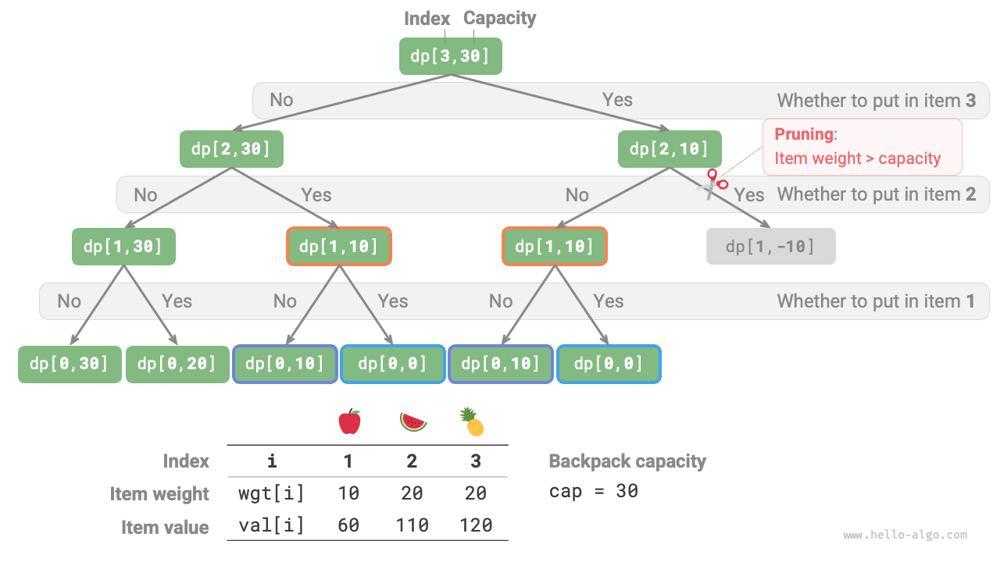
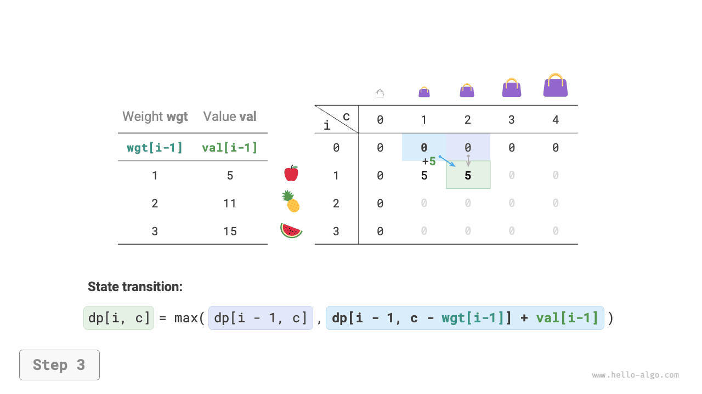
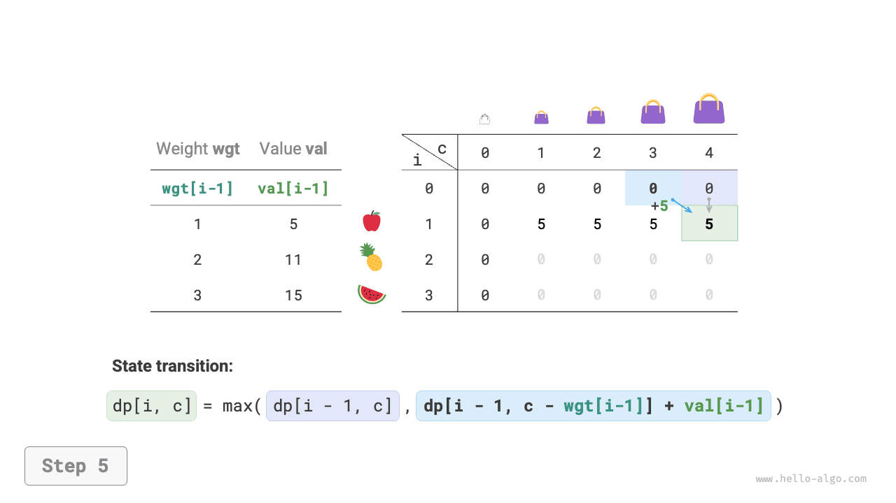
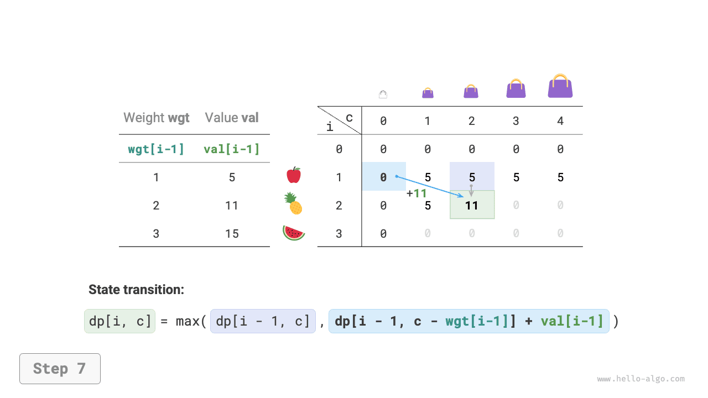
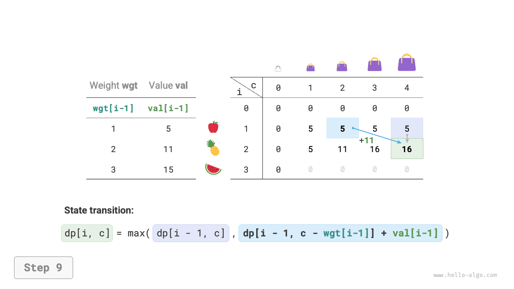
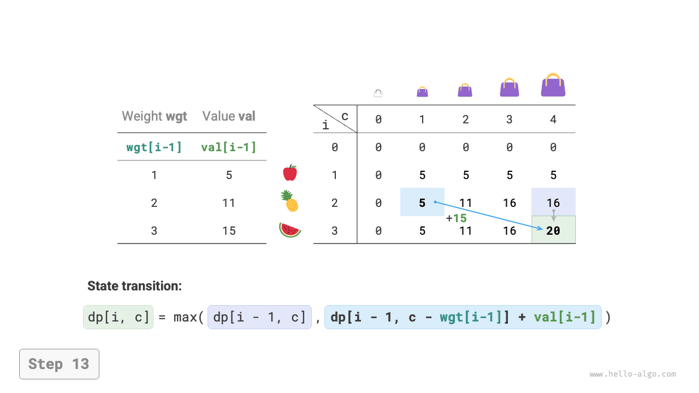
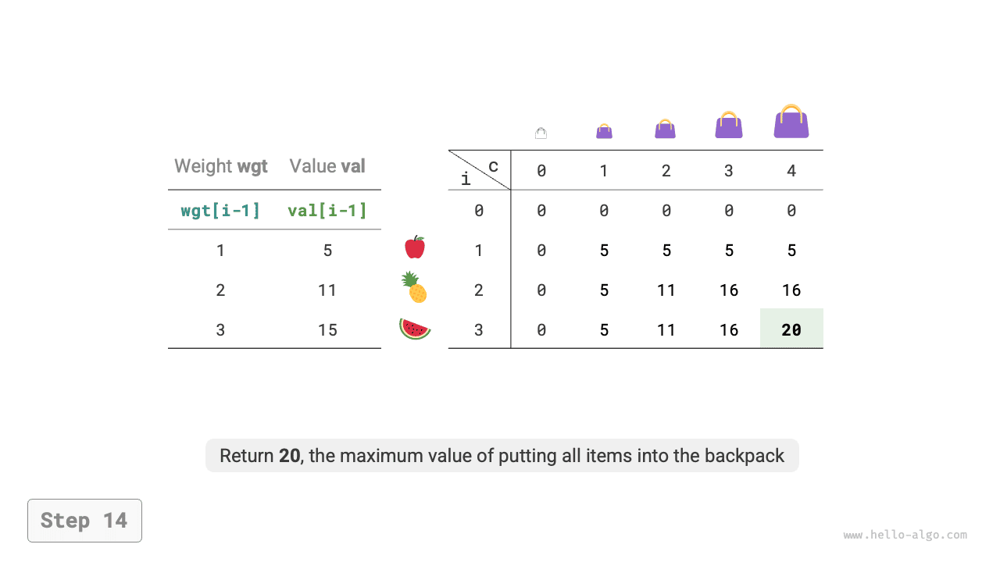
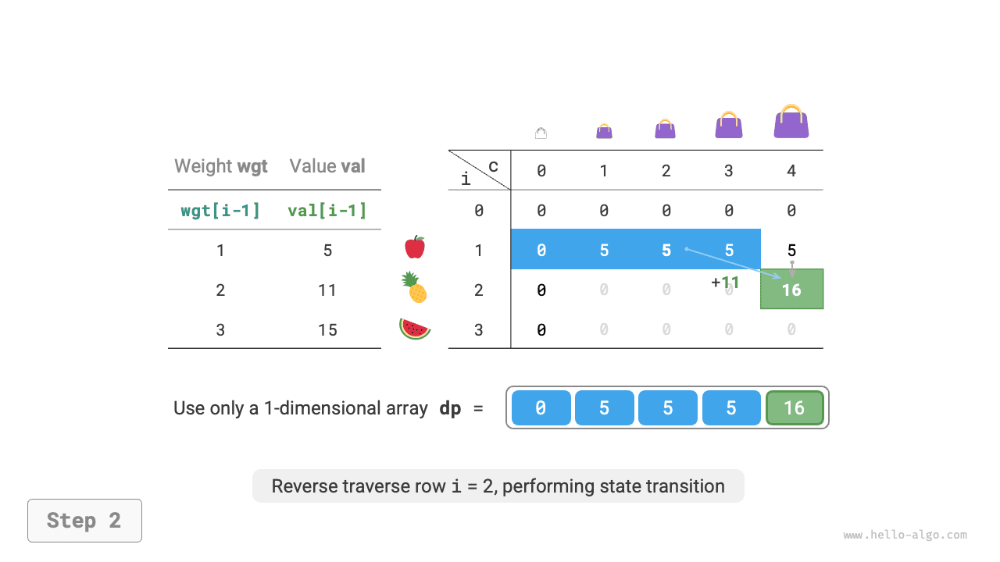

# 14.4 &nbsp; 0-1 배낭 문제

배낭 문제는 동적 계획법 입문에 매우 좋은 예제이며 가장 흔한 문제 유형이다. 0-1 배낭, 무한 배낭, 개수 제한 배낭 등 여러 변형이 있다.

이 절에서는 가장 흔한 0-1 배낭 문제부터 해결한다.

!!! question "문제"

    물건 $n$ 개와 용량이 $cap$인 배낭이 주어진다. $i$ 번째 물건의 무게는 $wgt[i-1]$, 가치는 $val[i-1]$이다. 각 물건을 한 번만 선택할 수 있을 때, 배낭 용량 제한 안에 담을 수 있는 물건의 최대 가치를 구하라.

아래 그림(14-17)에서 물건 번호 $i$는 $1$부터, 배열 인덱스는 $0$부터 시작하므로 물건 $i$의 무게와 가치는 각각 $wgt[i-1]$, $val[i-1]$이다.

{ class="animation-figure" }

<p align="center"> 그림 14-17 &nbsp; 0-1 배낭 문제 예시 데이터 </p>

0-1 배낭 문제는 $n$ 차례의 결정으로 이루어진 과정으로 볼 수 있다. 각 물건에는 넣지 않기와 넣기라는 두 결정이 있으므로 의사 결정 트리 모형을 만족한다.

목표가 '배낭 용량 제한 안에 담을 수 있는 최대 가치'이므로 동적 계획법 문제일 가능성이 높다.

**1단계: 매 차례의 결정을 생각하고 상태를 정의하여 $dp$ 테이블을 얻는다**

물건을 넣지 않으면 배낭 용량은 그대로이고, 넣으면 용량이 줄어든다. 따라서 현재 물건 번호 $i$와 배낭 용량 $c$로 상태를 정의하고 $[i, c]$라고 한다.

상태 $[i, c]$의 부분 문제는 **앞의 $i$ 개 물건을 용량 $c$인 배낭에 담았을 때의 최대 가치**이며, 이를 $dp[i, c]$라고 한다.

구할 값은 $dp[n, cap]$이므로 $(n+1) \times (cap+1)$ 크기의 2차원 $dp$ 테이블이 필요하다.

**2단계: 최적 부분 구조를 찾아 상태 전이 식을 도출한다**

물건 $i$에 대한 결정을 내리면 앞의 $i-1$ 개 물건을 결정하는 부분 문제가 남는다. 다음 두 경우로 나뉜다.

- **물건 $i$를 넣지 않음**: 용량은 그대로이며 상태는 $[i-1, c]$로 바뀐다.
- **물건 $i$를 넣음**: 용량이 $wgt[i-1]$ 줄고 가치가 $val[i-1]$ 늘며, 상태는 $[i-1, c-wgt[i-1]]$로 바뀐다.

이 분석에서 최적 부분 구조가 드러난다. **최대 가치 $dp[i, c]$는 물건 $i$를 넣지 않는 경우와 물건 $i$를 넣는 경우 중 가치가 더 큰 쪽이다**. 상태 전이 식은 다음과 같다.

$$
dp[i, c] = \max(dp[i-1, c], dp[i-1, c - wgt[i-1]] + val[i-1])
$$

현재 물건의 무게 $wgt[i - 1]$가 남은 용량 $c$를 넘으면 넣지 않는 선택만 가능하다.

**3단계: 경계 조건과 상태 전이 순서를 정한다**

물건이 없거나 배낭 용량이 $0$이면 최대 가치는 $0$이다. 즉, 첫 열 $dp[i, 0]$과 첫 행 $dp[0, c]$는 모두 $0$이다.

현재 상태 $[i, c]$는 바로 위의 $[i-1, c]$와 왼쪽 위의 $[i-1, c-wgt[i-1]]$에서 전이되므로, 이중 반복문으로 전체 $dp$ 테이블을 정방향으로 순회하면 된다.

이 분석을 바탕으로 완전 탐색, 메모이제이션을 이용한 탐색, 동적 계획법 순서로 구현한다.

### 1. &nbsp; 방법 1: 완전 탐색

탐색 코드에는 다음 요소가 포함된다.

- **재귀 매개변수**: 상태 $[i, c]$.
- **반환값**: 부분 문제의 해 $dp[i, c]$.
- **종료 조건**: 물건 번호가 범위를 벗어나 $i = 0$이 되거나 남은 용량이 $0$이면 재귀를 종료하고 가치 $0$을 반환한다.
- **가지치기**: 현재 물건의 무게가 남은 배낭 용량보다 크면 넣지 않는 선택만 할 수 있다.

=== "Python"

    ```python title="knapsack.py"
    def knapsack_dfs(wgt: list[int], val: list[int], i: int, c: int) -> int:
        """0-1 배낭: 완전 탐색"""
        # 모든 물건의 선택을 마쳤거나 배낭에 남은 용량이 없으면 가치 0을 반환한다
        if i == 0 or c == 0:
            return 0
        # 배낭 용량을 초과하면 배낭에 넣지 않는 선택만 가능하다
        if wgt[i - 1] > c:
            return knapsack_dfs(wgt, val, i - 1, c)
        # 물건 i를 넣지 않는 경우와 넣는 경우의 최대 가치를 계산한다
        no = knapsack_dfs(wgt, val, i - 1, c)
        yes = knapsack_dfs(wgt, val, i - 1, c - wgt[i - 1]) + val[i - 1]
        # 두 경우 중 더 큰 가치를 반환한다
        return max(no, yes)
    ```

=== "C++"

    ```cpp title="knapsack.cpp"
    /* 0-1 배낭: 완전 탐색 */
    int knapsackDFS(vector<int> &wgt, vector<int> &val, int i, int c) {
        // 모든 물건의 선택을 마쳤거나 배낭에 남은 용량이 없으면 가치 0을 반환한다
        if (i == 0 || c == 0) {
            return 0;
        }
        // 배낭 용량을 초과하면 배낭에 넣지 않는 선택만 가능하다
        if (wgt[i - 1] > c) {
            return knapsackDFS(wgt, val, i - 1, c);
        }
        // 물건 i를 넣지 않는 경우와 넣는 경우의 최대 가치를 계산한다
        int no = knapsackDFS(wgt, val, i - 1, c);
        int yes = knapsackDFS(wgt, val, i - 1, c - wgt[i - 1]) + val[i - 1];
        // 두 경우 중 더 큰 가치를 반환한다
        return max(no, yes);
    }
    ```

=== "Java"

    ```java title="knapsack.java"
    /* 0-1 배낭: 완전 탐색 */
    int knapsackDFS(int[] wgt, int[] val, int i, int c) {
        // 모든 물건의 선택을 마쳤거나 배낭에 남은 용량이 없으면 가치 0을 반환한다
        if (i == 0 || c == 0) {
            return 0;
        }
        // 배낭 용량을 초과하면 배낭에 넣지 않는 선택만 가능하다
        if (wgt[i - 1] > c) {
            return knapsackDFS(wgt, val, i - 1, c);
        }
        // 물건 i를 넣지 않는 경우와 넣는 경우의 최대 가치를 계산한다
        int no = knapsackDFS(wgt, val, i - 1, c);
        int yes = knapsackDFS(wgt, val, i - 1, c - wgt[i - 1]) + val[i - 1];
        // 두 경우 중 더 큰 가치를 반환한다
        return Math.max(no, yes);
    }
    ```

=== "C#"

    ```csharp title="knapsack.cs"
    /* 0-1 배낭: 완전 탐색 */
    int KnapsackDFS(int[] weight, int[] val, int i, int c) {
        // 모든 물건의 선택을 마쳤거나 배낭에 남은 용량이 없으면 가치 0을 반환한다
        if (i == 0 || c == 0) {
            return 0;
        }
        // 배낭 용량을 초과하면 배낭에 넣지 않는 선택만 가능하다
        if (weight[i - 1] > c) {
            return KnapsackDFS(weight, val, i - 1, c);
        }
        // 물건 i를 넣지 않는 경우와 넣는 경우의 최대 가치를 계산한다
        int no = KnapsackDFS(weight, val, i - 1, c);
        int yes = KnapsackDFS(weight, val, i - 1, c - weight[i - 1]) + val[i - 1];
        // 두 경우 중 더 큰 가치를 반환한다
        return Math.Max(no, yes);
    }
    ```

=== "Go"

    ```go title="knapsack.go"
    /* 0-1 배낭: 완전 탐색 */
    func knapsackDFS(wgt, val []int, i, c int) int {
        // 모든 물건의 선택을 마쳤거나 배낭에 남은 용량이 없으면 가치 0을 반환한다
        if i == 0 || c == 0 {
            return 0
        }
        // 배낭 용량을 초과하면 배낭에 넣지 않는 선택만 가능하다
        if wgt[i-1] > c {
            return knapsackDFS(wgt, val, i-1, c)
        }
        // 물건 i를 넣지 않는 경우와 넣는 경우의 최대 가치를 계산한다
        no := knapsackDFS(wgt, val, i-1, c)
        yes := knapsackDFS(wgt, val, i-1, c-wgt[i-1]) + val[i-1]
        // 두 경우 중 더 큰 가치를 반환한다
        return int(math.Max(float64(no), float64(yes)))
    }
    ```

=== "Swift"

    ```swift title="knapsack.swift"
    /* 0-1 배낭: 완전 탐색 */
    func knapsackDFS(wgt: [Int], val: [Int], i: Int, c: Int) -> Int {
        // 모든 물건의 선택을 마쳤거나 배낭에 남은 용량이 없으면 가치 0을 반환한다
        if i == 0 || c == 0 {
            return 0
        }
        // 배낭 용량을 초과하면 배낭에 넣지 않는 선택만 가능하다
        if wgt[i - 1] > c {
            return knapsackDFS(wgt: wgt, val: val, i: i - 1, c: c)
        }
        // 물건 i를 넣지 않는 경우와 넣는 경우의 최대 가치를 계산한다
        let no = knapsackDFS(wgt: wgt, val: val, i: i - 1, c: c)
        let yes = knapsackDFS(wgt: wgt, val: val, i: i - 1, c: c - wgt[i - 1]) + val[i - 1]
        // 두 경우 중 더 큰 가치를 반환한다
        return max(no, yes)
    }
    ```

=== "JS"

    ```javascript title="knapsack.js"
    /* 0-1 배낭: 완전 탐색 */
    function knapsackDFS(wgt, val, i, c) {
        // 모든 물건의 선택을 마쳤거나 배낭에 남은 용량이 없으면 가치 0을 반환한다
        if (i === 0 || c === 0) {
            return 0;
        }
        // 배낭 용량을 초과하면 배낭에 넣지 않는 선택만 가능하다
        if (wgt[i - 1] > c) {
            return knapsackDFS(wgt, val, i - 1, c);
        }
        // 물건 i를 넣지 않는 경우와 넣는 경우의 최대 가치를 계산한다
        const no = knapsackDFS(wgt, val, i - 1, c);
        const yes = knapsackDFS(wgt, val, i - 1, c - wgt[i - 1]) + val[i - 1];
        // 두 경우 중 더 큰 가치를 반환한다
        return Math.max(no, yes);
    }
    ```

=== "TS"

    ```typescript title="knapsack.ts"
    /* 0-1 배낭: 완전 탐색 */
    function knapsackDFS(
        wgt: Array<number>,
        val: Array<number>,
        i: number,
        c: number
    ): number {
        // 모든 물건의 선택을 마쳤거나 배낭에 남은 용량이 없으면 가치 0을 반환한다
        if (i === 0 || c === 0) {
            return 0;
        }
        // 배낭 용량을 초과하면 배낭에 넣지 않는 선택만 가능하다
        if (wgt[i - 1] > c) {
            return knapsackDFS(wgt, val, i - 1, c);
        }
        // 물건 i를 넣지 않는 경우와 넣는 경우의 최대 가치를 계산한다
        const no = knapsackDFS(wgt, val, i - 1, c);
        const yes = knapsackDFS(wgt, val, i - 1, c - wgt[i - 1]) + val[i - 1];
        // 두 경우 중 더 큰 가치를 반환한다
        return Math.max(no, yes);
    }
    ```

=== "Dart"

    ```dart title="knapsack.dart"
    /* 0-1 배낭: 완전 탐색 */
    int knapsackDFS(List<int> wgt, List<int> val, int i, int c) {
      // 모든 물건의 선택을 마쳤거나 배낭에 남은 용량이 없으면 가치 0을 반환한다
      if (i == 0 || c == 0) {
        return 0;
      }
      // 배낭 용량을 초과하면 배낭에 넣지 않는 선택만 가능하다
      if (wgt[i - 1] > c) {
        return knapsackDFS(wgt, val, i - 1, c);
      }
      // 물건 i를 넣지 않는 경우와 넣는 경우의 최대 가치를 계산한다
      int no = knapsackDFS(wgt, val, i - 1, c);
      int yes = knapsackDFS(wgt, val, i - 1, c - wgt[i - 1]) + val[i - 1];
      // 두 경우 중 더 큰 가치를 반환한다
      return max(no, yes);
    }
    ```

=== "Rust"

    ```rust title="knapsack.rs"
    /* 0-1 배낭: 완전 탐색 */
    fn knapsack_dfs(wgt: &[i32], val: &[i32], i: usize, c: usize) -> i32 {
        // 모든 물건의 선택을 마쳤거나 배낭에 남은 용량이 없으면 가치 0을 반환한다
        if i == 0 || c == 0 {
            return 0;
        }
        // 배낭 용량을 초과하면 배낭에 넣지 않는 선택만 가능하다
        if wgt[i - 1] > c as i32 {
            return knapsack_dfs(wgt, val, i - 1, c);
        }
        // 물건 i를 넣지 않는 경우와 넣는 경우의 최대 가치를 계산한다
        let no = knapsack_dfs(wgt, val, i - 1, c);
        let yes = knapsack_dfs(wgt, val, i - 1, c - wgt[i - 1] as usize) + val[i - 1];
        // 두 경우 중 더 큰 가치를 반환한다
        std::cmp::max(no, yes)
    }
    ```

=== "C"

    ```c title="knapsack.c"
    /* 0-1 배낭: 완전 탐색 */
    int knapsackDFS(int wgt[], int val[], int i, int c) {
        // 모든 물건의 선택을 마쳤거나 배낭에 남은 용량이 없으면 가치 0을 반환한다
        if (i == 0 || c == 0) {
            return 0;
        }
        // 배낭 용량을 초과하면 배낭에 넣지 않는 선택만 가능하다
        if (wgt[i - 1] > c) {
            return knapsackDFS(wgt, val, i - 1, c);
        }
        // 물건 i를 넣지 않는 경우와 넣는 경우의 최대 가치를 계산한다
        int no = knapsackDFS(wgt, val, i - 1, c);
        int yes = knapsackDFS(wgt, val, i - 1, c - wgt[i - 1]) + val[i - 1];
        // 두 경우 중 더 큰 가치를 반환한다
        return myMax(no, yes);
    }
    ```

=== "Kotlin"

    ```kotlin title="knapsack.kt"
    /* 0-1 배낭: 완전 탐색 */
    fun knapsackDFS(
        wgt: IntArray,
        _val: IntArray,
        i: Int,
        c: Int
    ): Int {
        // 모든 물건의 선택을 마쳤거나 배낭에 남은 용량이 없으면 가치 0을 반환한다
        if (i == 0 || c == 0) {
            return 0
        }
        // 배낭 용량을 초과하면 배낭에 넣지 않는 선택만 가능하다
        if (wgt[i - 1] > c) {
            return knapsackDFS(wgt, _val, i - 1, c)
        }
        // 물건 i를 넣지 않는 경우와 넣는 경우의 최대 가치를 계산한다
        val no = knapsackDFS(wgt, _val, i - 1, c)
        val yes = knapsackDFS(wgt, _val, i - 1, c - wgt[i - 1]) + _val[i - 1]
        // 두 경우 중 더 큰 가치를 반환한다
        return max(no, yes)
    }
    ```

=== "Ruby"

    ```ruby title="knapsack.rb"
    ### 0-1 배낭: 완전 탐색 ###
    def knapsack_dfs(wgt, val, i, c)
      # 모든 물건의 선택을 마쳤거나 배낭에 남은 용량이 없으면 가치 0을 반환한다
      return 0 if i == 0 || c == 0
      # 배낭 용량을 초과하면 배낭에 넣지 않는 선택만 가능하다
      return knapsack_dfs(wgt, val, i - 1, c) if wgt[i - 1] > c
      # 물건 i를 넣지 않는 경우와 넣는 경우의 최대 가치를 계산한다
      no = knapsack_dfs(wgt, val, i - 1, c)
      yes = knapsack_dfs(wgt, val, i - 1, c - wgt[i - 1]) + val[i - 1]
      # 두 경우 중 더 큰 가치를 반환한다
      [no, yes].max
    end
    ```

??? pythontutor "코드 시각화"

    <div style="height: 549px; width: 100%;"><iframe class="pythontutor-iframe" title="코드 시각화" src="https://pythontutor.com/iframe-embed.html#code=def%20knapsack_dfs%28wgt%3A%20list%5Bint%5D,%20val%3A%20list%5Bint%5D,%20i%3A%20int,%20c%3A%20int%29%20-%3E%20int%3A%0A%20%20%20%20%22%22%220-1%20%EB%B0%B0%EB%82%AD%3A%20%EC%99%84%EC%A0%84%20%ED%83%90%EC%83%89%22%22%22%0A%20%20%20%20%23%20%EB%AA%A8%EB%93%A0%20%EB%AC%BC%EA%B1%B4%EC%9D%98%20%EC%84%A0%ED%83%9D%EC%9D%84%20%EB%A7%88%EC%B3%A4%EA%B1%B0%EB%82%98%20%EB%B0%B0%EB%82%AD%EC%97%90%20%EB%82%A8%EC%9D%80%20%EC%9A%A9%EB%9F%89%EC%9D%B4%20%EC%97%86%EC%9C%BC%EB%A9%B4%20%EA%B0%80%EC%B9%98%200%EC%9D%84%20%EB%B0%98%ED%99%98%ED%95%9C%EB%8B%A4%0A%20%20%20%20if%20i%20%3D%3D%200%20or%20c%20%3D%3D%200%3A%0A%20%20%20%20%20%20%20%20return%200%0A%20%20%20%20%23%20%EB%B0%B0%EB%82%AD%20%EC%9A%A9%EB%9F%89%EC%9D%84%20%EC%B4%88%EA%B3%BC%ED%95%98%EB%A9%B4%20%EB%B0%B0%EB%82%AD%EC%97%90%20%EB%84%A3%EC%A7%80%20%EC%95%8A%EB%8A%94%20%EC%84%A0%ED%83%9D%EB%A7%8C%20%EA%B0%80%EB%8A%A5%ED%95%98%EB%8B%A4%0A%20%20%20%20if%20wgt%5Bi%20-%201%5D%20%3E%20c%3A%0A%20%20%20%20%20%20%20%20return%20knapsack_dfs%28wgt,%20val,%20i%20-%201,%20c%29%0A%20%20%20%20%23%20%EB%AC%BC%EA%B1%B4%20i%EB%A5%BC%20%EB%84%A3%EC%A7%80%20%EC%95%8A%EB%8A%94%20%EA%B2%BD%EC%9A%B0%EC%99%80%20%EB%84%A3%EB%8A%94%20%EA%B2%BD%EC%9A%B0%EC%9D%98%20%EC%B5%9C%EB%8C%80%20%EA%B0%80%EC%B9%98%EB%A5%BC%20%EA%B3%84%EC%82%B0%ED%95%9C%EB%8B%A4%0A%20%20%20%20no%20%3D%20knapsack_dfs%28wgt,%20val,%20i%20-%201,%20c%29%0A%20%20%20%20yes%20%3D%20knapsack_dfs%28wgt,%20val,%20i%20-%201,%20c%20-%20wgt%5Bi%20-%201%5D%29%20%2B%20val%5Bi%20-%201%5D%0A%20%20%20%20%23%20%EB%91%90%20%EA%B2%BD%EC%9A%B0%20%EC%A4%91%20%EB%8D%94%20%ED%81%B0%20%EA%B0%80%EC%B9%98%EB%A5%BC%20%EB%B0%98%ED%99%98%ED%95%9C%EB%8B%A4%0A%20%20%20%20return%20max%28no,%20yes%29%0A%0A%0A%22%22%22%EC%8B%A4%ED%96%89%20%EC%BD%94%EB%93%9C%22%22%22%0Aif%20__name__%20%3D%3D%20%22__main__%22%3A%0A%20%20%20%20wgt%20%3D%20%5B10,%2020,%2030,%2040,%2050%5D%0A%20%20%20%20val%20%3D%20%5B50,%20120,%20150,%20210,%20240%5D%0A%20%20%20%20cap%20%3D%2050%0A%20%20%20%20n%20%3D%20len%28wgt%29%0A%0A%20%20%20%20%23%20%EC%99%84%EC%A0%84%20%ED%83%90%EC%83%89%0A%20%20%20%20res%20%3D%20knapsack_dfs%28wgt,%20val,%20n,%20cap%29%0A%20%20%20%20print%28f%22%EB%B0%B0%EB%82%AD%20%EC%9A%A9%EB%9F%89%EC%9D%84%20%EC%B4%88%EA%B3%BC%ED%95%98%EC%A7%80%20%EC%95%8A%EB%8A%94%20%EB%AC%BC%EA%B1%B4%EC%9D%98%20%EC%B5%9C%EB%8C%80%20%EA%B0%80%EC%B9%98%EB%8A%94%20%7Bres%7D%EC%9D%B4%EB%8B%A4%22%29&codeDivHeight=472&codeDivWidth=350&cumulative=false&curInstr=7&heapPrimitives=nevernest&origin=opt-frontend.js&py=311&rawInputLstJSON=%5B%5D&textReferences=false"> </iframe></div>
    <div style="margin-top: 5px;"><a href="https://pythontutor.com/iframe-embed.html#code=def%20knapsack_dfs%28wgt%3A%20list%5Bint%5D,%20val%3A%20list%5Bint%5D,%20i%3A%20int,%20c%3A%20int%29%20-%3E%20int%3A%0A%20%20%20%20%22%22%220-1%20%EB%B0%B0%EB%82%AD%3A%20%EC%99%84%EC%A0%84%20%ED%83%90%EC%83%89%22%22%22%0A%20%20%20%20%23%20%EB%AA%A8%EB%93%A0%20%EB%AC%BC%EA%B1%B4%EC%9D%98%20%EC%84%A0%ED%83%9D%EC%9D%84%20%EB%A7%88%EC%B3%A4%EA%B1%B0%EB%82%98%20%EB%B0%B0%EB%82%AD%EC%97%90%20%EB%82%A8%EC%9D%80%20%EC%9A%A9%EB%9F%89%EC%9D%B4%20%EC%97%86%EC%9C%BC%EB%A9%B4%20%EA%B0%80%EC%B9%98%200%EC%9D%84%20%EB%B0%98%ED%99%98%ED%95%9C%EB%8B%A4%0A%20%20%20%20if%20i%20%3D%3D%200%20or%20c%20%3D%3D%200%3A%0A%20%20%20%20%20%20%20%20return%200%0A%20%20%20%20%23%20%EB%B0%B0%EB%82%AD%20%EC%9A%A9%EB%9F%89%EC%9D%84%20%EC%B4%88%EA%B3%BC%ED%95%98%EB%A9%B4%20%EB%B0%B0%EB%82%AD%EC%97%90%20%EB%84%A3%EC%A7%80%20%EC%95%8A%EB%8A%94%20%EC%84%A0%ED%83%9D%EB%A7%8C%20%EA%B0%80%EB%8A%A5%ED%95%98%EB%8B%A4%0A%20%20%20%20if%20wgt%5Bi%20-%201%5D%20%3E%20c%3A%0A%20%20%20%20%20%20%20%20return%20knapsack_dfs%28wgt,%20val,%20i%20-%201,%20c%29%0A%20%20%20%20%23%20%EB%AC%BC%EA%B1%B4%20i%EB%A5%BC%20%EB%84%A3%EC%A7%80%20%EC%95%8A%EB%8A%94%20%EA%B2%BD%EC%9A%B0%EC%99%80%20%EB%84%A3%EB%8A%94%20%EA%B2%BD%EC%9A%B0%EC%9D%98%20%EC%B5%9C%EB%8C%80%20%EA%B0%80%EC%B9%98%EB%A5%BC%20%EA%B3%84%EC%82%B0%ED%95%9C%EB%8B%A4%0A%20%20%20%20no%20%3D%20knapsack_dfs%28wgt,%20val,%20i%20-%201,%20c%29%0A%20%20%20%20yes%20%3D%20knapsack_dfs%28wgt,%20val,%20i%20-%201,%20c%20-%20wgt%5Bi%20-%201%5D%29%20%2B%20val%5Bi%20-%201%5D%0A%20%20%20%20%23%20%EB%91%90%20%EA%B2%BD%EC%9A%B0%20%EC%A4%91%20%EB%8D%94%20%ED%81%B0%20%EA%B0%80%EC%B9%98%EB%A5%BC%20%EB%B0%98%ED%99%98%ED%95%9C%EB%8B%A4%0A%20%20%20%20return%20max%28no,%20yes%29%0A%0A%0A%22%22%22%EC%8B%A4%ED%96%89%20%EC%BD%94%EB%93%9C%22%22%22%0Aif%20__name__%20%3D%3D%20%22__main__%22%3A%0A%20%20%20%20wgt%20%3D%20%5B10,%2020,%2030,%2040,%2050%5D%0A%20%20%20%20val%20%3D%20%5B50,%20120,%20150,%20210,%20240%5D%0A%20%20%20%20cap%20%3D%2050%0A%20%20%20%20n%20%3D%20len%28wgt%29%0A%0A%20%20%20%20%23%20%EC%99%84%EC%A0%84%20%ED%83%90%EC%83%89%0A%20%20%20%20res%20%3D%20knapsack_dfs%28wgt,%20val,%20n,%20cap%29%0A%20%20%20%20print%28f%22%EB%B0%B0%EB%82%AD%20%EC%9A%A9%EB%9F%89%EC%9D%84%20%EC%B4%88%EA%B3%BC%ED%95%98%EC%A7%80%20%EC%95%8A%EB%8A%94%20%EB%AC%BC%EA%B1%B4%EC%9D%98%20%EC%B5%9C%EB%8C%80%20%EA%B0%80%EC%B9%98%EB%8A%94%20%7Bres%7D%EC%9D%B4%EB%8B%A4%22%29&codeDivHeight=800&codeDivWidth=600&cumulative=false&curInstr=7&heapPrimitives=nevernest&origin=opt-frontend.js&py=311&rawInputLstJSON=%5B%5D&textReferences=false" target="_blank" rel="noopener noreferrer">전체 화면 ></a></div>

아래 그림(14-18)과 같이 물건마다 선택하지 않기와 선택하기라는 두 탐색 가지가 생기므로 시간 복잡도는 $O(2^n)$이다.

재귀 트리에는 $dp[1, 10]$ 같은 중복 부분 문제가 있음을 쉽게 알 수 있다. 물건이 많고 용량이 크며, 특히 무게가 같은 물건이 많을수록 중복 부분 문제의 수가 크게 늘어난다.

{ class="animation-figure" }

<p align="center"> 그림 14-18 &nbsp; 0-1 배낭 문제의 완전 탐색 재귀 트리 </p>

### 2. &nbsp; 방법 2: 메모이제이션을 이용한 탐색

중복 부분 문제를 한 번만 계산하도록 메모이제이션 리스트 `mem`에 부분 문제의 해를 저장한다. `mem[i][c]`는 $dp[i, c]$에 대응한다.

메모이제이션을 도입하면 **시간 복잡도는 부분 문제의 수에 의해 결정되므로** $O(n \times cap)$이다. 구현 코드는 다음과 같다.

=== "Python"

    ```python title="knapsack.py"
    def knapsack_dfs_mem(
        wgt: list[int], val: list[int], mem: list[list[int]], i: int, c: int
    ) -> int:
        """0-1 배낭: 메모이제이션을 이용한 탐색"""
        # 모든 물건의 선택을 마쳤거나 배낭에 남은 용량이 없으면 가치 0을 반환한다
        if i == 0 or c == 0:
            return 0
        # 기록이 이미 있으면 바로 반환한다
        if mem[i][c] != -1:
            return mem[i][c]
        # 배낭 용량을 초과하면 배낭에 넣지 않는 선택만 가능하다
        if wgt[i - 1] > c:
            return knapsack_dfs_mem(wgt, val, mem, i - 1, c)
        # 물건 i를 넣지 않는 경우와 넣는 경우의 최대 가치를 계산한다
        no = knapsack_dfs_mem(wgt, val, mem, i - 1, c)
        yes = knapsack_dfs_mem(wgt, val, mem, i - 1, c - wgt[i - 1]) + val[i - 1]
        # 두 경우 중 더 큰 가치를 기록하고 반환한다
        mem[i][c] = max(no, yes)
        return mem[i][c]
    ```

=== "C++"

    ```cpp title="knapsack.cpp"
    /* 0-1 배낭: 메모이제이션을 이용한 탐색 */
    int knapsackDFSMem(vector<int> &wgt, vector<int> &val, vector<vector<int>> &mem, int i, int c) {
        // 모든 물건의 선택을 마쳤거나 배낭에 남은 용량이 없으면 가치 0을 반환한다
        if (i == 0 || c == 0) {
            return 0;
        }
        // 기록이 이미 있으면 바로 반환한다
        if (mem[i][c] != -1) {
            return mem[i][c];
        }
        // 배낭 용량을 초과하면 배낭에 넣지 않는 선택만 가능하다
        if (wgt[i - 1] > c) {
            return knapsackDFSMem(wgt, val, mem, i - 1, c);
        }
        // 물건 i를 넣지 않는 경우와 넣는 경우의 최대 가치를 계산한다
        int no = knapsackDFSMem(wgt, val, mem, i - 1, c);
        int yes = knapsackDFSMem(wgt, val, mem, i - 1, c - wgt[i - 1]) + val[i - 1];
        // 두 경우 중 더 큰 가치를 기록하고 반환한다
        mem[i][c] = max(no, yes);
        return mem[i][c];
    }
    ```

=== "Java"

    ```java title="knapsack.java"
    /* 0-1 배낭: 메모이제이션을 이용한 탐색 */
    int knapsackDFSMem(int[] wgt, int[] val, int[][] mem, int i, int c) {
        // 모든 물건의 선택을 마쳤거나 배낭에 남은 용량이 없으면 가치 0을 반환한다
        if (i == 0 || c == 0) {
            return 0;
        }
        // 기록이 이미 있으면 바로 반환한다
        if (mem[i][c] != -1) {
            return mem[i][c];
        }
        // 배낭 용량을 초과하면 배낭에 넣지 않는 선택만 가능하다
        if (wgt[i - 1] > c) {
            return knapsackDFSMem(wgt, val, mem, i - 1, c);
        }
        // 물건 i를 넣지 않는 경우와 넣는 경우의 최대 가치를 계산한다
        int no = knapsackDFSMem(wgt, val, mem, i - 1, c);
        int yes = knapsackDFSMem(wgt, val, mem, i - 1, c - wgt[i - 1]) + val[i - 1];
        // 두 경우 중 더 큰 가치를 기록하고 반환한다
        mem[i][c] = Math.max(no, yes);
        return mem[i][c];
    }
    ```

=== "C#"

    ```csharp title="knapsack.cs"
    /* 0-1 배낭: 메모이제이션을 이용한 탐색 */
    int KnapsackDFSMem(int[] weight, int[] val, int[][] mem, int i, int c) {
        // 모든 물건의 선택을 마쳤거나 배낭에 남은 용량이 없으면 가치 0을 반환한다
        if (i == 0 || c == 0) {
            return 0;
        }
        // 기록이 이미 있으면 바로 반환한다
        if (mem[i][c] != -1) {
            return mem[i][c];
        }
        // 배낭 용량을 초과하면 배낭에 넣지 않는 선택만 가능하다
        if (weight[i - 1] > c) {
            return KnapsackDFSMem(weight, val, mem, i - 1, c);
        }
        // 물건 i를 넣지 않는 경우와 넣는 경우의 최대 가치를 계산한다
        int no = KnapsackDFSMem(weight, val, mem, i - 1, c);
        int yes = KnapsackDFSMem(weight, val, mem, i - 1, c - weight[i - 1]) + val[i - 1];
        // 두 경우 중 더 큰 가치를 기록하고 반환한다
        mem[i][c] = Math.Max(no, yes);
        return mem[i][c];
    }
    ```

=== "Go"

    ```go title="knapsack.go"
    /* 0-1 배낭: 메모이제이션을 이용한 탐색 */
    func knapsackDFSMem(wgt, val []int, mem [][]int, i, c int) int {
        // 모든 물건의 선택을 마쳤거나 배낭에 남은 용량이 없으면 가치 0을 반환한다
        if i == 0 || c == 0 {
            return 0
        }
        // 기록이 이미 있으면 바로 반환한다
        if mem[i][c] != -1 {
            return mem[i][c]
        }
        // 배낭 용량을 초과하면 배낭에 넣지 않는 선택만 가능하다
        if wgt[i-1] > c {
            return knapsackDFSMem(wgt, val, mem, i-1, c)
        }
        // 물건 i를 넣지 않는 경우와 넣는 경우의 최대 가치를 계산한다
        no := knapsackDFSMem(wgt, val, mem, i-1, c)
        yes := knapsackDFSMem(wgt, val, mem, i-1, c-wgt[i-1]) + val[i-1]
        // 두 경우 중 더 큰 가치를 반환한다
        mem[i][c] = int(math.Max(float64(no), float64(yes)))
        return mem[i][c]
    }
    ```

=== "Swift"

    ```swift title="knapsack.swift"
    /* 0-1 배낭: 메모이제이션을 이용한 탐색 */
    func knapsackDFSMem(wgt: [Int], val: [Int], mem: inout [[Int]], i: Int, c: Int) -> Int {
        // 모든 물건의 선택을 마쳤거나 배낭에 남은 용량이 없으면 가치 0을 반환한다
        if i == 0 || c == 0 {
            return 0
        }
        // 기록이 이미 있으면 바로 반환한다
        if mem[i][c] != -1 {
            return mem[i][c]
        }
        // 배낭 용량을 초과하면 배낭에 넣지 않는 선택만 가능하다
        if wgt[i - 1] > c {
            return knapsackDFSMem(wgt: wgt, val: val, mem: &mem, i: i - 1, c: c)
        }
        // 물건 i를 넣지 않는 경우와 넣는 경우의 최대 가치를 계산한다
        let no = knapsackDFSMem(wgt: wgt, val: val, mem: &mem, i: i - 1, c: c)
        let yes = knapsackDFSMem(wgt: wgt, val: val, mem: &mem, i: i - 1, c: c - wgt[i - 1]) + val[i - 1]
        // 두 경우 중 더 큰 가치를 기록하고 반환한다
        mem[i][c] = max(no, yes)
        return mem[i][c]
    }
    ```

=== "JS"

    ```javascript title="knapsack.js"
    /* 0-1 배낭: 메모이제이션을 이용한 탐색 */
    function knapsackDFSMem(wgt, val, mem, i, c) {
        // 모든 물건의 선택을 마쳤거나 배낭에 남은 용량이 없으면 가치 0을 반환한다
        if (i === 0 || c === 0) {
            return 0;
        }
        // 기록이 이미 있으면 바로 반환한다
        if (mem[i][c] !== -1) {
            return mem[i][c];
        }
        // 배낭 용량을 초과하면 배낭에 넣지 않는 선택만 가능하다
        if (wgt[i - 1] > c) {
            return knapsackDFSMem(wgt, val, mem, i - 1, c);
        }
        // 물건 i를 넣지 않는 경우와 넣는 경우의 최대 가치를 계산한다
        const no = knapsackDFSMem(wgt, val, mem, i - 1, c);
        const yes =
            knapsackDFSMem(wgt, val, mem, i - 1, c - wgt[i - 1]) + val[i - 1];
        // 두 경우 중 더 큰 가치를 기록하고 반환한다
        mem[i][c] = Math.max(no, yes);
        return mem[i][c];
    }
    ```

=== "TS"

    ```typescript title="knapsack.ts"
    /* 0-1 배낭: 메모이제이션을 이용한 탐색 */
    function knapsackDFSMem(
        wgt: Array<number>,
        val: Array<number>,
        mem: Array<Array<number>>,
        i: number,
        c: number
    ): number {
        // 모든 물건의 선택을 마쳤거나 배낭에 남은 용량이 없으면 가치 0을 반환한다
        if (i === 0 || c === 0) {
            return 0;
        }
        // 기록이 이미 있으면 바로 반환한다
        if (mem[i][c] !== -1) {
            return mem[i][c];
        }
        // 배낭 용량을 초과하면 배낭에 넣지 않는 선택만 가능하다
        if (wgt[i - 1] > c) {
            return knapsackDFSMem(wgt, val, mem, i - 1, c);
        }
        // 물건 i를 넣지 않는 경우와 넣는 경우의 최대 가치를 계산한다
        const no = knapsackDFSMem(wgt, val, mem, i - 1, c);
        const yes =
            knapsackDFSMem(wgt, val, mem, i - 1, c - wgt[i - 1]) + val[i - 1];
        // 두 경우 중 더 큰 가치를 기록하고 반환한다
        mem[i][c] = Math.max(no, yes);
        return mem[i][c];
    }
    ```

=== "Dart"

    ```dart title="knapsack.dart"
    /* 0-1 배낭: 메모이제이션을 이용한 탐색 */
    int knapsackDFSMem(
      List<int> wgt,
      List<int> val,
      List<List<int>> mem,
      int i,
      int c,
    ) {
      // 모든 물건의 선택을 마쳤거나 배낭에 남은 용량이 없으면 가치 0을 반환한다
      if (i == 0 || c == 0) {
        return 0;
      }
      // 기록이 이미 있으면 바로 반환한다
      if (mem[i][c] != -1) {
        return mem[i][c];
      }
      // 배낭 용량을 초과하면 배낭에 넣지 않는 선택만 가능하다
      if (wgt[i - 1] > c) {
        return knapsackDFSMem(wgt, val, mem, i - 1, c);
      }
      // 물건 i를 넣지 않는 경우와 넣는 경우의 최대 가치를 계산한다
      int no = knapsackDFSMem(wgt, val, mem, i - 1, c);
      int yes = knapsackDFSMem(wgt, val, mem, i - 1, c - wgt[i - 1]) + val[i - 1];
      // 두 경우 중 더 큰 가치를 기록하고 반환한다
      mem[i][c] = max(no, yes);
      return mem[i][c];
    }
    ```

=== "Rust"

    ```rust title="knapsack.rs"
    /* 0-1 배낭: 메모이제이션을 이용한 탐색 */
    fn knapsack_dfs_mem(wgt: &[i32], val: &[i32], mem: &mut Vec<Vec<i32>>, i: usize, c: usize) -> i32 {
        // 모든 물건의 선택을 마쳤거나 배낭에 남은 용량이 없으면 가치 0을 반환한다
        if i == 0 || c == 0 {
            return 0;
        }
        // 기록이 이미 있으면 바로 반환한다
        if mem[i][c] != -1 {
            return mem[i][c];
        }
        // 배낭 용량을 초과하면 배낭에 넣지 않는 선택만 가능하다
        if wgt[i - 1] > c as i32 {
            return knapsack_dfs_mem(wgt, val, mem, i - 1, c);
        }
        // 물건 i를 넣지 않는 경우와 넣는 경우의 최대 가치를 계산한다
        let no = knapsack_dfs_mem(wgt, val, mem, i - 1, c);
        let yes = knapsack_dfs_mem(wgt, val, mem, i - 1, c - wgt[i - 1] as usize) + val[i - 1];
        // 두 경우 중 더 큰 가치를 기록하고 반환한다
        mem[i][c] = std::cmp::max(no, yes);
        mem[i][c]
    }
    ```

=== "C"

    ```c title="knapsack.c"
    /* 0-1 배낭: 메모이제이션을 이용한 탐색 */
    int knapsackDFSMem(int wgt[], int val[], int memCols, int **mem, int i, int c) {
        // 모든 물건의 선택을 마쳤거나 배낭에 남은 용량이 없으면 가치 0을 반환한다
        if (i == 0 || c == 0) {
            return 0;
        }
        // 기록이 이미 있으면 바로 반환한다
        if (mem[i][c] != -1) {
            return mem[i][c];
        }
        // 배낭 용량을 초과하면 배낭에 넣지 않는 선택만 가능하다
        if (wgt[i - 1] > c) {
            return knapsackDFSMem(wgt, val, memCols, mem, i - 1, c);
        }
        // 물건 i를 넣지 않는 경우와 넣는 경우의 최대 가치를 계산한다
        int no = knapsackDFSMem(wgt, val, memCols, mem, i - 1, c);
        int yes = knapsackDFSMem(wgt, val, memCols, mem, i - 1, c - wgt[i - 1]) + val[i - 1];
        // 두 경우 중 더 큰 가치를 기록하고 반환한다
        mem[i][c] = myMax(no, yes);
        return mem[i][c];
    }
    ```

=== "Kotlin"

    ```kotlin title="knapsack.kt"
    /* 0-1 배낭: 메모이제이션을 이용한 탐색 */
    fun knapsackDFSMem(
        wgt: IntArray,
        _val: IntArray,
        mem: Array<IntArray>,
        i: Int,
        c: Int
    ): Int {
        // 모든 물건의 선택을 마쳤거나 배낭에 남은 용량이 없으면 가치 0을 반환한다
        if (i == 0 || c == 0) {
            return 0
        }
        // 기록이 이미 있으면 바로 반환한다
        if (mem[i][c] != -1) {
            return mem[i][c]
        }
        // 배낭 용량을 초과하면 배낭에 넣지 않는 선택만 가능하다
        if (wgt[i - 1] > c) {
            return knapsackDFSMem(wgt, _val, mem, i - 1, c)
        }
        // 물건 i를 넣지 않는 경우와 넣는 경우의 최대 가치를 계산한다
        val no = knapsackDFSMem(wgt, _val, mem, i - 1, c)
        val yes = knapsackDFSMem(wgt, _val, mem, i - 1, c - wgt[i - 1]) + _val[i - 1]
        // 두 경우 중 더 큰 가치를 기록하고 반환한다
        mem[i][c] = max(no, yes)
        return mem[i][c]
    }
    ```

=== "Ruby"

    ```ruby title="knapsack.rb"
    ### 0-1 배낭: 메모이제이션을 이용한 탐색 ###
    def knapsack_dfs_mem(wgt, val, mem, i, c)
      # 모든 물건의 선택을 마쳤거나 배낭에 남은 용량이 없으면 가치 0을 반환한다
      return 0 if i == 0 || c == 0
      # 기록이 이미 있으면 바로 반환한다
      return mem[i][c] if mem[i][c] != -1
      # 배낭 용량을 초과하면 배낭에 넣지 않는 선택만 가능하다
      return knapsack_dfs_mem(wgt, val, mem, i - 1, c) if wgt[i - 1] > c
      # 물건 i를 넣지 않는 경우와 넣는 경우의 최대 가치를 계산한다
      no = knapsack_dfs_mem(wgt, val, mem, i - 1, c)
      yes = knapsack_dfs_mem(wgt, val, mem, i - 1, c - wgt[i - 1]) + val[i - 1]
      # 두 경우 중 더 큰 가치를 기록하고 반환한다
      mem[i][c] = [no, yes].max
    end
    ```

??? pythontutor "코드 시각화"

    <div style="height: 549px; width: 100%;"><iframe class="pythontutor-iframe" title="코드 시각화" src="https://pythontutor.com/iframe-embed.html#code=def%20knapsack_dfs_mem%28%0A%20%20%20%20wgt%3A%20list%5Bint%5D,%20val%3A%20list%5Bint%5D,%20mem%3A%20list%5Blist%5Bint%5D%5D,%20i%3A%20int,%20c%3A%20int%0A%29%20-%3E%20int%3A%0A%20%20%20%20%22%22%220-1%20%EB%B0%B0%EB%82%AD%3A%20%EB%A9%94%EB%AA%A8%EC%9D%B4%EC%A0%9C%EC%9D%B4%EC%85%98%EC%9D%84%20%EC%9D%B4%EC%9A%A9%ED%95%9C%20%ED%83%90%EC%83%89%22%22%22%0A%20%20%20%20%23%20%EB%AA%A8%EB%93%A0%20%EB%AC%BC%EA%B1%B4%EC%9D%98%20%EC%84%A0%ED%83%9D%EC%9D%84%20%EB%A7%88%EC%B3%A4%EA%B1%B0%EB%82%98%20%EB%B0%B0%EB%82%AD%EC%97%90%20%EB%82%A8%EC%9D%80%20%EC%9A%A9%EB%9F%89%EC%9D%B4%20%EC%97%86%EC%9C%BC%EB%A9%B4%20%EA%B0%80%EC%B9%98%200%EC%9D%84%20%EB%B0%98%ED%99%98%ED%95%9C%EB%8B%A4%0A%20%20%20%20if%20i%20%3D%3D%200%20or%20c%20%3D%3D%200%3A%0A%20%20%20%20%20%20%20%20return%200%0A%20%20%20%20%23%20%EA%B8%B0%EB%A1%9D%EC%9D%B4%20%EC%9D%B4%EB%AF%B8%20%EC%9E%88%EC%9C%BC%EB%A9%B4%20%EB%B0%94%EB%A1%9C%20%EB%B0%98%ED%99%98%ED%95%9C%EB%8B%A4%0A%20%20%20%20if%20mem%5Bi%5D%5Bc%5D%20%21%3D%20-1%3A%0A%20%20%20%20%20%20%20%20return%20mem%5Bi%5D%5Bc%5D%0A%20%20%20%20%23%20%EB%B0%B0%EB%82%AD%20%EC%9A%A9%EB%9F%89%EC%9D%84%20%EC%B4%88%EA%B3%BC%ED%95%98%EB%A9%B4%20%EB%B0%B0%EB%82%AD%EC%97%90%20%EB%84%A3%EC%A7%80%20%EC%95%8A%EB%8A%94%20%EC%84%A0%ED%83%9D%EB%A7%8C%20%EA%B0%80%EB%8A%A5%ED%95%98%EB%8B%A4%0A%20%20%20%20if%20wgt%5Bi%20-%201%5D%20%3E%20c%3A%0A%20%20%20%20%20%20%20%20return%20knapsack_dfs_mem%28wgt,%20val,%20mem,%20i%20-%201,%20c%29%0A%20%20%20%20%23%20%EB%AC%BC%EA%B1%B4%20i%EB%A5%BC%20%EB%84%A3%EC%A7%80%20%EC%95%8A%EB%8A%94%20%EA%B2%BD%EC%9A%B0%EC%99%80%20%EB%84%A3%EB%8A%94%20%EA%B2%BD%EC%9A%B0%EC%9D%98%20%EC%B5%9C%EB%8C%80%20%EA%B0%80%EC%B9%98%EB%A5%BC%20%EA%B3%84%EC%82%B0%ED%95%9C%EB%8B%A4%0A%20%20%20%20no%20%3D%20knapsack_dfs_mem%28wgt,%20val,%20mem,%20i%20-%201,%20c%29%0A%20%20%20%20yes%20%3D%20knapsack_dfs_mem%28wgt,%20val,%20mem,%20i%20-%201,%20c%20-%20wgt%5Bi%20-%201%5D%29%20%2B%20val%5Bi%20-%201%5D%0A%20%20%20%20%23%20%EB%91%90%20%EA%B2%BD%EC%9A%B0%20%EC%A4%91%20%EB%8D%94%20%ED%81%B0%20%EA%B0%80%EC%B9%98%EB%A5%BC%20%EA%B8%B0%EB%A1%9D%ED%95%98%EA%B3%A0%20%EB%B0%98%ED%99%98%ED%95%9C%EB%8B%A4%0A%20%20%20%20mem%5Bi%5D%5Bc%5D%20%3D%20max%28no,%20yes%29%0A%20%20%20%20return%20mem%5Bi%5D%5Bc%5D%0A%0A%0A%22%22%22%EC%8B%A4%ED%96%89%20%EC%BD%94%EB%93%9C%22%22%22%0Aif%20__name__%20%3D%3D%20%22__main__%22%3A%0A%20%20%20%20wgt%20%3D%20%5B10,%2020,%2030,%2040,%2050%5D%0A%20%20%20%20val%20%3D%20%5B50,%20120,%20150,%20210,%20240%5D%0A%20%20%20%20cap%20%3D%2050%0A%20%20%20%20n%20%3D%20len%28wgt%29%0A%0A%20%20%20%20%23%20%EB%A9%94%EB%AA%A8%EC%9D%B4%EC%A0%9C%EC%9D%B4%EC%85%98%EC%9D%84%20%EC%9D%B4%EC%9A%A9%ED%95%9C%20%ED%83%90%EC%83%89%0A%20%20%20%20mem%20%3D%20%5B%5B-1%5D%20%2A%20%28cap%20%2B%201%29%20for%20_%20in%20range%28n%20%2B%201%29%5D%0A%20%20%20%20res%20%3D%20knapsack_dfs_mem%28wgt,%20val,%20mem,%20n,%20cap%29%0A%20%20%20%20print%28f%22%EB%B0%B0%EB%82%AD%20%EC%9A%A9%EB%9F%89%EC%9D%84%20%EC%B4%88%EA%B3%BC%ED%95%98%EC%A7%80%20%EC%95%8A%EB%8A%94%20%EB%AC%BC%EA%B1%B4%EC%9D%98%20%EC%B5%9C%EB%8C%80%20%EA%B0%80%EC%B9%98%EB%8A%94%20%7Bres%7D%EC%9D%B4%EB%8B%A4%22%29&codeDivHeight=472&codeDivWidth=350&cumulative=false&curInstr=20&heapPrimitives=nevernest&origin=opt-frontend.js&py=311&rawInputLstJSON=%5B%5D&textReferences=false"> </iframe></div>
    <div style="margin-top: 5px;"><a href="https://pythontutor.com/iframe-embed.html#code=def%20knapsack_dfs_mem%28%0A%20%20%20%20wgt%3A%20list%5Bint%5D,%20val%3A%20list%5Bint%5D,%20mem%3A%20list%5Blist%5Bint%5D%5D,%20i%3A%20int,%20c%3A%20int%0A%29%20-%3E%20int%3A%0A%20%20%20%20%22%22%220-1%20%EB%B0%B0%EB%82%AD%3A%20%EB%A9%94%EB%AA%A8%EC%9D%B4%EC%A0%9C%EC%9D%B4%EC%85%98%EC%9D%84%20%EC%9D%B4%EC%9A%A9%ED%95%9C%20%ED%83%90%EC%83%89%22%22%22%0A%20%20%20%20%23%20%EB%AA%A8%EB%93%A0%20%EB%AC%BC%EA%B1%B4%EC%9D%98%20%EC%84%A0%ED%83%9D%EC%9D%84%20%EB%A7%88%EC%B3%A4%EA%B1%B0%EB%82%98%20%EB%B0%B0%EB%82%AD%EC%97%90%20%EB%82%A8%EC%9D%80%20%EC%9A%A9%EB%9F%89%EC%9D%B4%20%EC%97%86%EC%9C%BC%EB%A9%B4%20%EA%B0%80%EC%B9%98%200%EC%9D%84%20%EB%B0%98%ED%99%98%ED%95%9C%EB%8B%A4%0A%20%20%20%20if%20i%20%3D%3D%200%20or%20c%20%3D%3D%200%3A%0A%20%20%20%20%20%20%20%20return%200%0A%20%20%20%20%23%20%EA%B8%B0%EB%A1%9D%EC%9D%B4%20%EC%9D%B4%EB%AF%B8%20%EC%9E%88%EC%9C%BC%EB%A9%B4%20%EB%B0%94%EB%A1%9C%20%EB%B0%98%ED%99%98%ED%95%9C%EB%8B%A4%0A%20%20%20%20if%20mem%5Bi%5D%5Bc%5D%20%21%3D%20-1%3A%0A%20%20%20%20%20%20%20%20return%20mem%5Bi%5D%5Bc%5D%0A%20%20%20%20%23%20%EB%B0%B0%EB%82%AD%20%EC%9A%A9%EB%9F%89%EC%9D%84%20%EC%B4%88%EA%B3%BC%ED%95%98%EB%A9%B4%20%EB%B0%B0%EB%82%AD%EC%97%90%20%EB%84%A3%EC%A7%80%20%EC%95%8A%EB%8A%94%20%EC%84%A0%ED%83%9D%EB%A7%8C%20%EA%B0%80%EB%8A%A5%ED%95%98%EB%8B%A4%0A%20%20%20%20if%20wgt%5Bi%20-%201%5D%20%3E%20c%3A%0A%20%20%20%20%20%20%20%20return%20knapsack_dfs_mem%28wgt,%20val,%20mem,%20i%20-%201,%20c%29%0A%20%20%20%20%23%20%EB%AC%BC%EA%B1%B4%20i%EB%A5%BC%20%EB%84%A3%EC%A7%80%20%EC%95%8A%EB%8A%94%20%EA%B2%BD%EC%9A%B0%EC%99%80%20%EB%84%A3%EB%8A%94%20%EA%B2%BD%EC%9A%B0%EC%9D%98%20%EC%B5%9C%EB%8C%80%20%EA%B0%80%EC%B9%98%EB%A5%BC%20%EA%B3%84%EC%82%B0%ED%95%9C%EB%8B%A4%0A%20%20%20%20no%20%3D%20knapsack_dfs_mem%28wgt,%20val,%20mem,%20i%20-%201,%20c%29%0A%20%20%20%20yes%20%3D%20knapsack_dfs_mem%28wgt,%20val,%20mem,%20i%20-%201,%20c%20-%20wgt%5Bi%20-%201%5D%29%20%2B%20val%5Bi%20-%201%5D%0A%20%20%20%20%23%20%EB%91%90%20%EA%B2%BD%EC%9A%B0%20%EC%A4%91%20%EB%8D%94%20%ED%81%B0%20%EA%B0%80%EC%B9%98%EB%A5%BC%20%EA%B8%B0%EB%A1%9D%ED%95%98%EA%B3%A0%20%EB%B0%98%ED%99%98%ED%95%9C%EB%8B%A4%0A%20%20%20%20mem%5Bi%5D%5Bc%5D%20%3D%20max%28no,%20yes%29%0A%20%20%20%20return%20mem%5Bi%5D%5Bc%5D%0A%0A%0A%22%22%22%EC%8B%A4%ED%96%89%20%EC%BD%94%EB%93%9C%22%22%22%0Aif%20__name__%20%3D%3D%20%22__main__%22%3A%0A%20%20%20%20wgt%20%3D%20%5B10,%2020,%2030,%2040,%2050%5D%0A%20%20%20%20val%20%3D%20%5B50,%20120,%20150,%20210,%20240%5D%0A%20%20%20%20cap%20%3D%2050%0A%20%20%20%20n%20%3D%20len%28wgt%29%0A%0A%20%20%20%20%23%20%EB%A9%94%EB%AA%A8%EC%9D%B4%EC%A0%9C%EC%9D%B4%EC%85%98%EC%9D%84%20%EC%9D%B4%EC%9A%A9%ED%95%9C%20%ED%83%90%EC%83%89%0A%20%20%20%20mem%20%3D%20%5B%5B-1%5D%20%2A%20%28cap%20%2B%201%29%20for%20_%20in%20range%28n%20%2B%201%29%5D%0A%20%20%20%20res%20%3D%20knapsack_dfs_mem%28wgt,%20val,%20mem,%20n,%20cap%29%0A%20%20%20%20print%28f%22%EB%B0%B0%EB%82%AD%20%EC%9A%A9%EB%9F%89%EC%9D%84%20%EC%B4%88%EA%B3%BC%ED%95%98%EC%A7%80%20%EC%95%8A%EB%8A%94%20%EB%AC%BC%EA%B1%B4%EC%9D%98%20%EC%B5%9C%EB%8C%80%20%EA%B0%80%EC%B9%98%EB%8A%94%20%7Bres%7D%EC%9D%B4%EB%8B%A4%22%29&codeDivHeight=800&codeDivWidth=600&cumulative=false&curInstr=20&heapPrimitives=nevernest&origin=opt-frontend.js&py=311&rawInputLstJSON=%5B%5D&textReferences=false" target="_blank" rel="noopener noreferrer">전체 화면 ></a></div>

아래 그림(14-19)은 메모이제이션을 이용한 탐색에서 잘라 낸 가지들을 보여 준다.

{ class="animation-figure" }

<p align="center"> 그림 14-19 &nbsp; 0-1 배낭 문제의 메모이제이션 탐색 재귀 트리 </p>

### 3. &nbsp; 방법 3: 동적 계획법

동적 계획법은 본질적으로 상태 전이를 통해 $dp$ 테이블을 채우는 과정이다. 코드는 다음과 같다.

=== "Python"

    ```python title="knapsack.py"
    def knapsack_dp(wgt: list[int], val: list[int], cap: int) -> int:
        """0-1 배낭: 동적 계획법"""
        n = len(wgt)
        # dp 테이블을 초기화한다
        dp = [[0] * (cap + 1) for _ in range(n + 1)]
        # 상태 전이
        for i in range(1, n + 1):
            for c in range(1, cap + 1):
                if wgt[i - 1] > c:
                    # 배낭 용량을 초과하면 물건 i를 선택하지 않는다
                    dp[i][c] = dp[i - 1][c]
                else:
                    # 물건 i를 선택하지 않는 경우와 선택하는 경우 중 더 큰 값
                    dp[i][c] = max(dp[i - 1][c], dp[i - 1][c - wgt[i - 1]] + val[i - 1])
        return dp[n][cap]
    ```

=== "C++"

    ```cpp title="knapsack.cpp"
    /* 0-1 배낭: 동적 계획법 */
    int knapsackDP(vector<int> &wgt, vector<int> &val, int cap) {
        int n = wgt.size();
        // dp 테이블을 초기화한다
        vector<vector<int>> dp(n + 1, vector<int>(cap + 1, 0));
        // 상태 전이
        for (int i = 1; i <= n; i++) {
            for (int c = 1; c <= cap; c++) {
                if (wgt[i - 1] > c) {
                    // 배낭 용량을 초과하면 물건 i를 선택하지 않는다
                    dp[i][c] = dp[i - 1][c];
                } else {
                    // 물건 i를 선택하지 않는 경우와 선택하는 경우 중 더 큰 값
                    dp[i][c] = max(dp[i - 1][c], dp[i - 1][c - wgt[i - 1]] + val[i - 1]);
                }
            }
        }
        return dp[n][cap];
    }
    ```

=== "Java"

    ```java title="knapsack.java"
    /* 0-1 배낭: 동적 계획법 */
    int knapsackDP(int[] wgt, int[] val, int cap) {
        int n = wgt.length;
        // dp 테이블을 초기화한다
        int[][] dp = new int[n + 1][cap + 1];
        // 상태 전이
        for (int i = 1; i <= n; i++) {
            for (int c = 1; c <= cap; c++) {
                if (wgt[i - 1] > c) {
                    // 배낭 용량을 초과하면 물건 i를 선택하지 않는다
                    dp[i][c] = dp[i - 1][c];
                } else {
                    // 물건 i를 선택하지 않는 경우와 선택하는 경우 중 더 큰 값
                    dp[i][c] = Math.max(dp[i - 1][c], dp[i - 1][c - wgt[i - 1]] + val[i - 1]);
                }
            }
        }
        return dp[n][cap];
    }
    ```

=== "C#"

    ```csharp title="knapsack.cs"
    /* 0-1 배낭: 동적 계획법 */
    int KnapsackDP(int[] weight, int[] val, int cap) {
        int n = weight.Length;
        // dp 테이블을 초기화한다
        int[,] dp = new int[n + 1, cap + 1];
        // 상태 전이
        for (int i = 1; i <= n; i++) {
            for (int c = 1; c <= cap; c++) {
                if (weight[i - 1] > c) {
                    // 배낭 용량을 초과하면 물건 i를 선택하지 않는다
                    dp[i, c] = dp[i - 1, c];
                } else {
                    // 물건 i를 선택하지 않는 경우와 선택하는 경우 중 더 큰 값
                    dp[i, c] = Math.Max(dp[i - 1, c - weight[i - 1]] + val[i - 1], dp[i - 1, c]);
                }
            }
        }
        return dp[n, cap];
    }
    ```

=== "Go"

    ```go title="knapsack.go"
    /* 0-1 배낭: 동적 계획법 */
    func knapsackDP(wgt, val []int, cap int) int {
        n := len(wgt)
        // dp 테이블을 초기화한다
        dp := make([][]int, n+1)
        for i := 0; i <= n; i++ {
            dp[i] = make([]int, cap+1)
        }
        // 상태 전이
        for i := 1; i <= n; i++ {
            for c := 1; c <= cap; c++ {
                if wgt[i-1] > c {
                    // 배낭 용량을 초과하면 물건 i를 선택하지 않는다
                    dp[i][c] = dp[i-1][c]
                } else {
                    // 물건 i를 선택하지 않는 경우와 선택하는 경우 중 더 큰 값
                    dp[i][c] = int(math.Max(float64(dp[i-1][c]), float64(dp[i-1][c-wgt[i-1]]+val[i-1])))
                }
            }
        }
        return dp[n][cap]
    }
    ```

=== "Swift"

    ```swift title="knapsack.swift"
    /* 0-1 배낭: 동적 계획법 */
    func knapsackDP(wgt: [Int], val: [Int], cap: Int) -> Int {
        let n = wgt.count
        // dp 테이블을 초기화한다
        var dp = Array(repeating: Array(repeating: 0, count: cap + 1), count: n + 1)
        // 상태 전이
        for i in 1 ... n {
            for c in 1 ... cap {
                if wgt[i - 1] > c {
                    // 배낭 용량을 초과하면 물건 i를 선택하지 않는다
                    dp[i][c] = dp[i - 1][c]
                } else {
                    // 물건 i를 선택하지 않는 경우와 선택하는 경우 중 더 큰 값
                    dp[i][c] = max(dp[i - 1][c], dp[i - 1][c - wgt[i - 1]] + val[i - 1])
                }
            }
        }
        return dp[n][cap]
    }
    ```

=== "JS"

    ```javascript title="knapsack.js"
    /* 0-1 배낭: 동적 계획법 */
    function knapsackDP(wgt, val, cap) {
        const n = wgt.length;
        // dp 테이블을 초기화한다
        const dp = Array(n + 1)
            .fill(0)
            .map(() => Array(cap + 1).fill(0));
        // 상태 전이
        for (let i = 1; i <= n; i++) {
            for (let c = 1; c <= cap; c++) {
                if (wgt[i - 1] > c) {
                    // 배낭 용량을 초과하면 물건 i를 선택하지 않는다
                    dp[i][c] = dp[i - 1][c];
                } else {
                    // 물건 i를 선택하지 않는 경우와 선택하는 경우 중 더 큰 값
                    dp[i][c] = Math.max(
                        dp[i - 1][c],
                        dp[i - 1][c - wgt[i - 1]] + val[i - 1]
                    );
                }
            }
        }
        return dp[n][cap];
    }
    ```

=== "TS"

    ```typescript title="knapsack.ts"
    /* 0-1 배낭: 동적 계획법 */
    function knapsackDP(
        wgt: Array<number>,
        val: Array<number>,
        cap: number
    ): number {
        const n = wgt.length;
        // dp 테이블을 초기화한다
        const dp = Array.from({ length: n + 1 }, () =>
            Array.from({ length: cap + 1 }, () => 0)
        );
        // 상태 전이
        for (let i = 1; i <= n; i++) {
            for (let c = 1; c <= cap; c++) {
                if (wgt[i - 1] > c) {
                    // 배낭 용량을 초과하면 물건 i를 선택하지 않는다
                    dp[i][c] = dp[i - 1][c];
                } else {
                    // 물건 i를 선택하지 않는 경우와 선택하는 경우 중 더 큰 값
                    dp[i][c] = Math.max(
                        dp[i - 1][c],
                        dp[i - 1][c - wgt[i - 1]] + val[i - 1]
                    );
                }
            }
        }
        return dp[n][cap];
    }
    ```

=== "Dart"

    ```dart title="knapsack.dart"
    /* 0-1 배낭: 동적 계획법 */
    int knapsackDP(List<int> wgt, List<int> val, int cap) {
      int n = wgt.length;
      // dp 테이블을 초기화한다
      List<List<int>> dp = List.generate(n + 1, (index) => List.filled(cap + 1, 0));
      // 상태 전이
      for (int i = 1; i <= n; i++) {
        for (int c = 1; c <= cap; c++) {
          if (wgt[i - 1] > c) {
            // 배낭 용량을 초과하면 물건 i를 선택하지 않는다
            dp[i][c] = dp[i - 1][c];
          } else {
            // 물건 i를 선택하지 않는 경우와 선택하는 경우 중 더 큰 값
            dp[i][c] = max(dp[i - 1][c], dp[i - 1][c - wgt[i - 1]] + val[i - 1]);
          }
        }
      }
      return dp[n][cap];
    }
    ```

=== "Rust"

    ```rust title="knapsack.rs"
    /* 0-1 배낭: 동적 계획법 */
    fn knapsack_dp(wgt: &[i32], val: &[i32], cap: usize) -> i32 {
        let n = wgt.len();
        // dp 테이블을 초기화한다
        let mut dp = vec![vec![0; cap + 1]; n + 1];
        // 상태 전이
        for i in 1..=n {
            for c in 1..=cap {
                if wgt[i - 1] > c as i32 {
                    // 배낭 용량을 초과하면 물건 i를 선택하지 않는다
                    dp[i][c] = dp[i - 1][c];
                } else {
                    // 물건 i를 선택하지 않는 경우와 선택하는 경우 중 더 큰 값
                    dp[i][c] = std::cmp::max(
                        dp[i - 1][c],
                        dp[i - 1][c - wgt[i - 1] as usize] + val[i - 1],
                    );
                }
            }
        }
        dp[n][cap]
    }
    ```

=== "C"

    ```c title="knapsack.c"
    /* 0-1 배낭: 동적 계획법 */
    int knapsackDP(int wgt[], int val[], int cap, int wgtSize) {
        int n = wgtSize;
        // dp 테이블을 초기화한다
        int **dp = malloc((n + 1) * sizeof(int *));
        for (int i = 0; i <= n; i++) {
            dp[i] = calloc(cap + 1, sizeof(int));
        }
        // 상태 전이
        for (int i = 1; i <= n; i++) {
            for (int c = 1; c <= cap; c++) {
                if (wgt[i - 1] > c) {
                    // 배낭 용량을 초과하면 물건 i를 선택하지 않는다
                    dp[i][c] = dp[i - 1][c];
                } else {
                    // 물건 i를 선택하지 않는 경우와 선택하는 경우 중 더 큰 값
                    dp[i][c] = myMax(dp[i - 1][c], dp[i - 1][c - wgt[i - 1]] + val[i - 1]);
                }
            }
        }
        int res = dp[n][cap];
        // 메모리 해제
        for (int i = 0; i <= n; i++) {
            free(dp[i]);
        }
        return res;
    }
    ```

=== "Kotlin"

    ```kotlin title="knapsack.kt"
    /* 0-1 배낭: 동적 계획법 */
    fun knapsackDP(wgt: IntArray, _val: IntArray, cap: Int): Int {
        val n = wgt.size
        // dp 테이블을 초기화한다
        val dp = Array(n + 1) { IntArray(cap + 1) }
        // 상태 전이
        for (i in 1..n) {
            for (c in 1..cap) {
                if (wgt[i - 1] > c) {
                    // 배낭 용량을 초과하면 물건 i를 선택하지 않는다
                    dp[i][c] = dp[i - 1][c]
                } else {
                    // 물건 i를 선택하지 않는 경우와 선택하는 경우 중 더 큰 값
                    dp[i][c] = max(dp[i - 1][c], dp[i - 1][c - wgt[i - 1]] + _val[i - 1])
                }
            }
        }
        return dp[n][cap]
    }
    ```

=== "Ruby"

    ```ruby title="knapsack.rb"
    ### 0-1 배낭: 동적 계획법 ###
    def knapsack_dp(wgt, val, cap)
      n = wgt.length
      # dp 테이블을 초기화한다
      dp = Array.new(n + 1) { Array.new(cap + 1, 0) }
      # 상태 전이
      for i in 1...(n + 1)
        for c in 1...(cap + 1)
          if wgt[i - 1] > c
            # 배낭 용량을 초과하면 물건 i를 선택하지 않는다
            dp[i][c] = dp[i - 1][c]
          else
            # 물건 i를 선택하지 않는 경우와 선택하는 경우 중 더 큰 값
            dp[i][c] = [dp[i - 1][c], dp[i - 1][c - wgt[i - 1]] + val[i - 1]].max
          end
        end
      end
      dp[n][cap]
    end
    ```

??? pythontutor "코드 시각화"

    <div style="height: 549px; width: 100%;"><iframe class="pythontutor-iframe" title="코드 시각화" src="https://pythontutor.com/iframe-embed.html#code=def%20knapsack_dp%28wgt%3A%20list%5Bint%5D,%20val%3A%20list%5Bint%5D,%20cap%3A%20int%29%20-%3E%20int%3A%0A%20%20%20%20%22%22%220-1%20%EB%B0%B0%EB%82%AD%3A%20%EB%8F%99%EC%A0%81%20%EA%B3%84%ED%9A%8D%EB%B2%95%22%22%22%0A%20%20%20%20n%20%3D%20len%28wgt%29%0A%20%20%20%20%23%20dp%20%ED%85%8C%EC%9D%B4%EB%B8%94%EC%9D%84%20%EC%B4%88%EA%B8%B0%ED%99%94%ED%95%9C%EB%8B%A4%0A%20%20%20%20dp%20%3D%20%5B%5B0%5D%20%2A%20%28cap%20%2B%201%29%20for%20_%20in%20range%28n%20%2B%201%29%5D%0A%20%20%20%20%23%20%EC%83%81%ED%83%9C%20%EC%A0%84%EC%9D%B4%0A%20%20%20%20for%20i%20in%20range%281,%20n%20%2B%201%29%3A%0A%20%20%20%20%20%20%20%20for%20c%20in%20range%281,%20cap%20%2B%201%29%3A%0A%20%20%20%20%20%20%20%20%20%20%20%20if%20wgt%5Bi%20-%201%5D%20%3E%20c%3A%0A%20%20%20%20%20%20%20%20%20%20%20%20%20%20%20%20%23%20%EB%B0%B0%EB%82%AD%20%EC%9A%A9%EB%9F%89%EC%9D%84%20%EC%B4%88%EA%B3%BC%ED%95%98%EB%A9%B4%20%EB%AC%BC%EA%B1%B4%20i%EB%A5%BC%20%EC%84%A0%ED%83%9D%ED%95%98%EC%A7%80%20%EC%95%8A%EB%8A%94%EB%8B%A4%0A%20%20%20%20%20%20%20%20%20%20%20%20%20%20%20%20dp%5Bi%5D%5Bc%5D%20%3D%20dp%5Bi%20-%201%5D%5Bc%5D%0A%20%20%20%20%20%20%20%20%20%20%20%20else%3A%0A%20%20%20%20%20%20%20%20%20%20%20%20%20%20%20%20%23%20%EB%AC%BC%EA%B1%B4%20i%EB%A5%BC%20%EC%84%A0%ED%83%9D%ED%95%98%EC%A7%80%20%EC%95%8A%EB%8A%94%20%EA%B2%BD%EC%9A%B0%EC%99%80%20%EC%84%A0%ED%83%9D%ED%95%98%EB%8A%94%20%EA%B2%BD%EC%9A%B0%20%EC%A4%91%20%EB%8D%94%20%ED%81%B0%20%EA%B0%92%0A%20%20%20%20%20%20%20%20%20%20%20%20%20%20%20%20dp%5Bi%5D%5Bc%5D%20%3D%20max%28dp%5Bi%20-%201%5D%5Bc%5D,%20dp%5Bi%20-%201%5D%5Bc%20-%20wgt%5Bi%20-%201%5D%5D%20%2B%20val%5Bi%20-%201%5D%29%0A%20%20%20%20return%20dp%5Bn%5D%5Bcap%5D%0A%0A%0A%22%22%22%EC%8B%A4%ED%96%89%20%EC%BD%94%EB%93%9C%22%22%22%0Aif%20__name__%20%3D%3D%20%22__main__%22%3A%0A%20%20%20%20wgt%20%3D%20%5B10,%2020,%2030,%2040,%2050%5D%0A%20%20%20%20val%20%3D%20%5B50,%20120,%20150,%20210,%20240%5D%0A%20%20%20%20cap%20%3D%2050%0A%20%20%20%20n%20%3D%20len%28wgt%29%0A%0A%20%20%20%20%23%20%EB%8F%99%EC%A0%81%20%EA%B3%84%ED%9A%8D%EB%B2%95%0A%20%20%20%20res%20%3D%20knapsack_dp%28wgt,%20val,%20cap%29%0A%20%20%20%20print%28f%22%EB%B0%B0%EB%82%AD%20%EC%9A%A9%EB%9F%89%EC%9D%84%20%EC%B4%88%EA%B3%BC%ED%95%98%EC%A7%80%20%EC%95%8A%EB%8A%94%20%EB%AC%BC%EA%B1%B4%EC%9D%98%20%EC%B5%9C%EB%8C%80%20%EA%B0%80%EC%B9%98%EB%8A%94%20%7Bres%7D%EC%9D%B4%EB%8B%A4%22%29&codeDivHeight=472&codeDivWidth=350&cumulative=false&curInstr=7&heapPrimitives=nevernest&origin=opt-frontend.js&py=311&rawInputLstJSON=%5B%5D&textReferences=false"> </iframe></div>
    <div style="margin-top: 5px;"><a href="https://pythontutor.com/iframe-embed.html#code=def%20knapsack_dp%28wgt%3A%20list%5Bint%5D,%20val%3A%20list%5Bint%5D,%20cap%3A%20int%29%20-%3E%20int%3A%0A%20%20%20%20%22%22%220-1%20%EB%B0%B0%EB%82%AD%3A%20%EB%8F%99%EC%A0%81%20%EA%B3%84%ED%9A%8D%EB%B2%95%22%22%22%0A%20%20%20%20n%20%3D%20len%28wgt%29%0A%20%20%20%20%23%20dp%20%ED%85%8C%EC%9D%B4%EB%B8%94%EC%9D%84%20%EC%B4%88%EA%B8%B0%ED%99%94%ED%95%9C%EB%8B%A4%0A%20%20%20%20dp%20%3D%20%5B%5B0%5D%20%2A%20%28cap%20%2B%201%29%20for%20_%20in%20range%28n%20%2B%201%29%5D%0A%20%20%20%20%23%20%EC%83%81%ED%83%9C%20%EC%A0%84%EC%9D%B4%0A%20%20%20%20for%20i%20in%20range%281,%20n%20%2B%201%29%3A%0A%20%20%20%20%20%20%20%20for%20c%20in%20range%281,%20cap%20%2B%201%29%3A%0A%20%20%20%20%20%20%20%20%20%20%20%20if%20wgt%5Bi%20-%201%5D%20%3E%20c%3A%0A%20%20%20%20%20%20%20%20%20%20%20%20%20%20%20%20%23%20%EB%B0%B0%EB%82%AD%20%EC%9A%A9%EB%9F%89%EC%9D%84%20%EC%B4%88%EA%B3%BC%ED%95%98%EB%A9%B4%20%EB%AC%BC%EA%B1%B4%20i%EB%A5%BC%20%EC%84%A0%ED%83%9D%ED%95%98%EC%A7%80%20%EC%95%8A%EB%8A%94%EB%8B%A4%0A%20%20%20%20%20%20%20%20%20%20%20%20%20%20%20%20dp%5Bi%5D%5Bc%5D%20%3D%20dp%5Bi%20-%201%5D%5Bc%5D%0A%20%20%20%20%20%20%20%20%20%20%20%20else%3A%0A%20%20%20%20%20%20%20%20%20%20%20%20%20%20%20%20%23%20%EB%AC%BC%EA%B1%B4%20i%EB%A5%BC%20%EC%84%A0%ED%83%9D%ED%95%98%EC%A7%80%20%EC%95%8A%EB%8A%94%20%EA%B2%BD%EC%9A%B0%EC%99%80%20%EC%84%A0%ED%83%9D%ED%95%98%EB%8A%94%20%EA%B2%BD%EC%9A%B0%20%EC%A4%91%20%EB%8D%94%20%ED%81%B0%20%EA%B0%92%0A%20%20%20%20%20%20%20%20%20%20%20%20%20%20%20%20dp%5Bi%5D%5Bc%5D%20%3D%20max%28dp%5Bi%20-%201%5D%5Bc%5D,%20dp%5Bi%20-%201%5D%5Bc%20-%20wgt%5Bi%20-%201%5D%5D%20%2B%20val%5Bi%20-%201%5D%29%0A%20%20%20%20return%20dp%5Bn%5D%5Bcap%5D%0A%0A%0A%22%22%22%EC%8B%A4%ED%96%89%20%EC%BD%94%EB%93%9C%22%22%22%0Aif%20__name__%20%3D%3D%20%22__main__%22%3A%0A%20%20%20%20wgt%20%3D%20%5B10,%2020,%2030,%2040,%2050%5D%0A%20%20%20%20val%20%3D%20%5B50,%20120,%20150,%20210,%20240%5D%0A%20%20%20%20cap%20%3D%2050%0A%20%20%20%20n%20%3D%20len%28wgt%29%0A%0A%20%20%20%20%23%20%EB%8F%99%EC%A0%81%20%EA%B3%84%ED%9A%8D%EB%B2%95%0A%20%20%20%20res%20%3D%20knapsack_dp%28wgt,%20val,%20cap%29%0A%20%20%20%20print%28f%22%EB%B0%B0%EB%82%AD%20%EC%9A%A9%EB%9F%89%EC%9D%84%20%EC%B4%88%EA%B3%BC%ED%95%98%EC%A7%80%20%EC%95%8A%EB%8A%94%20%EB%AC%BC%EA%B1%B4%EC%9D%98%20%EC%B5%9C%EB%8C%80%20%EA%B0%80%EC%B9%98%EB%8A%94%20%7Bres%7D%EC%9D%B4%EB%8B%A4%22%29&codeDivHeight=800&codeDivWidth=600&cumulative=false&curInstr=7&heapPrimitives=nevernest&origin=opt-frontend.js&py=311&rawInputLstJSON=%5B%5D&textReferences=false" target="_blank" rel="noopener noreferrer">전체 화면 ></a></div>

아래 그림(14-20)과 같이 시간 복잡도와 공간 복잡도는 모두 배열 `dp`의 크기인 $O(n \times cap)$이다.

=== "<1>"
    { class="animation-figure" }

=== "<2>"
    { class="animation-figure" }

=== "<3>"
    { class="animation-figure" }

=== "<4>"
    { class="animation-figure" }

=== "<5>"
    { class="animation-figure" }

=== "<6>"
    { class="animation-figure" }

=== "<7>"
    { class="animation-figure" }

=== "<8>"
    { class="animation-figure" }

=== "<9>"
    { class="animation-figure" }

=== "<10>"
    { class="animation-figure" }

=== "<11>"
    { class="animation-figure" }

=== "<12>"
    { class="animation-figure" }

=== "<13>"
    { class="animation-figure" }

=== "<14>"
    { class="animation-figure" }

<p align="center"> 그림 14-20 &nbsp; 0-1 배낭 문제의 동적 계획법 과정 </p>

### 4. &nbsp; 공간 최적화

각 상태는 바로 윗행의 상태에만 의존하므로 두 배열을 번갈아 갱신하면 공간 복잡도를 $O(n \times cap)$에서 $O(cap)$으로 줄일 수 있다.

배열 하나만으로도 가능할까? 각 상태는 바로 위 또는 왼쪽 위 칸에서 전이된다. 배열 하나를 쓴다면 $i$ 번째 행의 순회를 시작할 때 그 배열에는 아직 $i-1$ 번째 행의 상태가 저장되어 있다.

- 정방향으로 순회하면 $dp[i, j]$에 도달했을 때 왼쪽 위 $dp[i-1, 1]$ ~ $dp[i-1, j-1]$의 값이 이미 덮어써졌을 수 있어 올바른 상태 전이를 할 수 없다.
- 역방향으로 순회하면 값이 덮어써지는 문제가 없어 상태 전이를 올바르게 수행할 수 있다.

아래 그림(14-21)은 배열 하나로 $i = 1$ 행에서 $i = 2$ 행으로 바꾸는 과정이다. 정방향과 역방향 순회의 차이를 생각해 보자.

=== "<1>"
    { class="animation-figure" }

=== "<2>"
    { class="animation-figure" }

=== "<3>"
    { class="animation-figure" }

=== "<4>"
    { class="animation-figure" }

=== "<5>"
    { class="animation-figure" }

=== "<6>"
    { class="animation-figure" }

<p align="center"> 그림 14-21 &nbsp; 공간 최적화 후 0-1 배낭의 동적 계획법 과정 </p>

구현에서는 배열 `dp`의 첫 번째 차원 $i$를 없애고 안쪽 반복문을 역방향 순회로 바꾸기만 하면 된다.

=== "Python"

    ```python title="knapsack.py"
    def knapsack_dp_comp(wgt: list[int], val: list[int], cap: int) -> int:
        """0-1 배낭: 공간을 최적화한 동적 계획법"""
        n = len(wgt)
        # dp 테이블을 초기화한다
        dp = [0] * (cap + 1)
        # 상태 전이
        for i in range(1, n + 1):
            # 역방향 순회
            for c in range(cap, 0, -1):
                if wgt[i - 1] > c:
                    # 배낭 용량을 초과하면 물건 i를 선택하지 않는다
                    dp[c] = dp[c]
                else:
                    # 물건 i를 선택하지 않는 경우와 선택하는 경우 중 더 큰 값
                    dp[c] = max(dp[c], dp[c - wgt[i - 1]] + val[i - 1])
        return dp[cap]
    ```

=== "C++"

    ```cpp title="knapsack.cpp"
    /* 0-1 배낭: 공간을 최적화한 동적 계획법 */
    int knapsackDPComp(vector<int> &wgt, vector<int> &val, int cap) {
        int n = wgt.size();
        // dp 테이블을 초기화한다
        vector<int> dp(cap + 1, 0);
        // 상태 전이
        for (int i = 1; i <= n; i++) {
            // 역방향 순회
            for (int c = cap; c >= 1; c--) {
                if (wgt[i - 1] <= c) {
                    // 물건 i를 선택하지 않는 경우와 선택하는 경우 중 더 큰 값
                    dp[c] = max(dp[c], dp[c - wgt[i - 1]] + val[i - 1]);
                }
            }
        }
        return dp[cap];
    }
    ```

=== "Java"

    ```java title="knapsack.java"
    /* 0-1 배낭: 공간을 최적화한 동적 계획법 */
    int knapsackDPComp(int[] wgt, int[] val, int cap) {
        int n = wgt.length;
        // dp 테이블을 초기화한다
        int[] dp = new int[cap + 1];
        // 상태 전이
        for (int i = 1; i <= n; i++) {
            // 역방향 순회
            for (int c = cap; c >= 1; c--) {
                if (wgt[i - 1] <= c) {
                    // 물건 i를 선택하지 않는 경우와 선택하는 경우 중 더 큰 값
                    dp[c] = Math.max(dp[c], dp[c - wgt[i - 1]] + val[i - 1]);
                }
            }
        }
        return dp[cap];
    }
    ```

=== "C#"

    ```csharp title="knapsack.cs"
    /* 0-1 배낭: 공간을 최적화한 동적 계획법 */
    int KnapsackDPComp(int[] weight, int[] val, int cap) {
        int n = weight.Length;
        // dp 테이블을 초기화한다
        int[] dp = new int[cap + 1];
        // 상태 전이
        for (int i = 1; i <= n; i++) {
            // 역방향 순회
            for (int c = cap; c > 0; c--) {
                if (weight[i - 1] > c) {
                    // 배낭 용량을 초과하면 물건 i를 선택하지 않는다
                    dp[c] = dp[c];
                } else {
                    // 물건 i를 선택하지 않는 경우와 선택하는 경우 중 더 큰 값
                    dp[c] = Math.Max(dp[c], dp[c - weight[i - 1]] + val[i - 1]);
                }
            }
        }
        return dp[cap];
    }
    ```

=== "Go"

    ```go title="knapsack.go"
    /* 0-1 배낭: 공간을 최적화한 동적 계획법 */
    func knapsackDPComp(wgt, val []int, cap int) int {
        n := len(wgt)
        // dp 테이블을 초기화한다
        dp := make([]int, cap+1)
        // 상태 전이
        for i := 1; i <= n; i++ {
            // 역방향 순회
            for c := cap; c >= 1; c-- {
                if wgt[i-1] <= c {
                    // 물건 i를 선택하지 않는 경우와 선택하는 경우 중 더 큰 값
                    dp[c] = int(math.Max(float64(dp[c]), float64(dp[c-wgt[i-1]]+val[i-1])))
                }
            }
        }
        return dp[cap]
    }
    ```

=== "Swift"

    ```swift title="knapsack.swift"
    /* 0-1 배낭: 공간을 최적화한 동적 계획법 */
    func knapsackDPComp(wgt: [Int], val: [Int], cap: Int) -> Int {
        let n = wgt.count
        // dp 테이블을 초기화한다
        var dp = Array(repeating: 0, count: cap + 1)
        // 상태 전이
        for i in 1 ... n {
            // 역방향 순회
            for c in (1 ... cap).reversed() {
                if wgt[i - 1] <= c {
                    // 물건 i를 선택하지 않는 경우와 선택하는 경우 중 더 큰 값
                    dp[c] = max(dp[c], dp[c - wgt[i - 1]] + val[i - 1])
                }
            }
        }
        return dp[cap]
    }
    ```

=== "JS"

    ```javascript title="knapsack.js"
    /* 0-1 배낭: 공간을 최적화한 동적 계획법 */
    function knapsackDPComp(wgt, val, cap) {
        const n = wgt.length;
        // dp 테이블을 초기화한다
        const dp = Array(cap + 1).fill(0);
        // 상태 전이
        for (let i = 1; i <= n; i++) {
            // 역방향 순회
            for (let c = cap; c >= 1; c--) {
                if (wgt[i - 1] <= c) {
                    // 물건 i를 선택하지 않는 경우와 선택하는 경우 중 더 큰 값
                    dp[c] = Math.max(dp[c], dp[c - wgt[i - 1]] + val[i - 1]);
                }
            }
        }
        return dp[cap];
    }
    ```

=== "TS"

    ```typescript title="knapsack.ts"
    /* 0-1 배낭: 공간을 최적화한 동적 계획법 */
    function knapsackDPComp(
        wgt: Array<number>,
        val: Array<number>,
        cap: number
    ): number {
        const n = wgt.length;
        // dp 테이블을 초기화한다
        const dp = Array(cap + 1).fill(0);
        // 상태 전이
        for (let i = 1; i <= n; i++) {
            // 역방향 순회
            for (let c = cap; c >= 1; c--) {
                if (wgt[i - 1] <= c) {
                    // 물건 i를 선택하지 않는 경우와 선택하는 경우 중 더 큰 값
                    dp[c] = Math.max(dp[c], dp[c - wgt[i - 1]] + val[i - 1]);
                }
            }
        }
        return dp[cap];
    }
    ```

=== "Dart"

    ```dart title="knapsack.dart"
    /* 0-1 배낭: 공간을 최적화한 동적 계획법 */
    int knapsackDPComp(List<int> wgt, List<int> val, int cap) {
      int n = wgt.length;
      // dp 테이블을 초기화한다
      List<int> dp = List.filled(cap + 1, 0);
      // 상태 전이
      for (int i = 1; i <= n; i++) {
        // 역방향 순회
        for (int c = cap; c >= 1; c--) {
          if (wgt[i - 1] <= c) {
            // 물건 i를 선택하지 않는 경우와 선택하는 경우 중 더 큰 값
            dp[c] = max(dp[c], dp[c - wgt[i - 1]] + val[i - 1]);
          }
        }
      }
      return dp[cap];
    }
    ```

=== "Rust"

    ```rust title="knapsack.rs"
    /* 0-1 배낭: 공간을 최적화한 동적 계획법 */
    fn knapsack_dp_comp(wgt: &[i32], val: &[i32], cap: usize) -> i32 {
        let n = wgt.len();
        // dp 테이블을 초기화한다
        let mut dp = vec![0; cap + 1];
        // 상태 전이
        for i in 1..=n {
            // 역방향 순회
            for c in (1..=cap).rev() {
                if wgt[i - 1] <= c as i32 {
                    // 물건 i를 선택하지 않는 경우와 선택하는 경우 중 더 큰 값
                    dp[c] = std::cmp::max(dp[c], dp[c - wgt[i - 1] as usize] + val[i - 1]);
                }
            }
        }
        dp[cap]
    }
    ```

=== "C"

    ```c title="knapsack.c"
    /* 0-1 배낭: 공간을 최적화한 동적 계획법 */
    int knapsackDPComp(int wgt[], int val[], int cap, int wgtSize) {
        int n = wgtSize;
        // dp 테이블을 초기화한다
        int *dp = calloc(cap + 1, sizeof(int));
        // 상태 전이
        for (int i = 1; i <= n; i++) {
            // 역방향 순회
            for (int c = cap; c >= 1; c--) {
                if (wgt[i - 1] <= c) {
                    // 물건 i를 선택하지 않는 경우와 선택하는 경우 중 더 큰 값
                    dp[c] = myMax(dp[c], dp[c - wgt[i - 1]] + val[i - 1]);
                }
            }
        }
        int res = dp[cap];
        // 메모리 해제
        free(dp);
        return res;
    }
    ```

=== "Kotlin"

    ```kotlin title="knapsack.kt"
    /* 0-1 배낭: 공간을 최적화한 동적 계획법 */
    fun knapsackDPComp(wgt: IntArray, _val: IntArray, cap: Int): Int {
        val n = wgt.size
        // dp 테이블을 초기화한다
        val dp = IntArray(cap + 1)
        // 상태 전이
        for (i in 1..n) {
            // 역방향 순회
            for (c in cap downTo 1) {
                if (wgt[i - 1] <= c) {
                    // 물건 i를 선택하지 않는 경우와 선택하는 경우 중 더 큰 값
                    dp[c] = max(dp[c], dp[c - wgt[i - 1]] + _val[i - 1])
                }
            }
        }
        return dp[cap]
    }
    ```

=== "Ruby"

    ```ruby title="knapsack.rb"
    ### 0-1 배낭: 공간을 최적화한 동적 계획법 ###
    def knapsack_dp_comp(wgt, val, cap)
      n = wgt.length
      # dp 테이블을 초기화한다
      dp = Array.new(cap + 1, 0)
      # 상태 전이
      for i in 1...(n + 1)
        # 역방향 순회
        for c in cap.downto(1)
          if wgt[i - 1] > c
            # 배낭 용량을 초과하면 물건 i를 선택하지 않는다
            dp[c] = dp[c]
          else
            # 물건 i를 선택하지 않는 경우와 선택하는 경우 중 더 큰 값
            dp[c] = [dp[c], dp[c - wgt[i - 1]] + val[i - 1]].max
          end
        end
      end
      dp[cap]
    end
    ```

??? pythontutor "코드 시각화"

    <div style="height: 549px; width: 100%;"><iframe class="pythontutor-iframe" title="코드 시각화" src="https://pythontutor.com/iframe-embed.html#code=def%20knapsack_dp_comp%28wgt%3A%20list%5Bint%5D,%20val%3A%20list%5Bint%5D,%20cap%3A%20int%29%20-%3E%20int%3A%0A%20%20%20%20%22%22%220-1%20%EB%B0%B0%EB%82%AD%3A%20%EA%B3%B5%EA%B0%84%EC%9D%84%20%EC%B5%9C%EC%A0%81%ED%99%94%ED%95%9C%20%EB%8F%99%EC%A0%81%20%EA%B3%84%ED%9A%8D%EB%B2%95%22%22%22%0A%20%20%20%20n%20%3D%20len%28wgt%29%0A%20%20%20%20%23%20dp%20%ED%85%8C%EC%9D%B4%EB%B8%94%EC%9D%84%20%EC%B4%88%EA%B8%B0%ED%99%94%ED%95%9C%EB%8B%A4%0A%20%20%20%20dp%20%3D%20%5B0%5D%20%2A%20%28cap%20%2B%201%29%0A%20%20%20%20%23%20%EC%83%81%ED%83%9C%20%EC%A0%84%EC%9D%B4%0A%20%20%20%20for%20i%20in%20range%281,%20n%20%2B%201%29%3A%0A%20%20%20%20%20%20%20%20%23%20%EC%97%AD%EB%B0%A9%ED%96%A5%20%EC%88%9C%ED%9A%8C%0A%20%20%20%20%20%20%20%20for%20c%20in%20range%28cap,%200,%20-1%29%3A%0A%20%20%20%20%20%20%20%20%20%20%20%20if%20wgt%5Bi%20-%201%5D%20%3E%20c%3A%0A%20%20%20%20%20%20%20%20%20%20%20%20%20%20%20%20%23%20%EB%B0%B0%EB%82%AD%20%EC%9A%A9%EB%9F%89%EC%9D%84%20%EC%B4%88%EA%B3%BC%ED%95%98%EB%A9%B4%20%EB%AC%BC%EA%B1%B4%20i%EB%A5%BC%20%EC%84%A0%ED%83%9D%ED%95%98%EC%A7%80%20%EC%95%8A%EB%8A%94%EB%8B%A4%0A%20%20%20%20%20%20%20%20%20%20%20%20%20%20%20%20dp%5Bc%5D%20%3D%20dp%5Bc%5D%0A%20%20%20%20%20%20%20%20%20%20%20%20else%3A%0A%20%20%20%20%20%20%20%20%20%20%20%20%20%20%20%20%23%20%EB%AC%BC%EA%B1%B4%20i%EB%A5%BC%20%EC%84%A0%ED%83%9D%ED%95%98%EC%A7%80%20%EC%95%8A%EB%8A%94%20%EA%B2%BD%EC%9A%B0%EC%99%80%20%EC%84%A0%ED%83%9D%ED%95%98%EB%8A%94%20%EA%B2%BD%EC%9A%B0%20%EC%A4%91%20%EB%8D%94%20%ED%81%B0%20%EA%B0%92%0A%20%20%20%20%20%20%20%20%20%20%20%20%20%20%20%20dp%5Bc%5D%20%3D%20max%28dp%5Bc%5D,%20dp%5Bc%20-%20wgt%5Bi%20-%201%5D%5D%20%2B%20val%5Bi%20-%201%5D%29%0A%20%20%20%20return%20dp%5Bcap%5D%0A%0A%0A%22%22%22%EC%8B%A4%ED%96%89%20%EC%BD%94%EB%93%9C%22%22%22%0Aif%20__name__%20%3D%3D%20%22__main__%22%3A%0A%20%20%20%20wgt%20%3D%20%5B10,%2020,%2030,%2040,%2050%5D%0A%20%20%20%20val%20%3D%20%5B50,%20120,%20150,%20210,%20240%5D%0A%20%20%20%20cap%20%3D%2050%0A%20%20%20%20n%20%3D%20len%28wgt%29%0A%0A%20%20%20%20%23%20%EA%B3%B5%EA%B0%84%EC%9D%84%20%EC%B5%9C%EC%A0%81%ED%99%94%ED%95%9C%20%EB%8F%99%EC%A0%81%20%EA%B3%84%ED%9A%8D%EB%B2%95%0A%20%20%20%20res%20%3D%20knapsack_dp_comp%28wgt,%20val,%20cap%29%0A%20%20%20%20print%28f%22%EB%B0%B0%EB%82%AD%20%EC%9A%A9%EB%9F%89%EC%9D%84%20%EC%B4%88%EA%B3%BC%ED%95%98%EC%A7%80%20%EC%95%8A%EB%8A%94%20%EB%AC%BC%EA%B1%B4%EC%9D%98%20%EC%B5%9C%EB%8C%80%20%EA%B0%80%EC%B9%98%EB%8A%94%20%7Bres%7D%EC%9D%B4%EB%8B%A4%22%29&codeDivHeight=472&codeDivWidth=350&cumulative=false&curInstr=7&heapPrimitives=nevernest&origin=opt-frontend.js&py=311&rawInputLstJSON=%5B%5D&textReferences=false"> </iframe></div>
    <div style="margin-top: 5px;"><a href="https://pythontutor.com/iframe-embed.html#code=def%20knapsack_dp_comp%28wgt%3A%20list%5Bint%5D,%20val%3A%20list%5Bint%5D,%20cap%3A%20int%29%20-%3E%20int%3A%0A%20%20%20%20%22%22%220-1%20%EB%B0%B0%EB%82%AD%3A%20%EA%B3%B5%EA%B0%84%EC%9D%84%20%EC%B5%9C%EC%A0%81%ED%99%94%ED%95%9C%20%EB%8F%99%EC%A0%81%20%EA%B3%84%ED%9A%8D%EB%B2%95%22%22%22%0A%20%20%20%20n%20%3D%20len%28wgt%29%0A%20%20%20%20%23%20dp%20%ED%85%8C%EC%9D%B4%EB%B8%94%EC%9D%84%20%EC%B4%88%EA%B8%B0%ED%99%94%ED%95%9C%EB%8B%A4%0A%20%20%20%20dp%20%3D%20%5B0%5D%20%2A%20%28cap%20%2B%201%29%0A%20%20%20%20%23%20%EC%83%81%ED%83%9C%20%EC%A0%84%EC%9D%B4%0A%20%20%20%20for%20i%20in%20range%281,%20n%20%2B%201%29%3A%0A%20%20%20%20%20%20%20%20%23%20%EC%97%AD%EB%B0%A9%ED%96%A5%20%EC%88%9C%ED%9A%8C%0A%20%20%20%20%20%20%20%20for%20c%20in%20range%28cap,%200,%20-1%29%3A%0A%20%20%20%20%20%20%20%20%20%20%20%20if%20wgt%5Bi%20-%201%5D%20%3E%20c%3A%0A%20%20%20%20%20%20%20%20%20%20%20%20%20%20%20%20%23%20%EB%B0%B0%EB%82%AD%20%EC%9A%A9%EB%9F%89%EC%9D%84%20%EC%B4%88%EA%B3%BC%ED%95%98%EB%A9%B4%20%EB%AC%BC%EA%B1%B4%20i%EB%A5%BC%20%EC%84%A0%ED%83%9D%ED%95%98%EC%A7%80%20%EC%95%8A%EB%8A%94%EB%8B%A4%0A%20%20%20%20%20%20%20%20%20%20%20%20%20%20%20%20dp%5Bc%5D%20%3D%20dp%5Bc%5D%0A%20%20%20%20%20%20%20%20%20%20%20%20else%3A%0A%20%20%20%20%20%20%20%20%20%20%20%20%20%20%20%20%23%20%EB%AC%BC%EA%B1%B4%20i%EB%A5%BC%20%EC%84%A0%ED%83%9D%ED%95%98%EC%A7%80%20%EC%95%8A%EB%8A%94%20%EA%B2%BD%EC%9A%B0%EC%99%80%20%EC%84%A0%ED%83%9D%ED%95%98%EB%8A%94%20%EA%B2%BD%EC%9A%B0%20%EC%A4%91%20%EB%8D%94%20%ED%81%B0%20%EA%B0%92%0A%20%20%20%20%20%20%20%20%20%20%20%20%20%20%20%20dp%5Bc%5D%20%3D%20max%28dp%5Bc%5D,%20dp%5Bc%20-%20wgt%5Bi%20-%201%5D%5D%20%2B%20val%5Bi%20-%201%5D%29%0A%20%20%20%20return%20dp%5Bcap%5D%0A%0A%0A%22%22%22%EC%8B%A4%ED%96%89%20%EC%BD%94%EB%93%9C%22%22%22%0Aif%20__name__%20%3D%3D%20%22__main__%22%3A%0A%20%20%20%20wgt%20%3D%20%5B10,%2020,%2030,%2040,%2050%5D%0A%20%20%20%20val%20%3D%20%5B50,%20120,%20150,%20210,%20240%5D%0A%20%20%20%20cap%20%3D%2050%0A%20%20%20%20n%20%3D%20len%28wgt%29%0A%0A%20%20%20%20%23%20%EA%B3%B5%EA%B0%84%EC%9D%84%20%EC%B5%9C%EC%A0%81%ED%99%94%ED%95%9C%20%EB%8F%99%EC%A0%81%20%EA%B3%84%ED%9A%8D%EB%B2%95%0A%20%20%20%20res%20%3D%20knapsack_dp_comp%28wgt,%20val,%20cap%29%0A%20%20%20%20print%28f%22%EB%B0%B0%EB%82%AD%20%EC%9A%A9%EB%9F%89%EC%9D%84%20%EC%B4%88%EA%B3%BC%ED%95%98%EC%A7%80%20%EC%95%8A%EB%8A%94%20%EB%AC%BC%EA%B1%B4%EC%9D%98%20%EC%B5%9C%EB%8C%80%20%EA%B0%80%EC%B9%98%EB%8A%94%20%7Bres%7D%EC%9D%B4%EB%8B%A4%22%29&codeDivHeight=800&codeDivWidth=600&cumulative=false&curInstr=7&heapPrimitives=nevernest&origin=opt-frontend.js&py=311&rawInputLstJSON=%5B%5D&textReferences=false" target="_blank" rel="noopener noreferrer">전체 화면 ></a></div>
