# 무한 배낭 문제

이 절에서는 또 다른 대표적인 배낭 문제인 무한 배낭을 푼 뒤, 그 특수한 경우인 동전 교환을 살펴본다.

## 무한 배낭 문제

!!! question

    물건 $n$종류가 있고, $i$번째 종류의 무게는 $wgt[i-1]$, 가치는 $val[i-1]$이다. 배낭 용량은 $cap$이다. **같은 종류의 물건을 여러 번 선택할 수 있다**. 배낭 용량 내에서 담을 수 있는 물건의 최대 총가치를 구하라. 아래 그림은 그 예다.

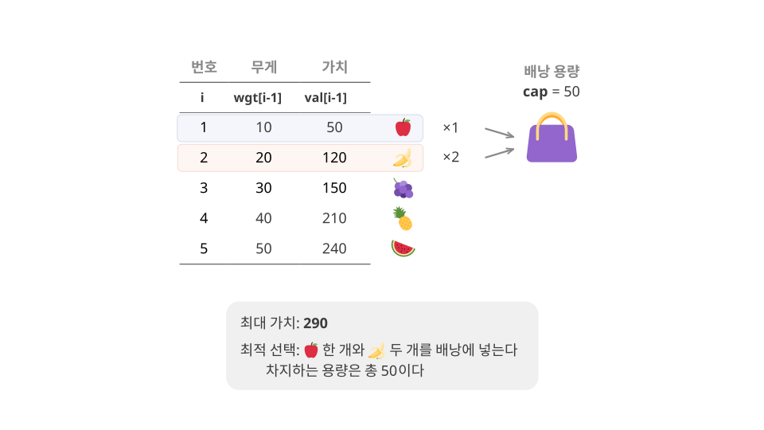

### 동적 계획법으로 접근하기

무한 배낭 문제는 0-1 배낭 문제와 매우 비슷하다. **유일한 차이는 같은 종류의 물건을 선택하는 횟수에 제한이 없다는 점이다**.

- 0-1 배낭에서는 각 종류의 물건이 하나뿐이므로 물건 $i$를 넣은 뒤에는 앞의 $i-1$개 물건 중에서만 선택할 수 있다.
- 무한 배낭에서는 각 종류의 물건이 무한히 많으므로 물건 $i$를 넣은 뒤에도 **여전히 앞의 $i$종류 중에서 선택할 수 있다**.

무한 배낭의 규칙에 따라 상태 $[i, c]$의 변화는 두 경우로 나뉜다.

- **물건 $i$를 넣지 않는 경우**: 0-1 배낭과 같이 $[i-1, c]$로 전이한다.
- **물건 $i$를 넣는 경우**: 0-1 배낭과 달리 $[i, c-wgt[i-1]]$로 전이한다.

이에 따라 상태 전이식은 다음과 같이 바뀐다.

$$
dp[i, c] = \max(dp[i-1, c], dp[i, c - wgt[i-1]] + val[i-1])
$$

### 코드 구현

두 문제의 코드를 비교하면 상태 전이에서 한 곳이 $i-1$에서 $i$로 바뀌고 나머지는 모두 같다.

```src
[file]{unbounded_knapsack}-[class]{}-[func]{unbounded_knapsack_dp}
```

### 공간 최적화

현재 상태는 왼쪽과 위쪽 상태에서 전이한다. **따라서 공간을 최적화한 뒤에는 $dp$ 테이블의 각 행을 정순으로 순회해야 한다**.

이 순서는 0-1 배낭과 정반대다. 아래 그림을 보며 차이를 살펴보자.

=== "<1>"
    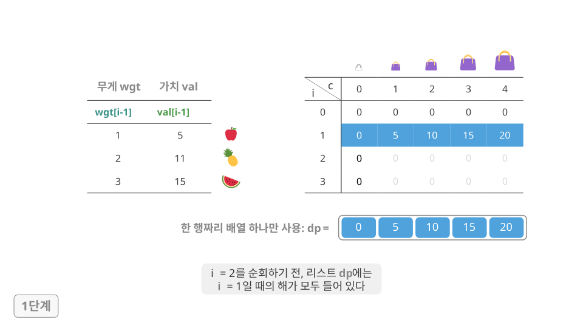

=== "<2>"
    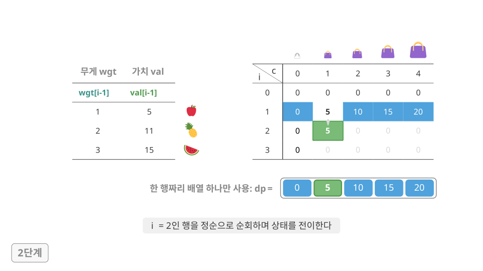

=== "<3>"
    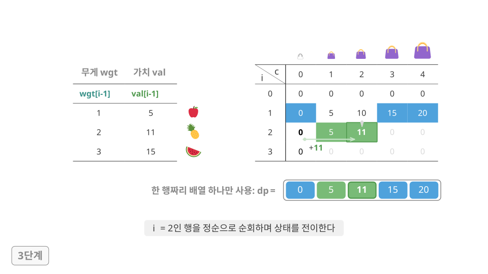

=== "<4>"
    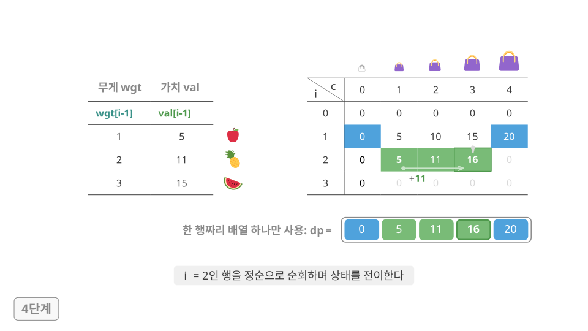

=== "<5>"
    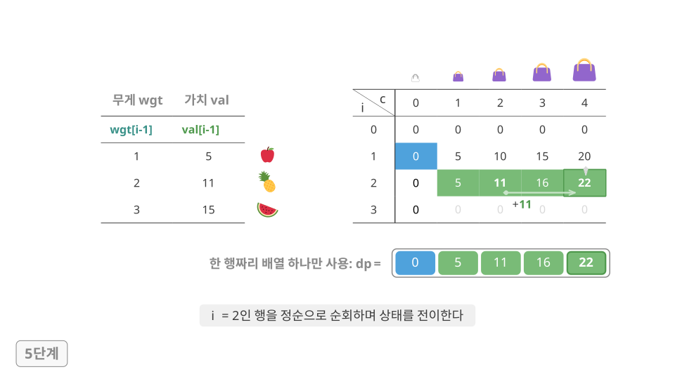

=== "<6>"
    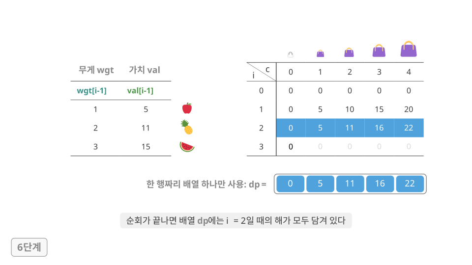

구현은 간단하다. 배열 `dp`의 첫 번째 차원만 없애면 된다.

```src
[file]{unbounded_knapsack}-[class]{}-[func]{unbounded_knapsack_dp_comp}
```

## 동전 교환 문제

배낭 문제는 동적 계획법의 큰 한 부류를 대표하며, 동전 교환을 비롯한 여러 변형이 있다.

!!! question

    동전 $n$종류가 주어지고 $i$번째 종류의 액면가는 $coins[i - 1]$, 목표 금액은 $amt$이다. **각 종류의 동전은 여러 번 선택할 수 있다**. 목표 금액을 만드는 최소 동전 수를 구하라. 목표 금액을 만들 수 없으면 $-1$을 반환한다. 아래 그림은 그 예다.

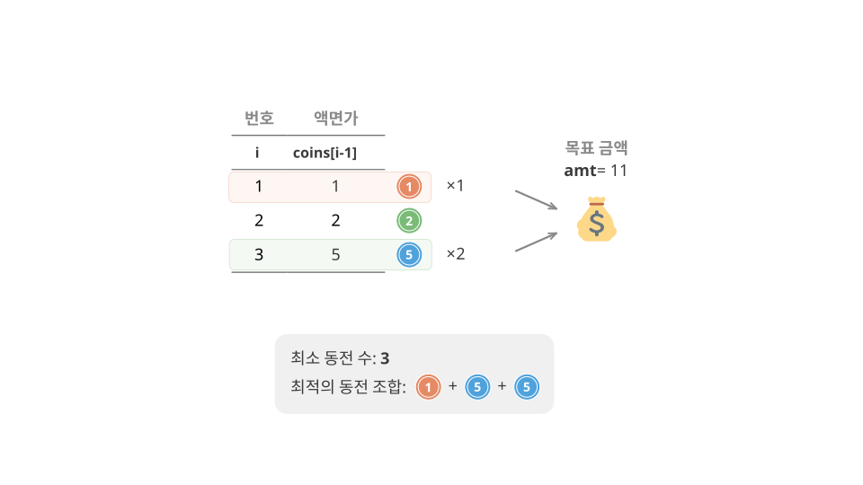

### 동적 계획법으로 접근하기

**동전 교환은 무한 배낭 문제의 특수한 경우로 볼 수 있다**. 두 문제의 대응 관계와 차이는 다음과 같다.

- 두 문제는 서로 바꾸어 생각할 수 있다. ‘물건’은 ‘동전’, ‘물건의 무게’는 ‘동전의 액면가’, ‘배낭 용량’은 ‘목표 금액’에 대응한다.
- 최적화 방향은 반대다. 무한 배낭에서는 물건의 가치를 최대화하고, 동전 교환에서는 동전 수를 최소화한다.
- 무한 배낭은 배낭 용량을 ‘넘지 않는’ 해를 구하지만, 동전 교환은 목표 금액을 ‘정확히’ 만드는 해를 구한다.

**첫 번째 단계: 매번 내릴 결정을 생각하고 상태를 정의해 $dp$ 테이블 구성하기**

상태 $[i, a]$에 해당하는 부분 문제는 **앞의 $i$종류 동전으로 금액 $a$를 만드는 최소 동전 수**를 구하는 것이다. 이를 $dp[i, a]$로 표기한다.

2차원 $dp$ 테이블의 크기는 $(n+1) \times (amt+1)$이다.

**두 번째 단계: 최적 부분 구조를 찾고 상태 전이식 유도하기**

이 문제의 상태 전이식은 무한 배낭 문제의 식과 두 가지 점에서 다르다.

- 최솟값을 구하므로 연산자 $\max()$를 $\min()$으로 바꾼다.
- 최적화 대상이 물건의 가치가 아니라 동전 수이므로 동전을 선택할 때는 $+1$만 하면 된다.

$$
dp[i, a] = \min(dp[i-1, a], dp[i, a - coins[i-1]] + 1)
$$

**세 번째 단계: 경계 조건과 상태 전이 순서 정하기**

목표 금액이 $0$이면 필요한 최소 동전 수는 $0$이다. 따라서 첫 열의 모든 $dp[i, 0]$ 값은 $0$이다.

동전이 없으면 **$> 0$인 목표 금액은 어느 것도 만들 수 없다**. 이 경우는 유효한 해가 없다. 상태 전이식의 $\min()$ 함수가 유효하지 않은 해를 걸러 내도록 이런 값을 $+ \infty$로 표시할 수 있다. 즉, 첫 행의 해당 $dp[0, a]$를 모두 $+ \infty$로 둔다.

### 코드 구현

대부분의 프로그래밍 언어는 $+ \infty$를 나타내는 정수 변수를 제공하지 않아 정수형 `int`의 최댓값으로 대신해야 한다. 그러면 상태 전이식의 $+ 1$ 연산에서 정수 범위를 넘어 오버플로가 발생할 수 있다.

그래서 유효하지 않은 해를 $amt + 1$로 나타낸다. 금액 $amt$을 만드는 데 필요한 동전 수는 많아야 $amt$개이기 때문이다. 마지막으로 $dp[n, amt]$가 $amt + 1$와 같은지 확인하고, 같으면 목표 금액을 만들 수 없다는 뜻으로 $-1$을 반환한다. 코드는 다음과 같다.

```src
[file]{coin_change}-[class]{}-[func]{coin_change_dp}
```

아래 그림은 동전 교환을 동적 계획법으로 푸는 과정이다. 무한 배낭 문제와 매우 비슷하다.

=== "<1>"
    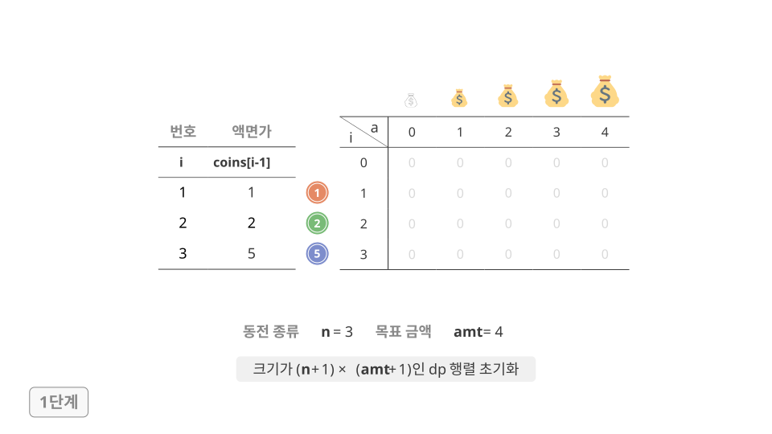

=== "<2>"
    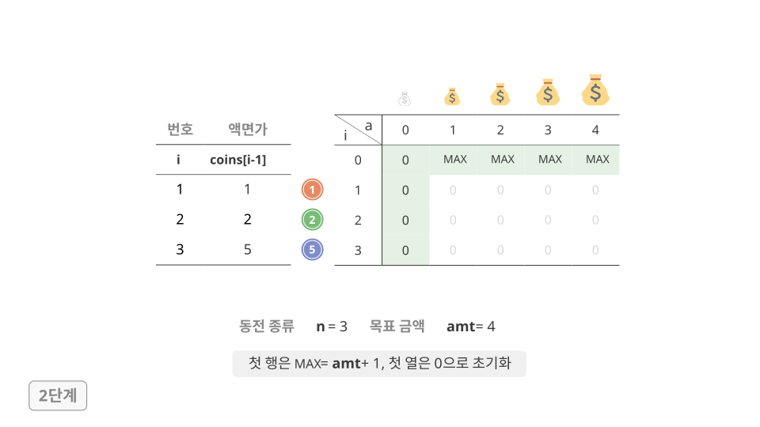

=== "<3>"
    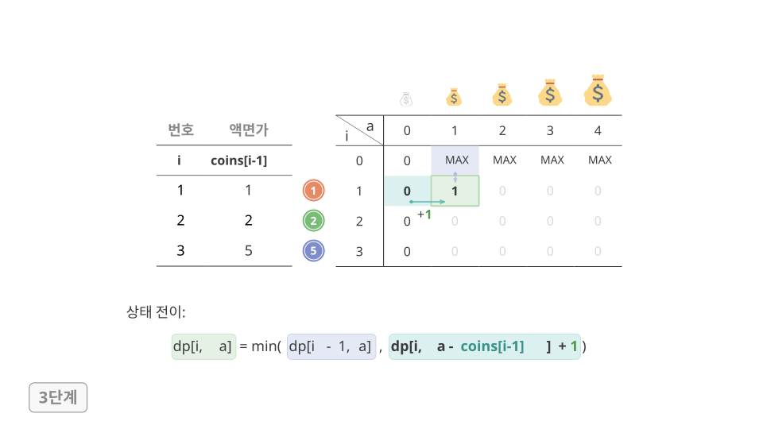

=== "<4>"
    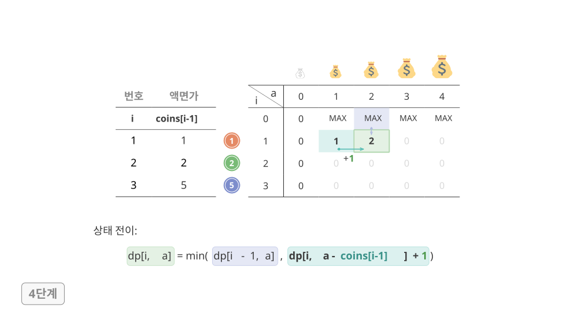

=== "<5>"
    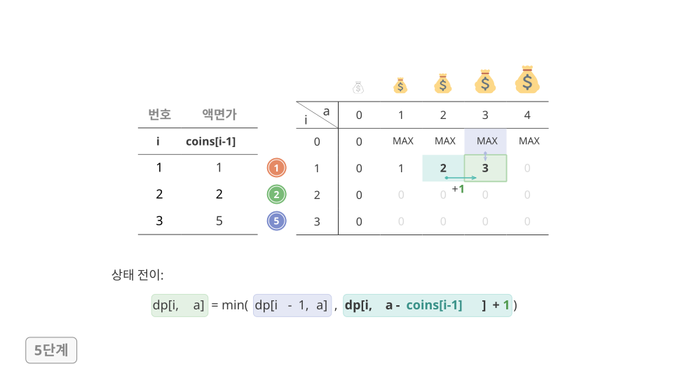

=== "<6>"
    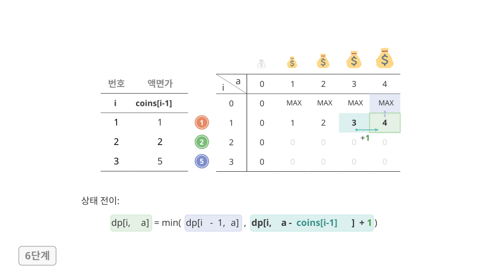

=== "<7>"
    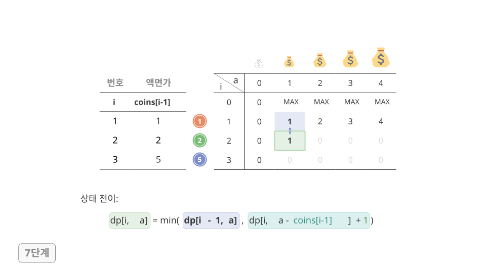

=== "<8>"
    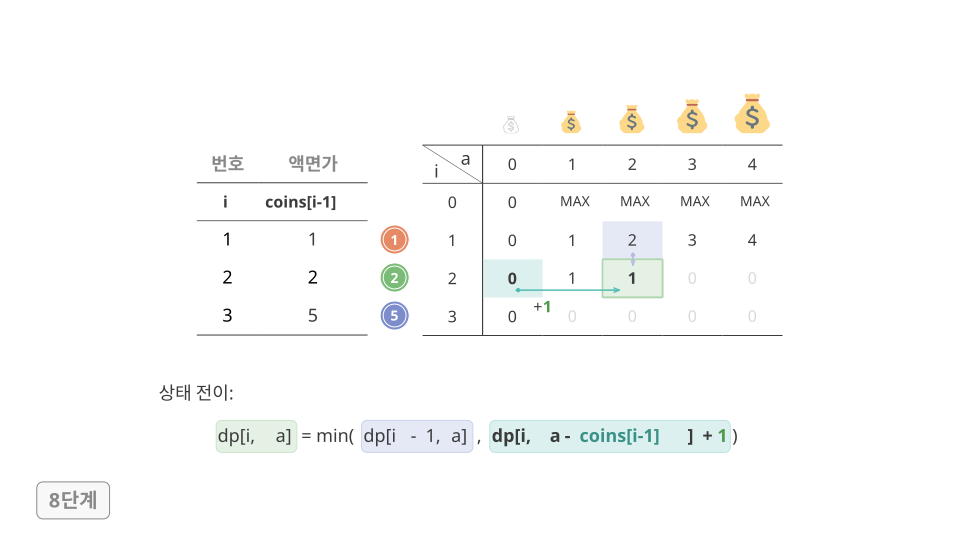

=== "<9>"
    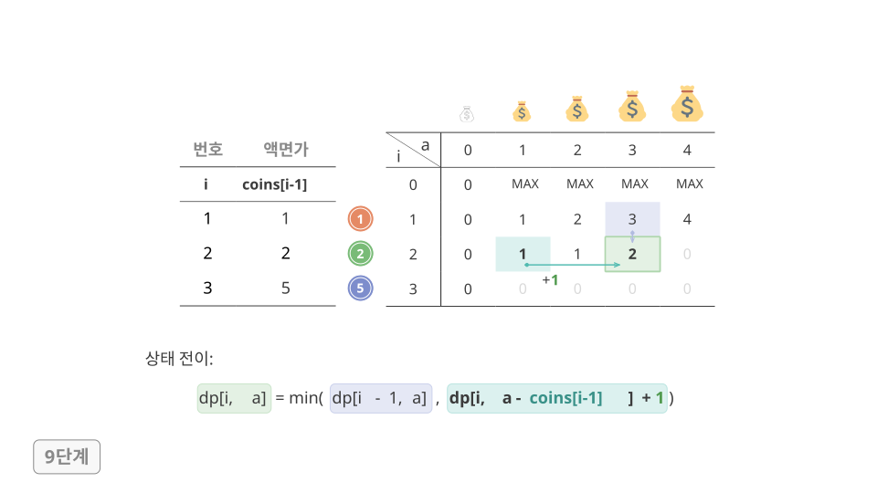

=== "<10>"
    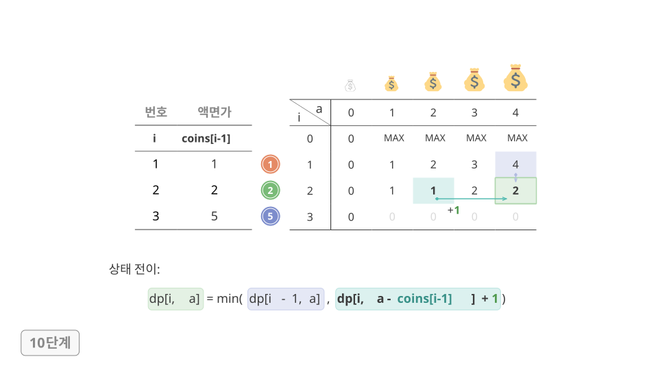

=== "<11>"
    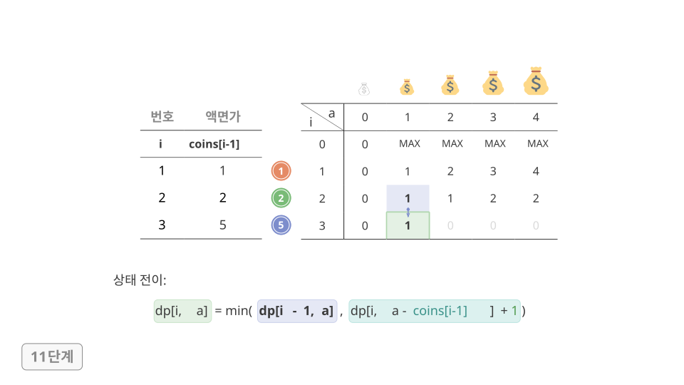

=== "<12>"
    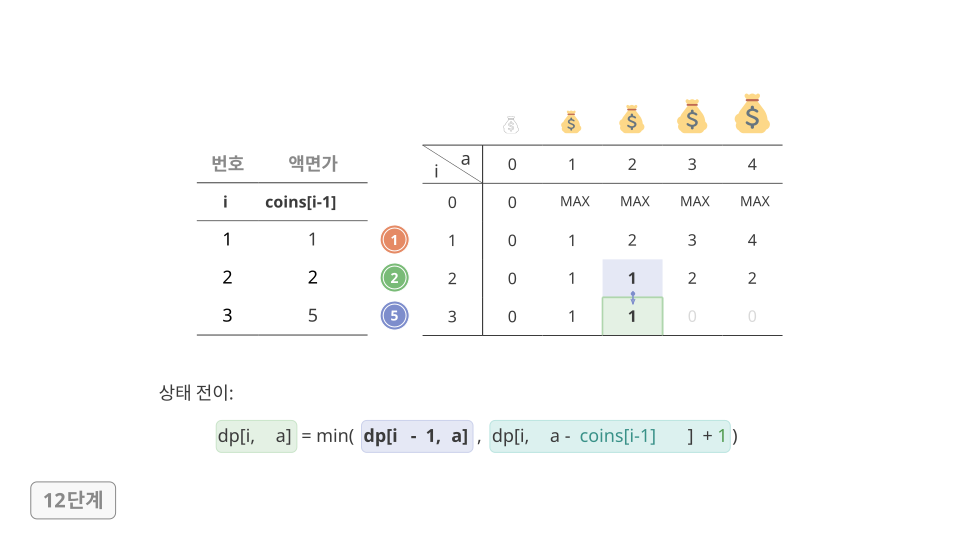

=== "<13>"
    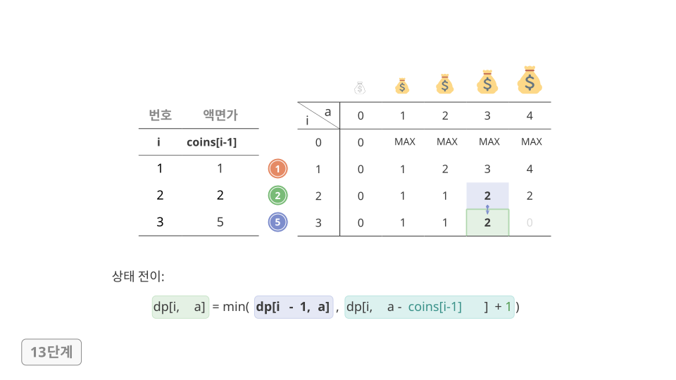

=== "<14>"
    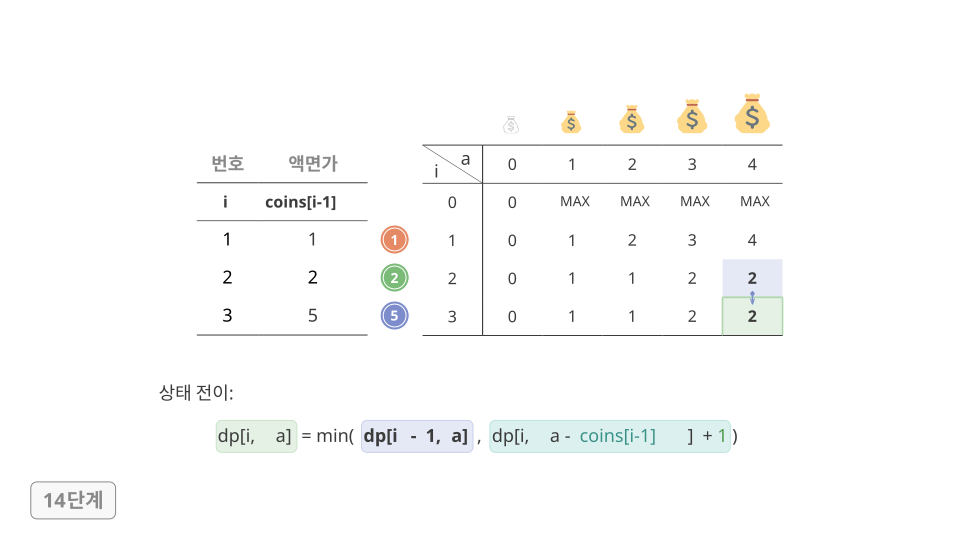

=== "<15>"
    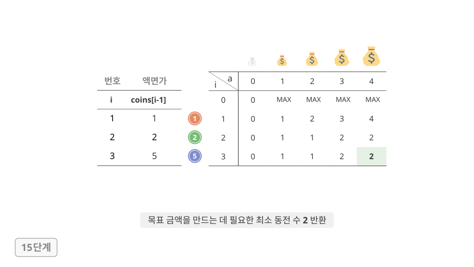

### 공간 최적화

동전 교환에서 공간을 최적화하는 방법도 무한 배낭과 같다.

```src
[file]{coin_change}-[class]{}-[func]{coin_change_dp_comp}
```

## 동전 교환 문제 II

!!! question

    동전 $n$종류가 주어지고 $i$번째 종류의 액면가는 $coins[i - 1]$, 목표 금액은 $amt$이다. 각 종류의 동전을 여러 번 선택할 수 있을 때 **목표 금액을 만드는 동전 조합은 몇 가지인지 구하라**. 아래 그림은 그 예다.

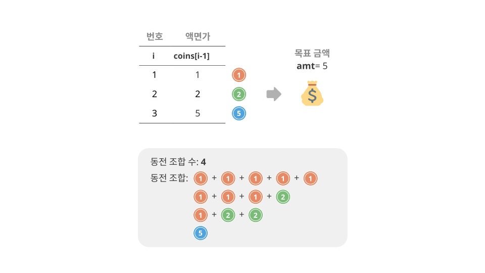

### 동적 계획법으로 접근하기

앞 문제와 달리 이번에는 조합 수를 구한다. 따라서 부분 문제는 **앞의 $i$종류 동전으로 금액 $a$를 만드는 조합 수**를 구하는 것으로 바뀐다. $dp$ 테이블은 여전히 크기가 $(n+1) \times (amt + 1)$인 2차원 행렬이다.

현재 상태의 조합 수는 현재 동전을 선택하지 않을 때와 선택할 때의 조합 수를 더한 값이다. 상태 전이식은 다음과 같다.

$$
dp[i, a] = dp[i-1, a] + dp[i, a - coins[i-1]]
$$

목표 금액이 $0$이면 동전을 하나도 선택하지 않는 방법으로 목표 금액을 만들 수 있다. 따라서 첫 열의 모든 $dp[i, 0]$를 $1$로 초기화한다. 동전이 없으면 $>0$인 목표 금액은 만들 수 없으므로 첫 행에서 이에 해당하는 모든 $dp[0, a]$는 $0$이다.

### 코드 구현

```src
[file]{coin_change_ii}-[class]{}-[func]{coin_change_ii_dp}
```

### 공간 최적화

공간 최적화 방식도 같다. 동전 종류에 해당하는 차원을 없애면 된다.

```src
[file]{coin_change_ii}-[class]{}-[func]{coin_change_ii_dp_comp}
```
