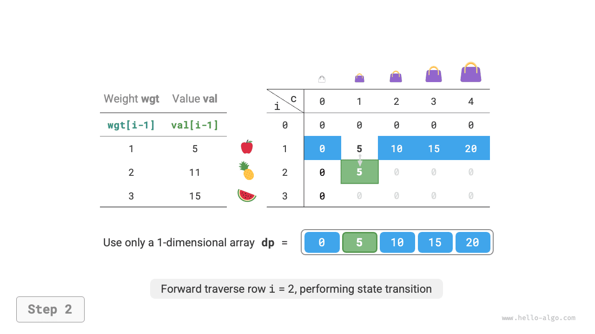
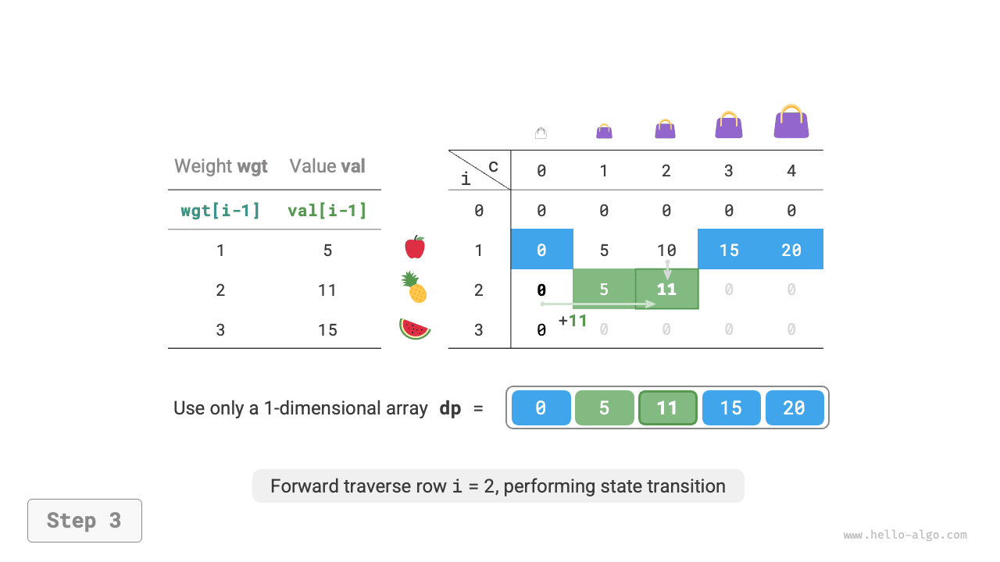
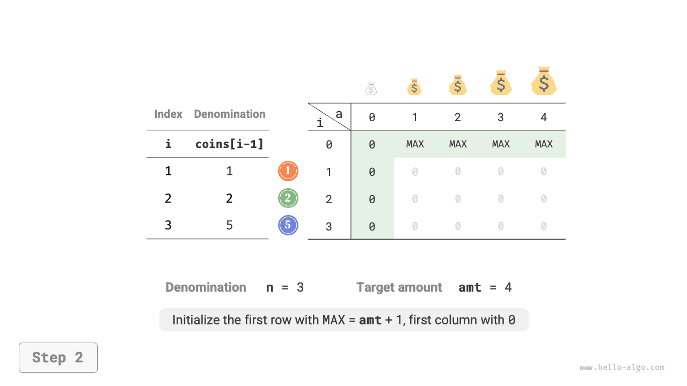
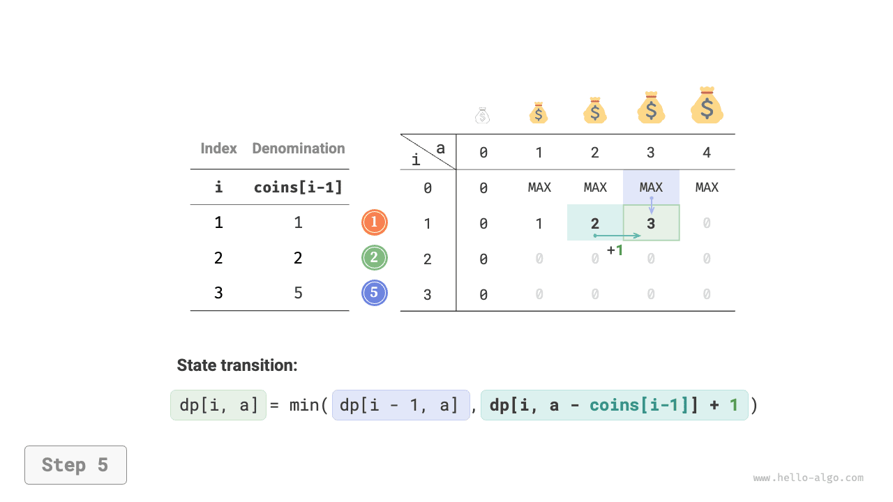
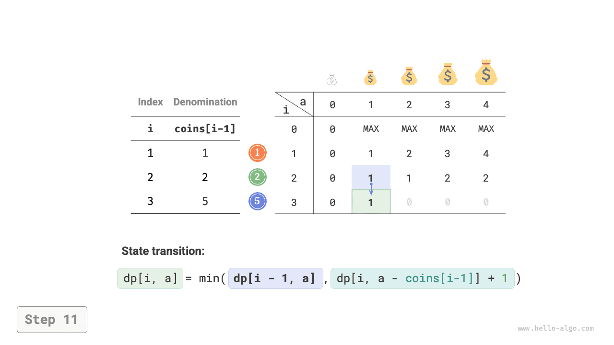
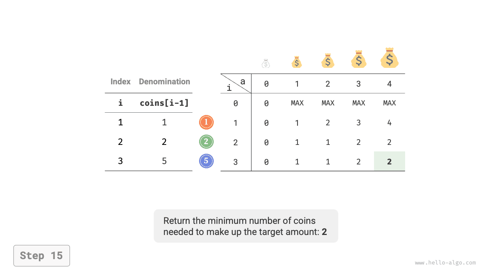
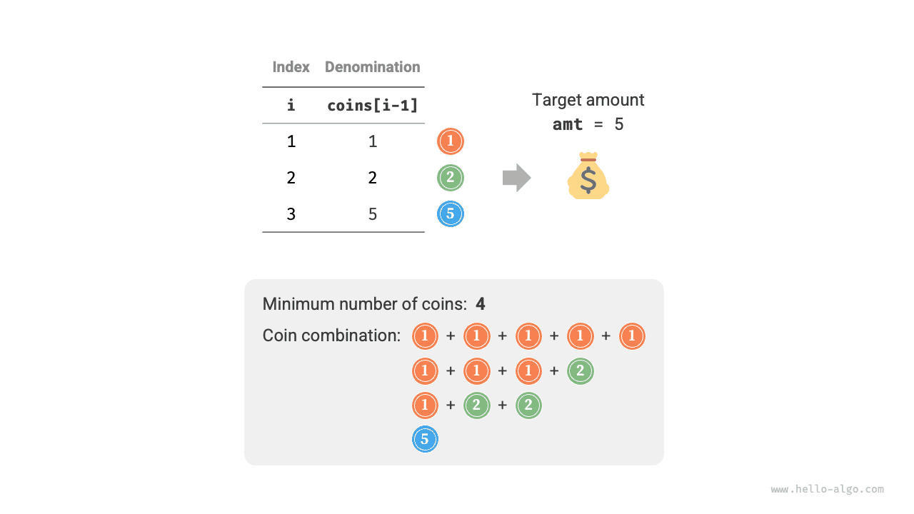

# 무한 배낭 문제

이 절에서는 또 다른 대표적인 배낭 문제인 무한 배낭을 먼저 풀고, 그 특수한 경우인 동전 교환을 알아본다.

## 무한 배낭 문제

!!! question "문제"

    물건 $n$ 개와 용량이 $cap$인 배낭이 주어진다. $i$ 번째 물건의 무게는 $wgt[i-1]$, 가치는 $val[i-1]$이다. **각 물건을 반복해서 선택할 수 있을 때**, 용량 제한 안에 담을 수 있는 최대 가치를 구하라. 예시는 아래 그림과 같다.


### 동적 계획법 접근

무한 배낭 문제는 0-1 배낭 문제와 매우 비슷하며, **물건을 선택하는 횟수에 제한이 없다는 점만 다르다**.

- 0-1 배낭에서는 종류별 물건이 하나뿐이므로 물건 $i$를 넣은 뒤에는 앞의 $i-1$ 개 물건에서만 선택할 수 있다.
- 무한 배낭에서는 각 종류의 물건이 무한히 많으므로 물건 $i$를 넣은 뒤에도 **앞의 $i$ 개 물건에서 계속 선택할 수 있다**.

무한 배낭의 규칙에 따라 상태 $[i, c]$의 변화는 두 경우로 나뉜다.

- **물건 $i$를 넣지 않음**: 0-1 배낭과 동일하게 $[i-1, c]$로 전이한다.
- **물건 $i$를 넣음**: 0-1 배낭과 달리 $[i, c-wgt[i-1]]$로 전이한다.

따라서 상태 전이 식은 다음과 같이 바뀐다.

$$
dp[i, c] = \max(dp[i-1, c], dp[i, c - wgt[i-1]] + val[i-1])
$$

### 코드 구현

두 문제의 코드를 비교하면 상태 전이의 한 곳이 $i-1$에서 $i$로 바뀌었을 뿐 나머지는 완전히 같다.

```src
[file]{unbounded_knapsack}-[class]{}-[func]{unbounded_knapsack_dp}
```

### 공간 최적화

현재 상태는 왼쪽과 위쪽 상태에서 전이되므로 **공간 최적화 후에는 $dp$ 테이블의 각 행을 정방향으로 순회해야 한다**.

이는 0-1 배낭의 순회 순서와 정반대다. 아래 그림으로 차이를 이해해 보자.

=== "<1>"
    

=== "<2>"
    

=== "<3>"
    

=== "<4>"
    

=== "<5>"
    

=== "<6>"
    

구현은 간단하다. 배열 `dp`의 첫 번째 차원을 없애면 된다.

```src
[file]{unbounded_knapsack}-[class]{}-[func]{unbounded_knapsack_dp_comp}
```

## 동전 교환 문제

배낭 문제는 동적 계획법의 큰 문제군을 대표하며, 동전 교환 같은 여러 변형이 있다.

!!! question "문제"

    동전 $n$ 종류가 주어지며 $i$ 번째 동전의 액면가는 $coins[i - 1]$이고 목표 금액은 $amt$다. **각 종류의 동전을 반복해서 선택할 수 있을 때**, 목표 금액을 만드는 최소 동전 수를 구하라. 목표 금액을 만들 수 없으면 $-1$을 반환하라. 예시는 아래 그림과 같다.


### 동적 계획법 접근

**동전 교환은 무한 배낭 문제의 특수한 경우로 볼 수 있으며**, 다음과 같은 공통점과 차이점이 있다.

- 두 문제는 서로 변환할 수 있다. '물건'은 '동전', '물건 무게'는 '동전 액면가', '배낭 용량'은 '목표 금액'에 대응한다.
- 최적화 목표가 반대다. 무한 배낭은 물건 가치를 최대화하고, 동전 교환은 동전 수를 최소화한다.
- 무한 배낭은 용량을 '넘지 않는' 해를 구하지만, 동전 교환은 목표 금액을 '정확히' 만드는 해를 구한다.

**1단계: 매 차례의 결정을 생각하고 상태를 정의하여 $dp$ 테이블을 얻는다**

상태 $[i, a]$의 부분 문제는 **앞의 $i$ 종류 동전으로 금액 $a$를 만드는 최소 동전 수**이며, 이를 $dp[i, a]$라고 한다.

2차원 $dp$ 테이블의 크기는 $(n+1) \times (amt+1)$이다.

**2단계: 최적 부분 구조를 찾아 상태 전이 식을 도출한다**

이 문제의 상태 전이 식은 무한 배낭과 다음 두 가지가 다르다.

- 최솟값을 구하므로 연산자 $\max()$를 $\min()$으로 바꾼다.
- 최적화 대상은 상품 가치가 아니라 동전 수이므로, 동전을 선택하면 $+1$만 수행한다.

$$
dp[i, a] = \min(dp[i-1, a], dp[i, a - coins[i-1]] + 1)
$$

**3단계: 경계 조건과 상태 전이 순서를 정한다**

목표 금액이 $0$이면 최소 동전 수는 $0$이다. 즉, 첫 열의 모든 $dp[i, 0]$은 $0$이다.

동전이 없으면 **$> 0$인 어떤 목표 금액도 만들 수 없으므로** 유효하지 않은 해다. 상태 전이 식의 $\min()$이 이를 알아보고 제외하도록 $+ \infty$로 나타낸다. 즉, 첫 행의 모든 $dp[0, a]$를 $+ \infty$로 둔다.

### 코드 구현

대부분의 프로그래밍 언어는 $+ \infty$ 변수를 제공하지 않아 정수 타입 `int`의 최댓값으로 대신해야 한다. 하지만 그러면 상태 전이 식의 $+ 1$ 연산에서 정수 오버플로가 발생할 수 있다.

이를 피하기 위해 유효하지 않은 해를 $amt + 1$로 나타낸다. $amt$를 만드는 동전 수는 많아도 $amt$ 개이기 때문이다. 마지막에 $dp[n, amt]$가 $amt + 1$인지 확인하고, 같으면 목표 금액을 만들 수 없다는 뜻으로 $-1$을 반환한다. 코드는 다음과 같다.

```src
[file]{coin_change}-[class]{}-[func]{coin_change_dp}
```

아래 그림의 동전 교환 동적 계획법 과정은 무한 배낭 문제와 매우 비슷하다.

=== "<1>"
    

=== "<2>"
    

=== "<3>"
    

=== "<4>"
    

=== "<5>"
    

=== "<6>"
    

=== "<7>"
    

=== "<8>"
    

=== "<9>"
    

=== "<10>"
    

=== "<11>"
    

=== "<12>"
    

=== "<13>"
    

=== "<14>"
    

=== "<15>"
    

### 공간 최적화

동전 교환의 공간 최적화는 무한 배낭과 같은 방식으로 처리한다.

```src
[file]{coin_change}-[class]{}-[func]{coin_change_dp_comp}
```

## 동전 교환 문제 II

!!! question "문제"

    동전 $n$ 종류가 주어지며 $i$ 번째 동전의 액면가는 $coins[i - 1]$이고 목표 금액은 $amt$다. 각 종류의 동전을 반복해서 선택할 수 있을 때, **목표 금액을 만드는 동전 조합 수를 구하라**. 예시는 아래 그림과 같다.



### 동적 계획법 접근

앞 문제와 달리 이번에는 조합 수를 구하므로 부분 문제는 **앞의 $i$ 종류 동전으로 금액 $a$를 만드는 조합 수**가 된다. $dp$ 테이블은 여전히 $(n+1) \times (amt + 1)$ 크기의 2차원 행렬이다.

현재 상태의 조합 수는 현재 동전을 선택하지 않는 경우와 선택하는 경우의 조합 수를 더한 값이다. 상태 전이 식은 다음과 같다.

$$
dp[i, a] = dp[i-1, a] + dp[i, a - coins[i-1]]
$$

목표 금액이 $0$이면 동전을 하나도 선택하지 않고도 만들 수 있으므로 첫 열의 모든 $dp[i, 0]$을 $1$로 초기화한다. 동전이 없으면 $>0$인 목표 금액을 만들 수 없으므로 첫 행의 모든 $dp[0, a]$는 $0$이다.

### 코드 구현

```src
[file]{coin_change_ii}-[class]{}-[func]{coin_change_ii_dp}
```

### 공간 최적화

공간 최적화 방법도 같으며, 동전 차원을 없애면 된다.

```src
[file]{coin_change_ii}-[class]{}-[func]{coin_change_ii_dp_comp}
```
