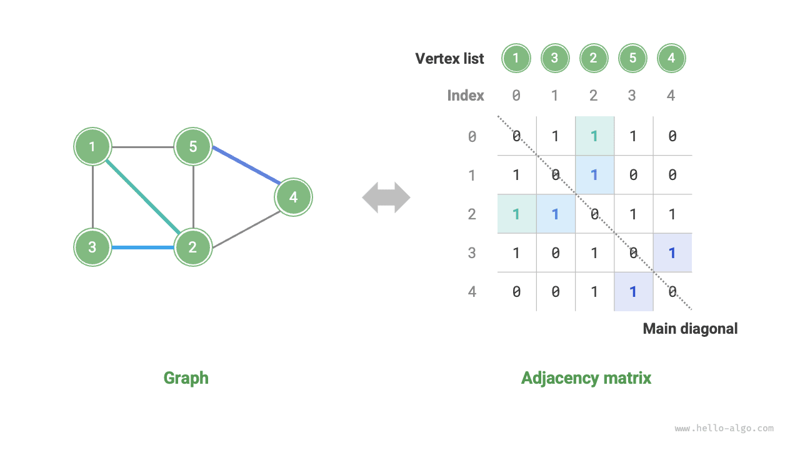

# 9.1 &nbsp; 그래프

<u>그래프(graph)</u>는 <u>정점(vertex)</u>과 <u>간선(edge)</u>으로 이루어진 비선형 자료 구조다. 그래프 $G$는 정점 집합 $V$와 간선 집합 $E$로 추상적으로 표현할 수 있다. 다음 예시는 정점 5개와 간선 7개로 이루어진 그래프를 나타낸다.

$$
\begin{aligned}
V & = \{ 1, 2, 3, 4, 5 \} \newline
E & = \{ (1,2), (1,3), (1,5), (2,3), (2,4), (2,5), (4,5) \} \newline
G & = \{ V, E \} \newline
\end{aligned}
$$

정점을 노드로, 간선을 노드들을 연결하는 참조(포인터)로 보면 그래프는 연결 리스트를 확장한 자료 구조로 생각할 수 있다. 아래 그림(9-1)과 같이 **선형 관계(연결 리스트)와 분할 정복 관계(트리)에 비해 네트워크 관계(그래프)는 자유도가 높아 더 복잡하다**.

{ class="animation-figure" }

 그림 9-1 &nbsp; 연결 리스트, 트리, 그래프 사이의 관계 

## 9.1.1 &nbsp; 그래프의 주요 종류와 용어

간선에 방향이 있는지에 따라 아래 그림(9-2)과 같이 <u>무방향 그래프(undirected graph)</u>와 <u>방향 그래프(directed graph)</u>로 나뉜다.

- 무방향 그래프에서 간선은 두 정점 사이의 '양방향' 연결 관계를 나타낸다. 위챗이나 QQ의 '친구 관계'가 그 예다.
- 방향 그래프에서 간선은 방향을 가진다. 즉, $A \rightarrow B$와 $A \leftarrow B$ 방향의 간선은 서로 독립적이다. 웨이보나 더우인의 '팔로우'와 '팔로워' 관계가 그 예다.

{ class="animation-figure" }

 그림 9-2 &nbsp; 방향 그래프와 무방향 그래프 

모든 정점이 연결되어 있는지에 따라 아래 그림(9-3)과 같이 <u>연결 그래프(connected graph)</u>와 <u>비연결 그래프(disconnected graph)</u>로 나뉜다.

- 연결 그래프에서는 한 정점에서 출발하여 다른 모든 정점에 도달할 수 있다.
- 비연결 그래프에서는 한 정점에서 출발했을 때 도달할 수 없는 정점이 하나 이상 존재한다.

{ class="animation-figure" }

 그림 9-3 &nbsp; 연결 그래프와 비연결 그래프 

간선에 '가중치' 변수를 추가하면 아래 그림(9-4)과 같은 <u>가중 그래프(weighted graph)</u>를 얻는다. 예를 들어 『왕자영요』 같은 모바일 게임에서는 함께 게임한 시간을 바탕으로 플레이어 간의 '친밀도'를 계산한다. 이러한 친밀도 네트워크는 가중 그래프로 표현할 수 있다.

{ class="animation-figure" }

 그림 9-4 &nbsp; 가중 그래프와 비가중 그래프 

그래프 자료 구조에서 자주 사용하는 용어는 다음과 같다.

- <u>인접(adjacency)</u>: 두 정점 사이에 간선이 있으면 두 정점이 '인접한다'고 한다. 위 그림(9-4)에서 정점 1에 인접한 정점은 2, 3, 5다.
- <u>경로(path)</u>: 정점 A에서 정점 B로 갈 때 거치는 간선의 순서를 A에서 B로 가는 '경로'라고 한다. 위 그림(9-4)에서 간선 순서 1-5-2-4는 정점 1에서 정점 4로 가는 경로다.
- <u>차수(degree)</u>: 한 정점에 연결된 간선의 수다. 방향 그래프에서는 <u>진입 차수(in-degree)</u>가 해당 정점으로 들어오는 간선 수를, <u>진출 차수(out-degree)</u>가 해당 정점에서 나가는 간선 수를 나타낸다.

## 9.1.2 &nbsp; 그래프의 표현

그래프를 표현하는 대표적인 방법은 '인접 행렬'과 '인접 리스트'다. 아래에서는 무방향 그래프를 예로 든다.

### 1. &nbsp; 인접 행렬

그래프의 정점 수를 $n$이라고 하자. <u>인접 행렬(adjacency matrix)</u>은 $n \times n$ 크기의 행렬로 그래프를 표현한다. 각 행(열)은 정점 하나를, 행렬의 원소는 간선을 나타내며, $1$ 또는 $0$으로 두 정점 사이에 간선이 있는지 표시한다.

아래 그림(9-5)과 같이 인접 행렬을 $M$, 정점 리스트를 $V$라고 하면, 행렬 원소 $M[i, j] = 1$은 정점 $V[i]$와 정점 $V[j]$ 사이에 간선이 있음을 뜻한다. 반대로 $M[i, j] = 0$은 두 정점 사이에 간선이 없음을 뜻한다.

{ class="animation-figure" }

 그림 9-5 &nbsp; 그래프의 인접 행렬 표현 

인접 행렬에는 다음 성질이 있다.

- 단순 그래프에서는 정점이 자기 자신과 연결될 수 없으므로, 인접 행렬의 주대각선 원소는 의미가 없다.
- 무방향 그래프에서는 두 방향의 간선이 같으므로, 인접 행렬은 주대각선에 대해 대칭이다.
- 인접 행렬의 원소 $1$과 $0$을 가중치로 바꾸면 가중 그래프를 표현할 수 있다.

인접 행렬로 그래프를 표현하면 행렬 원소에 직접 접근하여 간선을 얻을 수 있다. 따라서 추가, 삭제, 조회, 수정 연산이 매우 효율적이며 시간 복잡도는 모두 $O(1)$이다. 하지만 행렬의 공간 복잡도는 $O(n^2)$이므로 메모리를 많이 차지한다.

### 2. &nbsp; 인접 리스트

<u>인접 리스트(adjacency list)</u>는 $n$ 개의 연결 리스트로 그래프를 표현하며, 연결 리스트의 노드는 정점을 나타낸다. $i$ 번째 연결 리스트는 정점 $i$에 대응하고, 해당 정점에 인접한 모든 정점(간선으로 연결된 정점)을 저장한다. 아래 그림(9-6)은 인접 리스트로 그래프를 저장한 예다.

{ class="animation-figure" }

 그림 9-6 &nbsp; 그래프의 인접 리스트 표현 

인접 리스트는 실제로 존재하는 간선만 저장한다. 전체 간선 수는 보통 $n^2$보다 훨씬 작으므로 공간을 더 절약할 수 있다. 하지만 간선을 찾으려면 연결 리스트를 순회해야 하므로 시간 효율은 인접 행렬보다 낮다.

위 그림(9-6)을 보면 **인접 리스트의 구조는 해시 테이블의 '체이닝'과 매우 비슷하므로, 비슷한 방법으로 효율을 높일 수 있다**. 예를 들어 연결 리스트가 길면 AVL 트리나 레드-블랙 트리로 바꾸어 시간 복잡도를 $O(n)$에서 $O(\log n)$으로 개선할 수 있다. 연결 리스트를 해시 테이블로 바꾸면 시간 복잡도를 $O(1)$로 줄일 수도 있다.

## 9.1.3 &nbsp; 그래프의 주요 응용

아래 표(9-1)와 같이 현실의 많은 시스템을 그래프로 모델링할 수 있으며, 관련 문제를 그래프 계산 문제로 환원할 수 있다.

 표 9-1 &nbsp; 일상에서 볼 수 있는 그래프 

|          | 정점 | 간선 | 그래프 계산 문제 |
| -------- | ---- | -------------------- | ------------ |
| 소셜 네트워크 | 사용자 | 친구 관계 | 잠재적 친구 추천 |
| 지하철 노선 | 역 | 역 사이의 연결 관계 | 최단 경로 추천 |
| 태양계 | 천체 | 천체 사이의 만유인력 | 행성 궤도 계산 |

