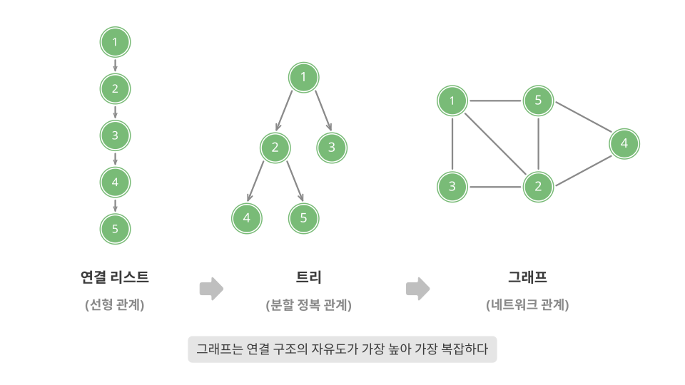
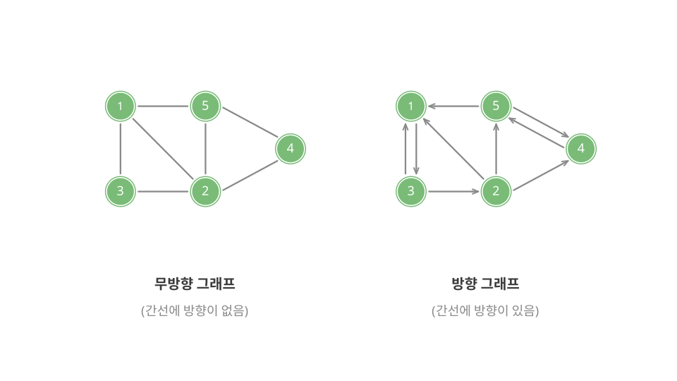
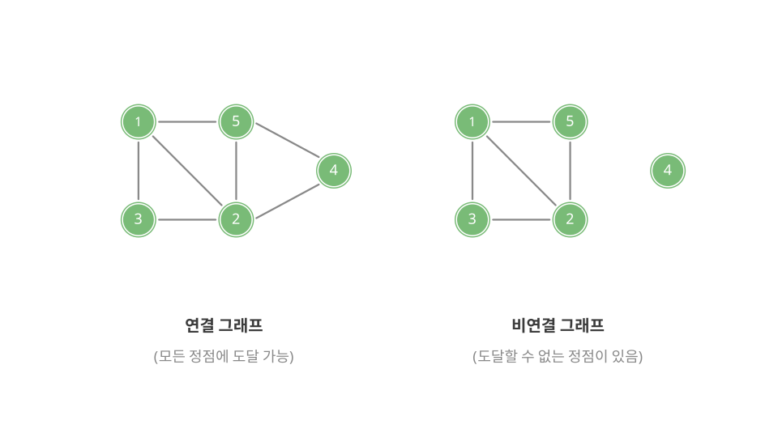
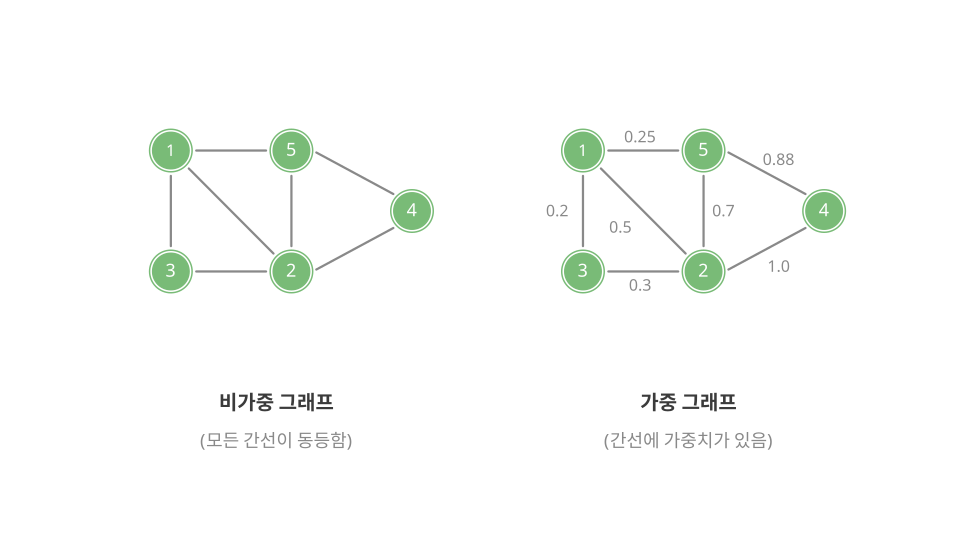
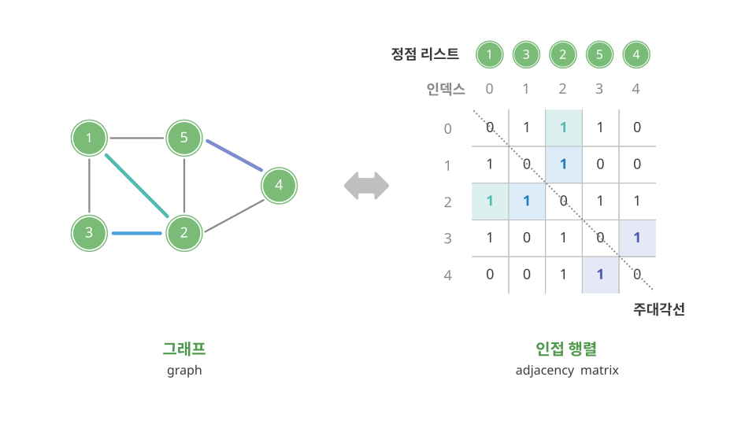
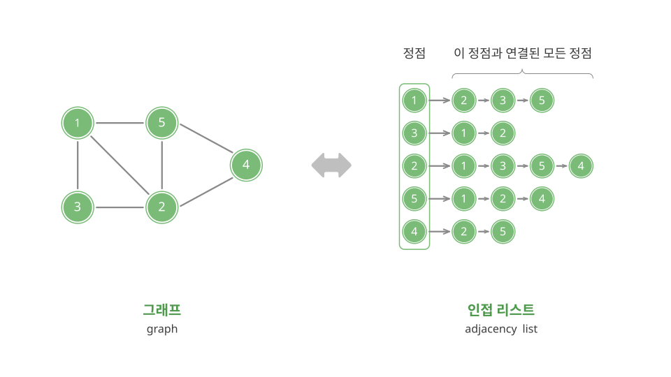

# 9.1 &nbsp; 그래프

<u>그래프(graph)</u>는 <u>정점(vertex)</u>과 <u>간선(edge)</u>으로 이루어진 비선형 자료 구조다. 그래프 $G$는 정점 집합 $V$와 간선 집합 $E$로 표현할 수 있다. 다음은 정점 5개와 간선 7개로 이루어진 그래프의 예다.

$$
\begin{aligned}
V & = \{ 1, 2, 3, 4, 5 \} \newline
E & = \{ (1,2), (1,3), (1,5), (2,3), (2,4), (2,5), (4,5) \} \newline
G & = \{ V, E \} \newline
\end{aligned}
$$

정점을 노드로, 간선을 노드들을 연결하는 참조(포인터)로 보면 그래프는 연결 리스트를 확장한 자료 구조로 이해할 수 있다. 아래 그림(9-1)처럼 **네트워크 관계(그래프)는 선형 관계(연결 리스트)나 분할 정복 관계(트리)보다 연결 방식의 자유도가 높아** 더 복잡하다.

{ class="animation-figure" }

 그림 9-1 &nbsp; 연결 리스트, 트리, 그래프의 관계 

## 9.1.1 &nbsp; 그래프의 대표 유형과 용어

간선에 방향이 있는지에 따라 그래프를 아래 그림(9-2)처럼 <u>무방향 그래프(undirected graph)</u>와 <u>방향 그래프(directed graph)</u>로 나눈다.

- 무방향 그래프에서 간선은 두 정점 사이의 양방향 연결을 나타낸다. 위챗이나 QQ에서 서로 친구를 맺는 관계가 그 예다.
- 방향 그래프에서는 간선에 방향이 있다. 즉 $A \rightarrow B$ 방향의 간선과 $A \leftarrow B$ 방향의 간선은 서로 독립적이다. 웨이보나 더우인에서 상대를 팔로우하는 관계와 상대에게 팔로우되는 관계를 예로 들 수 있다.

{ class="animation-figure" }

 그림 9-2 &nbsp; 방향 그래프와 무방향 그래프 

모든 정점이 서로 연결되는지에 따라 아래 그림(9-3)처럼 <u>연결 그래프(connected graph)</u>와 <u>비연결 그래프(disconnected graph)</u>로 나눈다.

- 연결 그래프에서는 어느 정점에서 출발해도 나머지 모든 정점에 도달할 수 있다.
- 비연결 그래프에서는 한 정점에서 출발했을 때 도달할 수 없는 정점이 적어도 하나 있다.

{ class="animation-figure" }

 그림 9-3 &nbsp; 연결 그래프와 비연결 그래프 

간선에 가중치를 부여하면 아래 그림(9-4)과 같은 <u>가중 그래프(weighted graph)</u>를 얻는다. 예를 들어 《왕자영요》와 같은 모바일 게임은 함께 플레이한 시간을 바탕으로 이용자 간의 친밀도를 계산한다. 이 친밀도 네트워크를 가중 그래프로 표현할 수 있다.

{ class="animation-figure" }

 그림 9-4 &nbsp; 가중 그래프와 비가중 그래프 

그래프에서 자주 쓰는 용어는 다음과 같다.

- <u>인접(adjacency)</u>: 두 정점이 간선으로 연결되어 있을 때 두 정점이 인접한다고 한다. 위 그림(9-4)에서 정점 1의 인접 정점은 2, 3, 5다.
- <u>경로(path)</u>: 정점 A에서 정점 B까지 지나가는 간선들의 순서를 A에서 B로 가는 경로라고 한다. 위 그림(9-4)에서 1-5-2-4를 잇는 간선들의 순서는 정점 1에서 정점 4로 가는 한 경로다.
- <u>차수(degree)</u>: 한 정점에 연결된 간선의 수다. 방향 그래프에서 <u>진입 차수(in-degree)</u>는 해당 정점으로 들어오는 간선 수이고, <u>진출 차수(out-degree)</u>는 해당 정점에서 나가는 간선 수다.

## 9.1.2 &nbsp; 그래프의 표현

그래프를 표현하는 대표적인 방법에는 인접 행렬과 인접 리스트가 있다. 무방향 그래프를 예로 살펴보자.

### 1. &nbsp; 인접 행렬

그래프의 정점 수가 $n$이라 하자. <u>인접 행렬(adjacency matrix)</u>은 크기가 $n \times n$인 행렬로 그래프를 나타낸다. 각 행과 열은 정점 하나에 대응하고, 행렬 원소는 간선을 나타낸다. 두 정점 사이에 간선이 있는지에 따라 $1$ 또는 $0$를 저장한다.

아래 그림(9-5)에서 인접 행렬을 $M$, 정점 리스트를 $V$라 하면, $M[i, j] = 1$은 정점 $V[i]$에서 정점 $V[j]$로 가는 간선이 있다는 뜻이다. 반대로 $M[i, j] = 0$은 두 정점 사이에 간선이 없다는 뜻이다.

{ class="animation-figure" }

 그림 9-5 &nbsp; 인접 행렬로 표현한 그래프 

인접 행렬의 특성은 다음과 같다.

- 단순 그래프에서는 정점을 자기 자신과 연결할 수 없으므로 인접 행렬의 주대각선 원소는 의미가 없다.
- 무방향 그래프에서는 양방향의 간선이 동등하므로 인접 행렬이 주대각선을 기준으로 대칭이다.
- 인접 행렬의 원소 $1$과 $0$ 대신 가중치를 저장하면 가중 그래프를 표현할 수 있다.

인접 행렬로 그래프를 표현하면 행렬 원소에 직접 접근해 간선을 다룰 수 있다. 따라서 간선의 추가, 삭제, 조회, 수정이 모두 효율적이며 시간 복잡도는 $O(1)$이다. 다만 행렬의 공간 복잡도는 $O(n^2)$이어서 메모리를 많이 차지한다.

### 2. &nbsp; 인접 리스트

<u>인접 리스트(adjacency list)</u>는 연결 리스트 $n$개로 그래프를 표현하며, 각 노드는 정점을 나타낸다. $i$번째 연결 리스트는 정점 $i$에 대응하며 해당 정점의 모든 인접 정점(간선으로 연결된 정점)을 저장한다. 아래 그림(9-6)은 인접 리스트로 그래프를 저장한 예다.

{ class="animation-figure" }

 그림 9-6 &nbsp; 인접 리스트로 표현한 그래프 

인접 리스트는 실제로 존재하는 간선만 저장한다. 간선 수는 보통 $n^2$보다 훨씬 작으므로 공간을 더 절약할 수 있다. 다만 간선을 찾으려면 연결 리스트를 순회해야 하므로 인접 행렬보다 시간이 더 걸린다.

위 그림(9-6)에서 **인접 리스트는 해시 테이블의 체이닝 구조와 매우 비슷하므로 효율을 높이는 방법도 비슷하다**. 예를 들어 연결 리스트가 길어지면 AVL 트리나 레드 블랙 트리로 바꾸어 탐색 시간을 $O(n)$에서 $O(\log n)$으로 줄일 수 있다. 연결 리스트를 해시 테이블로 바꾸면 시간 복잡도를 $O(1)$까지 낮출 수 있다.

## 9.1.3 &nbsp; 그래프의 대표적인 활용 사례

아래 표(9-1)와 같이 현실의 여러 시스템을 그래프로 모델링하면 관련 문제를 그래프 연산 문제로 바꿀 수 있다.

 표 9-1 &nbsp; 일상에서 볼 수 있는 그래프 

|          | 정점 | 간선                   | 그래프 연산 문제   |
| -------- | ---- | -------------------- | ------------ |
| 소셜 네트워크 | 사용자 | 친구 관계             | 친구가 될 만한 사용자 추천 |
| 지하철 노선 | 역 | 역 사이의 연결 관계       | 최단 경로 추천 |
| 태양계   | 천체 | 천체 사이의 만유인력 | 행성 궤도 계산 |

