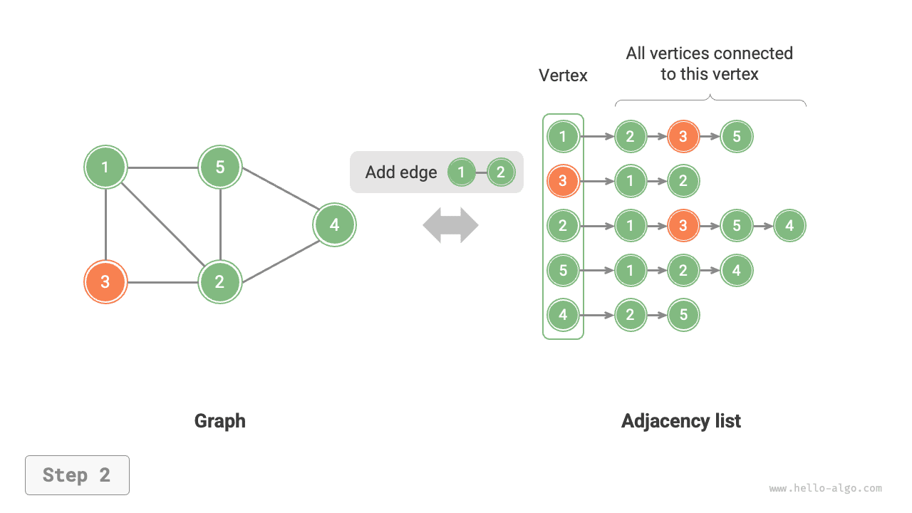
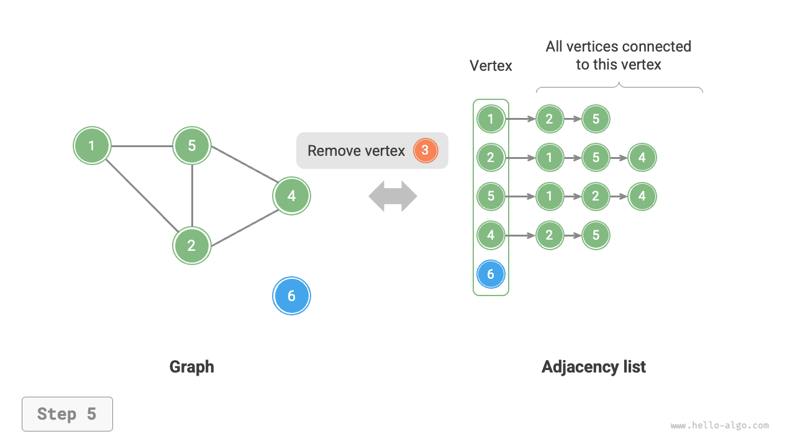

# 9.2 &nbsp; 그래프의 기본 연산

그래프의 기본 연산은 '간선'에 대한 연산과 '정점'에 대한 연산으로 나뉜다. '인접 행렬'과 '인접 리스트' 중 어느 표현을 사용하는지에 따라 구현 방법이 달라진다.

## 9.2.1 &nbsp; 인접 행렬 기반 구현

정점 수가 $n$인 무방향 그래프가 주어졌을 때 각 연산은 아래 그림(9-7)과 같이 구현한다.

- **간선 추가 또는 삭제**: 인접 행렬에서 해당 간선을 직접 수정하면 되며, $O(1)$ 시간이 걸린다. 무방향 그래프이므로 두 방향의 간선을 함께 갱신해야 한다.
- **정점 추가**: 인접 행렬의 끝에 행과 열을 하나씩 추가하고 모두 $0$으로 채운다. $O(n)$ 시간이 걸린다.
- **정점 삭제**: 인접 행렬에서 행과 열을 하나씩 삭제한다. 첫 번째 행과 열을 삭제할 때가 최악의 경우로, $(n-1)^2$ 개 원소를 '왼쪽 위로 이동'해야 하므로 $O(n^2)$ 시간이 걸린다.
- **초기화**: 정점 $n$ 개를 전달받아 길이가 $n$인 정점 리스트 `vertices`를 초기화하는 데 $O(n)$ 시간이 걸린다. $n \times n$ 크기의 인접 행렬 `adjMat`을 초기화하는 데는 $O(n^2)$ 시간이 걸린다.

=== "<1>"
    { class="animation-figure" }

=== "<2>"
    { class="animation-figure" }

=== "<3>"
    { class="animation-figure" }

=== "<4>"
    { class="animation-figure" }

=== "<5>"
    { class="animation-figure" }

<p align="center"> 그림 9-7 &nbsp; 인접 행렬의 초기화, 간선 추가와 삭제, 정점 추가와 삭제 </p>

다음은 인접 행렬로 그래프를 표현한 구현 코드다.

=== "Python"

    ```python title="graph_adjacency_matrix.py"
    class GraphAdjMat:
        """인접 행렬로 구현한 무방향 그래프 클래스"""

        def __init__(self, vertices: list[int], edges: list[list[int]]):
            """생성자"""
            # 정점 리스트의 원소는 정점 값을, 인덱스는 정점 인덱스를 나타낸다
            self.vertices: list[int] = []
            # 인접 행렬의 행과 열 인덱스는 정점 인덱스에 해당한다
            self.adj_mat: list[list[int]] = []
            # 정점 추가
            for val in vertices:
                self.add_vertex(val)
            # 간선 추가
            # edges의 원소는 정점 인덱스, 즉 vertices 원소의 인덱스를 나타낸다
            for e in edges:
                self.add_edge(e[0], e[1])

        def size(self) -> int:
            """정점 개수 반환"""
            return len(self.vertices)

        def add_vertex(self, val: int):
            """정점 추가"""
            n = self.size()
            # 정점 리스트에 새 정점의 값을 추가한다
            self.vertices.append(val)
            # 인접 행렬에 행 하나를 추가한다
            new_row = [0] * n
            self.adj_mat.append(new_row)
            # 인접 행렬에 열 하나를 추가한다
            for row in self.adj_mat:
                row.append(0)

        def remove_vertex(self, index: int):
            """정점 삭제"""
            if index >= self.size():
                raise IndexError()
            # 정점 리스트에서 인덱스 index의 정점을 제거한다
            self.vertices.pop(index)
            # 인접 행렬에서 인덱스 index의 행을 삭제한다
            self.adj_mat.pop(index)
            # 인접 행렬에서 인덱스 index의 열을 삭제한다
            for row in self.adj_mat:
                row.pop(index)

        def add_edge(self, i: int, j: int):
            """간선 추가"""
            # 매개변수 i, j는 vertices 원소의 인덱스에 해당한다
            # 인덱스가 범위를 벗어나거나 서로 같은 경우를 처리한다
            if i < 0 or j < 0 or i >= self.size() or j >= self.size() or i == j:
                raise IndexError()
            # 무방향 그래프의 인접 행렬은 주대각선에 대해 대칭이며, (i, j) == (j, i)를 만족한다
            self.adj_mat[i][j] = 1
            self.adj_mat[j][i] = 1

        def remove_edge(self, i: int, j: int):
            """간선 삭제"""
            # 매개변수 i, j는 vertices 원소의 인덱스에 해당한다
            # 인덱스가 범위를 벗어나거나 서로 같은 경우를 처리한다
            if i < 0 or j < 0 or i >= self.size() or j >= self.size() or i == j:
                raise IndexError()
            self.adj_mat[i][j] = 0
            self.adj_mat[j][i] = 0

        def print(self):
            """인접 행렬 출력"""
            print("정점 리스트 =", self.vertices)
            print("인접 행렬 =")
            print_matrix(self.adj_mat)
    ```

=== "C++"

    ```cpp title="graph_adjacency_matrix.cpp"
    /* 인접 행렬로 구현한 무방향 그래프 클래스 */
    class GraphAdjMat {
        vector<int> vertices;       // 정점 리스트의 원소는 정점 값을, 인덱스는 정점 인덱스를 나타낸다
        vector<vector<int>> adjMat; // 인접 행렬의 행과 열 인덱스는 정점 인덱스에 해당한다

      public:
        /* 생성자 */
        GraphAdjMat(const vector<int> &vertices, const vector<vector<int>> &edges) {
            // 정점 추가
            for (int val : vertices) {
                addVertex(val);
            }
            // 간선 추가
            // edges의 원소는 정점 인덱스, 즉 vertices 원소의 인덱스를 나타낸다
            for (const vector<int> &edge : edges) {
                addEdge(edge[0], edge[1]);
            }
        }

        /* 정점 개수 반환 */
        int size() const {
            return vertices.size();
        }

        /* 정점 추가 */
        void addVertex(int val) {
            int n = size();
            // 정점 리스트에 새 정점의 값을 추가한다
            vertices.push_back(val);
            // 인접 행렬에 행 하나를 추가한다
            adjMat.emplace_back(vector<int>(n, 0));
            // 인접 행렬에 열 하나를 추가한다
            for (vector<int> &row : adjMat) {
                row.push_back(0);
            }
        }

        /* 정점 삭제 */
        void removeVertex(int index) {
            if (index >= size()) {
                throw out_of_range("정점이 존재하지 않는다");
            }
            // 정점 리스트에서 인덱스 index의 정점을 제거한다
            vertices.erase(vertices.begin() + index);
            // 인접 행렬에서 인덱스 index의 행을 삭제한다
            adjMat.erase(adjMat.begin() + index);
            // 인접 행렬에서 인덱스 index의 열을 삭제한다
            for (vector<int> &row : adjMat) {
                row.erase(row.begin() + index);
            }
        }

        /* 간선 추가 */
        // 매개변수 i, j는 vertices 원소의 인덱스에 해당한다
        void addEdge(int i, int j) {
            // 인덱스가 범위를 벗어나거나 서로 같은 경우를 처리한다
            if (i < 0 || j < 0 || i >= size() || j >= size() || i == j) {
                throw out_of_range("정점이 존재하지 않는다");
            }
            // 무방향 그래프의 인접 행렬은 주대각선에 대해 대칭이며, (i, j) == (j, i)를 만족한다
            adjMat[i][j] = 1;
            adjMat[j][i] = 1;
        }

        /* 간선 삭제 */
        // 매개변수 i, j는 vertices 원소의 인덱스에 해당한다
        void removeEdge(int i, int j) {
            // 인덱스가 범위를 벗어나거나 서로 같은 경우를 처리한다
            if (i < 0 || j < 0 || i >= size() || j >= size() || i == j) {
                throw out_of_range("정점이 존재하지 않는다");
            }
            adjMat[i][j] = 0;
            adjMat[j][i] = 0;
        }

        /* 인접 행렬 출력 */
        void print() {
            cout << "정점 리스트 = ";
            printVector(vertices);
            cout << "인접 행렬 =" << endl;
            printVectorMatrix(adjMat);
        }
    };
    ```

=== "Java"

    ```java title="graph_adjacency_matrix.java"
    /* 인접 행렬로 구현한 무방향 그래프 클래스 */
    class GraphAdjMat {
        List<Integer> vertices; // 정점 리스트의 원소는 정점 값을, 인덱스는 정점 인덱스를 나타낸다
        List<List<Integer>> adjMat; // 인접 행렬의 행과 열 인덱스는 정점 인덱스에 해당한다

        /* 생성자 */
        public GraphAdjMat(int[] vertices, int[][] edges) {
            this.vertices = new ArrayList<>();
            this.adjMat = new ArrayList<>();
            // 정점 추가
            for (int val : vertices) {
                addVertex(val);
            }
            // 간선 추가
            // edges의 원소는 정점 인덱스, 즉 vertices 원소의 인덱스를 나타낸다
            for (int[] e : edges) {
                addEdge(e[0], e[1]);
            }
        }

        /* 정점 개수 반환 */
        public int size() {
            return vertices.size();
        }

        /* 정점 추가 */
        public void addVertex(int val) {
            int n = size();
            // 정점 리스트에 새 정점의 값을 추가한다
            vertices.add(val);
            // 인접 행렬에 행 하나를 추가한다
            List<Integer> newRow = new ArrayList<>(n);
            for (int j = 0; j < n; j++) {
                newRow.add(0);
            }
            adjMat.add(newRow);
            // 인접 행렬에 열 하나를 추가한다
            for (List<Integer> row : adjMat) {
                row.add(0);
            }
        }

        /* 정점 삭제 */
        public void removeVertex(int index) {
            if (index >= size())
                throw new IndexOutOfBoundsException();
            // 정점 리스트에서 인덱스 index의 정점을 제거한다
            vertices.remove(index);
            // 인접 행렬에서 인덱스 index의 행을 삭제한다
            adjMat.remove(index);
            // 인접 행렬에서 인덱스 index의 열을 삭제한다
            for (List<Integer> row : adjMat) {
                row.remove(index);
            }
        }

        /* 간선 추가 */
        // 매개변수 i, j는 vertices 원소의 인덱스에 해당한다
        public void addEdge(int i, int j) {
            // 인덱스가 범위를 벗어나거나 서로 같은 경우를 처리한다
            if (i < 0 || j < 0 || i >= size() || j >= size() || i == j)
                throw new IndexOutOfBoundsException();
            // 무방향 그래프의 인접 행렬은 주대각선에 대해 대칭이며, (i, j) == (j, i)를 만족한다
            adjMat.get(i).set(j, 1);
            adjMat.get(j).set(i, 1);
        }

        /* 간선 삭제 */
        // 매개변수 i, j는 vertices 원소의 인덱스에 해당한다
        public void removeEdge(int i, int j) {
            // 인덱스가 범위를 벗어나거나 서로 같은 경우를 처리한다
            if (i < 0 || j < 0 || i >= size() || j >= size() || i == j)
                throw new IndexOutOfBoundsException();
            adjMat.get(i).set(j, 0);
            adjMat.get(j).set(i, 0);
        }

        /* 인접 행렬 출력 */
        public void print() {
            System.out.print("정점 리스트 = ");
            System.out.println(vertices);
            System.out.println("인접 행렬 =");
            PrintUtil.printMatrix(adjMat);
        }
    }
    ```

=== "C#"

    ```csharp title="graph_adjacency_matrix.cs"
    /* 인접 행렬로 구현한 무방향 그래프 클래스 */
    class GraphAdjMat {
        List<int> vertices;     // 정점 리스트의 원소는 정점 값을, 인덱스는 정점 인덱스를 나타낸다
        List<List<int>> adjMat; // 인접 행렬의 행과 열 인덱스는 정점 인덱스에 해당한다

        /* 생성자 */
        public GraphAdjMat(int[] vertices, int[][] edges) {
            this.vertices = [];
            this.adjMat = [];
            // 정점 추가
            foreach (int val in vertices) {
                AddVertex(val);
            }
            // 간선 추가
            // edges의 원소는 정점 인덱스, 즉 vertices 원소의 인덱스를 나타낸다
            foreach (int[] e in edges) {
                AddEdge(e[0], e[1]);
            }
        }

        /* 정점 개수 반환 */
        int Size() {
            return vertices.Count;
        }

        /* 정점 추가 */
        public void AddVertex(int val) {
            int n = Size();
            // 정점 리스트에 새 정점의 값을 추가한다
            vertices.Add(val);
            // 인접 행렬에 행 하나를 추가한다
            List<int> newRow = new(n);
            for (int j = 0; j < n; j++) {
                newRow.Add(0);
            }
            adjMat.Add(newRow);
            // 인접 행렬에 열 하나를 추가한다
            foreach (List<int> row in adjMat) {
                row.Add(0);
            }
        }

        /* 정점 삭제 */
        public void RemoveVertex(int index) {
            if (index >= Size())
                throw new IndexOutOfRangeException();
            // 정점 리스트에서 인덱스 index의 정점을 제거한다
            vertices.RemoveAt(index);
            // 인접 행렬에서 인덱스 index의 행을 삭제한다
            adjMat.RemoveAt(index);
            // 인접 행렬에서 인덱스 index의 열을 삭제한다
            foreach (List<int> row in adjMat) {
                row.RemoveAt(index);
            }
        }

        /* 간선 추가 */
        // 매개변수 i, j는 vertices 원소의 인덱스에 해당한다
        public void AddEdge(int i, int j) {
            // 인덱스가 범위를 벗어나거나 서로 같은 경우를 처리한다
            if (i < 0 || j < 0 || i >= Size() || j >= Size() || i == j)
                throw new IndexOutOfRangeException();
            // 무방향 그래프의 인접 행렬은 주대각선에 대해 대칭이며, (i, j) == (j, i)를 만족한다
            adjMat[i][j] = 1;
            adjMat[j][i] = 1;
        }

        /* 간선 삭제 */
        // 매개변수 i, j는 vertices 원소의 인덱스에 해당한다
        public void RemoveEdge(int i, int j) {
            // 인덱스가 범위를 벗어나거나 서로 같은 경우를 처리한다
            if (i < 0 || j < 0 || i >= Size() || j >= Size() || i == j)
                throw new IndexOutOfRangeException();
            adjMat[i][j] = 0;
            adjMat[j][i] = 0;
        }

        /* 인접 행렬 출력 */
        public void Print() {
            Console.Write("정점 리스트 = ");
            PrintUtil.PrintList(vertices);
            Console.WriteLine("인접 행렬 =");
            PrintUtil.PrintMatrix(adjMat);
        }
    }
    ```

=== "Go"

    ```go title="graph_adjacency_matrix.go"
    /* 인접 행렬로 구현한 무방향 그래프 클래스 */
    type graphAdjMat struct {
        // 정점 리스트의 원소는 정점 값을, 인덱스는 정점 인덱스를 나타낸다
        vertices []int
        // 인접 행렬의 행과 열 인덱스는 정점 인덱스에 해당한다
        adjMat [][]int
    }

    /* 생성자 */
    func newGraphAdjMat(vertices []int, edges [][]int) *graphAdjMat {
        // 정점 추가
        n := len(vertices)
        adjMat := make([][]int, n)
        for i := range adjMat {
            adjMat[i] = make([]int, n)
        }
        // 그래프 초기화
        g := &graphAdjMat{
            vertices: vertices,
            adjMat:   adjMat,
        }
        // 간선 추가
        // edges의 원소는 정점 인덱스, 즉 vertices 원소의 인덱스를 나타낸다
        for i := range edges {
            g.addEdge(edges[i][0], edges[i][1])
        }
        return g
    }

    /* 정점 개수 반환 */
    func (g *graphAdjMat) size() int {
        return len(g.vertices)
    }

    /* 정점 추가 */
    func (g *graphAdjMat) addVertex(val int) {
        n := g.size()
        // 정점 리스트에 새 정점의 값을 추가한다
        g.vertices = append(g.vertices, val)
        // 인접 행렬에 행 하나를 추가한다
        newRow := make([]int, n)
        g.adjMat = append(g.adjMat, newRow)
        // 인접 행렬에 열 하나를 추가한다
        for i := range g.adjMat {
            g.adjMat[i] = append(g.adjMat[i], 0)
        }
    }

    /* 정점 삭제 */
    func (g *graphAdjMat) removeVertex(index int) {
        if index >= g.size() {
            return
        }
        // 정점 리스트에서 인덱스 index의 정점을 제거한다
        g.vertices = append(g.vertices[:index], g.vertices[index+1:]...)
        // 인접 행렬에서 인덱스 index의 행을 삭제한다
        g.adjMat = append(g.adjMat[:index], g.adjMat[index+1:]...)
        // 인접 행렬에서 인덱스 index의 열을 삭제한다
        for i := range g.adjMat {
            g.adjMat[i] = append(g.adjMat[i][:index], g.adjMat[i][index+1:]...)
        }
    }

    /* 간선 추가 */
    // 매개변수 i, j는 vertices 원소의 인덱스에 해당한다
    func (g *graphAdjMat) addEdge(i, j int) {
        // 인덱스가 범위를 벗어나거나 서로 같은 경우를 처리한다
        if i < 0 || j < 0 || i >= g.size() || j >= g.size() || i == j {
            fmt.Errorf("%s", "인덱스가 범위를 벗어났다")
        }
        // 무방향 그래프의 인접 행렬은 주대각선에 대해 대칭이며, (i, j) == (j, i)를 만족한다
        g.adjMat[i][j] = 1
        g.adjMat[j][i] = 1
    }

    /* 간선 삭제 */
    // 매개변수 i, j는 vertices 원소의 인덱스에 해당한다
    func (g *graphAdjMat) removeEdge(i, j int) {
        // 인덱스가 범위를 벗어나거나 서로 같은 경우를 처리한다
        if i < 0 || j < 0 || i >= g.size() || j >= g.size() || i == j {
            fmt.Errorf("%s", "인덱스가 범위를 벗어났다")
        }
        g.adjMat[i][j] = 0
        g.adjMat[j][i] = 0
    }

    /* 인접 행렬 출력 */
    func (g *graphAdjMat) print() {
        fmt.Printf("\t정점 리스트 = %v\n", g.vertices)
        fmt.Printf("\t인접 행렬 = \n")
        for i := range g.adjMat {
            fmt.Printf("\t\t\t%v\n", g.adjMat[i])
        }
    }
    ```

=== "Swift"

    ```swift title="graph_adjacency_matrix.swift"
    /* 인접 행렬로 구현한 무방향 그래프 클래스 */
    class GraphAdjMat {
        private var vertices: [Int] // 정점 리스트의 원소는 정점 값을, 인덱스는 정점 인덱스를 나타낸다
        private var adjMat: [[Int]] // 인접 행렬의 행과 열 인덱스는 정점 인덱스에 해당한다

        /* 생성자 */
        init(vertices: [Int], edges: [[Int]]) {
            self.vertices = []
            adjMat = []
            // 정점 추가
            for val in vertices {
                addVertex(val: val)
            }
            // 간선 추가
            // edges의 원소는 정점 인덱스, 즉 vertices 원소의 인덱스를 나타낸다
            for e in edges {
                addEdge(i: e[0], j: e[1])
            }
        }

        /* 정점 개수 반환 */
        func size() -> Int {
            vertices.count
        }

        /* 정점 추가 */
        func addVertex(val: Int) {
            let n = size()
            // 정점 리스트에 새 정점의 값을 추가한다
            vertices.append(val)
            // 인접 행렬에 행 하나를 추가한다
            let newRow = Array(repeating: 0, count: n)
            adjMat.append(newRow)
            // 인접 행렬에 열 하나를 추가한다
            for i in adjMat.indices {
                adjMat[i].append(0)
            }
        }

        /* 정점 삭제 */
        func removeVertex(index: Int) {
            if index >= size() {
                fatalError("범위를 벗어남")
            }
            // 정점 리스트에서 인덱스 index의 정점을 제거한다
            vertices.remove(at: index)
            // 인접 행렬에서 인덱스 index의 행을 삭제한다
            adjMat.remove(at: index)
            // 인접 행렬에서 인덱스 index의 열을 삭제한다
            for i in adjMat.indices {
                adjMat[i].remove(at: index)
            }
        }

        /* 간선 추가 */
        // 매개변수 i, j는 vertices 원소의 인덱스에 해당한다
        func addEdge(i: Int, j: Int) {
            // 인덱스가 범위를 벗어나거나 서로 같은 경우를 처리한다
            if i < 0 || j < 0 || i >= size() || j >= size() || i == j {
                fatalError("범위를 벗어남")
            }
            // 무방향 그래프의 인접 행렬은 주대각선에 대해 대칭이며, (i, j) == (j, i)를 만족한다
            adjMat[i][j] = 1
            adjMat[j][i] = 1
        }

        /* 간선 삭제 */
        // 매개변수 i, j는 vertices 원소의 인덱스에 해당한다
        func removeEdge(i: Int, j: Int) {
            // 인덱스가 범위를 벗어나거나 서로 같은 경우를 처리한다
            if i < 0 || j < 0 || i >= size() || j >= size() || i == j {
                fatalError("범위를 벗어남")
            }
            adjMat[i][j] = 0
            adjMat[j][i] = 0
        }

        /* 인접 행렬 출력 */
        func print() {
            Swift.print("정점 리스트 = ", terminator: "")
            Swift.print(vertices)
            Swift.print("인접 행렬 =")
            PrintUtil.printMatrix(matrix: adjMat)
        }
    }
    ```

=== "JS"

    ```javascript title="graph_adjacency_matrix.js"
    /* 인접 행렬로 구현한 무방향 그래프 클래스 */
    class GraphAdjMat {
        vertices; // 정점 리스트의 원소는 정점 값을, 인덱스는 정점 인덱스를 나타낸다
        adjMat; // 인접 행렬의 행과 열 인덱스는 정점 인덱스에 해당한다

        /* 생성자 */
        constructor(vertices, edges) {
            this.vertices = [];
            this.adjMat = [];
            // 정점 추가
            for (const val of vertices) {
                this.addVertex(val);
            }
            // 간선 추가
            // edges의 원소는 정점 인덱스, 즉 vertices 원소의 인덱스를 나타낸다
            for (const e of edges) {
                this.addEdge(e[0], e[1]);
            }
        }

        /* 정점 개수 반환 */
        size() {
            return this.vertices.length;
        }

        /* 정점 추가 */
        addVertex(val) {
            const n = this.size();
            // 정점 리스트에 새 정점의 값을 추가한다
            this.vertices.push(val);
            // 인접 행렬에 행 하나를 추가한다
            const newRow = [];
            for (let j = 0; j < n; j++) {
                newRow.push(0);
            }
            this.adjMat.push(newRow);
            // 인접 행렬에 열 하나를 추가한다
            for (const row of this.adjMat) {
                row.push(0);
            }
        }

        /* 정점 삭제 */
        removeVertex(index) {
            if (index >= this.size()) {
                throw new RangeError('인덱스가 범위를 벗어났다');
            }
            // 정점 리스트에서 인덱스 index의 정점을 제거한다
            this.vertices.splice(index, 1);

            // 인접 행렬에서 인덱스 index의 행을 삭제한다
            this.adjMat.splice(index, 1);
            // 인접 행렬에서 인덱스 index의 열을 삭제한다
            for (const row of this.adjMat) {
                row.splice(index, 1);
            }
        }

        /* 간선 추가 */
        // 매개변수 i, j는 vertices 원소의 인덱스에 해당한다
        addEdge(i, j) {
            // 인덱스가 범위를 벗어나거나 서로 같은 경우를 처리한다
            if (i < 0 || j < 0 || i >= this.size() || j >= this.size() || i === j) {
                throw new RangeError('인덱스가 범위를 벗어났다');
            }
            // 무방향 그래프의 인접 행렬은 주대각선을 기준으로 대칭이므로 (i, j) === (j, i)를 만족한다
            this.adjMat[i][j] = 1;
            this.adjMat[j][i] = 1;
        }

        /* 간선 삭제 */
        // 매개변수 i, j는 vertices 원소의 인덱스에 해당한다
        removeEdge(i, j) {
            // 인덱스가 범위를 벗어나거나 서로 같은 경우를 처리한다
            if (i < 0 || j < 0 || i >= this.size() || j >= this.size() || i === j) {
                throw new RangeError('인덱스가 범위를 벗어났다');
            }
            this.adjMat[i][j] = 0;
            this.adjMat[j][i] = 0;
        }

        /* 인접 행렬 출력 */
        print() {
            console.log('정점 리스트 = ', this.vertices);
            console.log('인접 행렬 =', this.adjMat);
        }
    }
    ```

=== "TS"

    ```typescript title="graph_adjacency_matrix.ts"
    /* 인접 행렬로 구현한 무방향 그래프 클래스 */
    class GraphAdjMat {
        vertices: number[]; // 정점 리스트의 원소는 정점 값을, 인덱스는 정점 인덱스를 나타낸다
        adjMat: number[][]; // 인접 행렬의 행과 열 인덱스는 정점 인덱스에 해당한다

        /* 생성자 */
        constructor(vertices: number[], edges: number[][]) {
            this.vertices = [];
            this.adjMat = [];
            // 정점 추가
            for (const val of vertices) {
                this.addVertex(val);
            }
            // 간선 추가
            // edges의 원소는 정점 인덱스, 즉 vertices 원소의 인덱스를 나타낸다
            for (const e of edges) {
                this.addEdge(e[0], e[1]);
            }
        }

        /* 정점 개수 반환 */
        size(): number {
            return this.vertices.length;
        }

        /* 정점 추가 */
        addVertex(val: number): void {
            const n: number = this.size();
            // 정점 리스트에 새 정점의 값을 추가한다
            this.vertices.push(val);
            // 인접 행렬에 행 하나를 추가한다
            const newRow: number[] = [];
            for (let j: number = 0; j < n; j++) {
                newRow.push(0);
            }
            this.adjMat.push(newRow);
            // 인접 행렬에 열 하나를 추가한다
            for (const row of this.adjMat) {
                row.push(0);
            }
        }

        /* 정점 삭제 */
        removeVertex(index: number): void {
            if (index >= this.size()) {
                throw new RangeError('인덱스가 범위를 벗어났다');
            }
            // 정점 리스트에서 인덱스 index의 정점을 제거한다
            this.vertices.splice(index, 1);

            // 인접 행렬에서 인덱스 index의 행을 삭제한다
            this.adjMat.splice(index, 1);
            // 인접 행렬에서 인덱스 index의 열을 삭제한다
            for (const row of this.adjMat) {
                row.splice(index, 1);
            }
        }

        /* 간선 추가 */
        // 매개변수 i, j는 vertices 원소의 인덱스에 해당한다
        addEdge(i: number, j: number): void {
            // 인덱스가 범위를 벗어나거나 서로 같은 경우를 처리한다
            if (i < 0 || j < 0 || i >= this.size() || j >= this.size() || i === j) {
                throw new RangeError('인덱스가 범위를 벗어났다');
            }
            // 무방향 그래프의 인접 행렬은 주대각선을 기준으로 대칭이므로 (i, j) === (j, i)를 만족한다
            this.adjMat[i][j] = 1;
            this.adjMat[j][i] = 1;
        }

        /* 간선 삭제 */
        // 매개변수 i, j는 vertices 원소의 인덱스에 해당한다
        removeEdge(i: number, j: number): void {
            // 인덱스가 범위를 벗어나거나 서로 같은 경우를 처리한다
            if (i < 0 || j < 0 || i >= this.size() || j >= this.size() || i === j) {
                throw new RangeError('인덱스가 범위를 벗어났다');
            }
            this.adjMat[i][j] = 0;
            this.adjMat[j][i] = 0;
        }

        /* 인접 행렬 출력 */
        print(): void {
            console.log('정점 리스트 = ', this.vertices);
            console.log('인접 행렬 =', this.adjMat);
        }
    }
    ```

=== "Dart"

    ```dart title="graph_adjacency_matrix.dart"
    /* 인접 행렬로 구현한 무방향 그래프 클래스 */
    class GraphAdjMat {
      List<int> vertices = []; // 정점 원소는 정점 값을, 인덱스는 정점 인덱스를 나타낸다
      List<List<int>> adjMat = []; //인접 행렬의 행과 열 인덱스는 정점 인덱스에 해당한다

      /* 생성자 */
      GraphAdjMat(List<int> vertices, List<List<int>> edges) {
        this.vertices = [];
        this.adjMat = [];
        // 정점 추가
        for (int val in vertices) {
          addVertex(val);
        }
        // 간선 추가
        // edges의 원소는 정점 인덱스, 즉 vertices 원소의 인덱스를 나타낸다
        for (List<int> e in edges) {
          addEdge(e[0], e[1]);
        }
      }

      /* 정점 개수 반환 */
      int size() {
        return vertices.length;
      }

      /* 정점 추가 */
      void addVertex(int val) {
        int n = size();
        // 정점 리스트에 새 정점의 값을 추가한다
        vertices.add(val);
        // 인접 행렬에 행 하나를 추가한다
        List<int> newRow = List.filled(n, 0, growable: true);
        adjMat.add(newRow);
        // 인접 행렬에 열 하나를 추가한다
        for (List<int> row in adjMat) {
          row.add(0);
        }
      }

      /* 정점 삭제 */
      void removeVertex(int index) {
        if (index >= size()) {
          throw IndexError;
        }
        // 정점 리스트에서 인덱스 index의 정점을 제거한다
        vertices.removeAt(index);
        // 인접 행렬에서 인덱스 index의 행을 삭제한다
        adjMat.removeAt(index);
        // 인접 행렬에서 인덱스 index의 열을 삭제한다
        for (List<int> row in adjMat) {
          row.removeAt(index);
        }
      }

      /* 간선 추가 */
      // 매개변수 i, j는 vertices 원소의 인덱스에 해당한다
      void addEdge(int i, int j) {
        // 인덱스가 범위를 벗어나거나 서로 같은 경우를 처리한다
        if (i < 0 || j < 0 || i >= size() || j >= size() || i == j) {
          throw IndexError;
        }
        // 무방향 그래프의 인접 행렬은 주대각선에 대해 대칭이며, (i, j) == (j, i)를 만족한다
        adjMat[i][j] = 1;
        adjMat[j][i] = 1;
      }

      /* 간선 삭제 */
      // 매개변수 i, j는 vertices 원소의 인덱스에 해당한다
      void removeEdge(int i, int j) {
        // 인덱스가 범위를 벗어나거나 서로 같은 경우를 처리한다
        if (i < 0 || j < 0 || i >= size() || j >= size() || i == j) {
          throw IndexError;
        }
        adjMat[i][j] = 0;
        adjMat[j][i] = 0;
      }

      /* 인접 행렬 출력 */
      void printAdjMat() {
        print("정점 리스트 = $vertices");
        print("인접 행렬 = ");
        printMatrix(adjMat);
      }
    }
    ```

=== "Rust"

    ```rust title="graph_adjacency_matrix.rs"
    /* 인접 행렬로 구현한 무방향 그래프 자료형 */
    pub struct GraphAdjMat {
        // 정점 리스트의 원소는 정점 값을, 인덱스는 정점 인덱스를 나타낸다
        pub vertices: Vec<i32>,
        // 인접 행렬의 행과 열 인덱스는 정점 인덱스에 해당한다
        pub adj_mat: Vec<Vec<i32>>,
    }

    impl GraphAdjMat {
        /* 생성자 */
        pub fn new(vertices: Vec<i32>, edges: Vec<[usize; 2]>) -> Self {
            let mut graph = GraphAdjMat {
                vertices: vec![],
                adj_mat: vec![],
            };
            // 정점 추가
            for val in vertices {
                graph.add_vertex(val);
            }
            // 간선 추가
            // edges의 원소는 정점 인덱스, 즉 vertices 원소의 인덱스를 나타낸다
            for edge in edges {
                graph.add_edge(edge[0], edge[1])
            }

            graph
        }

        /* 정점 개수 반환 */
        pub fn size(&self) -> usize {
            self.vertices.len()
        }

        /* 정점 추가 */
        pub fn add_vertex(&mut self, val: i32) {
            let n = self.size();
            // 정점 리스트에 새 정점의 값을 추가한다
            self.vertices.push(val);
            // 인접 행렬에 행 하나를 추가한다
            self.adj_mat.push(vec![0; n]);
            // 인접 행렬에 열 하나를 추가한다
            for row in self.adj_mat.iter_mut() {
                row.push(0);
            }
        }

        /* 정점 삭제 */
        pub fn remove_vertex(&mut self, index: usize) {
            if index >= self.size() {
                panic!("인덱스 오류")
            }
            // 정점 리스트에서 인덱스 index의 정점을 제거한다
            self.vertices.remove(index);
            // 인접 행렬에서 인덱스 index의 행을 삭제한다
            self.adj_mat.remove(index);
            // 인접 행렬에서 인덱스 index의 열을 삭제한다
            for row in self.adj_mat.iter_mut() {
                row.remove(index);
            }
        }

        /* 간선 추가 */
        pub fn add_edge(&mut self, i: usize, j: usize) {
            // 매개변수 i, j는 vertices 원소의 인덱스에 해당한다
            // 인덱스가 범위를 벗어나거나 서로 같은 경우를 처리한다
            if i >= self.size() || j >= self.size() || i == j {
                panic!("인덱스 오류")
            }
            // 무방향 그래프의 인접 행렬은 주대각선에 대해 대칭이며, (i, j) == (j, i)를 만족한다
            self.adj_mat[i][j] = 1;
            self.adj_mat[j][i] = 1;
        }

        /* 간선 삭제 */
        // 매개변수 i, j는 vertices 원소의 인덱스에 해당한다
        pub fn remove_edge(&mut self, i: usize, j: usize) {
            // 매개변수 i, j는 vertices 원소의 인덱스에 해당한다
            // 인덱스가 범위를 벗어나거나 서로 같은 경우를 처리한다
            if i >= self.size() || j >= self.size() || i == j {
                panic!("인덱스 오류")
            }
            self.adj_mat[i][j] = 0;
            self.adj_mat[j][i] = 0;
        }

        /* 인접 행렬 출력 */
        pub fn print(&self) {
            println!("정점 리스트 = {:?}", self.vertices);
            println!("인접 행렬 =");
            println!("[");
            for row in &self.adj_mat {
                println!("  {:?},", row);
            }
            println!("]")
        }
    }
    ```

=== "C"

    ```c title="graph_adjacency_matrix.c"
    /* 인접 행렬로 구현한 무방향 그래프 구조체 */
    typedef struct {
        int vertices[MAX_SIZE];
        int adjMat[MAX_SIZE][MAX_SIZE];
        int size;
    } GraphAdjMat;

    /* 생성자 */
    GraphAdjMat *newGraphAdjMat() {
        GraphAdjMat *graph = (GraphAdjMat *)malloc(sizeof(GraphAdjMat));
        graph->size = 0;
        for (int i = 0; i < MAX_SIZE; i++) {
            for (int j = 0; j < MAX_SIZE; j++) {
                graph->adjMat[i][j] = 0;
            }
        }
        return graph;
    }

    /* 소멸자 */
    void delGraphAdjMat(GraphAdjMat *graph) {
        free(graph);
    }

    /* 정점 추가 */
    void addVertex(GraphAdjMat *graph, int val) {
        if (graph->size == MAX_SIZE) {
            fprintf(stderr, "그래프의 정점 개수가 최댓값에 도달했다\n");
            return;
        }
        // n번째 정점을 추가하고 n번째 행과 열을 0으로 설정한다
        int n = graph->size;
        graph->vertices[n] = val;
        for (int i = 0; i <= n; i++) {
            graph->adjMat[n][i] = graph->adjMat[i][n] = 0;
        }
        graph->size++;
    }

    /* 정점 삭제 */
    void removeVertex(GraphAdjMat *graph, int index) {
        if (index < 0 || index >= graph->size) {
            fprintf(stderr, "정점 인덱스가 범위를 벗어났다\n");
            return;
        }
        // 정점 리스트에서 인덱스 index의 정점을 제거한다
        for (int i = index; i < graph->size - 1; i++) {
            graph->vertices[i] = graph->vertices[i + 1];
        }
        // 인접 행렬에서 인덱스 index의 행을 삭제한다
        for (int i = index; i < graph->size - 1; i++) {
            for (int j = 0; j < graph->size; j++) {
                graph->adjMat[i][j] = graph->adjMat[i + 1][j];
            }
        }
        // 인접 행렬에서 인덱스 index의 열을 삭제한다
        for (int i = 0; i < graph->size; i++) {
            for (int j = index; j < graph->size - 1; j++) {
                graph->adjMat[i][j] = graph->adjMat[i][j + 1];
            }
        }
        graph->size--;
    }

    /* 간선 추가 */
    // 매개변수 i, j는 vertices 원소의 인덱스에 해당한다
    void addEdge(GraphAdjMat *graph, int i, int j) {
        if (i < 0 || j < 0 || i >= graph->size || j >= graph->size || i == j) {
            fprintf(stderr, "간선 인덱스가 범위를 벗어나거나 서로 같다\n");
            return;
        }
        graph->adjMat[i][j] = 1;
        graph->adjMat[j][i] = 1;
    }

    /* 간선 삭제 */
    // 매개변수 i, j는 vertices 원소의 인덱스에 해당한다
    void removeEdge(GraphAdjMat *graph, int i, int j) {
        if (i < 0 || j < 0 || i >= graph->size || j >= graph->size || i == j) {
            fprintf(stderr, "간선 인덱스가 범위를 벗어나거나 서로 같다\n");
            return;
        }
        graph->adjMat[i][j] = 0;
        graph->adjMat[j][i] = 0;
    }

    /* 인접 행렬 출력 */
    void printGraphAdjMat(GraphAdjMat *graph) {
        printf("정점 리스트 = ");
        printArray(graph->vertices, graph->size);
        printf("인접 행렬 =\n");
        for (int i = 0; i < graph->size; i++) {
            printArray(graph->adjMat[i], graph->size);
        }
    }
    ```

=== "Kotlin"

    ```kotlin title="graph_adjacency_matrix.kt"
    /* 인접 행렬로 구현한 무방향 그래프 클래스 */
    class GraphAdjMat(vertices: IntArray, edges: Array<IntArray>) {
        val vertices = mutableListOf<Int>() // 정점 리스트의 원소는 정점 값을, 인덱스는 정점 인덱스를 나타낸다
        val adjMat = mutableListOf<MutableList<Int>>() // 인접 행렬의 행과 열 인덱스는 정점 인덱스에 해당한다

        /* 생성자 */
        init {
            // 정점 추가
            for (vertex in vertices) {
                addVertex(vertex)
            }
            // 간선 추가
            // edges의 원소는 정점 인덱스, 즉 vertices 원소의 인덱스를 나타낸다
            for (edge in edges) {
                addEdge(edge[0], edge[1])
            }
        }

        /* 정점 개수 반환 */
        fun size(): Int {
            return vertices.size
        }

        /* 정점 추가 */
        fun addVertex(_val: Int) {
            val n = size()
            // 정점 리스트에 새 정점의 값을 추가한다
            vertices.add(_val)
            // 인접 행렬에 행 하나를 추가한다
            val newRow = mutableListOf<Int>()
            for (j in 0..<n) {
                newRow.add(0)
            }
            adjMat.add(newRow)
            // 인접 행렬에 열 하나를 추가한다
            for (row in adjMat) {
                row.add(0)
            }
        }

        /* 정점 삭제 */
        fun removeVertex(index: Int) {
            if (index >= size())
                throw IndexOutOfBoundsException()
            // 정점 리스트에서 인덱스 index의 정점을 제거한다
            vertices.removeAt(index)
            // 인접 행렬에서 인덱스 index의 행을 삭제한다
            adjMat.removeAt(index)
            // 인접 행렬에서 인덱스 index의 열을 삭제한다
            for (row in adjMat) {
                row.removeAt(index)
            }
        }

        /* 간선 추가 */
        // 매개변수 i, j는 vertices 원소의 인덱스에 해당한다
        fun addEdge(i: Int, j: Int) {
            // 인덱스가 범위를 벗어나거나 서로 같은 경우를 처리한다
            if (i < 0 || j < 0 || i >= size() || j >= size() || i == j)
                throw IndexOutOfBoundsException()
            // 무방향 그래프의 인접 행렬은 주대각선에 대해 대칭이며, (i, j) == (j, i)를 만족한다
            adjMat[i][j] = 1
            adjMat[j][i] = 1
        }

        /* 간선 삭제 */
        // 매개변수 i, j는 vertices 원소의 인덱스에 해당한다
        fun removeEdge(i: Int, j: Int) {
            // 인덱스가 범위를 벗어나거나 서로 같은 경우를 처리한다
            if (i < 0 || j < 0 || i >= size() || j >= size() || i == j)
                throw IndexOutOfBoundsException()
            adjMat[i][j] = 0
            adjMat[j][i] = 0
        }

        /* 인접 행렬 출력 */
        fun print() {
            print("정점 리스트 = ")
            println(vertices)
            println("인접 행렬 =")
            printMatrix(adjMat)
        }
    }
    ```

=== "Ruby"

    ```ruby title="graph_adjacency_matrix.rb"
    ### 인접 행렬로 구현한 무방향 그래프 클래스 ###
    class GraphAdjMat
      def initialize(vertices, edges)
        ### 생성자 ###
        # 정점 리스트의 원소는 정점 값을, 인덱스는 정점 인덱스를 나타낸다
        @vertices = []
        # 인접 행렬의 행과 열 인덱스는 정점 인덱스에 해당한다
        @adj_mat = []
        # 정점 추가
        vertices.each { |val| add_vertex(val) }
        # 간선 추가
        # edges의 원소는 정점 인덱스, 즉 vertices 원소의 인덱스를 나타낸다
        edges.each { |e| add_edge(e[0], e[1]) }
      end

      ### 정점 개수 반환 ###
      def size
        @vertices.length
      end

      ### 정점 추가 ###
      def add_vertex(val)
        n = size
        # 정점 리스트에 새 정점의 값을 추가한다
        @vertices << val
        # 인접 행렬에 행 하나를 추가한다
        new_row = Array.new(n, 0)
        @adj_mat << new_row
        # 인접 행렬에 열 하나를 추가한다
        @adj_mat.each { |row| row << 0 }
      end

      ### 정점 삭제 ###
      def remove_vertex(index)
        raise IndexError if index >= size

        # 정점 리스트에서 인덱스 index의 정점을 제거한다
        @vertices.delete_at(index)
        # 인접 행렬에서 인덱스 index의 행을 삭제한다
        @adj_mat.delete_at(index)
        # 인접 행렬에서 인덱스 index의 열을 삭제한다
        @adj_mat.each { |row| row.delete_at(index) }
      end

      ### 간선 추가 ###
      def add_edge(i, j)
        # 매개변수 i, j는 vertices 원소의 인덱스에 해당한다
        # 인덱스가 범위를 벗어나거나 서로 같은 경우를 처리한다
        if i < 0 || j < 0 || i >= size || j >= size || i == j
          raise IndexError
        end
        # 무방향 그래프의 인접 행렬은 주대각선에 대해 대칭이며, (i, j) == (j, i)를 만족한다
        @adj_mat[i][j] = 1
        @adj_mat[j][i] = 1
      end

      ### 간선 삭제 ###
      def remove_edge(i, j)
        # 매개변수 i, j는 vertices 원소의 인덱스에 해당한다
        # 인덱스가 범위를 벗어나거나 서로 같은 경우를 처리한다
        if i < 0 || j < 0 || i >= size || j >= size || i == j
          raise IndexError
        end
        @adj_mat[i][j] = 0
        @adj_mat[j][i] = 0
      end

      ### 인접 행렬 출력 ###
      def __print__
        puts "정점 리스트 = #{@vertices}"
        puts '인접 행렬 ='
        print_matrix(@adj_mat)
      end
    end
    ```

??? pythontutor "코드 시각화"

    <div style="height: 549px; width: 100%;"><iframe class="pythontutor-iframe" title="코드 시각화" src="https://pythontutor.com/iframe-embed.html#code=class%20GraphAdjMat%3A%0A%20%22%22%22%EC%9D%B8%EC%A0%91%20%ED%96%89%EB%A0%AC%EB%A1%9C%20%EA%B5%AC%ED%98%84%ED%95%9C%20%EB%AC%B4%EB%B0%A9%ED%96%A5%20%EA%B7%B8%EB%9E%98%ED%94%84%20%ED%81%B4%EB%9E%98%EC%8A%A4%22%22%22%0A%0A%20def%20__init__%28self,%20vertices%3A%20list%5Bint%5D,%20edges%3A%20list%5Blist%5Bint%5D%5D%29%3A%0A%20%20%22%22%22%EC%83%9D%EC%84%B1%EC%9E%90%22%22%22%0A%20%20self.vertices%3A%20list%5Bint%5D%20%3D%20%5B%5D%0A%20%20self.adj_mat%3A%20list%5Blist%5Bint%5D%5D%20%3D%20%5B%5D%0A%20%20%23%20%EC%A0%95%EC%A0%90%20%EC%B6%94%EA%B0%80%0A%20%20for%20val%20in%20vertices%3A%0A%20%20%20self.add_vertex%28val%29%0A%20%20%23%20%EA%B0%84%EC%84%A0%20%EC%B6%94%EA%B0%80%0A%20%20for%20e%20in%20edges%3A%0A%20%20%20self.add_edge%28e%5B0%5D,%20e%5B1%5D%29%0A%0A%20def%20size%28self%29%20-%3E%20int%3A%0A%20%20%22%22%22%EC%A0%95%EC%A0%90%20%EA%B0%9C%EC%88%98%20%EB%B0%98%ED%99%98%22%22%22%0A%20%20return%20len%28self.vertices%29%0A%0A%20def%20add_vertex%28self,%20val%3A%20int%29%3A%0A%20%20%22%22%22%EC%A0%95%EC%A0%90%20%EC%B6%94%EA%B0%80%22%22%22%0A%20%20n%20%3D%20self.size%28%29%0A%20%20%23%20%EC%A0%95%EC%A0%90%20%EB%A6%AC%EC%8A%A4%ED%8A%B8%EC%97%90%20%EC%83%88%20%EC%A0%95%EC%A0%90%EC%9D%98%20%EA%B0%92%EC%9D%84%20%EC%B6%94%EA%B0%80%ED%95%9C%EB%8B%A4%0A%20%20self.vertices.append%28val%29%0A%20%20%23%20%EC%9D%B8%EC%A0%91%20%ED%96%89%EB%A0%AC%EC%97%90%20%ED%96%89%20%ED%95%98%EB%82%98%EB%A5%BC%20%EC%B6%94%EA%B0%80%ED%95%9C%EB%8B%A4%0A%20%20new_row%20%3D%20%5B0%5D%20%2A%20n%0A%20%20self.adj_mat.append%28new_row%29%0A%20%20%23%20%EC%9D%B8%EC%A0%91%20%ED%96%89%EB%A0%AC%EC%97%90%20%EC%97%B4%20%ED%95%98%EB%82%98%EB%A5%BC%20%EC%B6%94%EA%B0%80%ED%95%9C%EB%8B%A4%0A%20%20for%20row%20in%20self.adj_mat%3A%0A%20%20%20row.append%280%29%0A%0A%20def%20remove_vertex%28self,%20index%3A%20int%29%3A%0A%20%20%22%22%22%EC%A0%95%EC%A0%90%20%EC%82%AD%EC%A0%9C%22%22%22%0A%20%20if%20index%20%3E%3D%20self.size%28%29%3A%0A%20%20%20raise%20IndexError%28%29%0A%20%20%23%20%EC%A0%95%EC%A0%90%20%EB%A6%AC%EC%8A%A4%ED%8A%B8%EC%97%90%EC%84%9C%20%EC%9D%B8%EB%8D%B1%EC%8A%A4%20index%EC%9D%98%20%EC%A0%95%EC%A0%90%EC%9D%84%20%EC%A0%9C%EA%B1%B0%ED%95%9C%EB%8B%A4%0A%20%20self.vertices.pop%28index%29%0A%20%20%23%20%EC%9D%B8%EC%A0%91%20%ED%96%89%EB%A0%AC%EC%97%90%EC%84%9C%20%EC%9D%B8%EB%8D%B1%EC%8A%A4%20index%EC%9D%98%20%ED%96%89%EC%9D%84%20%EC%82%AD%EC%A0%9C%ED%95%9C%EB%8B%A4%0A%20%20self.adj_mat.pop%28index%29%0A%20%20%23%20%EC%9D%B8%EC%A0%91%20%ED%96%89%EB%A0%AC%EC%97%90%EC%84%9C%20%EC%9D%B8%EB%8D%B1%EC%8A%A4%20index%EC%9D%98%20%EC%97%B4%EC%9D%84%20%EC%82%AD%EC%A0%9C%ED%95%9C%EB%8B%A4%0A%20%20for%20row%20in%20self.adj_mat%3A%0A%20%20%20row.pop%28index%29%0A%0A%20def%20add_edge%28self,%20i%3A%20int,%20j%3A%20int%29%3A%0A%20%20%22%22%22%EA%B0%84%EC%84%A0%20%EC%B6%94%EA%B0%80%22%22%22%0A%20%20%23%20%EC%9D%B8%EB%8D%B1%EC%8A%A4%EA%B0%80%20%EB%B2%94%EC%9C%84%EB%A5%BC%20%EB%B2%97%EC%96%B4%EB%82%98%EA%B1%B0%EB%82%98%20%EC%84%9C%EB%A1%9C%20%EA%B0%99%EC%9D%80%20%EA%B2%BD%EC%9A%B0%EB%A5%BC%20%EC%B2%98%EB%A6%AC%ED%95%9C%EB%8B%A4%0A%20%20if%20i%20%3C%200%20or%20j%20%3C%200%20or%20i%20%3E%3D%20self.size%28%29%20or%20j%20%3E%3D%20self.size%28%29%20or%20i%20%3D%3D%20j%3A%0A%20%20%20raise%20IndexError%28%29%0A%20%20self.adj_mat%5Bi%5D%5Bj%5D%20%3D%201%0A%20%20self.adj_mat%5Bj%5D%5Bi%5D%20%3D%201%0A%0A%20def%20remove_edge%28self,%20i%3A%20int,%20j%3A%20int%29%3A%0A%20%20%22%22%22%EA%B0%84%EC%84%A0%20%EC%82%AD%EC%A0%9C%22%22%22%0A%20%20%23%20%EC%9D%B8%EB%8D%B1%EC%8A%A4%EA%B0%80%20%EB%B2%94%EC%9C%84%EB%A5%BC%20%EB%B2%97%EC%96%B4%EB%82%98%EA%B1%B0%EB%82%98%20%EC%84%9C%EB%A1%9C%20%EA%B0%99%EC%9D%80%20%EA%B2%BD%EC%9A%B0%EB%A5%BC%20%EC%B2%98%EB%A6%AC%ED%95%9C%EB%8B%A4%0A%20%20if%20i%20%3C%200%20or%20j%20%3C%200%20or%20i%20%3E%3D%20self.size%28%29%20or%20j%20%3E%3D%20self.size%28%29%20or%20i%20%3D%3D%20j%3A%0A%20%20%20raise%20IndexError%28%29%0A%20%20self.adj_mat%5Bi%5D%5Bj%5D%20%3D%200%0A%20%20self.adj_mat%5Bj%5D%5Bi%5D%20%3D%200%0A%0A%0A%22%22%22%EC%8B%A4%ED%96%89%20%EC%BD%94%EB%93%9C%22%22%22%0Aif%20__name__%20%3D%3D%20%22__main__%22%3A%0A%20%23%20%EB%AC%B4%EB%B0%A9%ED%96%A5%20%EA%B7%B8%EB%9E%98%ED%94%84%20%EC%B4%88%EA%B8%B0%ED%99%94%0A%20vertices%20%3D%20%5B1,%203,%202,%205,%204%5D%0A%20edges%20%3D%20%5B%5B0,%201%5D,%20%5B0,%203%5D,%20%5B1,%202%5D,%20%5B2,%203%5D,%20%5B2,%204%5D,%20%5B3,%204%5D%5D%0A%20graph%20%3D%20GraphAdjMat%28vertices,%20edges%29%0A%0A%20%23%20%EA%B0%84%EC%84%A0%20%EC%B6%94%EA%B0%80%0A%20%23%20%EC%A0%95%EC%A0%90%201,%202%EC%9D%98%20%EC%9D%B8%EB%8D%B1%EC%8A%A4%EB%8A%94%20%EA%B0%81%EA%B0%81%200,%202%EC%9D%B4%EB%8B%A4%0A%20graph.add_edge%280,%202%29%0A%0A%20%23%20%EA%B0%84%EC%84%A0%20%EC%82%AD%EC%A0%9C%0A%20%23%20%EC%A0%95%EC%A0%90%201,%203%EC%9D%98%20%EC%9D%B8%EB%8D%B1%EC%8A%A4%EB%8A%94%20%EA%B0%81%EA%B0%81%200,%201%EC%9D%B4%EB%8B%A4%0A%20graph.remove_edge%280,%201%29%0A%0A%20%23%20%EC%A0%95%EC%A0%90%20%EC%B6%94%EA%B0%80%0A%20graph.add_vertex%286%29%0A%0A%20%23%20%EC%A0%95%EC%A0%90%20%EC%82%AD%EC%A0%9C%0A%20%23%20%EC%A0%95%EC%A0%90%203%EC%9D%98%20%EC%9D%B8%EB%8D%B1%EC%8A%A4%EB%8A%94%201%EC%9D%B4%EB%8B%A4%0A%20graph.remove_vertex%281%29&codeDivHeight=472&codeDivWidth=350&cumulative=false&curInstr=3&heapPrimitives=nevernest&origin=opt-frontend.js&py=311&rawInputLstJSON=%5B%5D&textReferences=false"> </iframe></div>
    <div style="margin-top: 5px;"><a href="https://pythontutor.com/iframe-embed.html#code=class%20GraphAdjMat%3A%0A%20%22%22%22%EC%9D%B8%EC%A0%91%20%ED%96%89%EB%A0%AC%EB%A1%9C%20%EA%B5%AC%ED%98%84%ED%95%9C%20%EB%AC%B4%EB%B0%A9%ED%96%A5%20%EA%B7%B8%EB%9E%98%ED%94%84%20%ED%81%B4%EB%9E%98%EC%8A%A4%22%22%22%0A%0A%20def%20__init__%28self,%20vertices%3A%20list%5Bint%5D,%20edges%3A%20list%5Blist%5Bint%5D%5D%29%3A%0A%20%20%22%22%22%EC%83%9D%EC%84%B1%EC%9E%90%22%22%22%0A%20%20self.vertices%3A%20list%5Bint%5D%20%3D%20%5B%5D%0A%20%20self.adj_mat%3A%20list%5Blist%5Bint%5D%5D%20%3D%20%5B%5D%0A%20%20%23%20%EC%A0%95%EC%A0%90%20%EC%B6%94%EA%B0%80%0A%20%20for%20val%20in%20vertices%3A%0A%20%20%20self.add_vertex%28val%29%0A%20%20%23%20%EA%B0%84%EC%84%A0%20%EC%B6%94%EA%B0%80%0A%20%20for%20e%20in%20edges%3A%0A%20%20%20self.add_edge%28e%5B0%5D,%20e%5B1%5D%29%0A%0A%20def%20size%28self%29%20-%3E%20int%3A%0A%20%20%22%22%22%EC%A0%95%EC%A0%90%20%EA%B0%9C%EC%88%98%20%EB%B0%98%ED%99%98%22%22%22%0A%20%20return%20len%28self.vertices%29%0A%0A%20def%20add_vertex%28self,%20val%3A%20int%29%3A%0A%20%20%22%22%22%EC%A0%95%EC%A0%90%20%EC%B6%94%EA%B0%80%22%22%22%0A%20%20n%20%3D%20self.size%28%29%0A%20%20%23%20%EC%A0%95%EC%A0%90%20%EB%A6%AC%EC%8A%A4%ED%8A%B8%EC%97%90%20%EC%83%88%20%EC%A0%95%EC%A0%90%EC%9D%98%20%EA%B0%92%EC%9D%84%20%EC%B6%94%EA%B0%80%ED%95%9C%EB%8B%A4%0A%20%20self.vertices.append%28val%29%0A%20%20%23%20%EC%9D%B8%EC%A0%91%20%ED%96%89%EB%A0%AC%EC%97%90%20%ED%96%89%20%ED%95%98%EB%82%98%EB%A5%BC%20%EC%B6%94%EA%B0%80%ED%95%9C%EB%8B%A4%0A%20%20new_row%20%3D%20%5B0%5D%20%2A%20n%0A%20%20self.adj_mat.append%28new_row%29%0A%20%20%23%20%EC%9D%B8%EC%A0%91%20%ED%96%89%EB%A0%AC%EC%97%90%20%EC%97%B4%20%ED%95%98%EB%82%98%EB%A5%BC%20%EC%B6%94%EA%B0%80%ED%95%9C%EB%8B%A4%0A%20%20for%20row%20in%20self.adj_mat%3A%0A%20%20%20row.append%280%29%0A%0A%20def%20remove_vertex%28self,%20index%3A%20int%29%3A%0A%20%20%22%22%22%EC%A0%95%EC%A0%90%20%EC%82%AD%EC%A0%9C%22%22%22%0A%20%20if%20index%20%3E%3D%20self.size%28%29%3A%0A%20%20%20raise%20IndexError%28%29%0A%20%20%23%20%EC%A0%95%EC%A0%90%20%EB%A6%AC%EC%8A%A4%ED%8A%B8%EC%97%90%EC%84%9C%20%EC%9D%B8%EB%8D%B1%EC%8A%A4%20index%EC%9D%98%20%EC%A0%95%EC%A0%90%EC%9D%84%20%EC%A0%9C%EA%B1%B0%ED%95%9C%EB%8B%A4%0A%20%20self.vertices.pop%28index%29%0A%20%20%23%20%EC%9D%B8%EC%A0%91%20%ED%96%89%EB%A0%AC%EC%97%90%EC%84%9C%20%EC%9D%B8%EB%8D%B1%EC%8A%A4%20index%EC%9D%98%20%ED%96%89%EC%9D%84%20%EC%82%AD%EC%A0%9C%ED%95%9C%EB%8B%A4%0A%20%20self.adj_mat.pop%28index%29%0A%20%20%23%20%EC%9D%B8%EC%A0%91%20%ED%96%89%EB%A0%AC%EC%97%90%EC%84%9C%20%EC%9D%B8%EB%8D%B1%EC%8A%A4%20index%EC%9D%98%20%EC%97%B4%EC%9D%84%20%EC%82%AD%EC%A0%9C%ED%95%9C%EB%8B%A4%0A%20%20for%20row%20in%20self.adj_mat%3A%0A%20%20%20row.pop%28index%29%0A%0A%20def%20add_edge%28self,%20i%3A%20int,%20j%3A%20int%29%3A%0A%20%20%22%22%22%EA%B0%84%EC%84%A0%20%EC%B6%94%EA%B0%80%22%22%22%0A%20%20%23%20%EC%9D%B8%EB%8D%B1%EC%8A%A4%EA%B0%80%20%EB%B2%94%EC%9C%84%EB%A5%BC%20%EB%B2%97%EC%96%B4%EB%82%98%EA%B1%B0%EB%82%98%20%EC%84%9C%EB%A1%9C%20%EA%B0%99%EC%9D%80%20%EA%B2%BD%EC%9A%B0%EB%A5%BC%20%EC%B2%98%EB%A6%AC%ED%95%9C%EB%8B%A4%0A%20%20if%20i%20%3C%200%20or%20j%20%3C%200%20or%20i%20%3E%3D%20self.size%28%29%20or%20j%20%3E%3D%20self.size%28%29%20or%20i%20%3D%3D%20j%3A%0A%20%20%20raise%20IndexError%28%29%0A%20%20self.adj_mat%5Bi%5D%5Bj%5D%20%3D%201%0A%20%20self.adj_mat%5Bj%5D%5Bi%5D%20%3D%201%0A%0A%20def%20remove_edge%28self,%20i%3A%20int,%20j%3A%20int%29%3A%0A%20%20%22%22%22%EA%B0%84%EC%84%A0%20%EC%82%AD%EC%A0%9C%22%22%22%0A%20%20%23%20%EC%9D%B8%EB%8D%B1%EC%8A%A4%EA%B0%80%20%EB%B2%94%EC%9C%84%EB%A5%BC%20%EB%B2%97%EC%96%B4%EB%82%98%EA%B1%B0%EB%82%98%20%EC%84%9C%EB%A1%9C%20%EA%B0%99%EC%9D%80%20%EA%B2%BD%EC%9A%B0%EB%A5%BC%20%EC%B2%98%EB%A6%AC%ED%95%9C%EB%8B%A4%0A%20%20if%20i%20%3C%200%20or%20j%20%3C%200%20or%20i%20%3E%3D%20self.size%28%29%20or%20j%20%3E%3D%20self.size%28%29%20or%20i%20%3D%3D%20j%3A%0A%20%20%20raise%20IndexError%28%29%0A%20%20self.adj_mat%5Bi%5D%5Bj%5D%20%3D%200%0A%20%20self.adj_mat%5Bj%5D%5Bi%5D%20%3D%200%0A%0A%0A%22%22%22%EC%8B%A4%ED%96%89%20%EC%BD%94%EB%93%9C%22%22%22%0Aif%20__name__%20%3D%3D%20%22__main__%22%3A%0A%20%23%20%EB%AC%B4%EB%B0%A9%ED%96%A5%20%EA%B7%B8%EB%9E%98%ED%94%84%20%EC%B4%88%EA%B8%B0%ED%99%94%0A%20vertices%20%3D%20%5B1,%203,%202,%205,%204%5D%0A%20edges%20%3D%20%5B%5B0,%201%5D,%20%5B0,%203%5D,%20%5B1,%202%5D,%20%5B2,%203%5D,%20%5B2,%204%5D,%20%5B3,%204%5D%5D%0A%20graph%20%3D%20GraphAdjMat%28vertices,%20edges%29%0A%0A%20%23%20%EA%B0%84%EC%84%A0%20%EC%B6%94%EA%B0%80%0A%20%23%20%EC%A0%95%EC%A0%90%201,%202%EC%9D%98%20%EC%9D%B8%EB%8D%B1%EC%8A%A4%EB%8A%94%20%EA%B0%81%EA%B0%81%200,%202%EC%9D%B4%EB%8B%A4%0A%20graph.add_edge%280,%202%29%0A%0A%20%23%20%EA%B0%84%EC%84%A0%20%EC%82%AD%EC%A0%9C%0A%20%23%20%EC%A0%95%EC%A0%90%201,%203%EC%9D%98%20%EC%9D%B8%EB%8D%B1%EC%8A%A4%EB%8A%94%20%EA%B0%81%EA%B0%81%200,%201%EC%9D%B4%EB%8B%A4%0A%20graph.remove_edge%280,%201%29%0A%0A%20%23%20%EC%A0%95%EC%A0%90%20%EC%B6%94%EA%B0%80%0A%20graph.add_vertex%286%29%0A%0A%20%23%20%EC%A0%95%EC%A0%90%20%EC%82%AD%EC%A0%9C%0A%20%23%20%EC%A0%95%EC%A0%90%203%EC%9D%98%20%EC%9D%B8%EB%8D%B1%EC%8A%A4%EB%8A%94%201%EC%9D%B4%EB%8B%A4%0A%20graph.remove_vertex%281%29&codeDivHeight=800&codeDivWidth=600&cumulative=false&curInstr=3&heapPrimitives=nevernest&origin=opt-frontend.js&py=311&rawInputLstJSON=%5B%5D&textReferences=false" target="_blank" rel="noopener noreferrer">전체 화면 ></a></div>

## 9.2.2 &nbsp; 인접 리스트 기반 구현

무방향 그래프의 전체 정점 수가 $n$, 전체 간선 수가 $m$이라면 아래 그림(9-8)의 방법으로 각 연산을 구현할 수 있다.

- **간선 추가**: 해당 정점에 대응하는 연결 리스트 끝에 간선을 추가한다. $O(1)$ 시간이 걸린다. 무방향 그래프이므로 두 방향의 간선을 함께 추가해야 한다.
- **간선 삭제**: 해당 정점에 대응하는 연결 리스트에서 지정한 간선을 찾아 삭제한다. $O(m)$ 시간이 걸린다. 무방향 그래프에서는 두 방향의 간선을 함께 삭제해야 한다.
- **정점 추가**: 인접 리스트에 연결 리스트 하나를 추가하고 새 정점을 그 연결 리스트의 머리 노드로 둔다. $O(1)$ 시간이 걸린다.
- **정점 삭제**: 인접 리스트 전체를 순회하며 지정한 정점이 포함된 모든 간선을 삭제한다. $O(n + m)$ 시간이 걸린다.
- **초기화**: 인접 리스트에 정점 $n$ 개와 간선 $2m$ 개를 만든다. $O(n + m)$ 시간이 걸린다.

=== "<1>"
    { class="animation-figure" }

=== "<2>"
    { class="animation-figure" }

=== "<3>"
    { class="animation-figure" }

=== "<4>"
    { class="animation-figure" }

=== "<5>"
    { class="animation-figure" }

<p align="center"> 그림 9-8 &nbsp; 인접 리스트의 초기화, 간선 추가와 삭제, 정점 추가와 삭제 </p>

다음은 인접 리스트의 구현 코드다. 위 그림(9-8)과 비교하면 실제 코드에는 다음 차이가 있다.

- 정점을 편리하게 추가하고 삭제하며 코드를 간단하게 만들기 위해 연결 리스트 대신 리스트(동적 배열)를 사용한다.
- 해시 테이블로 인접 리스트를 저장한다. `key`는 정점 인스턴스이고, `value`는 그 정점의 인접 정점 리스트(연결 리스트)다.

또한 인접 리스트에서 정점을 나타내기 위해 `Vertex` 클래스를 사용한다. 인접 행렬처럼 리스트 인덱스로 정점을 구분한다면 인덱스가 $i$인 정점을 삭제할 때 인접 리스트 전체를 순회하면서 $i$보다 큰 모든 인덱스를 $1$씩 줄여야 하므로 매우 비효율적이기 때문이다. 반면 정점마다 고유한 `Vertex` 인스턴스를 사용하면 어느 정점을 삭제해도 다른 정점을 수정할 필요가 없다.

=== "Python"

    ```python title="graph_adjacency_list.py"
    class GraphAdjList:
        """인접 리스트로 구현한 무방향 그래프 클래스"""

        def __init__(self, edges: list[list[Vertex]]):
            """생성자"""
            # 인접 리스트의 key: 정점, value: 해당 정점의 모든 인접 정점
            self.adj_list = dict[Vertex, list[Vertex]]()
            # 모든 정점과 간선을 추가한다
            for edge in edges:
                self.add_vertex(edge[0])
                self.add_vertex(edge[1])
                self.add_edge(edge[0], edge[1])

        def size(self) -> int:
            """정점 개수 반환"""
            return len(self.adj_list)

        def add_edge(self, vet1: Vertex, vet2: Vertex):
            """간선 추가"""
            if vet1 not in self.adj_list or vet2 not in self.adj_list or vet1 == vet2:
                raise ValueError()
            # 간선 vet1 - vet2를 추가한다
            self.adj_list[vet1].append(vet2)
            self.adj_list[vet2].append(vet1)

        def remove_edge(self, vet1: Vertex, vet2: Vertex):
            """간선 삭제"""
            if vet1 not in self.adj_list or vet2 not in self.adj_list or vet1 == vet2:
                raise ValueError()
            # 간선 vet1 - vet2를 삭제한다
            self.adj_list[vet1].remove(vet2)
            self.adj_list[vet2].remove(vet1)

        def add_vertex(self, vet: Vertex):
            """정점 추가"""
            if vet in self.adj_list:
                return
            # 인접 리스트에 새 연결 리스트를 추가한다
            self.adj_list[vet] = []

        def remove_vertex(self, vet: Vertex):
            """정점 삭제"""
            if vet not in self.adj_list:
                raise ValueError()
            # 인접 리스트에서 정점 vet에 해당하는 연결 리스트를 삭제한다
            self.adj_list.pop(vet)
            # 다른 정점의 연결 리스트를 순회하여 vet를 포함하는 모든 간선을 삭제한다
            for vertex in self.adj_list:
                if vet in self.adj_list[vertex]:
                    self.adj_list[vertex].remove(vet)

        def print(self):
            """인접 리스트 출력"""
            print("인접 리스트 =")
            for vertex in self.adj_list:
                tmp = [v.val for v in self.adj_list[vertex]]
                print(f"{vertex.val}: {tmp},")
    ```

=== "C++"

    ```cpp title="graph_adjacency_list.cpp"
    /* 인접 리스트로 구현한 무방향 그래프 클래스 */
    class GraphAdjList {
      public:
        // 인접 리스트의 key: 정점, value: 해당 정점의 모든 인접 정점
        unordered_map<Vertex *, vector<Vertex *>> adjList;

        /* vector에서 지정한 노드 삭제 */
        void remove(vector<Vertex *> &vec, Vertex *vet) {
            for (int i = 0; i < vec.size(); i++) {
                if (vec[i] == vet) {
                    vec.erase(vec.begin() + i);
                    break;
                }
            }
        }

        /* 생성자 */
        GraphAdjList(const vector<vector<Vertex *>> &edges) {
            // 모든 정점과 간선을 추가한다
            for (const vector<Vertex *> &edge : edges) {
                addVertex(edge[0]);
                addVertex(edge[1]);
                addEdge(edge[0], edge[1]);
            }
        }

        /* 정점 개수 반환 */
        int size() {
            return adjList.size();
        }

        /* 간선 추가 */
        void addEdge(Vertex *vet1, Vertex *vet2) {
            if (!adjList.count(vet1) || !adjList.count(vet2) || vet1 == vet2)
                throw invalid_argument("정점이 존재하지 않는다");
            // 간선 vet1 - vet2를 추가한다
            adjList[vet1].push_back(vet2);
            adjList[vet2].push_back(vet1);
        }

        /* 간선 삭제 */
        void removeEdge(Vertex *vet1, Vertex *vet2) {
            if (!adjList.count(vet1) || !adjList.count(vet2) || vet1 == vet2)
                throw invalid_argument("정점이 존재하지 않는다");
            // 간선 vet1 - vet2를 삭제한다
            remove(adjList[vet1], vet2);
            remove(adjList[vet2], vet1);
        }

        /* 정점 추가 */
        void addVertex(Vertex *vet) {
            if (adjList.count(vet))
                return;
            // 인접 리스트에 새 연결 리스트를 추가한다
            adjList[vet] = vector<Vertex *>();
        }

        /* 정점 삭제 */
        void removeVertex(Vertex *vet) {
            if (!adjList.count(vet))
                throw invalid_argument("정점이 존재하지 않는다");
            // 인접 리스트에서 정점 vet에 해당하는 연결 리스트를 삭제한다
            adjList.erase(vet);
            // 다른 정점의 연결 리스트를 순회하여 vet를 포함하는 모든 간선을 삭제한다
            for (auto &adj : adjList) {
                remove(adj.second, vet);
            }
        }

        /* 인접 리스트 출력 */
        void print() {
            cout << "인접 리스트 =" << endl;
            for (auto &adj : adjList) {
                const auto &key = adj.first;
                const auto &vec = adj.second;
                cout << key->val << ": ";
                printVector(vetsToVals(vec));
            }
        }
    };
    ```

=== "Java"

    ```java title="graph_adjacency_list.java"
    /* 인접 리스트로 구현한 무방향 그래프 클래스 */
    class GraphAdjList {
        // 인접 리스트의 key: 정점, value: 해당 정점의 모든 인접 정점
        Map<Vertex, List<Vertex>> adjList;

        /* 생성자 */
        public GraphAdjList(Vertex[][] edges) {
            this.adjList = new HashMap<>();
            // 모든 정점과 간선을 추가한다
            for (Vertex[] edge : edges) {
                addVertex(edge[0]);
                addVertex(edge[1]);
                addEdge(edge[0], edge[1]);
            }
        }

        /* 정점 개수 반환 */
        public int size() {
            return adjList.size();
        }

        /* 간선 추가 */
        public void addEdge(Vertex vet1, Vertex vet2) {
            if (!adjList.containsKey(vet1) || !adjList.containsKey(vet2) || vet1 == vet2)
                throw new IllegalArgumentException();
            // 간선 vet1 - vet2를 추가한다
            adjList.get(vet1).add(vet2);
            adjList.get(vet2).add(vet1);
        }

        /* 간선 삭제 */
        public void removeEdge(Vertex vet1, Vertex vet2) {
            if (!adjList.containsKey(vet1) || !adjList.containsKey(vet2) || vet1 == vet2)
                throw new IllegalArgumentException();
            // 간선 vet1 - vet2를 삭제한다
            adjList.get(vet1).remove(vet2);
            adjList.get(vet2).remove(vet1);
        }

        /* 정점 추가 */
        public void addVertex(Vertex vet) {
            if (adjList.containsKey(vet))
                return;
            // 인접 리스트에 새 연결 리스트를 추가한다
            adjList.put(vet, new ArrayList<>());
        }

        /* 정점 삭제 */
        public void removeVertex(Vertex vet) {
            if (!adjList.containsKey(vet))
                throw new IllegalArgumentException();
            // 인접 리스트에서 정점 vet에 해당하는 연결 리스트를 삭제한다
            adjList.remove(vet);
            // 다른 정점의 연결 리스트를 순회하여 vet를 포함하는 모든 간선을 삭제한다
            for (List<Vertex> list : adjList.values()) {
                list.remove(vet);
            }
        }

        /* 인접 리스트 출력 */
        public void print() {
            System.out.println("인접 리스트 =");
            for (Map.Entry<Vertex, List<Vertex>> pair : adjList.entrySet()) {
                List<Integer> tmp = new ArrayList<>();
                for (Vertex vertex : pair.getValue())
                    tmp.add(vertex.val);
                System.out.println(pair.getKey().val + ": " + tmp + ",");
            }
        }
    }
    ```

=== "C#"

    ```csharp title="graph_adjacency_list.cs"
    /* 인접 리스트로 구현한 무방향 그래프 클래스 */
    class GraphAdjList {
        // 인접 리스트의 key: 정점, value: 해당 정점의 모든 인접 정점
        public Dictionary<Vertex, List<Vertex>> adjList;

        /* 생성자 */
        public GraphAdjList(Vertex[][] edges) {
            adjList = [];
            // 모든 정점과 간선을 추가한다
            foreach (Vertex[] edge in edges) {
                AddVertex(edge[0]);
                AddVertex(edge[1]);
                AddEdge(edge[0], edge[1]);
            }
        }

        /* 정점 개수 반환 */
        int Size() {
            return adjList.Count;
        }

        /* 간선 추가 */
        public void AddEdge(Vertex vet1, Vertex vet2) {
            if (!adjList.ContainsKey(vet1) || !adjList.ContainsKey(vet2) || vet1 == vet2)
                throw new InvalidOperationException();
            // 간선 vet1 - vet2를 추가한다
            adjList[vet1].Add(vet2);
            adjList[vet2].Add(vet1);
        }

        /* 간선 삭제 */
        public void RemoveEdge(Vertex vet1, Vertex vet2) {
            if (!adjList.ContainsKey(vet1) || !adjList.ContainsKey(vet2) || vet1 == vet2)
                throw new InvalidOperationException();
            // 간선 vet1 - vet2를 삭제한다
            adjList[vet1].Remove(vet2);
            adjList[vet2].Remove(vet1);
        }

        /* 정점 추가 */
        public void AddVertex(Vertex vet) {
            if (adjList.ContainsKey(vet))
                return;
            // 인접 리스트에 새 연결 리스트를 추가한다
            adjList.Add(vet, []);
        }

        /* 정점 삭제 */
        public void RemoveVertex(Vertex vet) {
            if (!adjList.ContainsKey(vet))
                throw new InvalidOperationException();
            // 인접 리스트에서 정점 vet에 해당하는 연결 리스트를 삭제한다
            adjList.Remove(vet);
            // 다른 정점의 연결 리스트를 순회하여 vet를 포함하는 모든 간선을 삭제한다
            foreach (List<Vertex> list in adjList.Values) {
                list.Remove(vet);
            }
        }

        /* 인접 리스트 출력 */
        public void Print() {
            Console.WriteLine("인접 리스트 =");
            foreach (KeyValuePair<Vertex, List<Vertex>> pair in adjList) {
                List<int> tmp = [];
                foreach (Vertex vertex in pair.Value)
                    tmp.Add(vertex.val);
                Console.WriteLine(pair.Key.val + ": [" + string.Join(", ", tmp) + "],");
            }
        }
    }
    ```

=== "Go"

    ```go title="graph_adjacency_list.go"
    /* 인접 리스트로 구현한 무방향 그래프 클래스 */
    type graphAdjList struct {
        // 인접 리스트의 key: 정점, value: 해당 정점의 모든 인접 정점
        adjList map[Vertex][]Vertex
    }

    /* 생성자 */
    func newGraphAdjList(edges [][]Vertex) *graphAdjList {
        g := &graphAdjList{
            adjList: make(map[Vertex][]Vertex),
        }
        // 모든 정점과 간선을 추가한다
        for _, edge := range edges {
            g.addVertex(edge[0])
            g.addVertex(edge[1])
            g.addEdge(edge[0], edge[1])
        }
        return g
    }

    /* 정점 개수 반환 */
    func (g *graphAdjList) size() int {
        return len(g.adjList)
    }

    /* 간선 추가 */
    func (g *graphAdjList) addEdge(vet1 Vertex, vet2 Vertex) {
        _, ok1 := g.adjList[vet1]
        _, ok2 := g.adjList[vet2]
        if !ok1 || !ok2 || vet1 == vet2 {
            panic("오류")
        }
        // 간선 vet1 - vet2를 추가하고 익명 struct{}를 추가한다
        g.adjList[vet1] = append(g.adjList[vet1], vet2)
        g.adjList[vet2] = append(g.adjList[vet2], vet1)
    }

    /* 간선 삭제 */
    func (g *graphAdjList) removeEdge(vet1 Vertex, vet2 Vertex) {
        _, ok1 := g.adjList[vet1]
        _, ok2 := g.adjList[vet2]
        if !ok1 || !ok2 || vet1 == vet2 {
            panic("오류")
        }
        // 간선 vet1 - vet2를 삭제한다
        g.adjList[vet1] = DeleteSliceElms(g.adjList[vet1], vet2)
        g.adjList[vet2] = DeleteSliceElms(g.adjList[vet2], vet1)
    }

    /* 정점 추가 */
    func (g *graphAdjList) addVertex(vet Vertex) {
        _, ok := g.adjList[vet]
        if ok {
            return
        }
        // 인접 리스트에 새 연결 리스트를 추가한다
        g.adjList[vet] = make([]Vertex, 0)
    }

    /* 정점 삭제 */
    func (g *graphAdjList) removeVertex(vet Vertex) {
        _, ok := g.adjList[vet]
        if !ok {
            panic("오류")
        }
        // 인접 리스트에서 정점 vet에 해당하는 연결 리스트를 삭제한다
        delete(g.adjList, vet)
        // 다른 정점의 연결 리스트를 순회하여 vet를 포함하는 모든 간선을 삭제한다
        for v, list := range g.adjList {
            g.adjList[v] = DeleteSliceElms(list, vet)
        }
    }

    /* 인접 리스트 출력 */
    func (g *graphAdjList) print() {
        var builder strings.Builder
        fmt.Printf("인접 리스트 = \n")
        for k, v := range g.adjList {
            builder.WriteString("\t\t" + strconv.Itoa(k.Val) + ": ")
            for _, vet := range v {
                builder.WriteString(strconv.Itoa(vet.Val) + " ")
            }
            fmt.Println(builder.String())
            builder.Reset()
        }
    }
    ```

=== "Swift"

    ```swift title="graph_adjacency_list.swift"
    /* 인접 리스트로 구현한 무방향 그래프 클래스 */
    class GraphAdjList {
        // 인접 리스트의 key: 정점, value: 해당 정점의 모든 인접 정점
        public private(set) var adjList: [Vertex: [Vertex]]

        /* 생성자 */
        public init(edges: [[Vertex]]) {
            adjList = [:]
            // 모든 정점과 간선을 추가한다
            for edge in edges {
                addVertex(vet: edge[0])
                addVertex(vet: edge[1])
                addEdge(vet1: edge[0], vet2: edge[1])
            }
        }

        /* 정점 개수 반환 */
        public func size() -> Int {
            adjList.count
        }

        /* 간선 추가 */
        public func addEdge(vet1: Vertex, vet2: Vertex) {
            if adjList[vet1] == nil || adjList[vet2] == nil || vet1 == vet2 {
                fatalError("인수 오류")
            }
            // 간선 vet1 - vet2를 추가한다
            adjList[vet1]?.append(vet2)
            adjList[vet2]?.append(vet1)
        }

        /* 간선 삭제 */
        public func removeEdge(vet1: Vertex, vet2: Vertex) {
            if adjList[vet1] == nil || adjList[vet2] == nil || vet1 == vet2 {
                fatalError("인수 오류")
            }
            // 간선 vet1 - vet2를 삭제한다
            adjList[vet1]?.removeAll { $0 == vet2 }
            adjList[vet2]?.removeAll { $0 == vet1 }
        }

        /* 정점 추가 */
        public func addVertex(vet: Vertex) {
            if adjList[vet] != nil {
                return
            }
            // 인접 리스트에 새 연결 리스트를 추가한다
            adjList[vet] = []
        }

        /* 정점 삭제 */
        public func removeVertex(vet: Vertex) {
            if adjList[vet] == nil {
                fatalError("인수 오류")
            }
            // 인접 리스트에서 정점 vet에 해당하는 연결 리스트를 삭제한다
            adjList.removeValue(forKey: vet)
            // 다른 정점의 연결 리스트를 순회하여 vet를 포함하는 모든 간선을 삭제한다
            for key in adjList.keys {
                adjList[key]?.removeAll { $0 == vet }
            }
        }

        /* 인접 리스트 출력 */
        public func print() {
            Swift.print("인접 리스트 =")
            for (vertex, list) in adjList {
                let list = list.map { $0.val }
                Swift.print("\(vertex.val): \(list),")
            }
        }
    }
    ```

=== "JS"

    ```javascript title="graph_adjacency_list.js"
    /* 인접 리스트로 구현한 무방향 그래프 클래스 */
    class GraphAdjList {
        // 인접 리스트의 key: 정점, value: 해당 정점의 모든 인접 정점
        adjList;

        /* 생성자 */
        constructor(edges) {
            this.adjList = new Map();
            // 모든 정점과 간선을 추가한다
            for (const edge of edges) {
                this.addVertex(edge[0]);
                this.addVertex(edge[1]);
                this.addEdge(edge[0], edge[1]);
            }
        }

        /* 정점 개수 반환 */
        size() {
            return this.adjList.size;
        }

        /* 간선 추가 */
        addEdge(vet1, vet2) {
            if (
                !this.adjList.has(vet1) ||
                !this.adjList.has(vet2) ||
                vet1 === vet2
            ) {
                throw new Error('잘못된 인수');
            }
            // 간선 vet1 - vet2를 추가한다
            this.adjList.get(vet1).push(vet2);
            this.adjList.get(vet2).push(vet1);
        }

        /* 간선 삭제 */
        removeEdge(vet1, vet2) {
            if (
                !this.adjList.has(vet1) ||
                !this.adjList.has(vet2) ||
                vet1 === vet2 ||
                this.adjList.get(vet1).indexOf(vet2) === -1
            ) {
                throw new Error('잘못된 인수');
            }
            // 간선 vet1 - vet2를 삭제한다
            this.adjList.get(vet1).splice(this.adjList.get(vet1).indexOf(vet2), 1);
            this.adjList.get(vet2).splice(this.adjList.get(vet2).indexOf(vet1), 1);
        }

        /* 정점 추가 */
        addVertex(vet) {
            if (this.adjList.has(vet)) return;
            // 인접 리스트에 새 연결 리스트를 추가한다
            this.adjList.set(vet, []);
        }

        /* 정점 삭제 */
        removeVertex(vet) {
            if (!this.adjList.has(vet)) {
                throw new Error('잘못된 인수');
            }
            // 인접 리스트에서 정점 vet에 해당하는 연결 리스트를 삭제한다
            this.adjList.delete(vet);
            // 다른 정점의 연결 리스트를 순회하여 vet를 포함하는 모든 간선을 삭제한다
            for (const set of this.adjList.values()) {
                const index = set.indexOf(vet);
                if (index > -1) {
                    set.splice(index, 1);
                }
            }
        }

        /* 인접 리스트 출력 */
        print() {
            console.log('인접 리스트 =');
            for (const [key, value] of this.adjList) {
                const tmp = [];
                for (const vertex of value) {
                    tmp.push(vertex.val);
                }
                console.log(key.val + ': ' + tmp.join());
            }
        }
    }
    ```

=== "TS"

    ```typescript title="graph_adjacency_list.ts"
    /* 인접 리스트로 구현한 무방향 그래프 클래스 */
    class GraphAdjList {
        // 인접 리스트의 key: 정점, value: 해당 정점의 모든 인접 정점
        adjList: Map<Vertex, Vertex[]>;

        /* 생성자 */
        constructor(edges: Vertex[][]) {
            this.adjList = new Map();
            // 모든 정점과 간선을 추가한다
            for (const edge of edges) {
                this.addVertex(edge[0]);
                this.addVertex(edge[1]);
                this.addEdge(edge[0], edge[1]);
            }
        }

        /* 정점 개수 반환 */
        size(): number {
            return this.adjList.size;
        }

        /* 간선 추가 */
        addEdge(vet1: Vertex, vet2: Vertex): void {
            if (
                !this.adjList.has(vet1) ||
                !this.adjList.has(vet2) ||
                vet1 === vet2
            ) {
                throw new Error('잘못된 인수');
            }
            // 간선 vet1 - vet2를 추가한다
            this.adjList.get(vet1).push(vet2);
            this.adjList.get(vet2).push(vet1);
        }

        /* 간선 삭제 */
        removeEdge(vet1: Vertex, vet2: Vertex): void {
            if (
                !this.adjList.has(vet1) ||
                !this.adjList.has(vet2) ||
                vet1 === vet2 ||
                this.adjList.get(vet1).indexOf(vet2) === -1
            ) {
                throw new Error('잘못된 인수');
            }
            // 간선 vet1 - vet2를 삭제한다
            this.adjList.get(vet1).splice(this.adjList.get(vet1).indexOf(vet2), 1);
            this.adjList.get(vet2).splice(this.adjList.get(vet2).indexOf(vet1), 1);
        }

        /* 정점 추가 */
        addVertex(vet: Vertex): void {
            if (this.adjList.has(vet)) return;
            // 인접 리스트에 새 연결 리스트를 추가한다
            this.adjList.set(vet, []);
        }

        /* 정점 삭제 */
        removeVertex(vet: Vertex): void {
            if (!this.adjList.has(vet)) {
                throw new Error('잘못된 인수');
            }
            // 인접 리스트에서 정점 vet에 해당하는 연결 리스트를 삭제한다
            this.adjList.delete(vet);
            // 다른 정점의 연결 리스트를 순회하여 vet를 포함하는 모든 간선을 삭제한다
            for (const set of this.adjList.values()) {
                const index: number = set.indexOf(vet);
                if (index > -1) {
                    set.splice(index, 1);
                }
            }
        }

        /* 인접 리스트 출력 */
        print(): void {
            console.log('인접 리스트 =');
            for (const [key, value] of this.adjList.entries()) {
                const tmp = [];
                for (const vertex of value) {
                    tmp.push(vertex.val);
                }
                console.log(key.val + ': ' + tmp.join());
            }
        }
    }
    ```

=== "Dart"

    ```dart title="graph_adjacency_list.dart"
    /* 인접 리스트로 구현한 무방향 그래프 클래스 */
    class GraphAdjList {
      // 인접 리스트의 key: 정점, value: 해당 정점의 모든 인접 정점
      Map<Vertex, List<Vertex>> adjList = {};

      /* 생성자 */
      GraphAdjList(List<List<Vertex>> edges) {
        for (List<Vertex> edge in edges) {
          addVertex(edge[0]);
          addVertex(edge[1]);
          addEdge(edge[0], edge[1]);
        }
      }

      /* 정점 개수 반환 */
      int size() {
        return adjList.length;
      }

      /* 간선 추가 */
      void addEdge(Vertex vet1, Vertex vet2) {
        if (!adjList.containsKey(vet1) ||
            !adjList.containsKey(vet2) ||
            vet1 == vet2) {
          throw ArgumentError;
        }
        // 간선 vet1 - vet2를 추가한다
        adjList[vet1]!.add(vet2);
        adjList[vet2]!.add(vet1);
      }

      /* 간선 삭제 */
      void removeEdge(Vertex vet1, Vertex vet2) {
        if (!adjList.containsKey(vet1) ||
            !adjList.containsKey(vet2) ||
            vet1 == vet2) {
          throw ArgumentError;
        }
        // 간선 vet1 - vet2를 삭제한다
        adjList[vet1]!.remove(vet2);
        adjList[vet2]!.remove(vet1);
      }

      /* 정점 추가 */
      void addVertex(Vertex vet) {
        if (adjList.containsKey(vet)) return;
        // 인접 리스트에 새 연결 리스트를 추가한다
        adjList[vet] = [];
      }

      /* 정점 삭제 */
      void removeVertex(Vertex vet) {
        if (!adjList.containsKey(vet)) {
          throw ArgumentError;
        }
        // 인접 리스트에서 정점 vet에 해당하는 연결 리스트를 삭제한다
        adjList.remove(vet);
        // 다른 정점의 연결 리스트를 순회하여 vet를 포함하는 모든 간선을 삭제한다
        adjList.forEach((key, value) {
          value.remove(vet);
        });
      }

      /* 인접 리스트 출력 */
      void printAdjList() {
        print("인접 리스트 =");
        adjList.forEach((key, value) {
          List<int> tmp = [];
          for (Vertex vertex in value) {
            tmp.add(vertex.val);
          }
          print("${key.val}: $tmp,");
        });
      }
    }
    ```

=== "Rust"

    ```rust title="graph_adjacency_list.rs"
    /* 인접 리스트로 구현한 무방향 그래프 자료형 */
    pub struct GraphAdjList {
        // 인접 리스트의 key: 정점, value: 해당 정점의 모든 인접 정점
        pub adj_list: HashMap<Vertex, Vec<Vertex>>, // 값 부분에는 HashSet<Vertex>가 더 적합할까?
    }

    impl GraphAdjList {
        /* 생성자 */
        pub fn new(edges: Vec<[Vertex; 2]>) -> Self {
            let mut graph = GraphAdjList {
                adj_list: HashMap::new(),
            };
            // 모든 정점과 간선을 추가한다
            for edge in edges {
                graph.add_vertex(edge[0]);
                graph.add_vertex(edge[1]);
                graph.add_edge(edge[0], edge[1]);
            }

            graph
        }

        /* 정점 개수 반환 */
        #[allow(unused)]
        pub fn size(&self) -> usize {
            self.adj_list.len()
        }

        /* 간선 추가 */
        pub fn add_edge(&mut self, vet1: Vertex, vet2: Vertex) {
            if vet1 == vet2 {
                panic!("값 오류");
            }
            // 간선 vet1 - vet2를 추가한다
            self.adj_list.entry(vet1).or_default().push(vet2);
            self.adj_list.entry(vet2).or_default().push(vet1);
        }

        /* 간선 삭제 */
        #[allow(unused)]
        pub fn remove_edge(&mut self, vet1: Vertex, vet2: Vertex) {
            if vet1 == vet2 {
                panic!("값 오류");
            }
            // 간선 vet1 - vet2를 삭제한다
            self.adj_list
                .entry(vet1)
                .and_modify(|v| v.retain(|&e| e != vet2));
            self.adj_list
                .entry(vet2)
                .and_modify(|v| v.retain(|&e| e != vet1));
        }

        /* 정점 추가 */
        pub fn add_vertex(&mut self, vet: Vertex) {
            if self.adj_list.contains_key(&vet) {
                return;
            }
            // 인접 리스트에 새 연결 리스트를 추가한다
            self.adj_list.insert(vet, vec![]);
        }

        /* 정점 삭제 */
        #[allow(unused)]
        pub fn remove_vertex(&mut self, vet: Vertex) {
            // 인접 리스트에서 정점 vet에 해당하는 연결 리스트를 삭제한다
            self.adj_list.remove(&vet);
            // 다른 정점의 연결 리스트를 순회하여 vet를 포함하는 모든 간선을 삭제한다
            for list in self.adj_list.values_mut() {
                list.retain(|&v| v != vet);
            }
        }

        /* 인접 리스트 출력 */
        pub fn print(&self) {
            println!("인접 리스트 =");
            for (vertex, list) in &self.adj_list {
                let list = list.iter().map(|vertex| vertex.val).collect::<Vec<i32>>();
                println!("{}: {:?},", vertex.val, list);
            }
        }
    }
    ```

=== "C"

    ```c title="graph_adjacency_list.c"
    /* 노드 구조체 */
    typedef struct AdjListNode {
        Vertex *vertex;           // 정점
        struct AdjListNode *next; // 다음 노드
    } AdjListNode;

    /* 정점에 해당하는 노드 찾기 */
    AdjListNode *findNode(GraphAdjList *graph, Vertex *vet) {
        for (int i = 0; i < graph->size; i++) {
            if (graph->heads[i]->vertex == vet) {
                return graph->heads[i];
            }
        }
        return NULL;
    }

    /* 간선 추가 보조 함수 */
    void addEdgeHelper(AdjListNode *head, Vertex *vet) {
        AdjListNode *node = (AdjListNode *)malloc(sizeof(AdjListNode));
        node->vertex = vet;
        // 맨 앞에 삽입한다
        node->next = head->next;
        head->next = node;
    }

    /* 간선 삭제 보조 함수 */
    void removeEdgeHelper(AdjListNode *head, Vertex *vet) {
        AdjListNode *pre = head;
        AdjListNode *cur = head->next;
        // 연결 리스트에서 vet에 해당하는 노드를 찾는다
        while (cur != NULL && cur->vertex != vet) {
            pre = cur;
            cur = cur->next;
        }
        if (cur == NULL)
            return;
        // 연결 리스트에서 vet에 해당하는 노드를 삭제한다
        pre->next = cur->next;
        // 메모리 해제
        free(cur);
    }

    /* 인접 리스트로 구현한 무방향 그래프 클래스 */
    typedef struct {
        AdjListNode *heads[MAX_SIZE]; // 노드 배열
        int size;                     // 노드 개수
    } GraphAdjList;

    /* 생성자 */
    GraphAdjList *newGraphAdjList() {
        GraphAdjList *graph = (GraphAdjList *)malloc(sizeof(GraphAdjList));
        if (!graph) {
            return NULL;
        }
        graph->size = 0;
        for (int i = 0; i < MAX_SIZE; i++) {
            graph->heads[i] = NULL;
        }
        return graph;
    }

    /* 소멸자 */
    void delGraphAdjList(GraphAdjList *graph) {
        for (int i = 0; i < graph->size; i++) {
            AdjListNode *cur = graph->heads[i];
            while (cur != NULL) {
                AdjListNode *next = cur->next;
                if (cur != graph->heads[i]) {
                    free(cur);
                }
                cur = next;
            }
            free(graph->heads[i]->vertex);
            free(graph->heads[i]);
        }
        free(graph);
    }

    /* 정점에 해당하는 노드 찾기 */
    AdjListNode *findNode(GraphAdjList *graph, Vertex *vet) {
        for (int i = 0; i < graph->size; i++) {
            if (graph->heads[i]->vertex == vet) {
                return graph->heads[i];
            }
        }
        return NULL;
    }

    /* 간선 추가 */
    void addEdge(GraphAdjList *graph, Vertex *vet1, Vertex *vet2) {
        AdjListNode *head1 = findNode(graph, vet1);
        AdjListNode *head2 = findNode(graph, vet2);
        assert(head1 != NULL && head2 != NULL && head1 != head2);
        // 간선 vet1 - vet2를 추가한다
        addEdgeHelper(head1, vet2);
        addEdgeHelper(head2, vet1);
    }

    /* 간선 삭제 */
    void removeEdge(GraphAdjList *graph, Vertex *vet1, Vertex *vet2) {
        AdjListNode *head1 = findNode(graph, vet1);
        AdjListNode *head2 = findNode(graph, vet2);
        assert(head1 != NULL && head2 != NULL);
        // 간선 vet1 - vet2를 삭제한다
        removeEdgeHelper(head1, head2->vertex);
        removeEdgeHelper(head2, head1->vertex);
    }

    /* 정점 추가 */
    void addVertex(GraphAdjList *graph, Vertex *vet) {
        assert(graph != NULL && graph->size < MAX_SIZE);
        AdjListNode *head = (AdjListNode *)malloc(sizeof(AdjListNode));
        head->vertex = vet;
        head->next = NULL;
        // 인접 리스트에 새 연결 리스트를 추가한다
        graph->heads[graph->size++] = head;
    }

    /* 정점 삭제 */
    void removeVertex(GraphAdjList *graph, Vertex *vet) {
        AdjListNode *node = findNode(graph, vet);
        assert(node != NULL);
        // 인접 리스트에서 정점 vet에 해당하는 연결 리스트를 삭제한다
        AdjListNode *cur = node, *pre = NULL;
        while (cur) {
            pre = cur;
            cur = cur->next;
            free(pre);
        }
        // 다른 정점의 연결 리스트를 순회하여 vet를 포함하는 모든 간선을 삭제한다
        for (int i = 0; i < graph->size; i++) {
            cur = graph->heads[i];
            pre = NULL;
            while (cur) {
                pre = cur;
                cur = cur->next;
                if (cur && cur->vertex == vet) {
                    pre->next = cur->next;
                    free(cur);
                    break;
                }
            }
        }
        // 해당 정점 뒤의 정점을 앞으로 옮겨 빈자리를 채운다
        int i;
        for (i = 0; i < graph->size; i++) {
            if (graph->heads[i] == node)
                break;
        }
        for (int j = i; j < graph->size - 1; j++) {
            graph->heads[j] = graph->heads[j + 1];
        }
        graph->size--;
        free(vet);
    }
    ```

=== "Kotlin"

    ```kotlin title="graph_adjacency_list.kt"
    /* 인접 리스트로 구현한 무방향 그래프 클래스 */
    class GraphAdjList(edges: Array<Array<Vertex?>>) {
        // 인접 리스트의 key: 정점, value: 해당 정점의 모든 인접 정점
        val adjList = HashMap<Vertex, MutableList<Vertex>>()

        /* 생성자 */
        init {
            // 모든 정점과 간선을 추가한다
            for (edge in edges) {
                addVertex(edge[0]!!)
                addVertex(edge[1]!!)
                addEdge(edge[0]!!, edge[1]!!)
            }
        }

        /* 정점 개수 반환 */
        fun size(): Int {
            return adjList.size
        }

        /* 간선 추가 */
        fun addEdge(vet1: Vertex, vet2: Vertex) {
            if (!adjList.containsKey(vet1) || !adjList.containsKey(vet2) || vet1 == vet2)
                throw IllegalArgumentException()
            // 간선 vet1 - vet2를 추가한다
            adjList[vet1]?.add(vet2)
            adjList[vet2]?.add(vet1)
        }

        /* 간선 삭제 */
        fun removeEdge(vet1: Vertex, vet2: Vertex) {
            if (!adjList.containsKey(vet1) || !adjList.containsKey(vet2) || vet1 == vet2)
                throw IllegalArgumentException()
            // 간선 vet1 - vet2를 삭제한다
            adjList[vet1]?.remove(vet2)
            adjList[vet2]?.remove(vet1)
        }

        /* 정점 추가 */
        fun addVertex(vet: Vertex) {
            if (adjList.containsKey(vet))
                return
            // 인접 리스트에 새 연결 리스트를 추가한다
            adjList[vet] = mutableListOf()
        }

        /* 정점 삭제 */
        fun removeVertex(vet: Vertex) {
            if (!adjList.containsKey(vet))
                throw IllegalArgumentException()
            // 인접 리스트에서 정점 vet에 해당하는 연결 리스트를 삭제한다
            adjList.remove(vet)
            // 다른 정점의 연결 리스트를 순회하여 vet를 포함하는 모든 간선을 삭제한다
            for (list in adjList.values) {
                list.remove(vet)
            }
        }

        /* 인접 리스트 출력 */
        fun print() {
            println("인접 리스트 =")
            for (pair in adjList.entries) {
                val tmp = mutableListOf<Int>()
                for (vertex in pair.value) {
                    tmp.add(vertex._val)
                }
                println("${pair.key._val}: $tmp,")
            }
        }
    }
    ```

=== "Ruby"

    ```ruby title="graph_adjacency_list.rb"
    ### 인접 리스트로 구현한 무방향 그래프 클래스 ###
    class GraphAdjList
      attr_reader :adj_list
      
      ### 생성자 ###
      def initialize(edges)
        # 인접 리스트의 key: 정점, value: 해당 정점의 모든 인접 정점
        @adj_list = {}
        # 모든 정점과 간선을 추가한다
        for edge in edges
          add_vertex(edge[0])
          add_vertex(edge[1])
          add_edge(edge[0], edge[1])
        end
      end

      ### 정점 개수 반환 ###
      def size
        @adj_list.length
      end

      ### 간선 추가 ###
      def add_edge(vet1, vet2)
        raise ArgumentError if !@adj_list.include?(vet1) || !@adj_list.include?(vet2)

        @adj_list[vet1] << vet2
        @adj_list[vet2] << vet1
      end

      ### 간선 삭제 ###
      def remove_edge(vet1, vet2)
        raise ArgumentError if !@adj_list.include?(vet1) || !@adj_list.include?(vet2)

        # 간선 vet1 - vet2를 삭제한다
        @adj_list[vet1].delete(vet2)
        @adj_list[vet2].delete(vet1)
      end

      ### 정점 추가 ###
      def add_vertex(vet)
        return if @adj_list.include?(vet)

        # 인접 리스트에 새 연결 리스트를 추가한다
        @adj_list[vet] = []
      end

      ### 정점 삭제 ###
      def remove_vertex(vet)
        raise ArgumentError unless @adj_list.include?(vet)

        # 인접 리스트에서 정점 vet에 해당하는 연결 리스트를 삭제한다
        @adj_list.delete(vet)
        # 다른 정점의 연결 리스트를 순회하여 vet를 포함하는 모든 간선을 삭제한다
        for vertex in @adj_list
          @adj_list[vertex.first].delete(vet) if @adj_list[vertex.first].include?(vet)
        end
      end

      ### 인접 리스트 출력 ###
      def __print__
        puts '인접 리스트 ='
        for vertex in @adj_list
          tmp = @adj_list[vertex.first].map { |v| v.val }
          puts "#{vertex.first.val}: #{tmp},"
        end
      end
    end
    ```

??? pythontutor "코드 시각화"

    <div style="height: 549px; width: 100%;"><iframe class="pythontutor-iframe" title="코드 시각화" src="https://pythontutor.com/iframe-embed.html#code=class%20Vertex%3A%0A%20%20%22%22%22%EC%A0%95%EC%A0%90%20%ED%81%B4%EB%9E%98%EC%8A%A4%22%22%22%0A%20%20def%20__init__%28self,%20val%3A%20int%29%3A%0A%20%20%20%20self.val%20%3D%20val%0A%0Adef%20vals_to_vets%28vals%3A%20list%5Bint%5D%29%20-%3E%20list%5B%22Vertex%22%5D%3A%0A%20%20%22%22%22%EA%B0%92%EC%9D%98%20%EB%A6%AC%EC%8A%A4%ED%8A%B8%20vals%EB%A5%BC%20%EC%9E%85%EB%A0%A5%EB%B0%9B%EC%95%84%20%EC%A0%95%EC%A0%90%20%EB%A6%AC%EC%8A%A4%ED%8A%B8%20vets%20%EB%B0%98%ED%99%98%22%22%22%0A%20%20return%20%5BVertex%28val%29%20for%20val%20in%20vals%5D%0A%0A%0Aclass%20GraphAdjList%3A%0A%20%20%22%22%22%EC%9D%B8%EC%A0%91%20%EB%A6%AC%EC%8A%A4%ED%8A%B8%EB%A1%9C%20%EA%B5%AC%ED%98%84%ED%95%9C%20%EB%AC%B4%EB%B0%A9%ED%96%A5%20%EA%B7%B8%EB%9E%98%ED%94%84%20%ED%81%B4%EB%9E%98%EC%8A%A4%22%22%22%0A%0A%20%20def%20__init__%28self,%20edges%3A%20list%5Blist%5BVertex%5D%5D%29%3A%0A%20%20%20%20%22%22%22%EC%83%9D%EC%84%B1%EC%9E%90%22%22%22%0A%20%20%20%20self.adj_list%20%3D%20dict%5BVertex,%20list%5BVertex%5D%5D%28%29%0A%20%20%20%20%23%20%EB%AA%A8%EB%93%A0%20%EC%A0%95%EC%A0%90%EA%B3%BC%20%EA%B0%84%EC%84%A0%EC%9D%84%20%EC%B6%94%EA%B0%80%ED%95%9C%EB%8B%A4%0A%20%20%20%20for%20edge%20in%20edges%3A%0A%20%20%20%20%20%20self.add_vertex%28edge%5B0%5D%29%0A%20%20%20%20%20%20self.add_vertex%28edge%5B1%5D%29%0A%20%20%20%20%20%20self.add_edge%28edge%5B0%5D,%20edge%5B1%5D%29%0A%0A%20%20def%20size%28self%29%20-%3E%20int%3A%0A%20%20%20%20%22%22%22%EC%A0%95%EC%A0%90%20%EA%B0%9C%EC%88%98%20%EB%B0%98%ED%99%98%22%22%22%0A%20%20%20%20return%20len%28self.adj_list%29%0A%0A%20%20def%20add_edge%28self,%20vet1%3A%20Vertex,%20vet2%3A%20Vertex%29%3A%0A%20%20%20%20%22%22%22%EA%B0%84%EC%84%A0%20%EC%B6%94%EA%B0%80%22%22%22%0A%20%20%20%20if%20vet1%20not%20in%20self.adj_list%20or%20vet2%20not%20in%20self.adj_list%20or%20vet1%20%3D%3D%20vet2%3A%0A%20%20%20%20%20%20raise%20ValueError%28%29%0A%20%20%20%20%23%20%EA%B0%84%EC%84%A0%20vet1%20-%20vet2%EB%A5%BC%20%EC%B6%94%EA%B0%80%ED%95%9C%EB%8B%A4%0A%20%20%20%20self.adj_list%5Bvet1%5D.append%28vet2%29%0A%20%20%20%20self.adj_list%5Bvet2%5D.append%28vet1%29%0A%0A%20%20def%20remove_edge%28self,%20vet1%3A%20Vertex,%20vet2%3A%20Vertex%29%3A%0A%20%20%20%20%22%22%22%EA%B0%84%EC%84%A0%20%EC%82%AD%EC%A0%9C%22%22%22%0A%20%20%20%20if%20vet1%20not%20in%20self.adj_list%20or%20vet2%20not%20in%20self.adj_list%20or%20vet1%20%3D%3D%20vet2%3A%0A%20%20%20%20%20%20raise%20ValueError%28%29%0A%20%20%20%20%23%20%EA%B0%84%EC%84%A0%20vet1%20-%20vet2%EB%A5%BC%20%EC%82%AD%EC%A0%9C%ED%95%9C%EB%8B%A4%0A%20%20%20%20self.adj_list%5Bvet1%5D.remove%28vet2%29%0A%20%20%20%20self.adj_list%5Bvet2%5D.remove%28vet1%29%0A%0A%20%20def%20add_vertex%28self,%20vet%3A%20Vertex%29%3A%0A%20%20%20%20%22%22%22%EC%A0%95%EC%A0%90%20%EC%B6%94%EA%B0%80%22%22%22%0A%20%20%20%20if%20vet%20in%20self.adj_list%3A%0A%20%20%20%20%20%20return%0A%20%20%20%20%23%20%EC%9D%B8%EC%A0%91%20%EB%A6%AC%EC%8A%A4%ED%8A%B8%EC%97%90%20%EC%83%88%20%EC%97%B0%EA%B2%B0%20%EB%A6%AC%EC%8A%A4%ED%8A%B8%EB%A5%BC%20%EC%B6%94%EA%B0%80%ED%95%9C%EB%8B%A4%0A%20%20%20%20self.adj_list%5Bvet%5D%20%3D%20%5B%5D%0A%0A%20%20def%20remove_vertex%28self,%20vet%3A%20Vertex%29%3A%0A%20%20%20%20%22%22%22%EC%A0%95%EC%A0%90%20%EC%82%AD%EC%A0%9C%22%22%22%0A%20%20%20%20if%20vet%20not%20in%20self.adj_list%3A%0A%20%20%20%20%20%20raise%20ValueError%28%29%0A%20%20%20%20%23%20%EC%9D%B8%EC%A0%91%20%EB%A6%AC%EC%8A%A4%ED%8A%B8%EC%97%90%EC%84%9C%20%EC%A0%95%EC%A0%90%20vet%EC%97%90%20%ED%95%B4%EB%8B%B9%ED%95%98%EB%8A%94%20%EC%97%B0%EA%B2%B0%20%EB%A6%AC%EC%8A%A4%ED%8A%B8%EB%A5%BC%20%EC%82%AD%EC%A0%9C%ED%95%9C%EB%8B%A4%0A%20%20%20%20self.adj_list.pop%28vet%29%0A%20%20%20%20%23%20%EB%8B%A4%EB%A5%B8%20%EC%A0%95%EC%A0%90%EC%9D%98%20%EC%97%B0%EA%B2%B0%20%EB%A6%AC%EC%8A%A4%ED%8A%B8%EB%A5%BC%20%EC%88%9C%ED%9A%8C%ED%95%98%EC%97%AC%20vet%EB%A5%BC%20%ED%8F%AC%ED%95%A8%ED%95%98%EB%8A%94%20%EB%AA%A8%EB%93%A0%20%EA%B0%84%EC%84%A0%EC%9D%84%20%EC%82%AD%EC%A0%9C%ED%95%9C%EB%8B%A4%0A%20%20%20%20for%20vertex%20in%20self.adj_list%3A%0A%20%20%20%20%20%20if%20vet%20in%20self.adj_list%5Bvertex%5D%3A%0A%20%20%20%20%20%20%20%20self.adj_list%5Bvertex%5D.remove%28vet%29%0A%0A%0A%22%22%22%EC%8B%A4%ED%96%89%20%EC%BD%94%EB%93%9C%22%22%22%0Aif%20__name__%20%3D%3D%20%22__main__%22%3A%0A%20%20%23%20%EB%AC%B4%EB%B0%A9%ED%96%A5%20%EA%B7%B8%EB%9E%98%ED%94%84%20%EC%B4%88%EA%B8%B0%ED%99%94%0A%20%20v%20%3D%20vals_to_vets%28%5B1,%203,%202,%205,%204%5D%29%0A%20%20edges%20%3D%20%5B%0A%20%20%20%20%5Bv%5B0%5D,%20v%5B1%5D%5D,%0A%20%20%20%20%5Bv%5B0%5D,%20v%5B3%5D%5D,%0A%20%20%20%20%5Bv%5B1%5D,%20v%5B2%5D%5D,%0A%20%20%20%20%5Bv%5B2%5D,%20v%5B3%5D%5D,%0A%20%20%20%20%5Bv%5B2%5D,%20v%5B4%5D%5D,%0A%20%20%20%20%5Bv%5B3%5D,%20v%5B4%5D%5D,%0A%20%20%5D%0A%20%20graph%20%3D%20GraphAdjList%28edges%29%0A%20%20del%20edges%0A%0A%20%20%23%20%EA%B0%84%EC%84%A0%20%EC%B6%94%EA%B0%80%0A%20%20graph.add_edge%28v%5B0%5D,%20v%5B2%5D%29%0A%0A%20%20%23%20%EA%B0%84%EC%84%A0%20%EC%82%AD%EC%A0%9C%0A%20%20graph.remove_edge%28v%5B0%5D,%20v%5B1%5D%29%0A%0A%20%20%23%20%EC%A0%95%EC%A0%90%20%EC%B6%94%EA%B0%80%0A%20%20v5%20%3D%20Vertex%286%29%0A%20%20graph.add_vertex%28v5%29%0A%0A%20%20%23%20%EC%A0%95%EC%A0%90%20%EC%82%AD%EC%A0%9C%0A%20%20graph.remove_vertex%28v%5B1%5D%29&codeDivHeight=472&codeDivWidth=350&cumulative=false&curInstr=39&heapPrimitives=nevernest&origin=opt-frontend.js&py=311&rawInputLstJSON=%5B%5D&textReferences=false"> </iframe></div>
    <div style="margin-top: 5px;"><a href="https://pythontutor.com/iframe-embed.html#code=class%20Vertex%3A%0A%20%20%22%22%22%EC%A0%95%EC%A0%90%20%ED%81%B4%EB%9E%98%EC%8A%A4%22%22%22%0A%20%20def%20__init__%28self,%20val%3A%20int%29%3A%0A%20%20%20%20self.val%20%3D%20val%0A%0Adef%20vals_to_vets%28vals%3A%20list%5Bint%5D%29%20-%3E%20list%5B%22Vertex%22%5D%3A%0A%20%20%22%22%22%EA%B0%92%EC%9D%98%20%EB%A6%AC%EC%8A%A4%ED%8A%B8%20vals%EB%A5%BC%20%EC%9E%85%EB%A0%A5%EB%B0%9B%EC%95%84%20%EC%A0%95%EC%A0%90%20%EB%A6%AC%EC%8A%A4%ED%8A%B8%20vets%20%EB%B0%98%ED%99%98%22%22%22%0A%20%20return%20%5BVertex%28val%29%20for%20val%20in%20vals%5D%0A%0A%0Aclass%20GraphAdjList%3A%0A%20%20%22%22%22%EC%9D%B8%EC%A0%91%20%EB%A6%AC%EC%8A%A4%ED%8A%B8%EB%A1%9C%20%EA%B5%AC%ED%98%84%ED%95%9C%20%EB%AC%B4%EB%B0%A9%ED%96%A5%20%EA%B7%B8%EB%9E%98%ED%94%84%20%ED%81%B4%EB%9E%98%EC%8A%A4%22%22%22%0A%0A%20%20def%20__init__%28self,%20edges%3A%20list%5Blist%5BVertex%5D%5D%29%3A%0A%20%20%20%20%22%22%22%EC%83%9D%EC%84%B1%EC%9E%90%22%22%22%0A%20%20%20%20self.adj_list%20%3D%20dict%5BVertex,%20list%5BVertex%5D%5D%28%29%0A%20%20%20%20%23%20%EB%AA%A8%EB%93%A0%20%EC%A0%95%EC%A0%90%EA%B3%BC%20%EA%B0%84%EC%84%A0%EC%9D%84%20%EC%B6%94%EA%B0%80%ED%95%9C%EB%8B%A4%0A%20%20%20%20for%20edge%20in%20edges%3A%0A%20%20%20%20%20%20self.add_vertex%28edge%5B0%5D%29%0A%20%20%20%20%20%20self.add_vertex%28edge%5B1%5D%29%0A%20%20%20%20%20%20self.add_edge%28edge%5B0%5D,%20edge%5B1%5D%29%0A%0A%20%20def%20size%28self%29%20-%3E%20int%3A%0A%20%20%20%20%22%22%22%EC%A0%95%EC%A0%90%20%EA%B0%9C%EC%88%98%20%EB%B0%98%ED%99%98%22%22%22%0A%20%20%20%20return%20len%28self.adj_list%29%0A%0A%20%20def%20add_edge%28self,%20vet1%3A%20Vertex,%20vet2%3A%20Vertex%29%3A%0A%20%20%20%20%22%22%22%EA%B0%84%EC%84%A0%20%EC%B6%94%EA%B0%80%22%22%22%0A%20%20%20%20if%20vet1%20not%20in%20self.adj_list%20or%20vet2%20not%20in%20self.adj_list%20or%20vet1%20%3D%3D%20vet2%3A%0A%20%20%20%20%20%20raise%20ValueError%28%29%0A%20%20%20%20%23%20%EA%B0%84%EC%84%A0%20vet1%20-%20vet2%EB%A5%BC%20%EC%B6%94%EA%B0%80%ED%95%9C%EB%8B%A4%0A%20%20%20%20self.adj_list%5Bvet1%5D.append%28vet2%29%0A%20%20%20%20self.adj_list%5Bvet2%5D.append%28vet1%29%0A%0A%20%20def%20remove_edge%28self,%20vet1%3A%20Vertex,%20vet2%3A%20Vertex%29%3A%0A%20%20%20%20%22%22%22%EA%B0%84%EC%84%A0%20%EC%82%AD%EC%A0%9C%22%22%22%0A%20%20%20%20if%20vet1%20not%20in%20self.adj_list%20or%20vet2%20not%20in%20self.adj_list%20or%20vet1%20%3D%3D%20vet2%3A%0A%20%20%20%20%20%20raise%20ValueError%28%29%0A%20%20%20%20%23%20%EA%B0%84%EC%84%A0%20vet1%20-%20vet2%EB%A5%BC%20%EC%82%AD%EC%A0%9C%ED%95%9C%EB%8B%A4%0A%20%20%20%20self.adj_list%5Bvet1%5D.remove%28vet2%29%0A%20%20%20%20self.adj_list%5Bvet2%5D.remove%28vet1%29%0A%0A%20%20def%20add_vertex%28self,%20vet%3A%20Vertex%29%3A%0A%20%20%20%20%22%22%22%EC%A0%95%EC%A0%90%20%EC%B6%94%EA%B0%80%22%22%22%0A%20%20%20%20if%20vet%20in%20self.adj_list%3A%0A%20%20%20%20%20%20return%0A%20%20%20%20%23%20%EC%9D%B8%EC%A0%91%20%EB%A6%AC%EC%8A%A4%ED%8A%B8%EC%97%90%20%EC%83%88%20%EC%97%B0%EA%B2%B0%20%EB%A6%AC%EC%8A%A4%ED%8A%B8%EB%A5%BC%20%EC%B6%94%EA%B0%80%ED%95%9C%EB%8B%A4%0A%20%20%20%20self.adj_list%5Bvet%5D%20%3D%20%5B%5D%0A%0A%20%20def%20remove_vertex%28self,%20vet%3A%20Vertex%29%3A%0A%20%20%20%20%22%22%22%EC%A0%95%EC%A0%90%20%EC%82%AD%EC%A0%9C%22%22%22%0A%20%20%20%20if%20vet%20not%20in%20self.adj_list%3A%0A%20%20%20%20%20%20raise%20ValueError%28%29%0A%20%20%20%20%23%20%EC%9D%B8%EC%A0%91%20%EB%A6%AC%EC%8A%A4%ED%8A%B8%EC%97%90%EC%84%9C%20%EC%A0%95%EC%A0%90%20vet%EC%97%90%20%ED%95%B4%EB%8B%B9%ED%95%98%EB%8A%94%20%EC%97%B0%EA%B2%B0%20%EB%A6%AC%EC%8A%A4%ED%8A%B8%EB%A5%BC%20%EC%82%AD%EC%A0%9C%ED%95%9C%EB%8B%A4%0A%20%20%20%20self.adj_list.pop%28vet%29%0A%20%20%20%20%23%20%EB%8B%A4%EB%A5%B8%20%EC%A0%95%EC%A0%90%EC%9D%98%20%EC%97%B0%EA%B2%B0%20%EB%A6%AC%EC%8A%A4%ED%8A%B8%EB%A5%BC%20%EC%88%9C%ED%9A%8C%ED%95%98%EC%97%AC%20vet%EB%A5%BC%20%ED%8F%AC%ED%95%A8%ED%95%98%EB%8A%94%20%EB%AA%A8%EB%93%A0%20%EA%B0%84%EC%84%A0%EC%9D%84%20%EC%82%AD%EC%A0%9C%ED%95%9C%EB%8B%A4%0A%20%20%20%20for%20vertex%20in%20self.adj_list%3A%0A%20%20%20%20%20%20if%20vet%20in%20self.adj_list%5Bvertex%5D%3A%0A%20%20%20%20%20%20%20%20self.adj_list%5Bvertex%5D.remove%28vet%29%0A%0A%0A%22%22%22%EC%8B%A4%ED%96%89%20%EC%BD%94%EB%93%9C%22%22%22%0Aif%20__name__%20%3D%3D%20%22__main__%22%3A%0A%20%20%23%20%EB%AC%B4%EB%B0%A9%ED%96%A5%20%EA%B7%B8%EB%9E%98%ED%94%84%20%EC%B4%88%EA%B8%B0%ED%99%94%0A%20%20v%20%3D%20vals_to_vets%28%5B1,%203,%202,%205,%204%5D%29%0A%20%20edges%20%3D%20%5B%0A%20%20%20%20%5Bv%5B0%5D,%20v%5B1%5D%5D,%0A%20%20%20%20%5Bv%5B0%5D,%20v%5B3%5D%5D,%0A%20%20%20%20%5Bv%5B1%5D,%20v%5B2%5D%5D,%0A%20%20%20%20%5Bv%5B2%5D,%20v%5B3%5D%5D,%0A%20%20%20%20%5Bv%5B2%5D,%20v%5B4%5D%5D,%0A%20%20%20%20%5Bv%5B3%5D,%20v%5B4%5D%5D,%0A%20%20%5D%0A%20%20graph%20%3D%20GraphAdjList%28edges%29%0A%20%20del%20edges%0A%0A%20%20%23%20%EA%B0%84%EC%84%A0%20%EC%B6%94%EA%B0%80%0A%20%20graph.add_edge%28v%5B0%5D,%20v%5B2%5D%29%0A%0A%20%20%23%20%EA%B0%84%EC%84%A0%20%EC%82%AD%EC%A0%9C%0A%20%20graph.remove_edge%28v%5B0%5D,%20v%5B1%5D%29%0A%0A%20%20%23%20%EC%A0%95%EC%A0%90%20%EC%B6%94%EA%B0%80%0A%20%20v5%20%3D%20Vertex%286%29%0A%20%20graph.add_vertex%28v5%29%0A%0A%20%20%23%20%EC%A0%95%EC%A0%90%20%EC%82%AD%EC%A0%9C%0A%20%20graph.remove_vertex%28v%5B1%5D%29&codeDivHeight=800&codeDivWidth=600&cumulative=false&curInstr=39&heapPrimitives=nevernest&origin=opt-frontend.js&py=311&rawInputLstJSON=%5B%5D&textReferences=false" target="_blank" rel="noopener noreferrer">전체 화면 ></a></div>

## 9.2.3 &nbsp; 효율 비교

그래프에 정점 $n$ 개와 간선 $m$ 개가 있다고 하자. 아래 표(9-2)는 인접 행렬과 인접 리스트의 시간 효율과 공간 효율을 비교한다. 여기서 인접 리스트(연결 리스트)는 이 절의 구현에 해당하며, 인접 리스트(해시 테이블)는 모든 연결 리스트를 해시 테이블로 바꾼 구현을 뜻한다.

<p align="center"> 표 9-2 &nbsp; 인접 행렬과 인접 리스트 비교 </p>

<div class="center-table" markdown>

|              | 인접 행렬 | 인접 리스트(연결 리스트) | 인접 리스트(해시 테이블) |
| ------------ | -------- | -------------- | ---------------- |
| 인접 여부 확인 | $O(1)$   | $O(n)$         | $O(1)$           |
| 간선 추가 | $O(1)$   | $O(1)$         | $O(1)$           |
| 간선 삭제 | $O(1)$   | $O(n)$         | $O(1)$           |
| 정점 추가 | $O(n)$   | $O(1)$         | $O(1)$           |
| 정점 삭제 | $O(n^2)$ | $O(n + m)$     | $O(n)$           |
| 메모리 사용량 | $O(n^2)$ | $O(n + m)$     | $O(n + m)$       |

</div>

위 표(9-2)만 보면 인접 리스트(해시 테이블)의 시간 효율과 공간 효율이 가장 좋아 보인다. 하지만 실제로는 배열 접근이나 대입 한 번이면 되는 인접 행렬의 간선 연산이 더 효율적이다. 종합하면 인접 행렬은 '공간을 더 써서 시간을 절약하는' 원리를, 인접 리스트는 '시간을 더 써서 공간을 절약하는' 원리를 보여 준다.
