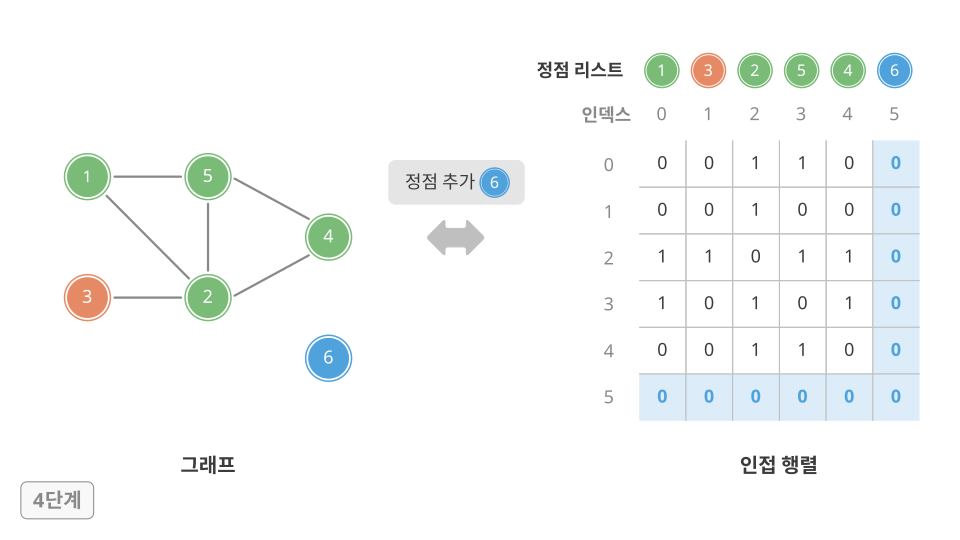
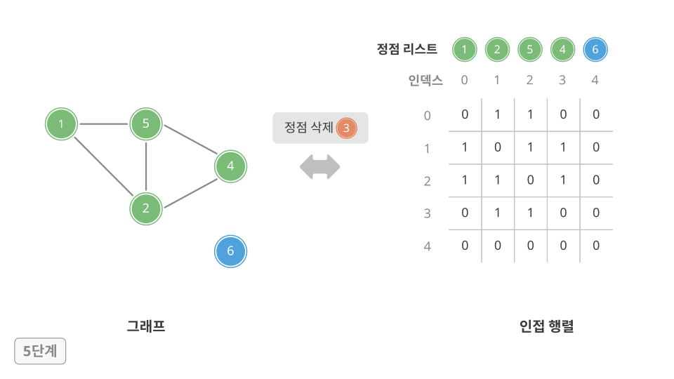
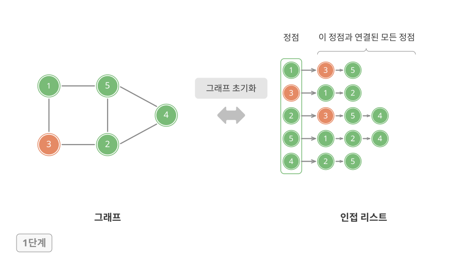
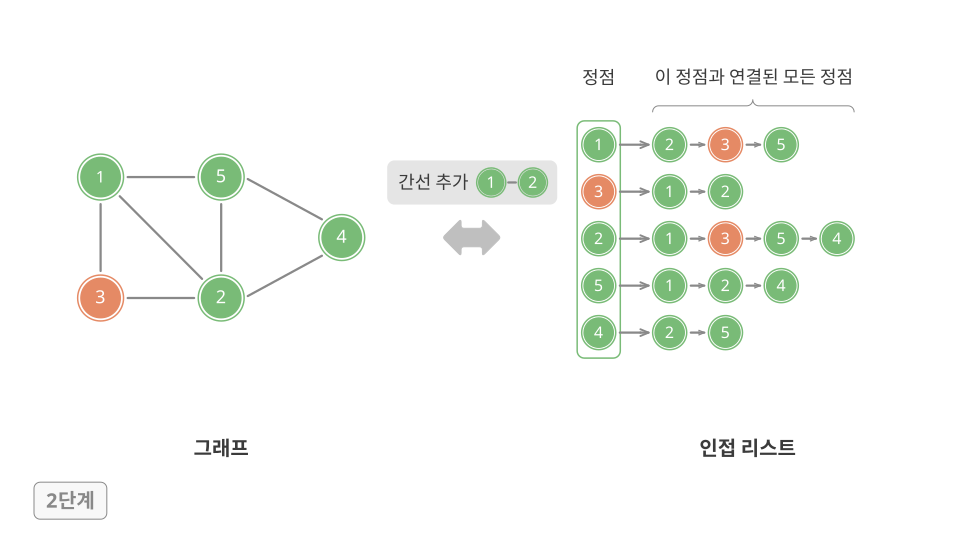
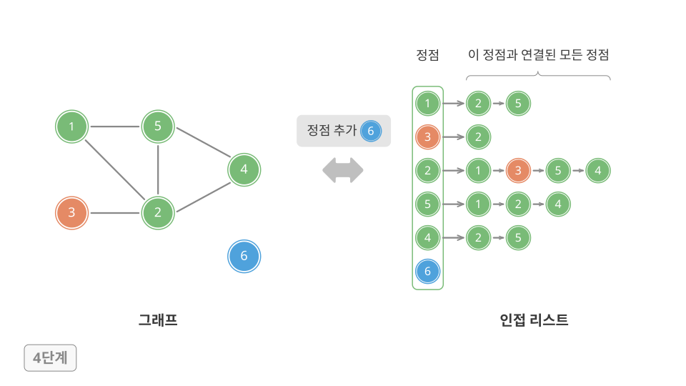
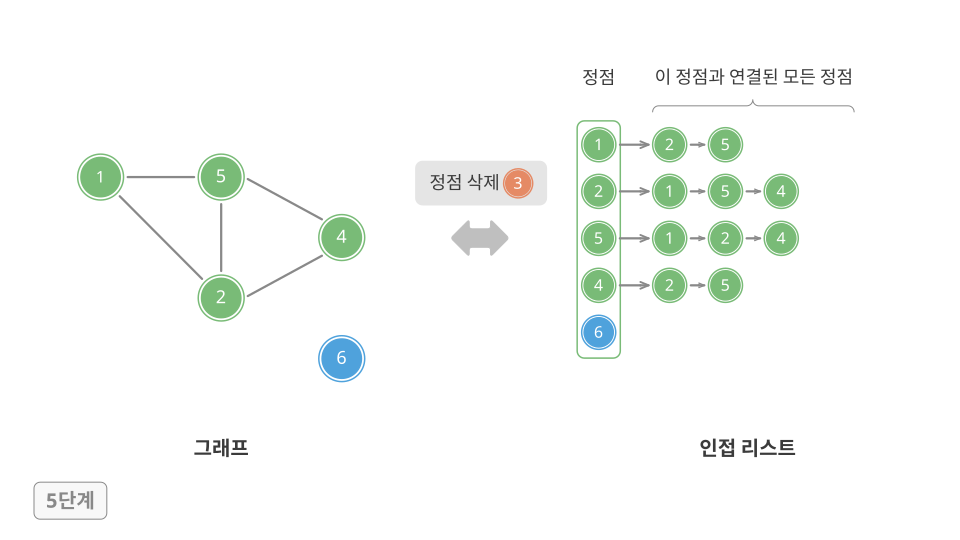

# 그래프의 기본 연산

그래프의 기본 연산은 간선에 대한 연산과 정점에 대한 연산으로 나뉜다. 그래프를 인접 행렬로 표현하는지 인접 리스트로 표현하는지에 따라 구현이 달라진다.

## 인접 행렬을 이용한 구현

정점이 $n$개인 무방향 그래프가 주어졌을 때 각 연산을 구현하는 방법은 아래 그림과 같다.

- **간선 추가 또는 삭제**: 인접 행렬에서 해당 간선을 직접 수정하면 되므로 $O(1)$ 시간이 걸린다. 무방향 그래프이므로 양방향의 간선을 함께 갱신해야 한다.
- **정점 추가**: 인접 행렬의 끝에 행과 열을 하나씩 추가하고 모두 $0$으로 채운다. $O(n)$ 시간이 걸린다.
- **정점 삭제**: 인접 행렬에서 행과 열을 하나씩 삭제한다. 첫 행과 첫 열을 삭제할 때가 최악의 경우로, 원소 $(n-1)^2$개를 왼쪽 위로 옮겨야 하므로 $O(n^2)$ 시간이 걸린다.
- **초기화**: 정점 $n$개를 입력받아 길이 $n$인 정점 리스트 `vertices`를 초기화하는 데 $O(n)$ 시간이 걸린다. 크기가 $n \times n$인 인접 행렬 `adjMat`을 초기화하는 데는 $O(n^2)$ 시간이 걸린다.

=== "<1>"
    

=== "<2>"
    

=== "<3>"
    

=== "<4>"
    

=== "<5>"
    

인접 행렬로 그래프를 구현한 코드는 다음과 같다.

```src
[file]{graph_adjacency_matrix}-[class]{graph_adj_mat}-[func]{}
```

## 인접 리스트를 이용한 구현

무방향 그래프의 정점 수를 $n$, 간선 수를 $m$이라 하면 아래 그림과 같이 각 연산을 구현할 수 있다.

- **간선 추가**: 정점에 해당하는 연결 리스트의 끝에 간선을 추가하면 되므로 $O(1)$ 시간이 걸린다. 무방향 그래프에서는 양방향의 간선을 함께 추가해야 한다.
- **간선 삭제**: 정점에 해당하는 연결 리스트에서 지정한 간선을 찾아 삭제하는 데 $O(m)$ 시간이 걸린다. 무방향 그래프에서는 양방향의 간선을 함께 삭제해야 한다.
- **정점 추가**: 인접 리스트에 연결 리스트 하나를 추가하고 새 정점을 그 리스트의 첫 노드로 삼는다. $O(1)$ 시간이 걸린다.
- **정점 삭제**: 인접 리스트 전체를 순회하여 지정한 정점과 연결된 간선을 모두 삭제해야 하므로 $O(n + m)$ 시간이 걸린다.
- **초기화**: 인접 리스트에 정점 $n$개와 간선에 해당하는 인접 항목 $2m$개를 만드는 데 $O(n + m)$ 시간이 걸린다.

=== "<1>"
    

=== "<2>"
    

=== "<3>"
    

=== "<4>"
    

=== "<5>"
    

인접 리스트의 구현 코드는 다음과 같다. 실제 코드는 위 그림과 다음과 같은 차이가 있다.

- 정점을 손쉽게 추가하고 삭제하며 코드를 단순하게 유지하기 위해 연결 리스트 대신 리스트(동적 배열)를 사용한다.
- 인접 리스트를 해시 테이블에 저장한다. `key`는 정점 인스턴스이고 `value`는 해당 정점에 인접한 정점들의 리스트(연결 리스트)다.

또한 인접 리스트에서는 `Vertex` 클래스로 정점을 나타낸다. 인접 행렬처럼 리스트 인덱스로 정점을 구분하면 인덱스가 $i$인 정점을 삭제할 때 인접 리스트 전체를 순회하며 $i$보다 큰 인덱스를 모두 $1$씩 줄여야 해서 비효율적이다. 반면 각 정점을 고유한 `Vertex` 인스턴스로 나타내면 정점 하나를 삭제해도 다른 정점을 수정할 필요가 없다.

```src
[file]{graph_adjacency_list}-[class]{graph_adj_list}-[func]{}
```

## 효율 비교

정점이 $n$개, 간선이 $m$개인 그래프에서 인접 행렬과 인접 리스트의 시간 및 공간 효율을 비교하면 아래 표와 같다. 여기서 인접 리스트(연결 리스트)는 본문의 구현에 해당하고, 인접 리스트(해시 테이블)는 연결 리스트를 모두 해시 테이블로 바꾼 구현을 뜻한다.

<p align="center"> 표 <id> &nbsp; 인접 행렬과 인접 리스트 비교 </p>

|              | 인접 행렬 | 인접 리스트(연결 리스트) | 인접 리스트(해시 테이블) |
| ------------ | -------- | -------------- | ---------------- |
| 인접 여부 판별 | $O(1)$   | $O(n)$         | $O(1)$           |
| 간선 추가       | $O(1)$   | $O(1)$         | $O(1)$           |
| 간선 삭제       | $O(1)$   | $O(n)$         | $O(1)$           |
| 정점 추가     | $O(n)$   | $O(1)$         | $O(1)$           |
| 정점 삭제     | $O(n^2)$ | $O(n + m)$     | $O(n)$           |
| 메모리 사용량 | $O(n^2)$ | $O(n + m)$     | $O(n + m)$       |

표만 보면 인접 리스트(해시 테이블)의 시간 및 공간 효율이 가장 좋아 보인다. 그러나 실제로 간선을 다룰 때는 배열 원소에 한 번 접근하거나 대입하기만 하면 되는 인접 행렬이 더 빠르다. 종합하면 인접 행렬은 공간을 더 써서 시간을 절약하고, 인접 리스트는 시간을 더 들여 공간을 절약하는 방식이다.
