# 9.3 &nbsp; 그래프 순회

트리는 일대다 관계를 나타내지만, 그래프는 자유도가 더 높아 임의의 다대다 관계를 나타낼 수 있다. 따라서 트리를 그래프의 특수한 경우로 볼 수 있다. 당연히 **트리 순회도 그래프 순회의 특수한 경우다**.

그래프와 트리 모두 탐색 알고리즘으로 순회한다. 그래프 순회도 <u>너비 우선 순회</u>와 <u>깊이 우선 순회</u>로 나눌 수 있다.

## 9.3.1 &nbsp; 너비 우선 순회

**너비 우선 순회는 한 노드에서 출발해 가까운 정점부터 방문하며 한 층씩 바깥으로 확장하는 순회 방식이다**. 아래 그림(9-9)에서는 왼쪽 위 정점에서 출발해 그 정점의 인접 정점을 모두 방문한다. 이어서 다음 정점의 인접 정점을 방문하는 과정을 모든 정점을 방문할 때까지 반복한다.

{ class="animation-figure" }

<p align="center"> 그림 9-9 &nbsp; 그래프의 너비 우선 순회 </p>

### 1. &nbsp; 알고리즘 구현

아래 코드처럼 BFS는 보통 큐로 구현한다. 먼저 넣은 원소를 먼저 꺼내는 큐의 성질은 가까운 곳부터 먼 곳으로 이동하는 BFS의 순서와 잘 맞는다.

1. 순회를 시작할 정점 `startVet`를 큐에 넣고 반복을 시작한다.
2. 반복할 때마다 큐 맨 앞의 정점을 꺼내 방문을 기록한 뒤 그 정점의 인접 정점을 모두 큐의 뒤쪽에 넣는다.
3. 모든 정점을 방문할 때까지 `2.` 단계를 반복한 뒤 종료한다.

정점을 중복 방문하지 않도록 해시 집합 `visited`에 이미 방문한 정점을 기록한다.

!!! tip

    해시 집합은 `key`만 저장하고 `value`는 저장하지 않는 해시 테이블로 볼 수 있다. `key`의 추가, 삭제, 조회, 수정에 걸리는 시간은 $O(1)$이다. `key`가 중복되지 않는 성질 때문에 해시 집합은 데이터의 중복 제거 등에 자주 쓰인다.

=== "Python"

    ```python title="graph_bfs.py"
    def graph_bfs(graph: GraphAdjList, start_vet: Vertex) -> list[Vertex]:
        """너비 우선 순회"""
        # 지정한 정점의 인접 정점을 모두 구할 수 있도록 인접 리스트로 그래프 표현
        # 정점 방문 순서
        res = []
        # 방문한 정점을 기록하는 해시 집합
        visited = set[Vertex]([start_vet])
        # BFS 구현에 사용하는 큐
        que = deque[Vertex]([start_vet])
        # 정점 vet에서 시작해 모든 정점을 방문할 때까지 반복
        while len(que) > 0:
            vet = que.popleft()  # 큐의 맨 앞 정점을 꺼냄
            res.append(vet)  # 방문한 정점 기록
            # 현재 정점에 인접한 모든 정점 순회
            for adj_vet in graph.adj_list[vet]:
                if adj_vet in visited:
                    continue  # 이미 방문한 정점은 건너뜀
                que.append(adj_vet)  # 아직 방문하지 않은 정점만 큐에 삽입
                visited.add(adj_vet)  # 이 정점을 방문한 것으로 표시
        # 정점 방문 순서 반환
        return res
    ```

=== "C++"

    ```cpp title="graph_bfs.cpp"
    /* 너비 우선 순회 */
    // 지정한 정점의 인접 정점을 모두 구할 수 있도록 인접 리스트로 그래프 표현
    vector<Vertex *> graphBFS(GraphAdjList &graph, Vertex *startVet) {
        // 정점 방문 순서
        vector<Vertex *> res;
        // 방문한 정점을 기록하는 해시 집합
        unordered_set<Vertex *> visited = {startVet};
        // BFS 구현에 사용하는 큐
        queue<Vertex *> que;
        que.push(startVet);
        // 정점 vet에서 시작해 모든 정점을 방문할 때까지 반복
        while (!que.empty()) {
            Vertex *vet = que.front();
            que.pop();          // 큐의 맨 앞 정점을 꺼냄
            res.push_back(vet); // 방문한 정점 기록
            // 현재 정점에 인접한 모든 정점 순회
            for (auto adjVet : graph.adjList[vet]) {
                if (visited.count(adjVet))
                    continue;            // 이미 방문한 정점은 건너뜀
                que.push(adjVet);        // 아직 방문하지 않은 정점만 큐에 삽입
                visited.emplace(adjVet); // 이 정점을 방문한 것으로 표시
            }
        }
        // 정점 방문 순서 반환
        return res;
    }
    ```

=== "Java"

    ```java title="graph_bfs.java"
    /* 너비 우선 순회 */
    // 지정한 정점의 인접 정점을 모두 구할 수 있도록 인접 리스트로 그래프 표현
    List<Vertex> graphBFS(GraphAdjList graph, Vertex startVet) {
        // 정점 방문 순서
        List<Vertex> res = new ArrayList<>();
        // 방문한 정점을 기록하는 해시 집합
        Set<Vertex> visited = new HashSet<>();
        visited.add(startVet);
        // BFS 구현에 사용하는 큐
        Queue<Vertex> que = new LinkedList<>();
        que.offer(startVet);
        // 정점 vet에서 시작해 모든 정점을 방문할 때까지 반복
        while (!que.isEmpty()) {
            Vertex vet = que.poll(); // 큐의 맨 앞 정점을 꺼냄
            res.add(vet);            // 방문한 정점 기록
            // 현재 정점에 인접한 모든 정점 순회
            for (Vertex adjVet : graph.adjList.get(vet)) {
                if (visited.contains(adjVet))
                    continue;        // 이미 방문한 정점은 건너뜀
                que.offer(adjVet);   // 아직 방문하지 않은 정점만 큐에 삽입
                visited.add(adjVet); // 이 정점을 방문한 것으로 표시
            }
        }
        // 정점 방문 순서 반환
        return res;
    }
    ```

=== "C#"

    ```csharp title="graph_bfs.cs"
    /* 너비 우선 순회 */
    // 지정한 정점의 인접 정점을 모두 구할 수 있도록 인접 리스트로 그래프 표현
    List<Vertex> GraphBFS(GraphAdjList graph, Vertex startVet) {
        // 정점 방문 순서
        List<Vertex> res = [];
        // 방문한 정점을 기록하는 해시 집합
        HashSet<Vertex> visited = [startVet];
        // BFS 구현에 사용하는 큐
        Queue<Vertex> que = new();
        que.Enqueue(startVet);
        // 정점 vet에서 시작해 모든 정점을 방문할 때까지 반복
        while (que.Count > 0) {
            Vertex vet = que.Dequeue(); // 큐의 맨 앞 정점을 꺼냄
            res.Add(vet);               // 방문한 정점 기록
            foreach (Vertex adjVet in graph.adjList[vet]) {
                if (visited.Contains(adjVet)) {
                    continue;          // 이미 방문한 정점은 건너뜀
                }
                que.Enqueue(adjVet);   // 아직 방문하지 않은 정점만 큐에 삽입
                visited.Add(adjVet);   // 이 정점을 방문한 것으로 표시
            }
        }

        // 정점 방문 순서 반환
        return res;
    }
    ```

=== "Go"

    ```go title="graph_bfs.go"
    /* 너비 우선 순회 */
    // 지정한 정점의 인접 정점을 모두 구할 수 있도록 인접 리스트로 그래프 표현
    func graphBFS(g *graphAdjList, startVet Vertex) []Vertex {
        // 정점 방문 순서
        res := make([]Vertex, 0)
        // 방문한 정점을 기록하는 해시 집합
        visited := make(map[Vertex]struct{})
        visited[startVet] = struct{}{}
        // BFS에 필요한 큐를 슬라이스로 구현
        queue := make([]Vertex, 0)
        queue = append(queue, startVet)
        // 정점 vet에서 시작해 모든 정점을 방문할 때까지 반복
        for len(queue) > 0 {
            // 큐의 맨 앞 정점을 꺼냄
            vet := queue[0]
            queue = queue[1:]
            // 방문한 정점 기록
            res = append(res, vet)
            // 현재 정점에 인접한 모든 정점 순회
            for _, adjVet := range g.adjList[vet] {
                _, isExist := visited[adjVet]
                // 아직 방문하지 않은 정점만 큐에 삽입
                if !isExist {
                    queue = append(queue, adjVet)
                    visited[adjVet] = struct{}{}
                }
            }
        }
        // 정점 방문 순서 반환
        return res
    }
    ```

=== "Swift"

    ```swift title="graph_bfs.swift"
    /* 너비 우선 순회 */
    // 지정한 정점의 인접 정점을 모두 구할 수 있도록 인접 리스트로 그래프 표현
    func graphBFS(graph: GraphAdjList, startVet: Vertex) -> [Vertex] {
        // 정점 방문 순서
        var res: [Vertex] = []
        // 방문한 정점을 기록하는 해시 집합
        var visited: Set<Vertex> = [startVet]
        // BFS 구현에 사용하는 큐
        var que: [Vertex] = [startVet]
        // 정점 vet에서 시작해 모든 정점을 방문할 때까지 반복
        while !que.isEmpty {
            let vet = que.removeFirst() // 큐의 맨 앞 정점을 꺼냄
            res.append(vet) // 방문한 정점 기록
            // 현재 정점에 인접한 모든 정점 순회
            for adjVet in graph.adjList[vet] ?? [] {
                if visited.contains(adjVet) {
                    continue // 이미 방문한 정점은 건너뜀
                }
                que.append(adjVet) // 아직 방문하지 않은 정점만 큐에 삽입
                visited.insert(adjVet) // 이 정점을 방문한 것으로 표시
            }
        }
        // 정점 방문 순서 반환
        return res
    }
    ```

=== "JS"

    ```javascript title="graph_bfs.js"
    /* 너비 우선 순회 */
    // 지정한 정점의 인접 정점을 모두 구할 수 있도록 인접 리스트로 그래프 표현
    function graphBFS(graph, startVet) {
        // 정점 방문 순서
        const res = [];
        // 방문한 정점을 기록하는 해시 집합
        const visited = new Set();
        visited.add(startVet);
        // BFS 구현에 사용하는 큐
        const que = [startVet];
        // 정점 vet에서 시작해 모든 정점을 방문할 때까지 반복
        while (que.length) {
            const vet = que.shift(); // 큐의 맨 앞 정점을 꺼냄
            res.push(vet); // 방문한 정점 기록
            // 현재 정점에 인접한 모든 정점 순회
            for (const adjVet of graph.adjList.get(vet) ?? []) {
                if (visited.has(adjVet)) {
                    continue; // 이미 방문한 정점은 건너뜀
                }
                que.push(adjVet); // 아직 방문하지 않은 정점만 큐에 삽입
                visited.add(adjVet); // 이 정점을 방문한 것으로 표시
            }
        }
        // 정점 방문 순서 반환
        return res;
    }
    ```

=== "TS"

    ```typescript title="graph_bfs.ts"
    /* 너비 우선 순회 */
    // 지정한 정점의 인접 정점을 모두 구할 수 있도록 인접 리스트로 그래프 표현
    function graphBFS(graph: GraphAdjList, startVet: Vertex): Vertex[] {
        // 정점 방문 순서
        const res: Vertex[] = [];
        // 방문한 정점을 기록하는 해시 집합
        const visited: Set<Vertex> = new Set();
        visited.add(startVet);
        // BFS 구현에 사용하는 큐
        const que = [startVet];
        // 정점 vet에서 시작해 모든 정점을 방문할 때까지 반복
        while (que.length) {
            const vet = que.shift(); // 큐의 맨 앞 정점을 꺼냄
            res.push(vet); // 방문한 정점 기록
            // 현재 정점에 인접한 모든 정점 순회
            for (const adjVet of graph.adjList.get(vet) ?? []) {
                if (visited.has(adjVet)) {
                    continue; // 이미 방문한 정점은 건너뜀
                }
                que.push(adjVet); // 미방문 정점만 큐에 삽입
                visited.add(adjVet); // 이 정점을 방문한 것으로 표시
            }
        }
        // 정점 방문 순서 반환
        return res;
    }
    ```

=== "Dart"

    ```dart title="graph_bfs.dart"
    /* 너비 우선 순회 */
    List<Vertex> graphBFS(GraphAdjList graph, Vertex startVet) {
      // 지정한 정점의 인접 정점을 모두 구할 수 있도록 인접 리스트로 그래프 표현
      // 정점 방문 순서
      List<Vertex> res = [];
      // 방문한 정점을 기록하는 해시 집합
      Set<Vertex> visited = {};
      visited.add(startVet);
      // BFS 구현에 사용하는 큐
      Queue<Vertex> que = Queue();
      que.add(startVet);
      // 정점 vet에서 시작해 모든 정점을 방문할 때까지 반복
      while (que.isNotEmpty) {
        Vertex vet = que.removeFirst(); // 큐의 맨 앞 정점을 꺼냄
        res.add(vet); // 방문한 정점 기록
        // 현재 정점에 인접한 모든 정점 순회
        for (Vertex adjVet in graph.adjList[vet]!) {
          if (visited.contains(adjVet)) {
            continue; // 이미 방문한 정점은 건너뜀
          }
          que.add(adjVet); // 아직 방문하지 않은 정점만 큐에 삽입
          visited.add(adjVet); // 이 정점을 방문한 것으로 표시
        }
      }
      // 정점 방문 순서 반환
      return res;
    }
    ```

=== "Rust"

    ```rust title="graph_bfs.rs"
    /* 너비 우선 순회 */
    // 지정한 정점의 인접 정점을 모두 구할 수 있도록 인접 리스트로 그래프 표현
    fn graph_bfs(graph: GraphAdjList, start_vet: Vertex) -> Vec<Vertex> {
        // 정점 방문 순서
        let mut res = vec![];
        // 방문한 정점을 기록하는 해시 집합
        let mut visited = HashSet::new();
        visited.insert(start_vet);
        // BFS 구현에 사용하는 큐
        let mut que = VecDeque::new();
        que.push_back(start_vet);
        // 정점 vet에서 시작해 모든 정점을 방문할 때까지 반복
        while let Some(vet) = que.pop_front() {
            res.push(vet); // 방문한 정점 기록

            // 현재 정점에 인접한 모든 정점 순회
            if let Some(adj_vets) = graph.adj_list.get(&vet) {
                for &adj_vet in adj_vets {
                    if visited.contains(&adj_vet) {
                        continue; // 이미 방문한 정점은 건너뜀
                    }
                    que.push_back(adj_vet); // 아직 방문하지 않은 정점만 큐에 삽입
                    visited.insert(adj_vet); // 이 정점을 방문한 것으로 표시
                }
            }
        }
        // 정점 방문 순서 반환
        res
    }
    ```

=== "C"

    ```c title="graph_bfs.c"
    /* 노드 큐 구조체 */
    typedef struct {
        Vertex *vertices[MAX_SIZE];
        int front, rear, size;
    } Queue;

    /* 생성자 */
    Queue *newQueue() {
        Queue *q = (Queue *)malloc(sizeof(Queue));
        q->front = q->rear = q->size = 0;
        return q;
    }

    /* 큐가 비었는지 확인 */
    int isEmpty(Queue *q) {
        return q->size == 0;
    }

    /* 큐에 삽입 */
    void enqueue(Queue *q, Vertex *vet) {
        q->vertices[q->rear] = vet;
        q->rear = (q->rear + 1) % MAX_SIZE;
        q->size++;
    }

    /* 큐에서 꺼내기 */
    Vertex *dequeue(Queue *q) {
        Vertex *vet = q->vertices[q->front];
        q->front = (q->front + 1) % MAX_SIZE;
        q->size--;
        return vet;
    }

    /* 이미 방문한 정점인지 확인 */
    int isVisited(Vertex **visited, int size, Vertex *vet) {
        // 노드를 순회하여 검색하는 데 O(n) 시간 소요
        for (int i = 0; i < size; i++) {
            if (visited[i] == vet)
                return 1;
        }
        return 0;
    }

    /* 너비 우선 순회 */
    // 지정한 정점의 인접 정점을 모두 구할 수 있도록 인접 리스트로 그래프 표현
    void graphBFS(GraphAdjList *graph, Vertex *startVet, Vertex **res, int *resSize, Vertex **visited, int *visitedSize) {
        // BFS 구현에 사용하는 큐
        Queue *queue = newQueue();
        enqueue(queue, startVet);
        visited[(*visitedSize)++] = startVet;
        // 정점 vet에서 시작해 모든 정점을 방문할 때까지 반복
        while (!isEmpty(queue)) {
            Vertex *vet = dequeue(queue); // 큐의 맨 앞 정점을 꺼냄
            res[(*resSize)++] = vet;      // 방문한 정점 기록
            // 현재 정점에 인접한 모든 정점 순회
            AdjListNode *node = findNode(graph, vet);
            while (node != NULL) {
                // 이미 방문한 정점은 건너뜀
                if (!isVisited(visited, *visitedSize, node->vertex)) {
                    enqueue(queue, node->vertex);             // 아직 방문하지 않은 정점만 큐에 삽입
                    visited[(*visitedSize)++] = node->vertex; // 이 정점을 방문한 것으로 표시
                }
                node = node->next;
            }
        }
        // 메모리 해제
        free(queue);
    }
    ```

=== "Kotlin"

    ```kotlin title="graph_bfs.kt"
    /* 너비 우선 순회 */
    // 지정한 정점의 인접 정점을 모두 구할 수 있도록 인접 리스트로 그래프 표현
    fun graphBFS(graph: GraphAdjList, startVet: Vertex): MutableList<Vertex?> {
        // 정점 방문 순서
        val res = mutableListOf<Vertex?>()
        // 방문한 정점을 기록하는 해시 집합
        val visited = HashSet<Vertex>()
        visited.add(startVet)
        // BFS 구현에 사용하는 큐
        val que = LinkedList<Vertex>()
        que.offer(startVet)
        // 정점 vet에서 시작해 모든 정점을 방문할 때까지 반복
        while (!que.isEmpty()) {
            val vet = que.poll() // 큐의 맨 앞 정점을 꺼냄
            res.add(vet)         // 방문한 정점 기록
            // 현재 정점에 인접한 모든 정점 순회
            for (adjVet in graph.adjList[vet]!!) {
                if (visited.contains(adjVet))
                    continue        // 이미 방문한 정점은 건너뜀
                que.offer(adjVet)   // 아직 방문하지 않은 정점만 큐에 삽입
                visited.add(adjVet) // 이 정점을 방문한 것으로 표시
            }
        }
        // 정점 방문 순서 반환
        return res
    }
    ```

=== "Ruby"

    ```ruby title="graph_bfs.rb"
    ### 너비 우선 순회 ###
    def graph_bfs(graph, start_vet)
      # 지정한 정점의 인접 정점을 모두 구할 수 있도록 인접 리스트로 그래프 표현
      # 정점 방문 순서
      res = []
      # 방문한 정점을 기록하는 해시 집합
      visited = Set.new([start_vet])
      # BFS 구현에 사용하는 큐
      que = [start_vet]
      # 정점 vet에서 시작해 모든 정점을 방문할 때까지 반복
      while que.length > 0
        vet = que.shift # 큐의 맨 앞 정점을 꺼냄
        res << vet # 방문한 정점 기록
        # 현재 정점에 인접한 모든 정점 순회
        for adj_vet in graph.adj_list[vet]
          next if visited.include?(adj_vet) # 이미 방문한 정점은 건너뜀
          que << adj_vet # 아직 방문하지 않은 정점만 큐에 삽입
          visited.add(adj_vet) # 이 정점을 방문한 것으로 표시
        end
      end
      # 정점 방문 순서 반환
      res
    end
    ```

??? pythontutor "실행 과정 시각화"

    <div style="height: 549px; width: 100%;"><iframe class="pythontutor-iframe" title="실행 과정 시각화" src="https://pythontutor.com/iframe-embed.html#code=from%20collections%20import%20deque%0A%0Aclass%20Vertex%3A%0A%20%20%22%22%22%EC%A0%95%EC%A0%90%20%ED%81%B4%EB%9E%98%EC%8A%A4%22%22%22%0A%20%20def%20__init__%28self,%20val%3A%20int%29%3A%0A%20%20%20%20self.val%20%3D%20val%0A%0Adef%20vals_to_vets%28vals%3A%20list%5Bint%5D%29%20-%3E%20list%5B%22Vertex%22%5D%3A%0A%20%20%22%22%22%EA%B0%92%20%EB%A6%AC%EC%8A%A4%ED%8A%B8%20vals%EB%A5%BC%20%EB%B0%9B%EC%95%84%20%EC%A0%95%EC%A0%90%20%EB%A6%AC%EC%8A%A4%ED%8A%B8%20vets%EB%A5%BC%20%EB%B0%98%ED%99%98%22%22%22%0A%20%20return%20%5BVertex%28val%29%20for%20val%20in%20vals%5D%0A%0Aclass%20GraphAdjList%3A%0A%20%20%22%22%22%EC%9D%B8%EC%A0%91%20%EB%A6%AC%EC%8A%A4%ED%8A%B8%EB%A1%9C%20%EA%B5%AC%ED%98%84%ED%95%9C%20%EB%AC%B4%EB%B0%A9%ED%96%A5%20%EA%B7%B8%EB%9E%98%ED%94%84%20%ED%81%B4%EB%9E%98%EC%8A%A4%22%22%22%0A%0A%20%20def%20__init__%28self,%20edges%3A%20list%5Blist%5BVertex%5D%5D%29%3A%0A%20%20%20%20%22%22%22%EC%83%9D%EC%84%B1%EC%9E%90%22%22%22%0A%20%20%20%20self.adj_list%20%3D%20dict%5BVertex,%20list%5BVertex%5D%5D%28%29%0A%20%20%20%20for%20edge%20in%20edges%3A%0A%20%20%20%20%20%20self.add_vertex%28edge%5B0%5D%29%0A%20%20%20%20%20%20self.add_vertex%28edge%5B1%5D%29%0A%20%20%20%20%20%20self.add_edge%28edge%5B0%5D,%20edge%5B1%5D%29%0A%0A%20%20def%20add_edge%28self,%20vet1%3A%20Vertex,%20vet2%3A%20Vertex%29%3A%0A%20%20%20%20%22%22%22%EA%B0%84%EC%84%A0%20%EC%B6%94%EA%B0%80%22%22%22%0A%20%20%20%20if%20vet1%20not%20in%20self.adj_list%20or%20vet2%20not%20in%20self.adj_list%20or%20vet1%20%3D%3D%20vet2%3A%0A%20%20%20%20%20%20raise%20ValueError%28%29%0A%20%20%20%20self.adj_list%5Bvet1%5D.append%28vet2%29%0A%20%20%20%20self.adj_list%5Bvet2%5D.append%28vet1%29%0A%0A%20%20def%20add_vertex%28self,%20vet%3A%20Vertex%29%3A%0A%20%20%20%20%22%22%22%EC%A0%95%EC%A0%90%20%EC%B6%94%EA%B0%80%22%22%22%0A%20%20%20%20if%20vet%20in%20self.adj_list%3A%0A%20%20%20%20%20%20return%0A%20%20%20%20self.adj_list%5Bvet%5D%20%3D%20%5B%5D%0A%0A%0Adef%20graph_bfs%28graph%3A%20GraphAdjList,%20start_vet%3A%20Vertex%29%20-%3E%20list%5BVertex%5D%3A%0A%20%20%22%22%22%EB%84%88%EB%B9%84%20%EC%9A%B0%EC%84%A0%20%EC%88%9C%ED%9A%8C%22%22%22%0A%20%20%23%20%EC%A0%95%EC%A0%90%20%EB%B0%A9%EB%AC%B8%20%EC%88%9C%EC%84%9C%0A%20%20res%20%3D%20%5B%5D%0A%20%20%23%20%EB%B0%A9%EB%AC%B8%ED%95%9C%20%EC%A0%95%EC%A0%90%EC%9D%84%20%EA%B8%B0%EB%A1%9D%ED%95%98%EB%8A%94%20%ED%95%B4%EC%8B%9C%20%ED%85%8C%EC%9D%B4%EB%B8%94%0A%20%20visited%20%3D%20set%5BVertex%5D%28%5Bstart_vet%5D%29%0A%20%20%23%20BFS%20%EA%B5%AC%ED%98%84%EC%97%90%20%EC%82%AC%EC%9A%A9%ED%95%98%EB%8A%94%20%ED%81%90%0A%20%20que%20%3D%20deque%5BVertex%5D%28%5Bstart_vet%5D%29%0A%20%20%23%20%EC%A0%95%EC%A0%90%20vet%EC%97%90%EC%84%9C%20%EC%8B%9C%EC%9E%91%ED%95%B4%20%EB%AA%A8%EB%93%A0%20%EC%A0%95%EC%A0%90%EC%9D%84%20%EB%B0%A9%EB%AC%B8%ED%95%A0%20%EB%95%8C%EA%B9%8C%EC%A7%80%20%EB%B0%98%EB%B3%B5%0A%20%20while%20len%28que%29%20%3E%200%3A%0A%20%20%20%20vet%20%3D%20que.popleft%28%29%20%20%23%20%ED%81%90%EC%9D%98%20%EB%A7%A8%20%EC%95%9E%20%EC%A0%95%EC%A0%90%EC%9D%84%20%EA%BA%BC%EB%83%84%0A%20%20%20%20res.append%28vet%29%20%20%23%20%EB%B0%A9%EB%AC%B8%ED%95%9C%20%EC%A0%95%EC%A0%90%20%EA%B8%B0%EB%A1%9D%0A%20%20%20%20%23%20%ED%98%84%EC%9E%AC%20%EC%A0%95%EC%A0%90%EC%97%90%20%EC%9D%B8%EC%A0%91%ED%95%9C%20%EB%AA%A8%EB%93%A0%20%EC%A0%95%EC%A0%90%20%EC%88%9C%ED%9A%8C%0A%20%20%20%20for%20adj_vet%20in%20graph.adj_list%5Bvet%5D%3A%0A%20%20%20%20%20%20if%20adj_vet%20in%20visited%3A%0A%20%20%20%20%20%20%20%20continue%20%20%23%20%EC%9D%B4%EB%AF%B8%20%EB%B0%A9%EB%AC%B8%ED%95%9C%20%EC%A0%95%EC%A0%90%EC%9D%80%20%EA%B1%B4%EB%84%88%EB%9C%80%0A%20%20%20%20%20%20que.append%28adj_vet%29%20%20%23%20%EC%95%84%EC%A7%81%20%EB%B0%A9%EB%AC%B8%ED%95%98%EC%A7%80%20%EC%95%8A%EC%9D%80%20%EC%A0%95%EC%A0%90%EB%A7%8C%20%ED%81%90%EC%97%90%20%EC%82%BD%EC%9E%85%0A%20%20%20%20%20%20visited.add%28adj_vet%29%20%20%23%20%EC%9D%B4%20%EC%A0%95%EC%A0%90%EC%9D%84%20%EB%B0%A9%EB%AC%B8%ED%95%9C%20%EA%B2%83%EC%9C%BC%EB%A1%9C%20%ED%91%9C%EC%8B%9C%0A%20%20%23%20%EC%A0%95%EC%A0%90%20%EB%B0%A9%EB%AC%B8%20%EC%88%9C%EC%84%9C%20%EB%B0%98%ED%99%98%0A%20%20return%20res%0A%0A%22%22%22Driver%20Code%22%22%22%0Aif%20__name__%20%3D%3D%20%22__main__%22%3A%0A%20%20%23%20%EB%AC%B4%EB%B0%A9%ED%96%A5%20%EA%B7%B8%EB%9E%98%ED%94%84%20%EC%B4%88%EA%B8%B0%ED%99%94%0A%20%20v%20%3D%20vals_to_vets%28%5B0,%201,%202,%203,%204%5D%29%0A%20%20edges%20%3D%20%5B%0A%20%20%20%20%5Bv%5B0%5D,%20v%5B1%5D%5D,%0A%20%20%20%20%5Bv%5B0%5D,%20v%5B3%5D%5D,%0A%20%20%20%20%5Bv%5B1%5D,%20v%5B2%5D%5D,%0A%20%20%20%20%5Bv%5B1%5D,%20v%5B4%5D%5D,%0A%20%20%20%20%5Bv%5B3%5D,%20v%5B4%5D%5D,%0A%20%20%5D%0A%20%20graph%20%3D%20GraphAdjList%28edges%29%0A%20%20del%20edges%0A%0A%20%20%23%20%EB%84%88%EB%B9%84%20%EC%9A%B0%EC%84%A0%20%EC%88%9C%ED%9A%8C%0A%20%20res%20%3D%20graph_bfs%28graph,%20v%5B0%5D%29&codeDivHeight=472&codeDivWidth=350&cumulative=false&curInstr=131&heapPrimitives=nevernest&origin=opt-frontend.js&py=311&rawInputLstJSON=%5B%5D&textReferences=false"> </iframe></div>
    <div style="margin-top: 5px;"><a href="https://pythontutor.com/iframe-embed.html#code=from%20collections%20import%20deque%0A%0Aclass%20Vertex%3A%0A%20%20%22%22%22%EC%A0%95%EC%A0%90%20%ED%81%B4%EB%9E%98%EC%8A%A4%22%22%22%0A%20%20def%20__init__%28self,%20val%3A%20int%29%3A%0A%20%20%20%20self.val%20%3D%20val%0A%0Adef%20vals_to_vets%28vals%3A%20list%5Bint%5D%29%20-%3E%20list%5B%22Vertex%22%5D%3A%0A%20%20%22%22%22%EA%B0%92%20%EB%A6%AC%EC%8A%A4%ED%8A%B8%20vals%EB%A5%BC%20%EB%B0%9B%EC%95%84%20%EC%A0%95%EC%A0%90%20%EB%A6%AC%EC%8A%A4%ED%8A%B8%20vets%EB%A5%BC%20%EB%B0%98%ED%99%98%22%22%22%0A%20%20return%20%5BVertex%28val%29%20for%20val%20in%20vals%5D%0A%0Aclass%20GraphAdjList%3A%0A%20%20%22%22%22%EC%9D%B8%EC%A0%91%20%EB%A6%AC%EC%8A%A4%ED%8A%B8%EB%A1%9C%20%EA%B5%AC%ED%98%84%ED%95%9C%20%EB%AC%B4%EB%B0%A9%ED%96%A5%20%EA%B7%B8%EB%9E%98%ED%94%84%20%ED%81%B4%EB%9E%98%EC%8A%A4%22%22%22%0A%0A%20%20def%20__init__%28self,%20edges%3A%20list%5Blist%5BVertex%5D%5D%29%3A%0A%20%20%20%20%22%22%22%EC%83%9D%EC%84%B1%EC%9E%90%22%22%22%0A%20%20%20%20self.adj_list%20%3D%20dict%5BVertex,%20list%5BVertex%5D%5D%28%29%0A%20%20%20%20for%20edge%20in%20edges%3A%0A%20%20%20%20%20%20self.add_vertex%28edge%5B0%5D%29%0A%20%20%20%20%20%20self.add_vertex%28edge%5B1%5D%29%0A%20%20%20%20%20%20self.add_edge%28edge%5B0%5D,%20edge%5B1%5D%29%0A%0A%20%20def%20add_edge%28self,%20vet1%3A%20Vertex,%20vet2%3A%20Vertex%29%3A%0A%20%20%20%20%22%22%22%EA%B0%84%EC%84%A0%20%EC%B6%94%EA%B0%80%22%22%22%0A%20%20%20%20if%20vet1%20not%20in%20self.adj_list%20or%20vet2%20not%20in%20self.adj_list%20or%20vet1%20%3D%3D%20vet2%3A%0A%20%20%20%20%20%20raise%20ValueError%28%29%0A%20%20%20%20self.adj_list%5Bvet1%5D.append%28vet2%29%0A%20%20%20%20self.adj_list%5Bvet2%5D.append%28vet1%29%0A%0A%20%20def%20add_vertex%28self,%20vet%3A%20Vertex%29%3A%0A%20%20%20%20%22%22%22%EC%A0%95%EC%A0%90%20%EC%B6%94%EA%B0%80%22%22%22%0A%20%20%20%20if%20vet%20in%20self.adj_list%3A%0A%20%20%20%20%20%20return%0A%20%20%20%20self.adj_list%5Bvet%5D%20%3D%20%5B%5D%0A%0A%0Adef%20graph_bfs%28graph%3A%20GraphAdjList,%20start_vet%3A%20Vertex%29%20-%3E%20list%5BVertex%5D%3A%0A%20%20%22%22%22%EB%84%88%EB%B9%84%20%EC%9A%B0%EC%84%A0%20%EC%88%9C%ED%9A%8C%22%22%22%0A%20%20%23%20%EC%A0%95%EC%A0%90%20%EB%B0%A9%EB%AC%B8%20%EC%88%9C%EC%84%9C%0A%20%20res%20%3D%20%5B%5D%0A%20%20%23%20%EB%B0%A9%EB%AC%B8%ED%95%9C%20%EC%A0%95%EC%A0%90%EC%9D%84%20%EA%B8%B0%EB%A1%9D%ED%95%98%EB%8A%94%20%ED%95%B4%EC%8B%9C%20%ED%85%8C%EC%9D%B4%EB%B8%94%0A%20%20visited%20%3D%20set%5BVertex%5D%28%5Bstart_vet%5D%29%0A%20%20%23%20BFS%20%EA%B5%AC%ED%98%84%EC%97%90%20%EC%82%AC%EC%9A%A9%ED%95%98%EB%8A%94%20%ED%81%90%0A%20%20que%20%3D%20deque%5BVertex%5D%28%5Bstart_vet%5D%29%0A%20%20%23%20%EC%A0%95%EC%A0%90%20vet%EC%97%90%EC%84%9C%20%EC%8B%9C%EC%9E%91%ED%95%B4%20%EB%AA%A8%EB%93%A0%20%EC%A0%95%EC%A0%90%EC%9D%84%20%EB%B0%A9%EB%AC%B8%ED%95%A0%20%EB%95%8C%EA%B9%8C%EC%A7%80%20%EB%B0%98%EB%B3%B5%0A%20%20while%20len%28que%29%20%3E%200%3A%0A%20%20%20%20vet%20%3D%20que.popleft%28%29%20%20%23%20%ED%81%90%EC%9D%98%20%EB%A7%A8%20%EC%95%9E%20%EC%A0%95%EC%A0%90%EC%9D%84%20%EA%BA%BC%EB%83%84%0A%20%20%20%20res.append%28vet%29%20%20%23%20%EB%B0%A9%EB%AC%B8%ED%95%9C%20%EC%A0%95%EC%A0%90%20%EA%B8%B0%EB%A1%9D%0A%20%20%20%20%23%20%ED%98%84%EC%9E%AC%20%EC%A0%95%EC%A0%90%EC%97%90%20%EC%9D%B8%EC%A0%91%ED%95%9C%20%EB%AA%A8%EB%93%A0%20%EC%A0%95%EC%A0%90%20%EC%88%9C%ED%9A%8C%0A%20%20%20%20for%20adj_vet%20in%20graph.adj_list%5Bvet%5D%3A%0A%20%20%20%20%20%20if%20adj_vet%20in%20visited%3A%0A%20%20%20%20%20%20%20%20continue%20%20%23%20%EC%9D%B4%EB%AF%B8%20%EB%B0%A9%EB%AC%B8%ED%95%9C%20%EC%A0%95%EC%A0%90%EC%9D%80%20%EA%B1%B4%EB%84%88%EB%9C%80%0A%20%20%20%20%20%20que.append%28adj_vet%29%20%20%23%20%EC%95%84%EC%A7%81%20%EB%B0%A9%EB%AC%B8%ED%95%98%EC%A7%80%20%EC%95%8A%EC%9D%80%20%EC%A0%95%EC%A0%90%EB%A7%8C%20%ED%81%90%EC%97%90%20%EC%82%BD%EC%9E%85%0A%20%20%20%20%20%20visited.add%28adj_vet%29%20%20%23%20%EC%9D%B4%20%EC%A0%95%EC%A0%90%EC%9D%84%20%EB%B0%A9%EB%AC%B8%ED%95%9C%20%EA%B2%83%EC%9C%BC%EB%A1%9C%20%ED%91%9C%EC%8B%9C%0A%20%20%23%20%EC%A0%95%EC%A0%90%20%EB%B0%A9%EB%AC%B8%20%EC%88%9C%EC%84%9C%20%EB%B0%98%ED%99%98%0A%20%20return%20res%0A%0A%22%22%22Driver%20Code%22%22%22%0Aif%20__name__%20%3D%3D%20%22__main__%22%3A%0A%20%20%23%20%EB%AC%B4%EB%B0%A9%ED%96%A5%20%EA%B7%B8%EB%9E%98%ED%94%84%20%EC%B4%88%EA%B8%B0%ED%99%94%0A%20%20v%20%3D%20vals_to_vets%28%5B0,%201,%202,%203,%204%5D%29%0A%20%20edges%20%3D%20%5B%0A%20%20%20%20%5Bv%5B0%5D,%20v%5B1%5D%5D,%0A%20%20%20%20%5Bv%5B0%5D,%20v%5B3%5D%5D,%0A%20%20%20%20%5Bv%5B1%5D,%20v%5B2%5D%5D,%0A%20%20%20%20%5Bv%5B1%5D,%20v%5B4%5D%5D,%0A%20%20%20%20%5Bv%5B3%5D,%20v%5B4%5D%5D,%0A%20%20%5D%0A%20%20graph%20%3D%20GraphAdjList%28edges%29%0A%20%20del%20edges%0A%0A%20%20%23%20%EB%84%88%EB%B9%84%20%EC%9A%B0%EC%84%A0%20%EC%88%9C%ED%9A%8C%0A%20%20res%20%3D%20graph_bfs%28graph,%20v%5B0%5D%29&codeDivHeight=800&codeDivWidth=600&cumulative=false&curInstr=131&heapPrimitives=nevernest&origin=opt-frontend.js&py=311&rawInputLstJSON=%5B%5D&textReferences=false" target="_blank" rel="noopener noreferrer">전체 화면으로 보기 ></a></div>

코드만으로 이해하기 어려우면 아래 그림(9-10)과 함께 살펴보자.

=== "<1>"
    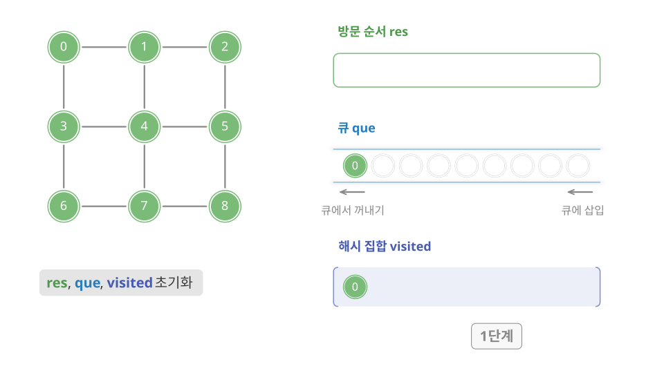{ class="animation-figure" }

=== "<2>"
    { class="animation-figure" }

=== "<3>"
    { class="animation-figure" }

=== "<4>"
    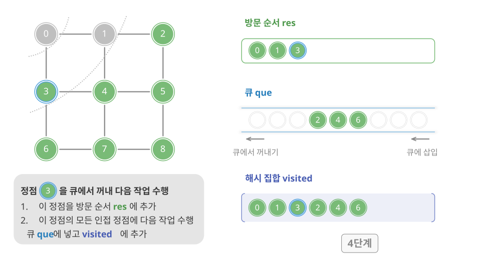{ class="animation-figure" }

=== "<5>"
    { class="animation-figure" }

=== "<6>"
    { class="animation-figure" }

=== "<7>"
    { class="animation-figure" }

=== "<8>"
    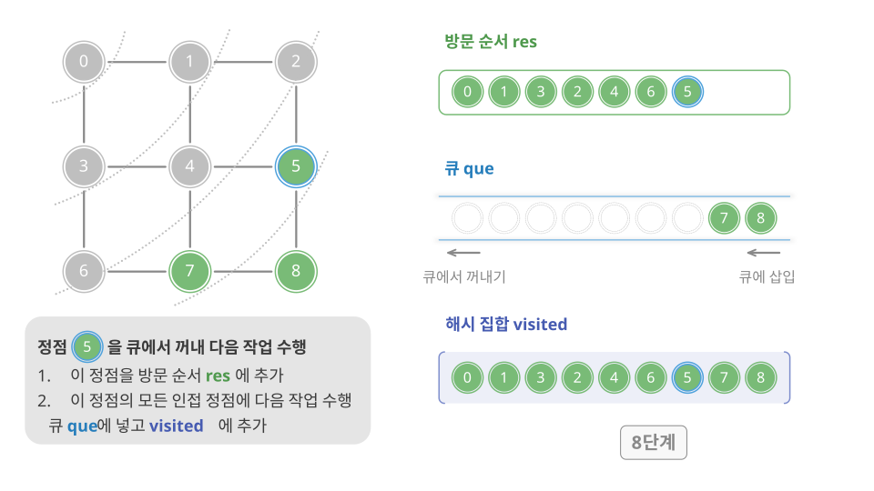{ class="animation-figure" }

=== "<9>"
    { class="animation-figure" }

=== "<10>"
    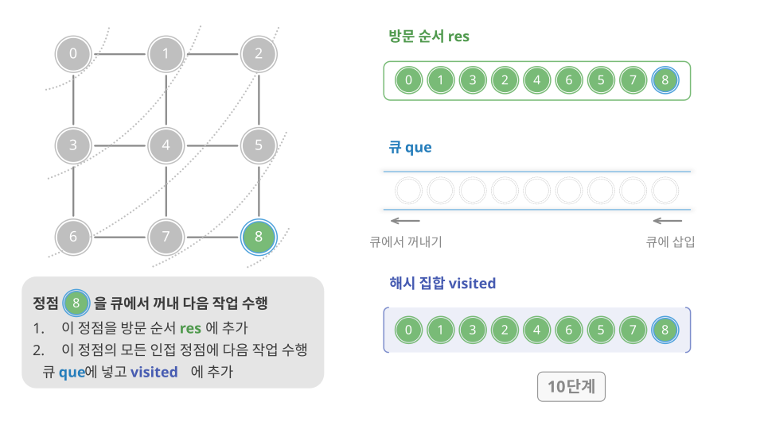{ class="animation-figure" }

=== "<11>"
    { class="animation-figure" }

<p align="center"> 그림 9-10 &nbsp; 그래프의 너비 우선 순회 단계 </p>

!!! question "너비 우선 순회의 방문 순서는 하나로 정해지는가?"

    그렇지 않다. 너비 우선 순회는 가까운 곳부터 방문하기만 하면 되므로 **거리가 같은 여러 정점은 어떤 순서로 방문해도 된다**. 위 그림(9-10)에서 정점 $1$과 $3$의 방문 순서를 바꿔도 되고, 정점 $2$, $4$, $6$의 순서도 자유롭게 바꿀 수 있다.

### 2. &nbsp; 복잡도 분석

**시간 복잡도**: 모든 정점이 한 번씩 큐에 들어갔다 나오므로 $O(|V|)$ 시간이 걸린다. 인접 정점을 순회할 때는 무방향 그래프의 각 간선을 $2$번씩 방문하므로 $O(2|E|)$ 시간이 걸린다. 전체 시간은 $O(|V| + |E|)$이다.

**공간 복잡도**: 리스트 `res`, 해시 집합 `visited`, 큐 `que`에 들어가는 정점은 각각 최대 $|V|$개이므로 $O(|V|)$ 공간이 필요하다.

## 9.3.2 &nbsp; 깊이 우선 순회

**깊이 우선 순회는 한 방향으로 갈 수 있는 데까지 간 뒤 더 갈 곳이 없으면 되돌아오는 순회 방식이다**. 아래 그림(9-11)에서는 왼쪽 위 정점에서 출발해 현재 정점의 인접 정점 하나로 이동하는 일을 반복한다. 막다른 곳에 이르면 되돌아와 다른 길을 따라 끝까지 갔다가 돌아온다. 모든 정점을 방문할 때까지 이 과정을 반복한다.

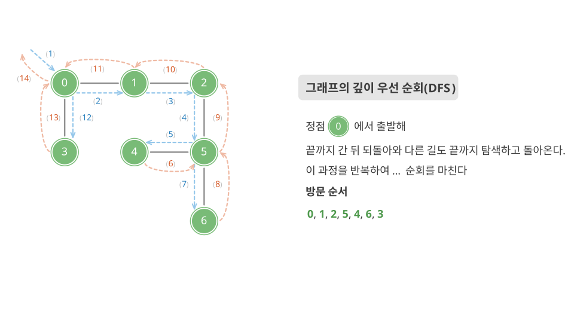{ class="animation-figure" }

<p align="center"> 그림 9-11 &nbsp; 그래프의 깊이 우선 순회 </p>

### 1. &nbsp; 알고리즘 구현

이렇게 끝까지 갔다가 되돌아오는 알고리즘은 보통 재귀로 구현한다. 너비 우선 순회와 마찬가지로 깊이 우선 순회에서도 이미 방문한 정점을 해시 집합 `visited`에 기록해 중복 방문을 막는다.

=== "Python"

    ```python title="graph_dfs.py"
    def dfs(graph: GraphAdjList, visited: set[Vertex], res: list[Vertex], vet: Vertex):
        """깊이 우선 순회 보조 함수"""
        res.append(vet)  # 방문한 정점 기록
        visited.add(vet)  # 이 정점을 방문한 것으로 표시
        # 현재 정점에 인접한 모든 정점 순회
        for adjVet in graph.adj_list[vet]:
            if adjVet in visited:
                continue  # 이미 방문한 정점은 건너뜀
            # 인접 정점을 재귀적으로 방문
            dfs(graph, visited, res, adjVet)

    def graph_dfs(graph: GraphAdjList, start_vet: Vertex) -> list[Vertex]:
        """깊이 우선 순회"""
        # 지정한 정점의 인접 정점을 모두 구할 수 있도록 인접 리스트로 그래프 표현
        # 정점 방문 순서
        res = []
        # 방문한 정점을 기록하는 해시 집합
        visited = set[Vertex]()
        dfs(graph, visited, res, start_vet)
        return res
    ```

=== "C++"

    ```cpp title="graph_dfs.cpp"
    /* 깊이 우선 순회 보조 함수 */
    void dfs(GraphAdjList &graph, unordered_set<Vertex *> &visited, vector<Vertex *> &res, Vertex *vet) {
        res.push_back(vet);   // 방문한 정점 기록
        visited.emplace(vet); // 이 정점을 방문한 것으로 표시
        // 현재 정점에 인접한 모든 정점 순회
        for (Vertex *adjVet : graph.adjList[vet]) {
            if (visited.count(adjVet))
                continue; // 이미 방문한 정점은 건너뜀
            // 인접 정점을 재귀적으로 방문
            dfs(graph, visited, res, adjVet);
        }
    }

    /* 깊이 우선 순회 */
    // 지정한 정점의 인접 정점을 모두 구할 수 있도록 인접 리스트로 그래프 표현
    vector<Vertex *> graphDFS(GraphAdjList &graph, Vertex *startVet) {
        // 정점 방문 순서
        vector<Vertex *> res;
        // 방문한 정점을 기록하는 해시 집합
        unordered_set<Vertex *> visited;
        dfs(graph, visited, res, startVet);
        return res;
    }
    ```

=== "Java"

    ```java title="graph_dfs.java"
    /* 깊이 우선 순회 보조 함수 */
    void dfs(GraphAdjList graph, Set<Vertex> visited, List<Vertex> res, Vertex vet) {
        res.add(vet);     // 방문한 정점 기록
        visited.add(vet); // 이 정점을 방문한 것으로 표시
        // 현재 정점에 인접한 모든 정점 순회
        for (Vertex adjVet : graph.adjList.get(vet)) {
            if (visited.contains(adjVet))
                continue; // 이미 방문한 정점은 건너뜀
            // 인접 정점을 재귀적으로 방문
            dfs(graph, visited, res, adjVet);
        }
    }

    /* 깊이 우선 순회 */
    // 지정한 정점의 인접 정점을 모두 구할 수 있도록 인접 리스트로 그래프 표현
    List<Vertex> graphDFS(GraphAdjList graph, Vertex startVet) {
        // 정점 방문 순서
        List<Vertex> res = new ArrayList<>();
        // 방문한 정점을 기록하는 해시 집합
        Set<Vertex> visited = new HashSet<>();
        dfs(graph, visited, res, startVet);
        return res;
    }
    ```

=== "C#"

    ```csharp title="graph_dfs.cs"
    /* 깊이 우선 순회 보조 함수 */
    void DFS(GraphAdjList graph, HashSet<Vertex> visited, List<Vertex> res, Vertex vet) {
        res.Add(vet);     // 방문한 정점 기록
        visited.Add(vet); // 이 정점을 방문한 것으로 표시
        // 현재 정점에 인접한 모든 정점 순회
        foreach (Vertex adjVet in graph.adjList[vet]) {
            if (visited.Contains(adjVet)) {
                continue; // 이미 방문한 정점은 건너뜀                             
            }
            // 인접 정점을 재귀적으로 방문
            DFS(graph, visited, res, adjVet);
        }
    }

    /* 깊이 우선 순회 */
    // 지정한 정점의 인접 정점을 모두 구할 수 있도록 인접 리스트로 그래프 표현
    List<Vertex> GraphDFS(GraphAdjList graph, Vertex startVet) {
        // 정점 방문 순서
        List<Vertex> res = [];
        // 방문한 정점을 기록하는 해시 집합
        HashSet<Vertex> visited = [];
        DFS(graph, visited, res, startVet);
        return res;
    }
    ```

=== "Go"

    ```go title="graph_dfs.go"
    /* 깊이 우선 순회 보조 함수 */
    func dfs(g *graphAdjList, visited map[Vertex]struct{}, res *[]Vertex, vet Vertex) {
        // append는 새 참조를 반환하므로 기존 변수에 새 슬라이스의 참조를 다시 대입해야 함
        *res = append(*res, vet)
        visited[vet] = struct{}{}
        // 현재 정점에 인접한 모든 정점 순회
        for _, adjVet := range g.adjList[vet] {
            _, isExist := visited[adjVet]
            // 인접 정점을 재귀적으로 방문
            if !isExist {
                dfs(g, visited, res, adjVet)
            }
        }
    }

    /* 깊이 우선 순회 */
    // 지정한 정점의 인접 정점을 모두 구할 수 있도록 인접 리스트로 그래프 표현
    func graphDFS(g *graphAdjList, startVet Vertex) []Vertex {
        // 정점 방문 순서
        res := make([]Vertex, 0)
        // 방문한 정점을 기록하는 해시 집합
        visited := make(map[Vertex]struct{})
        dfs(g, visited, &res, startVet)
        // 정점 방문 순서 반환
        return res
    }
    ```

=== "Swift"

    ```swift title="graph_dfs.swift"
    /* 깊이 우선 순회 보조 함수 */
    func dfs(graph: GraphAdjList, visited: inout Set<Vertex>, res: inout [Vertex], vet: Vertex) {
        res.append(vet) // 방문한 정점 기록
        visited.insert(vet) // 이 정점을 방문한 것으로 표시
        // 현재 정점에 인접한 모든 정점 순회
        for adjVet in graph.adjList[vet] ?? [] {
            if visited.contains(adjVet) {
                continue // 이미 방문한 정점은 건너뜀
            }
            // 인접 정점을 재귀적으로 방문
            dfs(graph: graph, visited: &visited, res: &res, vet: adjVet)
        }
    }

    /* 깊이 우선 순회 */
    // 지정한 정점의 인접 정점을 모두 구할 수 있도록 인접 리스트로 그래프 표현
    func graphDFS(graph: GraphAdjList, startVet: Vertex) -> [Vertex] {
        // 정점 방문 순서
        var res: [Vertex] = []
        // 방문한 정점을 기록하는 해시 집합
        var visited: Set<Vertex> = []
        dfs(graph: graph, visited: &visited, res: &res, vet: startVet)
        return res
    }
    ```

=== "JS"

    ```javascript title="graph_dfs.js"
    /* 깊이 우선 순회 */
    // 지정한 정점의 인접 정점을 모두 구할 수 있도록 인접 리스트로 그래프 표현
    function dfs(graph, visited, res, vet) {
        res.push(vet); // 방문한 정점 기록
        visited.add(vet); // 이 정점을 방문한 것으로 표시
        // 현재 정점에 인접한 모든 정점 순회
        for (const adjVet of graph.adjList.get(vet)) {
            if (visited.has(adjVet)) {
                continue; // 이미 방문한 정점은 건너뜀
            }
            // 인접 정점을 재귀적으로 방문
            dfs(graph, visited, res, adjVet);
        }
    }

    /* 깊이 우선 순회 */
    // 지정한 정점의 인접 정점을 모두 구할 수 있도록 인접 리스트로 그래프 표현
    function graphDFS(graph, startVet) {
        // 정점 방문 순서
        const res = [];
        // 방문한 정점을 기록하는 해시 집합
        const visited = new Set();
        dfs(graph, visited, res, startVet);
        return res;
    }
    ```

=== "TS"

    ```typescript title="graph_dfs.ts"
    /* 깊이 우선 순회 보조 함수 */
    function dfs(
        graph: GraphAdjList,
        visited: Set<Vertex>,
        res: Vertex[],
        vet: Vertex
    ): void {
        res.push(vet); // 방문한 정점 기록
        visited.add(vet); // 이 정점을 방문한 것으로 표시
        // 현재 정점에 인접한 모든 정점 순회
        for (const adjVet of graph.adjList.get(vet)) {
            if (visited.has(adjVet)) {
                continue; // 이미 방문한 정점은 건너뜀
            }
            // 인접 정점을 재귀적으로 방문
            dfs(graph, visited, res, adjVet);
        }
    }

    /* 깊이 우선 순회 */
    // 지정한 정점의 인접 정점을 모두 구할 수 있도록 인접 리스트로 그래프 표현
    function graphDFS(graph: GraphAdjList, startVet: Vertex): Vertex[] {
        // 정점 방문 순서
        const res: Vertex[] = [];
        // 방문한 정점을 기록하는 해시 집합
        const visited: Set<Vertex> = new Set();
        dfs(graph, visited, res, startVet);
        return res;
    }
    ```

=== "Dart"

    ```dart title="graph_dfs.dart"
    /* 깊이 우선 순회 보조 함수 */
    void dfs(
      GraphAdjList graph,
      Set<Vertex> visited,
      List<Vertex> res,
      Vertex vet,
    ) {
      res.add(vet); // 방문한 정점 기록
      visited.add(vet); // 이 정점을 방문한 것으로 표시
      // 현재 정점에 인접한 모든 정점 순회
      for (Vertex adjVet in graph.adjList[vet]!) {
        if (visited.contains(adjVet)) {
          continue; // 이미 방문한 정점은 건너뜀
        }
        // 인접 정점을 재귀적으로 방문
        dfs(graph, visited, res, adjVet);
      }
    }

    /* 깊이 우선 순회 */
    List<Vertex> graphDFS(GraphAdjList graph, Vertex startVet) {
      // 정점 방문 순서
      List<Vertex> res = [];
      // 방문한 정점을 기록하는 해시 집합
      Set<Vertex> visited = {};
      dfs(graph, visited, res, startVet);
      return res;
    }
    ```

=== "Rust"

    ```rust title="graph_dfs.rs"
    /* 깊이 우선 순회 보조 함수 */
    fn dfs(graph: &GraphAdjList, visited: &mut HashSet<Vertex>, res: &mut Vec<Vertex>, vet: Vertex) {
        res.push(vet); // 방문한 정점 기록
        visited.insert(vet); // 이 정점을 방문한 것으로 표시
                             // 현재 정점에 인접한 모든 정점 순회
        if let Some(adj_vets) = graph.adj_list.get(&vet) {
            for &adj_vet in adj_vets {
                if visited.contains(&adj_vet) {
                    continue; // 이미 방문한 정점은 건너뜀
                }
                // 인접 정점을 재귀적으로 방문
                dfs(graph, visited, res, adj_vet);
            }
        }
    }

    /* 깊이 우선 순회 */
    // 지정한 정점의 인접 정점을 모두 구할 수 있도록 인접 리스트로 그래프 표현
    fn graph_dfs(graph: GraphAdjList, start_vet: Vertex) -> Vec<Vertex> {
        // 정점 방문 순서
        let mut res = vec![];
        // 방문한 정점을 기록하는 해시 집합
        let mut visited = HashSet::new();
        dfs(&graph, &mut visited, &mut res, start_vet);

        res
    }
    ```

=== "C"

    ```c title="graph_dfs.c"
    /* 이미 방문한 정점인지 확인 */
    int isVisited(Vertex **res, int size, Vertex *vet) {
        // 노드를 순회하여 검색하는 데 O(n) 시간 소요
        for (int i = 0; i < size; i++) {
            if (res[i] == vet) {
                return 1;
            }
        }
        return 0;
    }

    /* 깊이 우선 순회 보조 함수 */
    void dfs(GraphAdjList *graph, Vertex **res, int *resSize, Vertex *vet) {
        // 방문한 정점 기록
        res[(*resSize)++] = vet;
        // 현재 정점에 인접한 모든 정점 순회
        AdjListNode *node = findNode(graph, vet);
        while (node != NULL) {
            // 이미 방문한 정점은 건너뜀
            if (!isVisited(res, *resSize, node->vertex)) {
                // 인접 정점을 재귀적으로 방문
                dfs(graph, res, resSize, node->vertex);
            }
            node = node->next;
        }
    }

    /* 깊이 우선 순회 */
    // 지정한 정점의 인접 정점을 모두 구할 수 있도록 인접 리스트로 그래프 표현
    void graphDFS(GraphAdjList *graph, Vertex *startVet, Vertex **res, int *resSize) {
        dfs(graph, res, resSize, startVet);
    }
    ```

=== "Kotlin"

    ```kotlin title="graph_dfs.kt"
    /* 깊이 우선 순회 보조 함수 */
    fun dfs(
        graph: GraphAdjList,
        visited: MutableSet<Vertex?>,
        res: MutableList<Vertex?>,
        vet: Vertex?
    ) {
        res.add(vet)     // 방문한 정점 기록
        visited.add(vet) // 이 정점을 방문한 것으로 표시
        // 현재 정점에 인접한 모든 정점 순회
        for (adjVet in graph.adjList[vet]!!) {
            if (visited.contains(adjVet))
                continue  // 이미 방문한 정점은 건너뜀
            // 인접 정점을 재귀적으로 방문
            dfs(graph, visited, res, adjVet)
        }
    }

    /* 깊이 우선 순회 */
    // 지정한 정점의 인접 정점을 모두 구할 수 있도록 인접 리스트로 그래프 표현
    fun graphDFS(graph: GraphAdjList, startVet: Vertex?): MutableList<Vertex?> {
        // 정점 방문 순서
        val res = mutableListOf<Vertex?>()
        // 방문한 정점을 기록하는 해시 집합
        val visited = HashSet<Vertex?>()
        dfs(graph, visited, res, startVet)
        return res
    }
    ```

=== "Ruby"

    ```ruby title="graph_dfs.rb"
    ### 깊이 우선 순회 보조 함수 ###
    def dfs(graph, visited, res, vet)
      res << vet # 방문한 정점 기록
      visited.add(vet) # 이 정점을 방문한 것으로 표시
      # 현재 정점에 인접한 모든 정점 순회
      for adj_vet in graph.adj_list[vet]
        next if visited.include?(adj_vet) # 이미 방문한 정점은 건너뜀
        # 인접 정점을 재귀적으로 방문
        dfs(graph, visited, res, adj_vet)
      end
    end

    ### 깊이 우선 순회 ###
    def graph_dfs(graph, start_vet)
      # 지정한 정점의 인접 정점을 모두 구할 수 있도록 인접 리스트로 그래프 표현
      # 정점 방문 순서
      res = []
      # 방문한 정점을 기록하는 해시 집합
      visited = Set.new
      dfs(graph, visited, res, start_vet)
      res
    end
    ```

??? pythontutor "실행 과정 시각화"

    <div style="height: 549px; width: 100%;"><iframe class="pythontutor-iframe" title="실행 과정 시각화" src="https://pythontutor.com/iframe-embed.html#code=class%20Vertex%3A%0A%20%20%20%20%22%22%22%EC%A0%95%EC%A0%90%20%ED%81%B4%EB%9E%98%EC%8A%A4%22%22%22%0A%20%20%20%20def%20__init__%28self,%20val%3A%20int%29%3A%0A%20%20%20%20%20%20%20%20self.val%20%3D%20val%0A%0Adef%20vals_to_vets%28vals%3A%20list%5Bint%5D%29%20-%3E%20list%5B%22Vertex%22%5D%3A%0A%20%20%20%20%22%22%22%EA%B0%92%20%EB%A6%AC%EC%8A%A4%ED%8A%B8%20vals%EB%A5%BC%20%EB%B0%9B%EC%95%84%20%EC%A0%95%EC%A0%90%20%EB%A6%AC%EC%8A%A4%ED%8A%B8%20vets%EB%A5%BC%20%EB%B0%98%ED%99%98%22%22%22%0A%20%20%20%20return%20%5BVertex%28val%29%20for%20val%20in%20vals%5D%0A%0Aclass%20GraphAdjList%3A%0A%20%20%20%20%22%22%22%EC%9D%B8%EC%A0%91%20%EB%A6%AC%EC%8A%A4%ED%8A%B8%EB%A1%9C%20%EA%B5%AC%ED%98%84%ED%95%9C%20%EB%AC%B4%EB%B0%A9%ED%96%A5%20%EA%B7%B8%EB%9E%98%ED%94%84%20%ED%81%B4%EB%9E%98%EC%8A%A4%22%22%22%0A%0A%20%20%20%20def%20__init__%28self,%20edges%3A%20list%5Blist%5BVertex%5D%5D%29%3A%0A%20%20%20%20%20%20%20%20%22%22%22%EC%83%9D%EC%84%B1%EC%9E%90%22%22%22%0A%20%20%20%20%20%20%20%20self.adj_list%20%3D%20dict%5BVertex,%20list%5BVertex%5D%5D%28%29%0A%20%20%20%20%20%20%20%20for%20edge%20in%20edges%3A%0A%20%20%20%20%20%20%20%20%20%20%20%20self.add_vertex%28edge%5B0%5D%29%0A%20%20%20%20%20%20%20%20%20%20%20%20self.add_vertex%28edge%5B1%5D%29%0A%20%20%20%20%20%20%20%20%20%20%20%20self.add_edge%28edge%5B0%5D,%20edge%5B1%5D%29%0A%0A%20%20%20%20def%20add_edge%28self,%20vet1%3A%20Vertex,%20vet2%3A%20Vertex%29%3A%0A%20%20%20%20%20%20%20%20%22%22%22%EA%B0%84%EC%84%A0%20%EC%B6%94%EA%B0%80%22%22%22%0A%20%20%20%20%20%20%20%20if%20vet1%20not%20in%20self.adj_list%20or%20vet2%20not%20in%20self.adj_list%20or%20vet1%20%3D%3D%20vet2%3A%0A%20%20%20%20%20%20%20%20%20%20%20%20raise%20ValueError%28%29%0A%20%20%20%20%20%20%20%20self.adj_list%5Bvet1%5D.append%28vet2%29%0A%20%20%20%20%20%20%20%20self.adj_list%5Bvet2%5D.append%28vet1%29%0A%0A%20%20%20%20def%20add_vertex%28self,%20vet%3A%20Vertex%29%3A%0A%20%20%20%20%20%20%20%20%22%22%22%EC%A0%95%EC%A0%90%20%EC%B6%94%EA%B0%80%22%22%22%0A%20%20%20%20%20%20%20%20if%20vet%20in%20self.adj_list%3A%0A%20%20%20%20%20%20%20%20%20%20%20%20return%0A%20%20%20%20%20%20%20%20self.adj_list%5Bvet%5D%20%3D%20%5B%5D%0A%0A%0Adef%20dfs%28graph%3A%20GraphAdjList,%20visited%3A%20set%5BVertex%5D,%20res%3A%20list%5BVertex%5D,%20vet%3A%20Vertex%29%3A%0A%20%20%20%20%22%22%22%EA%B9%8A%EC%9D%B4%20%EC%9A%B0%EC%84%A0%20%EC%88%9C%ED%9A%8C%20%EB%B3%B4%EC%A1%B0%20%ED%95%A8%EC%88%98%22%22%22%0A%20%20%20%20res.append%28vet%29%20%20%23%20%EB%B0%A9%EB%AC%B8%ED%95%9C%20%EC%A0%95%EC%A0%90%20%EA%B8%B0%EB%A1%9D%0A%20%20%20%20visited.add%28vet%29%20%20%23%20%EC%9D%B4%20%EC%A0%95%EC%A0%90%EC%9D%84%20%EB%B0%A9%EB%AC%B8%ED%95%9C%20%EA%B2%83%EC%9C%BC%EB%A1%9C%20%ED%91%9C%EC%8B%9C%0A%20%20%20%20%23%20%ED%98%84%EC%9E%AC%20%EC%A0%95%EC%A0%90%EC%97%90%20%EC%9D%B8%EC%A0%91%ED%95%9C%20%EB%AA%A8%EB%93%A0%20%EC%A0%95%EC%A0%90%20%EC%88%9C%ED%9A%8C%0A%20%20%20%20for%20adjVet%20in%20graph.adj_list%5Bvet%5D%3A%0A%20%20%20%20%20%20%20%20if%20adjVet%20in%20visited%3A%0A%20%20%20%20%20%20%20%20%20%20%20%20continue%20%20%23%20%EC%9D%B4%EB%AF%B8%20%EB%B0%A9%EB%AC%B8%ED%95%9C%20%EC%A0%95%EC%A0%90%EC%9D%80%20%EA%B1%B4%EB%84%88%EB%9C%80%0A%20%20%20%20%20%20%20%20%23%20%EC%9D%B8%EC%A0%91%20%EC%A0%95%EC%A0%90%EC%9D%84%20%EC%9E%AC%EA%B7%80%EC%A0%81%EC%9C%BC%EB%A1%9C%20%EB%B0%A9%EB%AC%B8%0A%20%20%20%20%20%20%20%20dfs%28graph,%20visited,%20res,%20adjVet%29%0A%0A%0Adef%20graph_dfs%28graph%3A%20GraphAdjList,%20start_vet%3A%20Vertex%29%20-%3E%20list%5BVertex%5D%3A%0A%20%20%20%20%22%22%22%EA%B9%8A%EC%9D%B4%20%EC%9A%B0%EC%84%A0%20%EC%88%9C%ED%9A%8C%22%22%22%0A%20%20%20%20%23%20%EC%A7%80%EC%A0%95%ED%95%9C%20%EC%A0%95%EC%A0%90%EC%9D%98%20%EC%9D%B8%EC%A0%91%20%EC%A0%95%EC%A0%90%EC%9D%84%20%EB%AA%A8%EB%91%90%20%EA%B5%AC%ED%95%A0%20%EC%88%98%20%EC%9E%88%EB%8F%84%EB%A1%9D%20%EC%9D%B8%EC%A0%91%20%EB%A6%AC%EC%8A%A4%ED%8A%B8%EB%A1%9C%20%EA%B7%B8%EB%9E%98%ED%94%84%20%ED%91%9C%ED%98%84%0A%20%20%20%20%23%20%EC%A0%95%EC%A0%90%20%EB%B0%A9%EB%AC%B8%20%EC%88%9C%EC%84%9C%0A%20%20%20%20res%20%3D%20%5B%5D%0A%20%20%20%20%23%20%EB%B0%A9%EB%AC%B8%ED%95%9C%20%EC%A0%95%EC%A0%90%EC%9D%84%20%EA%B8%B0%EB%A1%9D%ED%95%98%EB%8A%94%20%ED%95%B4%EC%8B%9C%20%ED%85%8C%EC%9D%B4%EB%B8%94%0A%20%20%20%20visited%20%3D%20set%5BVertex%5D%28%29%0A%20%20%20%20dfs%28graph,%20visited,%20res,%20start_vet%29%0A%20%20%20%20return%20res%0A%0A%0A%22%22%22Driver%20Code%22%22%22%0Aif%20__name__%20%3D%3D%20%22__main__%22%3A%0A%20%20%20%20%23%20%EB%AC%B4%EB%B0%A9%ED%96%A5%20%EA%B7%B8%EB%9E%98%ED%94%84%20%EC%B4%88%EA%B8%B0%ED%99%94%0A%20%20%20%20v%20%3D%20vals_to_vets%28%5B0,%201,%202,%203,%204%5D%29%0A%20%20%20%20edges%20%3D%20%5B%0A%20%20%20%20%20%20%20%20%5Bv%5B0%5D,%20v%5B1%5D%5D,%0A%20%20%20%20%20%20%20%20%5Bv%5B0%5D,%20v%5B3%5D%5D,%0A%20%20%20%20%20%20%20%20%5Bv%5B1%5D,%20v%5B2%5D%5D,%0A%20%20%20%20%20%20%20%20%5Bv%5B1%5D,%20v%5B4%5D%5D,%0A%20%20%20%20%20%20%20%20%5Bv%5B3%5D,%20v%5B4%5D%5D,%0A%20%20%20%20%5D%0A%20%20%20%20graph%20%3D%20GraphAdjList%28edges%29%0A%0A%20%20%20%20%23%20%EA%B9%8A%EC%9D%B4%20%EC%9A%B0%EC%84%A0%20%EC%88%9C%ED%9A%8C%0A%20%20%20%20res%20%3D%20graph_dfs%28graph,%20v%5B0%5D%29&codeDivHeight=472&codeDivWidth=350&cumulative=false&curInstr=130&heapPrimitives=nevernest&origin=opt-frontend.js&py=311&rawInputLstJSON=%5B%5D&textReferences=false"> </iframe></div>
    <div style="margin-top: 5px;"><a href="https://pythontutor.com/iframe-embed.html#code=class%20Vertex%3A%0A%20%20%20%20%22%22%22%EC%A0%95%EC%A0%90%20%ED%81%B4%EB%9E%98%EC%8A%A4%22%22%22%0A%20%20%20%20def%20__init__%28self,%20val%3A%20int%29%3A%0A%20%20%20%20%20%20%20%20self.val%20%3D%20val%0A%0Adef%20vals_to_vets%28vals%3A%20list%5Bint%5D%29%20-%3E%20list%5B%22Vertex%22%5D%3A%0A%20%20%20%20%22%22%22%EA%B0%92%20%EB%A6%AC%EC%8A%A4%ED%8A%B8%20vals%EB%A5%BC%20%EB%B0%9B%EC%95%84%20%EC%A0%95%EC%A0%90%20%EB%A6%AC%EC%8A%A4%ED%8A%B8%20vets%EB%A5%BC%20%EB%B0%98%ED%99%98%22%22%22%0A%20%20%20%20return%20%5BVertex%28val%29%20for%20val%20in%20vals%5D%0A%0Aclass%20GraphAdjList%3A%0A%20%20%20%20%22%22%22%EC%9D%B8%EC%A0%91%20%EB%A6%AC%EC%8A%A4%ED%8A%B8%EB%A1%9C%20%EA%B5%AC%ED%98%84%ED%95%9C%20%EB%AC%B4%EB%B0%A9%ED%96%A5%20%EA%B7%B8%EB%9E%98%ED%94%84%20%ED%81%B4%EB%9E%98%EC%8A%A4%22%22%22%0A%0A%20%20%20%20def%20__init__%28self,%20edges%3A%20list%5Blist%5BVertex%5D%5D%29%3A%0A%20%20%20%20%20%20%20%20%22%22%22%EC%83%9D%EC%84%B1%EC%9E%90%22%22%22%0A%20%20%20%20%20%20%20%20self.adj_list%20%3D%20dict%5BVertex,%20list%5BVertex%5D%5D%28%29%0A%20%20%20%20%20%20%20%20for%20edge%20in%20edges%3A%0A%20%20%20%20%20%20%20%20%20%20%20%20self.add_vertex%28edge%5B0%5D%29%0A%20%20%20%20%20%20%20%20%20%20%20%20self.add_vertex%28edge%5B1%5D%29%0A%20%20%20%20%20%20%20%20%20%20%20%20self.add_edge%28edge%5B0%5D,%20edge%5B1%5D%29%0A%0A%20%20%20%20def%20add_edge%28self,%20vet1%3A%20Vertex,%20vet2%3A%20Vertex%29%3A%0A%20%20%20%20%20%20%20%20%22%22%22%EA%B0%84%EC%84%A0%20%EC%B6%94%EA%B0%80%22%22%22%0A%20%20%20%20%20%20%20%20if%20vet1%20not%20in%20self.adj_list%20or%20vet2%20not%20in%20self.adj_list%20or%20vet1%20%3D%3D%20vet2%3A%0A%20%20%20%20%20%20%20%20%20%20%20%20raise%20ValueError%28%29%0A%20%20%20%20%20%20%20%20self.adj_list%5Bvet1%5D.append%28vet2%29%0A%20%20%20%20%20%20%20%20self.adj_list%5Bvet2%5D.append%28vet1%29%0A%0A%20%20%20%20def%20add_vertex%28self,%20vet%3A%20Vertex%29%3A%0A%20%20%20%20%20%20%20%20%22%22%22%EC%A0%95%EC%A0%90%20%EC%B6%94%EA%B0%80%22%22%22%0A%20%20%20%20%20%20%20%20if%20vet%20in%20self.adj_list%3A%0A%20%20%20%20%20%20%20%20%20%20%20%20return%0A%20%20%20%20%20%20%20%20self.adj_list%5Bvet%5D%20%3D%20%5B%5D%0A%0A%0Adef%20dfs%28graph%3A%20GraphAdjList,%20visited%3A%20set%5BVertex%5D,%20res%3A%20list%5BVertex%5D,%20vet%3A%20Vertex%29%3A%0A%20%20%20%20%22%22%22%EA%B9%8A%EC%9D%B4%20%EC%9A%B0%EC%84%A0%20%EC%88%9C%ED%9A%8C%20%EB%B3%B4%EC%A1%B0%20%ED%95%A8%EC%88%98%22%22%22%0A%20%20%20%20res.append%28vet%29%20%20%23%20%EB%B0%A9%EB%AC%B8%ED%95%9C%20%EC%A0%95%EC%A0%90%20%EA%B8%B0%EB%A1%9D%0A%20%20%20%20visited.add%28vet%29%20%20%23%20%EC%9D%B4%20%EC%A0%95%EC%A0%90%EC%9D%84%20%EB%B0%A9%EB%AC%B8%ED%95%9C%20%EA%B2%83%EC%9C%BC%EB%A1%9C%20%ED%91%9C%EC%8B%9C%0A%20%20%20%20%23%20%ED%98%84%EC%9E%AC%20%EC%A0%95%EC%A0%90%EC%97%90%20%EC%9D%B8%EC%A0%91%ED%95%9C%20%EB%AA%A8%EB%93%A0%20%EC%A0%95%EC%A0%90%20%EC%88%9C%ED%9A%8C%0A%20%20%20%20for%20adjVet%20in%20graph.adj_list%5Bvet%5D%3A%0A%20%20%20%20%20%20%20%20if%20adjVet%20in%20visited%3A%0A%20%20%20%20%20%20%20%20%20%20%20%20continue%20%20%23%20%EC%9D%B4%EB%AF%B8%20%EB%B0%A9%EB%AC%B8%ED%95%9C%20%EC%A0%95%EC%A0%90%EC%9D%80%20%EA%B1%B4%EB%84%88%EB%9C%80%0A%20%20%20%20%20%20%20%20%23%20%EC%9D%B8%EC%A0%91%20%EC%A0%95%EC%A0%90%EC%9D%84%20%EC%9E%AC%EA%B7%80%EC%A0%81%EC%9C%BC%EB%A1%9C%20%EB%B0%A9%EB%AC%B8%0A%20%20%20%20%20%20%20%20dfs%28graph,%20visited,%20res,%20adjVet%29%0A%0A%0Adef%20graph_dfs%28graph%3A%20GraphAdjList,%20start_vet%3A%20Vertex%29%20-%3E%20list%5BVertex%5D%3A%0A%20%20%20%20%22%22%22%EA%B9%8A%EC%9D%B4%20%EC%9A%B0%EC%84%A0%20%EC%88%9C%ED%9A%8C%22%22%22%0A%20%20%20%20%23%20%EC%A7%80%EC%A0%95%ED%95%9C%20%EC%A0%95%EC%A0%90%EC%9D%98%20%EC%9D%B8%EC%A0%91%20%EC%A0%95%EC%A0%90%EC%9D%84%20%EB%AA%A8%EB%91%90%20%EA%B5%AC%ED%95%A0%20%EC%88%98%20%EC%9E%88%EB%8F%84%EB%A1%9D%20%EC%9D%B8%EC%A0%91%20%EB%A6%AC%EC%8A%A4%ED%8A%B8%EB%A1%9C%20%EA%B7%B8%EB%9E%98%ED%94%84%20%ED%91%9C%ED%98%84%0A%20%20%20%20%23%20%EC%A0%95%EC%A0%90%20%EB%B0%A9%EB%AC%B8%20%EC%88%9C%EC%84%9C%0A%20%20%20%20res%20%3D%20%5B%5D%0A%20%20%20%20%23%20%EB%B0%A9%EB%AC%B8%ED%95%9C%20%EC%A0%95%EC%A0%90%EC%9D%84%20%EA%B8%B0%EB%A1%9D%ED%95%98%EB%8A%94%20%ED%95%B4%EC%8B%9C%20%ED%85%8C%EC%9D%B4%EB%B8%94%0A%20%20%20%20visited%20%3D%20set%5BVertex%5D%28%29%0A%20%20%20%20dfs%28graph,%20visited,%20res,%20start_vet%29%0A%20%20%20%20return%20res%0A%0A%0A%22%22%22Driver%20Code%22%22%22%0Aif%20__name__%20%3D%3D%20%22__main__%22%3A%0A%20%20%20%20%23%20%EB%AC%B4%EB%B0%A9%ED%96%A5%20%EA%B7%B8%EB%9E%98%ED%94%84%20%EC%B4%88%EA%B8%B0%ED%99%94%0A%20%20%20%20v%20%3D%20vals_to_vets%28%5B0,%201,%202,%203,%204%5D%29%0A%20%20%20%20edges%20%3D%20%5B%0A%20%20%20%20%20%20%20%20%5Bv%5B0%5D,%20v%5B1%5D%5D,%0A%20%20%20%20%20%20%20%20%5Bv%5B0%5D,%20v%5B3%5D%5D,%0A%20%20%20%20%20%20%20%20%5Bv%5B1%5D,%20v%5B2%5D%5D,%0A%20%20%20%20%20%20%20%20%5Bv%5B1%5D,%20v%5B4%5D%5D,%0A%20%20%20%20%20%20%20%20%5Bv%5B3%5D,%20v%5B4%5D%5D,%0A%20%20%20%20%5D%0A%20%20%20%20graph%20%3D%20GraphAdjList%28edges%29%0A%0A%20%20%20%20%23%20%EA%B9%8A%EC%9D%B4%20%EC%9A%B0%EC%84%A0%20%EC%88%9C%ED%9A%8C%0A%20%20%20%20res%20%3D%20graph_dfs%28graph,%20v%5B0%5D%29&codeDivHeight=800&codeDivWidth=600&cumulative=false&curInstr=130&heapPrimitives=nevernest&origin=opt-frontend.js&py=311&rawInputLstJSON=%5B%5D&textReferences=false" target="_blank" rel="noopener noreferrer">전체 화면으로 보기 ></a></div>

깊이 우선 순회의 진행 과정은 아래 그림(9-12)과 같다.

- **곧은 점선은 아래로 내려가는 재귀 호출**을 나타낸다. 새 정점을 방문하기 위해 재귀 메서드를 새로 호출한다는 뜻이다.
- **굽은 점선은 위로 되돌아가는 과정**을 나타낸다. 현재 재귀 메서드가 반환하여 호출한 위치로 돌아간다는 뜻이다.

아래 그림(9-12)과 코드를 함께 보며 전체 DFS 과정을 머릿속으로 따라가거나 종이에 그려 보자. 각 재귀 호출이 언제 시작되고 언제 반환하는지도 짚어 보자.

=== "<1>"
    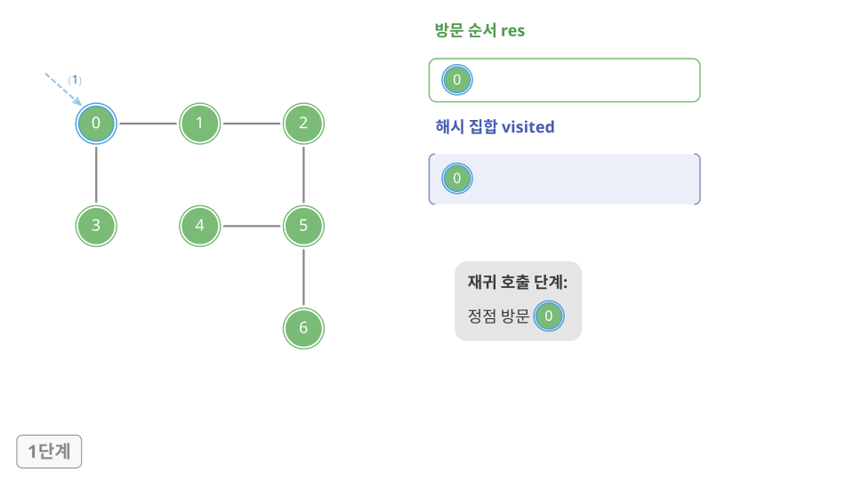{ class="animation-figure" }

=== "<2>"
    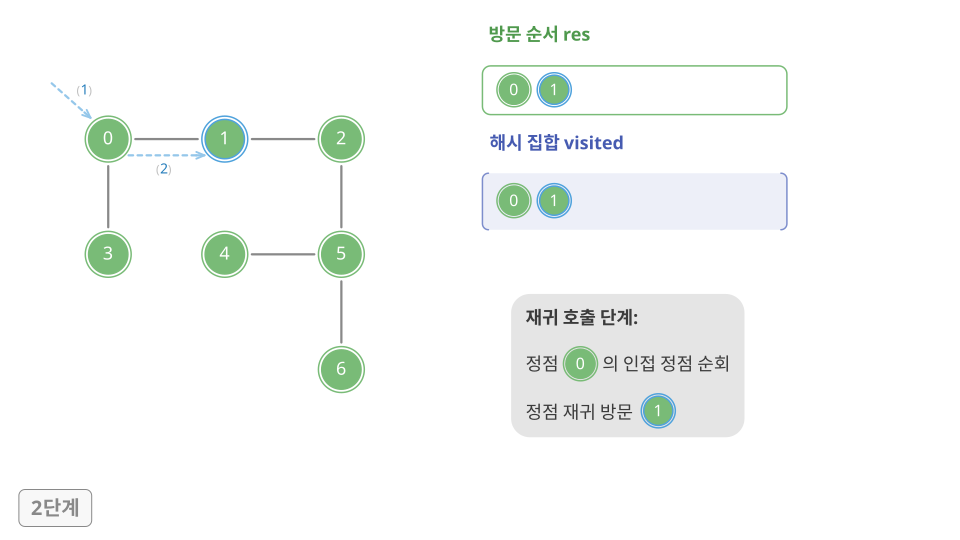{ class="animation-figure" }

=== "<3>"
    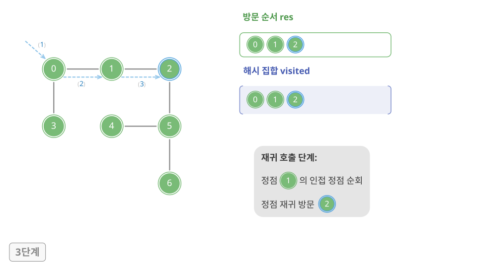{ class="animation-figure" }

=== "<4>"
    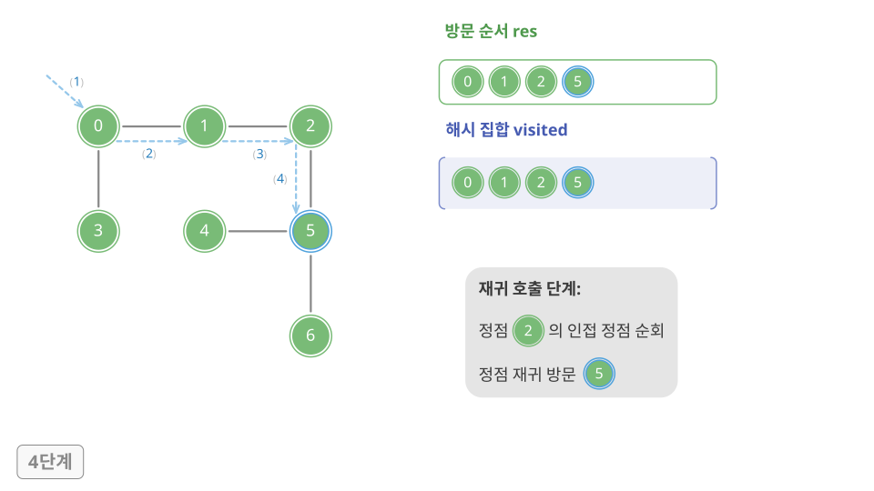{ class="animation-figure" }

=== "<5>"
    { class="animation-figure" }

=== "<6>"
    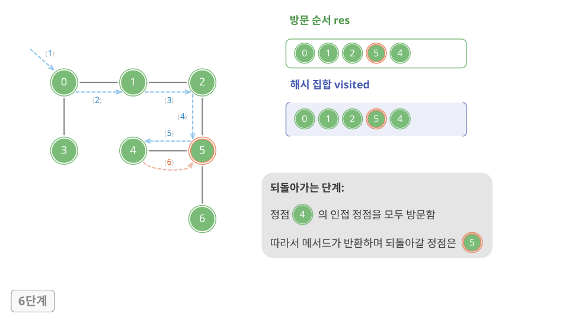{ class="animation-figure" }

=== "<7>"
    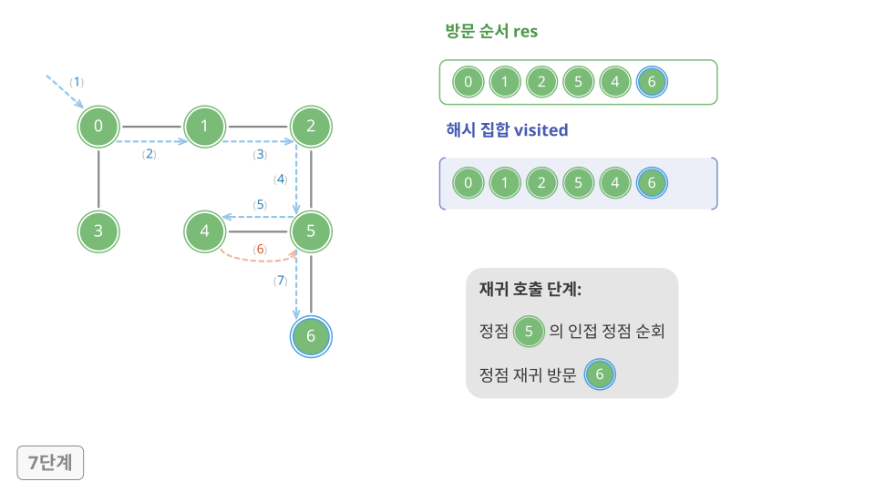{ class="animation-figure" }

=== "<8>"
    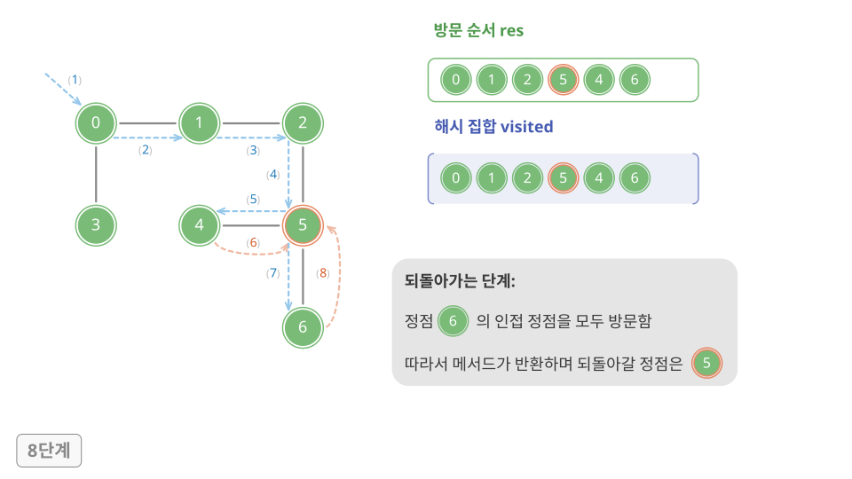{ class="animation-figure" }

=== "<9>"
    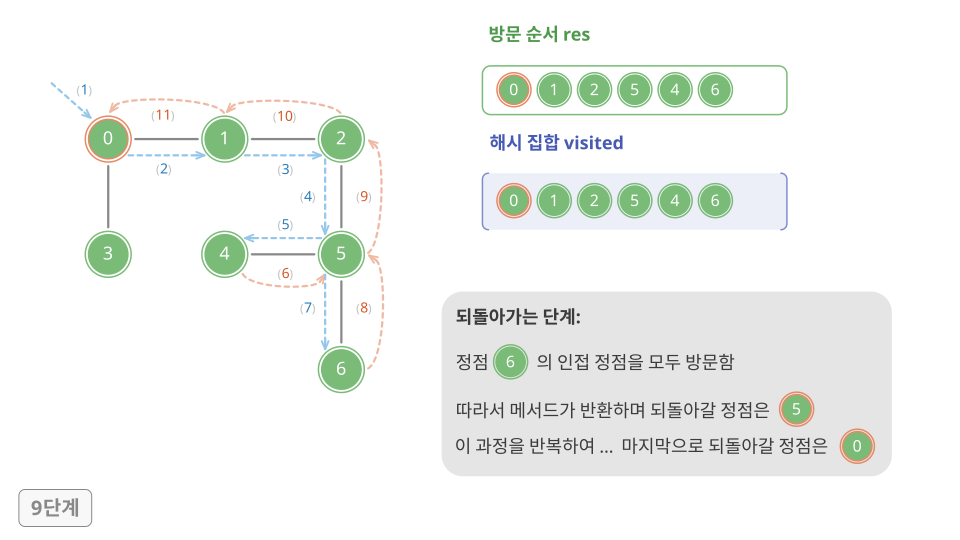{ class="animation-figure" }

=== "<10>"
    { class="animation-figure" }

=== "<11>"
    { class="animation-figure" }

<p align="center"> 그림 9-12 &nbsp; 그래프의 깊이 우선 순회 단계 </p>

!!! question "깊이 우선 순회의 방문 순서는 하나로 정해지는가?"

    너비 우선 순회와 마찬가지로 깊이 우선 순회의 방문 순서도 하나로 정해지지 않는다. 어느 정점에서든 어느 방향부터 탐색해도 된다. 인접 정점의 순서를 임의로 바꾸어도 깊이 우선 순회다.
    
    트리 순회를 예로 들면 ‘루트 $\rightarrow$ 왼쪽 $\rightarrow$ 오른쪽’, ‘왼쪽 $\rightarrow$ 루트 $\rightarrow$ 오른쪽’, ‘왼쪽 $\rightarrow$ 오른쪽 $\rightarrow$ 루트’는 각각 전위, 중위, 후위 순회에 해당한다. 방문 우선순위는 세 가지이지만 모두 깊이 우선 순회다.

### 2. &nbsp; 복잡도 분석

**시간 복잡도**: 각 정점을 $1$번씩 방문하는 데 $O(|V|)$ 시간이 걸리고 모든 간선을 $2$번씩 방문하는 데 $O(2|E|)$ 시간이 걸린다. 전체 시간은 $O(|V| + |E|)$이다.

**공간 복잡도**: 리스트 `res`와 해시 집합 `visited`에 들어가는 정점은 각각 최대 $|V|$개이고 최대 재귀 깊이는 $|V|$이므로 $O(|V|)$ 공간이 필요하다.
