# 그래프 순회

트리는 일대다 관계를 나타내지만, 그래프는 자유도가 더 높아 임의의 다대다 관계를 나타낼 수 있다. 따라서 트리를 그래프의 특수한 경우로 볼 수 있다. 당연히 **트리 순회도 그래프 순회의 특수한 경우다**.

그래프와 트리 모두 탐색 알고리즘으로 순회한다. 그래프 순회도 <u>너비 우선 순회</u>와 <u>깊이 우선 순회</u>로 나눌 수 있다.

## 너비 우선 순회

**너비 우선 순회는 한 노드에서 출발해 가까운 정점부터 방문하며 한 층씩 바깥으로 확장하는 순회 방식이다**. 아래 그림에서는 왼쪽 위 정점에서 출발해 그 정점의 인접 정점을 모두 방문한다. 이어서 다음 정점의 인접 정점을 방문하는 과정을 모든 정점을 방문할 때까지 반복한다.

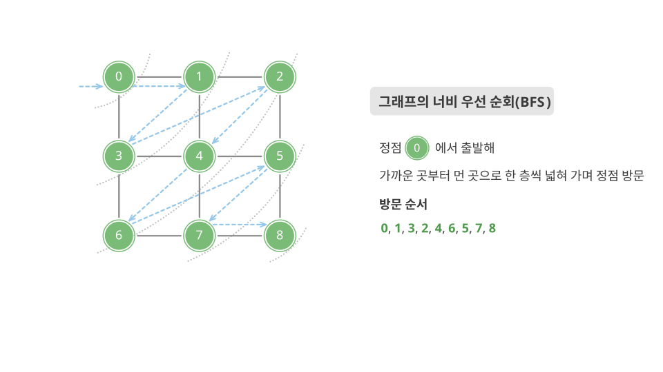

### 알고리즘 구현

아래 코드처럼 BFS는 보통 큐로 구현한다. 먼저 넣은 원소를 먼저 꺼내는 큐의 성질은 가까운 곳부터 먼 곳으로 이동하는 BFS의 순서와 잘 맞는다.

1. 순회를 시작할 정점 `startVet`를 큐에 넣고 반복을 시작한다.
2. 반복할 때마다 큐 맨 앞의 정점을 꺼내 방문을 기록한 뒤 그 정점의 인접 정점을 모두 큐의 뒤쪽에 넣는다.
3. 모든 정점을 방문할 때까지 `2.` 단계를 반복한 뒤 종료한다.

정점을 중복 방문하지 않도록 해시 집합 `visited`에 이미 방문한 정점을 기록한다.

!!! tip

    해시 집합은 `key`만 저장하고 `value`는 저장하지 않는 해시 테이블로 볼 수 있다. `key`의 추가, 삭제, 조회, 수정에 걸리는 시간은 $O(1)$이다. `key`가 중복되지 않는 성질 때문에 해시 집합은 데이터의 중복 제거 등에 자주 쓰인다.

```src
[file]{graph_bfs}-[class]{}-[func]{graph_bfs}
```

코드만으로 이해하기 어려우면 아래 그림과 함께 살펴보자.

=== "<1>"
    

=== "<2>"
    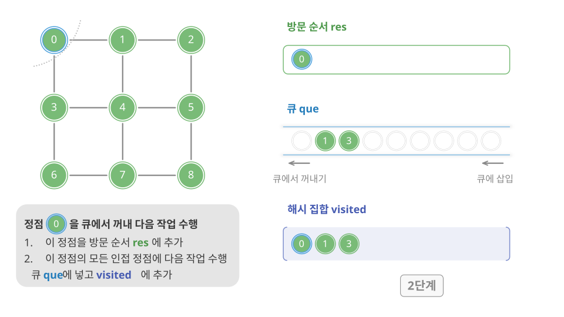

=== "<3>"
    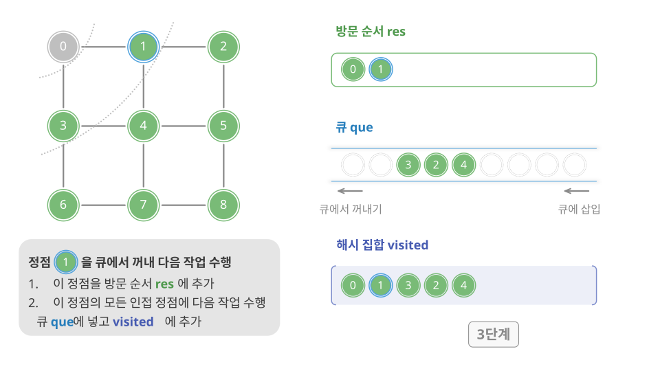

=== "<4>"
    

=== "<5>"
    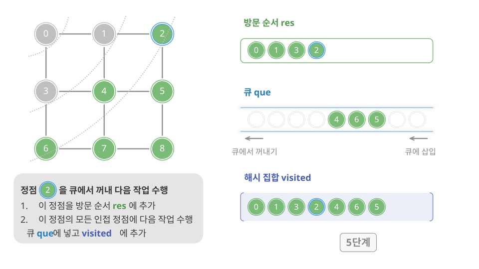

=== "<6>"
    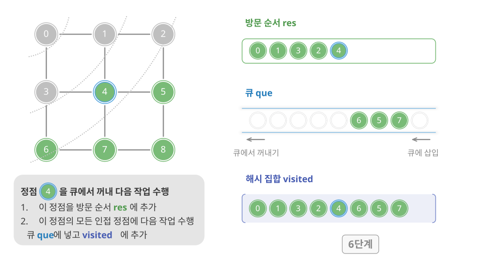

=== "<7>"
    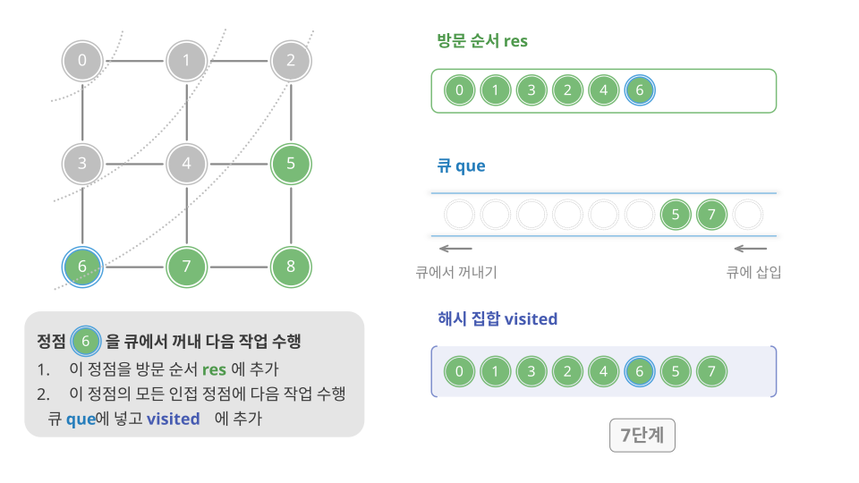

=== "<8>"
    

=== "<9>"
    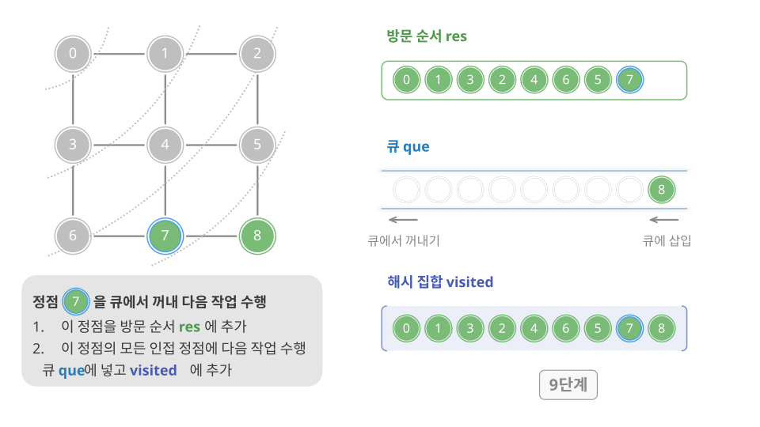

=== "<10>"
    

=== "<11>"
    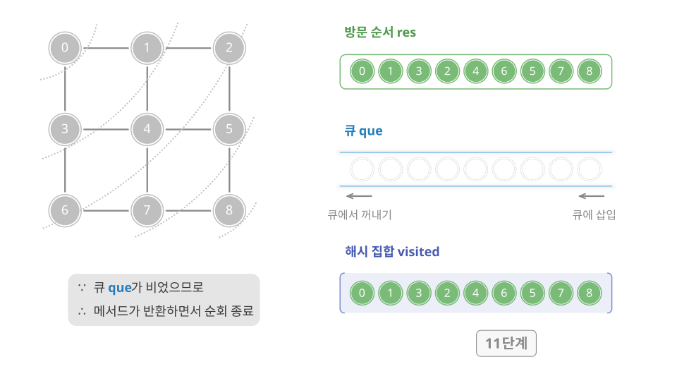

!!! question "너비 우선 순회의 방문 순서는 하나로 정해지는가?"

    그렇지 않다. 너비 우선 순회는 가까운 곳부터 방문하기만 하면 되므로 **거리가 같은 여러 정점은 어떤 순서로 방문해도 된다**. 위 그림에서 정점 $1$과 $3$의 방문 순서를 바꿔도 되고, 정점 $2$, $4$, $6$의 순서도 자유롭게 바꿀 수 있다.

### 복잡도 분석

**시간 복잡도**: 모든 정점이 한 번씩 큐에 들어갔다 나오므로 $O(|V|)$ 시간이 걸린다. 인접 정점을 순회할 때는 무방향 그래프의 각 간선을 $2$번씩 방문하므로 $O(2|E|)$ 시간이 걸린다. 전체 시간은 $O(|V| + |E|)$이다.

**공간 복잡도**: 리스트 `res`, 해시 집합 `visited`, 큐 `que`에 들어가는 정점은 각각 최대 $|V|$개이므로 $O(|V|)$ 공간이 필요하다.

## 깊이 우선 순회

**깊이 우선 순회는 한 방향으로 갈 수 있는 데까지 간 뒤 더 갈 곳이 없으면 되돌아오는 순회 방식이다**. 아래 그림에서는 왼쪽 위 정점에서 출발해 현재 정점의 인접 정점 하나로 이동하는 일을 반복한다. 막다른 곳에 이르면 되돌아와 다른 길을 따라 끝까지 갔다가 돌아온다. 모든 정점을 방문할 때까지 이 과정을 반복한다.


### 알고리즘 구현

이렇게 끝까지 갔다가 되돌아오는 알고리즘은 보통 재귀로 구현한다. 너비 우선 순회와 마찬가지로 깊이 우선 순회에서도 이미 방문한 정점을 해시 집합 `visited`에 기록해 중복 방문을 막는다.

```src
[file]{graph_dfs}-[class]{}-[func]{graph_dfs}
```

깊이 우선 순회의 진행 과정은 아래 그림과 같다.

- **곧은 점선은 아래로 내려가는 재귀 호출**을 나타낸다. 새 정점을 방문하기 위해 재귀 메서드를 새로 호출한다는 뜻이다.
- **굽은 점선은 위로 되돌아가는 과정**을 나타낸다. 현재 재귀 메서드가 반환하여 호출한 위치로 돌아간다는 뜻이다.

아래 그림과 코드를 함께 보며 전체 DFS 과정을 머릿속으로 따라가거나 종이에 그려 보자. 각 재귀 호출이 언제 시작되고 언제 반환하는지도 짚어 보자.

=== "<1>"
    

=== "<2>"
    

=== "<3>"
    

=== "<4>"
    

=== "<5>"
    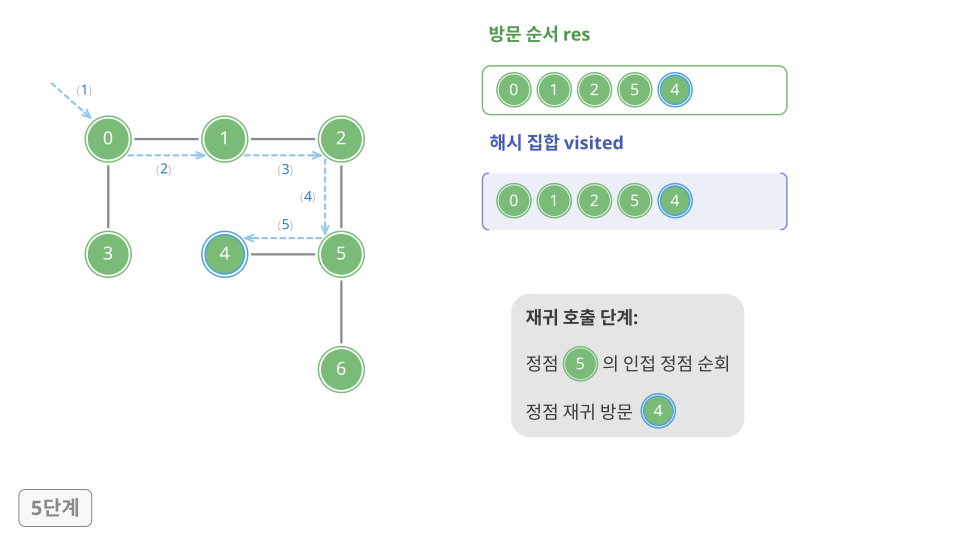

=== "<6>"
    

=== "<7>"
    

=== "<8>"
    

=== "<9>"
    

=== "<10>"
    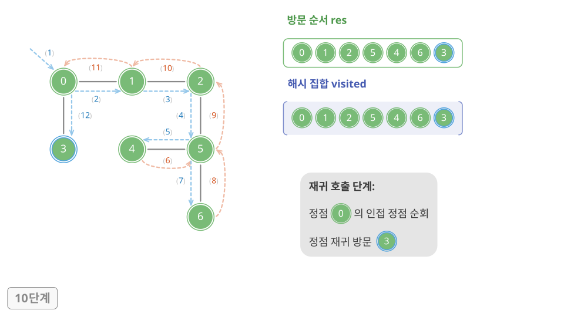

=== "<11>"
    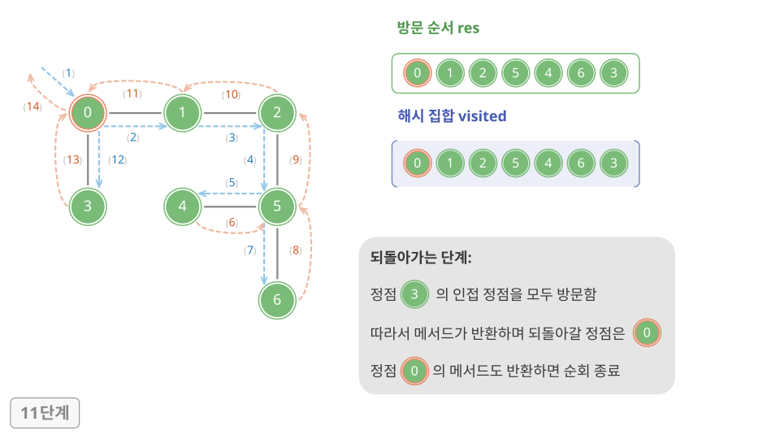

!!! question "깊이 우선 순회의 방문 순서는 하나로 정해지는가?"

    너비 우선 순회와 마찬가지로 깊이 우선 순회의 방문 순서도 하나로 정해지지 않는다. 어느 정점에서든 어느 방향부터 탐색해도 된다. 인접 정점의 순서를 임의로 바꾸어도 깊이 우선 순회다.
    
    트리 순회를 예로 들면 ‘루트 $\rightarrow$ 왼쪽 $\rightarrow$ 오른쪽’, ‘왼쪽 $\rightarrow$ 루트 $\rightarrow$ 오른쪽’, ‘왼쪽 $\rightarrow$ 오른쪽 $\rightarrow$ 루트’는 각각 전위, 중위, 후위 순회에 해당한다. 방문 우선순위는 세 가지이지만 모두 깊이 우선 순회다.

### 복잡도 분석

**시간 복잡도**: 각 정점을 $1$번씩 방문하는 데 $O(|V|)$ 시간이 걸리고 모든 간선을 $2$번씩 방문하는 데 $O(2|E|)$ 시간이 걸린다. 전체 시간은 $O(|V| + |E|)$이다.

**공간 복잡도**: 리스트 `res`와 해시 집합 `visited`에 들어가는 정점은 각각 최대 $|V|$개이고 최대 재귀 깊이는 $|V|$이므로 $O(|V|)$ 공간이 필요하다.
