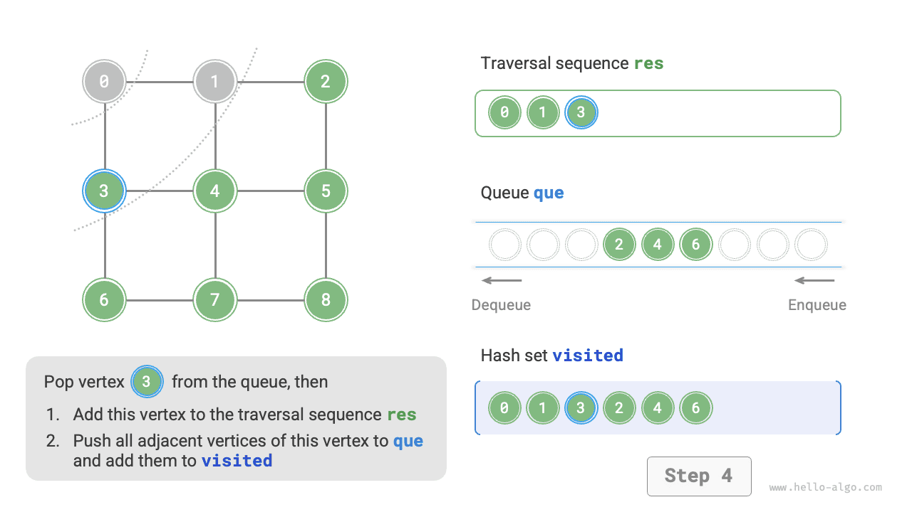
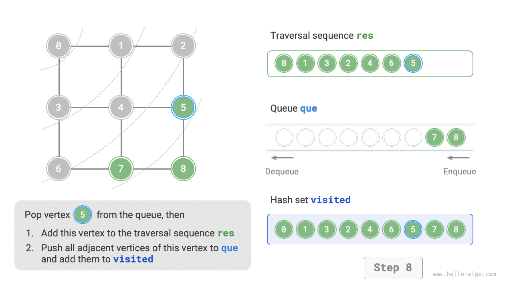
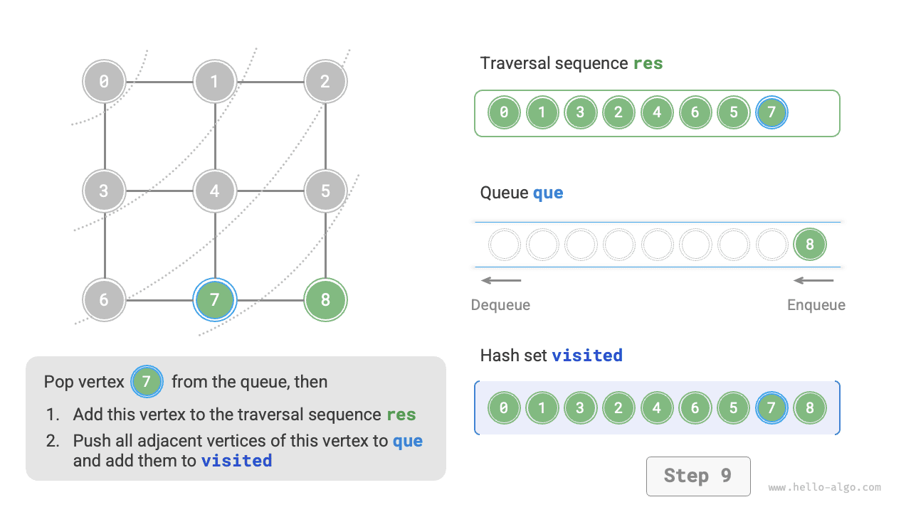
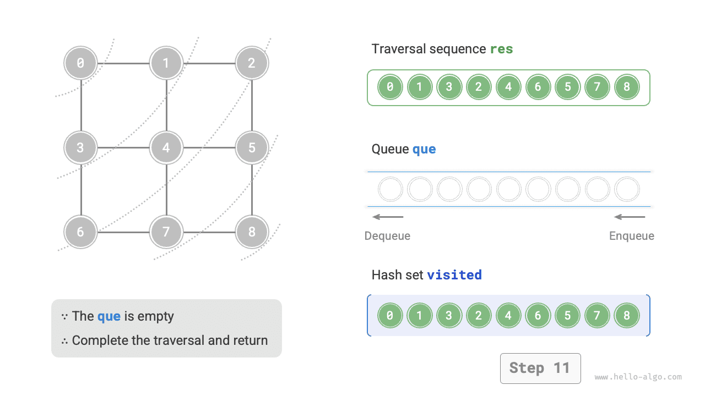
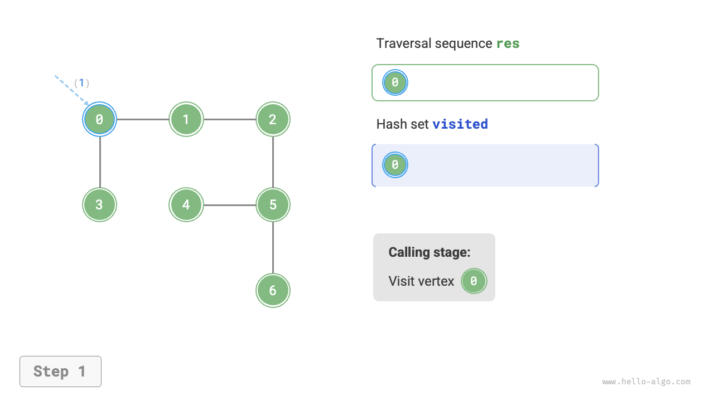
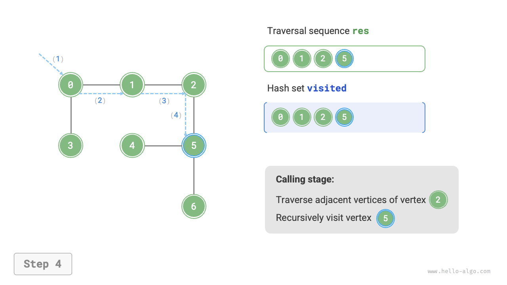
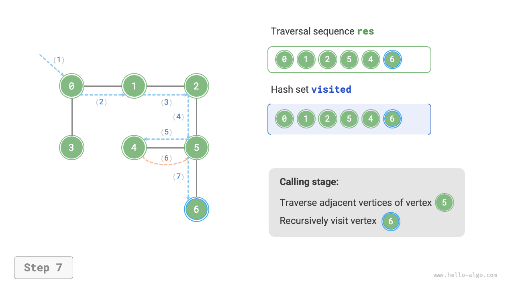
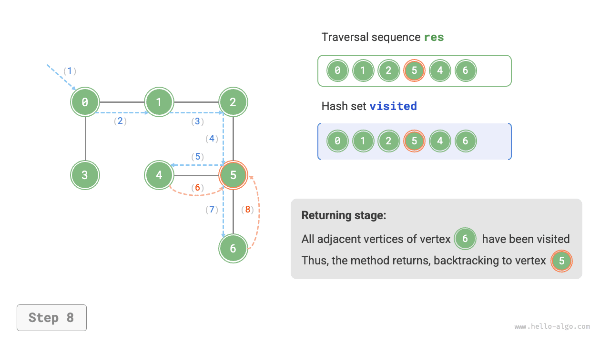

# 9.3 &nbsp; 그래프 순회

트리는 '일대다' 관계를 나타내지만, 그래프는 자유도가 더 높아 임의의 '다대다' 관계를 표현할 수 있다. 따라서 트리는 그래프의 특수한 경우로 볼 수 있다. **트리 순회 역시 그래프 순회의 특수한 경우다**.

그래프와 트리 모두 탐색 알고리즘을 이용하여 순회한다. 그래프 순회도 <u>너비 우선 순회</u>와 <u>깊이 우선 순회</u>의 두 가지로 나뉜다.

## 9.3.1 &nbsp; 너비 우선 순회

**너비 우선 순회는 가까운 곳에서 먼 곳으로 진행하는 순회 방식이다. 한 노드에서 출발하여 항상 거리가 가장 가까운 정점을 먼저 방문하고, 한 층씩 바깥으로 확장한다**. 아래 그림(9-9)에서는 왼쪽 위 정점에서 출발하여 해당 정점의 모든 인접 정점을 먼저 순회한 다음, 다음 정점의 모든 인접 정점을 순회한다. 이를 모든 정점을 방문할 때까지 반복한다.

{ class="animation-figure" }

<p align="center"> 그림 9-9 &nbsp; 그래프의 너비 우선 순회 </p>

### 1. &nbsp; 알고리즘 구현

BFS는 보통 큐로 구현하며, 코드는 다음과 같다. 큐의 '선입선출' 성질은 BFS의 '가까운 곳부터 먼 곳으로'라는 발상과 잘 맞는다.

1. 순회의 시작 정점 `startVet`를 큐에 넣고 반복문을 시작한다.
2. 매 반복에서 큐의 맨 앞 정점을 꺼내 방문을 기록한 다음, 해당 정점의 모든 인접 정점을 큐의 끝에 넣는다.
3. 모든 정점을 방문할 때까지 `2.` 단계를 반복한 뒤 종료한다.

같은 정점을 여러 번 순회하지 않도록 해시 집합 `visited`를 사용하여 방문한 노드를 기록한다.

!!! tip "참고"

    해시 집합은 `value` 없이 `key`만 저장하는 해시 테이블로 볼 수 있다. `key`의 추가, 삭제, 조회, 수정 연산을 $O(1)$ 시간에 수행한다. `key`는 중복될 수 없으므로, 해시 집합은 데이터 중복 제거 등에 자주 사용된다.

=== "Python"

    ```python title="graph_bfs.py"
    def graph_bfs(graph: GraphAdjList, start_vet: Vertex) -> list[Vertex]:
        """너비 우선 순회"""
        # 지정한 정점의 모든 인접 정점을 얻기 쉽도록 그래프를 인접 리스트로 표현한다
        # 정점 순회 순서
        res = []
        # 방문한 정점을 기록하는 해시 집합
        visited = set[Vertex]([start_vet])
        # 큐를 사용하여 BFS를 구현한다
        que = deque[Vertex]([start_vet])
        # 정점 vet에서 시작하여 모든 정점을 방문할 때까지 반복한다
        while len(que) > 0:
            vet = que.popleft()  # 큐 맨 앞의 정점을 꺼낸다
            res.append(vet)  # 방문한 정점을 기록한다
            # 해당 정점의 모든 인접 정점을 순회한다
            for adj_vet in graph.adj_list[vet]:
                if adj_vet in visited:
                    continue  # 이미 방문한 정점은 건너뛴다
                que.append(adj_vet)  # 방문하지 않은 정점만 큐에 삽입한다
                visited.add(adj_vet)  # 해당 정점을 방문했다고 표시한다
        # 정점 순회 순서를 반환한다
        return res
    ```

=== "C++"

    ```cpp title="graph_bfs.cpp"
    /* 너비 우선 순회 */
    // 지정한 정점의 모든 인접 정점을 얻기 쉽도록 그래프를 인접 리스트로 표현한다
    vector<Vertex *> graphBFS(GraphAdjList &graph, Vertex *startVet) {
        // 정점 순회 순서
        vector<Vertex *> res;
        // 방문한 정점을 기록하는 해시 집합
        unordered_set<Vertex *> visited = {startVet};
        // 큐를 사용하여 BFS를 구현한다
        queue<Vertex *> que;
        que.push(startVet);
        // 정점 vet에서 시작하여 모든 정점을 방문할 때까지 반복한다
        while (!que.empty()) {
            Vertex *vet = que.front();
            que.pop();          // 큐 맨 앞의 정점을 꺼낸다
            res.push_back(vet); // 방문한 정점을 기록한다
            // 해당 정점의 모든 인접 정점을 순회한다
            for (auto adjVet : graph.adjList[vet]) {
                if (visited.count(adjVet))
                    continue;            // 이미 방문한 정점은 건너뛴다
                que.push(adjVet);        // 방문하지 않은 정점만 큐에 삽입한다
                visited.emplace(adjVet); // 해당 정점을 방문했다고 표시한다
            }
        }
        // 정점 순회 순서를 반환한다
        return res;
    }
    ```

=== "Java"

    ```java title="graph_bfs.java"
    /* 너비 우선 순회 */
    // 지정한 정점의 모든 인접 정점을 얻기 쉽도록 그래프를 인접 리스트로 표현한다
    List<Vertex> graphBFS(GraphAdjList graph, Vertex startVet) {
        // 정점 순회 순서
        List<Vertex> res = new ArrayList<>();
        // 방문한 정점을 기록하는 해시 집합
        Set<Vertex> visited = new HashSet<>();
        visited.add(startVet);
        // 큐를 사용하여 BFS를 구현한다
        Queue<Vertex> que = new LinkedList<>();
        que.offer(startVet);
        // 정점 vet에서 시작하여 모든 정점을 방문할 때까지 반복한다
        while (!que.isEmpty()) {
            Vertex vet = que.poll(); // 큐 맨 앞의 정점을 꺼낸다
            res.add(vet);            // 방문한 정점을 기록한다
            // 해당 정점의 모든 인접 정점을 순회한다
            for (Vertex adjVet : graph.adjList.get(vet)) {
                if (visited.contains(adjVet))
                    continue;        // 이미 방문한 정점은 건너뛴다
                que.offer(adjVet);   // 방문하지 않은 정점만 큐에 삽입한다
                visited.add(adjVet); // 해당 정점을 방문했다고 표시한다
            }
        }
        // 정점 순회 순서를 반환한다
        return res;
    }
    ```

=== "C#"

    ```csharp title="graph_bfs.cs"
    /* 너비 우선 순회 */
    // 지정한 정점의 모든 인접 정점을 얻기 쉽도록 그래프를 인접 리스트로 표현한다
    List<Vertex> GraphBFS(GraphAdjList graph, Vertex startVet) {
        // 정점 순회 순서
        List<Vertex> res = [];
        // 방문한 정점을 기록하는 해시 집합
        HashSet<Vertex> visited = [startVet];
        // 큐를 사용하여 BFS를 구현한다
        Queue<Vertex> que = new();
        que.Enqueue(startVet);
        // 정점 vet에서 시작하여 모든 정점을 방문할 때까지 반복한다
        while (que.Count > 0) {
            Vertex vet = que.Dequeue(); // 큐 맨 앞의 정점을 꺼낸다
            res.Add(vet);               // 방문한 정점을 기록한다
            foreach (Vertex adjVet in graph.adjList[vet]) {
                if (visited.Contains(adjVet)) {
                    continue;          // 이미 방문한 정점은 건너뛴다
                }
                que.Enqueue(adjVet);   // 방문하지 않은 정점만 큐에 삽입한다
                visited.Add(adjVet);   // 해당 정점을 방문했다고 표시한다
            }
        }

        // 정점 순회 순서를 반환한다
        return res;
    }
    ```

=== "Go"

    ```go title="graph_bfs.go"
    /* 너비 우선 순회 */
    // 지정한 정점의 모든 인접 정점을 얻기 쉽도록 그래프를 인접 리스트로 표현한다
    func graphBFS(g *graphAdjList, startVet Vertex) []Vertex {
        // 정점 순회 순서
        res := make([]Vertex, 0)
        // 방문한 정점을 기록하는 해시 집합
        visited := make(map[Vertex]struct{})
        visited[startVet] = struct{}{}
        // 큐로 BFS를 구현하며, 슬라이스로 큐를 구현한다
        queue := make([]Vertex, 0)
        queue = append(queue, startVet)
        // 정점 vet에서 시작하여 모든 정점을 방문할 때까지 반복한다
        for len(queue) > 0 {
            // 큐 맨 앞의 정점을 꺼낸다
            vet := queue[0]
            queue = queue[1:]
            // 방문한 정점을 기록한다
            res = append(res, vet)
            // 해당 정점의 모든 인접 정점을 순회한다
            for _, adjVet := range g.adjList[vet] {
                _, isExist := visited[adjVet]
                // 방문하지 않은 정점만 큐에 삽입한다
                if !isExist {
                    queue = append(queue, adjVet)
                    visited[adjVet] = struct{}{}
                }
            }
        }
        // 정점 순회 순서를 반환한다
        return res
    }
    ```

=== "Swift"

    ```swift title="graph_bfs.swift"
    /* 너비 우선 순회 */
    // 지정한 정점의 모든 인접 정점을 얻기 쉽도록 그래프를 인접 리스트로 표현한다
    func graphBFS(graph: GraphAdjList, startVet: Vertex) -> [Vertex] {
        // 정점 순회 순서
        var res: [Vertex] = []
        // 방문한 정점을 기록하는 해시 집합
        var visited: Set<Vertex> = [startVet]
        // 큐를 사용하여 BFS를 구현한다
        var que: [Vertex] = [startVet]
        // 정점 vet에서 시작하여 모든 정점을 방문할 때까지 반복한다
        while !que.isEmpty {
            let vet = que.removeFirst() // 큐 맨 앞의 정점을 꺼낸다
            res.append(vet) // 방문한 정점을 기록한다
            // 해당 정점의 모든 인접 정점을 순회한다
            for adjVet in graph.adjList[vet] ?? [] {
                if visited.contains(adjVet) {
                    continue // 이미 방문한 정점은 건너뛴다
                }
                que.append(adjVet) // 방문하지 않은 정점만 큐에 삽입한다
                visited.insert(adjVet) // 해당 정점을 방문했다고 표시한다
            }
        }
        // 정점 순회 순서를 반환한다
        return res
    }
    ```

=== "JS"

    ```javascript title="graph_bfs.js"
    /* 너비 우선 순회 */
    // 지정한 정점의 모든 인접 정점을 얻기 쉽도록 그래프를 인접 리스트로 표현한다
    function graphBFS(graph, startVet) {
        // 정점 순회 순서
        const res = [];
        // 방문한 정점을 기록하는 해시 집합
        const visited = new Set();
        visited.add(startVet);
        // 큐를 사용하여 BFS를 구현한다
        const que = [startVet];
        // 정점 vet에서 시작하여 모든 정점을 방문할 때까지 반복한다
        while (que.length) {
            const vet = que.shift(); // 큐 맨 앞의 정점을 꺼낸다
            res.push(vet); // 방문한 정점을 기록한다
            // 해당 정점의 모든 인접 정점을 순회한다
            for (const adjVet of graph.adjList.get(vet) ?? []) {
                if (visited.has(adjVet)) {
                    continue; // 이미 방문한 정점은 건너뛴다
                }
                que.push(adjVet); // 방문하지 않은 정점만 큐에 삽입한다
                visited.add(adjVet); // 해당 정점을 방문했다고 표시한다
            }
        }
        // 정점 순회 순서를 반환한다
        return res;
    }
    ```

=== "TS"

    ```typescript title="graph_bfs.ts"
    /* 너비 우선 순회 */
    // 지정한 정점의 모든 인접 정점을 얻기 쉽도록 그래프를 인접 리스트로 표현한다
    function graphBFS(graph: GraphAdjList, startVet: Vertex): Vertex[] {
        // 정점 순회 순서
        const res: Vertex[] = [];
        // 방문한 정점을 기록하는 해시 집합
        const visited: Set<Vertex> = new Set();
        visited.add(startVet);
        // 큐를 사용하여 BFS를 구현한다
        const que = [startVet];
        // 정점 vet에서 시작하여 모든 정점을 방문할 때까지 반복한다
        while (que.length) {
            const vet = que.shift(); // 큐 맨 앞의 정점을 꺼낸다
            res.push(vet); // 방문한 정점을 기록한다
            // 해당 정점의 모든 인접 정점을 순회한다
            for (const adjVet of graph.adjList.get(vet) ?? []) {
                if (visited.has(adjVet)) {
                    continue; // 이미 방문한 정점은 건너뛴다
                }
                que.push(adjVet); // 방문하지 않은 정점만 큐에 삽입한다
                visited.add(adjVet); // 해당 정점을 방문했다고 표시한다
            }
        }
        // 정점 순회 순서를 반환한다
        return res;
    }
    ```

=== "Dart"

    ```dart title="graph_bfs.dart"
    /* 너비 우선 순회 */
    List<Vertex> graphBFS(GraphAdjList graph, Vertex startVet) {
      // 지정한 정점의 모든 인접 정점을 얻기 쉽도록 그래프를 인접 리스트로 표현한다
      // 정점 순회 순서
      List<Vertex> res = [];
      // 방문한 정점을 기록하는 해시 집합
      Set<Vertex> visited = {};
      visited.add(startVet);
      // 큐를 사용하여 BFS를 구현한다
      Queue<Vertex> que = Queue();
      que.add(startVet);
      // 정점 vet에서 시작하여 모든 정점을 방문할 때까지 반복한다
      while (que.isNotEmpty) {
        Vertex vet = que.removeFirst(); // 큐 맨 앞의 정점을 꺼낸다
        res.add(vet); // 방문한 정점을 기록한다
        // 해당 정점의 모든 인접 정점을 순회한다
        for (Vertex adjVet in graph.adjList[vet]!) {
          if (visited.contains(adjVet)) {
            continue; // 이미 방문한 정점은 건너뛴다
          }
          que.add(adjVet); // 방문하지 않은 정점만 큐에 삽입한다
          visited.add(adjVet); // 해당 정점을 방문했다고 표시한다
        }
      }
      // 정점 순회 순서를 반환한다
      return res;
    }
    ```

=== "Rust"

    ```rust title="graph_bfs.rs"
    /* 너비 우선 순회 */
    // 지정한 정점의 모든 인접 정점을 얻기 쉽도록 그래프를 인접 리스트로 표현한다
    fn graph_bfs(graph: GraphAdjList, start_vet: Vertex) -> Vec<Vertex> {
        // 정점 순회 순서
        let mut res = vec![];
        // 방문한 정점을 기록하는 해시 집합
        let mut visited = HashSet::new();
        visited.insert(start_vet);
        // 큐를 사용하여 BFS를 구현한다
        let mut que = VecDeque::new();
        que.push_back(start_vet);
        // 정점 vet에서 시작하여 모든 정점을 방문할 때까지 반복한다
        while let Some(vet) = que.pop_front() {
            res.push(vet); // 방문한 정점을 기록한다

            // 해당 정점의 모든 인접 정점을 순회한다
            if let Some(adj_vets) = graph.adj_list.get(&vet) {
                for &adj_vet in adj_vets {
                    if visited.contains(&adj_vet) {
                        continue; // 이미 방문한 정점은 건너뛴다
                    }
                    que.push_back(adj_vet); // 방문하지 않은 정점만 큐에 삽입한다
                    visited.insert(adj_vet); // 해당 정점을 방문했다고 표시한다
                }
            }
        }
        // 정점 순회 순서를 반환한다
        res
    }
    ```

=== "C"

    ```c title="graph_bfs.c"
    /* 노드 큐 구조체 */
    typedef struct {
        Vertex *vertices[MAX_SIZE];
        int front, rear, size;
    } Queue;

    /* 생성자 */
    Queue *newQueue() {
        Queue *q = (Queue *)malloc(sizeof(Queue));
        q->front = q->rear = q->size = 0;
        return q;
    }

    /* 큐가 비어 있는지 판단 */
    int isEmpty(Queue *q) {
        return q->size == 0;
    }

    /* 큐 삽입 연산 */
    void enqueue(Queue *q, Vertex *vet) {
        q->vertices[q->rear] = vet;
        q->rear = (q->rear + 1) % MAX_SIZE;
        q->size++;
    }

    /* 큐에서 꺼내는 연산 */
    Vertex *dequeue(Queue *q) {
        Vertex *vet = q->vertices[q->front];
        q->front = (q->front + 1) % MAX_SIZE;
        q->size--;
        return vet;
    }

    /* 정점을 이미 방문했는지 확인 */
    int isVisited(Vertex **visited, int size, Vertex *vet) {
        // O(n) 시간에 순회하여 노드를 찾는다
        for (int i = 0; i < size; i++) {
            if (visited[i] == vet)
                return 1;
        }
        return 0;
    }

    /* 너비 우선 순회 */
    // 지정한 정점의 모든 인접 정점을 얻기 쉽도록 그래프를 인접 리스트로 표현한다
    void graphBFS(GraphAdjList *graph, Vertex *startVet, Vertex **res, int *resSize, Vertex **visited, int *visitedSize) {
        // 큐를 사용하여 BFS를 구현한다
        Queue *queue = newQueue();
        enqueue(queue, startVet);
        visited[(*visitedSize)++] = startVet;
        // 정점 vet에서 시작하여 모든 정점을 방문할 때까지 반복한다
        while (!isEmpty(queue)) {
            Vertex *vet = dequeue(queue); // 큐 맨 앞의 정점을 꺼낸다
            res[(*resSize)++] = vet;      // 방문한 정점을 기록한다
            // 해당 정점의 모든 인접 정점을 순회한다
            AdjListNode *node = findNode(graph, vet);
            while (node != NULL) {
                // 이미 방문한 정점은 건너뛴다
                if (!isVisited(visited, *visitedSize, node->vertex)) {
                    enqueue(queue, node->vertex);             // 방문하지 않은 정점만 큐에 삽입한다
                    visited[(*visitedSize)++] = node->vertex; // 해당 정점을 방문했다고 표시한다
                }
                node = node->next;
            }
        }
        // 메모리 해제
        free(queue);
    }
    ```

=== "Kotlin"

    ```kotlin title="graph_bfs.kt"
    /* 너비 우선 순회 */
    // 지정한 정점의 모든 인접 정점을 얻기 쉽도록 그래프를 인접 리스트로 표현한다
    fun graphBFS(graph: GraphAdjList, startVet: Vertex): MutableList<Vertex?> {
        // 정점 순회 순서
        val res = mutableListOf<Vertex?>()
        // 방문한 정점을 기록하는 해시 집합
        val visited = HashSet<Vertex>()
        visited.add(startVet)
        // 큐를 사용하여 BFS를 구현한다
        val que = LinkedList<Vertex>()
        que.offer(startVet)
        // 정점 vet에서 시작하여 모든 정점을 방문할 때까지 반복한다
        while (!que.isEmpty()) {
            val vet = que.poll() // 큐 맨 앞의 정점을 꺼낸다
            res.add(vet)         // 방문한 정점을 기록한다
            // 해당 정점의 모든 인접 정점을 순회한다
            for (adjVet in graph.adjList[vet]!!) {
                if (visited.contains(adjVet))
                    continue        // 이미 방문한 정점은 건너뛴다
                que.offer(adjVet)   // 방문하지 않은 정점만 큐에 삽입한다
                visited.add(adjVet) // 해당 정점을 방문했다고 표시한다
            }
        }
        // 정점 순회 순서를 반환한다
        return res
    }
    ```

=== "Ruby"

    ```ruby title="graph_bfs.rb"
    ### 너비 우선 순회 ###
    def graph_bfs(graph, start_vet)
      # 지정한 정점의 모든 인접 정점을 얻기 쉽도록 그래프를 인접 리스트로 표현한다
      # 정점 순회 순서
      res = []
      # 방문한 정점을 기록하는 해시 집합
      visited = Set.new([start_vet])
      # 큐를 사용하여 BFS를 구현한다
      que = [start_vet]
      # 정점 vet에서 시작하여 모든 정점을 방문할 때까지 반복한다
      while que.length > 0
        vet = que.shift # 큐 맨 앞의 정점을 꺼낸다
        res << vet # 방문한 정점을 기록한다
        # 해당 정점의 모든 인접 정점을 순회한다
        for adj_vet in graph.adj_list[vet]
          next if visited.include?(adj_vet) # 이미 방문한 정점은 건너뛴다
          que << adj_vet # 방문하지 않은 정점만 큐에 삽입한다
          visited.add(adj_vet) # 해당 정점을 방문했다고 표시한다
        end
      end
      # 정점 순회 순서를 반환한다
      res
    end
    ```

??? pythontutor "코드 시각화"

    <div style="height: 549px; width: 100%;"><iframe class="pythontutor-iframe" title="코드 시각화" src="https://pythontutor.com/iframe-embed.html#code=from%20collections%20import%20deque%0A%0Aclass%20Vertex%3A%0A%20%20%22%22%22%EC%A0%95%EC%A0%90%20%ED%81%B4%EB%9E%98%EC%8A%A4%22%22%22%0A%20%20def%20__init__%28self,%20val%3A%20int%29%3A%0A%20%20%20%20self.val%20%3D%20val%0A%0Adef%20vals_to_vets%28vals%3A%20list%5Bint%5D%29%20-%3E%20list%5B%22Vertex%22%5D%3A%0A%20%20%22%22%22%EA%B0%92%EC%9D%98%20%EB%A6%AC%EC%8A%A4%ED%8A%B8%20vals%EB%A5%BC%20%EC%9E%85%EB%A0%A5%EB%B0%9B%EC%95%84%20%EC%A0%95%EC%A0%90%20%EB%A6%AC%EC%8A%A4%ED%8A%B8%20vets%20%EB%B0%98%ED%99%98%22%22%22%0A%20%20return%20%5BVertex%28val%29%20for%20val%20in%20vals%5D%0A%0Aclass%20GraphAdjList%3A%0A%20%20%22%22%22%EC%9D%B8%EC%A0%91%20%EB%A6%AC%EC%8A%A4%ED%8A%B8%EB%A1%9C%20%EA%B5%AC%ED%98%84%ED%95%9C%20%EB%AC%B4%EB%B0%A9%ED%96%A5%20%EA%B7%B8%EB%9E%98%ED%94%84%20%ED%81%B4%EB%9E%98%EC%8A%A4%22%22%22%0A%0A%20%20def%20__init__%28self,%20edges%3A%20list%5Blist%5BVertex%5D%5D%29%3A%0A%20%20%20%20%22%22%22%EC%83%9D%EC%84%B1%EC%9E%90%22%22%22%0A%20%20%20%20self.adj_list%20%3D%20dict%5BVertex,%20list%5BVertex%5D%5D%28%29%0A%20%20%20%20for%20edge%20in%20edges%3A%0A%20%20%20%20%20%20self.add_vertex%28edge%5B0%5D%29%0A%20%20%20%20%20%20self.add_vertex%28edge%5B1%5D%29%0A%20%20%20%20%20%20self.add_edge%28edge%5B0%5D,%20edge%5B1%5D%29%0A%0A%20%20def%20add_edge%28self,%20vet1%3A%20Vertex,%20vet2%3A%20Vertex%29%3A%0A%20%20%20%20%22%22%22%EA%B0%84%EC%84%A0%20%EC%B6%94%EA%B0%80%22%22%22%0A%20%20%20%20if%20vet1%20not%20in%20self.adj_list%20or%20vet2%20not%20in%20self.adj_list%20or%20vet1%20%3D%3D%20vet2%3A%0A%20%20%20%20%20%20raise%20ValueError%28%29%0A%20%20%20%20self.adj_list%5Bvet1%5D.append%28vet2%29%0A%20%20%20%20self.adj_list%5Bvet2%5D.append%28vet1%29%0A%0A%20%20def%20add_vertex%28self,%20vet%3A%20Vertex%29%3A%0A%20%20%20%20%22%22%22%EC%A0%95%EC%A0%90%20%EC%B6%94%EA%B0%80%22%22%22%0A%20%20%20%20if%20vet%20in%20self.adj_list%3A%0A%20%20%20%20%20%20return%0A%20%20%20%20self.adj_list%5Bvet%5D%20%3D%20%5B%5D%0A%0A%0Adef%20graph_bfs%28graph%3A%20GraphAdjList,%20start_vet%3A%20Vertex%29%20-%3E%20list%5BVertex%5D%3A%0A%20%20%22%22%22%EB%84%88%EB%B9%84%20%EC%9A%B0%EC%84%A0%20%EC%88%9C%ED%9A%8C%22%22%22%0A%20%20%23%20%EC%A0%95%EC%A0%90%20%EC%88%9C%ED%9A%8C%20%EC%88%9C%EC%84%9C%0A%20%20res%20%3D%20%5B%5D%0A%20%20%23%20%EB%B0%A9%EB%AC%B8%ED%95%9C%20%EC%A0%95%EC%A0%90%EC%9D%84%20%EA%B8%B0%EB%A1%9D%ED%95%98%EB%8A%94%20%ED%95%B4%EC%8B%9C%20%ED%85%8C%EC%9D%B4%EB%B8%94%0A%20%20visited%20%3D%20set%5BVertex%5D%28%5Bstart_vet%5D%29%0A%20%20%23%20%ED%81%90%EB%A5%BC%20%EC%82%AC%EC%9A%A9%ED%95%98%EC%97%AC%20BFS%EB%A5%BC%20%EA%B5%AC%ED%98%84%ED%95%9C%EB%8B%A4%0A%20%20que%20%3D%20deque%5BVertex%5D%28%5Bstart_vet%5D%29%0A%20%20%23%20%EC%A0%95%EC%A0%90%20vet%EC%97%90%EC%84%9C%20%EC%8B%9C%EC%9E%91%ED%95%98%EC%97%AC%20%EB%AA%A8%EB%93%A0%20%EC%A0%95%EC%A0%90%EC%9D%84%20%EB%B0%A9%EB%AC%B8%ED%95%A0%20%EB%95%8C%EA%B9%8C%EC%A7%80%20%EB%B0%98%EB%B3%B5%ED%95%9C%EB%8B%A4%0A%20%20while%20len%28que%29%20%3E%200%3A%0A%20%20%20%20vet%20%3D%20que.popleft%28%29%20%20%23%20%ED%81%90%20%EB%A7%A8%20%EC%95%9E%EC%9D%98%20%EC%A0%95%EC%A0%90%EC%9D%84%20%EA%BA%BC%EB%82%B8%EB%8B%A4%0A%20%20%20%20res.append%28vet%29%20%20%23%20%EB%B0%A9%EB%AC%B8%ED%95%9C%20%EC%A0%95%EC%A0%90%EC%9D%84%20%EA%B8%B0%EB%A1%9D%ED%95%9C%EB%8B%A4%0A%20%20%20%20%23%20%ED%95%B4%EB%8B%B9%20%EC%A0%95%EC%A0%90%EC%9D%98%20%EB%AA%A8%EB%93%A0%20%EC%9D%B8%EC%A0%91%20%EC%A0%95%EC%A0%90%EC%9D%84%20%EC%88%9C%ED%9A%8C%ED%95%9C%EB%8B%A4%0A%20%20%20%20for%20adj_vet%20in%20graph.adj_list%5Bvet%5D%3A%0A%20%20%20%20%20%20if%20adj_vet%20in%20visited%3A%0A%20%20%20%20%20%20%20%20continue%20%20%23%20%EC%9D%B4%EB%AF%B8%20%EB%B0%A9%EB%AC%B8%ED%95%9C%20%EC%A0%95%EC%A0%90%EC%9D%80%20%EA%B1%B4%EB%84%88%EB%9B%B4%EB%8B%A4%0A%20%20%20%20%20%20que.append%28adj_vet%29%20%20%23%20%EB%B0%A9%EB%AC%B8%ED%95%98%EC%A7%80%20%EC%95%8A%EC%9D%80%20%EC%A0%95%EC%A0%90%EB%A7%8C%20%ED%81%90%EC%97%90%20%EC%82%BD%EC%9E%85%ED%95%9C%EB%8B%A4%0A%20%20%20%20%20%20visited.add%28adj_vet%29%20%20%23%20%ED%95%B4%EB%8B%B9%20%EC%A0%95%EC%A0%90%EC%9D%84%20%EB%B0%A9%EB%AC%B8%ED%96%88%EB%8B%A4%EA%B3%A0%20%ED%91%9C%EC%8B%9C%ED%95%9C%EB%8B%A4%0A%20%20%23%20%EC%A0%95%EC%A0%90%20%EC%88%9C%ED%9A%8C%20%EC%88%9C%EC%84%9C%EB%A5%BC%20%EB%B0%98%ED%99%98%ED%95%9C%EB%8B%A4%0A%20%20return%20res%0A%0A%22%22%22%EC%8B%A4%ED%96%89%20%EC%BD%94%EB%93%9C%22%22%22%0Aif%20__name__%20%3D%3D%20%22__main__%22%3A%0A%20%20%23%20%EB%AC%B4%EB%B0%A9%ED%96%A5%20%EA%B7%B8%EB%9E%98%ED%94%84%20%EC%B4%88%EA%B8%B0%ED%99%94%0A%20%20v%20%3D%20vals_to_vets%28%5B0,%201,%202,%203,%204%5D%29%0A%20%20edges%20%3D%20%5B%0A%20%20%20%20%5Bv%5B0%5D,%20v%5B1%5D%5D,%0A%20%20%20%20%5Bv%5B0%5D,%20v%5B3%5D%5D,%0A%20%20%20%20%5Bv%5B1%5D,%20v%5B2%5D%5D,%0A%20%20%20%20%5Bv%5B1%5D,%20v%5B4%5D%5D,%0A%20%20%20%20%5Bv%5B3%5D,%20v%5B4%5D%5D,%0A%20%20%5D%0A%20%20graph%20%3D%20GraphAdjList%28edges%29%0A%20%20del%20edges%0A%0A%20%20%23%20%EB%84%88%EB%B9%84%20%EC%9A%B0%EC%84%A0%20%EC%88%9C%ED%9A%8C%0A%20%20res%20%3D%20graph_bfs%28graph,%20v%5B0%5D%29&codeDivHeight=472&codeDivWidth=350&cumulative=false&curInstr=131&heapPrimitives=nevernest&origin=opt-frontend.js&py=311&rawInputLstJSON=%5B%5D&textReferences=false"> </iframe></div>
    <div style="margin-top: 5px;"><a href="https://pythontutor.com/iframe-embed.html#code=from%20collections%20import%20deque%0A%0Aclass%20Vertex%3A%0A%20%20%22%22%22%EC%A0%95%EC%A0%90%20%ED%81%B4%EB%9E%98%EC%8A%A4%22%22%22%0A%20%20def%20__init__%28self,%20val%3A%20int%29%3A%0A%20%20%20%20self.val%20%3D%20val%0A%0Adef%20vals_to_vets%28vals%3A%20list%5Bint%5D%29%20-%3E%20list%5B%22Vertex%22%5D%3A%0A%20%20%22%22%22%EA%B0%92%EC%9D%98%20%EB%A6%AC%EC%8A%A4%ED%8A%B8%20vals%EB%A5%BC%20%EC%9E%85%EB%A0%A5%EB%B0%9B%EC%95%84%20%EC%A0%95%EC%A0%90%20%EB%A6%AC%EC%8A%A4%ED%8A%B8%20vets%20%EB%B0%98%ED%99%98%22%22%22%0A%20%20return%20%5BVertex%28val%29%20for%20val%20in%20vals%5D%0A%0Aclass%20GraphAdjList%3A%0A%20%20%22%22%22%EC%9D%B8%EC%A0%91%20%EB%A6%AC%EC%8A%A4%ED%8A%B8%EB%A1%9C%20%EA%B5%AC%ED%98%84%ED%95%9C%20%EB%AC%B4%EB%B0%A9%ED%96%A5%20%EA%B7%B8%EB%9E%98%ED%94%84%20%ED%81%B4%EB%9E%98%EC%8A%A4%22%22%22%0A%0A%20%20def%20__init__%28self,%20edges%3A%20list%5Blist%5BVertex%5D%5D%29%3A%0A%20%20%20%20%22%22%22%EC%83%9D%EC%84%B1%EC%9E%90%22%22%22%0A%20%20%20%20self.adj_list%20%3D%20dict%5BVertex,%20list%5BVertex%5D%5D%28%29%0A%20%20%20%20for%20edge%20in%20edges%3A%0A%20%20%20%20%20%20self.add_vertex%28edge%5B0%5D%29%0A%20%20%20%20%20%20self.add_vertex%28edge%5B1%5D%29%0A%20%20%20%20%20%20self.add_edge%28edge%5B0%5D,%20edge%5B1%5D%29%0A%0A%20%20def%20add_edge%28self,%20vet1%3A%20Vertex,%20vet2%3A%20Vertex%29%3A%0A%20%20%20%20%22%22%22%EA%B0%84%EC%84%A0%20%EC%B6%94%EA%B0%80%22%22%22%0A%20%20%20%20if%20vet1%20not%20in%20self.adj_list%20or%20vet2%20not%20in%20self.adj_list%20or%20vet1%20%3D%3D%20vet2%3A%0A%20%20%20%20%20%20raise%20ValueError%28%29%0A%20%20%20%20self.adj_list%5Bvet1%5D.append%28vet2%29%0A%20%20%20%20self.adj_list%5Bvet2%5D.append%28vet1%29%0A%0A%20%20def%20add_vertex%28self,%20vet%3A%20Vertex%29%3A%0A%20%20%20%20%22%22%22%EC%A0%95%EC%A0%90%20%EC%B6%94%EA%B0%80%22%22%22%0A%20%20%20%20if%20vet%20in%20self.adj_list%3A%0A%20%20%20%20%20%20return%0A%20%20%20%20self.adj_list%5Bvet%5D%20%3D%20%5B%5D%0A%0A%0Adef%20graph_bfs%28graph%3A%20GraphAdjList,%20start_vet%3A%20Vertex%29%20-%3E%20list%5BVertex%5D%3A%0A%20%20%22%22%22%EB%84%88%EB%B9%84%20%EC%9A%B0%EC%84%A0%20%EC%88%9C%ED%9A%8C%22%22%22%0A%20%20%23%20%EC%A0%95%EC%A0%90%20%EC%88%9C%ED%9A%8C%20%EC%88%9C%EC%84%9C%0A%20%20res%20%3D%20%5B%5D%0A%20%20%23%20%EB%B0%A9%EB%AC%B8%ED%95%9C%20%EC%A0%95%EC%A0%90%EC%9D%84%20%EA%B8%B0%EB%A1%9D%ED%95%98%EB%8A%94%20%ED%95%B4%EC%8B%9C%20%ED%85%8C%EC%9D%B4%EB%B8%94%0A%20%20visited%20%3D%20set%5BVertex%5D%28%5Bstart_vet%5D%29%0A%20%20%23%20%ED%81%90%EB%A5%BC%20%EC%82%AC%EC%9A%A9%ED%95%98%EC%97%AC%20BFS%EB%A5%BC%20%EA%B5%AC%ED%98%84%ED%95%9C%EB%8B%A4%0A%20%20que%20%3D%20deque%5BVertex%5D%28%5Bstart_vet%5D%29%0A%20%20%23%20%EC%A0%95%EC%A0%90%20vet%EC%97%90%EC%84%9C%20%EC%8B%9C%EC%9E%91%ED%95%98%EC%97%AC%20%EB%AA%A8%EB%93%A0%20%EC%A0%95%EC%A0%90%EC%9D%84%20%EB%B0%A9%EB%AC%B8%ED%95%A0%20%EB%95%8C%EA%B9%8C%EC%A7%80%20%EB%B0%98%EB%B3%B5%ED%95%9C%EB%8B%A4%0A%20%20while%20len%28que%29%20%3E%200%3A%0A%20%20%20%20vet%20%3D%20que.popleft%28%29%20%20%23%20%ED%81%90%20%EB%A7%A8%20%EC%95%9E%EC%9D%98%20%EC%A0%95%EC%A0%90%EC%9D%84%20%EA%BA%BC%EB%82%B8%EB%8B%A4%0A%20%20%20%20res.append%28vet%29%20%20%23%20%EB%B0%A9%EB%AC%B8%ED%95%9C%20%EC%A0%95%EC%A0%90%EC%9D%84%20%EA%B8%B0%EB%A1%9D%ED%95%9C%EB%8B%A4%0A%20%20%20%20%23%20%ED%95%B4%EB%8B%B9%20%EC%A0%95%EC%A0%90%EC%9D%98%20%EB%AA%A8%EB%93%A0%20%EC%9D%B8%EC%A0%91%20%EC%A0%95%EC%A0%90%EC%9D%84%20%EC%88%9C%ED%9A%8C%ED%95%9C%EB%8B%A4%0A%20%20%20%20for%20adj_vet%20in%20graph.adj_list%5Bvet%5D%3A%0A%20%20%20%20%20%20if%20adj_vet%20in%20visited%3A%0A%20%20%20%20%20%20%20%20continue%20%20%23%20%EC%9D%B4%EB%AF%B8%20%EB%B0%A9%EB%AC%B8%ED%95%9C%20%EC%A0%95%EC%A0%90%EC%9D%80%20%EA%B1%B4%EB%84%88%EB%9B%B4%EB%8B%A4%0A%20%20%20%20%20%20que.append%28adj_vet%29%20%20%23%20%EB%B0%A9%EB%AC%B8%ED%95%98%EC%A7%80%20%EC%95%8A%EC%9D%80%20%EC%A0%95%EC%A0%90%EB%A7%8C%20%ED%81%90%EC%97%90%20%EC%82%BD%EC%9E%85%ED%95%9C%EB%8B%A4%0A%20%20%20%20%20%20visited.add%28adj_vet%29%20%20%23%20%ED%95%B4%EB%8B%B9%20%EC%A0%95%EC%A0%90%EC%9D%84%20%EB%B0%A9%EB%AC%B8%ED%96%88%EB%8B%A4%EA%B3%A0%20%ED%91%9C%EC%8B%9C%ED%95%9C%EB%8B%A4%0A%20%20%23%20%EC%A0%95%EC%A0%90%20%EC%88%9C%ED%9A%8C%20%EC%88%9C%EC%84%9C%EB%A5%BC%20%EB%B0%98%ED%99%98%ED%95%9C%EB%8B%A4%0A%20%20return%20res%0A%0A%22%22%22%EC%8B%A4%ED%96%89%20%EC%BD%94%EB%93%9C%22%22%22%0Aif%20__name__%20%3D%3D%20%22__main__%22%3A%0A%20%20%23%20%EB%AC%B4%EB%B0%A9%ED%96%A5%20%EA%B7%B8%EB%9E%98%ED%94%84%20%EC%B4%88%EA%B8%B0%ED%99%94%0A%20%20v%20%3D%20vals_to_vets%28%5B0,%201,%202,%203,%204%5D%29%0A%20%20edges%20%3D%20%5B%0A%20%20%20%20%5Bv%5B0%5D,%20v%5B1%5D%5D,%0A%20%20%20%20%5Bv%5B0%5D,%20v%5B3%5D%5D,%0A%20%20%20%20%5Bv%5B1%5D,%20v%5B2%5D%5D,%0A%20%20%20%20%5Bv%5B1%5D,%20v%5B4%5D%5D,%0A%20%20%20%20%5Bv%5B3%5D,%20v%5B4%5D%5D,%0A%20%20%5D%0A%20%20graph%20%3D%20GraphAdjList%28edges%29%0A%20%20del%20edges%0A%0A%20%20%23%20%EB%84%88%EB%B9%84%20%EC%9A%B0%EC%84%A0%20%EC%88%9C%ED%9A%8C%0A%20%20res%20%3D%20graph_bfs%28graph,%20v%5B0%5D%29&codeDivHeight=800&codeDivWidth=600&cumulative=false&curInstr=131&heapPrimitives=nevernest&origin=opt-frontend.js&py=311&rawInputLstJSON=%5B%5D&textReferences=false" target="_blank" rel="noopener noreferrer">전체 화면 ></a></div>

코드만으로는 추상적일 수 있으므로 아래 그림(9-10)과 함께 살펴보며 이해를 깊이 다져 보자.

=== "<1>"
    { class="animation-figure" }

=== "<2>"
    { class="animation-figure" }

=== "<3>"
    { class="animation-figure" }

=== "<4>"
    { class="animation-figure" }

=== "<5>"
    { class="animation-figure" }

=== "<6>"
    { class="animation-figure" }

=== "<7>"
    { class="animation-figure" }

=== "<8>"
    { class="animation-figure" }

=== "<9>"
    { class="animation-figure" }

=== "<10>"
    { class="animation-figure" }

=== "<11>"
    { class="animation-figure" }

<p align="center"> 그림 9-10 &nbsp; 그래프의 너비 우선 순회 단계 </p>

!!! question "너비 우선 순회 순서는 유일한가?"

    유일하지 않다. 너비 우선 순회는 '가까운 곳부터 먼 곳으로' 순회하기만 하면 되므로, **거리가 같은 여러 정점의 방문 순서는 자유롭게 바꿀 수 있다**. 위 그림(9-10)에서는 정점 $1$, $3$의 방문 순서를 바꿀 수 있고, 정점 $2$, $4$, $6$의 순서도 자유롭게 바꿀 수 있다.

### 2. &nbsp; 복잡도 분석

**시간 복잡도**: 모든 정점은 큐에 한 번 들어갔다가 한 번 나오므로 $O(|V|)$ 시간이 걸린다. 인접 정점을 순회할 때는 무방향 그래프이므로 모든 간선을 $2$ 번씩 방문하여 $O(2|E|)$ 시간이 걸린다. 전체 시간은 $O(|V| + |E|)$이다.

**공간 복잡도**: 리스트 `res`, 해시 집합 `visited`, 큐 `que`에 저장되는 정점 수는 각각 최대 $|V|$이므로 $O(|V|)$ 공간을 사용한다.

## 9.3.2 &nbsp; 깊이 우선 순회

**깊이 우선 순회는 먼저 끝까지 나아가고, 더 갈 곳이 없으면 되돌아오는 순회 방식이다**. 아래 그림(9-11)에서는 왼쪽 위 정점에서 출발하여 현재 정점의 인접 정점 하나를 방문한다. 끝에 도달하면 되돌아오고, 다시 끝까지 나아갔다가 돌아오는 과정을 모든 정점을 순회할 때까지 반복한다.

{ class="animation-figure" }

<p align="center"> 그림 9-11 &nbsp; 그래프의 깊이 우선 순회 </p>

### 1. &nbsp; 알고리즘 구현

'끝까지 갔다가 돌아오는' 알고리즘 패턴은 보통 재귀로 구현한다. 너비 우선 순회와 마찬가지로 깊이 우선 순회에서도 해시 집합 `visited`로 이미 방문한 정점을 기록하여 중복 방문을 방지한다.

=== "Python"

    ```python title="graph_dfs.py"
    def dfs(graph: GraphAdjList, visited: set[Vertex], res: list[Vertex], vet: Vertex):
        """깊이 우선 순회 보조 함수"""
        res.append(vet)  # 방문한 정점을 기록한다
        visited.add(vet)  # 해당 정점을 방문했다고 표시한다
        # 해당 정점의 모든 인접 정점을 순회한다
        for adjVet in graph.adj_list[vet]:
            if adjVet in visited:
                continue  # 이미 방문한 정점은 건너뛴다
            # 인접 정점을 재귀적으로 방문한다
            dfs(graph, visited, res, adjVet)

    def graph_dfs(graph: GraphAdjList, start_vet: Vertex) -> list[Vertex]:
        """깊이 우선 순회"""
        # 지정한 정점의 모든 인접 정점을 얻기 쉽도록 그래프를 인접 리스트로 표현한다
        # 정점 순회 순서
        res = []
        # 방문한 정점을 기록하는 해시 집합
        visited = set[Vertex]()
        dfs(graph, visited, res, start_vet)
        return res
    ```

=== "C++"

    ```cpp title="graph_dfs.cpp"
    /* 깊이 우선 순회 보조 함수 */
    void dfs(GraphAdjList &graph, unordered_set<Vertex *> &visited, vector<Vertex *> &res, Vertex *vet) {
        res.push_back(vet);   // 방문한 정점을 기록한다
        visited.emplace(vet); // 해당 정점을 방문했다고 표시한다
        // 해당 정점의 모든 인접 정점을 순회한다
        for (Vertex *adjVet : graph.adjList[vet]) {
            if (visited.count(adjVet))
                continue; // 이미 방문한 정점은 건너뛴다
            // 인접 정점을 재귀적으로 방문한다
            dfs(graph, visited, res, adjVet);
        }
    }

    /* 깊이 우선 순회 */
    // 지정한 정점의 모든 인접 정점을 얻기 쉽도록 그래프를 인접 리스트로 표현한다
    vector<Vertex *> graphDFS(GraphAdjList &graph, Vertex *startVet) {
        // 정점 순회 순서
        vector<Vertex *> res;
        // 방문한 정점을 기록하는 해시 집합
        unordered_set<Vertex *> visited;
        dfs(graph, visited, res, startVet);
        return res;
    }
    ```

=== "Java"

    ```java title="graph_dfs.java"
    /* 깊이 우선 순회 보조 함수 */
    void dfs(GraphAdjList graph, Set<Vertex> visited, List<Vertex> res, Vertex vet) {
        res.add(vet);     // 방문한 정점을 기록한다
        visited.add(vet); // 해당 정점을 방문했다고 표시한다
        // 해당 정점의 모든 인접 정점을 순회한다
        for (Vertex adjVet : graph.adjList.get(vet)) {
            if (visited.contains(adjVet))
                continue; // 이미 방문한 정점은 건너뛴다
            // 인접 정점을 재귀적으로 방문한다
            dfs(graph, visited, res, adjVet);
        }
    }

    /* 깊이 우선 순회 */
    // 지정한 정점의 모든 인접 정점을 얻기 쉽도록 그래프를 인접 리스트로 표현한다
    List<Vertex> graphDFS(GraphAdjList graph, Vertex startVet) {
        // 정점 순회 순서
        List<Vertex> res = new ArrayList<>();
        // 방문한 정점을 기록하는 해시 집합
        Set<Vertex> visited = new HashSet<>();
        dfs(graph, visited, res, startVet);
        return res;
    }
    ```

=== "C#"

    ```csharp title="graph_dfs.cs"
    /* 깊이 우선 순회 보조 함수 */
    void DFS(GraphAdjList graph, HashSet<Vertex> visited, List<Vertex> res, Vertex vet) {
        res.Add(vet);     // 방문한 정점을 기록한다
        visited.Add(vet); // 해당 정점을 방문했다고 표시한다
        // 해당 정점의 모든 인접 정점을 순회한다
        foreach (Vertex adjVet in graph.adjList[vet]) {
            if (visited.Contains(adjVet)) {
                continue; // 이미 방문한 정점은 건너뛴다                             
            }
            // 인접 정점을 재귀적으로 방문한다
            DFS(graph, visited, res, adjVet);
        }
    }

    /* 깊이 우선 순회 */
    // 지정한 정점의 모든 인접 정점을 얻기 쉽도록 그래프를 인접 리스트로 표현한다
    List<Vertex> GraphDFS(GraphAdjList graph, Vertex startVet) {
        // 정점 순회 순서
        List<Vertex> res = [];
        // 방문한 정점을 기록하는 해시 집합
        HashSet<Vertex> visited = [];
        DFS(graph, visited, res, startVet);
        return res;
    }
    ```

=== "Go"

    ```go title="graph_dfs.go"
    /* 깊이 우선 순회 보조 함수 */
    func dfs(g *graphAdjList, visited map[Vertex]struct{}, res *[]Vertex, vet Vertex) {
        // append 연산은 새 참조를 반환하므로 원래 참조에 새 슬라이스의 참조를 다시 대입해야 한다
        *res = append(*res, vet)
        visited[vet] = struct{}{}
        // 해당 정점의 모든 인접 정점을 순회한다
        for _, adjVet := range g.adjList[vet] {
            _, isExist := visited[adjVet]
            // 인접 정점을 재귀적으로 방문한다
            if !isExist {
                dfs(g, visited, res, adjVet)
            }
        }
    }

    /* 깊이 우선 순회 */
    // 지정한 정점의 모든 인접 정점을 얻기 쉽도록 그래프를 인접 리스트로 표현한다
    func graphDFS(g *graphAdjList, startVet Vertex) []Vertex {
        // 정점 순회 순서
        res := make([]Vertex, 0)
        // 방문한 정점을 기록하는 해시 집합
        visited := make(map[Vertex]struct{})
        dfs(g, visited, &res, startVet)
        // 정점 순회 순서를 반환한다
        return res
    }
    ```

=== "Swift"

    ```swift title="graph_dfs.swift"
    /* 깊이 우선 순회 보조 함수 */
    func dfs(graph: GraphAdjList, visited: inout Set<Vertex>, res: inout [Vertex], vet: Vertex) {
        res.append(vet) // 방문한 정점을 기록한다
        visited.insert(vet) // 해당 정점을 방문했다고 표시한다
        // 해당 정점의 모든 인접 정점을 순회한다
        for adjVet in graph.adjList[vet] ?? [] {
            if visited.contains(adjVet) {
                continue // 이미 방문한 정점은 건너뛴다
            }
            // 인접 정점을 재귀적으로 방문한다
            dfs(graph: graph, visited: &visited, res: &res, vet: adjVet)
        }
    }

    /* 깊이 우선 순회 */
    // 지정한 정점의 모든 인접 정점을 얻기 쉽도록 그래프를 인접 리스트로 표현한다
    func graphDFS(graph: GraphAdjList, startVet: Vertex) -> [Vertex] {
        // 정점 순회 순서
        var res: [Vertex] = []
        // 방문한 정점을 기록하는 해시 집합
        var visited: Set<Vertex> = []
        dfs(graph: graph, visited: &visited, res: &res, vet: startVet)
        return res
    }
    ```

=== "JS"

    ```javascript title="graph_dfs.js"
    /* 깊이 우선 순회 */
    // 지정한 정점의 모든 인접 정점을 얻기 쉽도록 그래프를 인접 리스트로 표현한다
    function dfs(graph, visited, res, vet) {
        res.push(vet); // 방문한 정점을 기록한다
        visited.add(vet); // 해당 정점을 방문했다고 표시한다
        // 해당 정점의 모든 인접 정점을 순회한다
        for (const adjVet of graph.adjList.get(vet)) {
            if (visited.has(adjVet)) {
                continue; // 이미 방문한 정점은 건너뛴다
            }
            // 인접 정점을 재귀적으로 방문한다
            dfs(graph, visited, res, adjVet);
        }
    }

    /* 깊이 우선 순회 */
    // 지정한 정점의 모든 인접 정점을 얻기 쉽도록 그래프를 인접 리스트로 표현한다
    function graphDFS(graph, startVet) {
        // 정점 순회 순서
        const res = [];
        // 방문한 정점을 기록하는 해시 집합
        const visited = new Set();
        dfs(graph, visited, res, startVet);
        return res;
    }
    ```

=== "TS"

    ```typescript title="graph_dfs.ts"
    /* 깊이 우선 순회 보조 함수 */
    function dfs(
        graph: GraphAdjList,
        visited: Set<Vertex>,
        res: Vertex[],
        vet: Vertex
    ): void {
        res.push(vet); // 방문한 정점을 기록한다
        visited.add(vet); // 해당 정점을 방문했다고 표시한다
        // 해당 정점의 모든 인접 정점을 순회한다
        for (const adjVet of graph.adjList.get(vet)) {
            if (visited.has(adjVet)) {
                continue; // 이미 방문한 정점은 건너뛴다
            }
            // 인접 정점을 재귀적으로 방문한다
            dfs(graph, visited, res, adjVet);
        }
    }

    /* 깊이 우선 순회 */
    // 지정한 정점의 모든 인접 정점을 얻기 쉽도록 그래프를 인접 리스트로 표현한다
    function graphDFS(graph: GraphAdjList, startVet: Vertex): Vertex[] {
        // 정점 순회 순서
        const res: Vertex[] = [];
        // 방문한 정점을 기록하는 해시 집합
        const visited: Set<Vertex> = new Set();
        dfs(graph, visited, res, startVet);
        return res;
    }
    ```

=== "Dart"

    ```dart title="graph_dfs.dart"
    /* 깊이 우선 순회 보조 함수 */
    void dfs(
      GraphAdjList graph,
      Set<Vertex> visited,
      List<Vertex> res,
      Vertex vet,
    ) {
      res.add(vet); // 방문한 정점을 기록한다
      visited.add(vet); // 해당 정점을 방문했다고 표시한다
      // 해당 정점의 모든 인접 정점을 순회한다
      for (Vertex adjVet in graph.adjList[vet]!) {
        if (visited.contains(adjVet)) {
          continue; // 이미 방문한 정점은 건너뛴다
        }
        // 인접 정점을 재귀적으로 방문한다
        dfs(graph, visited, res, adjVet);
      }
    }

    /* 깊이 우선 순회 */
    List<Vertex> graphDFS(GraphAdjList graph, Vertex startVet) {
      // 정점 순회 순서
      List<Vertex> res = [];
      // 방문한 정점을 기록하는 해시 집합
      Set<Vertex> visited = {};
      dfs(graph, visited, res, startVet);
      return res;
    }
    ```

=== "Rust"

    ```rust title="graph_dfs.rs"
    /* 깊이 우선 순회 보조 함수 */
    fn dfs(graph: &GraphAdjList, visited: &mut HashSet<Vertex>, res: &mut Vec<Vertex>, vet: Vertex) {
        res.push(vet); // 방문한 정점을 기록한다
        visited.insert(vet); // 해당 정점을 방문했다고 표시한다
                             // 해당 정점의 모든 인접 정점을 순회한다
        if let Some(adj_vets) = graph.adj_list.get(&vet) {
            for &adj_vet in adj_vets {
                if visited.contains(&adj_vet) {
                    continue; // 이미 방문한 정점은 건너뛴다
                }
                // 인접 정점을 재귀적으로 방문한다
                dfs(graph, visited, res, adj_vet);
            }
        }
    }

    /* 깊이 우선 순회 */
    // 지정한 정점의 모든 인접 정점을 얻기 쉽도록 그래프를 인접 리스트로 표현한다
    fn graph_dfs(graph: GraphAdjList, start_vet: Vertex) -> Vec<Vertex> {
        // 정점 순회 순서
        let mut res = vec![];
        // 방문한 정점을 기록하는 해시 집합
        let mut visited = HashSet::new();
        dfs(&graph, &mut visited, &mut res, start_vet);

        res
    }
    ```

=== "C"

    ```c title="graph_dfs.c"
    /* 정점을 이미 방문했는지 확인 */
    int isVisited(Vertex **res, int size, Vertex *vet) {
        // O(n) 시간에 순회하여 노드를 찾는다
        for (int i = 0; i < size; i++) {
            if (res[i] == vet) {
                return 1;
            }
        }
        return 0;
    }

    /* 깊이 우선 순회 보조 함수 */
    void dfs(GraphAdjList *graph, Vertex **res, int *resSize, Vertex *vet) {
        // 방문한 정점을 기록한다
        res[(*resSize)++] = vet;
        // 해당 정점의 모든 인접 정점을 순회한다
        AdjListNode *node = findNode(graph, vet);
        while (node != NULL) {
            // 이미 방문한 정점은 건너뛴다
            if (!isVisited(res, *resSize, node->vertex)) {
                // 인접 정점을 재귀적으로 방문한다
                dfs(graph, res, resSize, node->vertex);
            }
            node = node->next;
        }
    }

    /* 깊이 우선 순회 */
    // 지정한 정점의 모든 인접 정점을 얻기 쉽도록 그래프를 인접 리스트로 표현한다
    void graphDFS(GraphAdjList *graph, Vertex *startVet, Vertex **res, int *resSize) {
        dfs(graph, res, resSize, startVet);
    }
    ```

=== "Kotlin"

    ```kotlin title="graph_dfs.kt"
    /* 깊이 우선 순회 보조 함수 */
    fun dfs(
        graph: GraphAdjList,
        visited: MutableSet<Vertex?>,
        res: MutableList<Vertex?>,
        vet: Vertex?
    ) {
        res.add(vet)     // 방문한 정점을 기록한다
        visited.add(vet) // 해당 정점을 방문했다고 표시한다
        // 해당 정점의 모든 인접 정점을 순회한다
        for (adjVet in graph.adjList[vet]!!) {
            if (visited.contains(adjVet))
                continue  // 이미 방문한 정점은 건너뛴다
            // 인접 정점을 재귀적으로 방문한다
            dfs(graph, visited, res, adjVet)
        }
    }

    /* 깊이 우선 순회 */
    // 지정한 정점의 모든 인접 정점을 얻기 쉽도록 그래프를 인접 리스트로 표현한다
    fun graphDFS(graph: GraphAdjList, startVet: Vertex?): MutableList<Vertex?> {
        // 정점 순회 순서
        val res = mutableListOf<Vertex?>()
        // 방문한 정점을 기록하는 해시 집합
        val visited = HashSet<Vertex?>()
        dfs(graph, visited, res, startVet)
        return res
    }
    ```

=== "Ruby"

    ```ruby title="graph_dfs.rb"
    ### 깊이 우선 순회 보조 함수 ###
    def dfs(graph, visited, res, vet)
      res << vet # 방문한 정점을 기록한다
      visited.add(vet) # 해당 정점을 방문했다고 표시한다
      # 해당 정점의 모든 인접 정점을 순회한다
      for adj_vet in graph.adj_list[vet]
        next if visited.include?(adj_vet) # 이미 방문한 정점은 건너뛴다
        # 인접 정점을 재귀적으로 방문한다
        dfs(graph, visited, res, adj_vet)
      end
    end

    ### 깊이 우선 순회 ###
    def graph_dfs(graph, start_vet)
      # 지정한 정점의 모든 인접 정점을 얻기 쉽도록 그래프를 인접 리스트로 표현한다
      # 정점 순회 순서
      res = []
      # 방문한 정점을 기록하는 해시 집합
      visited = Set.new
      dfs(graph, visited, res, start_vet)
      res
    end
    ```

??? pythontutor "코드 시각화"

    <div style="height: 549px; width: 100%;"><iframe class="pythontutor-iframe" title="코드 시각화" src="https://pythontutor.com/iframe-embed.html#code=class%20Vertex%3A%0A%20%20%20%20%22%22%22%EC%A0%95%EC%A0%90%20%ED%81%B4%EB%9E%98%EC%8A%A4%22%22%22%0A%20%20%20%20def%20__init__%28self,%20val%3A%20int%29%3A%0A%20%20%20%20%20%20%20%20self.val%20%3D%20val%0A%0Adef%20vals_to_vets%28vals%3A%20list%5Bint%5D%29%20-%3E%20list%5B%22Vertex%22%5D%3A%0A%20%20%20%20%22%22%22%EA%B0%92%EC%9D%98%20%EB%A6%AC%EC%8A%A4%ED%8A%B8%20vals%EB%A5%BC%20%EC%9E%85%EB%A0%A5%EB%B0%9B%EC%95%84%20%EC%A0%95%EC%A0%90%20%EB%A6%AC%EC%8A%A4%ED%8A%B8%20vets%20%EB%B0%98%ED%99%98%22%22%22%0A%20%20%20%20return%20%5BVertex%28val%29%20for%20val%20in%20vals%5D%0A%0Aclass%20GraphAdjList%3A%0A%20%20%20%20%22%22%22%EC%9D%B8%EC%A0%91%20%EB%A6%AC%EC%8A%A4%ED%8A%B8%EB%A1%9C%20%EA%B5%AC%ED%98%84%ED%95%9C%20%EB%AC%B4%EB%B0%A9%ED%96%A5%20%EA%B7%B8%EB%9E%98%ED%94%84%20%ED%81%B4%EB%9E%98%EC%8A%A4%22%22%22%0A%0A%20%20%20%20def%20__init__%28self,%20edges%3A%20list%5Blist%5BVertex%5D%5D%29%3A%0A%20%20%20%20%20%20%20%20%22%22%22%EC%83%9D%EC%84%B1%EC%9E%90%22%22%22%0A%20%20%20%20%20%20%20%20self.adj_list%20%3D%20dict%5BVertex,%20list%5BVertex%5D%5D%28%29%0A%20%20%20%20%20%20%20%20for%20edge%20in%20edges%3A%0A%20%20%20%20%20%20%20%20%20%20%20%20self.add_vertex%28edge%5B0%5D%29%0A%20%20%20%20%20%20%20%20%20%20%20%20self.add_vertex%28edge%5B1%5D%29%0A%20%20%20%20%20%20%20%20%20%20%20%20self.add_edge%28edge%5B0%5D,%20edge%5B1%5D%29%0A%0A%20%20%20%20def%20add_edge%28self,%20vet1%3A%20Vertex,%20vet2%3A%20Vertex%29%3A%0A%20%20%20%20%20%20%20%20%22%22%22%EA%B0%84%EC%84%A0%20%EC%B6%94%EA%B0%80%22%22%22%0A%20%20%20%20%20%20%20%20if%20vet1%20not%20in%20self.adj_list%20or%20vet2%20not%20in%20self.adj_list%20or%20vet1%20%3D%3D%20vet2%3A%0A%20%20%20%20%20%20%20%20%20%20%20%20raise%20ValueError%28%29%0A%20%20%20%20%20%20%20%20self.adj_list%5Bvet1%5D.append%28vet2%29%0A%20%20%20%20%20%20%20%20self.adj_list%5Bvet2%5D.append%28vet1%29%0A%0A%20%20%20%20def%20add_vertex%28self,%20vet%3A%20Vertex%29%3A%0A%20%20%20%20%20%20%20%20%22%22%22%EC%A0%95%EC%A0%90%20%EC%B6%94%EA%B0%80%22%22%22%0A%20%20%20%20%20%20%20%20if%20vet%20in%20self.adj_list%3A%0A%20%20%20%20%20%20%20%20%20%20%20%20return%0A%20%20%20%20%20%20%20%20self.adj_list%5Bvet%5D%20%3D%20%5B%5D%0A%0A%0Adef%20dfs%28graph%3A%20GraphAdjList,%20visited%3A%20set%5BVertex%5D,%20res%3A%20list%5BVertex%5D,%20vet%3A%20Vertex%29%3A%0A%20%20%20%20%22%22%22%EA%B9%8A%EC%9D%B4%20%EC%9A%B0%EC%84%A0%20%EC%88%9C%ED%9A%8C%20%EB%B3%B4%EC%A1%B0%20%ED%95%A8%EC%88%98%22%22%22%0A%20%20%20%20res.append%28vet%29%20%20%23%20%EB%B0%A9%EB%AC%B8%ED%95%9C%20%EC%A0%95%EC%A0%90%EC%9D%84%20%EA%B8%B0%EB%A1%9D%ED%95%9C%EB%8B%A4%0A%20%20%20%20visited.add%28vet%29%20%20%23%20%ED%95%B4%EB%8B%B9%20%EC%A0%95%EC%A0%90%EC%9D%84%20%EB%B0%A9%EB%AC%B8%ED%96%88%EB%8B%A4%EA%B3%A0%20%ED%91%9C%EC%8B%9C%ED%95%9C%EB%8B%A4%0A%20%20%20%20%23%20%ED%95%B4%EB%8B%B9%20%EC%A0%95%EC%A0%90%EC%9D%98%20%EB%AA%A8%EB%93%A0%20%EC%9D%B8%EC%A0%91%20%EC%A0%95%EC%A0%90%EC%9D%84%20%EC%88%9C%ED%9A%8C%ED%95%9C%EB%8B%A4%0A%20%20%20%20for%20adjVet%20in%20graph.adj_list%5Bvet%5D%3A%0A%20%20%20%20%20%20%20%20if%20adjVet%20in%20visited%3A%0A%20%20%20%20%20%20%20%20%20%20%20%20continue%20%20%23%20%EC%9D%B4%EB%AF%B8%20%EB%B0%A9%EB%AC%B8%ED%95%9C%20%EC%A0%95%EC%A0%90%EC%9D%80%20%EA%B1%B4%EB%84%88%EB%9B%B4%EB%8B%A4%0A%20%20%20%20%20%20%20%20%23%20%EC%9D%B8%EC%A0%91%20%EC%A0%95%EC%A0%90%EC%9D%84%20%EC%9E%AC%EA%B7%80%EC%A0%81%EC%9C%BC%EB%A1%9C%20%EB%B0%A9%EB%AC%B8%ED%95%9C%EB%8B%A4%0A%20%20%20%20%20%20%20%20dfs%28graph,%20visited,%20res,%20adjVet%29%0A%0A%0Adef%20graph_dfs%28graph%3A%20GraphAdjList,%20start_vet%3A%20Vertex%29%20-%3E%20list%5BVertex%5D%3A%0A%20%20%20%20%22%22%22%EA%B9%8A%EC%9D%B4%20%EC%9A%B0%EC%84%A0%20%EC%88%9C%ED%9A%8C%22%22%22%0A%20%20%20%20%23%20%EC%A7%80%EC%A0%95%ED%95%9C%20%EC%A0%95%EC%A0%90%EC%9D%98%20%EB%AA%A8%EB%93%A0%20%EC%9D%B8%EC%A0%91%20%EC%A0%95%EC%A0%90%EC%9D%84%20%EC%96%BB%EA%B8%B0%20%EC%89%BD%EB%8F%84%EB%A1%9D%20%EA%B7%B8%EB%9E%98%ED%94%84%EB%A5%BC%20%EC%9D%B8%EC%A0%91%20%EB%A6%AC%EC%8A%A4%ED%8A%B8%EB%A1%9C%20%ED%91%9C%ED%98%84%ED%95%9C%EB%8B%A4%0A%20%20%20%20%23%20%EC%A0%95%EC%A0%90%20%EC%88%9C%ED%9A%8C%20%EC%88%9C%EC%84%9C%0A%20%20%20%20res%20%3D%20%5B%5D%0A%20%20%20%20%23%20%EB%B0%A9%EB%AC%B8%ED%95%9C%20%EC%A0%95%EC%A0%90%EC%9D%84%20%EA%B8%B0%EB%A1%9D%ED%95%98%EB%8A%94%20%ED%95%B4%EC%8B%9C%20%ED%85%8C%EC%9D%B4%EB%B8%94%0A%20%20%20%20visited%20%3D%20set%5BVertex%5D%28%29%0A%20%20%20%20dfs%28graph,%20visited,%20res,%20start_vet%29%0A%20%20%20%20return%20res%0A%0A%0A%22%22%22%EC%8B%A4%ED%96%89%20%EC%BD%94%EB%93%9C%22%22%22%0Aif%20__name__%20%3D%3D%20%22__main__%22%3A%0A%20%20%20%20%23%20%EB%AC%B4%EB%B0%A9%ED%96%A5%20%EA%B7%B8%EB%9E%98%ED%94%84%20%EC%B4%88%EA%B8%B0%ED%99%94%0A%20%20%20%20v%20%3D%20vals_to_vets%28%5B0,%201,%202,%203,%204%5D%29%0A%20%20%20%20edges%20%3D%20%5B%0A%20%20%20%20%20%20%20%20%5Bv%5B0%5D,%20v%5B1%5D%5D,%0A%20%20%20%20%20%20%20%20%5Bv%5B0%5D,%20v%5B3%5D%5D,%0A%20%20%20%20%20%20%20%20%5Bv%5B1%5D,%20v%5B2%5D%5D,%0A%20%20%20%20%20%20%20%20%5Bv%5B1%5D,%20v%5B4%5D%5D,%0A%20%20%20%20%20%20%20%20%5Bv%5B3%5D,%20v%5B4%5D%5D,%0A%20%20%20%20%5D%0A%20%20%20%20graph%20%3D%20GraphAdjList%28edges%29%0A%0A%20%20%20%20%23%20%EA%B9%8A%EC%9D%B4%20%EC%9A%B0%EC%84%A0%20%EC%88%9C%ED%9A%8C%0A%20%20%20%20res%20%3D%20graph_dfs%28graph,%20v%5B0%5D%29&codeDivHeight=472&codeDivWidth=350&cumulative=false&curInstr=130&heapPrimitives=nevernest&origin=opt-frontend.js&py=311&rawInputLstJSON=%5B%5D&textReferences=false"> </iframe></div>
    <div style="margin-top: 5px;"><a href="https://pythontutor.com/iframe-embed.html#code=class%20Vertex%3A%0A%20%20%20%20%22%22%22%EC%A0%95%EC%A0%90%20%ED%81%B4%EB%9E%98%EC%8A%A4%22%22%22%0A%20%20%20%20def%20__init__%28self,%20val%3A%20int%29%3A%0A%20%20%20%20%20%20%20%20self.val%20%3D%20val%0A%0Adef%20vals_to_vets%28vals%3A%20list%5Bint%5D%29%20-%3E%20list%5B%22Vertex%22%5D%3A%0A%20%20%20%20%22%22%22%EA%B0%92%EC%9D%98%20%EB%A6%AC%EC%8A%A4%ED%8A%B8%20vals%EB%A5%BC%20%EC%9E%85%EB%A0%A5%EB%B0%9B%EC%95%84%20%EC%A0%95%EC%A0%90%20%EB%A6%AC%EC%8A%A4%ED%8A%B8%20vets%20%EB%B0%98%ED%99%98%22%22%22%0A%20%20%20%20return%20%5BVertex%28val%29%20for%20val%20in%20vals%5D%0A%0Aclass%20GraphAdjList%3A%0A%20%20%20%20%22%22%22%EC%9D%B8%EC%A0%91%20%EB%A6%AC%EC%8A%A4%ED%8A%B8%EB%A1%9C%20%EA%B5%AC%ED%98%84%ED%95%9C%20%EB%AC%B4%EB%B0%A9%ED%96%A5%20%EA%B7%B8%EB%9E%98%ED%94%84%20%ED%81%B4%EB%9E%98%EC%8A%A4%22%22%22%0A%0A%20%20%20%20def%20__init__%28self,%20edges%3A%20list%5Blist%5BVertex%5D%5D%29%3A%0A%20%20%20%20%20%20%20%20%22%22%22%EC%83%9D%EC%84%B1%EC%9E%90%22%22%22%0A%20%20%20%20%20%20%20%20self.adj_list%20%3D%20dict%5BVertex,%20list%5BVertex%5D%5D%28%29%0A%20%20%20%20%20%20%20%20for%20edge%20in%20edges%3A%0A%20%20%20%20%20%20%20%20%20%20%20%20self.add_vertex%28edge%5B0%5D%29%0A%20%20%20%20%20%20%20%20%20%20%20%20self.add_vertex%28edge%5B1%5D%29%0A%20%20%20%20%20%20%20%20%20%20%20%20self.add_edge%28edge%5B0%5D,%20edge%5B1%5D%29%0A%0A%20%20%20%20def%20add_edge%28self,%20vet1%3A%20Vertex,%20vet2%3A%20Vertex%29%3A%0A%20%20%20%20%20%20%20%20%22%22%22%EA%B0%84%EC%84%A0%20%EC%B6%94%EA%B0%80%22%22%22%0A%20%20%20%20%20%20%20%20if%20vet1%20not%20in%20self.adj_list%20or%20vet2%20not%20in%20self.adj_list%20or%20vet1%20%3D%3D%20vet2%3A%0A%20%20%20%20%20%20%20%20%20%20%20%20raise%20ValueError%28%29%0A%20%20%20%20%20%20%20%20self.adj_list%5Bvet1%5D.append%28vet2%29%0A%20%20%20%20%20%20%20%20self.adj_list%5Bvet2%5D.append%28vet1%29%0A%0A%20%20%20%20def%20add_vertex%28self,%20vet%3A%20Vertex%29%3A%0A%20%20%20%20%20%20%20%20%22%22%22%EC%A0%95%EC%A0%90%20%EC%B6%94%EA%B0%80%22%22%22%0A%20%20%20%20%20%20%20%20if%20vet%20in%20self.adj_list%3A%0A%20%20%20%20%20%20%20%20%20%20%20%20return%0A%20%20%20%20%20%20%20%20self.adj_list%5Bvet%5D%20%3D%20%5B%5D%0A%0A%0Adef%20dfs%28graph%3A%20GraphAdjList,%20visited%3A%20set%5BVertex%5D,%20res%3A%20list%5BVertex%5D,%20vet%3A%20Vertex%29%3A%0A%20%20%20%20%22%22%22%EA%B9%8A%EC%9D%B4%20%EC%9A%B0%EC%84%A0%20%EC%88%9C%ED%9A%8C%20%EB%B3%B4%EC%A1%B0%20%ED%95%A8%EC%88%98%22%22%22%0A%20%20%20%20res.append%28vet%29%20%20%23%20%EB%B0%A9%EB%AC%B8%ED%95%9C%20%EC%A0%95%EC%A0%90%EC%9D%84%20%EA%B8%B0%EB%A1%9D%ED%95%9C%EB%8B%A4%0A%20%20%20%20visited.add%28vet%29%20%20%23%20%ED%95%B4%EB%8B%B9%20%EC%A0%95%EC%A0%90%EC%9D%84%20%EB%B0%A9%EB%AC%B8%ED%96%88%EB%8B%A4%EA%B3%A0%20%ED%91%9C%EC%8B%9C%ED%95%9C%EB%8B%A4%0A%20%20%20%20%23%20%ED%95%B4%EB%8B%B9%20%EC%A0%95%EC%A0%90%EC%9D%98%20%EB%AA%A8%EB%93%A0%20%EC%9D%B8%EC%A0%91%20%EC%A0%95%EC%A0%90%EC%9D%84%20%EC%88%9C%ED%9A%8C%ED%95%9C%EB%8B%A4%0A%20%20%20%20for%20adjVet%20in%20graph.adj_list%5Bvet%5D%3A%0A%20%20%20%20%20%20%20%20if%20adjVet%20in%20visited%3A%0A%20%20%20%20%20%20%20%20%20%20%20%20continue%20%20%23%20%EC%9D%B4%EB%AF%B8%20%EB%B0%A9%EB%AC%B8%ED%95%9C%20%EC%A0%95%EC%A0%90%EC%9D%80%20%EA%B1%B4%EB%84%88%EB%9B%B4%EB%8B%A4%0A%20%20%20%20%20%20%20%20%23%20%EC%9D%B8%EC%A0%91%20%EC%A0%95%EC%A0%90%EC%9D%84%20%EC%9E%AC%EA%B7%80%EC%A0%81%EC%9C%BC%EB%A1%9C%20%EB%B0%A9%EB%AC%B8%ED%95%9C%EB%8B%A4%0A%20%20%20%20%20%20%20%20dfs%28graph,%20visited,%20res,%20adjVet%29%0A%0A%0Adef%20graph_dfs%28graph%3A%20GraphAdjList,%20start_vet%3A%20Vertex%29%20-%3E%20list%5BVertex%5D%3A%0A%20%20%20%20%22%22%22%EA%B9%8A%EC%9D%B4%20%EC%9A%B0%EC%84%A0%20%EC%88%9C%ED%9A%8C%22%22%22%0A%20%20%20%20%23%20%EC%A7%80%EC%A0%95%ED%95%9C%20%EC%A0%95%EC%A0%90%EC%9D%98%20%EB%AA%A8%EB%93%A0%20%EC%9D%B8%EC%A0%91%20%EC%A0%95%EC%A0%90%EC%9D%84%20%EC%96%BB%EA%B8%B0%20%EC%89%BD%EB%8F%84%EB%A1%9D%20%EA%B7%B8%EB%9E%98%ED%94%84%EB%A5%BC%20%EC%9D%B8%EC%A0%91%20%EB%A6%AC%EC%8A%A4%ED%8A%B8%EB%A1%9C%20%ED%91%9C%ED%98%84%ED%95%9C%EB%8B%A4%0A%20%20%20%20%23%20%EC%A0%95%EC%A0%90%20%EC%88%9C%ED%9A%8C%20%EC%88%9C%EC%84%9C%0A%20%20%20%20res%20%3D%20%5B%5D%0A%20%20%20%20%23%20%EB%B0%A9%EB%AC%B8%ED%95%9C%20%EC%A0%95%EC%A0%90%EC%9D%84%20%EA%B8%B0%EB%A1%9D%ED%95%98%EB%8A%94%20%ED%95%B4%EC%8B%9C%20%ED%85%8C%EC%9D%B4%EB%B8%94%0A%20%20%20%20visited%20%3D%20set%5BVertex%5D%28%29%0A%20%20%20%20dfs%28graph,%20visited,%20res,%20start_vet%29%0A%20%20%20%20return%20res%0A%0A%0A%22%22%22%EC%8B%A4%ED%96%89%20%EC%BD%94%EB%93%9C%22%22%22%0Aif%20__name__%20%3D%3D%20%22__main__%22%3A%0A%20%20%20%20%23%20%EB%AC%B4%EB%B0%A9%ED%96%A5%20%EA%B7%B8%EB%9E%98%ED%94%84%20%EC%B4%88%EA%B8%B0%ED%99%94%0A%20%20%20%20v%20%3D%20vals_to_vets%28%5B0,%201,%202,%203,%204%5D%29%0A%20%20%20%20edges%20%3D%20%5B%0A%20%20%20%20%20%20%20%20%5Bv%5B0%5D,%20v%5B1%5D%5D,%0A%20%20%20%20%20%20%20%20%5Bv%5B0%5D,%20v%5B3%5D%5D,%0A%20%20%20%20%20%20%20%20%5Bv%5B1%5D,%20v%5B2%5D%5D,%0A%20%20%20%20%20%20%20%20%5Bv%5B1%5D,%20v%5B4%5D%5D,%0A%20%20%20%20%20%20%20%20%5Bv%5B3%5D,%20v%5B4%5D%5D,%0A%20%20%20%20%5D%0A%20%20%20%20graph%20%3D%20GraphAdjList%28edges%29%0A%0A%20%20%20%20%23%20%EA%B9%8A%EC%9D%B4%20%EC%9A%B0%EC%84%A0%20%EC%88%9C%ED%9A%8C%0A%20%20%20%20res%20%3D%20graph_dfs%28graph,%20v%5B0%5D%29&codeDivHeight=800&codeDivWidth=600&cumulative=false&curInstr=130&heapPrimitives=nevernest&origin=opt-frontend.js&py=311&rawInputLstJSON=%5B%5D&textReferences=false" target="_blank" rel="noopener noreferrer">전체 화면 ></a></div>

깊이 우선 순회의 진행 과정은 아래 그림(9-12)과 같다.

- **직선 점선은 아래로 내려가는 재귀 호출을 나타내며**, 새 정점을 방문하기 위해 새로운 재귀 메서드를 호출했다는 뜻이다.
- **곡선 점선은 위로 되돌아가는 백트래킹을 나타내며**, 재귀 메서드가 반환되어 이를 호출한 위치로 돌아왔다는 뜻이다.

이해를 깊이 다지기 위해 아래 그림(9-12)과 코드를 함께 보면서, 각 재귀 메서드가 언제 호출되고 언제 반환되는지까지 포함하여 전체 DFS 과정을 머릿속으로 따라가 보자(또는 직접 그려 보자).

=== "<1>"
    { class="animation-figure" }

=== "<2>"
    { class="animation-figure" }

=== "<3>"
    { class="animation-figure" }

=== "<4>"
    { class="animation-figure" }

=== "<5>"
    { class="animation-figure" }

=== "<6>"
    { class="animation-figure" }

=== "<7>"
    { class="animation-figure" }

=== "<8>"
    { class="animation-figure" }

=== "<9>"
    { class="animation-figure" }

=== "<10>"
    { class="animation-figure" }

=== "<11>"
    { class="animation-figure" }

<p align="center"> 그림 9-12 &nbsp; 그래프의 깊이 우선 순회 단계 </p>

!!! question "깊이 우선 순회 순서는 유일한가?"

    너비 우선 순회와 마찬가지로 깊이 우선 순회 순서도 유일하지 않다. 한 정점에서 어느 방향을 먼저 탐색해도 되므로, 인접 정점의 순서를 자유롭게 바꾸어도 모두 깊이 우선 순회에 해당한다.
    
    트리 순회를 예로 들면 '루트 $\rightarrow$ 왼쪽 $\rightarrow$ 오른쪽', '왼쪽 $\rightarrow$ 루트 $\rightarrow$ 오른쪽', '왼쪽 $\rightarrow$ 오른쪽 $\rightarrow$ 루트'는 각각 전위, 중위, 후위 순회에 해당한다. 세 방식은 방문 우선순위가 다르지만 모두 깊이 우선 순회다.

### 2. &nbsp; 복잡도 분석

**시간 복잡도**: 모든 정점을 $1$ 번씩 방문하는 데 $O(|V|)$ 시간이 걸리고, 모든 간선을 $2$ 번씩 방문하는 데 $O(2|E|)$ 시간이 걸린다. 전체 시간은 $O(|V| + |E|)$이다.

**공간 복잡도**: 리스트 `res`와 해시 집합 `visited`의 정점 수는 각각 최대 $|V|$이고, 재귀 깊이도 최대 $|V|$이므로 $O(|V|)$ 공간을 사용한다.
