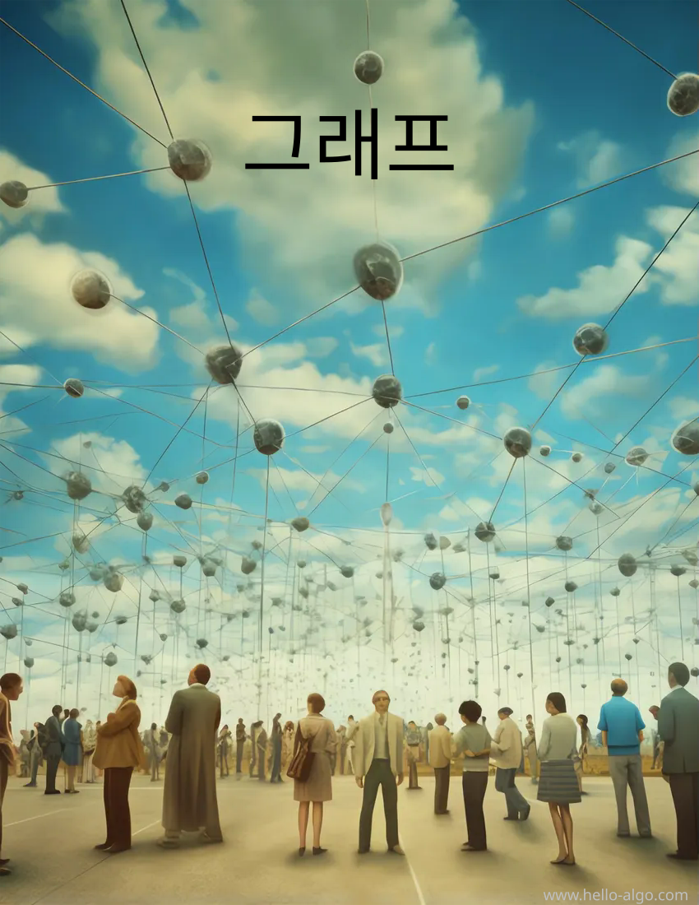

# 제 9 장 &nbsp; 그래프

{ class="cover-image" }

!!! abstract

    삶이라는 여정에서 우리는 저마다 하나의 노드가 되어 눈에 보이지 않는 수많은 간선으로 이어진다.
    
    만남과 헤어짐은 그때마다 이 거대한 연결망에 저마다의 흔적을 남긴다.

## 이 장의 내용

- [9.1 &nbsp; 그래프](graph.md)
- [9.2 &nbsp; 그래프의 기본 연산](graph_operations.md)
- [9.3 &nbsp; 그래프 순회](graph_traversal.md)
- [9.4 &nbsp; 요약](summary.md)
- [9.5 &nbsp; 연습 문제](exercises.md)
