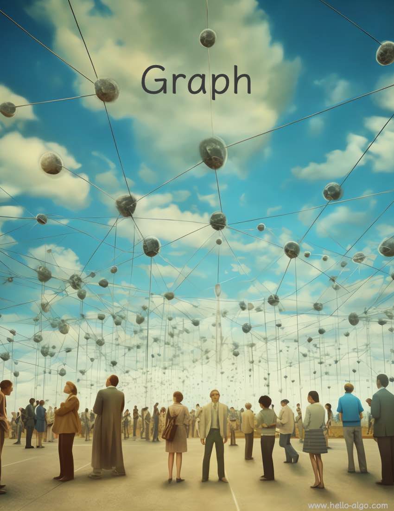

# 제 9 장 &nbsp; 그래프

{ class="cover-image" }

!!! abstract "이 장을 시작하며"

    삶이라는 여정에서 우리는 하나하나의 노드처럼, 보이지 않는 수많은 간선으로 연결되어 있다.
    
    만남과 헤어짐은 매번 이 거대한 네트워크 그래프에 저마다의 흔적을 남긴다.

## 이 장의 내용

- [9.1 &nbsp; 그래프](graph.md)
- [9.2 &nbsp; 그래프의 기본 연산](graph_operations.md)
- [9.3 &nbsp; 그래프 순회](graph_traversal.md)
- [9.4 &nbsp; 요약](summary.md)
- [9.5 &nbsp; 연습 문제](exercises.md)
