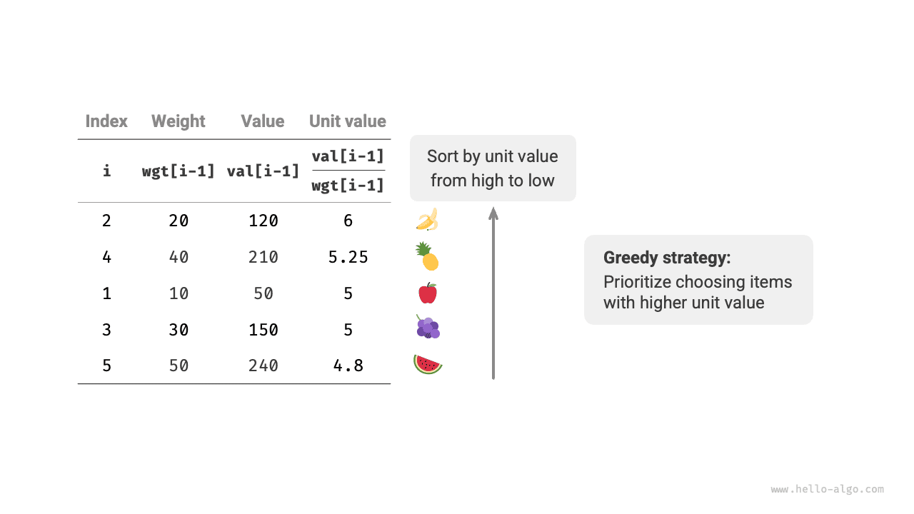

# 분할 가능한 배낭 문제

!!! question "문제"

    물건 $n$ 개와 용량이 $cap$인 배낭이 주어진다. $i$ 번째 물건의 무게는 $wgt[i-1]$, 가치는 $val[i-1]$이다. 각 물건은 한 번만 선택할 수 있지만, **일부만 선택할 수 있으며 가치는 선택한 무게의 비율에 따라 계산한다**. 용량 제한 안에서 배낭에 담을 수 있는 최대 가치를 구하라. 예시는 아래 그림과 같다.


분할 가능한 배낭 문제는 전체적으로 0-1 배낭 문제와 매우 비슷하다. 상태는 현재 물건 $i$와 용량 $c$를 포함하며, 목표는 용량 제한 안에서 최대 가치를 구하는 것이다.

차이점은 물건의 일부만 선택할 수 있다는 점이다. 아래 그림과 같이 **물건을 원하는 대로 나누고 무게 비율에 따라 그 가치를 계산할 수 있다**.

1. 물건 $i$의 단위 무게당 가치는 $val[i-1] / wgt[i-1]$이며, 줄여서 단위 가치라고 한다.
2. 물건 $i$의 일부를 무게 $w$만큼 넣으면 배낭의 가치는 $w \times val[i-1] / wgt[i-1]$만큼 늘어난다.


### 탐욕 전략 결정

배낭 안의 총가치를 최대화하는 것은 **본질적으로 단위 무게당 물건 가치를 최대화하는 것**이다. 여기서 아래 그림의 탐욕 전략을 도출할 수 있다.

1. 물건을 단위 가치가 높은 순서로 정렬한다.
2. 모든 물건을 순회하며 **매번 단위 가치가 가장 높은 물건을 탐욕적으로 선택한다**.
3. 남은 용량이 부족하면 현재 물건의 일부로 배낭을 가득 채운다.



### 코드 구현

단위 가치순으로 정렬하기 쉽도록 물건 클래스 `Item`을 만든다. 탐욕적 선택을 반복하다가 배낭이 가득 차면 반복문을 빠져나와 해를 반환한다.

```src
[file]{fractional_knapsack}-[class]{}-[func]{fractional_knapsack}
```

내장 정렬 알고리즘의 시간 복잡도는 보통 $O(n \log n)$이고, 공간 복잡도는 언어의 구체적인 구현에 따라 대체로 $O(\log n)$ 또는 $O(n)$이다.

정렬을 제외하면 최악의 경우 물건 리스트 전체를 순회해야 하므로 **시간 복잡도는 $O(n)$이다**. 여기서 $n$은 물건 수다.

`Item` 객체 리스트를 초기화하므로 **공간 복잡도는 $O(n)$이다**.

### 정확성 증명

귀류법을 사용하자. 물건 $x$의 단위 가치가 가장 높고, 어떤 알고리즘으로 구한 최대 가치가 `res`인데 그 해에 $x$가 없다고 가정한다.

배낭에서 임의의 물건을 단위 무게만큼 꺼내고 같은 무게의 물건 $x$로 바꾼다. $x$의 단위 가치가 가장 높으므로 바꾼 뒤의 총가치는 반드시 `res`보다 커진다. **이는 `res`가 최적해라는 가정에 모순이므로 최적해에는 물건 $x$가 포함되어야 한다**.

그 해의 다른 물건에도 같은 모순을 구성할 수 있다. 즉, **단위 가치가 더 높은 물건이 항상 더 좋은 선택**이며, 탐욕 전략이 유효함을 알 수 있다.

아래 그림과 같이 물건 무게를 가로축, 단위 가치를 세로축으로 보면, 분할 가능한 배낭 문제는 '제한된 가로축 구간에서 최대 넓이를 구하는' 문제로 바뀐다. 이 비유는 탐욕 전략의 유효성을 기하학적으로 이해하는 데 도움이 된다.


