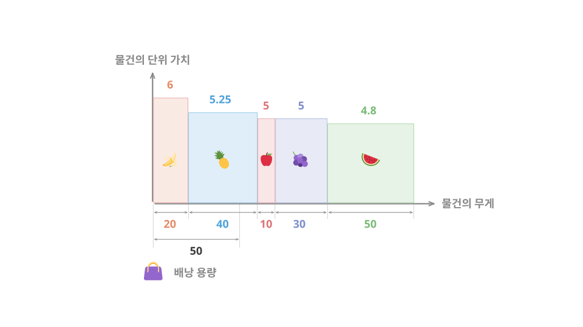

# 분할 가능 배낭 문제

!!! question

    물건 $n$개와 용량이 $cap$인 배낭이 주어진다. $i$번째 물건의 무게는 $wgt[i-1]$이고 가치는 $val[i-1]$이다. 각 물건은 한 번만 고를 수 있지만, **일부만 담을 수 있고 이때 가치는 담은 무게의 비율에 따라 계산한다**. 주어진 용량 안에서 배낭에 담은 물건의 최대 가치를 구하라. 아래 그림은 한 가지 예이다.


분할 가능 배낭 문제는 0-1 배낭 문제와 전반적으로 매우 비슷하다. 상태는 현재 물건 $i$와 용량 $c$로 나타내며, 주어진 배낭 용량 안에서 최대 가치를 구하는 것이 목표이다.

차이점은 이 문제에서는 물건의 일부만 골라도 된다는 것이다. 아래 그림처럼 **물건을 원하는 만큼 나누고 무게의 비율에 따라 그 부분의 가치를 계산할 수 있다**.

1. 물건 $i$의 단위 무게당 가치는 $val[i-1] / wgt[i-1]$이다. 이를 줄여서 단위 가치라고 한다.
2. 물건 $i$의 일부를 무게 $w$만큼 담으면 배낭 속 물건의 가치는 $w \times val[i-1] / wgt[i-1]$만큼 늘어난다.


### 탐욕 전략 정하기

배낭 속 물건의 총가치를 최대화하는 것은 **결국 단위 무게당 물건의 가치를 최대화하는 일이다**. 여기서 아래 그림의 탐욕 전략을 이끌어 낼 수 있다.

1. 단위 가치가 높은 순서로 물건을 정렬한다.
2. 모든 물건을 순회하면서 **매 단계에서 단위 가치가 가장 높은 물건을 고른다**.
3. 배낭의 남은 용량이 부족하면 현재 물건의 일부만 담아 배낭을 채운다.


### 코드 구현

물건을 단위 가치에 따라 정렬하기 위해 `Item` 클래스를 정의한다. 탐욕 선택을 반복하다가 배낭이 가득 차면 반복문을 빠져나와 결과를 반환한다.

```src
[file]{fractional_knapsack}-[class]{}-[func]{fractional_knapsack}
```

내장 정렬 알고리즘의 시간 복잡도는 보통 $O(n \log n)$이고, 공간 복잡도는 언어별 구현에 따라 대개 $O(\log n)$ 또는 $O(n)$이다.

정렬을 제외하면 최악의 경우 물건 리스트 전체를 순회해야 하므로 **시간 복잡도는 $O(n)$이다**. 여기서 $n$은 물건의 개수이다.

`Item` 객체의 리스트를 초기화하므로 **공간 복잡도는 $O(n)$이다**.

### 정당성 증명

귀류법을 사용한다. $x$가 단위 가치가 가장 높은 물건이고 어떤 알고리즘으로 구한 최대 가치가 `res`인데, 그 해에는 물건 $x$가 들어 있지 않다고 가정하자.

배낭에서 아무 물건이나 단위 무게만큼 꺼내고 그 자리에 물건 $x$를 같은 무게만큼 넣는다. 물건 $x$의 단위 가치가 가장 높으므로 교환한 뒤의 총가치는 반드시 `res`보다 크다. **이는 `res`가 최적해라는 가정에 모순된다. 따라서 최적해에는 반드시 물건 $x$가 들어 있어야 한다**.

그 해의 다른 물건에 대해서도 같은 방식으로 모순을 이끌어 낼 수 있다. 결국 **단위 가치가 더 높은 물건을 고르는 편이 항상 더 유리하므로** 이 탐욕 전략은 타당하다.

아래 그림처럼 2차원 그래프에서 가로축을 물건의 무게, 세로축을 물건의 단위 가치로 잡으면, 분할 가능 배낭 문제는 ‘한정된 가로 구간에서 얻을 수 있는 최대 넓이 구하기’로 바뀐다. 이 비유를 통해 탐욕 전략이 타당한 이유를 기하학적으로 이해할 수 있다.


