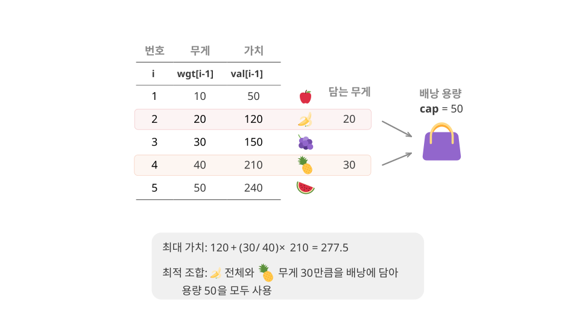
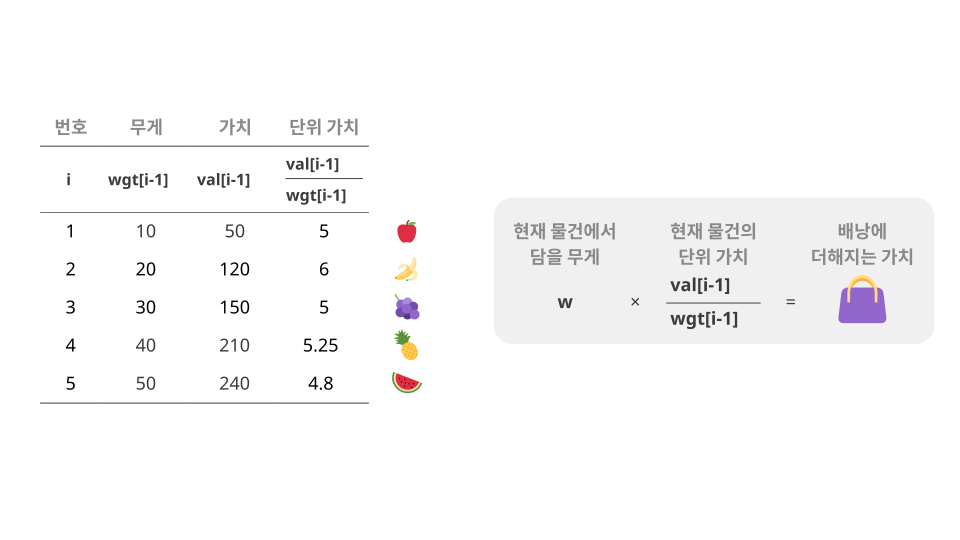
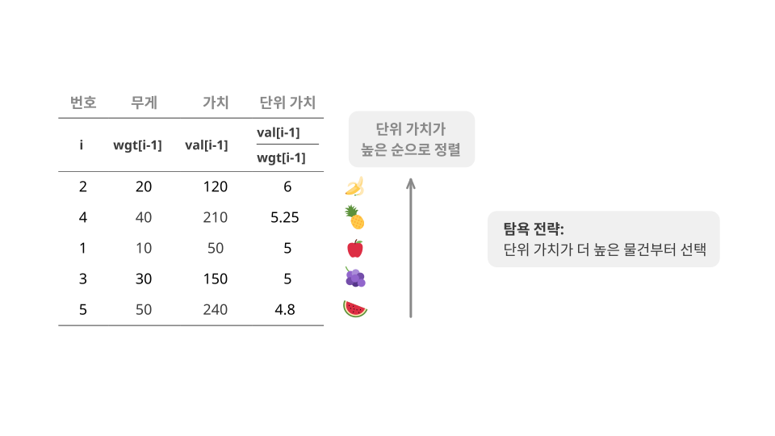

# 15.2 &nbsp; 분할 가능 배낭 문제

!!! question

    물건 $n$개와 용량이 $cap$인 배낭이 주어진다. $i$번째 물건의 무게는 $wgt[i-1]$이고 가치는 $val[i-1]$이다. 각 물건은 한 번만 고를 수 있지만, **일부만 담을 수 있고 이때 가치는 담은 무게의 비율에 따라 계산한다**. 주어진 용량 안에서 배낭에 담은 물건의 최대 가치를 구하라. 아래 그림(15-3)은 한 가지 예이다.

{ class="animation-figure" }

<p align="center"> 그림 15-3 &nbsp; 분할 가능 배낭 문제의 예시 데이터 </p>

분할 가능 배낭 문제는 0-1 배낭 문제와 전반적으로 매우 비슷하다. 상태는 현재 물건 $i$와 용량 $c$로 나타내며, 주어진 배낭 용량 안에서 최대 가치를 구하는 것이 목표이다.

차이점은 이 문제에서는 물건의 일부만 골라도 된다는 것이다. 아래 그림(15-4)처럼 **물건을 원하는 만큼 나누고 무게의 비율에 따라 그 부분의 가치를 계산할 수 있다**.

1. 물건 $i$의 단위 무게당 가치는 $val[i-1] / wgt[i-1]$이다. 이를 줄여서 단위 가치라고 한다.
2. 물건 $i$의 일부를 무게 $w$만큼 담으면 배낭 속 물건의 가치는 $w \times val[i-1] / wgt[i-1]$만큼 늘어난다.

{ class="animation-figure" }

<p align="center"> 그림 15-4 &nbsp; 물건의 단위 무게당 가치 </p>

### 1. &nbsp; 탐욕 전략 정하기

배낭 속 물건의 총가치를 최대화하는 것은 **결국 단위 무게당 물건의 가치를 최대화하는 일이다**. 여기서 아래 그림(15-5)의 탐욕 전략을 이끌어 낼 수 있다.

1. 단위 가치가 높은 순서로 물건을 정렬한다.
2. 모든 물건을 순회하면서 **매 단계에서 단위 가치가 가장 높은 물건을 고른다**.
3. 배낭의 남은 용량이 부족하면 현재 물건의 일부만 담아 배낭을 채운다.

{ class="animation-figure" }

<p align="center"> 그림 15-5 &nbsp; 분할 가능 배낭 문제의 탐욕 전략 </p>

### 2. &nbsp; 코드 구현

물건을 단위 가치에 따라 정렬하기 위해 `Item` 클래스를 정의한다. 탐욕 선택을 반복하다가 배낭이 가득 차면 반복문을 빠져나와 결과를 반환한다.

=== "Python"

    ```python title="fractional_knapsack.py"
    class Item:
        """물건"""

        def __init__(self, w: int, v: int):
            self.w = w  # 물건의 무게
            self.v = v  # 물건의 가치

    def fractional_knapsack(wgt: list[int], val: list[int], cap: int) -> int:
        """탐욕 알고리즘으로 분할 가능 배낭 풀기"""
        # 무게와 가치를 속성으로 갖는 물건의 리스트를 만든다
        items = [Item(w, v) for w, v in zip(wgt, val)]
        # 단위 가치 item.v / item.w를 기준으로 내림차순 정렬한다
        items.sort(key=lambda item: item.v / item.w, reverse=True)
        # 탐욕 선택을 반복한다
        res = 0
        for item in items:
            if item.w <= cap:
                # 남은 용량이 충분하면 현재 물건을 통째로 배낭에 담는다
                res += item.v
                cap -= item.w
            else:
                # 남은 용량이 부족하면 현재 물건의 일부만 배낭에 담는다
                res += (item.v / item.w) * cap
                # 남은 용량이 없으므로 반복문을 빠져나온다
                break
        return res
    ```

=== "C++"

    ```cpp title="fractional_knapsack.cpp"
    /* 물건 */
    class Item {
      public:
        int w; // 물건의 무게
        int v; // 물건의 가치

        Item(int w, int v) : w(w), v(v) {
        }
    };

    /* 탐욕 알고리즘으로 분할 가능 배낭 풀기 */
    double fractionalKnapsack(vector<int> &wgt, vector<int> &val, int cap) {
        // 무게와 가치를 속성으로 갖는 물건의 리스트를 만든다
        vector<Item> items;
        for (int i = 0; i < wgt.size(); i++) {
            items.push_back(Item(wgt[i], val[i]));
        }
        // 단위 가치 item.v / item.w를 기준으로 내림차순 정렬한다
        sort(items.begin(), items.end(), [](Item &a, Item &b) { return (double)a.v / a.w > (double)b.v / b.w; });
        // 탐욕 선택을 반복한다
        double res = 0;
        for (auto &item : items) {
            if (item.w <= cap) {
                // 남은 용량이 충분하면 현재 물건을 통째로 배낭에 담는다
                res += item.v;
                cap -= item.w;
            } else {
                // 남은 용량이 부족하면 현재 물건의 일부만 배낭에 담는다
                res += (double)item.v / item.w * cap;
                // 남은 용량이 없으므로 반복문을 빠져나온다
                break;
            }
        }
        return res;
    }
    ```

=== "Java"

    ```java title="fractional_knapsack.java"
    /* 물건 */
    class Item {
        int w; // 물건의 무게
        int v; // 물건의 가치

        public Item(int w, int v) {
            this.w = w;
            this.v = v;
        }
    }

    /* 탐욕 알고리즘으로 분할 가능 배낭 풀기 */
    double fractionalKnapsack(int[] wgt, int[] val, int cap) {
        // 무게와 가치를 속성으로 갖는 물건의 리스트를 만든다
        Item[] items = new Item[wgt.length];
        for (int i = 0; i < wgt.length; i++) {
            items[i] = new Item(wgt[i], val[i]);
        }
        // 단위 가치 item.v / item.w를 기준으로 내림차순 정렬한다
        Arrays.sort(items, Comparator.comparingDouble(item -> -((double) item.v / item.w)));
        // 탐욕 선택을 반복한다
        double res = 0;
        for (Item item : items) {
            if (item.w <= cap) {
                // 남은 용량이 충분하면 현재 물건을 통째로 배낭에 담는다
                res += item.v;
                cap -= item.w;
            } else {
                // 남은 용량이 부족하면 현재 물건의 일부만 배낭에 담는다
                res += (double) item.v / item.w * cap;
                // 남은 용량이 없으므로 반복문을 빠져나온다
                break;
            }
        }
        return res;
    }
    ```

=== "C#"

    ```csharp title="fractional_knapsack.cs"
    /* 물건 */
    class Item(int w, int v) {
        public int w = w; // 물건의 무게
        public int v = v; // 물건의 가치
    }

    /* 탐욕 알고리즘으로 분할 가능 배낭 풀기 */
    double FractionalKnapsack(int[] wgt, int[] val, int cap) {
        // 무게와 가치를 속성으로 갖는 물건의 리스트를 만든다
        Item[] items = new Item[wgt.Length];
        for (int i = 0; i < wgt.Length; i++) {
            items[i] = new Item(wgt[i], val[i]);
        }
        // 단위 가치 item.v / item.w를 기준으로 내림차순 정렬한다
        Array.Sort(items, (x, y) => ((double)y.v / y.w).CompareTo((double)x.v / x.w));
        // 탐욕 선택을 반복한다
        double res = 0;
        foreach (Item item in items) {
            if (item.w <= cap) {
                // 남은 용량이 충분하면 현재 물건을 통째로 배낭에 담는다
                res += item.v;
                cap -= item.w;
            } else {
                // 남은 용량이 부족하면 현재 물건의 일부만 배낭에 담는다
                res += (double)item.v / item.w * cap;
                // 남은 용량이 없으므로 반복문을 빠져나온다
                break;
            }
        }
        return res;
    }
    ```

=== "Go"

    ```go title="fractional_knapsack.go"
    /* 물건 */
    type Item struct {
        w int // 물건의 무게
        v int // 물건의 가치
    }

    /* 탐욕 알고리즘으로 분할 가능 배낭 풀기 */
    func fractionalKnapsack(wgt []int, val []int, cap int) float64 {
        // 무게와 가치를 속성으로 갖는 물건의 리스트를 만든다
        items := make([]Item, len(wgt))
        for i := 0; i < len(wgt); i++ {
            items[i] = Item{wgt[i], val[i]}
        }
        // 단위 가치 item.v / item.w를 기준으로 내림차순 정렬한다
        sort.Slice(items, func(i, j int) bool {
            return float64(items[i].v)/float64(items[i].w) > float64(items[j].v)/float64(items[j].w)
        })
        // 탐욕 선택을 반복한다
        res := 0.0
        for _, item := range items {
            if item.w <= cap {
                // 남은 용량이 충분하면 현재 물건을 통째로 배낭에 담는다
                res += float64(item.v)
                cap -= item.w
            } else {
                // 남은 용량이 부족하면 현재 물건의 일부만 배낭에 담는다
                res += float64(item.v) / float64(item.w) * float64(cap)
                // 남은 용량이 없으므로 반복문을 빠져나온다
                break
            }
        }
        return res
    }
    ```

=== "Swift"

    ```swift title="fractional_knapsack.swift"
    /* 물건 */
    class Item {
        var w: Int // 물건의 무게
        var v: Int // 물건의 가치

        init(w: Int, v: Int) {
            self.w = w
            self.v = v
        }
    }

    /* 탐욕 알고리즘으로 분할 가능 배낭 풀기 */
    func fractionalKnapsack(wgt: [Int], val: [Int], cap: Int) -> Double {
        // 무게와 가치를 속성으로 갖는 물건의 리스트를 만든다
        var items = zip(wgt, val).map { Item(w: $0, v: $1) }
        // 단위 가치 item.v / item.w를 기준으로 내림차순 정렬한다
        items.sort { -(Double($0.v) / Double($0.w)) < -(Double($1.v) / Double($1.w)) }
        // 탐욕 선택을 반복한다
        var res = 0.0
        var cap = cap
        for item in items {
            if item.w <= cap {
                // 남은 용량이 충분하면 현재 물건을 통째로 배낭에 담는다
                res += Double(item.v)
                cap -= item.w
            } else {
                // 남은 용량이 부족하면 현재 물건의 일부만 배낭에 담는다
                res += Double(item.v) / Double(item.w) * Double(cap)
                // 남은 용량이 없으므로 반복문을 빠져나온다
                break
            }
        }
        return res
    }
    ```

=== "JS"

    ```javascript title="fractional_knapsack.js"
    /* 물건 */
    class Item {
        constructor(w, v) {
            this.w = w; // 물건의 무게
            this.v = v; // 물건의 가치
        }
    }

    /* 탐욕 알고리즘으로 분할 가능 배낭 풀기 */
    function fractionalKnapsack(wgt, val, cap) {
        // 무게와 가치를 속성으로 갖는 물건의 리스트를 만든다
        const items = wgt.map((w, i) => new Item(w, val[i]));
        // 단위 가치 item.v / item.w를 기준으로 내림차순 정렬한다
        items.sort((a, b) => b.v / b.w - a.v / a.w);
        // 탐욕 선택을 반복한다
        let res = 0;
        for (const item of items) {
            if (item.w <= cap) {
                // 남은 용량이 충분하면 현재 물건을 통째로 배낭에 담는다
                res += item.v;
                cap -= item.w;
            } else {
                // 남은 용량이 부족하면 현재 물건의 일부만 배낭에 담는다
                res += (item.v / item.w) * cap;
                // 남은 용량이 없으므로 반복문을 빠져나온다
                break;
            }
        }
        return res;
    }
    ```

=== "TS"

    ```typescript title="fractional_knapsack.ts"
    /* 물건 */
    class Item {
        w: number; // 물건의 무게
        v: number; // 물건의 가치

        constructor(w: number, v: number) {
            this.w = w;
            this.v = v;
        }
    }

    /* 탐욕 알고리즘으로 분할 가능 배낭 풀기 */
    function fractionalKnapsack(wgt: number[], val: number[], cap: number): number {
        // 무게와 가치를 속성으로 갖는 물건의 리스트를 만든다
        const items: Item[] = wgt.map((w, i) => new Item(w, val[i]));
        // 단위 가치 item.v / item.w를 기준으로 내림차순 정렬한다
        items.sort((a, b) => b.v / b.w - a.v / a.w);
        // 탐욕 선택을 반복한다
        let res = 0;
        for (const item of items) {
            if (item.w <= cap) {
                // 남은 용량이 충분하면 현재 물건을 통째로 배낭에 담는다
                res += item.v;
                cap -= item.w;
            } else {
                // 남은 용량이 부족하면 현재 물건의 일부만 배낭에 담는다
                res += (item.v / item.w) * cap;
                // 남은 용량이 없으므로 반복문을 빠져나온다
                break;
            }
        }
        return res;
    }
    ```

=== "Dart"

    ```dart title="fractional_knapsack.dart"
    /* 물건 */
    class Item {
      int w; // 물건의 무게
      int v; // 물건의 가치

      Item(this.w, this.v);
    }

    /* 탐욕 알고리즘으로 분할 가능 배낭 풀기 */
    double fractionalKnapsack(List<int> wgt, List<int> val, int cap) {
      // 무게와 가치를 속성으로 갖는 물건의 리스트를 만든다
      List<Item> items = List.generate(wgt.length, (i) => Item(wgt[i], val[i]));
      // 단위 가치 item.v / item.w를 기준으로 내림차순 정렬한다
      items.sort((a, b) => (b.v / b.w).compareTo(a.v / a.w));
      // 탐욕 선택을 반복한다
      double res = 0;
      for (Item item in items) {
        if (item.w <= cap) {
          // 남은 용량이 충분하면 현재 물건을 통째로 배낭에 담는다
          res += item.v;
          cap -= item.w;
        } else {
          // 남은 용량이 부족하면 현재 물건의 일부만 배낭에 담는다
          res += item.v / item.w * cap;
          // 남은 용량이 없으므로 반복문을 빠져나온다
          break;
        }
      }
      return res;
    }
    ```

=== "Rust"

    ```rust title="fractional_knapsack.rs"
    /* 물건 */
    struct Item {
        w: i32, // 물건의 무게
        v: i32, // 물건의 가치
    }

    impl Item {
        fn new(w: i32, v: i32) -> Self {
            Self { w, v }
        }
    }

    /* 탐욕 알고리즘으로 분할 가능 배낭 풀기 */
    fn fractional_knapsack(wgt: &[i32], val: &[i32], mut cap: i32) -> f64 {
        // 무게와 가치를 속성으로 갖는 물건의 리스트를 만든다
        let mut items = wgt
            .iter()
            .zip(val.iter())
            .map(|(&w, &v)| Item::new(w, v))
            .collect::<Vec<Item>>();
        // 단위 가치 item.v / item.w를 기준으로 내림차순 정렬한다
        items.sort_by(|a, b| {
            (b.v as f64 / b.w as f64)
                .partial_cmp(&(a.v as f64 / a.w as f64))
                .unwrap()
        });
        // 탐욕 선택을 반복한다
        let mut res = 0.0;
        for item in &items {
            if item.w <= cap {
                // 남은 용량이 충분하면 현재 물건을 통째로 배낭에 담는다
                res += item.v as f64;
                cap -= item.w;
            } else {
                // 남은 용량이 부족하면 현재 물건의 일부만 배낭에 담는다
                res += item.v as f64 / item.w as f64 * cap as f64;
                // 남은 용량이 없으므로 반복문을 빠져나온다
                break;
            }
        }
        res
    }
    ```

=== "C"

    ```c title="fractional_knapsack.c"
    /* 물건 */
    typedef struct {
        int w; // 물건의 무게
        int v; // 물건의 가치
    } Item;

    /* 탐욕 알고리즘으로 분할 가능 배낭 풀기 */
    float fractionalKnapsack(int wgt[], int val[], int itemCount, int cap) {
        // 무게와 가치를 속성으로 갖는 물건의 리스트를 만든다
        Item *items = malloc(sizeof(Item) * itemCount);
        for (int i = 0; i < itemCount; i++) {
            items[i] = (Item){.w = wgt[i], .v = val[i]};
        }
        // 단위 가치 item.v / item.w를 기준으로 내림차순 정렬한다
        qsort(items, (size_t)itemCount, sizeof(Item), sortByValueDensity);
        // 탐욕 선택을 반복한다
        float res = 0.0;
        for (int i = 0; i < itemCount; i++) {
            if (items[i].w <= cap) {
                // 남은 용량이 충분하면 현재 물건을 통째로 배낭에 담는다
                res += items[i].v;
                cap -= items[i].w;
            } else {
                // 남은 용량이 부족하면 현재 물건의 일부만 배낭에 담는다
                res += (float)cap / items[i].w * items[i].v;
                cap = 0;
                break;
            }
        }
        free(items);
        return res;
    }
    ```

=== "Kotlin"

    ```kotlin title="fractional_knapsack.kt"
    /* 물건 */
    class Item(
        val w: Int, // 물건의 무게
        val v: Int  // 물건의 가치
    )

    /* 탐욕 알고리즘으로 분할 가능 배낭 풀기 */
    fun fractionalKnapsack(wgt: IntArray, _val: IntArray, c: Int): Double {
        // 무게와 가치를 속성으로 갖는 물건의 리스트를 만든다
        var cap = c
        val items = arrayOfNulls<Item>(wgt.size)
        for (i in wgt.indices) {
            items[i] = Item(wgt[i], _val[i])
        }
        // 단위 가치 item.v / item.w를 기준으로 내림차순 정렬한다
        items.sortBy { item: Item? -> -(item!!.v.toDouble() / item.w) }
        // 탐욕 선택을 반복한다
        var res = 0.0
        for (item in items) {
            if (item!!.w <= cap) {
                // 남은 용량이 충분하면 현재 물건을 통째로 배낭에 담는다
                res += item.v
                cap -= item.w
            } else {
                // 남은 용량이 부족하면 현재 물건의 일부만 배낭에 담는다
                res += item.v.toDouble() / item.w * cap
                // 남은 용량이 없으므로 반복문을 빠져나온다
                break
            }
        }
        return res
    }
    ```

=== "Ruby"

    ```ruby title="fractional_knapsack.rb"
    ### 물건 ###
    class Item
      attr_accessor :w # 물건의 무게
      attr_accessor :v # 물건의 가치

      def initialize(w, v)
        @w = w
        @v = v
      end
    end

    ### 탐욕 알고리즘으로 분할 가능 배낭 풀기 ###
    def fractional_knapsack(wgt, val, cap)
      # 무게와 가치를 속성으로 갖는 물건의 리스트를 만든다
      items = wgt.each_with_index.map { |w, i| Item.new(w, val[i]) }
      # 단위 가치 item.v / item.w를 기준으로 내림차순 정렬한다
      items.sort! { |a, b| (b.v.to_f / b.w) <=> (a.v.to_f / a.w) }
      # 탐욕 선택을 반복한다
      res = 0
      for item in items
        if item.w <= cap
          # 남은 용량이 충분하면 현재 물건을 통째로 배낭에 담는다
          res += item.v
          cap -= item.w
        else
          # 남은 용량이 부족하면 현재 물건의 일부만 배낭에 담는다
          res += (item.v.to_f / item.w) * cap
          # 남은 용량이 없으므로 반복문을 빠져나온다
          break
        end
      end
      res
    end
    ```

??? pythontutor "실행 과정 시각화"

    <div style="height: 549px; width: 100%;"><iframe class="pythontutor-iframe" title="실행 과정 시각화" src="https://pythontutor.com/iframe-embed.html#code=class%20Item%3A%0A%20%20%20%20%22%22%22%EB%AC%BC%EA%B1%B4%22%22%22%0A%20%20%20%20def%20__init__%28self,%20w%3A%20int,%20v%3A%20int%29%3A%0A%20%20%20%20%20%20%20%20self.w%20%3D%20w%20%20%23%20%EB%AC%BC%EA%B1%B4%EC%9D%98%20%EB%AC%B4%EA%B2%8C%0A%20%20%20%20%20%20%20%20self.v%20%3D%20v%20%20%23%20%EB%AC%BC%EA%B1%B4%EC%9D%98%20%EA%B0%80%EC%B9%98%0A%0Adef%20fractional_knapsack%28wgt%3A%20list%5Bint%5D,%20val%3A%20list%5Bint%5D,%20cap%3A%20int%29%20-%3E%20int%3A%0A%20%20%20%20%22%22%22%ED%83%90%EC%9A%95%20%EC%95%8C%EA%B3%A0%EB%A6%AC%EC%A6%98%EC%9C%BC%EB%A1%9C%20%EB%B6%84%ED%95%A0%20%EA%B0%80%EB%8A%A5%20%EB%B0%B0%EB%82%AD%20%ED%92%80%EA%B8%B0%22%22%22%0A%20%20%20%20%23%20%EB%AC%B4%EA%B2%8C%EC%99%80%20%EA%B0%80%EC%B9%98%EB%A5%BC%20%EC%86%8D%EC%84%B1%EC%9C%BC%EB%A1%9C%20%EA%B0%96%EB%8A%94%20%EB%AC%BC%EA%B1%B4%EC%9D%98%20%EB%A6%AC%EC%8A%A4%ED%8A%B8%EB%A5%BC%20%EB%A7%8C%EB%93%A0%EB%8B%A4%0A%20%20%20%20items%20%3D%20%5BItem%28w,%20v%29%20for%20w,%20v%20in%20zip%28wgt,%20val%29%5D%0A%20%20%20%20%23%20%EB%8B%A8%EC%9C%84%20%EA%B0%80%EC%B9%98%20item.v%20/%20item.w%EB%A5%BC%20%EA%B8%B0%EC%A4%80%EC%9C%BC%EB%A1%9C%20%EB%82%B4%EB%A6%BC%EC%B0%A8%EC%88%9C%20%EC%A0%95%EB%A0%AC%ED%95%9C%EB%8B%A4%0A%20%20%20%20items.sort%28key%3Dlambda%20item%3A%20item.v%20/%20item.w,%20reverse%3DTrue%29%0A%20%20%20%20%23%20%ED%83%90%EC%9A%95%20%EC%84%A0%ED%83%9D%EC%9D%84%20%EB%B0%98%EB%B3%B5%ED%95%9C%EB%8B%A4%0A%20%20%20%20res%20%3D%200%0A%20%20%20%20for%20item%20in%20items%3A%0A%20%20%20%20%20%20%20%20if%20item.w%20%3C%3D%20cap%3A%0A%20%20%20%20%20%20%20%20%20%20%20%20%23%20%EB%82%A8%EC%9D%80%20%EC%9A%A9%EB%9F%89%EC%9D%B4%20%EC%B6%A9%EB%B6%84%ED%95%98%EB%A9%B4%20%ED%98%84%EC%9E%AC%20%EB%AC%BC%EA%B1%B4%EC%9D%84%20%ED%86%B5%EC%A7%B8%EB%A1%9C%20%EB%B0%B0%EB%82%AD%EC%97%90%20%EB%8B%B4%EB%8A%94%EB%8B%A4%0A%20%20%20%20%20%20%20%20%20%20%20%20res%20%2B%3D%20item.v%0A%20%20%20%20%20%20%20%20%20%20%20%20cap%20-%3D%20item.w%0A%20%20%20%20%20%20%20%20else%3A%0A%20%20%20%20%20%20%20%20%20%20%20%20%23%20%EB%82%A8%EC%9D%80%20%EC%9A%A9%EB%9F%89%EC%9D%B4%20%EB%B6%80%EC%A1%B1%ED%95%98%EB%A9%B4%20%ED%98%84%EC%9E%AC%20%EB%AC%BC%EA%B1%B4%EC%9D%98%20%EC%9D%BC%EB%B6%80%EB%A7%8C%20%EB%B0%B0%EB%82%AD%EC%97%90%20%EB%8B%B4%EB%8A%94%EB%8B%A4%0A%20%20%20%20%20%20%20%20%20%20%20%20res%20%2B%3D%20%28item.v%20/%20item.w%29%20%2A%20cap%0A%20%20%20%20%20%20%20%20%20%20%20%20%23%20%EB%82%A8%EC%9D%80%20%EC%9A%A9%EB%9F%89%EC%9D%B4%20%EC%97%86%EC%9C%BC%EB%AF%80%EB%A1%9C%20%EB%B0%98%EB%B3%B5%EB%AC%B8%EC%9D%84%20%EB%B9%A0%EC%A0%B8%EB%82%98%EC%98%A8%EB%8B%A4%0A%20%20%20%20%20%20%20%20%20%20%20%20break%0A%20%20%20%20return%20res%0A%0A%22%22%22Driver%20Code%22%22%22%0Aif%20__name__%20%3D%3D%20%22__main__%22%3A%0A%20%20%20%20wgt%20%3D%20%5B10,%2020,%2030,%2040,%2050%5D%0A%20%20%20%20val%20%3D%20%5B50,%20120,%20150,%20210,%20240%5D%0A%20%20%20%20cap%20%3D%2050%0A%20%20%20%20n%20%3D%20len%28wgt%29%0A%0A%20%20%20%20%23%20%ED%83%90%EC%9A%95%20%EC%95%8C%EA%B3%A0%EB%A6%AC%EC%A6%98%0A%20%20%20%20res%20%3D%20fractional_knapsack%28wgt,%20val,%20cap%29%0A%20%20%20%20print%28f%22%EB%B0%B0%EB%82%AD%20%EC%9A%A9%EB%9F%89%20%EC%95%88%EC%97%90%EC%84%9C%20%EC%96%BB%EB%8A%94%20%EC%B5%9C%EB%8C%80%20%EA%B0%80%EC%B9%98%3A%20%7Bres%7D%22%29&codeDivHeight=472&codeDivWidth=350&cumulative=false&curInstr=8&heapPrimitives=nevernest&origin=opt-frontend.js&py=311&rawInputLstJSON=%5B%5D&textReferences=false"> </iframe></div>
    <div style="margin-top: 5px;"><a href="https://pythontutor.com/iframe-embed.html#code=class%20Item%3A%0A%20%20%20%20%22%22%22%EB%AC%BC%EA%B1%B4%22%22%22%0A%20%20%20%20def%20__init__%28self,%20w%3A%20int,%20v%3A%20int%29%3A%0A%20%20%20%20%20%20%20%20self.w%20%3D%20w%20%20%23%20%EB%AC%BC%EA%B1%B4%EC%9D%98%20%EB%AC%B4%EA%B2%8C%0A%20%20%20%20%20%20%20%20self.v%20%3D%20v%20%20%23%20%EB%AC%BC%EA%B1%B4%EC%9D%98%20%EA%B0%80%EC%B9%98%0A%0Adef%20fractional_knapsack%28wgt%3A%20list%5Bint%5D,%20val%3A%20list%5Bint%5D,%20cap%3A%20int%29%20-%3E%20int%3A%0A%20%20%20%20%22%22%22%ED%83%90%EC%9A%95%20%EC%95%8C%EA%B3%A0%EB%A6%AC%EC%A6%98%EC%9C%BC%EB%A1%9C%20%EB%B6%84%ED%95%A0%20%EA%B0%80%EB%8A%A5%20%EB%B0%B0%EB%82%AD%20%ED%92%80%EA%B8%B0%22%22%22%0A%20%20%20%20%23%20%EB%AC%B4%EA%B2%8C%EC%99%80%20%EA%B0%80%EC%B9%98%EB%A5%BC%20%EC%86%8D%EC%84%B1%EC%9C%BC%EB%A1%9C%20%EA%B0%96%EB%8A%94%20%EB%AC%BC%EA%B1%B4%EC%9D%98%20%EB%A6%AC%EC%8A%A4%ED%8A%B8%EB%A5%BC%20%EB%A7%8C%EB%93%A0%EB%8B%A4%0A%20%20%20%20items%20%3D%20%5BItem%28w,%20v%29%20for%20w,%20v%20in%20zip%28wgt,%20val%29%5D%0A%20%20%20%20%23%20%EB%8B%A8%EC%9C%84%20%EA%B0%80%EC%B9%98%20item.v%20/%20item.w%EB%A5%BC%20%EA%B8%B0%EC%A4%80%EC%9C%BC%EB%A1%9C%20%EB%82%B4%EB%A6%BC%EC%B0%A8%EC%88%9C%20%EC%A0%95%EB%A0%AC%ED%95%9C%EB%8B%A4%0A%20%20%20%20items.sort%28key%3Dlambda%20item%3A%20item.v%20/%20item.w,%20reverse%3DTrue%29%0A%20%20%20%20%23%20%ED%83%90%EC%9A%95%20%EC%84%A0%ED%83%9D%EC%9D%84%20%EB%B0%98%EB%B3%B5%ED%95%9C%EB%8B%A4%0A%20%20%20%20res%20%3D%200%0A%20%20%20%20for%20item%20in%20items%3A%0A%20%20%20%20%20%20%20%20if%20item.w%20%3C%3D%20cap%3A%0A%20%20%20%20%20%20%20%20%20%20%20%20%23%20%EB%82%A8%EC%9D%80%20%EC%9A%A9%EB%9F%89%EC%9D%B4%20%EC%B6%A9%EB%B6%84%ED%95%98%EB%A9%B4%20%ED%98%84%EC%9E%AC%20%EB%AC%BC%EA%B1%B4%EC%9D%84%20%ED%86%B5%EC%A7%B8%EB%A1%9C%20%EB%B0%B0%EB%82%AD%EC%97%90%20%EB%8B%B4%EB%8A%94%EB%8B%A4%0A%20%20%20%20%20%20%20%20%20%20%20%20res%20%2B%3D%20item.v%0A%20%20%20%20%20%20%20%20%20%20%20%20cap%20-%3D%20item.w%0A%20%20%20%20%20%20%20%20else%3A%0A%20%20%20%20%20%20%20%20%20%20%20%20%23%20%EB%82%A8%EC%9D%80%20%EC%9A%A9%EB%9F%89%EC%9D%B4%20%EB%B6%80%EC%A1%B1%ED%95%98%EB%A9%B4%20%ED%98%84%EC%9E%AC%20%EB%AC%BC%EA%B1%B4%EC%9D%98%20%EC%9D%BC%EB%B6%80%EB%A7%8C%20%EB%B0%B0%EB%82%AD%EC%97%90%20%EB%8B%B4%EB%8A%94%EB%8B%A4%0A%20%20%20%20%20%20%20%20%20%20%20%20res%20%2B%3D%20%28item.v%20/%20item.w%29%20%2A%20cap%0A%20%20%20%20%20%20%20%20%20%20%20%20%23%20%EB%82%A8%EC%9D%80%20%EC%9A%A9%EB%9F%89%EC%9D%B4%20%EC%97%86%EC%9C%BC%EB%AF%80%EB%A1%9C%20%EB%B0%98%EB%B3%B5%EB%AC%B8%EC%9D%84%20%EB%B9%A0%EC%A0%B8%EB%82%98%EC%98%A8%EB%8B%A4%0A%20%20%20%20%20%20%20%20%20%20%20%20break%0A%20%20%20%20return%20res%0A%0A%22%22%22Driver%20Code%22%22%22%0Aif%20__name__%20%3D%3D%20%22__main__%22%3A%0A%20%20%20%20wgt%20%3D%20%5B10,%2020,%2030,%2040,%2050%5D%0A%20%20%20%20val%20%3D%20%5B50,%20120,%20150,%20210,%20240%5D%0A%20%20%20%20cap%20%3D%2050%0A%20%20%20%20n%20%3D%20len%28wgt%29%0A%0A%20%20%20%20%23%20%ED%83%90%EC%9A%95%20%EC%95%8C%EA%B3%A0%EB%A6%AC%EC%A6%98%0A%20%20%20%20res%20%3D%20fractional_knapsack%28wgt,%20val,%20cap%29%0A%20%20%20%20print%28f%22%EB%B0%B0%EB%82%AD%20%EC%9A%A9%EB%9F%89%20%EC%95%88%EC%97%90%EC%84%9C%20%EC%96%BB%EB%8A%94%20%EC%B5%9C%EB%8C%80%20%EA%B0%80%EC%B9%98%3A%20%7Bres%7D%22%29&codeDivHeight=800&codeDivWidth=600&cumulative=false&curInstr=8&heapPrimitives=nevernest&origin=opt-frontend.js&py=311&rawInputLstJSON=%5B%5D&textReferences=false" target="_blank" rel="noopener noreferrer">전체 화면으로 보기 ></a></div>

내장 정렬 알고리즘의 시간 복잡도는 보통 $O(n \log n)$이고, 공간 복잡도는 언어별 구현에 따라 대개 $O(\log n)$ 또는 $O(n)$이다.

정렬을 제외하면 최악의 경우 물건 리스트 전체를 순회해야 하므로 **시간 복잡도는 $O(n)$이다**. 여기서 $n$은 물건의 개수이다.

`Item` 객체의 리스트를 초기화하므로 **공간 복잡도는 $O(n)$이다**.

### 3. &nbsp; 정당성 증명

귀류법을 사용한다. $x$가 단위 가치가 가장 높은 물건이고 어떤 알고리즘으로 구한 최대 가치가 `res`인데, 그 해에는 물건 $x$가 들어 있지 않다고 가정하자.

배낭에서 아무 물건이나 단위 무게만큼 꺼내고 그 자리에 물건 $x$를 같은 무게만큼 넣는다. 물건 $x$의 단위 가치가 가장 높으므로 교환한 뒤의 총가치는 반드시 `res`보다 크다. **이는 `res`가 최적해라는 가정에 모순된다. 따라서 최적해에는 반드시 물건 $x$가 들어 있어야 한다**.

그 해의 다른 물건에 대해서도 같은 방식으로 모순을 이끌어 낼 수 있다. 결국 **단위 가치가 더 높은 물건을 고르는 편이 항상 더 유리하므로** 이 탐욕 전략은 타당하다.

아래 그림(15-6)처럼 2차원 그래프에서 가로축을 물건의 무게, 세로축을 물건의 단위 가치로 잡으면, 분할 가능 배낭 문제는 ‘한정된 가로 구간에서 얻을 수 있는 최대 넓이 구하기’로 바뀐다. 이 비유를 통해 탐욕 전략이 타당한 이유를 기하학적으로 이해할 수 있다.

{ class="animation-figure" }

<p align="center"> 그림 15-6 &nbsp; 분할 가능 배낭 문제의 기하학적 표현 </p>
