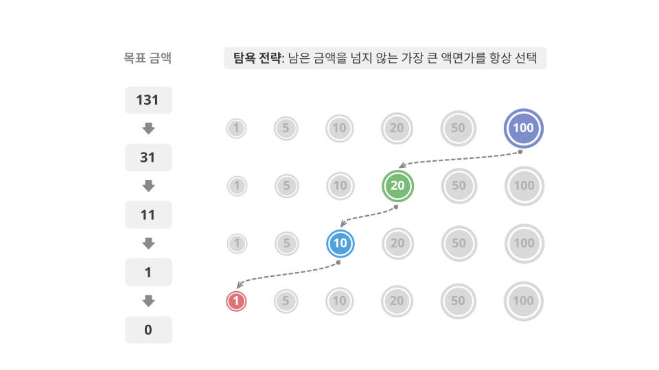
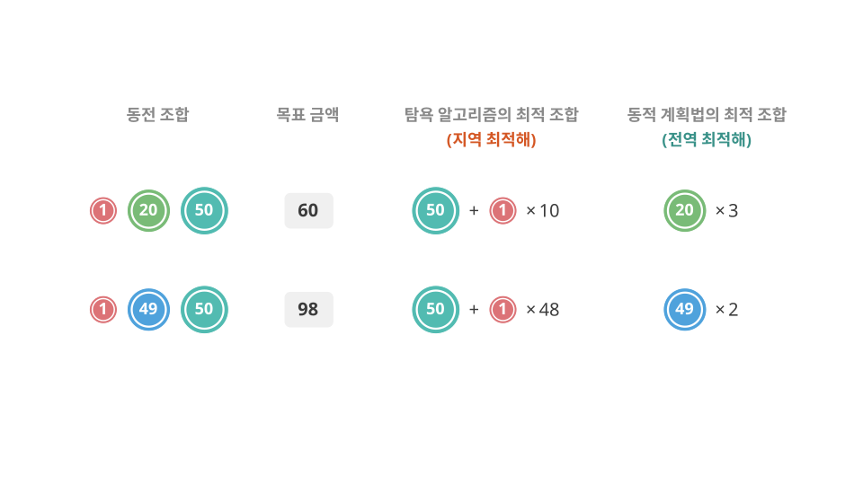

# 탐욕 알고리즘

<u>탐욕 알고리즘(greedy algorithm)</u>은 최적화 문제를 푸는 데 흔히 쓰인다. 기본 발상은 결정을 내릴 때마다 지금 가장 좋아 보이는 선택을 하는 것이다. 이렇게 지역적으로 최적인 결정을 쌓아 전역 최적해에 이르고자 한다. 탐욕 알고리즘은 간결하고 효율적이어서 다양한 실제 문제에 널리 쓰인다.

탐욕 알고리즘과 동적 계획법은 모두 최적화 문제를 풀 때 자주 사용한다. 둘 다 최적 부분 구조에 의존한다는 공통점이 있지만 작동 원리는 다르다.

- 동적 계획법은 이전 단계에서 가능한 모든 결정을 고려해 현재의 결정을 내리며, 앞에서 푼 부분 문제의 해로 현재 부분 문제의 해를 구성한다.
- 탐욕 알고리즘은 지난 결정을 되돌아보지 않고 앞으로 나아가며 탐욕 선택을 한다. 그때마다 문제의 범위를 좁혀 마침내 문제를 해결한다.

먼저 ‘거스름돈 만들기’ 예제로 탐욕 알고리즘의 작동 원리를 알아보자. ‘무한 배낭 문제’ 절에서 이미 다룬 문제이므로 익숙할 것이다.

!!! question

    동전 $n$종류가 주어지고 $i$번째 종류의 액면가는 $coins[i - 1]$이다. 목표 금액은 $amt$이고 각 종류의 동전을 여러 번 고를 수 있다. 목표 금액을 만드는 데 필요한 최소 동전 수를 구하라. 만들 수 없으면 $-1$을 반환한다.

아래 그림은 이 문제에 적용할 탐욕 전략을 보여 준다. 목표 금액이 주어지면 **남은 금액을 넘지 않으면서 그 금액에 가장 가까운 동전을 고른다**. 목표 금액을 모두 만들 때까지 이 단계를 반복한다.



코드로 구현하면 다음과 같다.

```src
[file]{coin_change_greedy}-[class]{}-[func]{coin_change_greedy}
```

‘정말 간결하네!’라는 감탄이 절로 나올지도 모른다. 탐욕 알고리즘은 단 열 줄 남짓한 코드로 거스름돈 만들기 문제를 푼다.

## 탐욕 알고리즘의 장점과 한계

**탐욕 알고리즘은 동작이 직관적이고 구현도 단순하며 대개 효율도 높다**. 위 코드에서 가장 작은 액면가를 $\min(coins)$라고 하면 탐욕 선택을 최대 $amt / \min(coins)$번 반복하므로 시간 복잡도는 $O(amt / \min(coins))$이다. 동적 계획법의 시간 복잡도인 $O(n \times amt)$보다 한 차수 작다.

그러나 **동전의 액면가 조합에 따라 탐욕 알고리즘이 최적해를 찾지 못할 수 있다**. 아래 그림에 두 가지 예가 있다.

- **최적해를 찾는 예 $coins = [1, 5, 10, 20, 50, 100]$**: 이 액면가 조합에서는 $amt$가 어떤 값이든 탐욕 알고리즘으로 최적해를 찾을 수 있다.
- **반례 $coins = [1, 20, 50]$**: $amt = 60$이라고 하자. 탐욕 알고리즘은 $50 + 1 \times 10$로 동전 $11$개를 쓰지만 동적 계획법은 최적해 $20 + 20 + 20$을 찾아 동전 $3$개만 쓴다.
- **반례 $coins = [1, 49, 50]$**: $amt = 98$이라고 하자. 탐욕 알고리즘은 $50 + 1 \times 48$로 동전 $49$개를 쓰지만 동적 계획법은 최적해 $49 + 49$을 찾아 동전 $2$개만 쓴다.



즉 거스름돈 만들기에서 탐욕 알고리즘은 전역 최적해를 보장하지 못하며, 때로는 최적해와 차이가 아주 큰 결과를 낸다. 이 문제에는 동적 계획법이 더 적합하다.

일반적으로 탐욕 알고리즘을 적용할 수 있는 경우는 다음 두 가지이다.

1. **최적해를 보장할 수 있는 경우**: 탐욕 알고리즘은 대개 백트래킹이나 동적 계획법보다 효율적이어서 가장 좋은 선택일 때가 많다.
2. **최적해에 가까운 해를 구할 수 있는 경우**: 이때도 탐욕 알고리즘을 사용할 수 있다. 많은 복잡한 문제에서는 전역 최적해를 찾기가 매우 어렵기 때문에 차선의 해라도 효율적으로 구할 수 있다면 좋은 결과이다.

## 탐욕 알고리즘의 특성

그렇다면 어떤 문제에 탐욕 알고리즘이 적합할까? 다시 말해 어떤 조건에서 탐욕 알고리즘이 최적해를 보장할까?

탐욕 알고리즘은 동적 계획법보다 적용 조건이 까다롭다. 주로 다음 두 가지 성질을 살펴본다.

- **탐욕 선택 속성**: 지역 최적 선택이 언제나 전역 최적해로 이어질 수 있어야 탐욕 알고리즘이 최적해를 보장한다.
- **최적 부분 구조**: 원래 문제의 최적해가 부분 문제의 최적해를 포함한다.

최적 부분 구조는 ‘동적 계획법’ 장에서 다루었으므로 여기서는 설명을 생략한다. 어떤 문제는 최적 부분 구조가 뚜렷하게 보이지 않아도 탐욕 알고리즘으로 풀 수 있다는 점을 기억하자.

여기서는 탐욕 선택 속성을 판별하는 방법을 중심으로 살펴본다. 정의는 간단해 보이지만 **많은 문제에서 탐욕 선택 속성을 증명하기는 쉽지 않다**.

거스름돈 만들기를 예로 들어 보자. 반례를 들어 탐욕 선택 속성이 성립하지 않음을 보이기는 쉬워도 그 속성이 성립함을 입증하기는 더 어렵다. **어떤 조건을 만족하는 액면가 조합을 탐욕 알고리즘으로 풀 수 있을까**? 직관이나 몇 가지 예에 기대어 모호한 답을 내놓기는 쉬워도 엄밀한 수학적 증명을 제시하기는 어렵다.

!!! quote

    한 논문에서는 주어진 액면가 조합에서 탐욕 알고리즘으로 모든 금액의 최적해를 구할 수 있는지 판별하는 시간 복잡도 $O(n^3)$의 알고리즘을 제시했다.

    Pearson, D. A polynomial-time algorithm for the change-making problem[J]. Operations Research Letters, 2005, 33(3): 231-234.

## 탐욕 알고리즘으로 문제를 푸는 단계

탐욕 문제의 풀이 과정은 대체로 다음 세 단계로 나눌 수 있다.

1. **문제 분석**: 상태의 정의, 최적화 목표, 제약 조건 등 문제의 특성을 정리하고 이해한다. 백트래킹과 동적 계획법에서도 거치는 단계이다.
2. **탐욕 전략 정하기**: 매 단계에서 어떻게 탐욕 선택을 할지 정한다. 이 전략으로 매번 문제의 크기를 줄여 결국 전체 문제를 해결할 수 있어야 한다.
3. **정당성 증명**: 일반적으로 문제가 탐욕 선택 속성과 최적 부분 구조를 가진다는 것을 보여야 한다. 이때 수학적 귀납법이나 귀류법 등의 증명 방법이 필요할 수 있다.

탐욕 전략을 정하는 일은 문제 풀이의 핵심이지만 실제로는 쉽지 않을 수 있다. 주된 이유는 다음과 같다.

- **문제에 따라 탐욕 전략이 크게 달라진다**. 전략이 비교적 분명해 조금 생각하고 몇 번 시도하는 것만으로 찾아낼 수 있는 문제도 많다. 반면 복잡한 문제에서는 전략이 잘 드러나지 않아 문제 풀이 경험과 알고리즘을 다루는 능력이 중요해진다.
- **어떤 탐욕 전략은 옳은 것처럼 보이기 쉽다**. 자신 있게 전략을 세우고 코드를 작성해 제출했는데 일부 테스트를 통과하지 못하는 일이 생길 수 있다. 전략이 일부 경우에만 맞기 때문이다. 앞에서 본 거스름돈 만들기가 대표적인 예이다.

정확성을 보장하려면 탐욕 전략을 수학적으로 엄밀하게 증명해야 한다. **이때 대개 귀류법이나 수학적 귀납법을 사용한다**.

하지만 정당성을 증명하는 일도 쉽지 않을 수 있다. 실마리가 보이지 않을 때는 흔히 테스트 사례에 맞춰 코드를 디버깅하면서 탐욕 전략을 조금씩 수정하고 검증한다.

## 대표적인 탐욕 알고리즘 문제

탐욕 알고리즘은 탐욕 선택 속성과 최적 부분 구조를 만족하는 최적화 문제에 자주 쓰인다. 대표적인 예는 다음과 같다.

- **거스름돈 만들기**: 특정 액면가 조합에서는 탐욕 알고리즘이 항상 최적해를 구한다.
- **구간 스케줄링**: 각 작업을 수행할 시간 구간이 정해져 있고 목표는 가능한 한 많은 작업을 완료하는 것이다. 매번 종료 시각이 가장 이른 작업을 선택하면 탐욕 알고리즘으로 최적해를 구할 수 있다.
- **분할 가능 배낭 문제**: 여러 물건과 무게 한도가 주어진다. 총무게가 한도를 넘지 않으면서 총가치가 최대가 되도록 물건을 고르는 것이 목표이다. 매번 무게 대비 가치(가치 / 무게)가 가장 높은 물건을 고르면 경우에 따라 탐욕 알고리즘으로 최적해를 구할 수 있다.
- **주식 매매 문제**: 과거 주가가 주어지고 여러 번 사고팔 수 있다. 단, 주식을 보유하고 있으면 팔기 전에는 다시 살 수 없다. 목표는 이익을 최대화하는 것이다.
- **허프먼 코딩**: 무손실 데이터 압축에 쓰이는 탐욕 알고리즘이다. 허프먼 트리를 만들 때 매번 출현 빈도가 가장 낮은 두 노드를 합친다. 이렇게 얻은 트리는 가중 경로 길이(인코딩 길이)가 최소이다.
- **다익스트라 알고리즘**: 모든 간선의 가중치가 음이 아닌 그래프에서 주어진 시작 정점으로부터 나머지 각 정점까지의 최단 경로를 구하는 탐욕 알고리즘이다.
