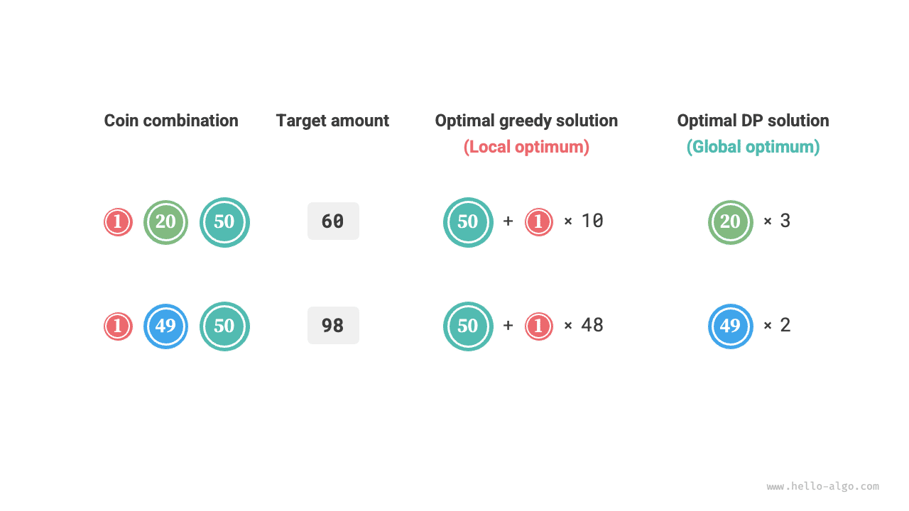

# 15.1 &nbsp; 탐욕 알고리즘

<u>탐욕 알고리즘(greedy algorithm)</u>은 최적화 문제를 푸는 대표적인 알고리즘이다. 매 결정 단계에서 현재 가장 좋아 보이는 선택, 즉 국소적으로 최적인 결정을 탐욕적으로 내려 전역 최적해를 얻으려는 것이 기본 아이디어다. 간결하고 효율적이어서 많은 실제 문제에 널리 쓰인다.

탐욕 알고리즘과 동적 계획법은 모두 최적화 문제에 자주 사용한다. 최적 부분 구조에 의존한다는 공통점 등이 있지만 작동 원리는 다르다.

- 동적 계획법은 이전 단계의 모든 결정을 바탕으로 현재 결정을 고려하고, 과거 부분 문제의 해로 현재 부분 문제의 해를 구성한다.
- 탐욕 알고리즘은 과거 결정을 고려하지 않고 계속 앞으로 나아가며 탐욕적으로 선택한다. 문제의 범위를 점차 줄여 해결될 때까지 진행한다.

먼저 '동전 교환' 예제로 탐욕 알고리즘의 원리를 알아보자. '무한 배낭 문제' 절에서 소개한 문제라 익숙할 것이다.

!!! question "문제"

    동전 $n$ 종류가 주어지며 $i$ 번째 동전의 액면가는 $coins[i - 1]$이고 목표 금액은 $amt$다. 각 종류의 동전을 반복해서 선택할 수 있을 때 목표 금액을 만드는 최소 동전 수를 구하라. 만들 수 없다면 $-1$을 반환하라.

이 문제에서 사용하는 탐욕 전략은 아래 그림(15-1)과 같다. 주어진 목표 금액에 대해 **그 금액을 넘지 않으면서 가장 가까운 액면가의 동전을 탐욕적으로 고르고**, 목표 금액을 만들 때까지 반복한다.

{ class="animation-figure" }

<p align="center"> 그림 15-1 &nbsp; 동전 교환의 탐욕 전략 </p>

구현 코드는 다음과 같다.

=== "Python"

    ```python title="coin_change_greedy.py"
    def coin_change_greedy(coins: list[int], amt: int) -> int:
        """동전 교환: 탐욕"""
        # coins 리스트가 정렬되어 있다고 가정한다
        i = len(coins) - 1
        count = 0
        # 남은 금액이 없을 때까지 탐욕적 선택을 반복한다
        while amt > 0:
            # 남은 금액보다 작으면서 가장 가까운 금액의 동전을 찾는다
            while i > 0 and coins[i] > amt:
                i -= 1
            # coins[i]를 선택한다
            amt -= coins[i]
            count += 1
        # 가능한 방법을 찾지 못하면 -1을 반환한다
        return count if amt == 0 else -1
    ```

=== "C++"

    ```cpp title="coin_change_greedy.cpp"
    /* 동전 교환: 탐욕 */
    int coinChangeGreedy(vector<int> &coins, int amt) {
        // coins 리스트가 정렬되어 있다고 가정한다
        int i = coins.size() - 1;
        int count = 0;
        // 남은 금액이 없을 때까지 탐욕적 선택을 반복한다
        while (amt > 0) {
            // 남은 금액보다 작으면서 가장 가까운 금액의 동전을 찾는다
            while (i > 0 && coins[i] > amt) {
                i--;
            }
            // coins[i]를 선택한다
            amt -= coins[i];
            count++;
        }
        // 가능한 방법을 찾지 못하면 -1을 반환한다
        return amt == 0 ? count : -1;
    }
    ```

=== "Java"

    ```java title="coin_change_greedy.java"
    /* 동전 교환: 탐욕 */
    int coinChangeGreedy(int[] coins, int amt) {
        // coins 리스트가 정렬되어 있다고 가정한다
        int i = coins.length - 1;
        int count = 0;
        // 남은 금액이 없을 때까지 탐욕적 선택을 반복한다
        while (amt > 0) {
            // 남은 금액보다 작으면서 가장 가까운 금액의 동전을 찾는다
            while (i > 0 && coins[i] > amt) {
                i--;
            }
            // coins[i]를 선택한다
            amt -= coins[i];
            count++;
        }
        // 가능한 방법을 찾지 못하면 -1을 반환한다
        return amt == 0 ? count : -1;
    }
    ```

=== "C#"

    ```csharp title="coin_change_greedy.cs"
    /* 동전 교환: 탐욕 */
    int CoinChangeGreedy(int[] coins, int amt) {
        // coins 리스트가 정렬되어 있다고 가정한다
        int i = coins.Length - 1;
        int count = 0;
        // 남은 금액이 없을 때까지 탐욕적 선택을 반복한다
        while (amt > 0) {
            // 남은 금액보다 작으면서 가장 가까운 금액의 동전을 찾는다
            while (i > 0 && coins[i] > amt) {
                i--;
            }
            // coins[i]를 선택한다
            amt -= coins[i];
            count++;
        }
        // 가능한 방법을 찾지 못하면 -1을 반환한다
        return amt == 0 ? count : -1;
    }
    ```

=== "Go"

    ```go title="coin_change_greedy.go"
    /* 동전 교환: 탐욕 */
    func coinChangeGreedy(coins []int, amt int) int {
        // coins 리스트가 정렬되어 있다고 가정한다
        i := len(coins) - 1
        count := 0
        // 남은 금액이 없을 때까지 탐욕적 선택을 반복한다
        for amt > 0 {
            // 남은 금액보다 작으면서 가장 가까운 금액의 동전을 찾는다
            for i > 0 && coins[i] > amt {
                i--
            }
            // coins[i]를 선택한다
            amt -= coins[i]
            count++
        }
        // 가능한 방법을 찾지 못하면 -1을 반환한다
        if amt != 0 {
            return -1
        }
        return count
    }
    ```

=== "Swift"

    ```swift title="coin_change_greedy.swift"
    /* 동전 교환: 탐욕 */
    func coinChangeGreedy(coins: [Int], amt: Int) -> Int {
        // coins 리스트가 정렬되어 있다고 가정한다
        var i = coins.count - 1
        var count = 0
        var amt = amt
        // 남은 금액이 없을 때까지 탐욕적 선택을 반복한다
        while amt > 0 {
            // 남은 금액보다 작으면서 가장 가까운 금액의 동전을 찾는다
            while i > 0 && coins[i] > amt {
                i -= 1
            }
            // coins[i]를 선택한다
            amt -= coins[i]
            count += 1
        }
        // 가능한 방법을 찾지 못하면 -1을 반환한다
        return amt == 0 ? count : -1
    }
    ```

=== "JS"

    ```javascript title="coin_change_greedy.js"
    /* 동전 교환: 탐욕 */
    function coinChangeGreedy(coins, amt) {
        // coins 배열이 정렬되어 있다고 가정한다
        let i = coins.length - 1;
        let count = 0;
        // 남은 금액이 없을 때까지 탐욕적 선택을 반복한다
        while (amt > 0) {
            // 남은 금액보다 작으면서 가장 가까운 금액의 동전을 찾는다
            while (i > 0 && coins[i] > amt) {
                i--;
            }
            // coins[i]를 선택한다
            amt -= coins[i];
            count++;
        }
        // 가능한 방법을 찾지 못하면 -1을 반환한다
        return amt === 0 ? count : -1;
    }
    ```

=== "TS"

    ```typescript title="coin_change_greedy.ts"
    /* 동전 교환: 탐욕 */
    function coinChangeGreedy(coins: number[], amt: number): number {
        // coins 배열이 정렬되어 있다고 가정한다
        let i = coins.length - 1;
        let count = 0;
        // 남은 금액이 없을 때까지 탐욕적 선택을 반복한다
        while (amt > 0) {
            // 남은 금액보다 작으면서 가장 가까운 금액의 동전을 찾는다
            while (i > 0 && coins[i] > amt) {
                i--;
            }
            // coins[i]를 선택한다
            amt -= coins[i];
            count++;
        }
        // 가능한 방법을 찾지 못하면 -1을 반환한다
        return amt === 0 ? count : -1;
    }
    ```

=== "Dart"

    ```dart title="coin_change_greedy.dart"
    /* 동전 교환: 탐욕 */
    int coinChangeGreedy(List<int> coins, int amt) {
      // coins 리스트가 정렬되어 있다고 가정한다
      int i = coins.length - 1;
      int count = 0;
      // 남은 금액이 없을 때까지 탐욕적 선택을 반복한다
      while (amt > 0) {
        // 남은 금액보다 작으면서 가장 가까운 금액의 동전을 찾는다
        while (i > 0 && coins[i] > amt) {
          i--;
        }
        // coins[i]를 선택한다
        amt -= coins[i];
        count++;
      }
      // 가능한 방법을 찾지 못하면 -1을 반환한다
      return amt == 0 ? count : -1;
    }
    ```

=== "Rust"

    ```rust title="coin_change_greedy.rs"
    /* 동전 교환: 탐욕 */
    fn coin_change_greedy(coins: &[i32], mut amt: i32) -> i32 {
        // coins 리스트가 정렬되어 있다고 가정한다
        let mut i = coins.len() - 1;
        let mut count = 0;
        // 남은 금액이 없을 때까지 탐욕적 선택을 반복한다
        while amt > 0 {
            // 남은 금액보다 작으면서 가장 가까운 금액의 동전을 찾는다
            while i > 0 && coins[i] > amt {
                i -= 1;
            }
            // coins[i]를 선택한다
            amt -= coins[i];
            count += 1;
        }
        // 가능한 방법을 찾지 못하면 -1을 반환한다
        if amt == 0 {
            count
        } else {
            -1
        }
    }
    ```

=== "C"

    ```c title="coin_change_greedy.c"
    /* 동전 교환: 탐욕 */
    int coinChangeGreedy(int *coins, int size, int amt) {
        // coins 리스트가 정렬되어 있다고 가정한다
        int i = size - 1;
        int count = 0;
        // 남은 금액이 없을 때까지 탐욕적 선택을 반복한다
        while (amt > 0) {
            // 남은 금액보다 작으면서 가장 가까운 금액의 동전을 찾는다
            while (i > 0 && coins[i] > amt) {
                i--;
            }
            // coins[i]를 선택한다
            amt -= coins[i];
            count++;
        }
        // 가능한 방법을 찾지 못하면 -1을 반환한다
        return amt == 0 ? count : -1;
    }
    ```

=== "Kotlin"

    ```kotlin title="coin_change_greedy.kt"
    /* 동전 교환: 탐욕 */
    fun coinChangeGreedy(coins: IntArray, amt: Int): Int {
        // coins 리스트가 정렬되어 있다고 가정한다
        var am = amt
        var i = coins.size - 1
        var count = 0
        // 남은 금액이 없을 때까지 탐욕적 선택을 반복한다
        while (am > 0) {
            // 남은 금액보다 작으면서 가장 가까운 금액의 동전을 찾는다
            while (i > 0 && coins[i] > am) {
                i--
            }
            // coins[i]를 선택한다
            am -= coins[i]
            count++
        }
        // 가능한 방법을 찾지 못하면 -1을 반환한다
        return if (am == 0) count else -1
    }
    ```

=== "Ruby"

    ```ruby title="coin_change_greedy.rb"
    ### 동전 교환: 탐욕 ###
    def coin_change_greedy(coins, amt)
      # coins 리스트가 정렬되어 있다고 가정한다
      i = coins.length - 1
      count = 0
      # 남은 금액이 없을 때까지 탐욕적 선택을 반복한다
      while amt > 0
        # 남은 금액보다 작으면서 가장 가까운 금액의 동전을 찾는다
        while i > 0 && coins[i] > amt
          i -= 1
        end
        # coins[i]를 선택한다
        amt -= coins[i]
        count += 1
      end
      # 가능한 방법을 찾지 못하면 -1을 반환한다
      amt == 0 ? count : -1
    end
    ```

??? pythontutor "코드 시각화"

    <div style="height: 549px; width: 100%;"><iframe class="pythontutor-iframe" title="코드 시각화" src="https://pythontutor.com/iframe-embed.html#code=def%20coin_change_greedy%28coins%3A%20list%5Bint%5D,%20amt%3A%20int%29%20-%3E%20int%3A%0A%20%20%20%20%22%22%22%EB%8F%99%EC%A0%84%20%EA%B5%90%ED%99%98%3A%20%ED%83%90%EC%9A%95%22%22%22%0A%20%20%20%20%23%20coins%20%EB%A6%AC%EC%8A%A4%ED%8A%B8%EA%B0%80%20%EC%A0%95%EB%A0%AC%EB%90%98%EC%96%B4%20%EC%9E%88%EB%8B%A4%EA%B3%A0%20%EA%B0%80%EC%A0%95%ED%95%9C%EB%8B%A4%0A%20%20%20%20i%20%3D%20len%28coins%29%20-%201%0A%20%20%20%20count%20%3D%200%0A%20%20%20%20%23%20%EB%82%A8%EC%9D%80%20%EA%B8%88%EC%95%A1%EC%9D%B4%20%EC%97%86%EC%9D%84%20%EB%95%8C%EA%B9%8C%EC%A7%80%20%ED%83%90%EC%9A%95%EC%A0%81%20%EC%84%A0%ED%83%9D%EC%9D%84%20%EB%B0%98%EB%B3%B5%ED%95%9C%EB%8B%A4%0A%20%20%20%20while%20amt%20%3E%200%3A%0A%20%20%20%20%20%20%20%20%23%20%EB%82%A8%EC%9D%80%20%EA%B8%88%EC%95%A1%EB%B3%B4%EB%8B%A4%20%EC%9E%91%EC%9C%BC%EB%A9%B4%EC%84%9C%20%EA%B0%80%EC%9E%A5%20%EA%B0%80%EA%B9%8C%EC%9A%B4%20%EA%B8%88%EC%95%A1%EC%9D%98%20%EB%8F%99%EC%A0%84%EC%9D%84%20%EC%B0%BE%EB%8A%94%EB%8B%A4%0A%20%20%20%20%20%20%20%20while%20i%20%3E%200%20and%20coins%5Bi%5D%20%3E%20amt%3A%0A%20%20%20%20%20%20%20%20%20%20%20%20i%20-%3D%201%0A%20%20%20%20%20%20%20%20%23%20coins%5Bi%5D%EB%A5%BC%20%EC%84%A0%ED%83%9D%ED%95%9C%EB%8B%A4%0A%20%20%20%20%20%20%20%20amt%20-%3D%20coins%5Bi%5D%0A%20%20%20%20%20%20%20%20count%20%2B%3D%201%0A%20%20%20%20%23%20%EA%B0%80%EB%8A%A5%ED%95%9C%20%EB%B0%A9%EB%B2%95%EC%9D%84%20%EC%B0%BE%EC%A7%80%20%EB%AA%BB%ED%95%98%EB%A9%B4%20-1%EC%9D%84%20%EB%B0%98%ED%99%98%ED%95%9C%EB%8B%A4%0A%20%20%20%20return%20count%20if%20amt%20%3D%3D%200%20else%20-1%0A%0A%0A%22%22%22%EC%8B%A4%ED%96%89%20%EC%BD%94%EB%93%9C%22%22%22%0Aif%20__name__%20%3D%3D%20%22__main__%22%3A%0A%20%20%20%20%23%20%ED%83%90%EC%9A%95%3A%20%EC%A0%84%EC%97%AD%20%EC%B5%9C%EC%A0%81%ED%95%B4%EB%A5%BC%20%EC%B0%BE%EB%8A%94%20%EA%B2%83%EC%9D%B4%20%EB%B3%B4%EC%9E%A5%EB%90%9C%EB%8B%A4%0A%20%20%20%20coins%20%3D%20%5B1,%205,%2010,%2020,%2050,%20100%5D%0A%20%20%20%20amt%20%3D%20186%0A%20%20%20%20res%20%3D%20coin_change_greedy%28coins,%20amt%29%0A%20%20%20%20print%28f%22%5Cncoins%20%3D%20%7Bcoins%7D,%20amt%20%3D%20%7Bamt%7D%22%29%0A%20%20%20%20print%28f%22%EB%AA%A9%ED%91%9C%20%EA%B8%88%EC%95%A1%20%7Bamt%7D%EC%97%90%20%ED%95%84%EC%9A%94%ED%95%9C%20%EC%B5%9C%EC%86%8C%20%EB%8F%99%EC%A0%84%20%EA%B0%9C%EC%88%98%EB%8A%94%20%7Bres%7D%EA%B0%9C%EC%9D%B4%EB%8B%A4%22%29%0A%0A%20%20%20%20%23%20%ED%83%90%EC%9A%95%3A%20%EC%A0%84%EC%97%AD%20%EC%B5%9C%EC%A0%81%ED%95%B4%EB%A5%BC%20%EC%B0%BE%EB%8A%94%20%EA%B2%83%EC%9D%B4%20%EB%B3%B4%EC%9E%A5%EB%90%98%EC%A7%80%20%EC%95%8A%EB%8A%94%EB%8B%A4%0A%20%20%20%20coins%20%3D%20%5B1,%2020,%2050%5D%0A%20%20%20%20amt%20%3D%2060%0A%20%20%20%20res%20%3D%20coin_change_greedy%28coins,%20amt%29%0A%20%20%20%20print%28f%22%5Cncoins%20%3D%20%7Bcoins%7D,%20amt%20%3D%20%7Bamt%7D%22%29%0A%20%20%20%20print%28f%22%EB%AA%A9%ED%91%9C%20%EA%B8%88%EC%95%A1%20%7Bamt%7D%EC%97%90%20%ED%95%84%EC%9A%94%ED%95%9C%20%EC%B5%9C%EC%86%8C%20%EB%8F%99%EC%A0%84%20%EA%B0%9C%EC%88%98%EB%8A%94%20%7Bres%7D%EA%B0%9C%EC%9D%B4%EB%8B%A4%22%29%0A%20%20%20%20print%28f%22%EC%8B%A4%EC%A0%9C%EB%A1%9C%20%ED%95%84%EC%9A%94%ED%95%9C%20%EC%B5%9C%EC%86%8C%20%EA%B0%9C%EC%88%98%EB%8A%94%203%EA%B0%9C%EC%9D%B4%EB%A9%B0,%2020%20%2B%2020%20%2B%2020%EC%9D%B4%EB%8B%A4%22%29&codeDivHeight=472&codeDivWidth=350&cumulative=false&curInstr=5&heapPrimitives=nevernest&origin=opt-frontend.js&py=311&rawInputLstJSON=%5B%5D&textReferences=false"> </iframe></div>
    <div style="margin-top: 5px;"><a href="https://pythontutor.com/iframe-embed.html#code=def%20coin_change_greedy%28coins%3A%20list%5Bint%5D,%20amt%3A%20int%29%20-%3E%20int%3A%0A%20%20%20%20%22%22%22%EB%8F%99%EC%A0%84%20%EA%B5%90%ED%99%98%3A%20%ED%83%90%EC%9A%95%22%22%22%0A%20%20%20%20%23%20coins%20%EB%A6%AC%EC%8A%A4%ED%8A%B8%EA%B0%80%20%EC%A0%95%EB%A0%AC%EB%90%98%EC%96%B4%20%EC%9E%88%EB%8B%A4%EA%B3%A0%20%EA%B0%80%EC%A0%95%ED%95%9C%EB%8B%A4%0A%20%20%20%20i%20%3D%20len%28coins%29%20-%201%0A%20%20%20%20count%20%3D%200%0A%20%20%20%20%23%20%EB%82%A8%EC%9D%80%20%EA%B8%88%EC%95%A1%EC%9D%B4%20%EC%97%86%EC%9D%84%20%EB%95%8C%EA%B9%8C%EC%A7%80%20%ED%83%90%EC%9A%95%EC%A0%81%20%EC%84%A0%ED%83%9D%EC%9D%84%20%EB%B0%98%EB%B3%B5%ED%95%9C%EB%8B%A4%0A%20%20%20%20while%20amt%20%3E%200%3A%0A%20%20%20%20%20%20%20%20%23%20%EB%82%A8%EC%9D%80%20%EA%B8%88%EC%95%A1%EB%B3%B4%EB%8B%A4%20%EC%9E%91%EC%9C%BC%EB%A9%B4%EC%84%9C%20%EA%B0%80%EC%9E%A5%20%EA%B0%80%EA%B9%8C%EC%9A%B4%20%EA%B8%88%EC%95%A1%EC%9D%98%20%EB%8F%99%EC%A0%84%EC%9D%84%20%EC%B0%BE%EB%8A%94%EB%8B%A4%0A%20%20%20%20%20%20%20%20while%20i%20%3E%200%20and%20coins%5Bi%5D%20%3E%20amt%3A%0A%20%20%20%20%20%20%20%20%20%20%20%20i%20-%3D%201%0A%20%20%20%20%20%20%20%20%23%20coins%5Bi%5D%EB%A5%BC%20%EC%84%A0%ED%83%9D%ED%95%9C%EB%8B%A4%0A%20%20%20%20%20%20%20%20amt%20-%3D%20coins%5Bi%5D%0A%20%20%20%20%20%20%20%20count%20%2B%3D%201%0A%20%20%20%20%23%20%EA%B0%80%EB%8A%A5%ED%95%9C%20%EB%B0%A9%EB%B2%95%EC%9D%84%20%EC%B0%BE%EC%A7%80%20%EB%AA%BB%ED%95%98%EB%A9%B4%20-1%EC%9D%84%20%EB%B0%98%ED%99%98%ED%95%9C%EB%8B%A4%0A%20%20%20%20return%20count%20if%20amt%20%3D%3D%200%20else%20-1%0A%0A%0A%22%22%22%EC%8B%A4%ED%96%89%20%EC%BD%94%EB%93%9C%22%22%22%0Aif%20__name__%20%3D%3D%20%22__main__%22%3A%0A%20%20%20%20%23%20%ED%83%90%EC%9A%95%3A%20%EC%A0%84%EC%97%AD%20%EC%B5%9C%EC%A0%81%ED%95%B4%EB%A5%BC%20%EC%B0%BE%EB%8A%94%20%EA%B2%83%EC%9D%B4%20%EB%B3%B4%EC%9E%A5%EB%90%9C%EB%8B%A4%0A%20%20%20%20coins%20%3D%20%5B1,%205,%2010,%2020,%2050,%20100%5D%0A%20%20%20%20amt%20%3D%20186%0A%20%20%20%20res%20%3D%20coin_change_greedy%28coins,%20amt%29%0A%20%20%20%20print%28f%22%5Cncoins%20%3D%20%7Bcoins%7D,%20amt%20%3D%20%7Bamt%7D%22%29%0A%20%20%20%20print%28f%22%EB%AA%A9%ED%91%9C%20%EA%B8%88%EC%95%A1%20%7Bamt%7D%EC%97%90%20%ED%95%84%EC%9A%94%ED%95%9C%20%EC%B5%9C%EC%86%8C%20%EB%8F%99%EC%A0%84%20%EA%B0%9C%EC%88%98%EB%8A%94%20%7Bres%7D%EA%B0%9C%EC%9D%B4%EB%8B%A4%22%29%0A%0A%20%20%20%20%23%20%ED%83%90%EC%9A%95%3A%20%EC%A0%84%EC%97%AD%20%EC%B5%9C%EC%A0%81%ED%95%B4%EB%A5%BC%20%EC%B0%BE%EB%8A%94%20%EA%B2%83%EC%9D%B4%20%EB%B3%B4%EC%9E%A5%EB%90%98%EC%A7%80%20%EC%95%8A%EB%8A%94%EB%8B%A4%0A%20%20%20%20coins%20%3D%20%5B1,%2020,%2050%5D%0A%20%20%20%20amt%20%3D%2060%0A%20%20%20%20res%20%3D%20coin_change_greedy%28coins,%20amt%29%0A%20%20%20%20print%28f%22%5Cncoins%20%3D%20%7Bcoins%7D,%20amt%20%3D%20%7Bamt%7D%22%29%0A%20%20%20%20print%28f%22%EB%AA%A9%ED%91%9C%20%EA%B8%88%EC%95%A1%20%7Bamt%7D%EC%97%90%20%ED%95%84%EC%9A%94%ED%95%9C%20%EC%B5%9C%EC%86%8C%20%EB%8F%99%EC%A0%84%20%EA%B0%9C%EC%88%98%EB%8A%94%20%7Bres%7D%EA%B0%9C%EC%9D%B4%EB%8B%A4%22%29%0A%20%20%20%20print%28f%22%EC%8B%A4%EC%A0%9C%EB%A1%9C%20%ED%95%84%EC%9A%94%ED%95%9C%20%EC%B5%9C%EC%86%8C%20%EA%B0%9C%EC%88%98%EB%8A%94%203%EA%B0%9C%EC%9D%B4%EB%A9%B0,%2020%20%2B%2020%20%2B%2020%EC%9D%B4%EB%8B%A4%22%29&codeDivHeight=800&codeDivWidth=600&cumulative=false&curInstr=5&heapPrimitives=nevernest&origin=opt-frontend.js&py=311&rawInputLstJSON=%5B%5D&textReferences=false" target="_blank" rel="noopener noreferrer">전체 화면 ></a></div>

'정말 간결하다!'라는 감탄이 나올 만하다. 탐욕 알고리즘은 약 열 줄의 코드만으로 동전 교환 문제를 해결했다.

## 15.1.1 &nbsp; 탐욕 알고리즘의 장점과 한계

**탐욕 알고리즘은 연산이 직접적이고 구현이 간단할 뿐 아니라 보통 효율도 매우 높다**. 위 코드에서 최소 액면가를 $\min(coins)$라고 하면 탐욕적 선택은 최대 $amt / \min(coins)$ 번 반복하므로 시간 복잡도는 $O(amt / \min(coins))$이다. 동적 계획법의 $O(n \times amt)$보다 한 차수 낮다.

하지만 **일부 동전 액면가 조합에서는 최적해를 찾지 못한다**. 아래 그림(15-2)은 두 예를 보여 준다.

- **성립 예 $coins = [1, 5, 10, 20, 50, 100]$**: 이 동전 조합에서는 어떤 $amt$에 대해서도 탐욕 알고리즘이 최적해를 찾는다.
- **반례 $coins = [1, 20, 50]$**: $amt = 60$이면 탐욕 알고리즘은 $50 + 1 \times 10$으로 동전 $11$ 개를 고른다. 하지만 동적 계획법은 $20 + 20 + 20$이라는 최적해를 찾아 $3$ 개만 사용한다.
- **반례 $coins = [1, 49, 50]$**: $amt = 98$이면 탐욕 알고리즘은 $50 + 1 \times 48$로 동전 $49$ 개를 고른다. 하지만 동적 계획법은 $49 + 49$라는 최적해를 찾아 $2$ 개만 사용한다.

{ class="animation-figure" }

<p align="center"> 그림 15-2 &nbsp; 탐욕 알고리즘이 최적해를 찾지 못하는 예 </p>

즉, 동전 교환에서 탐욕 알고리즘은 전역 최적해를 보장하지 못하고 매우 나쁜 해를 찾을 수도 있다. 이 문제는 동적 계획법으로 푸는 편이 더 적합하다.

일반적으로 탐욕 알고리즘을 적용하는 상황은 다음 두 가지다.

1. **최적해를 보장할 수 있다**: 보통 백트래킹이나 동적 계획법보다 효율적이므로 이런 경우에는 탐욕 알고리즘이 가장 좋은 선택인 경우가 많다.
2. **최적해에 가까운 해를 찾을 수 있다**: 이 경우에도 탐욕 알고리즘을 쓸 수 있다. 복잡한 문제에서는 전역 최적해를 찾기 매우 어려우므로, 효율적으로 차선의 해를 찾는 것만으로도 유용하다.

## 15.1.2 &nbsp; 탐욕 알고리즘의 특성

그렇다면 어떤 문제가 탐욕 알고리즘에 적합할까? 다시 말해 어떤 경우에 최적해를 보장할 수 있을까?

탐욕 알고리즘은 동적 계획법보다 적용 조건이 엄격하며, 주로 다음 두 성질에 주목한다.

- **탐욕적 선택 속성**: 국소 최적 선택이 항상 전역 최적해로 이어져야만 탐욕 알고리즘이 최적해를 보장할 수 있다.
- **최적 부분 구조**: 원래 문제의 최적해가 부분 문제의 최적해를 포함한다.

최적 부분 구조는 '동적 계획법' 장에서 설명했으므로 반복하지 않는다. 일부 문제는 최적 부분 구조가 뚜렷하지 않아도 탐욕 알고리즘으로 해결할 수 있다는 점을 알아 두자.

여기서는 탐욕적 선택 속성을 판단하는 방법을 주로 살펴본다. 설명은 간단해 보이지만 **많은 문제에서 이 속성을 증명하기는 쉽지 않다**.

예를 들어 동전 교환에서는 반례로 탐욕적 선택 속성을 부정하기는 쉽지만 증명하기는 어렵다. **어떤 조건을 만족하는 동전 조합을 탐욕 알고리즘으로 풀 수 있는가**라는 질문에는 직관이나 사례를 바탕으로 애매한 답을 내놓기 쉽고, 엄밀한 수학적 증명을 제시하기는 어렵다.

!!! quote "참고 문헌"

    어떤 동전 조합에 대해 탐욕 알고리즘이 모든 금액의 최적해를 찾을 수 있는지 판단하는 $O(n^3)$ 알고리즘을 제시한 논문이 있다.

    Pearson, D. A polynomial-time algorithm for the change-making problem[J]. Operations Research Letters, 2005, 33(3): 231-234.

## 15.1.3 &nbsp; 탐욕 알고리즘의 문제 해결 단계

탐욕 문제의 풀이 과정은 대체로 다음 세 단계다.

1. **문제 분석**: 상태 정의, 최적화 목표, 제약 조건 등 문제의 특성을 정리하고 이해한다. 백트래킹과 동적 계획법에서도 필요한 단계다.
2. **탐욕 전략 결정**: 매 단계에서 어떻게 탐욕적으로 선택할지 정한다. 각 단계에서 문제 크기를 줄여 최종적으로 전체 문제를 해결할 수 있어야 한다.
3. **정확성 증명**: 보통 탐욕적 선택 속성과 최적 부분 구조를 증명해야 한다. 귀납법이나 귀류법 같은 수학적 증명이 필요할 수 있다.

탐욕 전략을 정하는 것이 핵심 단계지만, 다음 이유로 쉽지 않을 수 있다.

- **문제마다 탐욕 전략이 크게 다르다**. 많은 문제는 전략이 비교적 명확하여 대략적인 생각과 시도만으로 찾을 수 있다. 반면 복잡한 문제에서는 전략이 잘 드러나지 않아 문제 풀이 경험과 알고리즘 역량이 크게 요구된다.
- **일부 탐욕 전략은 그럴듯해 보이지만 함정이 있다**. 자신 있게 전략을 설계하고 코드를 작성해 제출해도 일부 테스트를 통과하지 못할 수 있다. 전략이 '부분적으로만 옳기' 때문이다. 앞에서 본 동전 교환이 대표적인 사례다.

정확성을 보장하려면 탐욕 전략을 엄밀히 증명해야 하며, **보통 귀류법이나 수학적 귀납법을 사용한다**.

하지만 정확성 증명 자체도 쉽지 않을 수 있다. 실마리가 없으면 보통 테스트 사례로 코드를 디버깅하면서 탐욕 전략을 조금씩 수정하고 검증한다.

## 15.1.4 &nbsp; 대표적인 탐욕 알고리즘 문제

탐욕 알고리즘은 탐욕적 선택 속성과 최적 부분 구조를 만족하는 최적화 문제에 자주 사용한다. 대표적인 예는 다음과 같다.

- **동전 거스름돈 문제**: 일부 동전 조합에서는 탐욕 알고리즘이 항상 최적해를 얻는다.
- **구간 스케줄링 문제**: 각 작업이 일정 시간 구간에 걸쳐 진행될 때 가능한 한 많은 작업을 완료하는 것이 목표다. 매번 가장 일찍 끝나는 작업을 고르면 최적해를 얻을 수 있다.
- **분할 가능한 배낭 문제**: 물건들과 적재 용량이 주어졌을 때 총무게가 용량을 넘지 않으면서 총가치가 최대가 되도록 물건을 고른다. 매번 무게 대비 가치의 비율(가치 / 무게)이 가장 높은 물건을 고르면 일부 경우에 최적해를 얻을 수 있다.
- **주식 매매 문제**: 주가의 과거 기록이 주어졌을 때 여러 번 매매하여 최대 이익을 구한다. 단, 이미 주식을 보유하고 있으면 팔기 전에는 다시 살 수 없다.
- **허프먼 코딩**: 무손실 데이터 압축에 쓰이는 탐욕 알고리즘이다. 매번 빈도가 가장 낮은 두 노드를 합쳐 허프먼 트리를 만들면, 최종 트리의 가중 경로 길이(부호 길이)가 최소가 된다.
- **Dijkstra 알고리즘**: 모든 간선 가중치가 음이 아닌 그래프에서 주어진 시작 정점부터 나머지 정점까지의 최단 경로를 구하는 탐욕 알고리즘이다.
