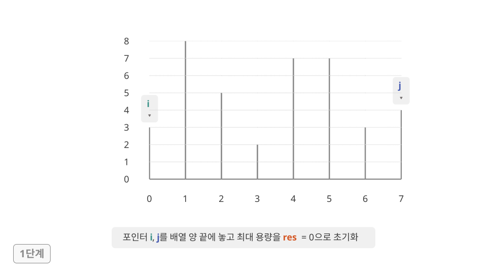
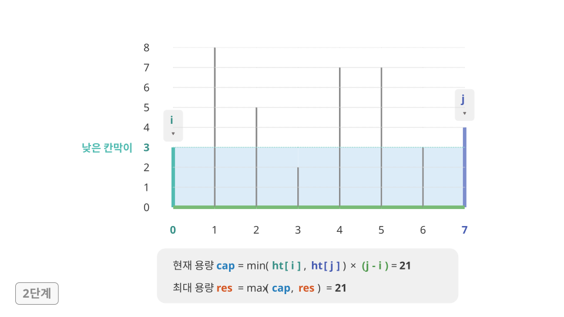
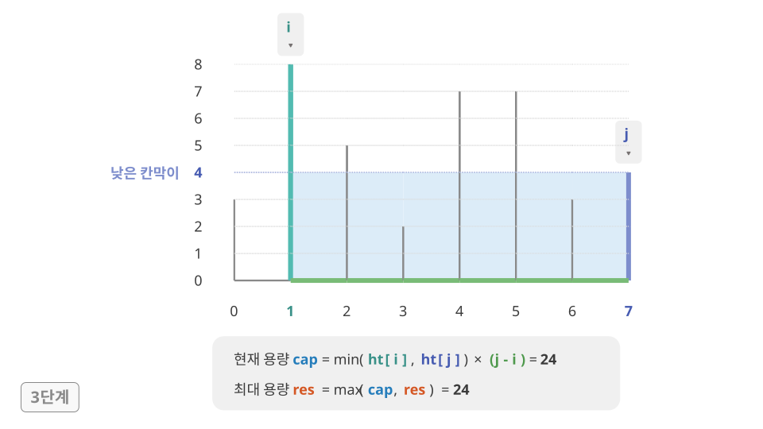
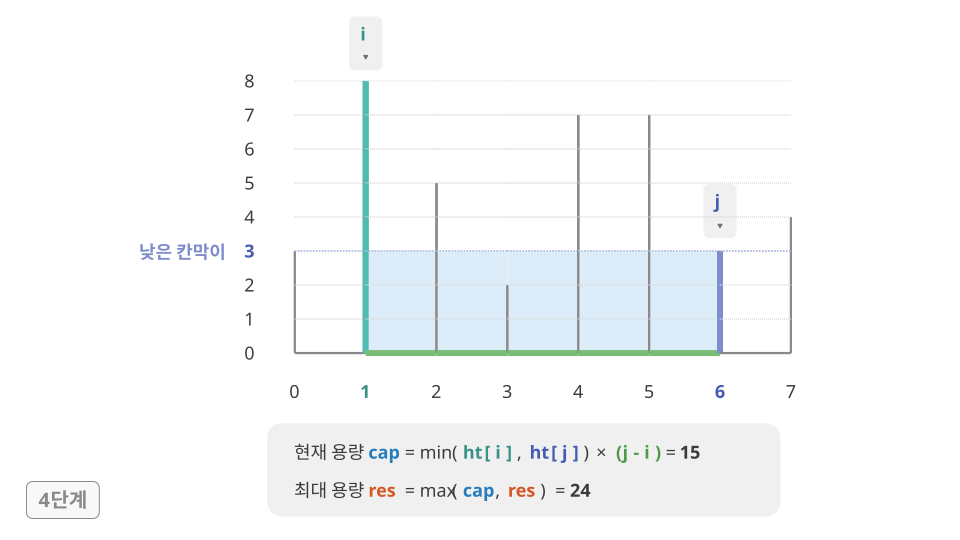
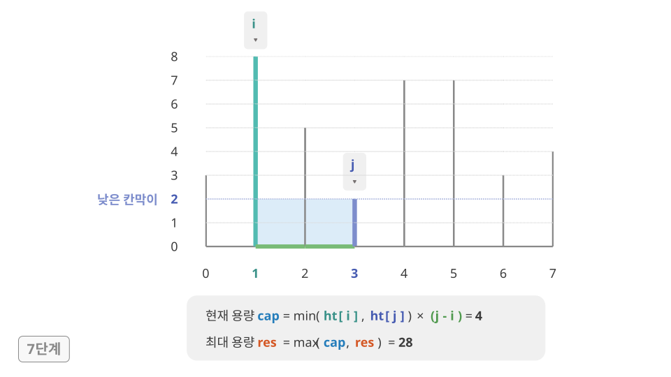

# 최대 용량 문제

!!! question

    배열 $ht$가 입력으로 주어지고 각 원소는 수직 칸막이 하나의 높이를 나타낸다. 배열에서 임의의 칸막이 두 개를 고르면 두 칸막이와 그 사이의 공간이 하나의 용기를 이룬다.
    
    용기의 용량은 높이와 너비를 곱한 값(넓이)이다. 높이는 두 칸막이 중 낮은 쪽이 결정하고 너비는 두 칸막이의 배열 인덱스 차이이다.
    
    배열에서 용량이 가장 큰 용기를 이루는 칸막이 두 개를 골라 그 최대 용량을 반환하라. 아래 그림은 한 가지 예이다.


임의의 칸막이 두 개가 용기를 이루므로 **이 문제의 상태는 두 칸막이의 인덱스이며 $[i, j]$로 나타낸다**.

용량은 높이와 너비의 곱이다. 높이는 낮은 칸막이가 결정하고 너비는 두 칸막이의 배열 인덱스 차이이다. 용량을 $cap[i, j]$라고 하면 다음 식을 얻는다.

$$
cap[i, j] = \min(ht[i], ht[j]) \times (j - i)
$$

배열 길이가 $n$이면 두 칸막이의 조합 수(전체 상태 수)는 $C_n^2 = \frac{n(n - 1)}{2}$이다. 가장 직접적인 방법은 **모든 상태를 빠짐없이 조사해** 최대 용량을 구하는 것이다. 시간 복잡도는 $O(n^2)$이다.

### 탐욕 전략 정하기

이 문제는 더 효율적으로 풀 수 있다. 아래 그림처럼 인덱스가 $i < j$이고 높이가 $ht[i] < ht[j]$인 상태 $[i, j]$를 하나 고르자. 즉 $i$는 낮은 쪽이고 $j$는 높은 쪽이다.


아래 그림처럼 **높은 쪽 $j$를 낮은 쪽 $i$ 쪽으로 옮기면 용량은 반드시 줄어든다**.

높은 쪽 $j$를 옮기면 너비 $j-i$가 반드시 줄어든다. 높이는 낮은 쪽이 결정하므로 그대로이거나($i$가 여전히 낮은 경우) 더 낮아질 수밖에 없다(이동한 $j$가 낮은 쪽이 된 경우).


반대로 생각하면 **낮은 쪽 $i$를 안으로 옮겨야만 용량이 커질 가능성이 있다**. 너비는 반드시 줄어들지만 **높이는 더 높아질 수 있기 때문이다**(옮긴 쪽 $i$에서 더 높은 칸막이를 만날 수 있다). 아래 그림에서는 낮은 쪽을 옮긴 뒤 넓이가 커졌다.


이로부터 다음 탐욕 전략을 얻는다. 두 포인터를 용기의 양 끝에 놓고, 두 포인터가 만날 때까지 매번 낮은 칸막이 쪽 포인터를 안으로 옮긴다.

아래 그림은 탐욕 전략을 실행하는 과정을 보여 준다.

1. 초기 상태에서는 포인터 $i$와 $j$를 배열의 양 끝에 놓는다.
2. 현재 상태의 용량 $cap[i, j]$를 계산하고 최대 용량을 갱신한다.
3. 칸막이 $i$와 $j$의 높이를 비교해 낮은 쪽을 안으로 한 칸 옮긴다.
4. `2.` 단계와 `3.` 단계를 반복하다가 $i$와 $j$가 만나면 종료한다.

=== "<1>"
    

=== "<2>"
    

=== "<3>"
    

=== "<4>"
    

=== "<5>"
    

=== "<6>"
    

=== "<7>"
    

=== "<8>"
    

=== "<9>"
    

### 코드 구현

반복문은 최대 $n$번 실행되므로 **시간 복잡도는 $O(n)$이다**.

변수 $i$, $j$, $res$가 사용하는 추가 공간은 상수 크기이므로 **공간 복잡도는 $O(1)$이다**.

```src
[file]{max_capacity}-[class]{}-[func]{max_capacity}
```

### 정당성 증명

탐욕법이 완전 탐색보다 빠른 이유는 매번 탐욕 선택을 할 때 일부 상태를 ‘건너뛰기’ 때문이다.

예를 들어 상태 $cap[i, j]$에서 $i$가 낮은 쪽이고 $j$가 높은 쪽이라고 하자. 탐욕 전략에 따라 낮은 쪽 $i$를 안으로 한 칸 옮기면 아래 그림의 상태들을 ‘건너뛰게’ 된다. **이후에는 이 상태들의 용량을 확인할 수 없다**.

$$
cap[i, i+1], cap[i, i+2], \dots, cap[i, j-2], cap[i, j-1]
$$


자세히 보면 **건너뛴 상태는 모두 높은 쪽 $j$를 안으로 옮겨 얻는 상태이다**. 앞에서 높은 쪽을 안으로 옮기면 용량이 반드시 줄어든다는 것을 증명했다. 따라서 건너뛴 상태는 어느 것도 최적해일 수 없고, **건너뛰어도 최적해를 놓치지 않는다**.

이 분석으로 낮은 쪽을 옮기는 연산이 ‘안전’하고 탐욕 전략이 타당하다는 것을 알 수 있다.
